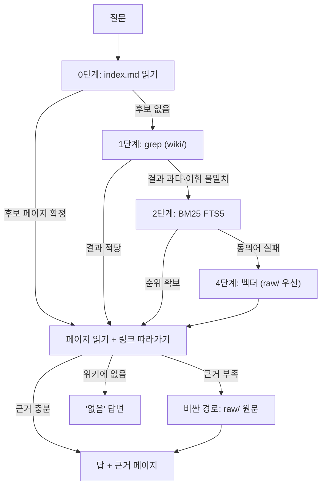

# 7장. 검색 계층 — `index.md`에서 BM25, 벡터까지

같은 24개 질문이었다. 88개 항목짜리 위키를 상대로, LLM이 페이지를 하나하나 읽고 직접 고르게 하면 질문당 69.1초가 걸렸다. BM25는 0.47밀리초였다. 그런데 정확도 1위는 69초 쪽이었다. Taktile이라는 회사가 2026년 7월에 공개한 자기 보고 벤치마크의 결과다 — 통제군 없는 사내 실측이라는 점은 미리 적어 두자. 그들의 결론은 한 줄이었다. "BM25 is the pragmatic middle."

이 숫자가 말하는 것은 "BM25를 써라"가 아니다. 검색에는 **정확도와 비용과 지연이 서로 다른 축**으로 있고, 어느 축을 얼마나 내줄지는 위키의 크기와 질문의 종류에 달렸다는 것이다. 앞 장에서 우리는 데스크의 스키마를 완성했다. 스키마는 데스크에게 "위키가 이렇게 생겼고, 이런 규칙으로 읽어라"라고 말해 준다. 그런데 정작 "어느 페이지를 어떻게 찾아 읽을 것인가"는 스키마 한 줄로 끝나지 않는다. 페이지원의 위키는 지금 소스 60건이고 여섯 달 뒤에는 300건, 페이지로는 수백 장이 된다. 오늘 잘 되던 검색이 그때도 잘 될까? 이 장은 그 질문에 규모별로 답한다.

### 한 번의 top-k가 왜 사내 Q&A에서 틀리는가

데스크가 "타 업종 확장 지금 어떻게 됐어?"라는 질문을 받았다고 해보자. 흔한 RAG라면 질문을 벡터로 바꿔 가장 가까운 청크 다섯 개를 가져오고, 그것을 모델에게 넘겨 답을 쓰게 한다. 검색은 한 번이다. 그런데 이 질문의 답은 한 군데에 없다. 2026년 6월의 "추진" 결정 페이지가 있고, 8월의 "보류" 결정 페이지가 있고, 두 페이지는 `superseded_by`로 이어져 있다. 첫 검색이 6월 페이지를 물고 오면 데스크는 "추진 중"이라고 답한다. 틀린 답이지만 근거는 있다. 뒷맛이 찜찜한 종류의 오답이다.

왜 그럴까? IRCoT(Trivedi 외 2022, arXiv 2212.10509, ACL 2023)가 이 문제를 한 문장으로 정리했다. "what to retrieve depends on what has already been derived, which in turn may depend on what was previously retrieved." 무엇을 찾아야 하는지는 지금까지 알아낸 것에 달려 있고, 지금까지 알아낸 것은 앞서 찾은 것에 달려 있다. 6월 페이지를 읽어야 비로소 "이게 뒤집혔는지" 확인할 필요가 생기고, 그제야 8월 페이지를 찾을 수 있다. 검색과 추론을 번갈아 돌리는 이 방식이 GPT-3 기준으로 검색 성능을 최대 21점, 다운스트림 QA를 최대 15점 올렸다.

이 루프의 원형은 더 거슬러 올라간다. ReAct(Yao 외 2022, arXiv 2210.03629, ICLR 2023)는 모델이 생각(Thought)과 행동(Action)을 번갈아 하며 "a simple Wikipedia API"를 호출하게 했고, 그것만으로 사고 사슬의 환각과 오류 전파를 줄였다. 여기서 "Wikipedia API"를 "사내 위키 파일 시스템"으로 바꿔 보자. `grep`으로 후보를 찾고, `read`로 한 페이지를 읽고, 그 페이지의 링크를 따라 다시 `read`하는 것 — 그게 데스크의 질의 루프다. Karpathy의 gist가 말한 "reads the index first to find relevant pages, then drills into them"은 ReAct를 파일 시스템 위에 수동으로 구현한 것에 가깝다.

국내 사례도 같은 방향으로 움직였다. 우아한형제들의 사내 데이터 분석 에이전트 '물어보새'는 처음에 고정 워크플로로 만들어졌는데, 그 구조가 "개발자가 설계한 순서에만 의존했기 때문에 새로운 질문이 등장할 때마다 코드를 수정해야 하는 비효율적이고 유지보수 불가능한 구조로 이어졌습니다"라고 2025년 10월 글에서 밝혔다. 그래서 ReAct 에이전트로 전환했다. 검색 계층을 고를 때 우리가 고르는 것은 "어떤 색인을 쓰느냐"이고, 그 색인을 몇 번 어떻게 호출하느냐는 루프가 정한다. 좋은 색인 하나보다 적당한 색인을 여러 번 부르는 루프가 사내 Q&A에서는 더 자주 맞는다.

### 0단계 — `index.md`를 먼저 읽는다

가장 싼 검색은 카탈로그를 읽는 것이다. 4장에서 만든 `index.md`는 모든 페이지를 한 줄 요약과 함께 나열한다. 데스크는 질문을 받으면 이 파일을 먼저 읽고, 관련 있어 보이는 페이지 두세 장을 골라 연다. gist 원문은 이 방식이 "moderate scale (~100 sources, ~hundreds of pages)"에서 "surprisingly well" 작동하며 임베딩 기반 RAG 인프라를 피하게 해 준다고 적었다. 이 수치가 gist가 규모에 관해 말한 전부라는 점을 짚어 두자 — 1차 출처가 준 숫자는 "소스 약 100건, 페이지 수백 장"뿐이다.

그 밖의 숫자는 전부 커뮤니티 경험치다. 서로 모순되지는 않지만 가중치는 달리 둬야 한다. gist 댓글에서 한 사용자는 `index.md`가 "~100 pages"를 넘으면 깨진다고 했고, "LLM Wiki v2"라는 후속 gist를 쓴 rohitg00은 "This works up to maybe 100-200 pages"라며 인덱스를 사람용 카탈로그로만 두고 100페이지 이후로는 LLM의 주 검색 수단으로 믿지 말라고 적었다. 반대로 클리앙의 한 사용자는 메모 500건 이상에서 "별 부족함이 없었"지만 느렸다고 썼고, Jim Liu는 6개월 보고에서 35페이지일 때 grep이 40~50밀리초면 충분하며 500페이지쯤에서 재검토하겠다고 했다. 한 가지 더 — 국내 AI매터스 칼럼이 짚은 대로 "자료가 늘어날수록 인덱스 자체가 비대해져 매 쿼리에 들어가는 컨텍스트가 커진다." 인덱스는 공짜가 아니다. 2장에서 본 컨텍스트 로트가 인덱스 자체에서 시작될 수 있다.

그렇다면 인덱스를 어떻게 다뤄야 할까? 두 가지 조언이 유용하다. 첫째, 손으로 유지하지 말고 계산하라. TiddlyWiki를 만든 jermolene은 LLM이 인덱스 동기화를 지키지 못하므로 손으로 관리하는 `index.md`보다 계산된 뷰가 낫다고 했다. 페이지원이라면 프런트매터의 TL;DR을 긁어 `index.md`를 생성하는 스크립트를 린트 잡에 붙이면 된다(10장). 둘째, 검색 색인에서는 빼라. 인덱스 페이지는 모든 단어를 조금씩 담고 있어 "우리 위키에 뭐가 있어?" 같은 메타 질문에서 top-1로 튀어나온다는 보고(0xjaishy)가 있고, PyTorchKR의 clue.oz4e도 인덱스 파일을 검색 색인에서 제외해야 한다고 썼다. 인덱스는 지도이지 영토가 아니다. 지도를 영토와 같은 서랍에 넣으면 지도가 자꾸 검색된다.

### 1단계 — grep, just-in-time의 힘과 한계

인덱스가 가리킨 페이지를 열어 보니 답이 없다. 그러면 데스크는 다음 수단을 꺼낸다. `grep`이다. Anthropic의 컨텍스트 엔지니어링 글(2025년 9월)은 Claude Code가 "glob and grep"으로 환경을 탐색하며 파일을 "just-in-time"으로 가져온다고 설명한다. 미리 색인을 만들지 않고, 필요한 순간에 필요한 단어로 찾는다. 6장에서 "가벼운 식별자만 유지하고 런타임에 로드한다"는 원리를 봤는데, grep은 그 원리의 가장 단순한 구현이다. 설치할 것도 없고, 위키가 git 저장소라면 이미 거기 있다.

그런데 grep에는 분명한 천장이 있다. 다시 Taktile의 벤치로 돌아가자(자기 보고). 88항목 위키에서 grep은 상위 3건 기준으로 관련 항목의 약 5분의 1만 찾아냈고, 그들은 "grep is not viable"이라고 적었다. 왜 그럴까? grep은 글자가 같아야 찾는다. "환불"로 찾으면 "리펀드"는 안 나오고, "노쇼"로 찾으면 "예약 부도"는 안 나온다. 2장에서 본 NoLiMa의 어휘 불일치 문제가 검색 단계에서 그대로 재현되는 셈이다. HN의 softwaredoug는 한계를 다른 쪽에서 그었다. "grep is fine if you don't care about tokens and you have less than 100k files." 파일 수보다 토큰이 먼저 문제가 된다는 뜻이다 — grep 결과를 모델이 읽어야 하니까.

여기서 한 가지 의문이 생긴다. 그러면 grep은 벡터 검색보다 못한가? 꼭 그렇지는 않다. PwC 소속 연구진이 2026년 5월에 낸 "Is Grep All You Need?"(Sen 외 2026, arXiv 2605.15184, v1 프리프린트)는 LongMemEval 116문항으로 하네스 4종과 모델 5종을 교차해 쟀다. 검색 결과를 인라인으로 돌려주는 호출 방식에서는 열 쌍 모두에서 grep이 벡터를 이겼고, 결과를 파일에 써서 넘기는 방식에서는 열 쌍 중 다섯에서 역전됐다. 저자들의 결론은 하네스를 바꾸는 것이 "shifts the ceiling by roughly as much as swapping retrievers within a fixed harness"라는 것이었다. 다만 116문항 단일 점추정에 신뢰구간이 없고, 같은 조건의 정확도가 표마다 다르게 적힌 곳이 있어 구체 수치는 싣지 않는다. 저자들도 결과를 장기 기억 대화형 QA에 한정하지, grep이 일반적으로 벡터를 이긴다고 주장하지는 않는다. 요지만 가져가자. 검색기를 고르기 전에, 검색 결과를 모델에게 어떻게 넘기는지가 그만큼 중요하다.

### 2단계 — BM25, 그리고 TL;DR이 맥락 문장인 이유

페이지가 수백 장을 넘어 grep이 돌려주는 줄이 너무 많아지면, 순위가 필요하다. 그 순위를 가장 싸게 매기는 것이 BM25다. Anthropic의 Contextual Retrieval 글(2024년 9월)은 BM25를 "a ranking function that uses lexical matching to find precise word or phrase matches"라고 정의한다. 단어가 얼마나 드물고 문서에서 얼마나 자주 나오는지로 점수를 매기는, 수십 년 된 방식이다. SQLite의 FTS5 확장이 BM25를 내장하고 있어서 서버 한 대 없이도 쓸 수 있다.

같은 글에서 사내 위키에 바로 쓸 통찰 하나를 건질 수 있다. 그들은 청크 앞에 "이 청크가 문서 전체에서 어디에 놓이는지"를 설명하는 짧은 맥락 문장을 붙였다. 프롬프트는 이렇다. "Please give a short succinct context to situate this chunk within the overall document for the purposes of improving search retrieval of the chunk." 그 결과 상위 20건 검색 실패율이 Contextual Embeddings로 35%(5.7% → 3.7%), Contextual BM25까지 결합하면 49%(→ 2.9%), 재순위화까지 하면 67%(→ 1.9%) 줄었다. 2024년 기준, Claude 3 세대 모델로 잰 숫자다. 지금 모델에서 같은 비율이 나온다고 보장할 수 없지만 방향은 분명하다. 그런데 이것을 4장의 페이지 규약과 겹쳐 보자. 우리는 모든 페이지 상단에 50자 이하의 TL;DR을 두기로 했다. 그 TL;DR이 바로 맥락 문장이다. 위키 페이지는 LLM이 의미 단위로 쓴 것이라 청킹이 따로 필요 없고, TL;DR은 그 단위가 무엇인지 검색기에게 알려 준다. 별도의 Contextual Retrieval 파이프라인을 짓지 않아도 같은 효과의 절반쯤은 이미 페이지 규약 안에 들어 있다.

구현 순서는 Blake Crosley의 Obsidian 하이브리드 검색기 글(2026년, 정확한 일자는 미확인)이 잘 정리했다. FTS5 가상 테이블로 BM25만 먼저 돌리고, 벡터와 RRF(Reciprocal Rank Fusion)는 맨 마지막에 붙이라는 것이다. 그가 경고한 편향도 하나 있다. BM25는 키워드 밀도를 보상하므로 "잘 태깅된 얕은 문서가 깊은 문서를 이길 수 있다." 페이지원이라면 `wiki/howto/`의 짧은 도구 사용법 페이지가 `wiki/strategy/`의 긴 전략 페이지를 밀어낼 수 있다는 뜻이다. HN WUPHF 스레드의 글쓴이는 아티팩트 500건, 쿼리 50개에서 BM25 단독으로 recall@20 85%를 봤고 특정 쿼리 종류가 그 아래로 떨어지면 벡터로 폴백한다고 썼다(자기 보고). 우아한형제들은 BM25s 도입으로 "약 15%의 검색 품질 향상을 확인했습니다"라고 적었다.

한국어에서는 한 가지가 더 필요하다. GeekNews의 kurthong은 BM25가 한국어 검색에 약해 한국어 쿼리용 가드레일을 따로 추가했다고 보고했다. 구체적인 가드레일 구성은 공개되지 않았지만, 이유는 짐작할 수 있다. "가격은", "가격을", "가격이"가 영어라면 전부 price 하나인데 띄어쓰기 기준 토크나이저에는 세 개의 다른 단어다. 어간을 자르는 토크나이저를 FTS5에 붙이거나, 동의어·조사 변형을 쿼리 확장으로 처리하거나, 그도 아니면 다음 단계의 벡터 검색으로 보완하는 것이 선택지다. 어느 쪽이 페이지원의 질문 분포에 맞는지는 11장의 골든셋으로 재야 한다 — 이 장 끝에서 과제로 남긴다.

### 3단계 — qmd, Karpathy가 지명한 도구

BM25를 직접 짜기 싫다면, gist가 지명한 도구가 있다. tobi/qmd다. gist는 이렇게 소개한다. "it's a local search engine for markdown files with hybrid BM25/vector search and LLM re-ranking, all on-device. It has both a CLI (so the LLM can shell out to it) and an MCP server (so the LLM can use it as a native tool)." 2026년 10월 11일 기준 GitHub 별 30.3k, MIT 라이선스다 — 이 숫자와 아래 설치 요건은 빠르게 바뀌니 README를 함께 확인하자.

구조는 2단계의 설계를 그대로 패키징한 것이다. SQLite FTS5로 BM25를, sqlite-vec로 벡터를 돌리고, 문서를 약 900토큰 청크(15% 겹침)로 나눈다. `qmd search`가 BM25, `qmd vsearch`가 벡터, `qmd query`가 쿼리 확장과 하이브리드와 재순위화를 한 번에 한다. 임베딩·재순위·쿼리 확장 모델 세 종(README 기준 각각 약 300MB, 640MB, 1.1GB)을 처음 실행할 때 내려받아 온디바이스로 돌린다. Node.js 22 이상 또는 Bun 1.0 이상이 필요하고, macOS에서는 Homebrew SQLite가 필요하다. 설치는 `npm install -g @tobilu/qmd`다. 한국 커뮤니티의 mosfet1kg는 qmd에 qwen 0.6B 임베딩을 붙여 보고 "이정도는 로컬로도 충분히 다 하네요"라고 썼다.

페이지원에 qmd가 맞을까? 두 가지를 보자. 하나는 청크 단위다. qmd는 900토큰 청크로 나누는데, 우리 위키 페이지는 TL;DR과 L1 요약을 합쳐도 그보다 짧은 경우가 많다. 페이지 하나가 청크 하나가 되므로 큰 문제는 아니지만, 긴 시나리오 페이지는 중간에 잘릴 수 있다. 다른 하나는 모델 다운로드 2GB가량을 CI 러너마다 받는 비용이다. 야간 린트 잡을 CI에서 돌릴 계획(9장)이라면 qmd 색인을 러너에 두기보다 에이전트 서버 한 대에 두는 편이 낫다. 어쨌든 "FTS5부터 시작해 RRF는 마지막에"라는 순서를 지키고 싶다면 qmd의 `search`만 먼저 쓰고 `query`는 나중에 켜면 된다.

### 4단계 — 벡터는 "모르는 단어"용이다

벡터(임베딩) 검색을 맨 뒤에 둔 이유를 분명히 하자. 순서는 품질 순위와 무관하다. 사내 위키의 질문 대부분은 고정된 용어로 온다 — "HubSpot", "프로 플랜", "노쇼". 이런 질문은 glob·grep·BM25가 더 싸고 더 정확하게 찾는다. 벡터가 필요한 순간은 질문의 단어와 페이지의 단어가 다를 때다. 2장의 NoLiMa가 보여 준 어휘 불일치 — "리펀드 절차 알려줘"가 "환불 요청 처리 흐름" 페이지에 닿아야 할 때. 커뮤니티의 합의에 가까운 표현을 빌리면 "작은 규모·고정 용어는 grep과 긴 컨텍스트, 수백 문서를 넘으면 BM25, 용어를 모를 때만 벡터"다.

벡터를 켠다면 bitsofchris가 노트 4,000개 이상을 운영하며 정리한 순서가 실용적이다. 필요한 수의 3배를 가져오고(overfetch), 근접 중복을 제거하고, MMR로 다양성을 살려 재순위화한다. 왜 3배일까? 위키 페이지는 서로 링크되어 있어서 같은 주제의 이웃 페이지가 한꺼번에 상위에 몰린다. 그대로 넘기면 모델은 같은 내용을 다섯 번 읽는다. 중복을 걷어내고 나면 다섯 자리를 채울 후보가 모자라므로, 처음부터 넉넉히 가져오는 것이다.

PyTorchKR의 clue.oz4e는 2026년 8월 운영기에서 자체 구현 끝에 위키를 "내용 저장소"에서 "지도"로 강등시키고 내용 검색은 하이브리드 RAG에 맡겨 recall@5 93%를 봤다고 썼다(자기 보고, 통제군 없음). 그의 역할 분리 — 위키는 누적된 이해, 근거 문장은 원본에서, 출처를 붙여서 — 는 3장에서 페이지원이 내린 포지셔닝과 같다. 벡터 색인의 대상을 `wiki/`로 할지 `raw/`로 할지가 여기서 갈린다. 위키 페이지는 TL;DR 덕분에 BM25가 잘 먹히므로, 벡터는 표현이 제각각인 `raw/`의 CS 시나리오와 Slack 스레드 쪽에 먼저 거는 편이 낫다.

### 싼 경로와 비싼 경로 — 그리고 MCP

지금까지 다섯 단계를 쌓았다. 그런데 모든 질문이 다섯 단계를 다 거칠 필요는 없다. "프로 플랜 지금 얼마야?"는 `index.md` 한 번이면 끝나고, "우리 마케팅 방향이 뭐야?"는 전략 페이지 여러 장을 읽어야 한다. 이 둘을 같은 비용으로 처리하면 아깝다.

Google DeepMind의 LC vs RAG 연구(Li 외 2024, arXiv 2407.16833, EMNLP 2024 Industry)가 이 라우팅에 숫자를 줬다. 긴 컨텍스트에 통째로 넣는 쪽이 평균 성능은 RAG보다 높았지만(GPT-4o 기준 13.1%, Gemini-1.5-Pro 기준 7.6%), RAG의 비용 우위가 뚜렷했다. 그래서 그들은 Self-Route를 제안했다. 모델이 먼저 "검색 결과만으로 답할 수 있는가"를 판단하고, 안 되면 비싼 경로로 간다. 결과는 비용 65%(Gemini-1.5-Pro)·39%(GPT-4o) 절감에 성능 차이는 −0.2%에서 −2.2% 사이였다. 데스크로 옮기면 싼 경로는 "`index.md`와 페이지 두세 장", 비싼 경로는 "관련 `raw/` 원문 전체"다. 6장의 답변 프롬프트에 넣은 판정 단계 — "위키에 없으면 없다고" — 가 바로 이 라우터의 스위치 역할을 한다.

이 검색 계층을 데스크만 쓰게 둘 이유도 없다. MCP로 노출하면 Claude Code 세션이든 다른 에이전트든 같은 도구로 위키를 읽는다. Claude Code 문서(2026년 10월 열람) 기준으로 원격 서버는 `claude mcp add --transport http <name> <url>`로, 로컬 프로세스는 `claude mcp add <name> -- <command> [args...]`로 붙인다. HTTP가 권장 전송이고 SSE는 더 이상 권장되지 않는다. 프로젝트 루트의 `.mcp.json`에 넣으면 팀 전체가 같은 설정을 공유하는데, 보안상 대화형 세션에서는 처음 쓸 때 승인을 묻는다. 도구 목록은 llmwiki 구현이 참고가 된다 — `guide`·`read`·`search`·`lint`에 `create`·`edit`·`append`·`delete`까지 여덟 개다. 데스크용이라면 읽기 도구만 노출하고 쓰기는 8장의 훅 뒤에 두는 편이 낫다. 우아한형제들은 한 걸음 더 나가 Atlassian MCP로 Confluence와 Jira의 최신 정보를 실시간으로 가져오되 "연결 실패 시에는 자동으로 벡터 스토어 기반 검색으로 전환하는 Fallback 전략을 적용했습니다." 위키는 캐시이고 실시간 소스는 원본이라는 역할 분담을 운영 수준에서 구현한 예다.

### 페이지원의 판단 — 언제 무엇으로 갈아타는가

이제 표로 접자. 비교의 축은 네 개다 — 규모, 지연, 어휘 불일치 내성, 운영 비용. 수치의 출처는 앞 절들에서 밝힌 대로이고, 규모 열의 숫자는 gist의 "~100 sources"를 빼면 전부 커뮤니티 경험치다.

| 단계 | 수단 | 맞는 규모 | 강점 | 약점 | 갈아탈 신호 |
|---|---|---|---|---|---|
| 0 | `index.md` 읽기 | gist: 소스 ~100건 / 경험치: 100~200페이지 | 인프라 없음, 전역 질문에 강함 | 인덱스가 커지면 매 질문의 컨텍스트가 커짐 | 인덱스가 수천 토큰을 넘거나 메타 질문에 인덱스가 검색됨 |
| 1 | grep | 수백 파일 | 설치 없음, 정확 일치 | 어휘 불일치, 결과 토큰 폭증 | grep 결과가 한 화면을 넘김 |
| 2 | BM25(FTS5) | 수백~수천 페이지 | 밀리초 지연, 순위 있음 | 키워드 밀도 편향, 한국어 조사 | 동의어 질문의 실패가 골든셋에서 반복 |
| 3 | qmd(하이브리드+재순위) | 수백~수천 페이지 | 2단계+4단계 패키지, CLI·MCP | 모델 2GB, 900토큰 청크 | — |
| 4 | 벡터(임베딩) | 어휘가 제각각인 `raw/` | 모르는 단어에 강함 | 이웃 페이지 중복, 비용 | — |

페이지원의 결정은 이렇다. 소스 60건인 지금은 0단계와 1단계만 쓴다. `index.md`는 TL;DR에서 스크립트로 생성하고, grep은 데스크의 서브에이전트(8장)에게 맡긴다. 소스가 300건 전후가 되어 페이지가 수백 장이 되면 FTS5 BM25를 켠다 — 그 시점을 기다리지 말고 지금부터 SQLite 테이블을 만들어 두는 것이 2단계 "준비"다. 벡터는 CS 시나리오처럼 같은 뜻을 여러 말로 묻는 질문에만, 그것도 `raw/` 쪽에 먼저 건다. qmd는 BM25와 벡터를 직접 짤 여력이 없을 때의 대안으로 둔다.

그림 1. 데스크의 검색 계층 — 싼 경로에서 비싼 경로로 내려가는 순서

이 그림에서 눈여겨볼 것은 화살표의 방향이다. 모든 질문이 위에서 시작해 필요할 때만 아래로 내려간다. 반대로 짓기 쉽다 — 처음부터 벡터 색인을 만들고 모든 질문을 거기 던지는 것. 그러면 "프로 플랜 얼마야?" 같은 질문에도 임베딩 비용과 이웃 중복이 따라붙고, 정작 전역 질문("마케팅 방향")은 청크 다섯 개로는 답할 수 없다. 3장에서 본 GraphRAG의 교훈이 그것이었다. 싼 경로를 먼저 두는 것은 정확도를 내주는 타협으로 보이기 쉽지만, 실은 질문 유형에 맞는 수단을 고르는 일이다. 기억해두자.

검색은 됐다. 데스크는 이제 `index.md`를 읽고, grep을 돌리고, 필요하면 BM25 순위를 받고, 그래도 모자라면 원문을 연다. 그런데 한 가지가 비어 있다. 이 검색을 **누가, 어떤 권한으로** 호출하는가? grep은 `wiki/`만 봐야 하고 `raw/`는 읽기만 해야 하는데, 그 경계를 지키는 것은 검색 계층이 아니다. 그리고 한국어 BM25 가드레일은 여기서 독자의 과제로 남긴다 — 자기 회사의 질문 열 개를 조사 변형만 바꿔 던져 보고, 몇 개가 떨어지는지 세어 보자. 그 숫자가 2단계를 켤 때 토크나이저를 고를 기준이 된다.
