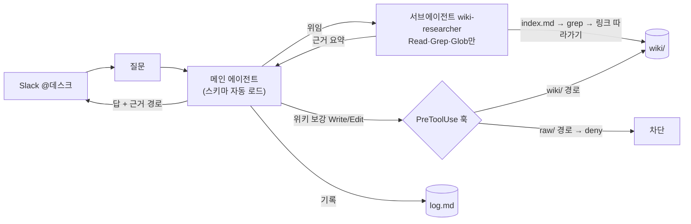

## 8장. 에이전트 짓기 — Agent SDK 경로와 직접 API 경로

```python
# desk_v0_naive.py — 페이지원 데스크, 가장 먼저 떠오르는 구현
import glob
import anthropic

MODEL = "claude-sonnet-5-5"  # 2026년 10월 기준 모델 ID — 공식 모델 목록에서 재확인 (사실 확인 필요)
client = anthropic.Anthropic()

def load_wiki() -> str:
    pages = sorted(glob.glob("wiki/**/*.md", recursive=True))
    return "\n\n---\n\n".join(open(p, encoding="utf-8").read() for p in pages)

def ask(question: str) -> str:
    response = client.messages.create(
        model=MODEL,
        max_tokens=2048,
        system="너는 페이지원의 사내 Q&A 에이전트 데스크다. 아래 위키만 근거로 답하라.\n\n" + load_wiki(),
        messages=[{"role": "user", "content": question}],
    )
    return "".join(block.text for block in response.content if block.type == "text")
```

이 코드는 돌아간다. 첫 주엔 잘 돌아간다. `wiki/` 아래의 마크다운을 전부 이어 붙여 시스템 프롬프트에 넣고, 질문을 던지고, 답을 받는다. 페이지가 서른 장일 때 데스크는 "프로 플랜은 29,000원"이라고 정확히 답하고, 김보라는 Slack에서 처음으로 `@데스크`를 불러 본다. 그런데 이 코드를 본 순간 어딘가 찜찜하지 않은가? 이 장은 그 찜찜함을 네 가지로 분해한 뒤, 두 가지 제대로 된 경로를 각각 설계한다.

### 무엇이 잘못됐나 — 네 가지 분해

첫째, 2장의 컨텍스트 로트다. 페이지원의 위키는 여섯 달 뒤 수백 장이 된다. 페이지당 몇백 토큰이라 쳐도 전체는 수십만 토큰이고, 1M 컨텍스트 모델이라면 "들어가긴" 한다. 그러나 2장에서 봤듯이 들어가는 것과 읽히는 것은 다르다. Same Task, More Tokens는 500토큰을 넘으며 하락이 시작돼 3,000토큰에서 평균 정확도가 0.92에서 0.68로 떨어지는 것을 보였고, NoLiMa는 32K에서 11개 모델이 짧은 입력 대비 절반 아래로 떨어지는 것을 보였다. 데스크에게 매번 위키 전체를 읽히는 것은 "가격 페이지 한 장"을 찾으려고 책 한 권을 통째로 읽히는 일이다.

둘째, 비용이다. 매 요청이 위키 전체를 입력 토큰으로 낸다. 여기서 자연스러운 반론이 나온다 — "프롬프트 캐싱을 걸면 되지 않나?" 걸면 싸진다. 그러나 Claude API 문서(2026년 10월 열람)는 이렇게 못 박는다. "Cached prompt prefixes still occupy the context window: prompt caching changes what you pay for those tokens, not whether they count." 캐싱은 청구서를 줄이지, 첫째 문제를 없애지 않는다. 그리고 캐시는 접두사가 바이트 단위로 같을 때만 맞는다. 위키는 수집 때마다 바뀌는 파일이고, 바뀐 자리 이후의 캐시는 전부 무효가 된다. 하루에 몇 번씩 갱신되는 위키를 캐시 접두사로 쓰는 것은 매일 새로 사는 정기권이다.

셋째, 이 코드는 위키를 세션 시작 때 한 번 읽고 끝이다. 작업 중에 새로 알게 된 것이 있어도 어디에도 쓰지 않는다. gist 원문이 "good answers can be filed back into the wiki as new pages"라고 적은 그 환류가 없다. 넷째 — 가장 조용한 문제 — 이 코드에는 경계가 없다. 데스크가 나중에 쓰기 도구를 갖게 되면 `raw/`를 고치는 것을 막을 장치가 코드 어디에도 없다. 6장에서 본 대로 "'raw is immutable' in a CLAUDE.md is a wish, not a rule"이다.

### 잘못된 대안 — "그럼 `index.md`만 넣으면 되지 않나?"

첫째와 둘째를 고치는 가장 쉬운 방법은 위키 전체 대신 `index.md`만 시스템 프롬프트에 넣고, 나머지는 도구로 읽게 하는 것이다. 7장의 0단계 그대로다. 그러면 될까? 절반은 된다. 그런데 orcosto-lab이 2026년 9월에 올린 세션 감사가 나머지 절반을 보여 준다. 실제 세션 아홉 개를 뜯어보니 에이전트는 위키를 세션 시작 때만 읽고 작업 중에는 읽지 않았다. "In 2 of those sessions the agent re-diagnosed from scratch a failure that already had a written lesson." 교훈이 이미 적혀 있는데 다시 처음부터 진단한 것이다. 인덱스를 넣어 주는 것은 "어디에 무엇이 있는지"를 알려 줄 뿐, "지금 이 순간 그것을 다시 열어 보라"고 시키지는 않는다.

답은 출력의 수를 바꾸는 데 있다. gist 댓글에서 프로덕션 팀을 운영하는 bluewater8008은 모든 작업이 두 가지 출력을 내야 한다고 썼다 — 답, 그리고 위키 갱신. Aaron Fulkerson은 같은 원칙을 스킬 수준에서 못 박았다. "Every skill that reads from the vault also writes back to it." 데스크가 "타 업종 확장은 8월에 보류됐다"고 답했다면, 그 답을 만들며 읽은 페이지 둘을 잇는 한 줄이 위키에 남아야 한다. 그러려면 데스크는 질의 중에 위키를 읽고, 질의 끝에 위키에 쓰는 **루프**여야 한다. 한 번의 `messages.create`로는 루프가 되지 않는다. 루프를 누가 돌리느냐 — 여기서 길이 둘로 갈린다.

### 두 경로, 한 장의 표

Anthropic은 에이전트를 짓는 세 가지 방법을 공식 문서(2026년 10월 열람)에서 나란히 놓는다. Claude Agent SDK는 "A library that runs the Claude Code binary, with Claude Code's capabilities, such as built-in tools, permissions, sessions, and hooks"다. 클라이언트 SDK로 직접 API를 부르는 경로는 "You write the tool loop yourself, or let the client SDK's beta tool runner drive it"이고, Managed Agents는 "A hosted agent harness that runs the agent loop, with sessions in an Anthropic-managed cloud sandbox"다. 이 책은 앞의 둘을 다룬다 — Managed Agents는 클라우드 샌드박스에서 루프를 돌리는 방식이라 "위키가 우리 서버의 git 저장소에 있다"는 전제와 맞지 않아 뒤로 미룬다.

| | 경로 A — Claude Agent SDK | 경로 B — 직접 API |
|---|---|---|
| 루프 | SDK가 돌린다(Claude Code와 같은 루프) | 내가 짠다(또는 SDK의 tool runner) |
| 도구 | Read·Grep·Glob·Bash 등 내장 | 내가 정의한 도구만 |
| 스키마(CLAUDE.md) | 프로젝트의 `.claude/`와 CLAUDE.md를 자동 로드 | 시스템 프롬프트에 직접 넣는다 |
| 위키 접근 | 파일 시스템 그대로 + MCP | 문서 블록으로 넘기거나 도구로 읽힌다 |
| 경계 | 훅(PreToolUse deny)·권한 모드 | 도구 핸들러에서 직접 검사 |
| 인용 | 모델이 경로를 적는다(검증 필요) | 인용 API가 포인터를 보장 |
| 캐싱 | 내부에서 처리 | `cache_control`로 세밀 제어 |
| 패키지(2026년 10월 기준) | Python `claude-agent-sdk` 0.2.x / TS `@anthropic-ai/claude-agent-sdk` 0.3.x | `anthropic` / `@anthropic-ai/sdk` |

버전은 일부러 소수점 둘째 자리까지만 적었다. 두 패키지 모두 며칠 단위로 올라가서, 책에 적힌 숫자는 인쇄되는 순간 낡는다. 하나 더 — 둘 다 API 키로 인증한다. 공식 문서는 "Anthropic does not allow third party developers to offer claude.ai login or rate limits for their products, including agents built on the Claude Agent SDK"라고 적는다. 개인 Claude 구독으로 데스크를 돌리는 것은 허용 범위 밖이니 처음부터 API 키 예산을 잡자.

### 경로 A — Agent SDK: 서브에이전트, 세션, 훅

경로 A의 매력은 6장에서 쓴 CLAUDE.md가 그대로 데스크의 스키마가 된다는 점이다. Agent SDK는 Claude Code의 바이너리를 라이브러리로 감싼 것이라 프로젝트의 `.claude/`와 CLAUDE.md를 "same as Claude Code" 자동으로 읽는다. `pageone-wiki` 저장소 루트에서 실행하면 스키마도, `raw/CLAUDE.md`의 하위 규칙도, 수집·질의·린트 스킬도 따라온다. 코드는 세 조각이면 된다.

첫 조각은 서브에이전트다. 7장의 검색 루프 — `index.md` 읽기, grep, 페이지 따라가기 — 를 메인 대화 안에서 돌리면 읽은 페이지가 전부 컨텍스트에 쌓인다. Agent SDK 문서는 서브에이전트의 효과를 이렇게 설명한다. "A `research-assistant` subagent can explore dozens of files without any of that content accumulating in the main conversation. The parent receives a concise summary, not every file the subagent read." 게다가 도구를 제한할 수 있다. "A `doc-reviewer` subagent might only have access to Read and Grep tools, ensuring it can analyze but never accidentally modify your documentation files." 데스크의 위키 탐색기는 정확히 그렇게 — `Read`, `Grep`, `Glob`만 가진 읽기 전용 리서처로 — 정의한다.

둘째 조각은 훅이다. 6장에서 미뤄 둔 "`raw/` 불변을 어떻게 강제하는가"의 답이다. Claude Code 문서는 CLAUDE.md를 "context, not enforced configuration"으로 다루며 "To block an action regardless of what Claude decides, use a PreToolUse hook instead"라고 적는다. 훅은 `PreToolUse` 이벤트에서 `permissionDecision`을 `"deny"`로 돌려주면 그 도구 호출을 결정론적으로 막는다. 공식 예제는 `.env` 파일 쓰기를 막는 것인데, 그 파일명 검사를 `raw/` 경로 검사로 바꾸면 끝이다. 여러 훅과 권한 규칙이 겹칠 때는 "`deny` takes priority over `defer`, which takes priority over `ask`, which takes priority over `allow`"다 — 한 번 deny면 다른 무엇도 뒤집지 못한다.

```python
# desk_v0_agent_sdk.py — 경로 A. pageone-wiki 저장소 루트에서 실행한다.
# 2026년 10월 기준 claude-agent-sdk 0.2.x. 시그니처는 공식 문서와 함께 확인하자.
from claude_agent_sdk import query, ClaudeAgentOptions, AgentDefinition, HookMatcher


async def protect_raw(input_data, tool_use_id, context):
    """raw/ 아래의 기존 파일을 고치려는 Write·Edit를 막는다."""
    file_path = input_data["tool_input"].get("file_path", "")
    if "/raw/" in f"/{file_path}" or file_path.startswith("raw/"):
        return {
            "hookSpecificOutput": {
                "hookEventName": input_data["hook_event_name"],
                "permissionDecision": "deny",
                "permissionDecisionReason": "raw/ is immutable. Add new sources via the ingest script.",
            }
        }
    return {}


options = ClaudeAgentOptions(
    # 메인 에이전트는 서브에이전트를 부를 수 있고, 위키에 쓸 수 있다(훅이 raw/를 지킨다).
    allowed_tools=["Read", "Grep", "Glob", "Write", "Edit", "Agent"],
    agents={
        "wiki-researcher": AgentDefinition(
            description="pageone-wiki에서 질문에 답할 근거 페이지를 찾는다. 질의마다 사용한다.",
            prompt=(
                "wiki/index.md를 먼저 읽고 후보 페이지를 고른다. 없으면 wiki/ 아래를 grep한다. "
                "찾은 페이지의 superseded_by·contradicts 링크를 따라가 최신 상태를 확인한다. "
                "근거 페이지 경로와 해당 줄을 그대로 인용해 요약을 돌려준다. 파일을 수정하지 않는다."
            ),
            tools=["Read", "Grep", "Glob"],
            model="sonnet",
        ),
    },
    hooks={
        "PreToolUse": [HookMatcher(matcher="Write|Edit", hooks=[protect_raw])],
    },
)


async def ask(question: str):
    prompt = (
        f"질문: {question}\n"
        "wiki-researcher 서브에이전트로 근거를 찾아 답하라. "
        "답한 뒤, 답에 쓰인 사실 연결이 위키에 없으면 해당 페이지에 한 줄로 보강하고 log.md에 기록하라."
    )
    async for message in query(prompt=prompt, options=options):
        yield message
```

셋째 조각은 세션인데, 코드보다 주의 사항이 중요하다. Agent SDK의 세션은 "the conversation history the SDK accumulates while your agent works"이고 디스크에 자동으로 저장된다(`~/.claude/projects/<encoded-cwd>/*.jsonl`). 그런데 문서가 굵게 강조한다. "Sessions persist the **conversation**, not the filesystem." 세션을 재개해도 위키 파일의 상태는 재개되지 않는다 — 그건 git의 몫이다. Slack에서 여러 사람이 데스크를 부르면 사용자마다 세션이 하나씩 생기므로 Resume 방식("Required when you have multiple sessions (for example, one per user in a multi-user app)")을 써야 하고, 서버가 여러 대이거나 서버리스라면 `SessionStore` 어댑터로 트랜스크립트를 공유 저장소에 미러링해야 한다. 그리고 문서의 마지막 조언이 가장 실용적이다. "**Don't rely on session resume.** Capture the results you need [...] as application state and pass them into a fresh session's prompt." 데스크에게 필요한 상태는 `log.md`와 위키에 있다. 세션은 버려도 된다.

한도도 적어 두자. 서브에이전트 깊이는 기본 3(`CLAUDE_CODE_MAX_SUBAGENT_SPAWN_DEPTH`), 동시 실행은 기본 20(`CLAUDE_CODE_MAX_CONCURRENT_SUBAGENTS`), 비용 상한은 `maxBudgetUsd`/`max_budget_usd`(TS v0.3.219, Python v0.2.127 이후)다. 문서는 "Claude Opus 5 delegates to subagents more readily than earlier models"라며 Opus 5 계열에서 이 한도가 특히 중요하다고 적는다. 데스크는 질문 하나에 리서처 하나면 충분하니 깊이 1, 동시 1로 묶는 편이 낫다 — alfadur가 GeekNews에 쓴 경고대로, 자율 멀티에이전트는 "토큰만 5~10배 잡아먹고 컨텍스트도 자주 놓"친다.

`Stop` 훅은 코드 없이 요지만 적는다. @vellumkasane은 세션이 끝나기 전에 `git status --porcelain`과 미푸시 커밋을 검사해 더러운 상태로는 턴을 못 끝내게 했다. 데스크가 위키에 한 줄 보강하고 커밋을 잊으면 "The wiki repo sat dirty until someone noticed"가 된다. 다만 9장에서 보겠지만, 신뢰할 수 없는 소스를 읽는 에이전트에게 git 명령 자체를 주지 않는 설계도 있다. 그 경우 `Stop` 훅은 "커밋했는가"가 아니라 "진행 파일에 기록했는가"를 검사한다.

### 경로 B — 직접 API: 인용, 캐싱, 메모리 도구

경로 B는 루프를 직접 짜는 대신 세 가지를 정밀하게 쥔다. 인용, 캐싱, 메모리다. 7장에서 본 clue.oz4e의 역할 분리 — 위키는 지도, 근거 문장은 원문에서 — 를 API 수준에서 보장하고 싶을 때 이 경로가 빛난다.

**인용 API.** 경로 A에서 데스크는 "근거: wiki/decisions/expansion-2026-08.md"라고 경로를 적지만, 그 경로가 실재하는지, 인용한 문장이 그 파일에 있는지는 모델의 성실성에 달려 있다. gist 댓글의 manavgup은 위키링크가 "hallucinates 404s"한다고 썼고, ShootJackal은 노트가 파일 경계를 위조해 조작된 답에 VERIFIED 표식을 받은 적이 있다고 고백했다. 인용 API는 이 문제를 구조로 푼다. 문서 블록에 `"citations": {"enabled": true}`를 켜면 응답이 여러 텍스트 블록으로 쪼개지고, 인용된 블록은 `cited_text`와 `char_location`(`document_index`, `start_char_index`)을 함께 돌려준다. 문서가 보장하는 바는 이렇다. "citations are guaranteed to contain valid pointers to the provided documents." 포인터가 유효하다는 것이지 답이 옳다는 것은 아니지만, 11장에서 만들 "모델 없는 검증기"가 설 자리가 생긴다. 비용은 "a slight increase in input tokens"이고 `cited_text`는 출력 토큰으로 계산되지 않는다. 함정 하나 — "**Citations cannot be used together with structured outputs.**" 같이 켜면 400이다. 답을 JSON으로 받고 싶다면 인용을 먼저 받고 후처리로 구조화해야 한다. 자체 검색 결과를 넘길 때는 `search_result` 블록을 쓸 수 있다.

**프롬프트 캐싱.** 경로 B에서는 무엇을 캐시 접두사로 둘지 내가 정한다. 바뀌지 않는 것부터 앞에 둔다 — 답변 프롬프트, 스키마, 그리고 `index.md`. 위키 페이지 본문은 질문마다 다르니 접두사 뒤에 온다. 2026년 10월 11일 열람한 공식 문서 기준으로 기본 TTL은 5분이고 "The cache is refreshed for no additional cost each time the cached content is used." 1시간 TTL은 기본 입력 가격의 2배로 쓸 수 있다. 쓰기는 5분이 1.25배, 1시간이 2배이고, 읽기는 기본 0.1배인데 모델마다 예외가 있다 — Fable 5.1·Mythos 5.1은 0.025배, Opus 5.5·Sonnet 5.5는 0.05배다. 최소 캐시 길이는 Sonnet 5.5·Opus 5.5 등 최신 모델에서 512토큰, Sonnet 5·4.6 등에서 1,024토큰이고 "Shorter prompts cannot be cached, even if marked with `cache_control`." 이 배수와 모델명은 책에서 가장 빨리 낡을 숫자다. 구현 전에 가격 페이지를 한 번 더 열자. 캐시가 실제로 맞는지는 `usage`의 `cache_read_input_tokens`로 확인한다 — 반복 요청에서 이 값이 0이면 접두사 어딘가에 시각이나 요청 ID 같은 변하는 값이 끼어 있는 것이다.

**Files API.** `raw/`의 PDF 열 건을 매번 base64로 올리기 싫다면 Files API에 한 번 올리고 `file_id`로 참조할 수 있다. 2026년 10월 기준 GA라 베타 헤더가 필요 없고(구 자료의 `files-api-2025-04-14` 헤더는 무시해도 된다), 파일당 500MB·조직당 1TB, 업로드 뒤에는 "cannot be modified or renamed"다. 바로 이 불변성이 판단 기준이 된다. 불변인 `raw/`에는 맞고, 하루에도 몇 번 바뀌는 `wiki/`에는 맞지 않는다. 또 하나 — "Uploaded files are accessible to your entire workspace, not scoped to an end user, conversation, or session." 페이지원처럼 한 회사가 쓰는 경우는 문제없지만, 여러 고객사의 위키를 한 서비스로 돌린다면 워크스페이스를 분리해야 한다(9장).

**메모리 도구.** `memory_20250818` 타입의 도구를 켜면 모델이 `/memories` 아래의 파일을 `view`·`create`·`str_replace`·`insert`·`delete`·`rename`하는 요청을 보내고, 그 실행은 "client-side" — 내 애플리케이션이 한다. 자동 주입되는 시스템 프롬프트는 이렇게 시작한다. "ALWAYS VIEW YOUR MEMORY DIRECTORY BEFORE DOING ANYTHING ELSE." 얼핏 위키와 같은 것처럼 보이지만 역할이 다르다. 메모리 도구는 에이전트가 자기 작업을 위해 쓰는 노트이고, 위키는 팀의 지식이다. 데스크가 "이 사용자는 CS팀이라 환불 절차를 자주 묻는다" 같은 것을 적어 두는 곳은 메모리이고, "환불 절차는 이렇다"가 적히는 곳은 위키다. 둘을 섞으면 10장의 승격 게이트가 무의미해진다. 그리고 보안 주의 — 문서는 `/memories/../../secrets.env` 같은 경로로 디렉터리 밖에 닿을 수 있다며 "Your implementation must validate every path in every command"라고 못 박는다.

```typescript
// desk_v0_direct.ts — 경로 B. 2026년 10월 기준 @anthropic-ai/sdk. 시그니처는 공식 문서와 함께 확인하자.
import Anthropic from "@anthropic-ai/sdk";
import { readFileSync } from "node:fs";

const MODEL = "claude-sonnet-5-5"; // 2026년 10월 기준 모델 ID — 공식 모델 목록에서 재확인 (사실 확인 필요)
const client = new Anthropic();

const ANSWER_PROMPT = readFileSync("prompts/desk-answer.md", "utf-8"); // 6장의 답변 프롬프트
const SCHEMA = readFileSync("CLAUDE.md", "utf-8");
const INDEX = readFileSync("wiki/index.md", "utf-8");

// 7장의 검색 계층(index.md → grep → BM25)이 고른 페이지 경로를 받는다.
export async function ask(question: string, pagePaths: string[]) {
  const documents = pagePaths.map((p) => ({
    type: "document" as const,
    // 인라인 텍스트 문서의 source 형태는 공식 문서와 대조할 것 (사실 확인 필요)
    source: { type: "text" as const, media_type: "text/plain" as const, data: readFileSync(p, "utf-8") },
    title: p,
    citations: { enabled: true },
  }));

  const response = await client.messages.create({
    model: MODEL,
    max_tokens: 2048,
    system: [
      // 바뀌지 않는 접두사: 답변 프롬프트 + 스키마 + index.md. 야간 배치라면 1시간 TTL.
      {
        type: "text",
        text: `${ANSWER_PROMPT}\n\n${SCHEMA}\n\n# index.md\n${INDEX}`,
        cache_control: { type: "ephemeral", ttl: "1h" }, // ttl 표기는 캐싱 문서로 재확인 (사실 확인 필요)
      },
    ],
    messages: [{ role: "user", content: [...documents, { type: "text", text: question }] }],
  });

  // 인용 블록만 따로 모은다 — 11장의 검증기가 이 포인터를 커밋과 대조한다.
  const cited = response.content
    .filter((b) => b.type === "text" && "citations" in b && b.citations)
    .flatMap((b: any) => b.citations.map((c: any) => ({
      page: pagePaths[c.document_index],
      quote: c.cited_text,
      start: c.start_char_index,
    })));

  const text = response.content.filter((b) => b.type === "text").map((b: any) => b.text).join("");
  console.log("cache read tokens:", response.usage.cache_read_input_tokens);
  return { text, cited };
}
```

이 코드에는 루프가 없다는 점을 눈여겨보자. 경로 B에서 7장의 검색은 `pagePaths`를 만드는 바깥 코드의 책임이고, "답 + 위키 갱신"의 두 번째 출력도 바깥에서 따로 호출해야 한다. 직접 API는 한 호출의 입력과 출력을 정밀하게 쥐는 대가로 루프와 환류를 내게 넘긴다.

### 어느 쪽을 고를까 — 그리고 섞는 조합

어느 쪽이 나을까? 상황에 따라 다르다. 기준은 셋이다.

위키가 파일 시스템에 있고, 검색이 grep이나 MCP이고, 경계를 훅으로 긋고 싶다면 **경로 A**다. Claude Code에서 손으로 하던 수집·질의·린트가 그대로 코드가 되고, 6장의 스키마가 자동으로 실린다. 위키 페이지를 문서 블록으로 넘겨 인용 포인터를 보장받고, 캐시 접두사와 메모리 디렉터리를 손으로 다루고 싶다면 **경로 B**다. 규제나 법무처럼 "그 문장이 그 문서에 있는가"가 답의 정확도보다 먼저 묻히는 곳이면 B 쪽이 무겁다.

그런데 둘 중 하나만 골라야 한다는 법은 없다. 페이지원이 실제로 택할 조합은 이렇다. 수집과 린트 잡 — 파일을 읽고 쓰고 링크를 따라가고 `log.md`에 기록하는 작업 — 은 경로 A로 짓는다. 훅이 `raw/`를 지키고 서브에이전트가 컨텍스트를 격리하는 것이 거기서 가장 값지다. Slack의 `@데스크` 응답, 즉 하루에 수십 번 불리고 짧게 답해야 하는 핫패스는 경로 B로 짓는다. 7장의 BM25가 고른 페이지 두세 장을 문서 블록으로 넘기고, 인용 포인터를 받아 Slack 메시지에 링크로 붙인다. 밤에는 A가 위키를 손질하고 낮에는 B가 그 위키로 답하는 구조다. 어느 한쪽만 써도 되지만, 이렇게 나누면 각 경로의 강점이 겹치지 않는 자리에 들어간다.

흔한 오해 하나를 짚자. "Agent SDK가 더 똑똑하니 항상 낫다"고 여기기 쉽다. 그렇지 않다. Agent SDK는 Claude Code의 루프를 통째로 가져오는 것이라 질문 하나에도 도구 호출이 여러 번 돈다. 핫패스에서 그 지연과 비용은 그대로 사용자에게 간다. 반대로 "직접 API가 더 가볍다"는 것도 절반만 맞다. 가벼운 것은 호출이지 코드가 아니다 — 루프, 환류, 경계, 세션을 전부 내가 짠다. 두 경로의 차이는 똑똑함이 아니라 **무엇을 누가 쥐느냐**의 차이다.

### 데스크 v0 — 한 그림으로


그림 1. 경로 A로 지은 데스크 v0 — 서브에이전트가 읽고, 메인이 답하고, 훅이 `raw/`를 지킨다

그림에서 읽기와 쓰기의 경로가 다르다는 점이 핵심이다. 읽기는 서브에이전트가 전담해 컨텍스트를 격리하고, 쓰기는 메인 에이전트만 하되 훅을 통과해야 한다. `raw/`로 향하는 화살표는 훅에서 끊긴다. 이 구조를 경로 B로 옮기면 서브에이전트 자리에 7장의 검색 코드가, 훅 자리에 도구 핸들러의 경로 검사가 들어간다. 모양은 같다.

이제 적용 과제다. 두 경로 중 하나로 데스크 v0를 띄우자. 경로 A라면 위의 Python 코드를 `pageone-wiki` 루트에 두고, 경로 B라면 TypeScript 코드에 7장의 검색 함수를 붙이면 된다. 그리고 계획의 골든셋 씨앗 여섯 질문을 차례로 던져 보자 — "프로 플랜 지금 얼마야?", "환불 요청 처리 절차는?", "HubSpot에서 리드 단계 바꾸는 법?", "우리 톤앤매너에서 쓰면 안 되는 말?", "타 업종 확장 지금 어떻게 됐어?", 그리고 답이 없어야 하는 "일본 진출 일정?". 여섯 답을 적어 두자. 몇 개가 맞았는지보다, 마지막 질문에 데스크가 무엇이라고 했는지가 중요하다. 그 여섯 줄이 11장에서 골든셋의 첫 행이 된다.
