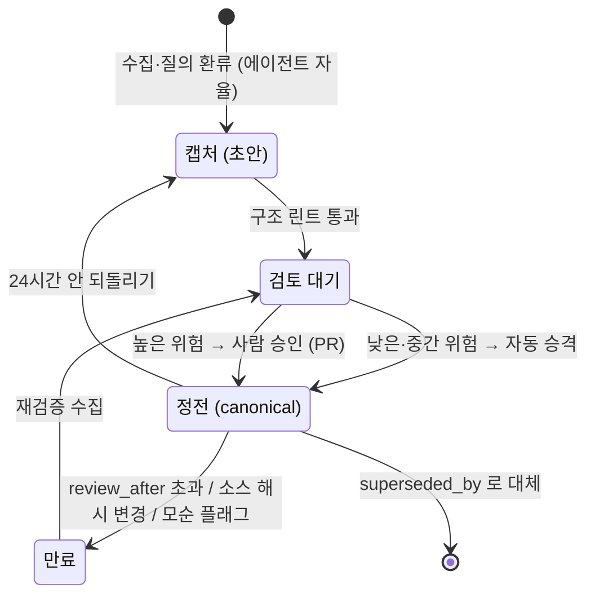

# 10장. 조용한 부패 — 린트, 신선도, 승격

여섯 달이 지났다고 해보자. 데스크는 여전히 유창하다. 그게 문제다.

9장 끝에서 `pageone-wiki`를 팀에 열었다. 김보라는 정적 뷰에서 브랜드 페이지를 읽고, 박태오의 CS 팀은 Slack에서 `@데스크`를 하루에 몇 번씩 부른다. 10월 어느 오후, 박태오가 묻는다. "프로 플랜 지금 얼마야?" 데스크는 1초 만에 답한다. "원북 프로 플랜은 월 29,000원이다. 근거: `strategy/pro-plan-pricing.md`." 근거 페이지가 붙어 있고 링크도 살아 있다. 4장에서 우리가 만든 바로 그 페이지, `valid_from: 2026-01-01`이 찍힌 가격 페이지다. 그런데 8월 20일 Slack #결정 스레드에서 한서진 대표는 프로 플랜을 39,000원으로 올리기로 했고, 9월 1일부터 적용됐다. 두 달이 지났다. 가격 페이지는 그대로다. 데스크는, 자신 있게, 틀렸다.

이 장면에서 가장 아찔한 대목은 어디일까. 데스크가 틀렸다는 사실이 아니다. 틀렸다는 신호가 어디에도 없다는 점이다. 페이지는 깔끔하고 프런트매터는 정연하고, `index.md`에는 "프로 플랜 월 29,000원, 베이직 무료 (2026-01-01 기준)"이라는 한 줄 요약이 멀쩡히 붙어 있다. HN의 Abby_101이 2026년 4월, 패턴이 나온 지 3주 만에 예언처럼 쓴 문장이 그대로 들어맞는다. "Six months in, you have entries that are confidently wrong and the lint pass can't tell which."

## 현상 — 방치돼도 방치된 것처럼 보이지 않는다

### 가격 페이지는 아무 신호도 내지 않았다

사람이 쓰던 위키라면 어땠을까. 마지막 수정일이 1월인 페이지는 그 자체로 낡아 보인다. 링크 몇 개가 죽어 있고, 누군가 "이거 아직 유효해요?"라는 댓글을 달아 둔다. 방치의 흔적이 눈에 보인다. LLM이 관리하는 위키에는 그 흔적이 없다. 수집할 때마다 에이전트가 관련 페이지를 손보고 교차 링크를 다듬으니, 페이지는 늘 방금 쓴 것처럼 매끈하다. Felipe Fontoura는 2026년 10월 글에서 이것을 한 문장으로 못 박았다. "A wiki maintained by an LLM never looks neglected. It stays fluent, linked, and current-sounding while the content drifts." 이 책이 이 상태를 **조용한 부패(silent rot)**라고 부르는 이유다. 2장의 컨텍스트 로트가 입력이 길어질수록 모델이 나빠지는 현상이었다면, 조용한 부패는 위키가 낡아도 아무도 모르는 상태다. 이름이 비슷하니 혼동하지 말자.

왜 가격 페이지는 낡았을까? 되짚어 보면 단순하다. 8월 20일 결정은 Slack #결정 채널에 있었고, 그 스레드는 `raw/`로 들어오지 않았다. 5장에서 정한 기록 트리거("뒤집힌 결정")에 정확히 해당하는 사건이었지만, 그 주에 "나"는 다른 일로 바빴고 김보라도 박태오도 `pageone-wiki`에 뭔가를 넣어야 한다고 생각하지 않았다. 소스가 들어오지 않았으니 위키는 아무것도 몰랐다. gist 댓글에서 Jwcjwc12가 첫 주에 이미 짚은 그대로다. "the moment those files change, the compiled knowledge might be wrong — and doesn't know it." 원본이 바뀌어도 컴파일된 페이지에는 신호가 없다.

여기서 더 찜찜한 사실이 하나 있다. 4장에서 그 페이지에 `review_after: 2026-03-30`을 적어 두었다. 가격 페이지는 짧게 검토한다고 주석까지 달았다. 그런데 3월 30일이 지나고 4월, 5월이 지나는 동안 그 필드를 읽는 것이 아무것도 없었다. 프런트매터에 날짜를 적는 것과 그 날짜가 지났을 때 무언가가 울리는 것은 다른 일이다. Rost Glukhov의 표현을 빌리면 "A page without a review date is a page that will eventually lie quietly." 페이지원의 경우는 한 단계 더 나아간다. 검토일이 있어도 읽는 이가 없으면 똑같이 조용히 거짓말을 한다.

2장에서 본 "모델을 고치지 말고 위키를 고쳐라"는 근거도 여기서 조건이 붙는다. 그 장점은 위키가 실제로 갱신된다는 전제 위에서만 성립한다. 갱신이 멈춘 위키는 학습이 끝난 모델보다 나쁘다. 모델은 "제 지식은 어느 시점까지입니다"라고 말할 줄이라도 알지만, 위키 페이지는 `last_verified`를 읽지 않으면 그런 말을 하지 않는다.

### 세 사람의 여섯 달

페이지원의 가격 페이지는 가상의 예시다. 그런데 여섯 달쯤 운영한 사람들의 보고를 읽으면 같은 그림이 반복된다. 세 건만 보자. 전부 자기 보고이고 통제군은 없다.

Jim Liu는 2026년 5월에 여섯 달치 보고를 올렸다. Obsidian과 Claude Pro로 개인 위키를 운영했는데, 린트를 몇 주 건너뛰었더니 3개월 차에 고아 페이지와 표시되지 않은 모순이 쌓여 있었다고 한다. 에이전트가 모순을 발견하고도 한쪽을 조용히 덮어쓴 일, 도구를 옮기면서 프런트매터의 `aliases` 필드가 유실돼 같은 인물의 페이지가 둘로 갈라진 일도 있었다. 그가 남긴 한 줄이 이 장의 뼈대다. "Contradictions are assets, not errors."

Eugeniu Ghelbur는 마케팅 에이전시에서 Claude Code 슬래시 커맨드 31개와 예약 에이전트 4개로 위키를 돌렸다(2026년 4월 보고). 소스가 50~100건을 넘을 때 첫 붕괴가 왔고, 페이지가 수백 장이 되자 모순이 폭증했다. 그는 모순을 플래그만 하고 손으로 해소하는 방식을 택했는데, 결과는 "accumulated faster than they could be fixed"였다. 해소되지 않은 모순이 쌓이자 답변이 헤지되기 시작했다. "A일 수도 있고 B일 수도 있다"는 식으로. 데스크가 "프로 플랜은 29,000원 또는 39,000원이다"라고 답하는 장면을 상상해보자. 틀린 답보다 나을까? 박태오에게는 별 차이가 없다.

Theo James는 2026년 4월 Medium에 자기 위키가 어디서 무너졌는지를 썼다. 2주 뒤부터 사용이 줄었고, 3주 공백 뒤에는 쌓인 소스를 한꺼번에 넣어야 하는 "ingestion debt"가 생겼다. 그는 모델을 탓하지 않았다. "The system didn't fail because the model was bad. It failed because I couldn't maintain the inputs." 그리고 운영 기준을 하나 남겼다. "Missing 5 percent is fine. Missing three weeks is not." 페이지원의 가격 페이지가 낡은 이유도 정확히 이것이다. 8월 셋째 주의 스레드 하나를 놓친 것 자체보다, 그 뒤 몇 주 동안 아무도 들여다보지 않은 것이 문제였다.

## 분석 — 모델은 설득력 있는 쪽을 믿는다

"페이지 하나 낡은 게 그렇게 큰일인가? 모델이 알아서 걸러 주지 않을까?" 이렇게 생각할 수 있다. 연구는 반대쪽을 가리킨다.

ClashEval(Wu·Wu·Zou 2024, arXiv 2404.10198)은 검색된 내용과 모델의 사전 지식이 충돌할 때 모델이 어느 쪽을 택하는지 쟀다. 결론은 모델들이 "are susceptible to adopting incorrect retrieved content, overriding their own correct prior knowledge"라는 것이다. 틀린 페이지를 주면 모델은 자기가 알던 맞는 답을 버리고 페이지를 따른다. 위키의 오류가 그대로 답변의 오류가 된다는 뜻이다.

더 불편한 결과는 "Adaptive Chameleon or Stubborn Sloth"(Xie 외 2023, arXiv 2305.13300, ICLR 2024 Spotlight)에 있다. 모델은 외부 증거가 "coherent and convincing"하면 자기 기억과 어긋나도 잘 받아들인다. 동시에 "a strong confirmation bias"도 보인다. 증거 가운데 자기 기억과 일치하는 것이 섞여 있으면 그쪽으로 기운다. 논문의 PopQA 실험에서 기억과 일치하는 증거의 비율을 0/2에서 2/2로 올리자 ChatGPT가 자기 기억을 채택한 비율은 3.7%에서 99.8%로 뛰었다. 무관한 단락 하나만 끼워 넣어도 Llama2-7B는 92.4%가 그 단락 내용으로 답했다. 페이지원으로 옮기면 이렇다. 가격 페이지(29,000원)와, 누군가 뒤늦게 넣은 "9월 가격 인상 안내" 페이지(39,000원)가 둘 다 위키에 있을 때, 데스크는 둘 사이에서 일관된 판정을 하지 않는다. 더 정연하게 쓰인 쪽, 더 많이 링크된 쪽, 모델이 원래 믿던 쪽으로 쏠린다. 모순을 위키 안에 남겨 두면 답은 운에 맡겨진다.

검색을 제대로 줘도 환각은 남는다. RAGTruth(Niu 외 2023, arXiv 2401.00396)는 검색 결과를 함께 준 조건에서도 모델이 "unsupported or contradictory claims to the retrieved contents"를 낸다고 보고한다. 논문 표의 숫자를 나눠 보면 GPT-4의 환각 응답 비율은 약 13.7%다(Table 3에서 계산한 값이지 논문이 쓴 문장은 아니다). 위키가 완벽해도 환각이 0이 되지 않는데, 위키에 모순까지 있으면 어떻게 될지는 자명하다. 이 사례들이 알려주는 것은 하나다. 린트는 정리 정돈을 넘어 답변 품질의 전제다.

## 원리 — 린트는 두 층이다

### 구조 린트: 토큰 한 개 쓰지 않는 스크립트

그렇다면 린트를 어떻게 돌려야 할까. 커뮤니티에서 거의 합의에 이른 분업이 있다. 구조는 스크립트가, 의미는 모델이. Fontoura의 정리가 그렇고, llmwiki의 `lint` 명령(인용 해상·끊긴 링크·고아·stale·프런트매터 검사)과 HagaiHen의 podcast-wiki(`tools/lint_wiki.py`로 기계 검사, `/lint-wiki`로 수정, `/dream`으로 중복 병합)도 같은 구조다.

@vellumkasane는 프로덕션 CRM·회계 앱 옆에서 위키 네 곳을 운영하며 150줄짜리 린트 스크립트를 짰다(2026년 9월 Dev.to). 검사 항목은 다섯 가지다. 프런트매터 유무와 형식, `index.md`에서 도달 가능한지, `[[link]]`가 실제 파일로 풀리는지, 파일명이 ASCII인지, stale 페이지인지. CI에서 nonzero exit로 머지를 막고, 세션이 끝나기 전에도 한 번 돌린다. 토큰은 한 개도 쓰지 않는다.

페이지원의 구조 린트에 무엇을 넣을지는 Glukhov의 체크리스트를 빌려 정하면 된다.

| 검사 | 페이지원에서 하는 일 | 실패 처리 |
|---|---|---|
| 끊긴 내부 링크 | `wiki/` 안 `[[...]]`·상대 링크가 실제 파일로 풀리는지 | CI 실패 |
| 고아 페이지 | 들어오는 링크 0 + `index.md`에도 없음 | 경고 → 주간 목록 |
| 프런트매터 | 필수 필드(`origin`·`last_verified`·`review_after`·`sources`) 누락·형식 오류 | CI 실패 |
| `review_after` 초과 | 오늘 > `review_after`인 페이지 | 경고 → 주간 목록. 가격·결정 페이지는 CI 실패 |
| ASCII 파일명 | 한글·공백·특수문자 파일명 | CI 실패 |
| 중복 제목·빈 섹션 | 같은 제목의 페이지 둘, 헤딩만 있고 본문 없음 | 경고 |
| `index.md` 정합 | 인덱스 항목 ↔ 실제 파일 양방향 일치 | 자동 재생성 (4장: 인덱스는 계산한다) |
| 수집 공백 | `log.md`의 마지막 `ingest` 항목이 14일 이전 | CI 실패 |

마지막 줄은 Theo James의 기준을 코드로 옮긴 것이다. 5%를 놓치는 건 괜찮다. 3주를 비우는 건 안 된다. 공백이 3주가 되기 전에 빌드가 빨갛게 변한다. 위키가 스스로 "나 방치되고 있다"고 말할 수 있는 유일한 방법이다.

markdownlint나 lychee 같은 범용 도구로 대신할 수 있을까? 절반만 된다. markdownlint는 스타일을, lychee는 외부 URL을 볼 뿐 둘 다 `[[wikilink]]`와 프런트매터를 모른다. 위키 전용 검사는 sidequery/mdlint 같은 도구나 claude-obsidian의 `wiki-lint` 스킬, 아니면 150줄 자체 스크립트다. 페이지원 규모면 자체 스크립트가 가장 덜 번거롭고, 외부 링크만 lychee에 맡긴다. Jim Liu는 주간 외부 링크 스크립트로 6개월 동안 약 24개의 죽은 링크를 잡았다고 보고했다(자기 보고).

첫 린트 결과가 어떨지 미리 각오해 두는 편이 낫다. Aaron Fulkerson이 프로덕션 볼트에서 처음 돌린 린트는 "23 orphaned files and 11 broken cross-references"를 뱉었다(자기 보고). 첫 결과가 더럽다고 당황할 일은 없다. 그게 린트의 존재 이유다.

### 의미 린트: 모델만 할 수 있는 판단

구조 린트는 가격 페이지의 문제를 잡았을까? `review_after` 검사가 돌고 있었다면 4월부터 경고가 떴을 것이다. 하지만 "29,000원이라는 주장이 8월 결정과 모순된다"는 판단은 스크립트가 못 한다. 그건 의미 린트의 일이고, 여기서만 모델 토큰을 쓴다.

4장에서 예고한 두 번째 사건도 여기서 터진다. 브랜드 가이드 v3의 슬로건은 "예약은 한 페이지면 된다"인데, 9월 신규 캠페인 카피가 다른 슬로건을 썼다. 캠페인 페이지를 수집한 에이전트가 그것을 "어긋남"으로 기록할지 "브랜드가 바뀌었나 보다"로 넘길지는 지시가 없으면 복불복이다. 구조 린트는 두 페이지 모두 링크가 멀쩡하고 프런트매터가 정연하니 아무것도 보지 못한다.

의미 린트가 볼 항목은 Glukhov의 목록이 잘 정리해 두었다. 출처 없는 주장, 서로 상충하는 주장, 낡은 결정을 현재형으로 서술한 문장, 이름만 다른 중복 개념, 여러 뜻이 섞인 개념 페이지, 제약 조건을 빼먹은 요약, 기준 없는 "best", 버전 번호 없는 버전 주장, 최신 소스와 어긋나는 페이지. 페이지원에 맞춰 셋만 덧붙이자. 브랜드 금지 표현("최저가", "무조건")이 위키 페이지 본문에 들어갔는지, `decisions/` 페이지의 결정이 뒤집힌 이전 결정을 `superseded_by`로 가리키는지, 그리고 "결정"으로 적힌 것이 실제로는 "논의"가 아닌지(5장의 결정 vs 논의 구분). 세 번째가 11장에서 거부 평가와 만난다.

모순 검사는 비용이 걱정된다. 커뮤니티 논의에서 Covenant0028이 짚었듯 N개 페이지의 짝을 다 보면 N×N이다. 수백 장이면 매주 전부 돌릴 수 없다. ChrisGreenHeur의 답이 실용적이다. 무작위 샘플을 시간에 걸쳐 돌리면 대부분 드러난다. 더 좋은 방법은 샘플을 무작위로 뽑지 않는 것이다. 이번 주에 수집으로 바뀐 페이지와 그 페이지가 링크하는 이웃만 짝지으면 된다. 수집 한 건이 10~15페이지를 건드린다는 gist의 수치가 여기서는 검사 범위의 상한이 된다. 중복 병합도 같은 식으로 좁힌다. SemDeDup(Abbas 외 2023, arXiv 2303.09540)이 학습 데이터에서 임베딩 클러스터로 의미 중복을 찾았듯, 후보는 임베딩 근접도로 뽑고 "정말 같은 페이지인가"는 모델이 판단한다. 학습 데이터 중복 제거와 위키 페이지 병합은 다른 문제라 그 논문의 효과 수치를 그대로 옮길 수는 없지만, 후보는 싸게 찾고 판단은 비싸게 한다는 분업은 그대로 쓸 만하다.

실측치를 하나 두고 예산을 잡자. Jim Liu는 격주로 서브에이전트에게 모순 탐지를 시키는 데 1회 0.40달러 미만이 들었다고 보고했다(Opus 1M 컨텍스트 기준, 자기 보고). 페이지원의 수백 장 규모면 이 정도가 상한 근처일 것이다. 다만 린트를 LLM이 하면 자기 채점이 된다는 커뮤니티의 지적은 유효하다. 린트는 사람 검토를 줄여 주지, 없애 주지 않는다. 함정도 하나 알아두자. llmwiki 이슈 #93(2026년 9월)에는 새로 수집한 직후 린트의 stale 검사가 모든 페이지를 낡았다고 플래그한 보고가 있다. 의미 린트가 "전부 낡았다"고 외치면 린트를 믿기 전에 타임스탬프 규약부터 의심하자.

### 모순은 자산이다 — 뭉개지 않는다

의미 린트가 모순을 찾았다. 그 다음이 진짜 문제다. 에이전트에게 "모순을 해소하라"고 시키면 무슨 일이 벌어질까? 가장 흔한 결과는 두 주장을 섞은 애매한 문장이다. "프로 플랜은 29,000원대에서 39,000원 사이로 책정되어 있다." 틀리지는 않았다. 쓸모도 없다. Glukhov는 이것을 금지 조항으로 적었다. "Do not let the agent silently resolve contradictions by blending both claims into a vague compromise." Fontoura의 에이전트 계약에도 같은 조항이 있다. "Record contradictions and divergences. Never smooth them into one story." HagaiHen은 더 짧게 썼다. "Never silently overwrite."

그렇다면 어떻게 해야 할까. 세 단계다.

첫째, 린트 출력은 "어느 페이지의 어느 줄"과 "어느 페이지의 어느 줄"이 충돌하는지 구조화해서 낸다. 모델에게 그냥 "모순을 찾아라"고 하면 충돌이 있다는 사실은 잘 알아내지만 정확히 어느 주장끼리인지는 잘 짚지 못한다. Wang 외(2023, arXiv 2310.00935, COLM 2024)가 측정한 그대로다. "LLMs perform well in identifying the existence of knowledge conflicts, [but] they struggle to determine the specific conflicting knowledge." 그러니 출력 형식으로 강제한다. 6장의 린트 프롬프트에 넣은 "어느 줄 vs 어느 줄" 규약이 이것이다.

둘째, 해소 전까지는 병기한다. 가격 페이지에 두 주장을 날짜와 출처를 달아 나란히 두고, 프런트매터의 `contradicts`에 상대 페이지를 적는다. 데스크의 답변 프롬프트는 `contradicts`가 비어 있지 않은 페이지를 근거로 쓸 때 "이 페이지에는 해소되지 않은 모순이 있다"고 답에 덧붙인다. 유창하게 틀리는 것보다 어색하게 솔직한 편이 낫다.

셋째, 플래그만 하고 두지 않는다. Ghelbur의 실패가 정확히 이것이었다. 모순을 쌓아 두면 쌓이는 속도가 푸는 속도를 앞지른다. 그래서 모순 해소는 뒤에서 볼 승격 게이트의 "높은 위험" 항목으로 올라가고, 운영 캘린더에 주간 자리를 갖는다. 가격 페이지의 경우 해소는 4장이 예고한 대로다. 29,000원 줄을 지우지 않고 `valid_to: 2026-08-31`로 만료시키고, 39,000원 줄을 `valid_from: 2026-09-01`로 새로 쓴다.

## 신선도 — 검토 주기와 소스 해시

### 페이지마다 유효 기간이 다르다

2장에서 본 Dhingra 외(2021)의 문장을 떠올려보자. "Many facts come with an expiration date." 가격은 분기마다 바뀌고 브랜드 슬로건은 몇 년을 간다. 그러니 `review_after`를 모든 페이지에 같은 값으로 둘 이유가 없다. Glukhov의 검토 주기 표(발행일은 글에 표시돼 있지 않다)를 페이지원의 다섯 유형에 맞춰 옮기면 이렇다.

| 페이지 유형 | 페이지원 예 | 검토 주기 (Glukhov 기준) |
|---|---|---|
| 가격·가용성 | `strategy/pro-plan-pricing.md` | 7~30일 |
| 도구 버전·사용법 | HubSpot 파이프라인 단계, Zapier 자동화 목록 | 30~90일 |
| 비교·시나리오 | 노쇼 대응, 환불 처리 흐름 | 30~180일 |
| 용어집·브랜드 | 금지 표현 목록, 슬로건 | 3~12개월 |
| 아키텍처·원칙 | 운영 원칙, 조직 구조 | 6~18개월 |
| 소스 요약 | `raw/` 1건의 요약 페이지 | 소스가 바뀔 때만 |
| 과거 결정 | 2026-06 "확장 추진" | 대체될 때만 (`superseded_by`) |

기본값은 `review_after = last_reviewed + 3개월`로 두고, 유형별로 덮어쓴다. 가격 페이지가 `review_after: 2026-03-30`이었으니 4월에 구조 린트가 경고를 냈을 것이고, 8월 결정 후에도 늦어도 9월에는 또 걸렸을 것이다. 페이지는 여전히 틀렸겠지만, 적어도 "검토가 밀린 페이지"로 목록에 떴다. 조용한 부패에서 "조용한"을 없애는 것이 검토 주기의 역할이다. 부패 자체를 없애지는 못한다.

### 소스 해시 — 바뀐 것만 다시 본다

검토 주기는 시간 기반이다. 더 정확한 신호는 소스 쪽에 있다. Taktile은 처음에 매 답변마다 소스를 다시 조회해 재검증했는데, 그 비용이 그대로 남아 있었다. "we're still paying to fetch the source on every answer"(자기 보고). 그래서 계획한 것이 소스의 타임스탬프와 콘텐츠 해시를 저장해 두고 바뀌었을 때만 재검증하는 방식이다. 그들의 논리가 깔끔하다. "If it hasn't changed, we _know_ nothing about the source moved, so we can trust the compiled wiki fact."

페이지원에는 이미 그 자리가 있다. 5장에서 만든 `raw/_manifest.jsonl`이다. 소스마다 경로·SHA-256·수집일·유형이 한 줄씩 있으니, 야간 잡이 Notion 페이지와 PDF를 다시 받아 해시를 비교하고, 달라진 소스를 `sources`로 가진 위키 페이지만 재검증 큐에 넣는다. Slack #결정 채널은 스레드가 추가되는 쪽이라 해시보다 "마지막으로 본 메시지 타임스탬프"가 맞다. 어느 쪽이든 원리는 같다. 바뀐 것만 다시 본다. 2장에서 본 TemporalWiki(Jang 외 2022)가 diff만 학습해 비용을 1/12로 줄인 것과 같은 발상이다.

가격 페이지 사건을 이 장치로 다시 돌려 보자. 야간 잡의 타임스탬프 비교가 "#결정 채널에 새 스레드"를 잡아 `raw/slack/`로 끌어왔다면, 수집 에이전트는 기록 트리거("뒤집힌 결정")에 따라 결정 페이지를 만들고 가격 페이지의 `contradicts`를 채웠을 것이다. 사람이 바빴던 것과 무관하게. 조용한 부패의 첫 번째 방어선은 수집이 사람 기억에 의존하지 않게 만드는 일이고, 린트는 그다음이다. `log.md`도 여기서 두 번째 역할을 얻는다. 수집·린트·승격이 한 줄씩 남으니 "90일 넘게 아무 항목도 없는 페이지"를 grep 한 번으로 뽑을 수 있다. Fulkerson이 LOG.md로 90일 이상 낡은 항목을 추적한 방식 그대로다.

## 승격 — 캡처와 승격을 가른다

여기까지 오면 질문이 하나 남는다. 린트가 "가격 페이지가 8월 결정과 모순된다"고 알렸을 때, 누가 고치는가? 에이전트가 그 자리에서 39,000원으로 고쳐 커밋해도 될까?

커뮤니티가 도달한 중간 지점은 캡처와 승격을 분리하는 것이다. 캡처는 자율이다. 에이전트가 소스를 읽고 초안 페이지를 쓰고 관련 페이지에 변경 제안을 남기는 일은 사람이 기다릴 필요가 없다. 승격은 게이트다. 그 초안이 정전(canonical), 즉 데스크가 근거로 삼는 페이지로 올라가는 순간에만 검토가 붙는다. saadn92는 트랜스크립트에서 결정과 기각된 접근을 뽑는 백그라운드 프로세스를 여섯 달째 돌리면서 승격 전에만 사람이 본다고 했고, Fontoura는 왜 그래야 하는지를 이렇게 적었다. 근거·재사용·실제 결정을 얻은 뒤에 정전으로 올리는 편이 낫다. "a ripe page next month"가 "a canonical page that is really a first impression"보다 낫다고.

그림 1. 페이지원 승격 상태 기계 — 캡처는 자율, 정전 진입에만 게이트

### 위험 등급과 PR 규율

모든 변경에 사람을 붙이면 Theo James의 길로 간다. 사람이 입력을 못 버틴다. 그래서 등급을 나눈다. Glukhov의 세 단계가 기준으로 쓸 만하다. 낮음은 링크·포맷·오타·별칭. 중간은 소스 요약, 새 개념 페이지, 페이지 병합, 상태 변경. 높음은 주장 삭제, 정전 페이지 재작성, 결정 변경, 보안·법·가격·벤치마크처럼 틀리면 바깥으로 새는 것, 그리고 모순 해소. 높음만 사람이 본다.

페이지원의 결정은 이렇다. `strategy/pro-plan-pricing.md`, `decisions/*`, `brand/*`. 가격·결정·브랜드 세 범주만 사람 승격이다. 나머지는 구조 린트를 통과하면 자동으로 정전이 된다. 왜 이 셋인가? 데스크가 틀렸을 때 손님이나 돈에 닿는 페이지이기 때문이다. 가격을 틀리면 CS가 환불 처리를 한다. 결정을 틀리면 마케팅이 보류된 확장 캠페인을 다시 돌린다. 브랜드 금지 표현이 섞이면 카피가 나간다. 노쇼 대응 시나리오의 문장 하나가 어색한 것과는 무게가 다르다.

승격의 통로는 git PR이다. @techwithhari의 규칙이 간결해서 그대로 빌린다. "PRs always target `dev` branch. Never auto-merge. Human review required." 에이전트가 올린 PR은 `dev`로 가고, 사람이 머지한다. 자동 승격 범주의 변경도 PR로는 남긴다. 머지만 자동일 뿐이다. 여기에 Ghelbur의 24시간 창을 더하자. 에이전트 변경은 24시간 뒤에 영구화되고 그 안에는 한 명령으로 되돌린다. anuramat가 미검토 변경에 `// SLOP` 표시를 남겨 두듯, 자동 승격된 페이지는 프런트매터에 `origin: llm`을 달고 있어 사람이 본 페이지(`llm-reviewed`)와 언제든 구분된다. 4장에서 그 필드를 만든 이유가 여기서 돌아온다.

### 자율이냐, 사람이냐

이 배치는 논쟁 한가운데를 지난다. 한쪽 끝에 Stigmergy가 있다. 9장 끝에서 본 그 문장, "No write waits for a human." 그들은 승인 큐 자체를 없애고("Nobody approves a queue"), 대신 단일 직렬 writer 하나가 모든 쓰기를 맡아 충돌을 막고, 변경 기록과 가시성(ACL)으로 사후 감사를 한다. HagaiHen의 팟캐스트 위키도 몇 시간마다 무인으로 돈다. 다른 쪽 끝에는 SOLAR_FIELDS가 있다. 완전 자율로 자기참조하는 층은 "completely valueless"이고 가치는 "a system that supports a human coming in"에 있다는 주장이다. bluewater8008의 "The LLM is the writer. You're the editor-in-chief."도 이쪽이다. jurajskuska는 더 현실적인 이유를 댔다. 신뢰가 병목이라서, 사람 감사 체크포인트가 있어야 팀이 위키를 믿는다는 것이다.

Karpathy 본인은 gist에서 "ingest sources one at a time and stay involved"를 개인 취향으로 밝히고, 팀 위키 대목에서는 "Possibly with humans in the loop reviewing updates"라고 조심스럽게 적었다. 양쪽을 다 열어 둔 셈이다.

어느 쪽이 맞을까? 둘 다 자기 조건에서 맞다. Stigmergy의 조건은 쓰기가 많고 쓰는 주체가 여럿이라 큐가 병목이 되는 환경이고, 사후 감사를 믿을 만큼 변경 기록과 ACL이 갖춰진 경우다. 페이지원은 그렇지 않다. 32명 회사에서 위키에 쓰는 주체는 데스크와 야간 잡뿐이고, 가격·결정·브랜드 페이지는 한 주에 몇 건 바뀌지 않는다. 그 몇 건에 사람 눈을 붙이는 비용은 작고, 안 붙였을 때의 비용은 환불 한 건이면 넘는다. 그래서 페이지원은 "캡처 자율 + 세 범주만 사람 승격"이다. 나중에 승격 큐가 밀리기 시작하면, 그게 Stigmergy 쪽으로 옮겨 갈 신호다.

## 유지보수가 사람을 잡아먹지 않게

### 쓰는 사람만 있고 읽는 사람이 없다

운영 설계에서 가장 흔한 실패는 사람 쪽에서 온다. HN의 simsla가 짧게 썼다. "Everyone is writing. Nobody is reading." saberience는 "it's more fun to build than to actually use."를 지적했고, 2026년 7월 "Ask HN: Do you use LLM-Wikis?" 스레드에는 "별 가치를 못 얻었다"는 본문에 댓글이 0개였다. Fulkerson은 자기가 만든 모든 위키가 "under the weight of its own bookkeeping" 죽었다고 고백했다. LLM이 부기를 맡는다는 게 이 패턴의 약속이었는데, 부기를 맡기고 나면 이번엔 부기를 감독하는 일이 사람을 누른다.

그래서 운영 시간을 먼저 못 박는 편이 낫다. Jim Liu의 보고(자기 보고)는 하루 약 15분 유지, 일요일 아침 주간 린트 20분, 격주 모순 패스 1회였다. 페이지원에서 "나"가 쓸 수 있는 시간도 그쯤이다. 이 안에 들어오지 않는 작업은 자동화하거나 버린다.

### 비결정성, 그리고 증분과 리빌드

운영에서 마지막으로 짚을 것이 둘 있다.

하나는 비결정성이다. GeekNews에서 daydreamblend가 "LLM이 관리를 하면 RAG보다는 비결정론적이기에 모델마다 성능이 크게 달라질 거 같은데"라고 걱정했고, 같은 메모를 이틀 뒤 다시 수집하니 다른 결과가 나왔다는 보고도 있다(Medium 글의 2차 인용이라 원문은 확인하지 못했다). 이 문제를 직접 통제한 실험은 아직 없다. 실무의 대응은 alfadur가 말한 반복 검증 사다리다. 초안을 그대로 믿지 않고 구조 린트 → 의미 린트 → 승격 검토를 차례로 통과시킨다.

다른 하나는 증분이냐 리빌드냐다. 페이지는 증분이다. Karpathy의 "surgically update only affected pages"(사실 확인 필요 — 이 문구는 커뮤니티 인용으로만 확보됐다), Jim Liu의 수집당 중앙값 9파일, TemporalWiki의 diff 학습이 모두 같은 쪽을 가리킨다. 하지만 인덱스는 리빌드다. Stigmergy가 "a nightly full rebuild guarantees convergence"라고 한 것은 인덱스 얘기고, TiddlyWiki를 만든 jermolene이 LLM은 인덱스 동기화를 못 지키니 계산된 뷰가 낫다고 한 것도 같은 말이다. 4장에서 `index.md`를 손으로 유지하지 않기로 한 결정이 여기서 운영 규칙이 된다. 야간 잡은 페이지를 건드리지 않고 `index.md`와 7장의 BM25 색인만 처음부터 다시 만든다.

야간 잡의 형태는 9장에서 정한 대로 `claude -p`를 스케줄러에 묶는 것이다. podcast-wiki는 launchd로 6시간마다, Taktile은 주간 린트 잡으로 돈다. dataviz1000의 조언대로 짧게 자주다. "It is better to let them run twice for 5 minutes than once for 10 minutes." 한 번에 수십 건을 밀어 넣는 잡 하나보다, 바뀐 소스만 집어 드는 짧은 잡 여러 개가 덜 깨진다.

## 운영 캘린더

기억해두자. 위키는 방치돼도 방치된 것처럼 보이지 않는다. 그래서 운영은 "문제가 보이면 한다"가 될 수 없다. 보이지 않기 때문이다. 달력에 박아 두는 수밖에 없다. 페이지원의 캘린더는 이렇다.

| 주기 | 무엇을 | 누가 | 비용 |
|---|---|---|---|
| 수집마다 / 매 PR | 구조 린트 (링크·고아·프런트매터·ASCII·`review_after`·인덱스 정합·수집 공백) | CI 스크립트 | 토큰 0 |
| 매일 밤 | `_manifest.jsonl` 해시·타임스탬프 비교 → 바뀐 소스만 재수집; `index.md`·BM25 색인 리빌드 | 야간 잡 (`claude -p`, 1시간 캐시 TTL) | 바뀐 소스 수에 비례 |
| 매일 15분 | 승격 큐(가격·결정·브랜드 PR) 확인, 데스크 답변 중 이상한 것 한두 개를 `raw/`로 환류 | "나" | 사람 15분 |
| 매주 20분 | `review_after` 초과 목록 처리, 의미 린트 보고 읽기, lychee 결과 | "나" (+ 해당 페이지 담당: 김보라·박태오) | 사람 20분 |
| 격주 | 이번 2주에 바뀐 페이지 + 이웃 대상 모순 탐지·중복 병합 후보 | 서브에이전트 | < $0.40/회 (Jim Liu 자기 보고 기준) |
| 월간 | 가격 페이지 강제 재검증(주기 30일), `log.md` 90일 무활동 페이지 목록, 골든셋 보충(11장) | 구조 린트 + "나" | 토큰 0 |
| 분기 | 브랜드·용어집 재검증, 검토 주기 표와 위험 등급 자체를 다시 본다 | "나" + 김보라 | 사람 1시간 |

이 캘린더는 데스크가 틀렸을 때 그것을 잡아 주는 그물이다. 그런데 그물이 제대로 쳐졌는지는 어떻게 알까? "대체로 맞는 것 같다"로는 부족하다. 숫자가 필요하다.
