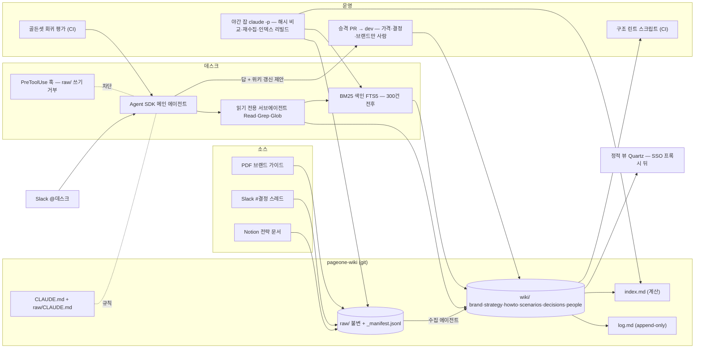

# 12장. 첫 4주 — 페이지원 구축 계획과 당신의 결정 목록

11장 끝에서 데스크는 골든셋 40문항 중 34문항을 통과했다고 해보자. 85%다. 나쁘지 않은 숫자다. 그런데 떨어진 여섯 문항을 하나씩 열어 보면, 이 책 전체가 거꾸로 되짚어진다.

첫 번째는 "일본 진출 일정?"이었다. 데스크는 7월 스레드의 "내년 상반기쯤"을 집어 들었다. 거부에 실패한 것이다. 6장의 답변 프롬프트는 "위키에 없으면 없다고"를 지시했지만, `decisions/` 페이지에 "미결"이 명시돼 있지 않아 모델은 논의를 결정으로 읽었다. 5장의 결정 vs 논의 구분이 페이지에 박혀 있지 않았다.

두 번째와 세 번째는 시간 질문이었다. "프로 플랜 지금 얼마야?"에 29,000원. 10장의 그 페이지다. 이번에는 `review_after`가 걸려 경고까지 떴는데, 수정 PR이 승격 큐에서 일주일째 사람을 기다리고 있었다.

네 번째는 "HubSpot에서 리드 단계 바꾸는 법?"의 변형이었다. 박태오가 "허브스팟 딜 스테이지 옮기기"라고 물었고, grep은 "허브스팟"을 못 찾았다. 7장에서 예고한 어휘 불일치다. 300건 전후에서 BM25로 가기로 한 전환점이 생각보다 빨리 왔다는 신호다.

다섯 번째는 인용 검사에서 떨어졌다. 답은 맞았는데 근거로 적은 문장이 그 커밋의 페이지에 없었다. 8장의 포인터 문제다.

여섯 번째는 전역 질문 "올해 마케팅 방향이 뭐야?"였다. 데스크는 Q3 전략 문서 하나만 읽고 답했다. 3장에서 전역 종합 질문에는 위키의 개요 페이지가 답해야 한다고 했고, 4장의 `strategy/` 디렉터리에 그 개요 페이지가 아직 없었다.

여섯 문항이 여섯 장을 가리킨다. @keane42443가 X에 올린 질문이 정확히 이 지점에서 나온다. "Yes, I set up Karpathy's LLM wiki. Now what?" 세팅은 끝났다. 이제 무엇을 하는가. 이 장은 그 "now what"에 답하려고 열한 장의 결정을 한 장으로 접는다.

### 다섯 묶음이 맞물리는 자리

되짚어 보면 열한 장의 결정은 다섯 묶음이다. 포지셔닝(1~3장), 저장 규약(4~5장), 스키마와 프롬프트(6장), 검색과 연결 경로(7~9장), 운영과 평가(10~11장). 나열하면 다섯 개의 독립된 결정처럼 보인다. 하지만 실제로는 한 줄기가 끝까지 이어진다. 예를 하나만 따라가 보자.

"페이지를 짧게 쓴다." 2장에서 이 결정의 근거를 봤다. Same Task, More Tokens가 500토큰을 넘으며 정확도가 0.92에서 0.68로 떨어진다고 했고, NoLiMa는 표기 컨텍스트와 유효 컨텍스트가 다르다고 했다. 4장에서 그 근거가 규약이 됐다. 모든 페이지 상단에 50자 이하 TL;DR, 토큰 예산 계층 L0~L3. 7장에서 같은 TL;DR이 다른 역할을 얻었다. Contextual Retrieval이 청크마다 붙이는 "맥락 문장"을 위키 페이지는 이미 상단에 갖고 있다는 것. 그래서 BM25로 넘어갈 때 색인 단위가 자연스럽게 정해졌다. 11장에서 그 짧은 페이지가 충실성 채점을 쉽게 만든다. 근거 페이지가 짧으면 "답이 그 페이지에서 나온 말만 하는가"를 코드로도 상당 부분 잴 수 있다. 하나의 결정이 근거 → 규약 → 색인 → 평가로 네 번 쓰였다.

같은 식으로 "원천 계층은 불변이다"를 따라가면 1장의 정의 → 6장의 "CLAUDE.md에 적는 건 소망" → 8장의 `PreToolUse` 훅 → 9장의 headless 에이전트 `wiki/` 쓰기 전용 → 10장의 승격 게이트로 이어지고, "모순을 뭉개지 않는다"를 따라가면 2장의 지식 충돌 연구 → 4장의 `contradicts` 필드 → 6장의 "어느 줄 vs 어느 줄" 출력 → 10장의 병기 규율 → 11장의 거부·시간 질문 채점으로 이어진다. 결정 목록을 볼 때 이 줄기를 기억해두자. 한 항목을 바꾸면 같은 줄기의 나머지가 따라 움직인다.

세 번째 줄기는 조금 다른 모양이다. "없으면 없다고 말한다"는 3장에서 포지셔닝의 조건으로 처음 나왔다. 위키를 지도로 쓰고 근거 문장은 원문에서 가져오기로 했으니, 지도에 없는 곳은 없다고 말해야 지도가 믿을 만해진다. 6장은 그것을 답변 프롬프트의 판정 단계로 옮겼고, 10장은 "결정"과 "논의"를 페이지에서 가르는 규율로, 11장은 골든셋의 거부 항목 20%로 바꿨다. 이 줄기는 앞의 둘과 달리 코드나 필드가 거의 없다. 프롬프트 한 줄, 페이지의 "미결" 한 단어, 평가의 한 열이다. 그래서 가장 쉽게 빠진다. 12장 오프닝의 첫 번째 실패가 바로 이 줄기에서 났다.

### 페이지원 전체 그림

그림 1. 페이지원 전체 아키텍처 — 소스 → `raw/` → `wiki/` → 데스크, 그리고 둘러싼 운영 루프

그림에서 화살표가 가장 많이 모이는 곳이 `wiki/`다. 수집이 쓰고, 서브에이전트가 읽고, 린트가 검사하고, 승격 PR이 고치고, 정적 뷰가 보여 준다. 그리고 `wiki/`로 들어가는 쓰기 화살표는 둘뿐이다. 수집 에이전트와 승격 PR. 데스크 자체는 `wiki/`에 직접 쓰지 않는다. 8장의 "답 + 위키 갱신" 두 출력 가운데 갱신 쪽은 PR로만 나간다. 이 한 가지 제약이 9장의 보안 격리와 10장의 승격 게이트를 한 번에 만족시킨다.

### 결정 목록

아래 열다섯 항목은 각 장이 끝에서 내린 결정이다. "이 책의 기본값"은 페이지원의 선택이고, "바꿔야 할 신호"는 당신 회사가 페이지원과 다를 때 그 항목을 다시 볼 조건이다. 표를 그대로 복사해 오른쪽에 "우리 회사" 열을 하나 더 붙이자. 열다섯 칸 가운데 기본값을 그대로 쓰는 칸은 비워 두고, 바꾸는 칸에만 이유를 적는다. 3장의 결정표가 "위키냐 RAG냐"를 정했다면, 이 표는 그 뒤의 열네 가지를 정한다. 다 채운 뒤 비어 있는 칸이 열 개를 넘으면 당신 회사는 페이지원과 비슷한 곳이고, 다섯 개 아래면 이 책의 기본값보다 당신의 조건이 더 많이 다르다는 뜻이니 2장의 근거부터 다시 읽는 편이 낫다.

| # | 결정 | 이 책의 기본값 (페이지원) | 바꿔야 할 신호 | 장 |
|---|---|---|---|---|
| 1 | 무엇을 짓는가 | 개인 연구 위키가 아닌 "조직의 기억". 소스를 브랜드·전략·도구·시나리오·결정 다섯 유형으로 본다 | 지식이 안정적인 연구 자료뿐이면 gist 원형 그대로가 더 가볍다 | 1 |
| 2 | 페이지 길이 | 짧고 밀도 있게, 주장마다 날짜 | 연구 근거라 바꿀 신호가 없다. 긴 원문이 필요한 유형은 L3로 분리 | 2 |
| 3 | 포지셔닝 | 위키 계층 + 근거 문장은 원문 + BM25 준비 | 규제·법무 인용이 필수면 원문 우선. 소스가 수천이면 하이브리드를 1주차에 | 3 |
| 4 | 디렉터리 | `raw/`·`wiki/{brand,strategy,howto,scenarios,decisions,people}`·`index.md`·`log.md` | 팀·도메인이 여럿이면 Global/Domain/Local 계층(토스 하네스 글 — 저자 스스로 가설이라 밝힘) | 4 |
| 5 | 프런트매터 | `origin`·`confidence`·`sources`·`last_verified`·`review_after`·`superseded_by`·`contradicts`·`valid_from/to` | 뷰어가 YAML을 그대로 노출하면 처리 분기 | 4 |
| 6 | 수집 단위 | 유형 분류 먼저, 스레드·섹션 단위로 작게, `_manifest.jsonl` 해시 | 얕은 요약·근접 중복 페이지가 보이면 단위를 더 쪼갠다 | 5 |
| 7 | 기록 규칙 | 기록 트리거(선택지·뒤집힌 결정·암묵 규칙·측정값) + do-not-record 목록 | 에이전트가 "기록할까요?"를 자주 물으면 목록이 모자란 것 | 5 |
| 8 | 스키마 | CLAUDE.md 200줄 이하, 절차는 스킬, 강제는 훅, `raw/CLAUDE.md` 분리 | 규약을 무시한다는 보고가 나오면 줄인다. 늘리지 않는다 | 6 |
| 9 | 답변 프롬프트 | 간결·근거 페이지 명시·"없으면 없다"·모순은 "어느 줄 vs 어느 줄" | 거부 항목 실패율이 오르면 프롬프트보다 페이지의 "미결" 표기를 먼저 본다 | 6 |
| 10 | 검색 계층 | 60건은 `index.md`+grep → 300건 전후 FTS5 BM25 → 벡터는 CS 시나리오만 | grep 지연, 어휘 불일치 실패, 한국어 BM25 약점이 보일 때 | 7 |
| 11 | 연결 경로 | Agent SDK(경로 A) 주 + 직접 API(경로 B)는 Slack 핫패스 | 문서 블록 인용·캐시 세밀 제어가 핵심이면 B를 주 경로로 | 8 |
| 12 | 호스팅 | (가) git 저장소 + 정적 뷰(SSO 프록시는 별도 확인) + 에이전트 서버 한 대 | 수백 페이지 + 다중 writer + 연속 write-back이 겹치면 DB 백엔드 | 9 |
| 13 | 권한 경계 | headless 에이전트는 `wiki/` 쓰기 전용·git 금지, 커밋은 스크립트 | 항상 유지 | 9 |
| 14 | 린트·승격 | 구조는 스크립트(CI), 의미는 모델(격주). 가격·결정·브랜드만 사람 승격 | 승격 큐가 밀리면 자율 범위를 넓히고 사후 감사로 | 10 |
| 15 | 평가 | 골든셋 20~50(거부 20%) + 인용 코드 검사 + pass^k 회귀 CI | 전부 통과하면 최근 실패로 보충 | 11 |

### 첫 4주

열다섯 항목을 한꺼번에 하려 들면 Theo James의 3주 공백이 온다. 순서를 정하자. 각 주 끝에 "멈춰야 할 신호"를 둔 이유는, 그 신호가 떴는데 다음 주로 넘어가면 나중에 두 배로 돌아오기 때문이다.

| 주 | 만드는 것 | 끝났다는 기준 | 멈춰야 할 신호 |
|---|---|---|---|
| 1주 | `pageone-wiki` 저장소, 디렉터리, CLAUDE.md·`raw/CLAUDE.md`, 다섯 유형 템플릿, 소스 10건 손으로 수집, 골든셋 씨앗 6문항 | 10건이 각자 맞는 디렉터리의 페이지가 되고 `index.md`가 계산된다 | 10건 중 셋 이상이 얕고 균일한 요약이면 소스 단위를 더 쪼갠 뒤 진행 |
| 2주 | 데스크 v0(경로 A), 읽기 전용 서브에이전트, `PreToolUse` 훅, `index.md`+grep, 씨앗 6문항 수동 시행 | 6문항 중 거부 1문항을 포함해 5문항 통과 | 훅 없이 돌려 본 세션이 하나라도 `raw/`를 건드렸으면 훅부터 |
| 3주 | 소스 60건, 구조 린트 스크립트 + CI, 야간 잡(해시 비교·인덱스 리빌드), 정적 뷰 | 린트가 CI에서 돌고 첫 결과(고아·끊긴 링크)를 처리했다 | 60건 수집에 토큰·시간이 예산의 두 배를 넘으면 배치 크기 조정 |
| 4주 | 승격 PR 흐름(가격·결정·브랜드), 검토 주기 표 적용, 골든셋 40문항 + 회귀 CI, 팀 공개(`@데스크`) | 회귀 평가가 CI에서 돌고 pass^3 기준 점수가 찍혀 있다 | 거부 항목이 절반 이상 떨어지면 공개를 한 주 미룬다 |

순서에 이유가 있다. 1주차에 소스를 손으로 10건만 넣는 것은 5장의 교훈이다. 노션 35개를 한 번에 던진 월요일이 어떻게 끝났는지 봤다. 10건이면 유형별로 두 건씩이고, 그 10건의 페이지를 사람이 전부 읽어 볼 수 있다. 템플릿이 틀렸으면 여기서 드러난다. 2주차에 훅을 데스크 v0와 같은 주에 두는 것은 6장과 8장의 교훈이다. 훅 없는 에이전트를 하루라도 돌리면 `raw/`가 깨끗하다는 보장이 사라진다. 3주차에 린트와 야간 잡을 정적 뷰보다 먼저 두는 것은 10장의 교훈이다. 사람이 읽기 시작하면 틀린 페이지가 바깥으로 새기 시작하니, 그물을 먼저 친다. 4주차의 회귀 평가가 팀 공개와 같은 주인 것은 11장의 교훈이다. 공개 첫 주의 실패가 골든셋의 가장 좋은 재료다.

2주차 끝에 팀에 공개하고 싶은 유혹이 생긴다. 참는 편이 낫다. 9장에서 봤듯 공개하는 순간 identity·visibility·concurrency·audit 같은 것들이 한꺼번에 필요해지고, 그 준비가 3~4주차다. 데스크가 틀린 답을 한 번 하면 박태오가 다시 물어보기까지 몇 주가 걸린다.

### 사례 대조표 — 남들은 무엇이 깨졌나

페이지원은 가상이다. 아래는 실제 운영자들의 보고를 한 표로 모은 것이다. 전부 자기 보고이고 통제군은 없다. "숫자" 열은 규모감으로만 읽자. 서로 비교할 수 있는 값은 아니다.

| 보고자 (시점) | 규모·스택 | 깨진 것 | 숫자 (자기 보고) |
|---|---|---|---|
| Taktile (회사, 2026-07) | 사내 Q&A 에이전트, 마크다운+프런트매터, 범주별 서브위키, 주간 린트 잡 | 소스가 조용히 바뀜, grep 부적합, LLM이 쓴 인덱스 오류 | 라이브 조회 9m40s·$2.50 → 위키 답변 1m19s·$0.98 |
| Casey Newton / Platformer (언론, 2026-08) | Obsidian + Claude, 아카이브 시드 + 일일 클리핑 | 상시 유지보수, Claude 문체 때문에 재작성 | 약 한 달에 1,440+ 페이지 |
| Jim Liu (개인, 6개월, 2026-05) | Obsidian + Claude Pro, schema.md 중심 | 린트 건너뛰자 고아·미표시 모순, 모순 덮어쓰기 | 하루 ~15분, 주간 린트 20분, 격주 모순 패스 <$0.40 |
| Eugeniu Ghelbur (에이전시, 6개월, 2026-04) | 슬래시 커맨드 31개 + 예약 에이전트 4개 | 50~100 소스에서 1차 붕괴, 수백 페이지에서 모순 폭증 | /research-deep $0.40~0.80, 변경 24시간 유예 |
| @vellumkasane (4곳 운영, 2026-09) | Claude Code + 훅 + 150줄 린트 | `raw/` 수정, 미커밋, 고아, 과잉 질문 | 2주 안에 4건 |
| @techwithhari (마케팅 KB, 2026-05) | Cognee → 마크다운 9페이지 + AGENTS.md | 이전 파이프라인 3회+ 고장 | $35/월 → ~$0(토큰 제외), 자기 평가 3/10 → 7/10 |
| HagaiHen (팟캐스트 위키, 2026-10) | CLAUDE.md 절차, 몇 시간마다 무인, launchd | 근접 중복 페이지 | 60회 → 69 개념 페이지 |
| orcosto-lab (2026-09) | 세션 감사 | 작업 중 위키를 안 읽음 | 9세션 중 2세션이 기록된 교훈을 재진단 |
| clue.oz4e (PyTorchKR, 수개월) | 자체 구현 → 위키=지도 + 하이브리드 RAG | 페이지 누락, 없는 답 환각, 조용한 노후화 | recall@5 93% |
| 카일라스 (클리앙, 2026-04) | JSON 메모 500+ | 느림 | 등록 20분+, 답변 "대부분 유사" |
| Theo James (개인, 2026-04) | 개인 | 2주 뒤 사용 감소, 3주 공백 뒤 ingestion debt | — |
| lucasastorian/llmwiki 이슈 | 호스팅 + MCP | #93 삭제가 원본 삭제·린트가 전 페이지 stale, #47 370파일 검색 불가, #52 인용 단위 미정의 | — |

표를 세로로 읽으면 "깨진 것" 열에 같은 단어가 반복된다. 조용히, 모순, 고아, 중복, 유지보수. 10장이 이 책에서 가장 긴 장이 된 이유다.

그리고 빈 줄이 하나 있다. 국내 회사의 사내 도입 후기다. 토스 Topic, 토스페이먼츠 하네스, 우아한형제들 물어보새, LY Corporation의 글은 이 책이 여러 번 빌린 참조점이지만, LLM 위키 패턴 그 자체를 사내에 들인 기록은 아니다. 리서치 시점(2026년 10월) 기준으로 그 기록은 사실상 없었다. 이 책을 읽고 페이지원 같은 걸 만든 독자가 그 첫 기록을 남기게 될 것이다.

### 이 책이 답하지 못한 것

정직하게 남겨 둘 것이 넷 있다.

첫째, "LLM이 유지보수하는 위키" 자체를 다룬 동료심사 논문은 찾지 못했다. 2장의 근거는 전부 인접 연구다. 컨텍스트 길이, 메모리 아키텍처, 지식 편집, 지식 충돌. 가장 가까운 2026년 논문 셋(Retrieval as Reasoning, Is Grep All You Need, 자동 생성 AGENTS.md)은 2차 요약만 확보했다. 이 책의 설계 결정은 "인접 연구 + 자기 보고"를 근거로 삼고 있고, 그 사실을 장마다 밝히려 했다.

둘째, 비결정성을 통제한 실험이 없다. 같은 소스를 두 번 수집하면 얼마나 다른 페이지가 나오는지, 모델을 바꾸면 위키가 얼마나 달라지는지. 10장은 반복 검증 사다리라는 실무 대응을 제시했지만 측정은 아무도 하지 않았다.

셋째, 사내 지식 베이스에서 정작 가장 먼저 물을 질문, 즉 권한 인지 검색(이 사람이 볼 수 있는 페이지만 근거로 쓰는가), 개인정보, 감사 로그를 1차 자료로 다룬 글을 찾지 못했다. 9장의 권한 경계는 에이전트가 무엇을 못 하게 할지까지만 다뤘다. 누가 무엇을 볼 수 있는지는 당신 회사의 SSO와 정책 위에서 당신이 설계해야 한다.

넷째, 국내 사례의 부재는 위에서 말했다.

이 넷은 책의 한계이자, 독자가 직접 만들게 될 지식이다. `pageone-wiki`에 첫 커밋을 하는 순간부터 이 책에 없는 데이터가 쌓이기 시작한다. gist 첫날 alinawab이 던지고 답을 받지 못한 질문, "What's the failure mode? Where does it start fighting you?"에 대한 답도 그 데이터 안에 있을 것이다.

### 위키가 쌓는 것

1장에서 Karpathy의 문장으로 시작했다. "There's no accumulation." RAG는 매번 처음부터 다시 발견하고, 위키는 쌓인다. 열한 장을 지나온 지금, 그 쌓이는 것이 정확히 무엇인지 한 번 더 묻고 끝내자.

답이 쌓이는 건 아니다. 데스크의 답은 매번 새로 만들어진다. 쌓이는 것은 페이지이고, 페이지에 쌓이는 것은 사실만이 아니다. 가격 페이지의 `superseded_by`는 29,000원이 왜 39,000원이 됐는지를 가리키고, `decisions/`의 "확장 보류" 페이지는 6월의 "추진"이 8월에 왜 뒤집혔는지를 담는다. 당근이 AI월드 2026 발표에서 한 말이 이것이다. "판단의 결과뿐 아니라 이유와 근거를 남겨야 다음 사람과 에이전트가 이를 바탕으로 일할 수 있다." 위키가 쌓는 것은 결정의 이유다.

그리고 그 이유를 남기는 일은 아직 사람의 몫이다. 데스크는 "39,000원"을 읽을 수 있고, 한서진이 8월 20일 스레드에 "네이버 광고비가 줄어든 만큼 제품에 투자하려면 이 가격이어야 한다"고 쓴 문장도 읽을 수 있다. 하지만 그 문장이 거기 있으려면 한서진이 써야 했다. gist의 역할 분담, "You're in charge of sourcing, exploration, and asking the right questions. The LLM's job is everything else."에서 사람 몫의 핵심은 소스를 고르는 일이고, 소스에 이유가 적혀 있게 하는 일이다.

그러니 월요일에 `pageone-wiki`의 첫 커밋을 만들 때, 디렉터리 여섯 개와 CLAUDE.md와 함께 한 가지를 더 챙기자. 다음 #결정 스레드에서 누군가 결정을 내릴 때 "왜"를 한 줄 적어 달라고 부탁하는 것. 위키는 LLM이 쓴다. 그 한 줄은 사람이 쓴다. 그 한 줄이 여섯 달 뒤 데스크가 유창하게 맞는 답을 하게 만드는, 이 책에서 가장 싼 설계 결정이다.
