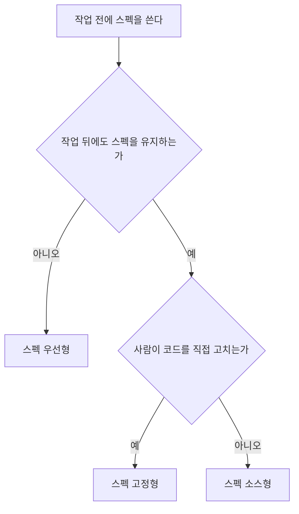
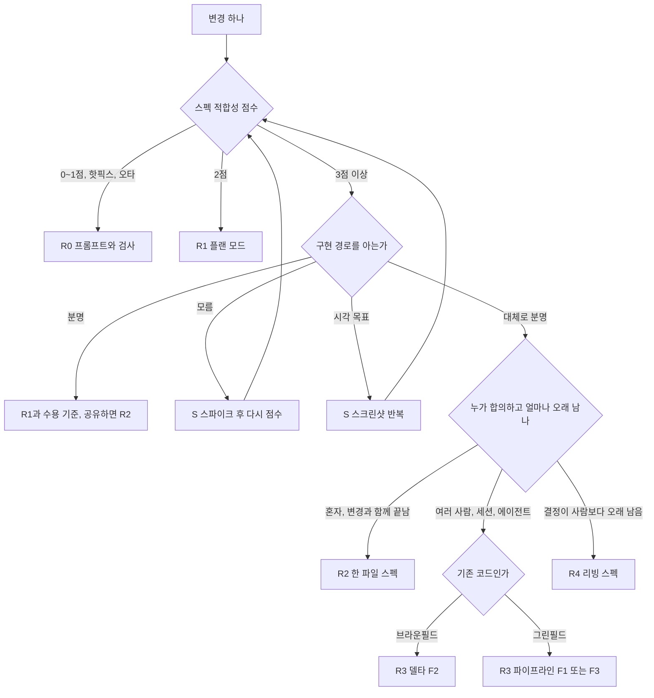

# AI 코딩 에이전트와 함께하는 스펙 주도 개발(SDD) 레퍼런스

- 대상 책: 『SDD 가이드북』 (genre: tech-book, slug: `sdd-guidebook`)
- 대상 독자: AI 코딩 에이전트(Claude Code, Codex, Cursor, Copilot 등)를 이미 쓰는 현업 개발자
- 책의 흐름: (1) SDD 개념 → (2) 도구 지형·기능·차이 → (3) 도구 없이 처음부터 SDD → (4) 가장 쓸모 있는 도구로 개발하기 → 전 과정에 스펙 문서 실물 예시
- 합성 시점: 2026-11-10. 입력 4종(`research/sdd-report.md` 2026-11-09 검증, `research/web.md`·`papers.md`·`community.md` 2026-11-10 수집)
- 이 문서는 이후 저술가와 fact-checker의 대조 기준이다. 원문 수치·날짜·버전·인물 귀속은 원문 표현 그대로 옮겼다. 1차 대조 근거는 `research/*.md`이며, 이 문서와 원본이 어긋나면 원본이 우선한다.

## 읽는 법

### 출처 태그

모든 주장 끝에 `[유형|파일-번호]` 태그를 붙인다.

| 태그 | 뜻 | 원본 위치 |
|---|---|---|
| `[웹|web-N]` | `research/web.md`의 자료 N (공식 저장소·문서, 2026-11-10 접근) | web.md "자료 N" |
| `[논문|pap-N]` | `research/papers.md`의 논문 N | papers.md "논문 N" |
| `[커뮤니티|C N]` | `research/community.md`의 출처 C N | community.md 끝 출처 목록 |
| `[웹|rpt rN]`, `[논문|rpt rN]`, `[커뮤니티|rpt rN]` | `research/sdd-report.md`의 참고 문헌 rN. 유형은 이 문서가 출처 성격으로 분류 | sdd-report.md 3022행 이후 참고 문헌 |
| `[보고서 §N]` | 보고서의 해당 절 자체의 종합 판단 | sdd-report.md 절 번호 |

출처 유형 분류 기준: 공식 문서·저장소·제조사 블로그·컨설팅/업체 블로그·뉴스 = 웹, arXiv·학회·저널 = 논문, 개인 실무 블로그·포럼(HN, Reddit, GeekNews, GPTers, Qiita, Zenn 댓글·글)·GitHub 이슈 = 커뮤니티. 개인 실무자 블로그 중 보고서가 웹으로 등록한 것(Scott Logic 등 회사 블로그)은 웹으로 둔다.

### 근거 표시

| 표시 | 뜻 |
|---|---|
| (측정) | 벤치마크, 통제 실험, 저장소 채굴, 팀 지표, 저자 본인 계측에서 나온 숫자 |
| (주장) | 제조사·저자·경쟁 도구 제작자가 자기 도구나 경험에 대해 한 말. 커뮤니티 자기 보고 포함 |
| (추론) | 보고서 또는 리서처 또는 이 합성이 여러 출처를 묶어 낸 판단 |
| **확인 필요** | 출처가 불분명하거나, 검색 스니펫·익명 주장·메타 정보만 있는 항목 |

### 버전·시점 표기

- "{버전}/{날짜} 기준"으로 못 박는다. 보고서 값은 2026-11-09, web.md 값은 2026-11-10 GitHub API 조회값이다.
- **web.md와 보고서가 어긋나면 web.md(더 새로운 1차 출처)를 따른다.** 어긋남은 모두 §9 "충돌 기록"에 모았다.
- 별 수와 다운로드 수는 관심·요청을 셀 뿐 채택을 세지 않는다 [보고서 §5.6]. 본문에서 순위 근거로 쓰지 않는다.

---

## 0. 한눈에 보는 버전 기준표

| 도구 | 최신 릴리스 (web.md, 2026-11-10 조회) | 보고서 기준값 (2026-11-09) | 라이선스 | 비고 |
|---|---|---|---|---|
| GitHub Spec Kit | **v1.3.3** (2026-11-09 20:40 UTC) | v1.3.2 (2026-11-06) | MIT | 1.0.0은 2026-08-21 [웹|rpt r35] |
| OpenSpec | **v1.17.0** (2026-11-09 23:46 UTC) | v1.16.1 (2026-11-07) | MIT | v1.17.0이 2.0에서 `/opsx:*` 명령 파일 제거를 예고 [웹|web-13] |
| cc-sdd | v3.1.0 (2026-09-23) | 같음 | MIT | 마지막 푸시 2026-10-22 [웹|web-16] |
| BMAD Method | v6.12.4 안정판 (2026-10-14) | 같음 | MIT + 상표 (GitHub API는 NOASSERTION) | v7은 main 브랜치 미리보기 알파, README상 2026-11 중순 출시 예정 [웹|web-19] |
| Superpowers | v7.0.2 (2026-11-03) | 같음 | MIT | v7.0.0(2026-10-10)에 brainstorming 재작성 [웹|web-21] |
| mattpocock/skills | v1.3.2 (2026-10-29) | 같음 | MIT | 마지막 푸시 2026-11-09 [웹|web-23] |
| Kiro | 독점 제품, 버전 번호 없음 | GA 2025-11-17 | 독점 | `kirodotdev/Kiro`는 이슈·문서용 저장소 [웹|rpt r39] |
| Claude Code | 2.1.319 (로컬 설치본 `claude --version`) | - | - | 문서는 버전 표기 없음 [웹|web-26] |

> 경고 (web.md 원문 취지): 빠르게 변하는 영역이다. Spec Kit과 OpenSpec은 보고서 검증일 이후 하루 사이에 새 릴리스가 나왔다. 원고 확정 직전에 이 표를 다시 조회한다 [웹|web-0].

---

## 1. 개념과 정의

### 1.1 SDD의 작업 정의

> **작업 정의 (보고서).** 스펙 주도 개발(SDD)은 AI 에이전트에게 코드를 맡기기 전에 구조화된 자연어 스펙을 먼저 쓰고, 그 스펙을 사람과 에이전트가 함께 따르는 기준으로 삼는 개발 방식이다 [보고서 §1.1].

출처마다 정의의 강조점이 다르다 [보고서 §1.1].

| 출처 | 날짜 | 스펙이란 | 강조점 | 태그 |
|---|---|---|---|---|
| Birgitta Böckeler (Thoughtworks) | 2025-10-15 | 코드보다 먼저 쓰는 구조화된 행동 중심 자연어 산출물 | 스펙이 사람과 에이전트 모두의 진실 원천. 모든 세션에 들어가는 메모리 뱅크와 구분 | [웹|rpt r1] |
| GitHub, Den Delimarsky | 2025-09-02 | 프로젝트와 함께 진화하는 살아 있는 실행 가능한 산출물 | 일회용 문서가 아님 | [웹|rpt r2] |
| Spec Kit 선언문 `spec-driven.md` | 저장소 문서 | 코드가 섬기는 대상 | 권력 역전(The Power Inversion). 코드가 스펙을 따르고 유지보수는 스펙을 진화시키는 일 | [웹|rpt r59] |
| Marc Brooker (AWS) | 2026-04-09 | 요구사항과 핵심 설계 결정을 명시한 문장 | 코드보다 위(upstream). 자유 형식도, RFC 2119나 EARS 같은 구조 형식도 됨 | [웹|rpt r60] |
| Wikipedia | 문서 항목 | 문서 주도 개발의 한 유형 | Ostroff, Makalsky, Paige의 2004년 논문 "Agile Specification-Driven Development"(TDD + Design by Contract)를 인용. 이 논문을 용어의 첫 공개 사용으로 보는 것은 specdriven.com 연표 | [웹|rpt r62][웹|rpt r61] |

- 공통점: 스펙이 코드보다 먼저 오고 코드가 스펙을 따른다 (추론) [보고서 §1.1]. 차이는 스펙의 수명이다. GitHub·Spec Kit 선언문은 스펙이 계속 산다고 보고, Böckeler는 대부분 도구가 실제로 작업 전 스펙에서 멈춘다고 본다 [웹|rpt r1].
- Böckeler 경고: 이 용어는 이미 "semantically diffused" 상태이고, 어떤 사람은 자세한 프롬프트의 동의어로 쓴다 [웹|rpt r1].
- 한 줄 정의(보고서 "세 문장" 요약): 방법은 작업 뒤 스펙이 어떻게 되는가에 따라 스펙 우선형·스펙 고정형·스펙 소스형으로 나뉘고, 2026년 11월 현재 도구는 대부분 스킬이나 플러그인으로 배포되며, 보고서가 확인한 하네스 11개가 읽기 전용 계획 단계를 내장한다 (추론) [보고서 한눈에 보기].

### 1.2 스펙, 메모리 뱅크, 플랜은 다르다

| 구분 | 범위 | 언제 읽히나 | 수명 | 예 | 태그 |
|---|---|---|---|---|---|
| 스펙(spec) | 기능 하나 또는 변경 하나 | 그 기능을 만들 때 | 작업 뒤 버리거나, 유지하며 코드와 함께 고침 | Kiro `requirements.md`, OpenSpec 스펙 델타 | [웹|rpt r14][웹|rpt r27] |
| 메모리 뱅크(memory bank) | 프로젝트 전체 | 모든 세션에 공통 | 프로젝트가 끝날 때까지 | `AGENTS.md`, `CLAUDE.md`, Kiro 스티어링(`product.md`, `tech.md`, `structure.md`), Spec Kit 헌법 파일 | [웹|rpt r63][웹|rpt r64][웹|rpt r59] |
| 플랜(plan) | 이번 작업 하나 | 승인 직후 구현 동안 | 보통 작업 하나 동안 | Claude Code 플랜 모드, Cursor Plan Mode, Codex ExecPlan | [웹|rpt r65][웹|rpt r5][웹|rpt r66] |

- 보고서는 플랜의 수명을 "작업 하나 동안, Cursor는 저장 선택지"로 적었지만, Claude Code 플랜도 실제로는 `~/.claude/plans`에 **파일로** 저장되며 `plansDirectory`로 저장소 안에 둘 수 있다 [웹|web-26] (→ §9 충돌 #7).
- 리빙 계획 패턴: OpenAI Cookbook의 ExecPlan은 Progress(시각이 붙은 체크박스), Surprises & Discoveries, Decision Log, Outcomes & Retrospective를 필수 리빙 절로 두고, 처음 보는 사람이 계획 파일 하나만 읽고 작업을 재개할 수 있어야 한다고 쓴다. 쿡북 페이지는 보관 표시가 붙어 있다 [웹|rpt r66][웹|rpt r154].

### 1.3 분류 A: 스펙의 수명 (Böckeler 3수준)

| 수준 | 영문 | 스펙의 운명 | 사람이 고치는 것 | 대표 사례 | 태그 |
|---|---|---|---|---|---|
| 스펙 우선형 | spec-first | 작업 전에 쓰고 그 작업에 씀. 작업 뒤 버려지거나 방치될 수 있음 | 스펙과 코드 | Kiro, Spec Kit | [웹|rpt r1] |
| 스펙 고정형 | spec-anchored | 작업 뒤에도 남고 스펙과 코드를 함께 바꿈 | 스펙과 코드를 같이 | OpenSpec 아카이브 병합, Tessl의 목표 | [웹|rpt r1][웹|rpt r27] |
| 스펙 소스형 | spec-as-source | 스펙만 원본, 코드는 스펙에서 재생성 | 스펙만 | Tessl Framework 실험 | [웹|rpt r1][웹|rpt r67] |

- 모든 SDD 접근은 스펙 우선형에서 출발하고, 유지 전략을 정한 도구는 적다. 그래서 대부분 도구는 실제로는 스펙 우선형이다 [웹|rpt r1].
- 한국어 독자는 요즘IT 번역본(안영회 역, 2025-12-01, 읽은 시점 조회 12.6K)으로 접한다. 번역본 용어는 "스펙 우선", "스펙 고정형", "스펙을 소스로" [웹|rpt r68]. 보고서와 이 레퍼런스는 "스펙 소스형"으로 통일한다.
- 학술 수용: Piskala(2026-01)와 Alenezi(2026-07, SGRM) [논문|rpt r69][논문|rpt r70].
- 스펙 소스형의 이론적 끝: Monperrus 시연. 926단어 스펙과 Claude Code의 첫 구현에서 출발해, 새로 생성한 에이전트가 같은 스펙을 처음부터 다시 올바르게 구현 (측정, 시연 1회). IEEE Software 게재 예정 [논문|rpt r71][논문|rpt r227].
- 스펙 소스형은 아직 실험이다. Tessl은 2025-09 Framework(비공개 베타)·Spec Registry 공개 후 2026-01-29 스킬 패키지 관리 플랫폼으로 전환 (추론, 약 4개월 만의 방향 전환) [웹|rpt r67][웹|rpt r82].



### 1.4 분류 B: 과정의 차원 (학계)

- de Macedo(2026-06) 여섯 차원: 명세(specification), 컨텍스트(context), 역할(roles), 실행(execution), 검증(validation), 이식성(portability). Spec Kit, OpenSpec, BMAD, GSD, Spec Kitty, Reversa에 적용. **여섯 차원을 모두 강하게 다루는 프레임워크는 없음**, 프레임워크들은 영속 산출물·작업 계약·추적성·사람 검토로 수렴, 과정 깊이와 이식성이 교환된다 [논문|rpt r72][논문|rpt r220].
- Díaz 등(2026-08): 기술 하네스(technical harness, 에이전트를 감싼 도구 환경) vs 방법론 하네스(methodological harness, 팀을 감싼 절차와 합의). 상호작용 패턴 5개. 바이브 코딩이 잃는 책임성·검증 가능성·이전 가능성을 SDD가 되찾는다고 주장 (주장). 주로 회색 문헌 기반 개념 분석이고 저자도 근거 기반이 미성숙하다고 밝힘 [논문|rpt r73][논문|rpt r74].
- 하네스 엔지니어링(harness engineering): 스펙, 컨텍스트, 센서(테스트·검사), 훅을 조합해 에이전트 행동을 설계하는 일 [웹|rpt r75]. Böckeler(2026-04-02): 기능 스펙은 피드포워드 가이드, 테스트·검사는 센서. 사람이 원하는 바를 명확히 정하지 않으면 정확성은 어떤 센서도 잡지 못한다 [웹|rpt r75].

### 1.5 분류 C: 보고서의 계열 F1~F8 (추론)

**이 분류는 보고서의 분류이며 연구 노트를 종합한 추론이다** [보고서 §1.5]. 책에서 쓸 때 "이 책(또는 참고 보고서)의 분류"라고 밝힌다.

| 기호 | 계열 | 무엇이 스펙인가 | 대표 도구 |
|---|---|---|---|
| F1 | 단계 게이트형 파이프라인 | 요구사항 → 설계 → 태스크 문서 사슬과 단계별 승인 | Spec Kit, Kiro 스펙, cc-sdd |
| F2 | 변경 델타형 | 변경마다 쓰는 제안과 스펙 델타. 끝나면 리빙 스펙에 병합 | OpenSpec |
| F3 | 역할 시뮬레이션형 | PM, 아키텍트 같은 역할 에이전트가 차례로 만드는 문서 | BMAD, gstack |
| F4 | 스킬 규율형 | 고정 문서 대신 질문·계획·TDD·리뷰 습관을 강제하는 스킬 | Superpowers, mattpocock/skills |
| F5 | 계획-실행 루프형 | 계획 파일이나 태스크 그래프를 새 컨텍스트에서 반복 실행 | GSD, Taskmaster, Ralph 루프 |
| F6 | 네이티브 플랜 모드 | 하네스 내장 읽기 전용 계획 단계의 결과 | Claude Code 플랜 모드, Cursor Plan Mode |
| F7 | 스펙 소스형 실험과 역공학 | 코드를 재생성하는 원본 스펙, 또는 기존 코드에서 복원한 스펙 | Tessl Framework(전환됨), Reversa |
| F8 | 검증 중심형 | 테스트, 속성, 계약, 형식 명세처럼 기계가 판정하는 스펙 | VSDD, Kiro 속성 기반 테스트, Specmatic MCP |

- 계열과 수준은 다른 축이다. F1 도구도 대부분 스펙 우선형이고, F2 OpenSpec은 아카이브 단계로 스펙 고정형에 가깝다 (추론) [보고서 §1.5].
- 2026년 SDD 도구는 세 갈래로 다시 묶인다 (추론) [보고서 §3.1]: 문서 파이프라인(F1·F2·F3·F7, 통제 단위 = 문서와 승인 관문) / 스킬 규율(F4, 통제 단위 = 질문·계획·TDD·리뷰 스킬) / 계획-실행 루프(F5, 통제 단위 = 반복 단위와 진행 기록).

### 1.6 왜 지금인가: 2025년 열 달 사이 몰려 나온 도구와 동인

| 날짜 | 방법 | 계열 | 공개 형태 | 태그 |
|---|---|---|---|---|
| 2025-02-16 | Harper Reed "My LLM codegen workflow atm" (`spec.md` → `prompt_plan.md` → `todo.md`) | 도구 없음 | 블로그 글 (한국어판 있음) | [커뮤니티|C1] |
| 2025-03-04 | Taskmaster | F5 | 저장소 생성 | [웹|rpt r80] |
| 2025-04-13 | BMAD | F3 | 저장소 생성 | [웹|rpt r77] |
| 2025-07-14 | Kiro | F1 | 제품 발표 | [웹|rpt r89] |
| 2025-07-14 | Ralph 루프 | F5 | Geoffrey Huntley 블로그 글 | [웹|rpt r81] |
| 2025-07-17 | cc-sdd | F1 | 저장소 생성 | [웹|rpt r45] |
| 2025-08-05 | OpenSpec | F2 | 저장소 생성 | [웹|rpt r27] |
| 2025-09-02 | Spec Kit | F1 | 발표 (저장소는 2025-08-21 생성) | [웹|rpt r2] |
| 2025-09 (2025-09-23 직전 주) | Tessl Framework, Spec Registry | F7 | 베타 공개 | [웹|rpt r67] |
| 2025-10-09 | Superpowers | F4 | 발표와 저장소 생성 | [웹|rpt r90] |
| 2025-11-17 | Kiro GA | F1 | 정식 출시 | [웹|rpt r38] |
| 2025-12-14 | GSD | F5 | 저장소 생성 (지금은 GSD Core) | [웹|rpt r92] |
| 2026-02-03 | mattpocock/skills | F4 | 저장소 생성 | [웹|rpt r24] |

- Harper Reed 글(2025-02)은 보고서 7절 연대표(2025-07 Kiro부터 시작)보다 앞서 "도구 없는 SDD" 3파일 구성을 보여 주는 역사적 기준점이다 (추론) [커뮤니티|C1].
- 동인 다섯 가지 [보고서 §1.6]: (1) 에이전트가 한 번에 오래 일하게 됨 — 긴 작업에 대화 기록 밖의 기준 문서가 필요 (추론) [웹|rpt r66][웹|rpt r81][웹|rpt r79]; (2) 대화만으로 만든 결과는 남지 않음 (Díaz, 주장) [논문|rpt r73]; (3) 바이브 코딩 반작용 — Sean Grove(OpenAI)가 2025 AI Engineer World's Fair에서 스펙이 프로그래밍의 기본 단위가 된다고 말함 (주장) [웹|rpt r94]; (4) 자연어 스펙이 실행 가능해짐, 대신 비결정성이 더해짐 [웹|rpt r1]; (5) "The Specification Paradox": AI가 코드를 잘 만들수록 사람이 쓴 올바른 스펙에 더 의존 (주장) [논문|rpt r95].
- 주의: Sean Grove 발표의 "코드는 손실 투영" 주장은 **확인 필요**(열어 본 요약에 그 말이 없음) [보고서 부록 C.5].

### 1.7 SDD는 오래된 실천을 다시 묶는다

| 이전 실천 | 시기 | SDD가 물려받은 것 | 그때의 한계 | 태그 |
|---|---|---|---|---|
| 모델 주도 개발(MDD), OMG MDA | MDA 2001 | 원본 모델에서 코드 생성. 스펙 소스형이 되살림 | 업무용 앱에서 절차 부담. Böckeler는 경직성과 비결정성을 함께 안을 위험을 경고 | [웹|rpt r1][웹|rpt r61] |
| Design by Contract | 1986 (Meyer, Eiffel) | 사전조건·사후조건·불변식을 먼저 적는 습관. Ostroff 등 2004가 TDD와 결합 | 당시 실패 원인의 직접 근거는 없음 | [웹|rpt r61][웹|rpt r62] |
| TDD | 약 2000 (Kent Beck) | 테스트를 먼저 쓰는 일 = 작은 스펙. Spec Kit 헌법 예시의 Test-First, Superpowers·cc-sdd의 RED-GREEN | 테스트만으로 기능·아키텍처 수준 의도를 다 적기 어려움 (추론). Piskala는 SDD를 이 수준으로 끌어올린 TDD로 봄 | [웹|rpt r59][논문|rpt r69] |
| BDD, Gherkin | Cucumber 2008 | Given/When/Then. Kiro·OpenSpec의 WHEN/THEN 시나리오. Piskala는 BDD를 SDD의 가장 직접적인 조상으로 봄 | 좋은 Gherkin을 코드와 맞춰 두기 어려웠음 | [웹|rpt r97][논문|rpt r69] |
| IDL, Thrift, OpenAPI | CORBA IDL, Thrift 약 2007, OpenAPI | 스키마 우선, 생성물은 고치지 않고 재생성. 계약 테스트(Specmatic, Pact)로 이어짐 | 기계가 읽는 형식은 API 경계에만 쓰임 (추론) | [웹|rpt r97] |
| 형식 명세 (VDM, Z, B, TLA+) | VDM 1960년대, Z 1970년대 말, B 1990년대 (TLA+ 날짜는 출처에 없음) | 기계가 참·거짓을 판정하는 스펙. F8 방향 | Brooker는 TLA+·Lean 같은 형식 언어를 필요할 때만 가끔 쓴다고 함 | [웹|rpt r61][웹|rpt r60] |
| 문학적 프로그래밍 (Knuth) | 유비 | 설명 문서와 코드를 함께 두는 생각 | **계보가 아니라 유비**. 직접 잇는 1차 출처 없음 | [웹|rpt r98] |
| 요구공학 | 전통 | 요구 문형, 추적성, 수용 기준 | 모호하지 않은 스펙은 원래 어려웠음. 낡은 스펙이 쌓이면 스펙 부채 | [웹|rpt r1][논문|rpt r95] |
| EARS | 2009 (Rolls-Royce) | `WHEN [조건] THE SYSTEM SHALL [동작]`. Kiro·cc-sdd `requirements.md`가 씀 | 실패한 실천이 아님. 지금도 쓰임 | [웹|web-12][논문|pap-1] |

- 반복되는 실패 원인: 스펙과 코드를 맞춰 두는 비용이 이득보다 컸다. 2025년 도구가 다르다는 주장은 에이전트가 그 비용을 대신 진다는 데 있다 (추론) [보고서 §1.7].
- 주의: Meyer 1992 "Applying Design by Contract"는 **메타만 확인**. 본문에 Meyer의 문장을 인용하려면 원문 확인 필요 [논문|pap-19].

### 1.8 의견의 흐름: 여섯 국면 (2025 중반 ~ 2026-11)

국면 구분은 보고서의 종합이다 (추론) [보고서 §7.2].

| 국면 | 시기 | 무엇이 일어났나 | 대표 태그 |
|---|---|---|---|
| 1. 비전 | 2025 중반 | 스펙을 새 진실의 원천으로 제시. 정성적 주장, GitHub 공개 글에도 데이터 없음 | [웹|rpt r94] |
| 2. 첫 체험과 반발 | 2025-10~12 | 절차 부담, 마크다운 검토 피로, 워터폴 같은 느낌. Radar Assess | [웹|rpt r283][웹|rpt r287][웹|rpt r290] |
| 3. 반박과 재구성 | 2026-01~05 | "워터폴이 아니다" 반박(스펙이 버전 관리되고 코드와 함께 바뀜). Beck·Fowler는 사전 가정에 반대. Kiro는 설계 우선·버그픽스 스펙으로 적응 | [웹|rpt r306][웹|rpt r297][웹|rpt r307][웹|rpt r292] |
| 4. 도구 정렬 | 2026 봄 | 무거운 도구(Spec Kit, BMAD, GSD)와 가벼운 도구(OpenSpec)를 비용으로 비교. Radar는 브라운필드 스펙 델타에 주목 | [웹|rpt r217][웹|rpt r12] |
| 5. 피로 | 2026 여름 | "SDD는 어떻게 됐나". 모델이 좋아져 plan.md와 검증 루프로 충분한 경우가 많다는 답 | [커뮤니티|rpt r301][웹|rpt r299] |
| 6. 정착한 중간 지대 + 하네스 엔지니어링 | 2026-11 | Radar Vol 35가 OpenSpec을 Trial로 올리고 같은 판에서 문서 난립·지시문 비대를 Caution. 질문이 "SDD를 할까"에서 "하네스 안에서 스펙을 어디까지 둘까"로 이동 | [웹|rpt r12][웹|rpt r13][웹|rpt r75] |

Thoughtworks Radar 링 이력 [보고서 §7.3]:

| 항목 | 2025-11 (Vol 33) | 2026-04 (Vol 34) | 2026-11 (Vol 35) | 태그 |
|---|---|---|---|---|
| 스펙 주도 개발 (기법) | Assess | - | 현재 판에 없음 | [웹|rpt r285] |
| GitHub Spec Kit | - | Assess (2026-04-15) | 현재 판에 없음 | [웹|rpt r221] |
| OpenSpec | - | Assess | **Trial** | [웹|rpt r12][웹|rpt r212] |
| AI 기반 문서 난립 | - | - | Caution (Spec Kit과 BMAD의 대량 마크다운 지목) | [웹|rpt r13][웹|rpt r223] |
| 에이전트 지시문 비대 | - | - | Caution (처방: 규칙을 훅과 검사로, 모델마다 재평가) | [웹|rpt r13] |
| 무인 야간 에이전트 빌드 | - | - | Trial (샌드박스, SDD 방식 사전 스펙, 피드백 센서 필요) | [웹|rpt r13] |
| AI가 고친 산문의 시맨틱 리뷰 | - | - | Assess | [웹|rpt r13] |
| 점진적 컨텍스트 공개 | - | - | Adopt | [웹|rpt r303] |
| 변이 테스트 | - | - | Adopt | [웹|rpt r223] |

- 주의: Vol 35가 2026-11 판이라는 사실은 페이지에 적혀 있다. **Vol 33·Vol 34 번호는 연 2회 발행 주기에서 거꾸로 센 값**이다 (추론) [보고서 §7.3].
- Radar Spec Kit 평: 주로 브라운필드에서 사용, 지시문 비대가 컨텍스트 부패로 이어짐, 깔끔한 코딩·아키텍처 습관을 가진 경험 많은 엔지니어가 가장 큰 가치를 얻음 [웹|rpt r298][웹|rpt r221].
- Radar OpenSpec 평: 여러 팀이 성공 보고, 스펙을 나중에 붙일 수 있어 브라운필드에 맞음, 맨 프롬프트보다 예측 가능하고 의도치 않은 변경이 적음, 마크다운을 많이 만든다는 단서 [웹|rpt r12].
- 해석: Vol 35가 스펙 고정형 도구 하나를 올리면서 SDD 부작용 두 개를 Caution에 넣은 조합은 "SDD를 고르되 문서 양을 통제하라"는 신호 (추론) [보고서 §7.3].

### 1.9 보고서의 결론 판단 (책의 기조 후보)

> **판단 (보고서 §11.1).** 2026년 11월의 SDD는 모든 작업의 기본 방법이 아니다. 큰 변경마다 고르는 선택지다 (추론).

판단 일곱 가지 [보고서 §11.2]:

| 번호 | 판단 | 받치는 근거 | 근거 강도 |
|---|---|---|---|
| 1 | 스펙의 이득은 큰 변경에서만 측정된다 | 파일 6개 이상 티켓에서 대조군 50%, 최고 스펙 조건 80%. 파일 1~2개에서는 둘 다 85% (측정, n=50) [웹|rpt r7]. 실무자는 버그를 스펙 없이 직접 고침 [논문|rpt r8] | 중 |
| 2 | 가장 강한 근거는 도구가 아니라 부품에 있다 | 처음 정리한 스펙 > 대화로 자란 스펙 (측정) [논문|rpt r16][논문|rpt r17][논문|rpt r18]. 사람이 쓴 테스트로 SWE-Bench Verified 94.3% (측정) [논문|rpt r20]. 명확화 질문이 정답률을 올림 (측정) [논문|rpt r228][논문|rpt r250] | 중~강 |
| 3 | 이름 있는 도구 사이의 순위는 아직 정할 수 없다 | 다중 도구 통제 비교는 Uvik 하나, 잡음 대역 ±10%p 밖은 OpenSpec 하나 (측정, 모델 1개) [웹|rpt r9]. 논문 비교 1편은 도구 제작자의 단독 연구 [논문|rpt r216] | 약 |
| 4 | 무거운 절차의 비용은 실재한다 | 스펙 단계가 티켓마다 중앙값 12~28분을 더함. 대조군 병합까지 시간 중앙값 29분 (측정) [웹|rpt r9]. Radar Vol 35 문서 난립 Caution [웹|rpt r223] | 중 |
| 5 | 업계는 스펙을 남기고 절차를 줄였다 | Anthropic이 스프린트 절차를 빼고 플래너를 남김 [웹|rpt r11]. Agent OS v3가 스펙 작성을 플랜 모드에 넘김 [웹|rpt r10]. Tsumiki가 옛 요구사항 흐름을 선택형 플러그인으로 뺌 [웹|rpt r151]. Radar가 OpenSpec을 Trial로 [웹|rpt r12] | 중 |
| 6 | 관문은 작업한 에이전트 밖에 둘 때만 믿을 수 있다 | 자기 판정 오케스트레이터가 블록 점검 247회에서 미선언 변경 11회를 기록하고 그중 4회만 작업을 멈춤 (측정, 저자 운영) [논문|rpt r23]. LLM 판정이 실행 평가기가 잡은 실패의 26%를 놓침 (측정) [논문|rpt r262] | 중 |
| 7 | 오래 남길 산출물은 저장소의 평범한 마크다운이다 | 2026년 하네스 종료·개명·지원 종료 발표 3건 [웹|rpt r178][웹|rpt r179][웹|rpt r181]. Tessl 방향 전환 [웹|rpt r82] | 중 |

세 문장 권고 [보고서 §11.6]: (1) 큰 변경에는 코드보다 의도를 먼저 적고, 작은 변경에는 적지 않는다. (2) 검사는 작업한 에이전트 밖에 두고 수용 테스트는 사람이 소유한다. (3) 프레임워크는 내 기록이 이득을 보일 때만 더하고, 보이지 않으면 뺀다.

---

## 2. 도구 지형과 비교

### 2.1 먼저 알아 둘 도구 (후보 중심 요약)

버전은 §0을 따른다. 별 수는 보고서의 2026-11-09 값이며 채택 증거가 아니다 [보고서 §5.6].

| 도구 | 계열 | 한 줄 요약 | 먼저 볼 상황 (보고서·제조사) | 별 (2026-11-09) | 태그 |
|---|---|---|---|---|---|
| Spec Kit | F1 | 헌법 파일부터 converge까지 단계별 문서를 만들고 통합 키 43개(이름 있는 에이전트 41개 + `generic`, `none`)에 설치 | 그린필드의 팀 작업 [웹|rpt r34] | 148,677 | [웹|web-1][웹|web-2] |
| Kiro 스펙 | F1 | AWS Kiro 내장 `requirements.md`(EARS), `design.md`, `tasks.md` 3문서 사슬 | 규정 준수가 걸리거나 위험이 큰 작업 [웹|rpt r37] | 4,452 (이슈 저장소) | [웹|web-6] |
| OpenSpec | F2 | 바꿀 부분만 스펙 델타로 쓰고 archive 때 리빙 스펙에 병합 | 기존 시스템의 변경 [웹|rpt r40] | 74,291 | [웹|web-13][웹|web-15] |
| cc-sdd | F1 | Kiro 호환 스펙 흐름을 스킬 17개로 옮김. 안정 지원은 Claude Code와 Codex | Kiro식 EARS 흐름을 Kiro 밖에서 쓸 때 | 3,758 | [웹|web-16][웹|web-17] |
| BMAD | F3 | 역할 에이전트가 문서를 차례로 만들고 작업 크기별 경로를 둠 | 여러 이해관계자가 합의할 여러 에픽 [웹|rpt r42] | 55,132 | [웹|web-19][웹|web-20] |
| Superpowers | F4 | brainstorming, 계획, TDD, 리뷰 스킬을 조건이 맞으면 스스로 켜는 필수 워크플로 | 인프런 강의가 초보자에게 권하는 출발점 [웹|rpt r47] | 314,546 | [웹|web-21][웹|web-22] |
| mattpocock/skills | F4 | `/grill-me`로 질문해 스펙을 끌어내고 `/to-spec`으로 대화를 스펙으로 정리. 절차는 사용자에게 맡김 | 절차를 직접 정하려는 숙련 개발자 (추론) | 318,438 | [웹|web-23][웹|web-24] |
| 네이티브 플랜 모드 | F6 | 하네스 내장 읽기 전용 계획 단계. 설치 비용 없음 | 2점 변경, 경로가 분명한 작업 [보고서 §9] | 해당 없음 | [웹|web-26][웹|web-27] |
| GSD Core | F5 | 실행자마다 새 200k 토큰 컨텍스트로 컨텍스트 부패를 막음 | 여러 세션에 걸친 마일스톤 작업 (추론) | 11,356 (옛 저장소 64,155) | [웹|rpt r50][웹|rpt r51] |

### 2.2 계열별 핵심 도구 프로필 (보고서 §2·§3 요약, 실습 상세는 §4)

**Spec Kit (F1)** — GitHub. 출시 글 Den Delimarsky 2025-09-02, 저장소 2025-08-21 생성, 첫 릴리스 v0.0.1 2025-08-22 [웹|rpt r2][웹|rpt r32]. 2026 변화: 0.9.4(2026-06-05) 첫 PyPI 릴리스 / 0.10.0(2026-06-09) git 확장 선택화, 브랜치 생성은 훅으로 켜는 선택 기능 / 0.11.2(2026-06-18) converge 추가 / 1.0.0(2026-08-21) 첫 1.x [웹|rpt r35][웹|rpt r104][웹|rpt r105]. converge는 코드를 spec·plan·tasks와 비교해 빠진 작업만 `tasks.md`에 덧붙이고 스펙 문서는 고치지 않으므로 상시 동기화가 아니다 (추론) [웹|rpt r101][웹|rpt r103]. 약점: 기능 하나에 파일이 많다. Böckeler는 스펙 하나에서 파일 8개를 셌다 (측정, 체험 1회, 2025-09 사용, 2025-10-15 글) [웹|rpt r1].

**Kiro 스펙 (F1)** — AWS, Code OSS 기반 IDE. 발표 2025-07-14, GA 2025-11-17 [웹|rpt r89][웹|rpt r38]. 한 하네스가 IDE, CLI, Web, Mobile을 돌림 [웹|rpt r39]. 설계 우선 흐름과 버그픽스 스펙은 2026-02-18 추가 — 계기는 "모든 사람이 요구사항에서 출발하지 않는다"는 사용자 의견 [웹|rpt r114]. 동기화는 사람이 시작(Sync Files), 코드→스펙 자동 동기화는 문서에 없음 [웹|rpt r118]. 약점: 2025-09 체험(2025-10-15 글)에서 작은 버그가 사용자 스토리 4개와 수용 기준 16개가 됨 (측정, 체험 1회) — **이 체험은 버그픽스 스펙과 퀵 스펙 이전**이다 [웹|rpt r1]. 스펙 UI는 Kiro 안에서만 쓴다 (추론, 하네스 종속).

**cc-sdd (F1)** — gotalab(일본). 저장소 2025-07-17, v3.0.0 2026-04-09, v3.1.0 2026-09-23 [웹|rpt r44][웹|rpt r120]. 기원은 2025-07-19 Zenn 글: Kiro 스펙 흐름을 Claude Code 명령 7개로 재현해 결과를 Kiro에서 그대로 쓰려 함 [커뮤니티|rpt r122]. 코드가 진실 원천이고 스펙은 시스템 부분 사이의 계약이라는 입장 [웹|rpt r44]. 문서가 cc-sdd가 필요 없는 경우를 적음: 한 세션에 끝나는 혼자 하는 일, 프로토타입, 바이브 코딩이 정말 더 빠른 일 [웹|rpt r123].

**OpenSpec (F2)** — Fission AI. 저장소 2025-08-05, v0.1.0 2025-09-06 [웹|rpt r27]. 변경이 끝날 때마다 델타가 리빙 스펙에 병합되므로 구조상 스펙 고정형 (추론) [웹|rpt r27]. Stores(베타)는 스펙을 별도 저장소에 두어 저장소를 넘는 기능을 다룬다 [웹|rpt r27]. README는 구현 전 추론 성능이 높은 모델과 깨끗한 맥락을 권한다 [웹|rpt r27]. 제조사 안내: 시작할 때 코드베이스 전체를 문서화하지 않고 바꿀 부분만 쓴다. 기존 PRD를 일괄 변환하면 "아무도 믿지 않는 큰 낡은 스펙"을 만들기 쉽다 [웹|rpt r40]. FAQ: 한 글자 오타 수정에는 절차 부담이 맞지 않음 [웹|rpt r136]. 약점: Spec Kit 헌법 같은 사전 거버넌스 장치가 약함 (추론) [보고서 §2.6].

**BMAD (F3)** — BMad Code, LLC. 저장소 2025-04-13 [웹|rpt r43]. 제조사가 가벼운 경로를 직접 적음: 분명하고 위험이 낮은 수정에는 BMAD 불필요, 여러 사람이 합의해야 할 때가 아니면 PRD를 건너뜀 [웹|rpt r42]. **판 혼동 주의**: 보고서 §2.7의 역할·산출물(PO Sofia, `prd-<slug>.md`, `tickets.toml`, PM 계획 문서 11개)은 v7 알파 내용이다. 안정판 v6.12는 에이전트 5종(Sofia 없음), `bmad-spec` → `SPEC.md` + `stories.yaml`, `prd.md`다 [웹|web-20] (→ §9 충돌 #5).

**Superpowers (F4)** — Jesse Vincent / Prime Radiant. 발표 2025-10-09, v7.0.2 2026-11-03 [웹|rpt r90][웹|web-21]. 자동 트리거 스킬, README는 스킬을 "Mandatory workflows, not suggestions"라고 부름 [웹|web-21]. 두 단계 리뷰: 먼저 스펙 준수, 그다음 코드 품질 [웹|rpt r48]. 산출물은 설계 문서와 구현 계획이고 리빙 스펙은 두지 않으므로 스펙 우선형 (추론) [보고서 §3.2]. 제조사 주장: 에이전트가 계획을 받아 몇 시간씩 혼자 일함 (주장) [웹|rpt r48].

**mattpocock/skills (F4)** — Matt Pocock, 저장소 2026-02-03 [웹|rpt r24]. README가 GSD, BMAD, Spec Kit을 이름으로 들고 "Approaches like GSD, BMAD, and Spec-Kit try to help by owning the process."라고 쓴 뒤 프로세스를 소유하지 않는 작은 스킬만 준다 [웹|web-23]. 단계 순서와 문서 사슬은 사용자가 정하므로 초보자 안내는 적다 (추론) [보고서 §3.3].

**네이티브 플랜 모드 (F6)** — 보고서는 플랜 모드를 "가장 작은 스펙 우선형"으로 본다: 작업 전에 쓰이고, 그 작업에만 쓰이고, 저장하지 않으면 세션과 함께 사라진다 (추론) [보고서 §3.13]. Agent OS v3(2026-01-20)는 변경 기록에서 플랜 모드를 "the industry-standard approach to spec-driven development in 2026+"라고 부르며 구현·오케스트레이션 단계를 없앴다 [웹|rpt r10].

**그 밖에 책에서 짧게 언급할 수 있는 도구** [보고서 §2.4, §3.4~3.12]:

| 도구 | 한 줄 | 태그 |
|---|---|---|
| Conductor (Google) | Context → Spec & Plan → Implement. 2026-07-16 Gemini CLI 확장에서 Conductor Plugin으로 전환, 현재 README는 Antigravity와 Claude Code 설치만 안내 | [웹|rpt r93][웹|rpt r124][웹|rpt r125] |
| AI-DLC (AWS Labs) | 5단계 33스테이지, 에이전트 14개, 감사 이벤트 134개. 단위당 문서 40~50개(Serverworks) | [웹|rpt r91][웹|rpt r128][웹|rpt r211] |
| agent-skills (Addy Osmani) | DEFINE → PLAN → BUILD → VERIFY → REVIEW → SHIP, 슬래시 명령 9개. spec-driven-development 스킬은 한 줄 수정·오타·모호함 없는 독립 변경에 쓰지 않고, 30분이 넘거나 여러 파일·아키텍처 결정이 필요할 때 씀 | [웹|rpt r142][웹|rpt r143][웹|rpt r144] |
| Compound Engineering (Every) | `/ce-brainstorm` → `/ce-plan` → `/ce-work` → `/ce-simplify-code` → `/ce-code-review` → `/ce-compound`(교훈을 `docs/solutions/`에). 80/20 규칙(계획·리뷰 80%)은 주장 | [웹|rpt r145][웹|rpt r146] |
| GSD Core | Discuss → (UI design) → Plan → Execute → Verify → Ship. 산출물 `ROADMAP.md`, `CONTEXT.md`, `PLAN.md`, `STATE.md` 등 | [웹|rpt r79][웹|rpt r50] |
| ExecPlan (OpenAI Cookbook) | 도구가 아니라 템플릿. AGENTS.md가 `.agent/PLANS.md`를 쓰라고 지시. Codex가 프롬프트 하나에서 7시간 넘게 일했다고 씀 (주장) | [웹|rpt r66][웹|rpt r154] |
| Ralph 루프 | 원형은 `while :; do cat PROMPT.md \| claude-code ; done`. 원형은 반복마다 컨텍스트를 비우고, 공식 `ralph-loop` 플러그인은 한 세션 안에서 Stop 훅으로 반복 | [웹|rpt r81][웹|rpt r156] |
| Ouroboros (한국, 이재규 `Q00/ouroboros`) | 인터뷰 → 결정화 → 실행 → 평가 → 진화. 모호성 점수, YAML 계약, MCP 서버, 런타임 14개, 한국어 README. 별 6,336 | [웹|rpt r158][웹|rpt r159] |
| VSDD | 도구가 아닌 gist 방법론(2026-02-28). 계약 → Red Gate 테스트 → 적대적 리뷰 → 형식 검증. 패키지 도구·측정 결과 없음 | [웹|rpt r84] |
| Anthropic 장기 실행 하네스 | 2025-11-26 글(기능 목록 JSON, `passes` 값만 수정) / 2026-03-24 글(플래너·생성자·평가자, 단독 20분 $9 대 전체 하네스 6시간 $200, 플래너 단계 4.7분 $0.46) | [웹|rpt r157][웹|rpt r11] |

- Ouroboros 제작자는 한 벤치마크에서 Superpowers와 기본 플랜 모드를 앞섰다고 말한다 — **경쟁 도구 제작자의 말이고 독립 측정이 아니다** (주장) [웹|rpt r159].
- Anthropic 2026-03-24 글의 교훈: Opus 4.6에서 스프린트 구조를 뺐지만 플래너와 평가자는 남겼다. 플래너가 없으면 생성자가 스펙을 먼저 쓰지 않고 바로 만들기 시작했고 기능이 적은 앱이 나왔다. 하네스의 부품마다 모델이 혼자 못 하는 일에 대한 가정이 들어 있으므로 새 모델이 나오면 하네스를 다시 점검하라 [웹|rpt r11]. 수치는 저자가 앱 하나씩 직접 돌린 결과 (측정, 자체 보고, 앱 1개씩).

### 2.3 F1 내부 구조 비교 [보고서 §2.5, 2026-11-09 기준]

| 도구 | 핵심 단계 수 | 승인 관문 | 산출물 위치 | 가벼운 경로 이름 |
|---|---|---|---|---|
| Spec Kit | 6 (+ 선택 2, analyze 1) | 단계마다 사람이 다음 명령을 부름 (추론) | `.specify/memory/`, 기능별 스펙 디렉터리 (보고서는 `memory/`로 표기 → §9 #12) | bug 확장, assess 확장 |
| Kiro 스펙 | 3 | 있음, 퀵 스펙은 없음 | `.kiro/specs/<name>/` | 퀵 스펙, 버그픽스 스펙, 플랜 모드 |
| cc-sdd | 6 (discovery부터 impl까지) | 문서 단계 사이 검토 (추론), `spec.json` 승인 상태 | Kiro 호환 스펙 폴더 | discovery의 "스펙 없이 바로 구현" 경로 |
| Agent OS v3 | 4 | 하네스 플랜 모드에 맡김 (추론) | Agent OS 스펙 폴더 | 하네스 플랜 모드 |

### 2.4 주 비교 매트릭스 요약 (보고서 §5.1, 2026-11-09 버전 기준)

점수가 높다고 좋은 것이 아니다. D1 높을수록 스펙이 오래 삶, D3 높을수록 무거움, D4 높을수록 브라운필드 장치가 강함, D6 높을수록 동기화가 강함, D7 높을수록 하네스 종속이 약함, D10 높을수록 기계가 판정. `4/2`는 기본 경로/가벼운 경로. `?`는 근거 없음 [보고서 §5.1].

| 도구 | D1 SDD 수준 | D3 절차 부담 | D4 브라운필드 | D6 동기화 | D7 이식성 | D10 검증 강도 | D11 효과 근거 |
|---|---|---|---|---|---|---|---|
| Spec Kit | 2 | 4/2 | 3 | 3 | 4 | 2 | 4± [측정] |
| Kiro 스펙 | 2 | 3/1 | 3 | 2 | 1 | 2/4 | 3± [측정] |
| cc-sdd | 2 | 3 | 4 | 2 | 2 | 2/3 | 2 [실무] |
| OpenSpec | 3 | 2 | 4 | 3 | 4 | 1/2 | 3+ [측정+실무] |
| BMAD | 1 | 4/2 | ? | ? | 3 | ? | 3± [측정+실무] |
| Superpowers | 1 | 3/1 | ? | 2 | 4 | 3 | 1- [주장] |
| mattpocock/skills | 1 | 2 | ? | ? | 3 | ? | 1 [주장] |
| agent-skills | 1 | 3/1 | ? | ? | 3 | 3 | 1 [주장] |
| GSD | 1 | 4 | ? | 3 | 3 | 2 | 2- [실무] |
| ExecPlan | 2 | 1 | ? | 2 | 3 | 2 | 1 [주장] |
| 네이티브 플랜 모드 | 0 | 1 | 2 | 0 | 1 | 1 | 1 [주장] |

매트릭스에서 읽히는 것 (추론) [보고서 §5.1]:
- 무게와 절차는 같이 움직인다. D3이 4 이상인 도구 중 D2를 아는 넷은 모두 D2가 4다.
- D11이 3 이상인 도구는 Spec Kit, Kiro 스펙, OpenSpec, BMAD — 모두 측정 근거(Uvik 또는 프리프린트)가 있는 문서 계열이다. **F4·F5가 1~2점인 것은 효과가 없다는 뜻이 아니라 독립 측정이 없다는 뜻이다.**
- 1차 문서 기준 D10 기본값 3 이상은 Superpowers와 agent-skills(둘 다 TDD를 워크플로에 넣음). 문서 파이프라인 기본 경로는 LLM 판정이라 대부분 2점.
- D7이 1인 두 행(Kiro 스펙, 플랜 모드)은 D9(학습 곡선)도 1이다. 내장 기능은 배우기 쉽지만 다른 하네스로 가져가지 못한다.

### 2.5 Uvik 벤치마크: 같은 티켓으로 잰 유일한 실무 통제 비교

설계 [웹|rpt r9]: 실행일 2026-10-15, 페이지 최종 갱신 2026-11-02. 고객 저장소 다섯 곳의 티켓 50개(n=50), 모두 브라운필드 Python. 유형 5종 × 10개(버그 수정, 기능, 리팩터링, 데이터 파이프라인, 테스트 작성), 크기 작음 20·중간 20·큼 10. 스펙과 구현 각 45분 제한. 시니어 엔지니어 다섯 명이 도구를 모른 채 리뷰. 잡음을 재려고 10개 티켓 재실행. 모델 claude-sonnet-5 하나. Kiro만 자체 IDE, 나머지는 Claude Code. **병합률 잡음 대역 ±10%p**. Uvik은 Python과 인력 지원 서비스를 파는 회사이고 이 이해관계를 페이지에 밝혔다.

| 지표 | Spec Kit | Kiro 스펙 | BMAD | OpenSpec | 대조군 (스펙 없음) |
|---|---|---|---|---|---|
| 버전 | 1.0 | 번호 없음 | 6.x | 번호 없음 | 해당 없음 |
| 하네스 | Claude Code 2026.09 | Kiro IDE | Claude Code 2026.09 | Claude Code 2026.09 | Claude Code 2026.09 |
| 병합률 (병합 수) | 80% (40) | 82% (41) | 82% (41) | 84% (42) | 72% (36) |
| 대조군 대비 | +8%p | +10%p | +10%p | +12%p | 기준 |
| 잡음 대역 ±10%p 밖인가 | 아니오 | 경계 | 경계 | 예 | 해당 없음 |
| 병합 티켓당 비용 | $3.33 | $2.35 | $4.23 | $2.71 | $2.43 |
| 병합까지 시간 중앙값 | 44분 | 41분 | 55분 | 36분 | 29분 |
| 스펙 단계 시간 중앙값 | 18분 | 16분 | 28분 | 12분 | 해당 없음 |
| 스펙 길이 중앙값 | 132줄 | 106줄 | 188줄 | 93줄 | 해당 없음 |
| 스펙 드리프트 | 12.5% | 4.9% | 12.2% | 2.4% | 해당 없음 |
| 병합 티켓당 리뷰 결함 | 0.57 | 0.39 | 0.49 | 0.40 | 0.86 |

작업 유형별·크기별 병합률 (측정, n=50) [웹|rpt r7]:

| 작업 유형 | 대조군 | 스펙 조건 | 잡음 대역 밖인가 (추론) |
|---|---|---|---|
| 버그 수정 | 90% | 80~90% | 아니오 |
| 리팩터링 | 80% | 80% | 아니오 |
| 기능 | 60% | 최고 90% (BMAD) | 예 |
| 데이터 파이프라인 | 60% | 최고 90% | 예 |
| 테스트 작성 | 70% | 70~80% | 아니오 |

| 수정 파일 수 | 대조군 | 최고 스펙 조건 | 차이 |
|---|---|---|---|
| 1~2개 (작음) | 85% | 85% | 0%p |
| 3~5개 (중간) | 70% | 85% | +15%p |
| 6개 이상 (큼) | 50% | 80% | +30%p |

읽는 규칙 (보고서 §5.2, 원고에서 반드시 함께 옮길 경고):
1. 잡음 대역 밖은 OpenSpec(+12%p) 하나다. Spec Kit, Kiro, BMAD는 대역 안이나 경계라서 **Uvik도 순위를 매기지 않는다**.
2. 리뷰 결함은 네 도구 모두 대조군 0.86보다 낮다. 스펙 쪽 평균 0.46 [웹|rpt r7].
3. 시간은 대조군이 가장 짧다(29분). 스펙 단계가 티켓마다 중앙값 12~28분을 더한다.
4. Kiro 비용($2.35) < 대조군($2.43)이지만 Kiro만 다른 하네스에서 모델을 손으로 설정해 돌았으므로 **비용 차이를 도구 효과로 읽으면 안 된다** (추론).
5. 대조군이 플랜 모드를 썼는지는 노트에 없다. 그래서 Uvik 결과를 "문서 파이프라인 대 플랜 모드"로 읽지 않는다 [보고서 §5.5].
6. 인용할 때는 서비스 회사 운영, 통제 실험, 블라인드 리뷰, n=50, 모델 1개라는 조건을 함께 적는다. 원자료 CSV(CC BY 4.0)는 내려받지 않았다 [보고서 §5.2].

### 2.6 그 밖의 비교 근거 (모두 표본 작음)

**Ran the Builder (2026-04-13)** — 게스트 저자 Itzhak Eretz Kdosha, 기존 serverless Python 서비스에 중간 크기 백엔드 기능 하나, Cursor + Sonnet 4.5 (실무자 보고, 기능 1개) [웹|rpt r217][웹|rpt r222].

| 지표 | BMAD 전체 | BMAD Quick | Spec Kit (v0.1.6) | OpenSpec (v1.2.0) |
|---|---|---|---|---|
| 계획 시간 | 2일 | 5시간 | 4시간 | 3시간 |
| 구현 시간 | 4일 | 1.5일 | 1일 | 1일 |
| 비용 | $200 | $85 | $75 | $95 |
| 점수 (5점 만점) | 3.65 | 3.74 | 2.77 | 4.00 |

- 경고: 버전은 작성자가 2026-02에 평가한 값(BMAD v6.0.3)으로 현재 버전보다 훨씬 이전이다. 점수는 작성자 13개 범주 루브릭이며 작성자 스스로 "매우 주관적"이라고 밝혔다. 비용 계산 방법 미설명. 작성자는 BMAD Quick, Spec Kit, OpenSpec의 시간·비용 차이를 잡음으로 봤다. 네 방법 모두 수정 없이는 대기업 도입 준비가 안 됐다고 결론 [웹|rpt r217][웹|rpt r222].
- 보안 관찰: 계획 단계의 어떤 도구도 인가 누락을 짚지 못했다. BMAD는 권한 검사를 더했고 Spec Kit과 OpenSpec은 호출자가 준 맥락을 그대로 믿었다 (주장, 실무자 1명) [웹|rpt r222].

**GMO Media (2025-12-11, Claude Code에서 세 도구 비교)** [커뮤니티|rpt r34]: 기존 서비스 변경 → OpenSpec / 그린필드·견고한 팀 작업 → Spec Kit / 그린필드·문서 언어 일관성 필요 → cc-sdd. 변경을 `specs/`에 병합하는 아카이브 단계가 세 도구 중 OpenSpec에만 있다고 적음. 이 판정은 Spec Kit 1.0 이전.

**Serverworks (2026-08-25)** [웹|rpt r211]: 문서 수 AI-DLC 단위당 40~50개, Spec Kit 기능당 약 10개, OpenSpec 변경당 약 4개 — [문서+실무] 성격이지 [측정]이 아니다. 네 도구 중 계정 플랫폼(IAM Identity Center, SSO, 감사 로그)을 가진 것은 Kiro 하나.

**ypyl (2026-06-03)** OpenSpec vs Spec Kit 비교: Spec Kit 기능당 7개 이상 [웹|rpt r213].

**traceSDD 비교 (프리프린트)** — 사전 등록 통제 연구 2건, Claude 구현 240개·GLM 구현 600개. 인용 조건만 환각을 자동 탐지(Claude 86.4%, GLM 88.0%, 다른 조건 0%). traceSDD는 결정성에서 Spec Kit보다 낫고 OpenSpec보다는 낫지 않음. **단독 저자가 traceSDD 제작자** [논문|rpt r216].

**Spec Kit Agents (프리프린트)** — 128회 실행, 기능 32개, 저장소 5개. 저장소 근거 훅이 LLM 판정 점수를 5점 척도에서 +0.15(p<0.05), SWE-bench Lite Pass@1 1.7% 올라 58.2%. 작은 효과, LLM이 채점 [논문|rpt r215].

**토큰 비교 (확인 필요)** — IT Chronicles(Medium): OpenSpec 91,729토큰 대 Spec Kit 181,040토큰(약 97% 증가), 원인으로 장황한 헌법과 다단계 절차 지목. **원문 403, 검색 스니펫 기준, 단일 실험** [커뮤니티|C21]. 보고서도 이 비교를 미확인으로 분류 [보고서 부록 C.2].

**측정 공백 (원고에 반드시 반영)** — F4 스킬 규율형(Superpowers, mattpocock/skills, agent-skills)과 F6 네이티브 플랜 모드를 다른 방법과 같은 과제로 잰 **독립 측정은 없다**. 유일한 비교는 Ouroboros 제작자 강의(주장). 그래서 "가벼운 방법이 더 낫다"는 결론은 낼 수 없다. 근거가 말하는 것은 같은 문서 계열 안에서 OpenSpec이 Uvik과 Ran the Builder 모두에서 BMAD 전체·Spec Kit보다 빠르고 점수가 같거나 높았다는 것 하나다 (추론) [보고서 §5.4].

### 2.7 채택 지표: 지표마다 순위가 다르다 (2026-11-09)

| 도구 | GitHub 별 | 월 다운로드 (패키지) | skills.sh 설치 | SpecMine 저장소 / 파일 | 인터뷰 응답자 현재 도구 (N=21) |
|---|---|---|---|---|---|
| Spec Kit | 148,677 | 83,972 (PyPI `specify-cli`) | 750 | 10,619 / 54,640 | 3 |
| OpenSpec | 74,291 | 3,920,829 (npm) | 61.5K | 8,926 / 274,955 | 7 (파생 포함) |
| Kiro | 4,452 (이슈 저장소) | 공개 수치 없음 | 해당 없음 | 12,910 / 98,574 (별도 집계) | 1 |
| BMAD | 55,132 | 83,745 (npm) | 462.0K | 집계 안 됨 | 1 |
| Superpowers | 314,546 | 해당 없음 | 3.8M | 집계 안 됨 | 3 |
| mattpocock/skills | 318,438 | 해당 없음 | 32.2M | 집계 안 됨 | 0 |
| cc-sdd | 3,758 | 45,812 (npm) | 31 | 따로 집계 없음 | 0 |

태그: [웹|rpt r36][웹|rpt r27][웹|rpt r28][웹|rpt r225][웹|rpt r25][논문|rpt r26]. 다운로드는 npm 2026-10-09~2026-11-07, PyPI는 pypistats 지난 한 달.

- 인터뷰 응답자 21명의 나머지는 자체 도구 3명, 도구 없음 3명. **응답자 중 8명이 도구 제작자** [논문|rpt r26][논문|rpt r8].
- 편향 [보고서 §5.6]: 별 = 관심·홍보(부풀림 여부 미확인) / npm = CI·캐시 없는 `npx`·미러를 모두 셈 / PyPI = Spec Kit 첫 PyPI 릴리스가 2026-06-05라 그 전 git 설치가 빠짐 / skills.sh = 자체 설치기를 가진 도구를 적게 세고 스킬 묶음에 유리 / SpecMine = 고유 스펙 디렉터리 없는 스킬 묶음을 못 봄, 파일 수는 OpenSpec에 유리, 수집 2026-07-03 종료, caffeine.ai 13,749개 저장소는 한 생성 계정 / 공식 Claude Code 마켓플레이스(플러그인 317개)에는 설치 수 필드가 없음.
- OpenSpec npm 월 합계는 8월 1.80M, 9월 2.42M, 10월 3.54M, 최대 일일 값 2026-11-03의 232,491건. Spec Kit PyPI 대비 약 47배는 집계 방식 차이 때문에 사용 비율로 읽기에 너무 크다 (추론) [웹|rpt r28].
- 포크 대 별 비율(2026-11-09): Superpowers 0.089, mattpocock/skills 0.084, Spec Kit 0.090, OpenSpec 0.069. 부풀림을 보여 주지도 배제하지도 못함 (추론) [보고서 §5.6].

### 2.8 하네스별 지원 (후보 도구만, 2026-11-09 보고서 매트릭스 + web.md 보정)

● 공식·안정 / ◐ 베타·범용 경로만 / ○ 문서에서 확인 못 함 [보고서 §4].

| 도구 | Claude Code | Cursor | Copilot | Codex | Gemini CLI / Antigravity | Kiro |
|---|---|---|---|---|---|---|
| Spec Kit | ● | ● | ● 기본 | ● | ● | ● CLI (`kiro-cli` 키) |
| Kiro 스펙 | ○ | ○ | ○ | ○ | ○ | ● 내장 |
| cc-sdd | ● | ◐ | ◐ | ● | ◐ | ○ |
| OpenSpec | ● `/opsx:propose` | ● `/opsx-propose` | ● `/opsx-propose` (IDE만) | ● `$openspec-propose` | ● 둘 다 | ● |
| BMAD | ● | ◐ | ◐ | ● | ◐ | ◐ |
| Superpowers | ● | ● | ● CLI | ● | ● 둘 다 | ○ |
| mattpocock/skills | ● | ◐ | ● | ● | ● Gemini | ○ |

- cc-sdd README: "Installing 17 skills does not verify that a host can run the full autonomous loop." — ● 표시는 설치 안내가 있다는 뜻이지 기능이 같다는 뜻이 아니다 [웹|web-16].
- Copilot CLI는 사용자 정의 프롬프트 파일을 지원하지 않아 OpenSpec `/opsx-*`는 IDE에서만 된다 [웹|web-14].

### 2.9 네이티브 플랜 모드·스펙 모드 비교 (web.md로 보정한 표)

| 하네스 | 모드 | 진입 | 산출물 | 기본 위치 | 저장소에 기본 저장 | 태그 |
|---|---|---|---|---|---|---|
| Claude Code | 플랜 모드 | `Shift+Tab` 순환, 프롬프트 앞 `/plan`, `claude --permission-mode plan` | 승인 전 계획 (파일) | `~/.claude/plans` (`plansDirectory`로 저장소 안 지정 가능) | 아니오 (설정 시 예) | [웹|web-26] |
| Cursor | Plan Mode | `Shift+Tab`, 모드 선택기 | 편집 가능한 마크다운 계획 | 홈 디렉터리, **Save to workspace**로 작업 공간에 | 선택 | [웹|web-27][웹|rpt r214] |
| VS Code Copilot | Plan 에이전트 | `/plan` | 구현 단계, 관련 파일, 검증 단계 | Local: 세션 메모리 `/memories/session/plan.md` | 아니오 | [웹|web-27] |
| Codex CLI | `/plan` | `/plan` (인라인 프롬프트 가능), 작업 중에는 사용 불가 | 실행 계획 | 공식 페이지에 없음 | 확인 안 됨 | [웹|web-27] |
| Gemini CLI | 플랜 모드 | `/plan`, `Shift+Tab`, 기본 승인 모드 | 읽기 전용 계획 | 문서에 없음 | 문서에 없음 | [웹|rpt r172] |
| Kiro | Plan 모드 | IDE: "Let's build"·에이전트 선택기 / CLI: `Shift+Tab`, `/plan` | 대화형 계획 | 대화 컨텍스트 | 아니오 | [웹|web-8] |
| Kiro | 스펙 | IDE `+`/채팅 Spec, CLI `/spec new <name>` | `requirements.md`(또는 `bugfix.md`), `design.md`, `tasks.md` | `.kiro/specs/<name>/` | **예** | [웹|web-6] |
| TRAE | Spec | `/spec` | `spec.md`, `tasks.md`, `checklist.md` | `.trae/specs/<task>/` | **예** | [웹|rpt r15] |
| OpenCode | Plan 에이전트 | Tab | 마크다운 계획 | `.opencode/plans/`(실험 플래그) | 선택. 함정: Plan은 bash를 막지 않음 | [웹|rpt r177] |
| Amp | 없음 | - | - | - | - | [웹|rpt r171] |

- 설치 없이 저장소에 스펙 폴더를 기본으로 남기는 것은 Kiro 스펙과 TRAE Spec뿐이다 (추론) [보고서 §4].
- Codex 플랜 모드의 모드 개수·승인 후 흐름·`Shift+Tab` 지원은 커뮤니티 글에만 있고 서로 다르다. 공식으로 확인한 것은 `/plan` 명령뿐 ("Switch to plan mode and optionally send a prompt.") — **확인 필요** [웹|web-27].
- Cursor 플랜의 정확한 기본 경로(홈 디렉터리 아래 어디인지)는 문서에 없다. 보고서가 본 `.cursor/plans/` 경로도 미확인 [웹|web-27][보고서 부록 C.1].

### 2.10 하네스 교체 연표 (종속 위험의 근거)

| 날짜 | 사건 | 태그 |
|---|---|---|
| 2026-04-30 | AWS가 Amazon Q Developer IDE 플러그인·유료 구독을 2027-04-30에 지원 종료한다고 발표, 후속 Kiro | [웹|rpt r181] |
| 2026-05-15 | Roo Code 확장 종료, 저장소 보관 | [웹|rpt r178] |
| 2026-05-22 ~ 05-31 | GSD 저장소 이동 (`open-gsd/gsd-core`) | [웹|rpt r51][웹|rpt r152] |
| 2026-06-02 | Windsurf → Devin Desktop, `.windsurf/plans/` → `.devin/plans/`, cc-sdd는 `--devin` 플래그로 교체 | [웹|rpt r179] |
| 2026-07-16 | Conductor가 Gemini CLI 확장에서 플러그인으로 전환 | [웹|rpt r124] |
| 2026-10-15 | Qoder IDE Quest 창 종료 | [웹|rpt r180] |
| 2026-11-09 | OpenSpec v1.17.0이 2.0에서 `/opsx:*` 명령 파일 제거 예고 (이슈 #2022) | [웹|web-13] |

교훈: 저장소 안의 평범한 마크다운 스펙과 계획은 하네스가 사라져도 남는다 (추론) [보고서 §10].

---

## 3. 도구 없이 처음부터 하는 SDD (최소 키트)

### 3.1 1차 근거: Claude Code 공식 모범 사례의 "인터뷰 → SPEC.md → 새 세션"

출처: https://code.claude.com/docs/en/best-practices (Anthropic, 페이지 날짜 없음, 접근 2026-11-10, 문서가 기본 모델을 Opus 5.5로 서술하는 2026-11 시점 문서) [웹|web-25][웹|rpt r53].

- 핵심: 원하는 것을 아직 모르면 프롬프트를 다듬지 말고 Claude에게 인터뷰를 시키고, 결과를 `SPEC.md`로 남긴 뒤 **새 세션**에서 구현하고, 같은 파일로 리뷰한다. 프레임워크 없는 SDD의 1차 근거다.
- 인터뷰 프롬프트 (원문 예):

```text
I want to add rate limiting to the public API but haven't thought it through yet. Interview me until you could write the spec, then write it to SPEC.md.
```

- 짧은 인용: "Once `SPEC.md` exists, start a fresh session to build from it". 새 세션은 깨끗한 컨텍스트와 글로 적힌 완료 정의로 시작한다. Claude는 사용자별 대 키별 제한, 초과 요청 처리, 범위 밖 항목 같은 객관식 질문을 한다.
- 스펙 기준 리뷰 프롬프트 (원문 예):

```text
use a subagent to review the rate limiter diff against SPEC.md, check every requirement is implemented and the listed edge cases have tests, report gaps that affect correctness and skip style
```

- **원문 주의 (함께 옮길 것)**: `skip style`을 빼지 말 것. 문제를 찾으라는 리뷰어는 늘 무언가를 찾고, 그걸 다 고치면 불필요한 추상화와 일어날 수 없는 경우의 테스트가 생긴다 [웹|web-25].
- 함께 쓰는 지침(같은 문서): CLAUDE.md는 짧게(검증 명령, 오해하기 쉬운 코드, 저장소에 없는 결정, 두 번 고친 것). 예외 없는 규칙은 훅으로. 리뷰는 대화를 못 본 새 서브에이전트(`/code-review`)로. 완료 주장에는 증거(실행한 명령과 출력)를 요구. `/verify`로 앱을 빌드·실행해 확인 [웹|web-25][웹|rpt r53].
- 보고서의 한국어 각색 예 (결제 웹훅) [보고서 §9 결정 트리 L6]:
  1. 첫 세션: `결제 웹훅 재시도를 바꾸려는데 아직 다 정하지 못했습니다. 스펙을 쓸 수 있을 때까지 저에게 질문하고, 끝나면 SPEC.md에 써 주세요.`
  2. 새 세션: `SPEC.md대로 구현해 주세요.`
  3. 검토: `서브에이전트로 이 diff를 SPEC.md와 대조해 주세요.`
- 한 세션 안에서 "새 세션"을 흉내 내는 방법: Claude Code 설정 `showClearContextOnPlanAccept`를 켜면 플랜 승인 선택지에 **Yes, clear context and …**가 생겨 계획만으로 구현을 시작한다 [웹|web-26].

### 3.2 커뮤니티가 실제로 쓰는 최소 키트 (여러 출처에서 반복된 구성)

| 구성 요소 | 하는 일 | 사례 (태그) |
|---|---|---|
| 인터뷰 프롬프트 | 한 번에 질문 하나, 선택지 제시, 끝나면 파일에 기록 | Reed `spec.md` [커뮤니티|C1], VelvetShark 32문항 [커뮤니티|C2], McGuinness 50문항 [커뮤니티|C3], Ray [커뮤니티|C4], Vincent "질문 하나씩, 가능하면 객관식" [커뮤니티|C7] |
| 비목표 / 안 만들 것 | 범위 폭발과 샛길 차단 | VelvetShark non-goals [커뮤니티|C2], Ray "안 만들 것" [커뮤니티|C4] |
| 결정 기록 | 왜 그렇게 정했는지 남김 | Ray Decision Log [커뮤니티|C4], Brody 결정·변경 요약 [커뮤니티|C8], redism `decisions.md` [커뮤니티|C29] |
| 연구 문서 | 구현 전 기존 코드 이해를 파일로 검증 | Tane `research.md` [커뮤니티|C5], Brody `.scratch/research/` [커뮤니티|C8] |
| 계획 + 체크리스트 | 단계별 태스크, 진행 상태를 파일에 | Reed `todo.md` [커뮤니티|C1], Tane plan 안 체크리스트 [커뮤니티|C5], McLeod `docs/DEVELOPMENT_PLAN.md` [커뮤니티|C9], Dzombak `IMPLEMENTATION_PLAN.md` 3~5단계 [커뮤니티|C11] |
| 구현 금지 가드 | 계획 승인 전 코드 작성 차단 | Tane `don't implement yet` [커뮤니티|C5], Brody [커뮤니티|C8], Vincent ESC 두 번으로 되감기 [커뮤니티|C7] |
| 세션 분리 | 인터뷰·검사·구현을 다른 컨텍스트에서 | VelvetShark 새 세션 구현 [커뮤니티|C2], Ray 검사관 세션 [커뮤니티|C4], Vincent 3세션 [커뮤니티|C7], McLeod 계획 점검용 새 세션 [커뮤니티|C9] |
| 짧은 규칙 파일 | CLAUDE.md/AGENTS.md는 규칙만 | Dzombak 번역 댓글 "100줄 미만이 최선" [커뮤니티|C11], Reddit 752줄 → 약 40줄 [커뮤니티|C20], McLeod 강조 남발 금지 [커뮤니티|C9] |

- McLeod의 요약: "The checklist is the state of the work." — 진행 상태가 대화가 아니라 파일에 있으니 새 세션이 길을 잃지 않는다 [커뮤니티|C9].
- GPTers 황금호랑이 회고의 요지: 검수할 수 있는 건 파일뿐이다 — 맥락·결정·제약을 채팅이 아니라 스펙·계획·노트 파일로 남겨 Git으로 공유 [커뮤니티|C26]. (도구 없는 SDD 장의 결론 문장 후보, 커뮤니티 리서처 제안)
- 한국 댓글(GeekNews 26907): 계획 파일을 저장소 안에 두고 실행 결과도 저장하게 했더니 컨텍스트가 잘 유지됨(pcj9024) / 채팅으로만 협업하면 작업 분해·진척·결정 기록이 흐려짐(naka98) (댓글 일화) [커뮤니티|C6].

### 3.3 세션을 몇 개로 나누는가 (실측 숫자, 모두 자기 보고)

- **Jesse Vincent (2025-10-05)**: 3세션. 브레인스토밍(설계를 200~300단어 절로 나눠 절마다 확인) → 설계자 세션(계획 리뷰, 불일치 표시) → 구현자 세션(태스크 3~4개씩, 계획에서 벗어나지 말 것). 구현자는 `/compact` 대신 `/clear`. 같은 코드베이스에서 프로젝트 3~4개 병렬 [커뮤니티|C7]. (Vincent는 Superpowers 제작자다 — 이 글은 Superpowers 발표 직전 시점의 개인 워크플로.)
- **Sam McLeod (2025-04 작성, 2026-07 개정)**: 계획이 작고 사용량이 약 40~50K 토큰 미만일 때만 같은 세션을 이어 감. 200K 모델은 약 160K, 1M 모델은 250~300K 아래로 유지 [커뮤니티|C9].
- **Ray (2026-09-21)**: 인터뷰 세션 → `/clear` → 검사 세션(보고만) → 결정 반영 → 재검사 [커뮤니티|C4].

### 3.4 리뷰 피로를 줄인 장치

- 설계 절을 200~300단어로 끊고 절마다 확인 — 에이전트가 끝났다고 생각하면 긴 글을 쏟아내고 사람은 읽지 않게 된다는 관찰에서 나온 규칙 [커뮤니티|C7].
- 계획에 주석 달기 → 같은 채팅에서 반영 → 변경 요약 받기 (전체 재독 대신 변경분만) [커뮤니티|C5][커뮤니티|C8].
- 검사 질문 3개를 정해 두고 "없음"이 나올 때까지 반복 [커뮤니티|C4].
- 리뷰는 새 세션에서, 내 코드라고 말하지 말고 "동료의 PR"로 제시, 새 버그가 안 나올 때까지 같은 리뷰 프롬프트 반복 — 내 코드라고 하면 에이전트가 아첨한다 (Nolan Lawson, 2025-12-22) [커뮤니티|C10].
- Addy Osmani(2026-01-13): 큰 방향만 주고 에이전트가 스펙 초안을 씀. 스펙을 모듈로 나눠 관련 조각만 주입. 경계는 3단(항상 할 것, 먼저 물을 것, 절대 하지 말 것) [웹|rpt r293].

### 3.5 도구 없는 SDD 워크스루 실물 (스펙 파일이 보이는 사례)

**A1. 한 문장 SPEC.md가 157줄이 되기까지 — Radek Sienkiewicz (VelvetShark), 2026-01-02** [커뮤니티|C2]
- 리뷰 전: `SPEC.md`에 한 문장("북마크를 저장하고 검색하는 CLI 도구").
- 과정: Claude에게 SPEC을 읽고 `AskUserQuestion` 도구로 깊게 인터뷰한 뒤 결과를 파일에 쓰라고 지시. 질문 32개.
- 리뷰 후: 157줄. 절은 기술 스택, 데이터 모델, 명령, 출력 형식, 저장 형식, 첫 실행 동작, **비목표(non-goals)**.
- 구현: 새 세션에서 "Implement @SPEC.md". 약 5분 만에 `bm add`와 `bm list`가 스펙대로 동작.
- 수치: 질문은 보통 20~30개, 복잡한 기능은 40~60개. 32개 중 약 3분의 1은 저자가 생각하지 못한 질문. 저자는 작업의 90%에 이 기법을 쓴다고 말함 (주장).
- 재사용 형태: `~/.claude/commands/interview.md` 슬래시 명령. frontmatter에 허용 도구(AskUserQuestion, Read, Glob, Grep, Write, Edit)와 모델 지정. 덮어쓰기 전에 스펙 개요를 확인받음.
- 기법 출처: Claude Code 팀 엔지니어 Thariq의 X 게시물, 사흘 만에 조회 130만 이상·북마크 1만 이상이라고 저자가 적음 — **확인 필요**(2차 서술).
- 저자가 밝힌 한계: 요구사항이 이미 분명하거나 변경이 작으면 과하다.

**A2. 열 줄짜리 메모 → 질문 50개 → MVP 2시간 — Charles McGuinness, 2025-12-29** [커뮤니티|C3]
- 대조군(한 문단 스펙으로 바로 바이브 코딩): 위치를 40마일 떨어진 곳으로 잡아 기온이 틀림(52°F 대신 40°F), 챗봇이 예보를 가림, 구형 모델(gpt-4o-mini) 사용. → "스펙에 없던 결정(위치, 모델, 레이아웃)을 에이전트가 임의로 채운" 사례.
- SDD 경로 프롬프트 3개: ① 스펙 인터뷰(한 번에 질문 하나, 답마다 파일 갱신) ② 스펙의 빈틈을 묻고 `projectplan.md`에 태스크 목록 ③ 태스크 순서대로 구현, 애매하면 멈추고 질문, 태스크마다 커밋.
- 수치: 질문 약 50개(권장 25~100개), 질문마다 선택지 2~3개. 인터뷰 약 1시간 + 구현 약 1시간 (자기 보고).

**A3. SPEC.md 54행과 112행: 검사 세션이 찾은 결함 — Ray, 2026-09-21 ("30일 바이브 코딩" 8일차, 가계부 앱 `money-note`)** [커뮤니티|C4]
- 흐름: ① 인터뷰 세션(코드 쓰지 말 것, 질문 하나씩, 요구가 구체화되면 SPEC.md로 정리) ② `/clear` 뒤 **검사관 세션** — 세 가지만 보고하고 파일은 고치지 않음: "만들 것"이 테스트 가능한지 / "만들 것"과 "안 만들 것"이 충돌하는지 / 본문에 나온 기능이 "만들 것"에서 빠졌는지 ③ 사람이 쟁점마다 결정, AI가 SPEC.md 갱신 + **Decision Log** 절 추가 ④ 세 검사가 모두 "없음"일 때만 확정.
- 스펙 절: 동기, 사용자(1인), 유형(지출만, 수입은 10일차로 미룸), 필드(금액·분류·날짜·메모), 저장(로컬, 동기화 없음), 통계(월 합계·분류별 비율), 만들 것 / 안 만들 것(로그인·예산 알림·클라우드 동기화) / 수용 기준.
- 결함 두 개:
  - **SPEC.md:112** 월 이동은 무제한인데 "이번 달로 돌아가기"가 없음. 2019년에서 돌아오려면 ▶를 80번 넘게 눌러야 함 → 버튼 추가, 수용 기준 갱신.
  - **SPEC.md:54** 예시 데이터의 `date: "2026-08-07"`과 `createdAt: 1754534400000`(= 2025-08-07)이 1년 어긋남. 저자는 이런 샘플이 테스트와 시드로 복사된다고 경고 → 예시 수정.
- 쓸 지점: "리뷰 전/후"를 **줄 번호**로 보여 주는 드문 사례. "보고만, 수정 금지" 검사 세션은 도구 없이 할 수 있는 스펙 리뷰의 표준형 후보.

**A4. plan.md에 인라인 주석을 1~6회 달고 나서야 구현 — Boris Tane, 2026-02-11** [커뮤니티|C5][커뮤니티|C6]
- Claude Code를 약 9개월 주 도구로 씀. GeekNews 번역(2026-02-23) 86점, 댓글 4개.
- 산출물: `research.md`(코드베이스를 "깊이" 읽고 쓴 보고서, 채팅 요약이 아니라 파일) → `plan.md`(접근법, 변경 코드 조각, 수정할 파일 경로, 트레이드오프) → plan 안의 체크리스트(에이전트가 완료 표시).
- 리뷰: 저자가 plan.md에 직접 주석. 예: "PUT이 아니라 PATCH여야 한다"처럼 두 단어에서 한 문단까지. 수정 요청마다 끝에 `don't implement yet` — 없으면 에이전트가 계획이 충분하다고 판단하는 순간 코드를 쓰기 시작한다고 함.
- research를 건너뛸 때 에이전트가 틀린 점: 기존 캐시 층 무시, ORM 관례 무시, 기존 엔드포인트 로직 중복. 계획 없이 시작하면 되돌리는 데 15분쯤 듦.
- 방향이 틀리면 패치하지 않고 git 변경을 버린 뒤 범위를 좁혀 다시 시작.
- HN 댓글(GeekNews 번역 요약)의 숫자: 계획을 1,500줄 이하 단위로 나눔, 3만 LOC 앱에 10만 줄짜리 계획, API 환각 루프로 30분에 $20 소모 (댓글 일화).

**A5. spec.md → prompt_plan.md → todo.md — Harper Reed, 2025-02-16 (한국어판 있음)** [커뮤니티|C1]
- `spec.md`(브레인스토밍 결과, 개발자에게 넘길 수 있는 수준) / `prompt_plan.md`(추론 모델이 쓴 단계별 코드 생성 프롬프트, 앞 단계 위에 쌓이고 마지막에 연결, 고아 코드 금지, TDD 변형) / `todo.md`(세션을 넘어 상태를 유지하는 체크리스트).
- 브레인스토밍 프롬프트 핵심: 한 번에 질문 하나, 앞 답에 이어서. 끝나면 요구사항·아키텍처·데이터 처리·오류 처리·테스트 계획을 묶음.
- 브라운필드 변형: 태스크마다 계획, repomix로 코드를 `output.txt`에 묶음. 계획 단계 약 15분.
- 한계(저자): 앞서 나가기 쉽다, 팀으로 쓰기 어렵다(봇 충돌, 병합 지옥).

**A6. 연구 문서와 계획 문서를 나누고, 계획을 PR에 접어 넣기 — Hartley Brody, 2026-03-09 "Markdown is the new source code"** [커뮤니티|C8]
- 파일: `.scratch/research/<시스템명>.md`(기존 패턴, 갱신 시각, 기능 간 재사용) / `.scratch/plan/{기능 요약}.md`(초기 프롬프트와 의도 절, 생성 날짜, 예상 LOC, 하단에 결정·변경 요약, 구현 후 구현 요약).
- 흐름: 연구 문서가 내 이해와 맞는지 확인 → 계획에 인라인 주석 → 같은 채팅에서 반영·요약 → 새 채팅에서 구현 → 테스트보다 수동 확인 먼저 → **계획 문서를 PR 본문의 `<details>` 블록에 첨부**.
- 고친 문제: 계획 중 구현 시작 → 명시 금지 / 앱 코드와 테스트 사이 루프 → 첫 패스는 테스트 건너뜀 / 덜 명세된 곳 추측 → 모호한 점과 선택지를 목록으로 내게 함 / 재시작 시 진행 유실 → 계획 문서를 진실의 원천으로 계속 갱신. 계획이 PR 하나에 크면 쪼갬.
- 스킬 4개로 묶음: `/research`, `/plan-create`, `/plan-update`, `/plan-implement`.

**A7. 테스트와 타입을 스펙으로 (한국어 예시) — 달레(Dale Seo), 2026-03-21** [커뮤니티|C28]
- 스펙 파일: `discount.test.ts`(쿠폰 할인 뒤 등급 할인, 합산 50% 상한, 가격 0원, 음수 할인율 오류), `types.ts`(`CartItem`, `Cart`, `CartService`), `CLAUDE.md` 개발 워크플로 절(타입 정의 → 스텁 → Red → Green → Refactor → 커밋 순서 강제).
- 예시 값: 10,000원, 쿠폰 10%, 등급 5% → 8,550원. 합산이 50%를 넘으면 5,000원으로 제한.
- 팁: 입출력이 분명한 비즈니스 로직에만 스펙을 쓰고 UI·인프라는 자연어 프롬프트. CI에서 타입 체크와 테스트를 필수 관문으로.

**A8. 코드 없는 라이브러리 — Drew Breunig `whenwords` (2026-01) + "SDD Triangle" (2026-03-04)** [커뮤니티|C12]
- 구성: 마크다운 스펙 + 언어 중립 YAML 적합성 테스트 약 750개 + 에이전트에 붙여 넣을 `install.md`. 구현 코드 없음. GitHub 별 1,000개 이상.
- 외부 PR 하나가 스펙의 반올림 규칙을 어기는 **테스트**를 찾아냄 — 스펙·테스트·코드 세 꼭짓점이 서로를 검증한다는 주장의 실례.
- 저자 교훈: 스펙과 테스트는 비싸다, 기존 테스트 스위트가 가장 따기 쉬운 열매다, "스킬은 제안일 뿐"이라 체크포인트여야 한다.

**반대 쪽 끝: Peter Steinberger "Just Talk To It" (2025-10)** [커뮤니티|C13] — 6월까지 SDD를 했지만 큰 스펙을 쓰고 몇 시간 돌리는 방식을 옛 사고방식으로 봄. 새 세션이 파일을 다시 읽느라 작업마다 10분쯤 더 든다고 추정. 까다로운 기능만 Codex가 스펙을 쓰고 다른 모델(GPT-5-Pro)이 리뷰. UI는 모호하게 시작해 브라우저를 보며 반복.

**목표 관리 공백: OpenGoal (GeekNews 35168, 2026-10-11)** [커뮤니티|C30] — OpenSpec과 Superpowers로 명세 기반 개발을 했지만 "지금 무엇을 해야 하나"는 스펙에 없어 Notion에 목표 문서를 따로 둠. 해법: `docs/`에 `ROADMAP.md`(전체에서 현재 위치), `CONTEXT.md`(이 프로젝트는 무엇인가), `GOAL.md`(지금 할 일). CLI·훅·MCP 없이 순수 마크다운.

### 3.6 변경마다 수준을 고르는 사다리 (R0~R5) — 보고서 §9

**모든 문턱값(예: "15분 이하", "3분의 1 감소")은 보고서가 정한 시작값이며 (추론)이다. 독자가 자기 기록에 맞게 고친다** [보고서 §9].

여정의 다섯 규칙: (1) 경력이 아니라 변경마다 고른다 (2) 변경 크기가 첫 갈림길 (3) 증거로 올린다 — 한 단은 내 변경에서 관문을 통과한 뒤에만 내 **천장**이 된다 (4) 내려가는 것도 정상 결과 (5) 오래 남길 부분은 저장소의 평범한 마크다운에 둔다. Spec Kit README도 "Stopping with a documented reason is also a useful outcome"이라고 쓴다 [웹|rpt r106].

**스펙 적합성 테스트 (Spec Fit Test)** — 여섯 조건 중 참인 수를 센다. Uvik 규칙은 셋 이상이면 스펙을 쓰라고 한다 [웹|rpt r7].

| 번호 | 조건 |
|---|---|
| 1 | 파일 3개 이상을 건드린다 |
| 2 | 수용 기준이 4개 이상이다 |
| 3 | 모듈, 서비스, 저장소 경계를 넘는다 |
| 4 | 스키마나 공개 API를 바꾼다 |
| 5 | 여러 엔지니어나 여러 에이전트가 참여한다 |
| 6 | 규제나 감사 대상이다 |

| 점수 | 이동 | 근거 |
|---|---|---|
| 0~1점, 또는 운영 핫픽스·오타 | R0 | Uvik 규칙, 제조사 안내 |
| 2점, 또는 에이전트가 내가 보기 전에 엉뚱한 길로 간 적이 있음 | R1 | (추론) 이 구간을 시험한 출처는 없음 |
| 3점 이상 | 구현 경로 질문(Q2)으로 | Uvik 규칙 |

- 근거의 한계: 서비스 회사 한 곳이 자기 팀으로 돌린 벤치마크(브라운필드 Python 티켓 50개, 모델 1개, 잡음 대역 ±10%p). 크기 칸마다 표본이 작다. 크기 신호를 강하게 보는 이유는 여러 출처가 같은 방향이기 때문이다 (추론) [보고서 §9].

| 단 | 이름 | 진입 신호 | 머무는 동안 할 일 | 내리는 신호 | 주 계열 |
|---|---|---|---|---|---|
| 바닥 | 짧은 컨텍스트 파일 | 같은 교정을 두 번 입력함, 에이전트가 저장소 관례를 깸 | 에이전트가 추론할 수 없는 비표준 사실만. 기록한 실패가 요구할 때만 한 줄씩 | 약 150줄을 넘음 [웹|rpt r366], README 반복 | 모든 계열 |
| R0 | 프롬프트와 검사 | 오타, 한 줄 수정, 핫픽스, 버리는 스크립트 | 수용 기준 1~2문장 + 변경을 증명할 명령 하나(테스트, 빌드, curl) | 없음 | 없음 |
| R1 | 플랜 모드 | 점수 2점 | 계획 전에 질문을 받음. 이름·경로·경계 사례를 직접 읽어 확인. 빌드가 틀어지면 되돌리고 계획을 고쳐 재실행 | R0에서 잘 병합되던 변경에 시간만 더함 | F6 |
| R2 | 한 파일 스펙 | 점수 3점 이상, 구현 경로 대체로 분명, 계획이 세션 사이에 사라짐 | 인터뷰 → `SPEC.md` → 새 세션 빌드 → diff를 `SPEC.md`와 대조. 수용 테스트는 직접 쓰거나 검토 | 브라운필드에서 스펙이 diff보다 길어짐 [논문|rpt r8] | F6, F4 |
| R3 | 변경 범위 프레임워크 | R2가 관문을 통과했고 여러 사람·세션·에이전트 | 변경 모양에 맞는 프레임워크 하나만. 설치 전 점검표. 작고 진짜인 첫 변경 | 마크다운 리뷰가 코드 리뷰보다 길고 수용률 그대로, 토큰 대부분이 계획에 쓰임 → 먼저 네이티브 `SPEC.md` 경로로 | F2, F1, F3 |
| R4 | 리빙 스펙 | 결정이 세션이나 사람보다 오래 살아야 함 [웹|rpt r346] | 시스템 전체가 아니라 모듈 하나만. 소유자와 보관 계획. 병합마다 드리프트 점검 | 스펙 리뷰가 팀을 막음, 계획이 저장소보다 위에 있어야 함 | F2 아카이브, F1 converge, F5 ExecPlan |
| R5 | 실행 가능한 검사 | 수용 기준 반복, 규제, 긴 무인 실행, 믿을 수 없는 "완료" 보고 | 위험만큼만 V1~V5를 오름. 검사는 그 동작이 없으면 실패해야 함 [웹|rpt r348]. 검사는 검사받는 에이전트 밖에 [논문|rpt r23] | 동작이 틀렸는데 검사가 통과, 유지 비용이 잡은 결함보다 큼 | F8 |

곁가지 트랙: S 스파이크(경로를 모르거나 시각·주관 목표 → 시간 상자 프로토타입, 배운 것을 적고 다시 점수), G 통제와 추적(감사 요구 → 잠근 요구사항, CI 관문, 사람 결정 지점, 모델 태그 커밋), H 무인 루프(몇 시간 이상 → 통과 표시 있는 기능 목록, 진행 파일, 루프마다 항목 하나와 새 컨텍스트) [보고서 §9].

결정 트리 (보고서 §9):



| 끝 | 먼저 해 볼 것 하나 | 피할 것 하나 |
|---|---|---|
| L1 R0 | 수용 기준 1~2문장과 증명 명령 하나 | 오타 하나에 프레임워크 전체 흐름 [웹|rpt r136] |
| L2 R1 | 계획 전에 에이전트가 질문하게 하기 | 계획을 읽지 않고 승인하기 |
| L3 R1 | 계획을 저장소에 저장하고 수용 기준 붙이기 | 경로가 분명한 일에 문서 파이프라인 [커뮤니티|rpt r341] |
| L6 R2 | 인터뷰 → `SPEC.md` → 새 세션 빌드 → diff 대조 | 대화 기록을 스펙 대신 넘기기 |
| L7 R3 F2 | OpenSpec으로 이번 주 하려던 작고 진짜인 변경 하나 [웹|rpt r40] | 기존 문서 일괄 변환이나 시스템 전체 역공학 |
| L8 R3 F1 | Spec Kit 경계 있는 첫 변경, 헌법은 저장소가 이미 지키는 규칙으로 [웹|rpt r109] | 합의할 일이 아닌데 PRD 쓰기 [웹|rpt r42] |
| L9 R4 | 모듈 하나에 소유자와 보관 계획 [웹|rpt r346] | 시스템 전체를 리빙 스펙으로 덮기 |

경로 확실성 (두 번째 축) [보고서 §8]:
- Loglass(Zenn, 2025-10-08): 작업을 경로가 분명/대체로 분명/모름으로 나눴고 Spec Kit은 가운데에서만 이득. 분명하면 플랜 모드로 충분, 모르면 생성된 계획을 사람이 검토할 수 없음 (주장) [커뮤니티|rpt r341].
- y-hirakaw(Zenn, 2026-03-15, 약 2개월 Spec Kit·cc-sdd·OpenSpec·Tsumiki): 리팩터링과 잘 아는 변경에 맞고 새 기술·낯선 스택에는 설계를 판단할 수 없어 맞지 않음 (주장) [커뮤니티|rpt r340].
- **상충**: Kiro 문서는 반대로 낯선 영역에 승인 관문이 있는 표준 Feature 스펙을 권한다 [웹|rpt r37]. 보고서의 조정: 공통 조건은 스펙을 읽는 사람이 계획의 옳고 그름을 판단할 수 있는가다 (추론).

시험 계획 최소 경로 (추론) [보고서 §9]: P0 기준선 1주(변경 10개 이상 기록, CSV 머리글 예 `date,change,files,fit_score,rung,reprompts,first_review_pass,review_min,spec_min`) → P1 플랜 모드 1주 → P3 R1 대 R2 비교 2주. 지표는 첫 리뷰 수용률, 재작업률, 스펙 부담 세 개. 팀 저장소에서 혼자 시험할 때는 `SPEC.md`와 계획 파일을 `.git/info/exclude`에 넣고, PR 본문에는 수용 기준과 바뀌지 않을 동작만 옮기며, 플러그인은 user나 local 범위로 설치한다 (추론).

주니어 이해 점검(O3) [보고서 §9]: diff를 받기 전에 세 질문(무엇을 하는가, 왜 이 방법인가, 어떻게 실패할 수 있는가) 0~3점 자기 채점 / 테스트가 실패하면 먼저 손으로 디버깅 / 결과를 확인할 수 있을 때만 위임 / 수용 테스트는 직접 쓰거나 검토. 근거 연구는 SDD가 아니라 일반 AI 코딩을 시험했다: Anthropic RCT(엔지니어 52명) 퀴즈 AI 그룹 50% 대 직접 코딩 67% (Cohen's d=0.738, p=0.01), 격차는 디버깅에서 가장 큼 (측정) [논문|rpt r358].

### 3.7 바닥층: 컨텍스트 파일을 어떻게 쓰나

| 연구 | 결과 | 태그 |
|---|---|---|
| Gloaguen 등 | 성공률이 대체로 오르지 않고 추론 비용이 평균 20% 이상 증가. 저장소 개요는 도움이 되지 않음 | [논문|rpt r231] |
| Lulla 등 | 저장소 10개, PR 124개. 런타임 중앙값 28.64% 감소, 출력 토큰 16.58% 감소, 완료율 비슷 | [논문|rpt r265] |
| 설정 냄새 | 인기 저장소 100개. Lint Leakage 62%, Context Bloat 42%, Skill Leakage 35% | [논문|rpt r266] |
| 문구별 준수율 | 조건문형 문구가 처방형·설명형보다 덜 지켜짐 | [논문|rpt r267] |
| AGENTS.md·CLAUDE.md 인구조사 | 저장소 22,854개, 진술 341,852개. 26.3% 저장소에 에이전트 지시, 별이 가장 많은 저장소에서는 59.6%. 지시의 74.0%가 이유를 적지 않음 | [논문|rpt r268] |
| Lost in the Middle | 관련 정보가 처음이나 끝에 있을 때 성능 최고, 중간에 있으면 크게 떨어짐 (TACL 2023) | [논문|rpt r275] |

- 두 핵심 측정은 설정과 지표가 달라 어느 한쪽이 틀렸다고 말할 수 없다. 함께 지키는 방법: 비표준 관행만 적고, 저장소 개요는 빼고, 파일을 바꾸기 전후를 잰다 (추론) [보고서 §6].
- AGENTS.md 성숙도 곡선 (주장, 실무자 글): 1 Wish List(1주차) → 2 Constraint Set(2~6주) → 3 Decision Engine(2~4개월) → 4 Living Contract(5개월 이후). 파일이 약 150줄을 넘으면 나눈다 [웹|rpt r366].
- Codex는 AGENTS.md 합계가 `project_doc_max_bytes`(기본 32 KiB)에 닿으면 더 읽지 않는다 [웹|rpt r195].
- 커뮤니티 실측: 항상 읽히는 지시 파일을 **752줄 → 약 40줄**로 줄이고 세부 규칙은 해당 에이전트가 쓸 때만 읽는 파일로 옮김. 시스템·도구 컨텍스트 33.3k → 21.7k 토큰, 세션당 약 11.6k(약 35%) 절감 (자기 보고) [커뮤니티|C20].
- Kiro 스티어링은 AGENTS.md도 읽지만 "do not support inclusion modes and are always included." [웹|web-11].

---

## 4. 도구별 실습 상세 (후보 도구)

이 절의 설치 명령·명령 목록·디렉터리·템플릿 헤딩은 web.md의 1차 출처(공식 저장소 원본 파일, 2026-11-10 GitHub API로 읽음)를 따른다. 보고서와 어긋나는 곳은 **[보고서와 다름]**으로 표시하고 §9에 모았다.

### 4.1 GitHub Spec Kit (v1.3.3/2026-11-09 기준)

출처: https://github.com/github/spec-kit (README.md·README.ko.md 마지막 커밋 2026-11-04), https://github.github.io/spec-kit/ [웹|web-1][웹|web-2][웹|web-3].

**진입점이 넷이다.** Spec Kit은 이제 "SDD, 버그 수정, 아이디어 평가, 직접 만든 프로세스" 네 진입점을 둔다. SDD는 코어, 버그 수정·평가는 확장. 명령은 터미널이 아니라 에이전트 채팅에서 하나씩 실행하고 결과를 검토한 뒤 넘어간다. 원문: "These are independent entry points, not mandatory phases." [웹|web-1]

**설치** (사전 요구: Python 3.11+, uv, 지원 에이전트 / Linux·macOS·Windows) [웹|web-1]:

```bash
uv tool install specify-cli
specify init my-project --integration copilot
cd my-project
# 버전 고정 (v1.3.3 릴리스 노트 원문)
uv tool install specify-cli --from git+https://github.com/github/spec-kit.git@v1.3.3
# 기존 프로젝트에 붙일 때 (docs/integrations/claude.md)
specify integration install claude
```

- 컨텍스트 비용 옵션: 기본값에서는 모든 Spec Kit 스킬이 모델 호출 가능이라 설명이 항상 컨텍스트에 들어간다. 아래 옵션은 코어 스킬에 `disable-model-invocation: true`를 넣어 사용자가 직접 부를 때만 실행되게 한다 [웹|web-2].

```bash
specify init my-project --integration claude --integration-options="--no-model-invocation"
```

- CLI 하위 명령: `specify init`, `specify check`, `specify integration list|search|info|install|uninstall|switch|use|upgrade|status|catalog`, `specify extension add`, `specify preset add`, `specify version`, `specify artifact list --json` [웹|web-2].
- 여러 에이전트를 함께 쓰는 팀은 `--integration none` (보고서 §4) [웹|rpt r182].

**에이전트별 설치 위치와 호출 표기** — 단계는 같고 표기만 다르다. 공식 문서는 점 표기(`/speckit.specify`)를 쓰지만 실제 설치본은 하이픈 스킬이나 `$` 스킬이다 [웹|web-2].

| 에이전트 | 통합 키 | 설치 위치 | 호출 예 |
|---|---|---|---|
| Claude Code | `claude` | `.claude/skills/speckit-<command>/SKILL.md` | `/speckit-specify` |
| Codex CLI | `codex` | `.agents/skills/speckit-<command>/SKILL.md` | `$speckit-specify` |
| Cursor | `cursor-agent` | `.cursor/skills/speckit-<command>/SKILL.md` | `/speckit-specify` |
| GitHub Copilot | `copilot` | `.github/skills/speckit-<command>/SKILL.md` | `/speckit-specify` |
| 문서 표기 | - | - | `/speckit.specify` |

**최소 SDD 흐름** (README 원문, Copilot 기본 스킬 표기) [웹|web-1]:

```text
/speckit-constitution Create principles focused on code quality, testing, and maintainability.
/speckit-specify Build a photo organizer with albums grouped by date and a tile preview of each album.
/speckit-plan Use Vite with vanilla JavaScript. Keep images local and store metadata in SQLite.
/speckit-tasks
/speckit-implement
/speckit-converge
```

원문: "Repeat implement and converge until convergence reports `Converged`." [웹|web-1]

**SDD 명령 9개** [웹|web-3]:

| 명령 | 공식 설명 (원문) | 쓰거나 읽는 파일 |
|---|---|---|
| `/speckit.constitution` | "Establish or update project principles" | `.specify/memory/constitution.md` |
| `/speckit.specify` | "Define requirements and user stories" | `specs/<NNN>-<short-name>/spec.md`, `checklists/requirements.md`, `.specify/feature.json` |
| `/speckit.clarify` | "Resolve ambiguity before planning (optional quality gate; formerly `/quizme`)" | `spec.md`에 `## Clarifications` → `### Session YYYY-MM-DD` 추가 |
| `/speckit.plan` | "Create the technical implementation plan" | `plan.md`, `research.md`, `data-model.md`, `quickstart.md`, `contracts/` |
| `/speckit.checklist` | "Generate requirements-quality checklists (optional quality gate)" | `checklists/*.md` |
| `/speckit.tasks` | "Break the plan into actionable tasks" | `tasks.md` |
| `/speckit.analyze` | "Check artifact consistency after tasks and before implementation (optional quality gate)" | 읽기 전용 |
| `/speckit.implement` | "Execute the tasks" | `tasks.md`를 읽고 코드 작성 |
| `/speckit.converge` | "Assess implementation against the artifacts and append remaining work" | `tasks.md`에 `## Phase N: Convergence`만 덧붙임 |

- clarify: "Asks up to five targeted questions about underspecified areas of the current spec." / 템플릿: "Maximum of 5 total questions across the whole session." [웹|web-3]
- analyze: "**read-only**" / "never edits files." converge: "append-only: it never edits or deletes code, and its only possible write is adding tasks to `tasks.md`." [웹|web-3]
- 기능 디렉터리 이름: 기본 `specs/` 아래. `.specify/init-options.json`의 `feature_numbering`이 `"sequential"`이거나 없으면 `NNN` 세 자리 번호, `"timestamp"`면 `YYYYMMDD-HHMMSS`. 예 `003-user-auth`, `20260319-143022-user-auth`. 결정된 경로는 `.specify/feature.json`의 `"feature_directory"`에 저장 [웹|web-3].
- "The spec directory name and the git branch name are independent — they may be the same but that is the user's choice" [웹|web-3]. 브랜치 생성은 `before_specify` 훅이 있을 때만(v0.10.0, 2026-06-09부터).
- **주의 (구버전 정보)**: `spec-driven.md` 예시는 아직 "Creates branch "003-chat-system""이라고 적는다. 이는 v0.10.0 이전 동작이다. 인용 시 주석을 붙인다 [웹|web-5].

**기능 폴더 트리** (plan 템플릿 원문) [웹|web-4]:

```text
specs/[###-feature]/
├── plan.md              # This file (plan command output)
├── research.md          # Phase 0 output (plan command)
├── data-model.md        # Phase 1 output (plan command)
├── quickstart.md        # Phase 1 output (plan command)
├── contracts/           # Phase 1 output (plan command)
└── tasks.md             # Phase 2 output (tasks command - NOT created by plan)
```

**템플릿 헤딩 구조** (파일별 마지막 커밋: `spec-template.md` 2026-05-12, `plan-template.md` 2026-07-10, `tasks-template.md` 2026-05-12, `constitution-template.md` 2026-02-09) [웹|web-4]:

`constitution-template.md` → `.specify/memory/constitution.md`:
```markdown
# [PROJECT_NAME] Constitution
## Core Principles
### [PRINCIPLE_1_NAME]        <!-- Example: I. Library-First -->
### [PRINCIPLE_2_NAME]        <!-- Example: II. CLI Interface -->
### [PRINCIPLE_3_NAME]        <!-- Example: III. Test-First (NON-NEGOTIABLE) -->
### [PRINCIPLE_4_NAME]        <!-- Example: IV. Integration Testing -->
### [PRINCIPLE_5_NAME]        <!-- Example: V. Observability, VI. Versioning & Breaking Changes, VII. Simplicity -->
## [SECTION_2_NAME]           <!-- Example: Additional Constraints, Security Requirements ... -->
## [SECTION_3_NAME]           <!-- Example: Development Workflow, Review Process, Quality Gates ... -->
## Governance
**Version**: [CONSTITUTION_VERSION] | **Ratified**: [RATIFICATION_DATE] | **Last Amended**: [LAST_AMENDED_DATE]
```
- 템플릿 주석 예시 문장: "TDD mandatory: Tests written → User approved → Tests fail → Then implement; Red-Green-Refactor cycle strictly enforced".
- **경고 — "조항 9개"라고 쓰지 말 것**: 보고서 §2.1은 "`memory/constitution.md`는 Test-First 같은 조항 9개를 담습니다"라고 적었다. 실제 **템플릿 파일은 원칙 칸 5개 + 추가 절 2개 + Governance** 구조다. "The Nine Articles of Development"(Article I Library-First, II CLI Interface Mandate, III Test-First Imperative, IV~VI 프로젝트가 정의, VII~VIII Simplicity·Anti-Abstraction, IX Integration-First Testing)는 방법론 문서 `spec-driven.md`의 설명틀이고 템플릿이 9개 칸을 만들지 않는다. 원문: "Articles IV, V, and VI are intentionally defined by each project's constitution rather than prescribed by Spec Kit." 경로도 `memory/`가 아니라 `.specify/memory/constitution.md` [웹|web-4] (→ §9 #11, #12).

`spec-template.md` → `specs/<feature>/spec.md`:
```markdown
# Feature Specification: [FEATURE NAME]
**Feature Branch**: `[###-feature-name]`
**Created**: [DATE]
**Status**: Draft
**Input**: User description: "$ARGUMENTS"

## User Scenarios & Testing *(mandatory)*
### User Story 1 - [Brief Title] (Priority: P1)
**Why this priority**: ...
**Independent Test**: ...
**Acceptance Scenarios**:
1. **Given** [initial state], **When** [action], **Then** [expected outcome]
### User Story 2 - [Brief Title] (Priority: P2)
### User Story 3 - [Brief Title] (Priority: P3)
### Edge Cases

## Requirements *(mandatory)*
### Functional Requirements
- **FR-001**: System MUST [specific capability, e.g., "allow users to create accounts"]
### Key Entities *(include if feature involves data)*

## Success Criteria *(mandatory)*
### Measurable Outcomes
- **SC-001**: [Measurable metric, e.g., "Users can complete account creation in under 2 minutes"]

## Assumptions
```
- 불명확 표시 규칙 (원문 예): "- **FR-006**: System MUST authenticate users via [NEEDS CLARIFICATION: auth method not specified - email/password, SSO, OAuth?]"
- Success Criteria 주석: "These must be technology-agnostic and measurable."
- 실습 포인트: Spec Kit의 수용 기준은 EARS가 아니라 **Given/When/Then**, 기능 요구사항은 RFC 2119식 `MUST` 문장(FR-번호) [웹|web-4].

`plan-template.md` → `plan.md` 헤딩: `# Implementation Plan: [FEATURE]` → `## Summary` → `## Technical Context`(**Language/Version** / **Primary Dependencies** / **Storage** / **Testing** / **Target Platform** / **Project Type** / **Performance Goals** / **Constraints** / **Scale/Scope**) → `## Constitution Check`("*GATE: Must pass before Phase 0 research. Re-check after Phase 1 design.*") → `## Project Structure` → `## Complexity Tracking`. Technical Context 각 항목 기본값은 "`or NEEDS CLARIFICATION`"이 붙은 자리 표시 — 모르는 값을 지어내지 말라는 장치 [웹|web-4].

`tasks-template.md` → `tasks.md`:
```markdown
# Tasks: [FEATURE NAME]
## Format: `[ID] [P?] [Story] Description`
## Phase 1: Setup (Shared Infrastructure)
## Phase 2: Foundational (Blocking Prerequisites)
## Phase 3: User Story 1 - [Title] (Priority: P1) 🎯 MVP
### Tests for User Story 1 (OPTIONAL - only if tests requested) ⚠️
### Implementation for User Story 1
**Checkpoint**: At this point, User Story 1 should be fully functional and testable independently
## Phase N: Polish & Cross-Cutting Concerns
```
- 태스크 줄 형식: "- [ ] T012 [P] [US1] Create [Entity1] model in src/models/[entity1].py" — `[P]` 병렬 가능(다른 파일, 의존 없음), `[US1]` 사용자 스토리 번호, 정확한 파일 경로 포함.
- 테스트 정책 원문: "Tests are OPTIONAL - only include them if explicitly requested in the feature specification." — 헌법 예시의 Test-First 원칙과 함께 읽어야 하는 긴장 지점 [웹|web-4].

**확장** [웹|web-1]:
- 버그 수정: `specify extension add bug` → `/speckit-bug-assess "..." slug=login-crash` → `/speckit-bug-fix slug=login-crash` → `/speckit-bug-test slug=login-crash`. 보고서는 `.specify/bugs/login-crash/`, 판정 `verified`/`partial`/`failed`.
- 아이디어 평가: `specify extension add assess` → `/speckit-assess-intake` → `-research` → `-define` → `-shape` → `-decide`. 산출물 `.specify/assessments/<slug>/`, 판정 `go`/`needs-clarification`/`kill`.
- 프리셋으로 계획에 규제 추적성을 요구할 수 있음, 커뮤니티 확장(spec-kit-review, spec-kit-jira 등) [웹|rpt r106][커뮤니티|rpt r107].
- 기존 프로젝트 가이드: 기존 시스템 전체 문서화를 첫 기능으로 삼지 말고, 범위가 정해진 작은 변경을 먼저 고르고, 헌법은 저장소가 이미 지키는 규칙에서 출발. 먼저 커밋하거나 stash [웹|rpt r109].

**현장 노하우와 함정 (Spec Kit)**:
- 이슈 #75 "SpecKit creates the illusion of work"(2025-09-08, 댓글 26개): 프로젝트 구조를 무시하고 파일을 새로 만들고, 테스트 하나면 될 일에 테스트 수백 개를 생성, 수 KB 지시문 분석에 본질을 잃음. 한 사용자는 `tasks.md`에 적힌 버튼 문구와 다른 문구로 구현됐다고 보고. 처방: 작은 변경에는 쓰지 않고, 큰 변경은 plan 단계를 따로 다듬어 넘김. 토큰 절약을 위해 계획·스펙은 Gemini CLI, 구현은 Claude Code [커뮤니티|C14].
- 이슈 #620(2025-09-27): 기능 001 "이메일+비밀번호 로그인" 스펙이 몇 달 뒤 기능 009 "2단계 인증"으로 부분적으로 낡음. `/speckit.compact` 아이디어, 한 사용자는 그것이 바로 OpenSpec의 핵심 기능이라고 답함 [커뮤니티|C15].
- 이슈 #4164(2026-08-17): 에이전트가 spec·plan·tasks에서 **비슷한 문구를 grep해** 관련 작업을 찾으므로, 문구가 바뀌면("결제 시 청구" → "확인 모달 표시") 기존 요구사항을 못 찾고 새로 추가 → 같은 동작에 살아 있는 줄이 둘. `/speckit.analyze`는 컨텍스트에 올라온 것만 봐서 결과가 깨끗하게 나옴 [커뮤니티|C18].
- 이슈 #4065(2026-08-12): `FR-###`, `T###`, `CHK###` 연번 때문에 하나를 끼우면 뒤 번호가 다 밀리고 참조가 조용히 다른 항목을 가리킴. 제안자는 PR을 닫고 개인 포크 유지. #4065·#4164 제안은 **2026-11 기준 미채택** [커뮤니티|C17].
- 이슈 #737(2025-10-04): `/implement` 중 질문하면 답 대신 코드를 고침. 처방: Copilot Ask 모드(댓글), 원작성자는 UX 문제라고 반박 [커뮤니티|C16].
- Reddit r/GithubCopilot(Spec Kit + Copilot + Sonnet 4.6, Nuxt 4 + FastAPI 모노레포): `/plan`·`/implement`마다 파일 20개 이상을 읽고 grep을 여러 번. Serena MCP 코드 인덱싱은 `/plan` 전체 실행에서 호출 0회 — Spec Kit 에이전트가 심볼 조회가 아니라 파일 전체 맥락을 원한다는 저자 해석. 게시 시점: 미러 스냅샷 2026-04-24, 게시는 그보다 199일 전 [커뮤니티|C20].
- OrangeLoops(2026-05-19, NestJS + Expo/React Native): 태스크 195개(백엔드 94, 프론트 101). 백엔드 약 1시간 6분(세션 컨텍스트 약 95% 사용), 프론트 약 1시간, 디자인 적용 약 4시간, **테스트·버그 수정·시드·시니어 리뷰·안정화 4일**. 총 2주 미만, 사내 기준 추정 2명 6주. 생성 클라이언트가 인증 토큰 헤더 동작을 옮기지 않아 UNAUTHORIZED 반복. 타이밍 파일을 에이전트가 덮어씀 → "지표 기록은 에이전트가 편집하는 작업 공간 밖에" (자기 보고) [커뮤니티|C24].
- GPTers 황금호랑이(2026-08-05, 반년 SpecKit): 검수 스킬은 만들기 전용(`clarify`, `checklist`)과 만든 뒤 전용(`analyze`, `converge`)으로 나뉘는데 앞의 둘을 거의 안 썼다 — 반년간의 신뢰가 검수 단계 절반을 건너뛴 위에 서 있었다는 자각. 문제 8분류: 결과물(맥락 오염, 할루시네이션, 지시 무시, 평균 수렴) / 운영(컨텍스트 휘발성, 지식 사일로, 모델 종속성, 토큰 비용) [커뮤니티|C26].
- velog KIM Jongwan(2026-04-26): 헌법에 TDD를 강제하고 허용 규칙보다 금지 규칙을 씀. `/speckit.clarify`를 N회 반복하면 엣지 케이스, 미정 정책, 모호한 도메인 용어가 드러남 [커뮤니티|rpt r107].
- GeekNews 23074(2025-09-15) 댓글 heycalmdown: 앱 전체를 말하는 상위 문서가 없음, 문서가 많아 컨텍스트를 빨리 씀, 압축이나 새 세션 뒤 문서를 잊음, 버그 수정 중 `tasks.md`에서 멀어짐 → PoC에는 쓰지 말라 [커뮤니티|rpt r325].
- Scott Logic(2025-11-26, Spec Kit 1.0 이전, Copilot + Claude Sonnet 4.5): 증분 1은 에이전트 33분 30초, 689 LOC, 마크다운 2,577줄, 검토 3.5시간(plan 단계만 2,067줄, 검토 약 2시간). 증분 2는 23분 30초, 약 300 LOC, 마크다운 2,262줄, 검토 약 2시간. 기준선은 에이전트 8분, 1,000 LOC, 코드 검토 15분, 기능 테스트 9분. 저자 판정 SDD 없이 약 10배 빠름 (측정, 1인, 증분 2개) [웹|rpt r291][웹|rpt r290].
  - **경고 — "3.5시간 대 23분"이라고 쓰지 말 것**: 2차 인용에 도는 이 값은 두 증분의 숫자를 섞은 것이다. 23분 30초는 Spec Kit 두 번째 증분의 에이전트 시간이고, 기준선의 사람 시간은 15분 + 9분 = 24분이다 (추론, Scott Logic 원문 대조) [보고서 §7.6].
  - 1.0(2026-08-21) 이후 같은 방식의 재측정은 찾지 못했다 [보고서 §10].
- 2025 비판의 유효기간 (2026-11-09, v1.3.2 기준) [보고서 §10]: 기존 스펙 수정 어려움(#1191) → 해결(커뮤니티 Spec Refine 확장) / 항상 새 브랜치 → 해결(v0.10.0) / 코드가 스펙을 따랐는지 확인 루프 없음 → 부분 해결(converge, 완료 판정은 여전히 에이전트) / 버그에도 무거운 흐름 → 해결(버그 확장) / **기능마다 파일이 많다 → 여전히 유효** / **긴 마크다운 검토 부담 → 여전히 유효(Radar Vol 35 지목)** / 설치 번거로움 → 해결.

### 4.2 OpenSpec (v1.17.0/2026-11-09 기준)

출처: https://github.com/Fission-AI/OpenSpec (`docs/installation.md`, `getting-started.md`, `commands.md`, `concepts.md` 마지막 커밋 2026-10-14, `writing-specs.md`, `cli.md`, 릴리스 노트). 릴리스: v1.15.0 2026-10-24, v1.16.0 2026-10-30, v1.16.1 2026-11-07, v1.17.0 2026-11-09 [웹|web-13][웹|web-14][웹|web-15].

**설치 — v1.15.0 이후 기본은 독립 실행 파일 (Node.js 불필요)** [웹|web-13]:

```bash
# macOS / Linux
curl -fsSL https://raw.githubusercontent.com/Fission-AI/OpenSpec/main/scripts/binary/install.sh | sh
# Windows (PowerShell)
irm https://raw.githubusercontent.com/Fission-AI/OpenSpec/main/scripts/binary/install.ps1 | iex
# 짧은 주소 (v1.16.0 릴리스 노트)
curl -fsSL https://openspec.dev/cli/install.sh | sh
# 패키지 관리자 경로 (Node.js 22.12.0 이상, v1.16.0부터 breaking)
npm install -g @fission-ai/openspec@latest
```

- 설치 위치 `~/.local/bin`, `OPENSPEC_VERSION=v1.15.0`처럼 버전 고정 가능. v1.16.0 원문: "The standalone binary, the default install since v1.15.0, doesn't use Node" [웹|web-13].
- **[보고서와 다름]** 보고서 §4 매트릭스는 `npm install -g @fission-ai/openspec@latest` 후 `openspec init`을 설치 명령으로 적었다 (→ §9 #1).

**다섯 줄 흐름** (getting-started.md 원문) [웹|web-13]:

```text
TERMINAL   $ curl -fsSL https://raw.githubusercontent.com/Fission-AI/OpenSpec/main/scripts/binary/install.sh | sh
TERMINAL   $ cd your-project && openspec init
AI CHAT      /opsx:explore                    (optional: think it through first)
AI CHAT      /opsx:propose add-dark-mode      (AI drafts the plan; you review it)
AI CHAT      /opsx:apply                      (AI builds it)
AI CHAT      /opsx:archive                    (specs updated, change filed away)
```

**`openspec init` 후 구조** [웹|web-13]:

```text
openspec/
├── specs/              # Source of truth (your system's behavior)
│   └── <domain>/
│       └── spec.md
├── changes/            # Proposed updates (one folder per change)
│   └── <change-name>/
│       ├── proposal.md
│       ├── design.md
│       ├── tasks.md
│       └── specs/      # Delta specs (what's changing)
│           └── <domain>/
│               └── spec.md
└── config.yaml         # Project configuration (optional)
```

- 변경 폴더의 선택 메타 파일 `.openspec.yaml`: `schema`, `created`, `skip_specs`, `retire_capabilities`, 사용자 `x-*` 키 [웹|web-13].

**명령 (기본 `core` 프로필 6개)** [웹|web-14]:

| 명령 | 목적 (원문) |
|---|---|
| `/opsx:propose` | Create a change and generate planning artifacts in one step |
| `/opsx:explore` | Think through ideas before committing to a change |
| `/opsx:apply` | Implement tasks from the change |
| `/opsx:update` | Revise a change's planning artifacts and keep them coherent |
| `/opsx:sync` | Merge delta specs into main specs |
| `/opsx:archive` | Archive a completed change |

- 확장 프로필(`openspec config profile` → `openspec update`): `/opsx:new`, `/opsx:continue`, `/opsx:ff`, `/opsx:verify`, `/opsx:bulk-archive`, `/opsx:onboard`.
- 기본 흐름: `/opsx:explore`(선택) → `/opsx:propose` → `/opsx:apply` → `/opsx:sync` → `/opsx:archive`. 확장 흐름: `/opsx:new` → `/opsx:ff` 또는 `/opsx:continue` → `/opsx:apply` → `/opsx:verify` → `/opsx:archive`.
- **[보고서와 다름]** 보고서 §2.6은 4단계(explore, propose, apply, archive)로 적었다. 기본 core 프로필은 update와 sync를 포함한 6개다 (→ §9 #2).
- 첫 순환 안내: `/opsx:onboard`, 첫 변경으로 실제 작은 작업을 고르라고 함 [웹|rpt r40].

**도구별 표기** [웹|web-14]:

| 명령 파일 형태 | 표기 | 예 |
|---|---|---|
| `.../commands/opsx/<id>.*` | `/opsx:propose` | Claude Code, Gemini CLI |
| `.../opsx-<id>.*` | `/opsx-propose` | Cursor, Devin Desktop, Copilot(IDE), Trae |
| 스킬만 | `/openspec-propose`, `/openspec-apply-change` | Zed Agent, 공유 `.agents` 등 |
| Codex CLI | `$openspec-propose` | Codex |

- Claude Code 설치 위치: 스킬 `.claude/skills/openspec-*/SKILL.md`, 명령 `.claude/commands/opsx/<id>.md` [웹|web-14].
- **2.0 예고 (v1.17.0, 2026-11-09)**: "command files (`/opsx:*`) go away in OpenSpec 2.0." 스킬은 남는다. 미리 바꾸려면 `openspec config set delivery skills && openspec update`. 계획은 이슈 #2022. 실습서 영향: `/opsx:propose` 대신 스킬 표기(`/openspec-propose`)가 표준이 될 수 있으므로 **두 표기를 함께 적는다** [웹|web-13] (→ §9 #3).
- 레거시 명령 `/openspec:proposal`, `/openspec:apply`, `/openspec:archive`는 아직 동작, OPSX 권장 [웹|web-14].

`/opsx:propose` 출력 예 (원문) [웹|web-14]:

```text
You: /opsx:propose add-dark-mode

AI:  Created openspec/changes/add-dark-mode/
     ✓ proposal.md
     ✓ specs/ui/spec.md
     ✓ design.md
     ✓ tasks.md
     Ready for implementation. Run /opsx:apply.
```

- `/opsx:archive`: 산출물 완료 확인 → 태스크 완료 확인(미완료면 경고만) → 델타 미동기화 시 동기화 제안 → `openspec/changes/archive/YYYY-MM-DD-<name>/`로 이동 → 감사 기록용으로 모든 산출물 보존. 원문 "Archive won't block on incomplete tasks, but will warn" [웹|web-14].
- CLI: `openspec init`, `update`, `list`, `view`, `show`, `validate`, `archive`, `new change`, `status`, `instructions`, `templates`, `schemas`, `schema init|fork|validate|which`, `config`, `store setup|register|...`, `feedback`, `completion` [웹|web-14].
- 검증 규칙 변화: v1.16.0 `openspec validate`가 WHEN/GIVEN 단계나 THEN 단계가 없는 `Scenario:`를 경고, `--strict`면 실패. v1.16.1 `## DEPRECATED Requirements`처럼 모르는 델타 절에 요구사항을 넣으면 `validate` 실패, `archive` 거부(전에는 경고 후 조용히 버림) [웹|web-14].

**문서 형식** (concepts.md 예시) [웹|web-15]:

메인 스펙 `openspec/specs/<domain>/spec.md`:
```markdown
# Auth Specification

## Purpose
Authentication and session management for the application.

## Requirements

### Requirement: User Authentication
The system SHALL issue a JWT token upon successful login.

#### Scenario: Valid credentials
- GIVEN a user with valid credentials
- WHEN the user submits login form
- THEN a JWT token is returned
- AND the user is redirected to dashboard
```
- 요소: `## Purpose` = 도메인 개요, `### Requirement:` = 시스템이 가져야 할 동작, `#### Scenario:` = 그 동작의 구체 예, SHALL/MUST/SHOULD = RFC 2119 강도.
- `proposal.md`: `# Proposal: Add Dark Mode` → `## Intent` → `## Scope`(In scope / Out of scope) → `## Approach`.
- `design.md`: `# Design: Add Dark Mode` → `## Technical Approach` → `## Architecture Decisions` → `### Decision: Context over Redux` … → `## Data Flow` → `## File Changes`.
- `tasks.md`: `# Tasks` → `## 1. Theme Infrastructure` → `- [ ] 1.1 Create ThemeContext with light/dark state` / `- [ ] 1.2 Add CSS custom properties for colors`. 모범 사례: 계층 번호, 한 세션에 끝낼 크기, 태스크마다 검증 방법, 테스트와 문서는 마지막 몰아치기가 아니라 각 그룹 안에.

델타 스펙 `openspec/changes/<change>/specs/<domain>/spec.md`:
```markdown
# Delta for Auth

## ADDED Requirements

### Requirement: Two-Factor Authentication
The system MUST support TOTP-based two-factor authentication.

#### Scenario: 2FA enrollment
- GIVEN a user without 2FA enabled
- WHEN the user enables 2FA in settings
- THEN a QR code is displayed for authenticator app setup

## MODIFIED Requirements

### Requirement: Session Expiration
The system MUST expire sessions after 15 minutes of inactivity.
(Previously: 30 minutes)

## REMOVED Requirements

### Requirement: Remember Me
(Deprecated in favor of 2FA. Users should re-authenticate each session.)
```

아카이브 시 병합 규칙 [웹|web-15]:

| 절 | 의미 | 아카이브 때 |
|---|---|---|
| `## ADDED Requirements` | 새 동작 | 메인 스펙에 덧붙임 |
| `## MODIFIED Requirements` | 바뀐 동작 | 기존 요구사항을 **통째로** 교체 (전체 새 버전을 적어야 함) |
| `## REMOVED Requirements` | 없어질 동작 | 메인 스펙에서 삭제. 마지막 요구사항을 지우면 능력을 은퇴시키고 spec 파일을 지움 — 단 `.openspec.yaml`에 `retire_capabilities: true`가 있을 때만 |
| `## Purpose` | 새 능력의 목적 | 새 메인 스펙의 Purpose가 됨, 기존 스펙에서는 무시 |

- **주의 — RENAMED 절**: `/opsx:sync` 설명은 "Parses ADDED/MODIFIED/REMOVED/RENAMED sections"라고 적지만(commands.md) concepts.md 델타 표에는 없다. 문서 사이 불일치이므로 실습에서는 ADDED/MODIFIED/REMOVED 세 절만 가르친다 [웹|web-15].
- **주의 박스 후보 — "MODIFIED는 전문을 다시 쓴다"** [웹|web-15].

좋은 요구사항 기준 (writing-specs.md 원문) [웹|web-15]:
- "One statement, one `SHALL`/`MUST`."
- "The test for a requirement: *could a tester who's never seen the code tell whether it passed?*"
- "A good change has one intent you can say in a sentence."
- 체크리스트 6항: 요구사항마다 관찰 가능한 동작 하나, 구현 세부 없음, 요구사항마다 시나리오 하나 이상, 경계·오류 사례 시나리오, 델타 절 올바른 사용, 변경 하나 = 의도 하나.

**현장 노하우와 함정 (OpenSpec)**:
- 이슈 #821(2026-03-10): `/opsx:apply` 뒤 로컬 테스트에서 버그를 찾으면 코드·`spec.md`·`design.md`·`tasks.md`를 고치라고 매번 따로 지시해야 함. 원인이 구현인지 스펙인지 먼저 판정하는 `/opsx:repair` 제안 [커뮤니티|C19]. (v1.17.0의 `/opsx:update`가 이 공백을 얼마나 메우는지는 **확인 필요**.)
- UI 재설계 실패(Incomplete Developer, dev.to): .NET Razor Pages 재설계에 OpenSpec을 쓰자 약 2시간 뒤 새 화면이 원본과 거의 같음. 평범한 `Instructions.md`가 더 빠르고 쌌음 (주장, 단일 실험) [커뮤니티|rpt r351].
- Talk Think Do(2026-06-01, OpenSpec 중단): 저장소 스펙이 계획을 엔지니어링 도구에 묶어 범위·비용 변화가 보이지 않음. 요구사항 작업은 저장소보다 위에 있다고 봄. 계획을 Claude Team과 Azure DevOps 작업 항목으로 옮기고 계획 규율은 유지 [웹|rpt r354].
- HN 댓글(2026-09): 단순한 스펙 워크플로 471줄 스펙 하나로 큰 기능을 구현 (주장) [커뮤니티|rpt r302].
- 한국어 블로그 사용기는 1건(mjoo1106.tistory.com) 정도로 얕다 [웹|web 한국어 자료].

### 4.3 Kiro 스펙 (독점 제품, 문서 접근 2026-11-10)

출처: https://kiro.dev/docs/specs/ (원본 `specs.md`), `feature-specs/`(상위 페이지 "Page updated: August 4, 2026", 하위 페이지 날짜 없음), `bugfix-specs.md`, `quick-spec.md`, `plan.md`, `best-practices.md`, `steering/`, `getting-started/installation.md` [웹|web-6]~[웹|web-11].

**3문서 구조와 표면별 기능**: 모든 스펙은 `requirements.md`(버그면 `bugfix.md`), `design.md`, `tasks.md`를 `.kiro/specs/<name>/`에 만든다. Feature/Bugfix/Quick Spec·병렬 태스크 실행은 IDE·CLI·Web 모두 ✓, Analyze Requirements는 IDE·CLI ✓·Web —, 속성 기반 테스트(Correctness)는 IDE만 ✓ [웹|web-6].

**시작 방법** [웹|web-6]:
- IDE: Specs 아래 `+` 또는 채팅에서 Spec → Feature면 Requirements-First 또는 Design-First → 단계 문서의 Review 버튼으로 Markdown Review를 열어 구절에 댓글.
- CLI: `/spec new <name>` → 에이전트가 Spec 모드로 바뀌고 Feature/Bug/Quick Spec 중 무엇인지 물음 → 산출물 `.kiro/specs/<name>/` → 단계마다 `Ctrl+X`로 문서를 읽고 줄 댓글 → `/spec run <name>` 전체 화면 태스크 실행, `/spec <name>`으로 재개.
- Web: app.kiro.dev에서 저장소 선택 후 Spec → 완료되면 PR. 산출물은 Download로 `.md` 저장.
- 병렬 실행 원문: "Waves execute sequentially; tasks within a wave execute concurrently."
- **[보고서와 다름]** 보고서 §2.2는 CLI 스펙 명령을 언급하지 않았다 (→ §9 #10).

**설치** [웹|web-11]: IDE는 kiro.dev 설치 파일. CLI는 macOS `brew install kiro-cli` 또는 `curl -fsSL https://cli.kiro.dev/install | bash` (Linux rpm/deb 경로도 있음). Kiro CLI는 2025-11-17 버전 1.20.0으로 발표 [웹|rpt r203].

**Requirements-First 흐름** [웹|web-7]: Feature Spec → Requirements-First → `requirements.md` 생성·검토·확정("Confirm when requirements meet your needs") → `design.md` 생성·검토 → `tasks.md` 생성(선택 태스크 표시) → 개별 또는 전체 실행.
- `requirements.md` 내용(원문 목록): "User stories with clear acceptance criteria", "System behaviors in EARS format (WHEN...THE SYSTEM SHALL...)", "Functional requirements", "Edge cases and error handling".
- `design.md`: "System architecture and components", "Sequence diagrams showing interactions", "Data models and interfaces", "Technology stack recommendations", "Error handling approach", "Testing strategy".
- `tasks.md`: "Discrete, trackable tasks", "Clear descriptions and expected outcomes", "Dependencies between tasks", "Optional vs required tasks".
- 문형(feature-specs 원문): "WHEN [condition/event] THE SYSTEM SHALL [expected behavior]". 예: `WHEN a user submits valid registration data` / `THE SYSTEM SHALL create a new user account`.
- Design-First: High Level Design(아키텍처 다이어그램, 컴포넌트, 비기능 속성) 또는 Low Level Design(의사코드, 인터페이스, 데이터 구조) 중 선택. design.md 확정 후 요구사항을 역으로 도출 [웹|web-7].

**Bugfix Spec** [웹|web-8]:
- `bugfix.md` 세 절과 문형 (원문):
  - Current Behavior (Defect): "WHEN [condition] THEN the system [incorrect behavior]"
  - Expected Behavior (Correct): "WHEN [condition] THEN the system SHALL [correct behavior]"
  - Unchanged Behavior (Regression Prevention): "WHEN [condition] THEN the system SHALL CONTINUE TO [existing behavior]"
- 버그 design.md는 근본 원인 분석, 수정 방식, 세 종류 속성(버그 재현·수정 확인·회귀 방지). 태스크는 속성 기반 테스트로 이 셋을 검증.
- 문서가 권하는 버그 설명 예: "O'Brien" 같은 특수문자 이름에서 500 오류 → 정상 저장 → 이메일·비밀번호 검증 로직은 건드리지 말 것.
- 쓰는 경우: 복잡한 버그, 핵심 경로, 회귀 이력, 컴플라이언스 문서가 필요한 버그 [웹|rpt r115].

**Quick Spec과 Plan 모드** [웹|web-8]:
- Quick Spec: 시작할 때 범위·제약·경계 사례를 한 번에 묻고 승인 관문 없이 세 문서를 차례로 만듦. 형식은 표준 스펙과 같음. 잘 아는 기능과 빠른 프로토타입에 맞음 [웹|rpt r37].
- 원문: "Vibe mode is conversational and unstructured - there are no artifacts saved to `.kiro/specs/`."
- Plan 모드: IDE ✓, CLI ✓ (Web·Mobile —). CLI는 `Shift+Tab` 또는 `/plan`, 프롬프트에 `[plan]` 표시. 계획은 대화 컨텍스트에만 있고 `.kiro/specs/`에 저장하지 않음. 15~60분 구현 작업에 권함.
- **[보고서와 다름]** 보고서 §4 Kiro 표는 Plan 모드 CLI를 "확인 안 됨"으로 적었다 (→ §9 #9).
- 낯선 영역이나 규정 준수가 걸린 작업에는 표준 Feature 스펙 [웹|rpt r37].

**스펙 반복·동기화 모범 사례** [웹|web-9]:
- 워크플로는 스펙을 만들 때 고르고 바꿀 수 없다. 바꾸려면 새 Feature Spec.
- 기존 요구사항 문서 가져오기: 파일을 저장소에 두고 스펙 채팅에서 `#foo-prfaq.md Generate a spec from it`.
- 요구사항을 고친 뒤: design.md 갱신 요청 → `tasks.md`에서 **Sync Files** → 새 태스크. 이미 구현된 태스크는 Sync Files나 "Check which tasks are already complete" 요청으로 완료 표시.
- 바이브 세션에서 `Generate spec` → 스펙 세션으로 전환. 채팅에서 `#spec`으로 스펙 세 파일 전체를 컨텍스트에.
- Analyze Requirements는 "minutes (not seconds)" 걸리며 작은 스펙은 건너뛰어도 됨. 요구사항 전체에서 모순, 모호함, 충돌 제약, 숨은 가정, 빠진 경계 사례를 찾음 [웹|rpt r116]. Kiro 블로그(2026-05-12)는 LLM 자동 형식화와 SMT 솔버를 쓴다고 설명 (주장) [웹|rpt r321].
- 팀 공유: 스펙을 코드와 같은 저장소에 버전 관리. 여러 팀은 중앙 스펙 저장소 + git submodule.

**스티어링** [웹|web-11]: 작업 공간 `.kiro/steering/`(IDE·CLI·Web·Mobile), 전역 `~/.kiro/steering/`(IDE·CLI). 기본 파일 `product.md`(목적·사용자·기능), `tech.md`(스택·제약), `structure.md`(파일 구성·명명·import 패턴). 포함 모드는 YAML 머리말 `inclusion: always | fileMatch | manual | auto`. (Spec Kit 헌법과 비교 박스 후보)

**속성 기반 테스트(Correctness, IDE 전용)**: EARS 요구사항에서 속성을 뽑고 무작위 입력을 많이 만들고 실패 입력을 최소 사례로 줄인 뒤, 코드를 고치거나 스펙·코드·테스트 중 무엇을 고칠지 제안. 텍스트 속성이 Hypothesis 테스트로 바뀜. 문서 원문: "evidence of correctness, not a proof" [웹|rpt r117][웹|rpt r85].

**실사용 산출물 예 — `darko-mesaros/shuk`의 `.kiro/specs/upload-only/`** (requirements.md 86줄, design.md 232줄, tasks.md 117줄. requirements.md 마지막 커밋 2026-06-09. **라이선스 표기 없음 → 원고에는 링크하고 구조만 설명, 짧게만 발췌**) [웹|web-10]:
- 공식 문서에는 Kiro가 생성하는 헤딩 템플릿이 없어서, 이 예가 **2026년 Kiro가 실제로 생성하는 형식**을 보여 준다.
- `requirements.md` 헤딩: `# Requirements Document` → `## Introduction` → `## Glossary` → `## Requirements` → `### Requirement 1: Upload-Only CLI Flag Definition` → `**User Story:** As a user, I want ..., so that ...` → `#### Acceptance Criteria` (번호 목록).
- 수용 기준 발췌 (2줄):
```markdown
1. THE CLI_Parser SHALL accept an optional `--upload-only` boolean flag that defaults to `false` when not provided.
3. WHEN the `--upload-only` flag is provided without a filename, THE CLI_Parser SHALL exit with a non-zero exit code and write an error message to stderr indicating that a filename is required.
```
- 관찰: Glossary에서 정의한 컴포넌트 이름(`CLI_Parser`, `Upload_Engine`)을 EARS의 `<system name>` 자리에 씀. Ubiquitous(`THE ... SHALL`)와 Event-driven(`WHEN ..., THE ... SHALL`)이 섞임.
- `design.md` 헤딩: Overview / Design Rationale / Architecture / Components and Interfaces / Data Models / **Correctness Properties** / Error Handling / Testing Strategy(Unit, Property-Based, Integration). 속성 형식: "### Property 1: Upload-only flag parses correctly with any valid filename" → "*For any* valid filename string ..." → "**Validates: Requirements 1.2, 1.5**".
- `tasks.md`: `# Implementation Plan: ...` → `## Overview` → `## Tasks` → 계층 체크박스 `- [x] 1.` / `- [x] 1.1`, 선택 태스크 `- [ ]*`, 추적 표기 `_Requirements: 1.1, 1.2, 1.3, 1.4, 1.5_`, 끝에 `## Task Dependency Graph` JSON(`"waves": [{ "id": 0, "tasks": ["1.1"] }, ...]`).

**현장 노하우 (Kiro)**:
- AWS Japan SA 稲田(builders.flash 2026-06-02, **제조사 측 권고**) 스펙 크기 기준: 요구사항 7~10개, 요구사항당 수용 기준 3~7개, 메인 태스크 10~14개(하위 포함 30~40개). 요구사항 15개 초과, 독립 화면·엔드포인트 여러 개, 한 문장 설명 불가 중 하나면 스펙을 나눈다. Quick Plan이 예상보다 많은 태스크를 만들면 Requirements-First로 바꿔 단계별로 검토. 버그픽스 스펙에는 "바꾸면 안 되는 동작"을 명시 [커뮤니티|C23].
- fikuri(dev.to, 2025-09-13): 초기 단계 기능에 단위·통합·E2E 테스트를 과잉 생성, 다수 실패, 한 번에 2,000줄 이상 생성. 무료 등급 50 요청을 2시간 세션 한 번에 소진, 훅 실행마다 요청 1회 차감. 처방: 기능이 확정 전이면 설계 스펙에서 테스트를 빼라고 스티어링에 적고, 스티어링을 폴더·파일 단위로 범위 지정 (자기 보고, 2025 시점 가격 체계) [커뮤니티|C22]. Kiro 가격 등급은 보고서 미확인 항목 [보고서 부록 C.1].
- AWS Korea 기술 블로그(2025-08-21): Kent Beck의 Augmented Coding(TDD, Tidy First)을 스티어링 규칙으로 결합하자고 제안 [웹|rpt r329].
- 제조사 성과 주장(Kiro "Frontier teams" 페이지, 날짜 없음): Amazon Stores 생산성 중앙값 4.5배(측정 방법 미공개), Bedrock 최대 20배(커밋 주당 2회 → 개발자당 40회), Prime Video 커밋 556 대 기준선 96. **커밋 수는 대리 지표이고 품질을 말하지 않는다. 독립 재현 없음** (주장) [웹|rpt r54].

### 4.4 cc-sdd (v3.1.0/2026-09-23 기준)

출처: https://github.com/gotalab/cc-sdd (README.md, `docs/guides/skill-reference.md`, 템플릿 `tools/cc-sdd/templates/...`) [웹|web-16][웹|web-17][웹|web-18].

**설치** [웹|web-16]:

```bash
cd your-project
npx cc-sdd@latest                       # Claude Code Skills, 영어 문서 (기본)
npx cc-sdd@latest --codex-skills --lang ja
npx cc-sdd@latest --claude-skills --lang ko   # 한국어 (지원 언어 14개 중 ko 포함)
npx cc-sdd@latest --dry-run             # 적용 전 미리 보기
npx cc-sdd@latest --kiro-dir docs       # 스펙 폴더 위치 변경
```

- 스킬 모드 플래그: `--claude-skills`, `--codex-skills`(안정), `--cursor-skills`, `--copilot-skills`, `--devin`, `--opencode-skills`, `--gemini-skills`, `--antigravity`(베타). 레거시 `/kiro:*` 명령 모드(`--claude`, `--cursor` 등)는 폐기 예정, `--codex`는 차단.
- **[보고서와 다름]** 보고서 부록 C.1은 "cc-sdd가 지원하는 언어에 한국어가 들어 있는지"를 미확인으로 두었다. README는 `--lang ko`를 명시한다 (→ §9 #14).

**흐름** [웹|web-16]:
```bash
/kiro-discovery Photo albums with upload, tagging, and sharing
/kiro-spec-init photo-albums
/kiro-spec-requirements photo-albums
/kiro-spec-design photo-albums
/kiro-spec-tasks photo-albums
/kiro-impl photo-albums
```
- Codex는 `$kiro-*`, (구) Cascade는 `@kiro-*` 표기.
- 상황별 경로: 새 기능 = discovery → spec-init → requirements → design → tasks → impl / 기존 시스템 확장 = `kiro-steering` → discovery 또는 spec-init → (선택) `kiro-validate-gap` → design → tasks → impl / 큰 이니셔티브 = discovery → `kiro-spec-batch` / 스펙 없는 작은 변경 = discovery → 바로 구현.
- 인용: "Code remains the source of truth." / "Installing 17 skills does not verify that a host can run the full autonomous loop."

**17개 스킬** (디렉터리 목록 그대로): `kiro-debug`, `kiro-discovery`, `kiro-impl`, `kiro-review`, `kiro-spec-batch`, `kiro-spec-design`, `kiro-spec-init`, `kiro-spec-quick`, `kiro-spec-requirements`, `kiro-spec-status`, `kiro-spec-tasks`, `kiro-steering-custom`, `kiro-steering`, `kiro-validate-design`, `kiro-validate-gap`, `kiro-validate-impl`, `kiro-verify-completion` [웹|web-17].

| 스킬 | 하는 일 | 출력 |
|---|---|---|
| `/kiro-discovery` | 요청을 라우팅하고 범위를 다듬음 | `brief.md`, 필요 시 `roadmap.md`, 다음 명령 제안 후 멈춤 |
| `/kiro-spec-batch` | 여러 스펙을 의존성 웨이브로 생성, 스펙 간 일관성 검토 | 여러 스펙 폴더 |
| `/kiro-impl` | 자율 모드(인자 없음, 반복당 태스크 1개, 구현자·리뷰어·디버거 새 컨텍스트) / 수동 모드(태스크 지정, 메인 컨텍스트 TDD + 리뷰 관문) | 코드, `tasks.md`의 `## Implementation Notes` |
| `/kiro-validate-impl` | 태스크 간 통합, 요구사항 커버리지, 설계 정합, 전체 테스트 증거 | `GO` / `NO-GO` / `MANUAL_VERIFY_REQUIRED` |
| `kiro-review` | 태스크 단위 적대적 리뷰 (스펙 준수, 경계, 기계 검증, RED 증거) | 판정 |
| `kiro-debug` | 근본 원인 우선 디버그 | `ROOT_CAUSE`, `CATEGORY`, `FIX_PLAN`, `NEXT_ACTION` |
| `kiro-verify-completion` | 성공 주장 전 새 증거 확인 | `VERIFIED` / `NOT_VERIFIED` / `MANUAL_VERIFY_REQUIRED` |
| `/kiro-steering`, `/kiro-steering-custom` | 프로젝트 기억(스티어링) 생성 | `.kiro/steering/*.md` |

**산출물과 템플릿** [웹|web-18]:
- 위치: `.kiro/specs/<feature>/` 아래 `requirements.md`, `design.md`, `tasks.md`, `spec.json`(+ discovery의 `brief.md`, `roadmap.md`). 사용자 정의는 `{{KIRO_DIR}}/settings/templates/`(문서 구조)와 `settings/rules/`(생성 원칙).
- `spec.json` 승인 상태: `"phase": "initialized"`, `"approvals"` 아래 `requirements`/`design`/`tasks` 각각 `{"generated": false, "approved": false}`, `"ready_for_implementation": false` — **단계 관문이 파일로 기록된다**.
- `requirements.md` 헤딩: `# Requirements Document` → `## Introduction` → `## Boundary Context (Optional)` → `## Requirements` → `### Requirement 1: {{REQUIREMENT_AREA_1}}` → `**Objective:** As a {{ROLE}}, I want {{CAPABILITY}}, so that {{BENEFIT}}` → `#### Acceptance Criteria`. 요구사항 제목은 숫자 ID만 허용("Requirement A" 금지).
- 수용 기준 자리 (원문):
```markdown
1. When [event], the [system] shall [response/action]
2. If [trigger], then the [system] shall [response/action]
3. While [precondition], the [system] shall [response/action]
4. Where [feature is included], the [system] shall [response/action]
5. The [system] shall [response/action]
```
- `design.md` 주요 헤딩: Overview(Goals, Non-Goals) / **Boundary Commitments**(This Spec Owns, Out of Boundary, Allowed Dependencies, Revalidation Triggers) / Architecture / Technology Stack / **File Structure Plan**(Directory Structure, Modified Files) / System Flows / **Requirements Traceability** / Components and Interfaces(Service Interface, API Contract, Event Contract, Batch/Job Contract, State Management) / Data Models. 원문: "This section directly drives task `_Boundary:_` annotations and implementation Task Briefs."
- `tasks.md` 템플릿 (원문):
```markdown
- [ ] {{NUMBER}}.{{PARALLEL_MARK}} {{TASK_DESCRIPTION}}
  - _Boundary: {{COMPONENT_NAMES}}_ (Only for (P) tasks. Omit when scope is obvious.)
  - _Depends: {{TASK_IDS}}_ (Only for non-obvious cross-boundary dependencies. Most tasks omit this.)
  - _Requirements: {{REQUIREMENT_IDS}}_ (IDs only; do not add descriptions or parentheses.)
```
- 실제 예 `photo-albums-en/requirements.md` (마지막 커밋 2025-09-07, **v3 이전 구버전 형식**, `_Boundary:_` 없음): `1. WHEN a user creates a new album THEN the Photo Album Application SHALL associate the album with a creation date` / `3. IF an album contains no photos THEN the Photo Album Application SHALL allow the user to delete the album`. 같은 파일 2번 요구사항에 `WHILE dragging an album THE Photo Album Application SHALL ...`, `WHERE drag and drop is active THE ...`도 있어 다섯 패턴이 한 문서에 다 나오는 교재. 단 `WHEN ... THEN ... SHALL`은 현재 템플릿(`When ..., the ... shall`)과 다르다 [웹|web-18].

**현장 보고 (일본)** [보고서 §7.11]:
- 하쿠호도 테크놀로지스 7인 팀(Qiita, 2025-12-11): 구현 대 스펙 시간 비율이 약 7 대 3에서 뒤집히는 중(체감), 팀 공통 방법·중단 뒤 재개 빠름. `design.md`가 상세 설계 수준이라 검토가 어렵고 PR이 커짐 (주장) [커뮤니티|rpt r337].
- 91works(Zenn, 2025-11-28, cc-sdd v2.x): 변경 파일 71개(그중 마크다운 스펙 약 30개), 큰 재작업 거의 없음, EARS 요구사항이 빠진 조건을 일찍 드러냄, 시행착오형 작업에는 맞지 않음 (측정) [커뮤니티|rpt r338].
- y-morimatsu(Qiita, 2026-04-17, cc-sdd v3): 1,200줄(약 2만 자) 요구사항 문서 하나로 사내 시스템 1.0을 사람 작업 약 반나절(약 6~7시간)에. 요구사항 99% 반영, 87% 완전 구현 (측정, 자기 보고) [커뮤니티|rpt r120].
- TOKIUM(Zenn, 2026-03-27): 합의된 스펙을 구현 수준 문서로 쪼개는 데만 쓰고 구현 뒤 문서를 지움(이중 유지 방지). 다음 단계를 기억하는 인지 부하가 사라짐 (주장) [커뮤니티|rpt r339].

### 4.5 Superpowers (v7.0.2/2026-11-03 기준)

출처: https://github.com/obra/superpowers (README.md, `skills/brainstorming/SKILL.md`, `skills/writing-plans/SKILL.md` 마지막 커밋 2026-09-25, 릴리스 노트) [웹|web-21][웹|web-22].

**설치** [웹|web-21]:

```bash
# Claude Code — 공식 마켓플레이스
/plugin install superpowers@claude-plugins-official
# 또는 Superpowers 마켓플레이스
/plugin marketplace add obra/superpowers-marketplace
/plugin install superpowers@superpowers-marketplace
# Cursor Agent 채팅
/add-plugin superpowers
# Codex CLI: /plugins 에서 superpowers 검색 후 Install Plugin
# Gemini CLI
gemini extensions install https://github.com/obra/superpowers
# GitHub Copilot CLI
copilot plugin marketplace add obra/superpowers-marketplace
copilot plugin install superpowers@superpowers-marketplace
```

- 슬래시 명령이 아니라 **자동 트리거 스킬**이다. 저장소에 `commands/` 디렉터리가 없다(2026-11-10 확인). 사용자가 `/brainstorming`처럼 스킬 이름으로 직접 부를 수도 있다(v7.0.1 릴리스 노트).
- 원문: "**The agent checks for relevant skills before any task.** Mandatory workflows, not suggestions."

**기본 흐름 7단계** (README "The Basic Workflow" 요약) [웹|web-21]:
1. `brainstorming` — 만들기 전에 발동. 질문으로 의도와 이유를 끌어내고 이해한 바를 되읽어 줌. 작은 변경은 채팅에서 합의, 프로젝트는 설계 문서.
2. `using-git-worktrees` — 설계 승인 뒤. 새 브랜치 격리 작업 공간, 깨끗한 테스트 기준선 확인.
3. `writing-plans` — 2~5분 단위 태스크로 분해.
4. `subagent-driven-development`(태스크마다 새 서브에이전트 + 리뷰, 가장 철저) 또는 `executing-plans`(현재 세션에서 인라인, 마지막에 브랜치 전체 리뷰 1회, 가장 저렴).
5. `test-driven-development` — RED-GREEN-REFACTOR. 테스트 전에 쓴 코드는 지움.
6. `requesting-code-review` — 태스크 사이, 심각도별 보고, Critical은 진행을 막음.
7. `finishing-a-development-branch` — 테스트 확인, merge/PR/keep/discard 선택, worktree 정리.

전체 스킬 15개: `brainstorming`, `diagnosing-superpowers`, `dispatching-parallel-agents`, `executing-plans`, `finishing-a-development-branch`, `receiving-code-review`, `requesting-code-review`, `subagent-driven-development`, `systematic-debugging`, `test-driven-development`, `using-git-worktrees`, `using-superpowers`, `verification-before-completion`, `writing-plans`, `writing-skills` [웹|web-21].

**산출물 저장 위치와 형식** (SKILL.md 원문) [웹|web-22]:
- 설계: `docs/superpowers/specs/YYYY-MM-DD-<topic>-design.md`, committed (사용자 선호가 우선).
- 계획: `docs/superpowers/plans/YYYY-MM-DD-<feature-name>.md`.
- 설계 문서가 다룰 것: intent and the why / goals, non-goals, anti-goals / constraints / approaches / the parts of the how they decided / what's left to the builder. 프로젝트 규모면 새 서브에이전트가 빌더 입장에서 읽는 **Builder check**를 거침(v7.0.0에서 spec-document reviewer를 대체).
- 계획 문서 머리말:
```markdown
# [Feature Name] Implementation Plan

> **For agentic workers:** REQUIRED SUB-SKILL: Use superpowers:subagent-driven-development (recommended) or superpowers:executing-plans to implement this plan task-by-task. ...

**Goal:** [One sentence describing what this builds]
**Architecture:** [2-3 sentences about approach]
**Tech Stack:** [Key technologies/libraries]
**Spec:** [path to the spec/design doc this plan implements ...]

## Global Constraints
## Review Focus
```
- 태스크 구조:
```markdown
### Task N: [Component Name]

**Files:**
- Create: `exact/path/to/file.py`
- Modify: `exact/path/to/existing.py:123-145`
- Test: `tests/exact/path/to/test.py`

**Interfaces:**
- Consumes: [...]
- Produces: [...]

- [ ] **Step 1: Write the failing test**
- [ ] **Step 2: Run test to verify it fails**   (Run: `pytest ...` / Expected: FAIL ...)
- [ ] **Step 3: Implement `function(input: InputType) -> ResultType` in `exact/path/to/file.py`**
- [ ] **Step 4: Run test to verify it passes**
- [ ] **Step 5: Commit**
```
- 코드 단계의 기준 (원문): "the exact signature (name, parameters, return type), the file it lives in, and the specific values the spec pins. The implementer writes the body."
- **경고 — "태스크마다 완성 코드"라고 쓰지 말 것**: 보고서 §3.2는 README를 따라 "태스크마다 정확한 파일 경로, **완성 코드**, 검증 단계"라고 적었다. README 문구는 아직 "complete code"지만 실제 `writing-plans` SKILL.md(2026-09-25)는 시그니처·파일·값만 주고 본문은 구현자가 쓰며, 코드 블록은 시그니처와 테스트로 정해지지 않는 알고리즘에만 둔다. 저장소 안에서 README와 스킬이 어긋난다. **실습 장은 SKILL.md를 기준으로 삼는다** [웹|web-22] (→ §9 #6).
- v7.0.2 brainstorming 변화: 답이 결과를 바꿀 때만 묻는다, 이유를 말하지 않았으면 그것부터 묻는다, 선택지가 있으면 추천과 함께 보여 준다. 블라인드 채점 테스트에서 불필요한 질문이 41개(7.0.1)에서 23개로 줄었다 (**제조사 측정**) [웹|web-22].
- 텔레메트리: 브레인스토밍 시각 도구가 버전을 알리는 로고를 불러옴. `SUPERPOWERS_DISABLE_TELEMETRY`로 끔 [웹|rpt r48].

**한국 맥락** [보고서 §7.10][커뮤니티|C31]:
- 인프런 "클로드 코드의 정석"(실용주의개발, 2026-09-17 갱신 단원): SessionStart 훅이 시작·clear·compact 뒤에 using-superpowers 스킬을 다시 넣음. 브레인스토밍이 작업을 Spike, Bounded, Architecture로 나눔. 전통 방법론을 스킬로 묶은 것이라 설명. 강의는 별 28만 개로 소개(강의 시점) [웹|rpt r333].
- 인프런 "Claude Code 실전 업무 자동화"(일잘러 장피엠): 플랜 모드는 모호함을 스스로 채우고 바로 구현, Superpowers는 되묻고 대안을 검토하고 검증 가드레일을 세움. 초보자에게 Superpowers 권함 (강사 의견) [웹|rpt r47].
- GeekNews 29552(2026-05-16, 24점): 실사용 기록보다 기능 소개에 가까움. 댓글에서 Superpowers(TDD 강제) + Compound(매뉴얼 자동 갱신) 조합 추천 — 근거 약함, 오프닝 소재로만 [커뮤니티|C31].
- HN 댓글: Superpowers와 GSD가 대체로 토큰을 더 쓴다 (주장) [커뮤니티|rpt r302].

### 4.6 mattpocock/skills (v1.3.2/2026-10-29 기준)

출처: https://github.com/mattpocock/skills (README.md, `skills/engineering/to-spec/SKILL.md` 마지막 커밋 2026-08-19, `skills/productivity/grill-me/SKILL.md`) [웹|web-23][웹|web-24].

**설치** (에이전트마다 하나만 — 둘 다 설치하면 스킬이 두 번 보임) [웹|web-23]:

```bash
# Claude Code (자동 업데이트)
claude plugin install mattpocock-skills@claude-plugins-official
# Codex
codex plugin marketplace add mattpocock/skills
codex plugin add mattpocock-skills@mattpocock
# GitHub Copilot (CLI, VS Code)
copilot plugin marketplace add mattpocock/skills
copilot plugin install mattpocock-skills@mattpocock
# Gemini CLI (수동 업데이트)
gemini skills install https://github.com/mattpocock/skills.git --path skills/engineering
gemini skills install https://github.com/mattpocock/skills.git --path skills/productivity
# 그 밖의 에이전트 / 편집 가능한 사본
npx skills@latest add mattpocock/skills -a <agent>   # cursor, opencode, devin, windsurf, amp, pi
```

- 설치 직후 저장소마다 한 번 `/setup-matt-pocock-skills`: 이슈 트래커(GitHub, GitLab, 로컬 파일 등), 트리아지 라벨, 문서 저장 위치를 물음.
- 스킬 분류: **사용자 호출**(직접 입력해야 실행, 오케스트레이션 담당)과 **모델 호출**(에이전트가 알아서 고를 수 있는 규율). 사용자 호출 스킬은 모델 호출 스킬을 부를 수 있지만 다른 사용자 호출 스킬은 부르지 않음.
  - Engineering 사용자 호출: `ask-matt`, `grill-with-docs`, `triage`, `improve-codebase-architecture`, `setup-matt-pocock-skills`, `to-spec`, `to-tickets`, `implement`, `implement-spec`, `wayfinder`, `retro`
  - Engineering 모델 호출: `prototype`, `diagnosing-bugs`, `research`, `tdd`, `domain-modeling`, `codebase-design`, `code-review`, `pr`, `wizard`
  - Productivity 사용자 호출: `grill-me`, `handoff`, `teach`, `to-questionnaire`, `wait-what` / 모델 호출: `grilling`, `writing-for-agents`
- 공유 언어 파일 이름은 `GLOSSARY.md`(README: 예시 링크의 `CONTEXT.md`는 이름 변경 전 커밋).

**`/grill-me`와 `/to-spec`의 실제 내용** [웹|web-24]:
- `grill-me` SKILL.md는 머리말 `disable-model-invocation: true`와 한 줄 본문("Call the Skill tool with "grilling".")뿐. 실제 인터뷰 규율은 모델 호출 스킬 `grilling`에 있음.
- `to-spec` 머리말: `disable-model-invocation: true`, 설명 "Turn the current conversation into a spec and publish it to the project issue tracker: no interview, just synthesis of what you've already discussed."
- `to-spec` 절차: (1) 저장소 탐색, 용어집 어휘 사용, ADR 존중 → (2) 기능을 테스트할 **이음매(seam)**를 스케치하고 사용자와 확인(가장 높은 곳, 가능하면 하나) → (3) 템플릿으로 스펙을 쓰고 이슈 트래커에 올리며 `ready-for-agent` 라벨.
- 보고서 §3.3이 지적한 "소개문(모듈을 먼저 묻는다) vs 스킬 목록(인터뷰 없음)" 차이는 SKILL.md로 풀린다: 인터뷰는 하지 않지만 테스트 이음매 하나는 사용자에게 확인한다 (→ §9 #13, 해소).
- 스펙 템플릿 헤딩 (원문):
```markdown
## Problem Statement
## Solution
## User Stories
1. As an <actor>, I want a <feature>, so that <benefit>
## Implementation Decisions
## Testing Decisions
## Out of Scope
## Further Notes
```
- 지침 원문: User Stories는 "A LONG, numbered list", Implementation Decisions에는 "Do NOT include specific file paths or code snippets. They may end up being outdated very quickly." (프로토타입이 만든 상태 기계·스키마 같은 결정은 예외).
- 실습 흐름 제안 (도구 문서 조합, **추론**): `/grill-with-docs`로 인터뷰 + `GLOSSARY.md`/ADR 갱신 → `/to-spec`으로 이슈 등록 → `/to-tickets`로 블로킹 관계가 있는 티켓 분해 → `/implement` 또는 `/implement-spec` [웹|web-24].
- 채택 신호의 모순: 별(318,438)과 skills.sh 설치(32.2M)에서 1위지만 SpecMine에는 신호가 없고 인터뷰 응답자 중 현재 쓰는 사람 0명 [보고서 §5.6].

### 4.7 네이티브 플랜 모드 실습 상세

**Claude Code** (https://code.claude.com/docs/en/permission-modes, `common-workflows`, `settings-reference`, 날짜 없음, 로컬 2.1.319) [웹|web-26]:
- 진입: `Shift+Tab`으로 모드 순환(`default` → `acceptEdits` → `plan`, auto에서 시작하면 첫 누름이 default), **또는 한 프롬프트 앞에 `/plan`**, 또는 `claude --permission-mode plan`. 상태 표시줄 `⏸ plan mode on`. 다시 `Shift+Tab`이면 승인 없이 나감.
- 계획 중: 파일을 읽고 탐색용 셸 명령을 실행하고 계획을 쓰지만 소스는 고치지 않음. 셸 명령은 auto 모드 가능 + `useAutoModeDuringPlan`(기본 켜짐)이면 분류기가 판정, 아니면 읽기 전용 목록 밖 명령은 승인을 물음.
- 승인 선택지: **Yes, and use auto mode**(auto 불가면 **Yes, auto-accept edits**) / **Yes, manually approve edits** / **No, keep planning**. `Ctrl+G`로 계획을 텍스트 편집기에서 직접 고침.
- `showClearContextOnPlanAccept`: 첫 선택지 **Yes, clear context and …** 추가 — 계획을 승인하고 대화 컨텍스트를 비운 채 계획만으로 구현 시작.
- 계획 파일 위치: 기본 `~/.claude/plans`. `plansDirectory`(예 `"./plans"`)로 프로젝트 루트 기준 경로 지정. 루트 밖 경로나 macOS·Linux에서 백슬래시가 든 경로는 무시되고 `~/.claude/plans`로 감.
- 기본 모드로: `.claude/settings.json`에 `defaultMode: "plan"`. VS Code 확장은 `claudeCode.initialPermissionMode: "plan"`.
- **[보고서와 다름]** 보고서 §4는 위치를 "세션 안", 진입을 "`--permission-mode plan`, Shift+Tab"으로 적었다. "저장소에 기본 저장 = 아니오"는 맞다 (→ §9 #7).
- 보고서 §11.5의 "계획을 승인한 뒤 `docs/plans/<변경 이름>.md`에 저장하라고 요청" 제안(추론)은 `plansDirectory` 설정으로 대체할 수 있다 (추론, 이 합성).

**Cursor** (https://cursor.com/docs/agent/plan-mode, 날짜 없음): 채팅 입력에서 `Shift+Tab` 또는 모드 선택기 → 명확화 질문 → 코드베이스 조사 → 편집 가능한 계획 → 버튼으로 build. 기본 홈 디렉터리, **Save to workspace**로 작업 공간에 저장. 2025-10-07 Plan Mode 발표 [웹|web-27][웹|rpt r5].

**VS Code Copilot** (https://code.visualstudio.com/docs/agents/run/planning, 바닥글 2026-11-04): `/plan` + 원하는 결과·제약·검증 방법, 또는 Local에서 에이전트 목록의 Plan. 계획은 구현 단계, 관련 파일, 검증 단계. Local은 세션 메모리 `/memories/session/plan.md`(프로젝트 파일 아님). 인계 선택지: Copilot 하네스 Implement Plan / Approve Plan Only / Implement with Autopilot / Reject, Local은 Start Implementation과 "Continue in" 목적지, Open in Editor(편집 가능한 무제 사본) [웹|web-27].

**Codex CLI** (https://developers.openai.com/codex/cli/slash-commands, 날짜 없음): `/plan`(선택적으로 인라인 프롬프트, 이미지·붙여넣기 가능), "Ask Codex to propose an execution plan before implementation work starts." 작업 중에는 사용 불가. 계획 저장 위치는 공식 페이지에 없음 [웹|web-27].
- **[보고서와 다름]** 보고서 §4·§9는 "Codex 문서는 플랜 모드를 다루지 않는다"며 비교표에서 Codex를 뺐고, 하네스별 첫 선택에서 "AGENTS.md와 `PLANS.md` ExecPlan으로 시작"을 권했다 (→ §9 #8).

**Kiro Plan 모드**: §4.3 참조. **Gemini CLI**: 2026-03-11 발표, 읽기 전용, `ask_user`로 질문, 읽기 전용 MCP만, `/plan`·`Shift+Tab`·기본 승인 모드 설정 [웹|rpt r172].

**플랜 모드에 대한 커뮤니티 관찰**:
- 컬리 기술 블로그(박재영, 2025-12-17): 30쪽 스펙을 한 번에 넣자 항목이 빠지고 요청하지 않은 기능이 생김. 원인으로 Lost in the Middle, 학습 데이터 쪽 회귀(15턴쯤 Zustand가 Redux로 바뀜), 스펙 모호성, 오류 누적. 처방: 작은 다회 요청, **실행 전 플랜 모드**, Todo, 영역별 서브에이전트, CLAUDE.md, compact와 파일 백업 [웹|rpt r328].
- 인프런 장피엠: "플랜 모드는 모호함을 스스로 채우고 바로 구현함" (강사 의견) [웹|rpt r47].
- intent-driven.dev 하이브리드 안: 빠른 실험·버리는 프로토타입·작고 고립된 기능은 플랜 모드, 운영·팀·규정 준수·브라운필드는 SDD, 처음에는 플랜 모드로 탐색하고 나중에 SDD로 넘어가는 순서 [웹|rpt r224].

### 4.8 BMAD (짧게, 판 명시 필수)

출처: https://github.com/bmad-code-org/BMAD-METHOD (main README), V6.12 브랜치 `docs/` [웹|web-19][웹|web-20].

- 안정판 v6.12 설치 (Node.js 20.12+, Python 3.10+, uv 필요): `npx bmad-method install` / 헤드리스 CI `npx bmad-method install --yes --modules bmm --tools claude-code` / `npx bmad-method install --list-tools` / 프리릴리스 `npx bmad-method@next install`. 설치 후 `bmad-build`, 모르면 `bmad-help`. 결과 `_bmad/`.
- v7 미리보기 알파: `npx skills add bmad-code-org/BMAD-METHOD --skill '*'`, Claude Code `/plugin marketplace add bmad-code-org/bmad-plugins`, Codex `codex plugin marketplace add bmad-code-org/bmad-plugins`. `bmad` 허브 스킬에 `bmad setup`, `bmad status`. 산출물 `_bmad-output`. 원문 "Expect breaking changes between updates."
- v6.12 에이전트 5종: Analyst (Mary) `bmad-agent-analyst`, Product Manager (John) `bmad-agent-pm`, Architect (Winston) `bmad-agent-architect`, Developer (Amelia) `bmad-agent-dev`, UX Designer (Sally) `bmad-agent-ux-designer`.
- v6.12 `SPEC.md` 다섯 필드 원문: "`SPEC.md` has five fields: Why, Capabilities (each with an intent and a success condition), Constraints, Non-goals, and Success signal." / "`bmad-spec` is the only writer of `SPEC.md`. Do not hand-edit it" / 입력 상한 "a few tens of thousands of tokens is the practical ceiling"(약 40쪽).
- 경로: 한 세션 크기면 바로 `bmad-build`, 에픽 크기면 Story Breakdown(`stories.yaml`) 후 스토리마다 Build, 약 20세션 이상이면 프로젝트 경로. 원문 "You don't need BMad for an obvious, low-risk edit."
- **문서 사이트(docs.bmad-method.org)는 버전 배너 없이 v7 알파 내용을 보여 준다** (2026-11-10 확인: 사이트의 choose-a-planning-path에 Sofia·`tickets.toml`은 있고 `bmad-spec`·`SPEC.md`는 없음). 안정판 문서는 GitHub `V6.12` 브랜치 `docs/`. 한국어 문서 `docs/ko-kr/`(V6.12 브랜치) [웹|web-20].
- 원고 확정 전 재확인: v7 정식 출시(README 예정 2026-11 중순)와 그에 따른 설치 명령·산출물 변경 [웹|web 수집 한계].

---

## 5. 스펙 작성 기술과 예시 산출물

papers.md의 "작성 규칙"은 논문 결과에서 리서처가 끌어낸 실천 문장이다 (추론). 논문 저자의 권고와 구분해 인용한다 [논문|pap 읽는 법].

### 5.1 다섯 영역 한눈에 (papers.md 요약표)

| 영역 | 작성 규칙 (추론) | 대표 수치 | 근거 | 주의점 |
|---|---|---|---|---|
| EARS | 요구 하나를 `[While 상태] [When 트리거] 시스템은 [응답]을 해야 한다` 틀에 넣고, 실패·이상 상황은 `If…then`으로 따로 쓴다 | 요구 36개 → 47개로 쪼개짐, 요구당 단어 36.9 → 25.6. 8개 결함 유형 중 5개가 사례에서 사라짐 | Mavin 2009 (동료심사, 본문) | 요구 36개 한 건의 사례 연구, 제작자 본인 평가. LLM·에이전트 대상 통제 실험은 찾지 못함 |
| 모호성·명확화 | "모호하면 먼저 물어라"를 명시하고, 스펙 안의 서로 모순되는 문장을 사람이 먼저 지운다. 답할 정보는 기대 동작과 실패 양상 위주 | 명시 지시 없이는 모델이 "거의 묻지 않음". 상호작용 시 비상호작용 대비 최대 74% 향상(Ambig-SWE). ChatGPT는 결함 있는 문제의 14.21%에서만 질문(HumanEvalComm) | Ambig-SWE (ICLR 2026), HumanEvalComm (TOSEM 2025) | 대부분 벤치마크 과제. 모순이 가장 덜 잡힘 |
| 수용 기준·BDD | 스토리 한 줄이 아니라 상세 요구 설명에서 Given-When-Then을 뽑는다. 스토리는 한 기능만, 해결책 말고 문제를 쓴다 | 상세 요구만 준 입력이 고품질 시나리오(Rathnayake). QUS 13개 기준 중 자동 점검 5개로 1,023개 스토리의 56%에서 결함 1개 이상 | Lucassen 2016 (동료심사, 본문), Rathnayake 2026 (프리프린트) | GWT가 에이전트 구현 품질을 올린다는 직접 통제 실험은 찾지 못함 |
| 상세도 | 입출력 형식·사전/사후조건·알고리즘 세부·예시를 적되 규칙 수를 무작정 늘리지 않는다. "should" 대신 "must" | 테스트 통과로 이끈 수정의 57%가 알고리즘 세부, 44%가 입출력 형식(Midolo). 덜 정한 프롬프트는 모델·프롬프트 변경 시 회귀 확률 2배(Yang). 지시 500개에서 최고 모델 정확도 68%(IFScale) | Yang (Findings of ACL 2026), Midolo·IFScale (프리프린트) | 함수 수준·비코딩 지시 과제. 저장소 수준 재현 없음 |
| 계약·경량 형식 명세 | 핵심 모듈만 사전조건·사후조건·불변식으로 쓰고, 속성 기반 테스트나 실행 가능한 참조 모델로 검사한다 | AWS: TLA+를 대형 시스템 10개에 적용, 엔지니어가 2~3주에 학습, 35단계 오류 추적 발견. S3 ShardStore: 16건이 운영 진입 전 차단 | Newcombe 2015 (잡지), Bornholt 2021 (동료심사) | 분산 시스템 핵심부 사례. 일반 업무 코드 비용은 미측정 |

### 5.2 EARS로 요구 쓰기

**원전** (Alistair Mavin, https://alistairmavin.com/ears/, 페이지 © 2026. 최초 발표 2009년, Rolls-Royce PLC에서 제트 엔진 제어 시스템의 감항 규정을 분석하며 개발. 원 논문 Mavin et al., "Easy Approach to Requirements Syntax (EARS)", RE'09, pp. 317–322, DOI 10.1109/RE.2009.9, 피인용 265 Crossref 2026-11-10) [웹|web-12][논문|pap-1].

일반 문형 (원문): "While <optional pre-condition>, when <optional trigger>, the <system name> shall <system response>". 절의 순서는 시간 논리를 따른다: 사전조건이 먼저 성립하고 그다음 트리거가 참이어야 응답이 요구된다 [논문|pap-1].

| 패턴 | 키워드 | 템플릿 (원문) | 예문 (원문) |
|---|---|---|---|
| Ubiquitous (항상) | 없음 | The <system name> shall <system response> | The mobile phone shall have a mass of less than XX grams. |
| State-driven (상태) | While | While <precondition(s)>, the <system name> shall <system response> | While there is no card in the ATM, the ATM shall display "insert card to begin". |
| Event-driven (사건) | When | When <trigger>, the <system name> shall <system response> | When "mute" is selected, the laptop shall suppress all audio output. |
| Optional feature (선택 기능) | Where | Where <feature is included>, the <system name> shall <system response> | Where the car has a sunroof, the car shall have a sunroof control panel on the driver door. |
| Unwanted behaviour (원치 않는 동작) | If / Then | If <trigger>, then the <system name> shall <system response> | If an invalid credit card number is entered, then the website shall display "please re-enter credit card details". |
| Complex (복합) | 조합 | While <precondition(s)>, When <trigger>, the <system name> shall <system response> | While the aircraft is on ground, when reverse thrust is commanded, the engine control system shall enable reverse thrust. |

- "원치 않는 동작"에 별도 문형을 준 이유(저자): 초기 요구에서 누락의 주된 출처가 장애·교란·오사용 처리이고, 별도 문형이 있으면 수명주기 내내 그 요구를 찾기 쉽다 [논문|pap-1].
- 2009 사례 수치 (Table 2): 원문 요구 36개 → EARS 재작성 후 47개(약 +31%), 요구당 평균 단어 36.9 → 25.6(약 −31%). 8개 기준 중 5개(복잡함, 누락, 중복, 구현 서술, 검증 불가)는 재작성본에서 0건, 모호함·막연함·장황함은 크게 줄었지만 남음(Graph 1, 로그 척도, 원 수치 비공개). 인용 가능: "Against five of the criteria, the interpretations contain none of the problems" (p.321, §5) [논문|pap-1].
- **경고 — 저자 스스로 붙인 단서**: 표본이 작고(36개), 안전 관련 상위 요구에 한정, 막연함 분류가 주관적. 누락이 "제거되었다"는 주장은 조심해야 한다(원치 않는 동작 일부를 찾았을 뿐 다른 누락을 잡았다는 증거는 없음). 상위 이해관계자 요구에 가장 적합 [논문|pap-1].
- **경고 — EARS가 LLM 코딩 에이전트 출력 품질을 자유 서술보다 높인다는 통제 실험은 찾지 못했다.** 근거는 (a) 2009 사례의 결함 감소와 (b) "결함이 적고 조건이 명시된 요구가 정답률을 높인다"는 간접 근거의 결합이다. 책은 이 점을 숨기지 않는다 [논문|pap EARS 종합].
- Big EARS(2010, DOI 10.1109/RE.2010.39)와 Listens Learned(2016, "8 Lessons Learned Applying EARS", DOI 10.1109/RE.2016.38)는 **메타만 확인**. "EARS를 경직되게 적용하면 문제가 생긴다"는 취지는 검색 요약에서만 봤으므로 본문 인용 금지. Crossref는 2016 논문 저자명을 "Wilksinson"으로 오기 [논문|pap-2][논문|pap-3].
- Salari 외(SN Computer Science, 2025-03-24): 참가자가 자연어 요구를 EARS로 옮겨 PLC 소프트웨어를 시험. 문형 선택이 자명하지 않다는 근거로만 가볍게 (초록) [논문|pap-4].

작성 규칙 (추론) [논문|pap-1]:
1. 요구 한 문장에 트리거 하나. 트리거가 둘이면 요구를 둘로. 요구 수가 늘고 문장은 짧아지는 것이 정상.
2. 정상 흐름마다 "이게 실패하면?"을 묻고 `If…then` 요구를 따로.
3. 머릿속에만 있는 전제(예: "로그인한 상태에서")를 `While` 절로 꺼낸다 — 남은 모호함의 첫째 원인.
4. "어떻게 만들지"는 쓰지 않는다 — 구현 서술은 EARS 재작성에서 사라진 결함 유형.

**도구별 변형** [웹|web-12][웹|web-18]:

| 도구 | 문형 | 원전과의 차이 |
|---|---|---|
| Kiro 문서 | `WHEN ... THE SYSTEM SHALL ...` | 대문자, 주어를 THE SYSTEM으로 고정. 실사용 예(shuk)는 Glossary의 컴포넌트 이름을 주어로. 버그 스펙은 EARS에 없는 `SHALL CONTINUE TO`를 더함 |
| cc-sdd 템플릿 | `When ..., the [system] shall ...` 등 다섯 패턴 그대로 | 레거시 예시는 `WHEN ... THEN ... SHALL`도 섞임 |
| OpenSpec | `The system SHALL ...` 한 문장 + GIVEN/WHEN/THEN 시나리오 | EARS 아님 |
| Spec Kit | `System MUST ...`(FR) + Given/When/Then | EARS 아님 |

**한국어로 쓸 때** (cc-sdd `ears-format.md` 규칙): 트리거 키워드와 고정 구(`When`, `If`, `While`, `Where`, `The system shall`)는 **영어로 두고** 변수 부분만 대상 언어로. 주어는 구체 시스템 이름(예 "Checkout Service"). 복합형 `While [precondition], when [event], the [system] shall ...` 허용. 예: `When 사용자가 결제 버튼을 누르면, the Checkout Service shall 장바구니 내용을 검증한다` — **이 예문은 web 리서처가 규칙에 맞춰 만든 것이고 출처 문장이 아니다** [웹|web-18].

EARS의 실무 효과 보고: 91works는 EARS 요구사항이 빠진 조건을 일찍 드러냈다고 보고 (측정, 1건) [커뮤니티|rpt r338].

### 5.3 모호성과 명확화: 에이전트는 빈칸은 눈치채지만 모순은 못 본다

| 연구 | 핵심 수치 | 상태 | 태그 |
|---|---|---|---|
| HumanEvalComm (Wu & Fard, TOSEM 2025, DOI 10.1145/3715109) | HumanEval 164문제를 모순·모호·불완전으로 고쳐 762개 변형. ChatGPT(GPT-3.5)는 결함 문제의 14.21%에서만 질문, Pass@1 65.58% → 31.34%. 질문 에이전트 Okanagan 질문 비율 72.73%, Pass@1 31.34% → 39.62%(약 +8점). ChatGPT 질문 비율: 불완전 31.68%, 모호 5.84%, 모순 5.84%. 원본 문제에서는 Okanagan이 불필요한 질문으로 오히려 낮음 | 동료심사, HTML | [논문|pap-5] |
| Ambig-SWE (Vijayvargiya 외, ICLR 2026 채택 표기, arXiv 2502.13069) | 명시 지시가 없으면 모델은 "거의 묻지 않았다". 정보 부족 감지 정확도 Claude Sonnet 4 0.74~0.89(최고), 다른 모델 0.47~0.84, Llama 3.1 70B 거짓 양성률 최대 0.95. 상호작용 시 최대 74% 향상, Claude Sonnet 4는 완전한 이슈 대비 약 89% 회복. 위치형 정보(파일 경로)는 약한 모델에 도움(Claude Sonnet 3.5 37.94% → 59.52%), 강한 모델엔 작거나 역효과(Qwen 3 Coder 55.43% → 52.38%). 효율은 안 오름(Claude Sonnet 4 평균 단계 65 → 75) | 동료심사(채택 표기), HTML | [논문|pap-6] |
| Requirements Smells (Femmer 외, JSS 2017) | 자동 탐지 평균 정밀도 59%, 재현율 82% (사례별 편차 큼) | 동료심사, 초록+목차 | [논문|pap-7] |
| Requirement Smells in LLM Code Gen (Villamizar 외, PROFES 2026 채택, arXiv 2609.29208) | 게임 4개(요구 74개), GPT-4o·DeepSeek-V3. 냄새 밀도↑ → 정확도 대체로↓(예 Snake DeepSeek-V3 64.3% → 52.9%, Scopa GPT-4o 72.5% → 57.5%) 그러나 Arkanoid는 88~90% 이상 유지, Scopa DeepSeek-V3는 81.3% → 90.0%. Bonferroni 보정 뒤 유의한 결과 없음. 냄새 없는 요구도 결함 코드를 만듦 | 동료심사(채택), HTML | [논문|pap-8] |
| Meng 외 (ICSE 2026, 버그 수정 에이전트) | 모두 푼 이슈 vs 못 푼 이슈의 설명 품질: 해결 방법 서술 0.656 → 1.276(약 1.95배), 위치 정보 1.22~1.30배, 재현 예시 2.01 → 2.022(거의 차이 없음) | 동료심사, HTML | [논문|pap-9] |
| ClarifyGPT | 모호함 감지 때만 질문. 참가자 10명 실험 GPT-4 MBPP-sanitized Pass@1 70.96% → 80.80% | (측정) | [논문|rpt r228] |
| ClarifyCodeBench | 코드 생성이 강해도 명확화는 강하지 않음. 추론을 늘려도 모호함 발견은 거의 안 오름 | (측정) | [논문|rpt r248] |
| Orchid | 과제 1,304개. 모호함은 모든 LLM 성능을 떨어뜨리고 가장 앞선 모델에서 낙폭이 가장 큼 | (측정) | [논문|rpt r249] |
| SpecFix | 문제 설명의 43.58%를 고쳐 그 부분 Pass@1 30.9%, 전체 4.09%p 상승, 고친 설명은 다른 모델도 10.48% 올림 | (측정) | [논문|rpt r250] |
| UnderSpecBench | 덜 정해진 DevOps 지시, 변형 2,208개. 실행의 55.8~67.8%가 행동 경계를 하나 이상 위반. 에이전트는 실패하기보다 추측 | (측정) | [논문|rpt r245] |

- 주의: HumanEvalComm은 GPT-4급 이후 모델을 평가하지 않았고, 서론과 본문의 Okanagan 향상 수치가 다르게 적혀 있다(본문 표 기준 +58%p, +38%p) [논문|pap-5]. Meng 외는 상관 비교이고 해결 방법이 이슈에 적혀 있으면 정답 유출에 가깝다 [논문|pap-9].
- 인용 가능: "The most effective questions are specific, actionable, and task-level." (Ambig-SWE §RQ2) [논문|pap-6].

작성 규칙 (추론) [논문|pap-5][논문|pap-6][논문|pap-9]:
1. 스펙이나 에이전트 지시에 "불분명하면 구현 전에 질문하라"를 명시한다. 기본값으로는 묻지 않는다.
2. 모델은 **자기모순**을 가장 못 잡는다. 사람이 넘기기 전에 "두 문장이 같은 상황에 다른 결과를 요구하는가"만 따로 점검한다.
3. 질문 단계는 결함이 있을 때 효과가 있고 없을 때는 비용이다 → 큰 변경에만 명확화 단계를 넣는 선택적 운용.
4. 기대 동작과 실패 양상을 먼저 쓴다. 파일 위치는 에이전트가 스스로 찾을 수 있으면 생략 가능.
5. 에이전트 질문이 구현 세부(변수명, 내부 함수)라면 스펙 질문이 아니다.
6. 버그 수정 스펙에는 "무엇이 틀렸는지"만이 아니라 "어떤 방향으로 고치길 원하는지"와 관련 심볼을 적는다. 재현 절차만 길게 쓰는 효과는 작다.
7. 요구 냄새 점검은 린트처럼 빠르게 돌리고 사람이 거른다(정밀도 59%면 경고 10개 중 4개는 오탐).

도구의 명확화 장치와 연결: Spec Kit `/speckit.clarify`(최대 5문항, `[NEEDS CLARIFICATION: ...]` 표시), Kiro Analyze Requirements, Superpowers brainstorming(v7.0.2에서 불필요한 질문 41 → 23, 제조사 측정), mattpocock `grilling`, Claude Code 인터뷰 프롬프트 [웹|web-3][웹|web-4][웹|web-9][웹|web-22][웹|web-24][웹|web-25].

### 5.4 수용 기준, Given-When-Then, 테스트를 스펙으로

**QUS 13개 기준** (Lucassen 외, Requirements Engineering 21(3), 2016, DOI 10.1007/s00766-016-0250-x, 피인용 224 Crossref / 265 Semantic Scholar) [논문|pap-10]:

| 범주 | 기준 | 뜻 | 단위 |
|---|---|---|---|
| 구문 | Well-formed | 최소한 역할과 수단(means)을 가진다 | 개별 |
| 구문 | Atomic | 정확히 한 기능만 요구한다 | 개별 |
| 구문 | Minimal | 역할, 수단, 목적(ends) 외의 내용이 없다 | 개별 |
| 의미 | Conceptually sound | 수단은 기능, 목적은 이유를 말한다 | 개별 |
| 의미 | Problem-oriented | 문제만 쓰고 해결책은 쓰지 않는다 | 개별 |
| 의미 | Unambiguous | 여러 해석을 낳는 용어·추상을 피한다 | 개별 |
| 의미 | Conflict-free | 다른 스토리와 모순되지 않는다 | 집합 |
| 화용 | Full sentence | 완결된 문장이다 | 개별 |
| 화용 | Estimatable | 계획·우선순위를 매기기 어려운 큰 덩어리가 아니다 | 개별 |
| 화용 | Unique | 중복이 없다 | 집합 |
| 화용 | Uniform | 같은 틀을 쓴다 | 집합 |
| 화용 | Independent | 다른 스토리에 본질적으로 의존하지 않는다 | 집합 |
| 화용 | Complete | 스토리 집합을 구현하면 빠진 단계 없이 기능이 완성된다 | 집합 |

- AQUSA v1이 점검한 5개 기준만으로 스토리 평균 56%에서 결함 1개 이상(18개 조직, 1,023개). 재현율·정밀도 매크로 92.1%·77.4%, 마이크로 93.8%·72.2%. 기준별 정밀도 Well-formed 42.31% ~ Unique 100% [논문|pap-10].
- 집합 단위 기준(모순 없음, 독립, 완결)은 도구가 거의 못 잡는다 → 사람이 집합 전체를 한 번 읽는다 (추론).
- 원고에 싣는다면 원문 기준명을 영문 그대로 병기 (리서처 제안).

**LLM이 쓰는 BDD 시나리오**:

| 연구 | 결과 | 상태 | 태그 |
|---|---|---|---|
| Rathnayake 외 2026 (arXiv 2603.04729) | 상용 제품 4개 500건. 상세 요구 설명만 준 입력 → 고품질, 스토리만 준 입력 → 저품질. 프롬프트 기법 효과는 모델마다 다름(GPT-4 제로샷, Claude 3 사고 사슬, Gemini 퓨샷) | 프리프린트, 초록 | [논문|pap-11] |
| Siddeeq 외 2026 (SEET 2026 채택, arXiv 2607.01980) | PURE 요구 107개. 커버리지 94.3% 대 92.9% 비슷. 블라인드 평가 에픽 단위 생성이 정확성 4.61 대 4.14, 실행 가능성 4.61 대 4.07, 완결성 4.31 대 3.50. 평가자 4명이 연구자 | 동료심사(채택), 초록 | [논문|pap-12] |
| Hassani 외 2025 (IST 채택, arXiv 2508.20744) | 식품 안전 규정 Gherkin 60개, 참가자 10명. 상위 두 등급 관련성 95%, 명확성 100%, 완결성 94.2%, 단일성 93.4%, 시간 절약 91.7%. 정성 의견: 가끔 누락·환각·의도 혼합 | 동료심사(채택), 초록 | [논문|pap-13] |
| Karpurapu 외 2024 (IEEE Access 12, pp. 58715–58721) | GPT-3.5·GPT-4가 오류 없는 BDD 테스트, 퓨샷이 더 정확. 효과 크기 수치 없음 | 동료심사, 초록 | [논문|pap-14] |
| AutoGlue (Shi 외 2026, arXiv 2607.19703) | Java 8개 프로젝트 단계 1,307개. 퓨샷 대비 API F1 +58.7%, CodeBLEU +43.7%, 단계의 46.1%에서 바로 쓸 글루 코드 | 프리프린트, 초록 | [논문|pap-15] |

- **경고 — Given-When-Then 형식이 에이전트 구현 품질을 자유 서술보다 올린다는 직접 통제 실험은 찾지 못했다.** 책의 규칙은 "GWT로 쓰면 좋아진다"가 아니라 "수용 기준을 **실행 가능한 테스트로 바꿀 수 있는 형태**로 쓰고 그 테스트를 사람이 소유한다"가 근거에 맞다 [논문|pap 수용 기준 종합].
- BDD 체계적 매핑(JSS 203, 2023)과 BDD 유지보수(SANER 2018)는 메타만 [논문|pap 수용 기준 종합].

**테스트를 스펙으로 (가장 많이 측정된 실행 가능한 스펙)** [보고서 §6]:
- TDFlow(EACL 2026): 사람이 쓴 테스트로 SWE-Bench Lite 88.8%(차순위보다 +27.8점), SWE-Bench Verified 94.3%. 800회 중 테스트 해킹 7회. 주 장애물은 좋은 재현 테스트 작성 [논문|rpt r20].
- TestSuiteBench: 상세 스펙 앱 165개. 최전선 에이전트 변이 점수 60% 미만, 그 테스트의 88%는 참조 구현 통과, 같은 스펙으로 만든 구현은 참조 테스트의 82% 통과 [논문|rpt r22].
- Fakhoury 등(IEEE TSE 50(9), 2024): 프로그래머 15명. AI 코드 정오 판정 가능성↑, 인지 부하↓. 5회 상호작용 안에 LLM 4개 평균 Pass@1 +45.97점 [논문|rpt r19].
- 스펙-오라클 격차: SWE-Milestone 마일스톤 98개 중 25개에서 스펙에 없는 이름·경로에 기대는 테스트, 그런 단위는 80.6% 실패(비교 단위 48.4%) → 테스트가 확인할 이름, 경로, 인터페이스를 스펙에 적는다 [논문|rpt r244].
- 결론: 수용 테스트는 사람이 쓰거나 검토한다 (추론, TDFlow와 TestSuiteBench) [보고서 §6].
- 커뮤니티 반례: whenwords에서 외부 PR이 스펙 규칙을 어기는 **테스트**를 찾음 — 테스트도 틀린다 [커뮤니티|C12]. Ray의 결함 두 개는 테스트 이전 산문 리뷰가 잡음 [커뮤니티|C4].

### 5.5 상세도: 무엇을 빠짐없이, 무엇을 줄일까

**Midolo 외 2026 (arXiv 2601.13118, 프리프린트, HTML)** — 실패 프롬프트를 테스트 통과까지 자동 수정, 수정 내용을 분류해 지침 10개, 실무자 50명 설문. BigCodeBench(1,140), HumanEval+(163), MBPP+(375), 모델 4개 [논문|pap-16].

| 지침 | 내용 | 적용 비율 (최적화된 프롬프트 627개 중) |
|---|---|---|
| 알고리즘 세부 | 복잡한 로직의 정의·공식·세부 | 57% |
| 입출력 형식 | 입출력 타입·구조·특수 경우 | 44% |
| 예시 추가 | 구체 예시, doctest | 24% |
| 사후조건 | 출력의 범위·순서 같은 보장 | 23% |
| 의존 요구 | 필요한 라이브러리와 용도 | 19% |
| 예외 | 어떤 예외를 언제, 어떤 메시지로 | 12% |
| 단정형 언어 | "must"처럼 확정적인 표현 | 9% |
| 사전조건 | 실행 전 성립해야 할 조건 | 7% |
| 변수 명칭 일관 | 같은 대상에 같은 이름 | 3% |
| 불명확한 조건 | "otherwise" 대신 양쪽 분기를 모두 명시 | 1% |

- 실무자 약 88%가 입출력 형식 지침을 유용하다고 평가. **주의**: 수정 프롬프트 수가 본문 안에서 627과 690(모델별 합)으로 엇갈림. 함수 수준 Python, 동료심사 전 [논문|pap-16].
- **Yang 외 (Findings of ACL 2026, pp. 9072–9101, DOI 10.18653/v1/2026.findings-acl.441)**: 명시하지 않은 요구를 모델이 기본으로 맞힌 비율 41.1%. 덜 정한 프롬프트는 모델·프롬프트가 바뀔 때 회귀 가능성 2배, 정확도가 20% 넘게 떨어지는 경우도. **모든 요구를 그냥 다 적는 것은 일관되게 도움이 되지 않았다**(지시 준수 한계, 요구끼리 충돌). 요구를 의식한 최적화 평균 4.8% 향상. 대상은 코딩 에이전트가 아니라 LLM 앱 프롬프트 [논문|pap-17]. (Kiro 블로그가 이 연구를 "Yang 등 2025, 회귀 가능성 약 2배"로 인용 [웹|rpt r321].)
- **IFScale (arXiv 2507.11538, 프리프린트)**: "키워드 포함" 지시를 최대 500개, 20개 모델. 최고 모델도 지시 500개에서 정확도 68%. 앞쪽 지시를 더 잘 지키는 편향. 단순 키워드 지시라 코드 제약과 성격이 다르고 2025년 7월 모델 기준 [논문|pap-18].
- 스펙 격차(단독 저자): 클래스 생성 과제 51개, 상세도를 전체 docstring(L0)에서 시그니처만(L3)까지 줄이면 2-에이전트 통합 정확도 58% → 25%, 단일 에이전트 89% → 56%. 전체 스펙을 되돌리면 89% 회복 [논문|rpt r17].
- SLUMP: ML 논문 20편, 구성 요소 371개. 한 번에 준 스펙이 16/20(Claude Code), 14/20(Codex)에서 충실도가 더 높음. 외부 상태 층 ProjectGuard가 Claude Code에서 격차의 90% 회복, 완전 충실 구성 요소 118 → 181 [논문|rpt r16].
- SpecPath: 직접 스펙에서 성공한 블록 100개 중 35개가 계약상 동등한 수정 이력 하나 이상에서 실패 → 요구사항 변경을 하나의 현재 스펙으로 합쳐 준다 [논문|rpt r18].
- 플래너-코더 격차: 의미가 같은 입력만 바꿔도 이미 푼 문제의 7.9~83.3%에서 실패, 실패의 75.3%가 플래너와 코더 사이의 정보 손실 [논문|rpt r229].
- EPIC: SDD 저장소 114개를 ISO/IEC/IEEE 29148로 채점, 스펙 품질 상위 1/3은 커밋의 11.8%가 버그 수정, 하위 1/3은 20.4%, 상위 1/3 기여자 수 중앙값 4배 — **상관이지 인과가 아님**. 한 팀은 "should" 대신 "must"를 씀(에이전트가 "should"를 선택 사항으로 읽을 수 있음) [논문|rpt r235].

책의 실천 규칙 (추론) [논문|pap 상세도 종합]: **"입출력·조건·예외·예시는 빠짐없이, 배경 설명과 저장소 개요는 최소로, 꼭 지킬 제약은 짧게 앞에."** 저장소 수준 과제에서 이 균형점을 잰 연구는 찾지 못했다. 함께: 지금 모델이 알아서 맞혀 주는 요구라도 모델 교체 때 깨지면 안 되는 것은 적는다.

스펙 크기 경험칙 (모두 자기 보고·제조사 권고):
- AWS Japan SA: 요구사항 7~10개, 요구사항당 수용 기준 3~7개, 메인 태스크 10~14개(하위 포함 30~40개), 15개 초과면 분할 (제조사 측) [커뮤니티|C23].
- OpenSpec: 변경 하나 = 의도 하나 [웹|web-15]. Brody: 계획이 PR 하나에 크면 쪼갬 [커뮤니티|C8]. HN 댓글: 계획을 1,500줄 이하 단위로 [커뮤니티|C5]. Uvik 스펙 길이 중앙값 93~188줄 (측정) [웹|rpt r9]. Superpowers 설계 절 200~300단어 [커뮤니티|C7].

### 5.6 계약, 속성, 참조 모델: 스펙 사다리의 꼭대기

| 연구 | 결과 | 상태 | 태그 |
|---|---|---|---|
| Meyer 1992 "Applying Design by Contract" (IEEE Computer 25(10), pp. 40–51, DOI 10.1109/2.161279, 피인용 1,419) | 사전조건(호출자 의무), 사후조건(루틴 보장), 불변식(늘 지키는 성질). Eiffel이 언어 차원 지원 | **잡지, 메타만** — 개념 설명은 원문 대조 전. Meyer 문장 인용 시 원문 확인 필요 | [논문|pap-19] |
| Newcombe 외 2015 "How Amazon Web Services Uses Formal Methods" (CACM 58(4), pp. 66–73) | 2011년부터 TLA+(PlusCal). 대형 실서비스 10개에 적용, 모든 경우 미묘한 버그를 찾거나 공격적 최적화 확신. 신입~수석이 2~3주 안에 쓸모 있는 결과. DynamoDB 복제·멤버십 명세(939줄)에서 버그 3개, 가장 짧은 오류 추적 35단계 | 잡지. **수치는 2014-09-29 저자 원고 기준이며 CACM 최종본과 다를 수 있음** | [논문|pap-20] |
| Bornholt 외 2021 (SOSP '21, pp. 836–850) | S3 ShardStore에 경량 형식 기법, 실행 가능한 참조 모델을 구현의 스펙으로. "prevented 16 issues from reaching production" | 동료심사, 초록 | [논문|pap-21] |
| Jackson 2002 Alloy (TOSEM 11(2)) | 경량 형식 기법의 대표 출처 | 메타만, 내용 주장 안 함 | [논문|pap-22] |
| Misu 외 FSE 2024 (Dafny) | MBPP 178문제. GPT-4가 사고 사슬+검색 예시로 58%에서 검증되고 사람이 확인한 Dafny 메서드, 맥락 없음 19%, 시그니처+테스트 10% | 동료심사, 초록 | [논문|pap-23] |
| Vikram 외 (arXiv 2307.04346) | API 메서드 40개. API 문서에서 뽑을 수 있는 속성 중 GPT-4가 올바른 PBT로 만든 비율 21% | 프리프린트, 초록 | [논문|pap-24] |
| Maaz 외 (NeurIPS 2025 DL4Code 워크숍) | 인기 패키지 100개. 에이전트 버그 보고의 56%가 실제 버그, 32%는 보고할 만함, 상위 21건은 86%. 보고 5건 중 패치 3건 병합(NumPy 포함) | 동료심사(워크숍), 초록 | [논문|pap-25] |
| PGS (He 외, arXiv 2506.18315) | 고수준 속성 검사 + 가장 단순한 반례 피드백. pass@1 최대 +13.4%, 처음 실패한 문제의 64% 이상 수정 | 프리프린트, 초록 | [논문|pap-26] |

- 형식 명세 연구(보고서 §6): AxDafny DafnyBench 92.7% [논문|rpt r230], 같은 모델이 같은 글에서 스펙을 다시 뽑으면 일치율 59.3% [논문|rpt r263], RLVR 스펙 해킹 [논문|rpt r264], Verus-SpecGym LLM 판정이 실행 평가기가 잡은 실패의 26% 놓침 [논문|rpt r262]. 결론: **증명이 통과해도 스펙이 의도를 담았다는 보장은 없다**. 일반 업무 코드 비용은 미측정 (추론).
- 책의 사다리 제안 (추론) [논문|pap 계약 종합]: 자연어 요구 → EARS 문형 → 수용 기준(GWT) → 예시 테스트(사람 소유) → **계약(사전·사후·불변식)과 속성 기반 테스트** → 실행 가능한 참조 모델 → 형식 명세·증명. "대부분의 업무 코드는 계약·속성 단까지가 비용 대비 효율적"이라는 판단은 측정이 아니라 추론이다.
- 보고서의 실행 가능한 스펙 사다리 V1~V5(V1 마크다운 수용 기준 → V2 테스트 우선 → V3 속성 기반 테스트 → V4 API 계약 실행(Specmatic MCP, PactFlow MCP) → V5 형식 명세와 검증기 루프)는 R0~R5와 다른 축이다 [보고서 §3.14]. Specmatic MCP npm 다운로드 179회(2026-10-09~2026-11-07, 측정) [웹|rpt r28].
- 작성 규칙 (추론): 기능 하나마다 "호출 전에 참이어야 할 것 / 호출 뒤 참이 될 것 / 언제나 참인 것" 세 줄이 계약 단의 최소 형태 [논문|pap-19]. 스펙에 "항상 참인 성질"(정렬 결과는 비내림차순, 직렬화 후 역직렬화하면 원래 값)을 명시해 두면 에이전트가 PBT로 옮길 재료가 된다 — 문서에서 속성을 스스로 찾게 두면 대부분을 놓친다(21%) [논문|pap-24]. 형식 명세는 동시성·장애 복구처럼 시험으로 상태 공간을 다 못 덮는 핵심부에만 [논문|pap-20].
- Google 스펙 주도 테스트 생성(SpecOps 2026 워크숍): 에이전트가 사전조건·사후조건·미정의 동작을 먼저 쓰고 테스트 생성 → 일반 테스트 생성 에이전트보다 버그 탐지율 +9.8%p(p=0.0352), 분기 커버리지 +2.5%p(p=0.0034) [논문|rpt r55].

### 5.7 도구별 스펙 문서 형식 비교 (예시 산출물 표)

| 도구 | 요구 문장 | 수용 기준 | 핵심 파일 | 추적 표기 | 태그 |
|---|---|---|---|---|---|
| Spec Kit | `**FR-001**: System MUST ...` | Given/When/Then (사용자 스토리별 P1~P3, Independent Test) | `spec.md`, `plan.md`, `research.md`, `data-model.md`, `quickstart.md`, `contracts/`, `tasks.md`, `checklists/` | `T012 [P] [US1]`, `SC-001`, `[NEEDS CLARIFICATION: ...]` | [웹|web-4] |
| Kiro | EARS `WHEN ... THE SYSTEM SHALL ...` (실사용은 Glossary 컴포넌트 주어) | User Story + `#### Acceptance Criteria` 번호 목록 | `requirements.md`/`bugfix.md`, `design.md`(Correctness Properties), `tasks.md`(Task Dependency Graph) | `_Requirements: 1.1, ..._`, `**Validates: Requirements 1.2**`, 선택 태스크 `- [ ]*` | [웹|web-7][웹|web-10] |
| cc-sdd | EARS 다섯 패턴 `When ..., the [system] shall ...` | `**Objective:** As a ..., I want ..., so that ...` + Acceptance Criteria | `brief.md`, `requirements.md`, `design.md`(Boundary Commitments, File Structure Plan, Requirements Traceability), `tasks.md`, `spec.json` | `_Boundary:_`, `_Depends:_`, `_Requirements:_` | [웹|web-18] |
| OpenSpec | `The system SHALL ...` (한 문장 한 SHALL) | `#### Scenario:` GIVEN/WHEN/THEN | `proposal.md`(Intent, Scope, Approach), 델타 `specs/<domain>/spec.md`, `design.md`, `tasks.md` | `## ADDED/MODIFIED/REMOVED Requirements`, `(Previously: ...)` | [웹|web-15] |
| Superpowers | 설계 문서(intent·why, goals/non-goals/anti-goals, constraints, approaches) | 계획의 Step 1 "Write the failing test" | `docs/superpowers/specs/YYYY-MM-DD-<topic>-design.md`, `docs/superpowers/plans/YYYY-MM-DD-<feature-name>.md` | 태스크별 **Files**·**Interfaces**, 시그니처 | [웹|web-22] |
| mattpocock `/to-spec` | Problem Statement / Solution | 긴 번호 User Stories + Testing Decisions | 이슈 트래커 이슈(`ready-for-agent`), `GLOSSARY.md`, ADR | 테스트 이음매(seam) | [웹|web-24] |
| BMAD v6.12 `bmad-spec` | Why / Capabilities(intent + success condition) / Constraints / Non-goals / Success signal | Capability별 success condition | `SPEC.md` + `specs/spec-<slug>/`, 요청 시 `stories.yaml` | 능력 ID | [웹|web-20] |
| Claude Code 인터뷰 | 자유 (인터뷰 결과) | 리뷰 프롬프트가 "every requirement"와 "listed edge cases"를 대조 | `SPEC.md` | 없음 | [웹|web-25] |
| 커뮤니티 SPEC.md (Ray) | 만들 것 / 안 만들 것 | 수용 기준 절 + Decision Log | `SPEC.md` | 줄 번호 리뷰 | [커뮤니티|C4] |

### 5.8 바로 옮겨 쓸 수 있는 예시 산출물 목록 (원고 실습용 인덱스)

| 예시 | 무엇을 보여 주나 | 라이선스·인용 주의 | 위치 |
|---|---|---|---|
| Spec Kit 템플릿 4종 헤딩 | F1 파이프라인 문서 골격 | MIT, 헤딩 원문 OK | §4.1 [웹|web-4] |
| `FR-006 ... [NEEDS CLARIFICATION: ...]` | 모르는 값을 지어내지 않는 표기 | MIT | §4.1 |
| OpenSpec 메인 스펙·델타 예(Auth, 2FA, Session 15분 ← 30분) | 변경 델타와 MODIFIED 전문 재작성 | MIT | §4.2 [웹|web-15] |
| OpenSpec `/opsx:propose add-dark-mode` 출력 | 변경 폴더 생성 결과 | MIT | §4.2 |
| Kiro `bugfix.md` 세 문형 + O'Brien 예 | 현재/기대/바뀌면 안 되는 동작 | Kiro 문서, 짧은 발췌만 | §4.3 [웹|web-8] |
| shuk `upload-only` requirements/design/tasks | 2026년 Kiro 실제 생성 형식 | **라이선스 표기 없음, 링크 + 구조 설명만** | §4.3 [웹|web-10] |
| cc-sdd `photo-albums-en` | EARS 다섯 패턴이 한 문서에 | MIT, 구버전 형식 주석 필요 | §4.4 [웹|web-18] |
| cc-sdd `tasks.md` 템플릿 (`_Boundary:_` 등) | 경계·의존·추적 주석 | MIT | §4.4 |
| Superpowers 계획 머리말·태스크 골격 | 시그니처·파일·테스트 단위 계획 | MIT | §4.5 [웹|web-22] |
| mattpocock `/to-spec` 템플릿 | 이슈 트래커형 스펙 | MIT | §4.6 [웹|web-24] |
| Claude Code 인터뷰·리뷰 프롬프트 | 도구 없는 SDD의 3단계 | Anthropic 문서, 짧은 인용 | §3.1 [웹|web-25] |
| Ray SPEC.md:54, :112 결함 | 줄 번호로 본 스펙 리뷰 전후 | 개인 블로그, 요지로 | §3.5 [커뮤니티|C4] |
| VelvetShark 1문장 → 157줄 | 인터뷰의 효과 | 개인 블로그, 요지로 | §3.5 [커뮤니티|C2] |
| 달레 `discount.test.ts` (10,000원 → 8,550원, 50% 상한 5,000원) | 테스트·타입을 스펙으로, 원화 예시 | 개인 블로그, 요지로 | §3.5 [커뮤니티|C28] |
| Tane `PUT이 아니라 PATCH` 주석 + `don't implement yet` | 계획 리뷰 | 개인 블로그 | §3.5 [커뮤니티|C5] |
| Brody 계획을 PR `<details>`에 | 일회용 계획의 보관법 | 개인 블로그 | §3.5 [커뮤니티|C8] |
| EARS 원전 예문 6개 | 문형별 표준 예 | 원저자 페이지, 짧은 예문 | §5.2 [웹|web-12] |
| ExecPlan 리빙 절 4개 | 장기 실행 계획 파일 | OpenAI Cookbook(보관 표시) | §1.2 [웹|rpt r154] |

---

## 6. 위험과 SDD를 쓰지 말아야 할 때

### 6.1 쓰지 말 때 (맥락별 적합성, 보고서 §8)

| 번호 | 발견 | 근거 표시 | 태그 |
|---|---|---|---|
| 1 | 변경 크기가 가장 강하고 자주 반복되는 신호. 여러 파일 기능·데이터 파이프라인에서 이득, 작은 버그 수정·리팩터링·오타에서는 이득 없음 | (측정)과 (주장) | [웹|rpt r7][논문|rpt r8][웹|rpt r346] |
| 2 | 실무자 대부분은 SDD를 선택적으로, 주로 새 기능에. 채굴한 스펙의 82.0%가 feat 라벨, 버그는 직접 프롬프트. 운영 핫픽스는 SDD 흐름 전체를 건너뜀 | (측정) | [논문|rpt r8] |
| 3 | 브라운필드가 주 무대. 제조사들은 그린필드 우선에서 변경 범위 흐름으로 이동 | (주장) | [웹|rpt r40][웹|rpt r109][웹|rpt r114] |
| 4 | 팀 이득에는 공유 절차가 필요. 스펙 파일의 98.3%가 단독 저자, 팀 검토는 조직 환경에서만 | (측정) | [논문|rpt r8] |
| 5 | 규제·감사는 추적성을 갖춘 스펙 고정형이 가장 분명히 맞는 경우 | (주장) | [웹|rpt r348][웹|rpt r349] |
| 6 | 프런트엔드 시각 작업과 주관적 목표는 텍스트 스펙과 잘 안 맞음 | (주장), 단일 실험 | [커뮤니티|rpt r351] |
| 7 | 스펙 단계는 시간과 토큰을 더함. Uvik 티켓당 12~28분, 한 인터뷰 참여자는 토큰의 80%가 계획에 쓰인다고 말함 | (측정)과 (주장) | [웹|rpt r7][논문|rpt r8] |
| 8 | 흔한 실패: 스펙 부패·드리프트, 검토 과부하, 과잉 구현 위험, 스펙에서 코드·테스트로 그대로 옮겨진 잘못된 가정 | (주장) | [논문|rpt r8][웹|rpt r346] |
| 9 | 흔한 회복은 절차를 줄이는 것 | (주장) | [웹|rpt r346][웹|rpt r354] |

- 한 참여자의 기준: "the cost of failure determines how rigorous the spec must be" [논문|rpt r8].
- Piskala의 기본 규칙: 모호함을 없애는 데 필요한 최소한의 엄격성만 (주장, 개념 논문). 버리는 프로토타입·탐색 코딩에는 과할 수 있음(이른 스펙이 학습을 묶음), 대부분 운영 시스템에는 스펙 고정형이 적정점 [논문|rpt r350].
- Asana(2026-09-16, 3개월, 팀 자체 보고): 엔지니어 약 절반 시도, 주간 사용자 30~50명, Admin Console 마이그레이션 설정 66개·마이그레이션 약 150건 중 91% 수정 불필요, 계획보다 한 달 이상 빠른 출시. 그러나 인프라 팀은 스펙 검토가 병목, 데이터 마이그레이션에서 두 작업이 경쟁해 중복 필드를 만들 수 있었고 스펙이 그 결함을 코드와 테스트로 옮김 → 구현을 멈추고 한 쪽짜리 설계 문서와 동료 의견. 주당 PR 38% 증가와 구현 코드 추가량 약 2.66배는 **확인된 실패가 아니라 위험 신호**(통제 비교 아님). 완료된 스펙에는 소유자와 보관 계획 필요 (주장) [웹|rpt r346].
- 제조사들도 가벼운 경로를 냈다: Spec Kit(버그·평가 진입점), Kiro(퀵 스펙, 버그픽스 스펙, 플랜 모드), OpenSpec(오타에는 맞지 않음, explore 생략), BMAD(Trivial 경로, "You don't need BMad for an obvious, low-risk edit."), Superpowers(작은 변경은 채팅 합의), agent-skills(한 줄 수정·오타 제외), cc-sdd(discovery가 "스펙 불필요"라고 답할 수 있음), Claude Code(프레임워크 없는 SPEC.md 경로) [보고서 §8][웹|web-20][웹|rpt r123].
- 한국·일본 지역 합의 두 줄 (추론) [보고서 §7.11]: (1) 이득 구간은 목표는 알지만 경로를 고민해야 하는 중간 크기 작업. PoC, 작은 수정, 낯선 스택에서는 이득 없음. (2) 최대 불만은 생성된 마크다운의 검토 부담(Loglass는 기능마다 계획 문서를 맞추는 데 1~2시간).

### 6.2 위험 지도 (보고서 §10)

| 위험 | 발생 조건 | 측정된 크기 | 완화책 |
|---|---|---|---|
| 스킬·플러그인 공급망 | 검토 없는 마켓플레이스에서 스크립트·훅이 든 스킬 설치 | 스킬 31,132개 중 26.1%에 취약점 1개 이상, 스크립트 포함 스킬은 2.12배 (측정) [논문|rpt r30] | 설치 전 점검표, 조직 허용 목록 |
| 토큰과 컨텍스트 비용 | 플러그인을 여럿 켜거나 작은 변경에도 긴 문서 사슬 | 컨텍스트 파일이 추론 비용을 평균 20% 넘게 올림 (측정) [논문|rpt r231] | 플러그인 수 줄이기, 규칙을 훅과 검사로 |
| 스펙 드리프트와 문서 난립 | 스펙과 코드를 따로 고치거나 문서가 품질 관문 밖에서 쌓임 | 도구별 드리프트 2.4~12.5% (Uvik, 측정) [웹|rpt r9] | 같은 PR 규칙, 드리프트 관문, 완료 시점 점검 |
| 자기 판정 관문의 과신 | 작업한 모델이 자기 작업의 관문도 판정 | 미선언 변경 기록 11회 중 작업 중단 4회 (측정, 저자 실행 9개 기능) [논문|rpt r23] | 결정적 검사, 판정자 분리 |
| 낡은 2025 비판 | 2025 체험기를 2026 도구 선택에 그대로 | Spec Kit 비판 7개 중 해결 4, 부분 해결 1, 여전히 유효 2 (추론) | 비판의 날짜와 도구 버전 확인 |
| 종속과 교체 | 산출물·기능이 한 하네스에서만 동작 | 2026년 하네스 종료·개명 3건 (→ §2.10) | 저장소 안의 평범한 마크다운 산출물 |

**공급망 상세** [보고서 §10]:
- Snyk ToxicSkills(2026-02-05): ClawHub와 skills.sh 스킬 3,984개, 치명적 문제 534개(13.4%), 문제 1개 이상 1,467개(36.82%), 사람 검토로 확인한 악성 페이로드 76개(그중 91%가 프롬프트 주입), ClawHub 스킬의 10.9%에 하드코딩된 비밀. 요약 원문 "No code signing. No security review. No sandbox by default." (측정, 보안 회사) [웹|rpt r29].
- Agent Skills in the Wild(arXiv 2601.10338): 42,447개 수집 중 31,132개 분석, 취약점 26.1%, 데이터 유출 13.3%, 권한 상승 11.8%, 스크립트 포함 2.12배. 탐지기 정밀도 86.7%, 재현율 82.5% [논문|rpt r30].
- 자격 증명 유출(arXiv 2604.03070): SkillsMP 17,022개 중 영향 520개, 문제 1,708건, 원인의 73.5%가 디버그 로그 [논문|rpt r369].
- Claude Code 문서: 플러그인은 훅을 셸 명령으로 실행하고 MCP·LSP 서버를 띄우고 `bin/`을 PATH에 추가할 수 있다. **권한 규칙과 샌드박스는 Claude의 도구 호출만 덮고 플러그인이 스스로 실행하는 코드는 덮지 않는다.** 플러그인은 자동 업데이트되므로 검토한 파일이 디스크에서 바뀔 수 있다 [웹|rpt r31].
- **보고서는 어떤 SDD 플러그인도 악성이거나 취약하다고 판정하지 않는다** — 특정 SDD 프레임워크의 보안 감사를 찾지 못했다 [보고서 §10].

설치 전 점검표 [보고서 §10]: (1) 출처 — 공식 또는 사람이 검토하는 큐레이션 마켓플레이스 (2) 버전 고정 또는 자동 업데이트 끄기 (3) `hooks/hooks.json`과 `.mcp.json` 직접 읽기 (4) `/plugin` 상세 화면 "Will install" 목록 또는 `claude --plugin-dir <dir> plugin details <name>` (5) `uvx mcp-scan@latest --skills`, `snyk aibom` (6) 조직 정책 — 마켓플레이스 허용 목록, 관리형 훅, `pluginTrustMessage` (7) 라이선스 — spec-workflow-mcp는 GPL-3.0, Taskmaster는 MIT + Commons Clause.

**토큰과 컨텍스트**:
- Claude Code 문서: 켜진 플러그인에서 Claude가 스스로 부를 수 있는 스킬·에이전트·명령의 이름과 설명이 매 턴 컨텍스트에 들어간다. 공식 마켓플레이스는 플러그인마다 컨텍스트 비용 추정치를 보여 준다 [웹|rpt r3].
- 규칙: SDD 플러그인은 한 번에 하나만 켠다. 두 개를 켜면 어느 쪽이 도왔는지 알 수 없고 비용만 는다 (추론) [보고서 §9].
- Spec Kit의 `--no-model-invocation`, mattpocock의 사용자 호출 스킬(`disable-model-invocation: true`)은 이 비용을 줄이는 장치다 [웹|web-2][웹|web-24].
- HN GSD 사용자(2026-03-17): 5시간 한도를 약 30분 만에, 주간 한도를 화요일까지 소진. 직접 프롬프팅보다 측정 가능한 개선 없음 (주장) [커뮤니티|rpt r218].

**스펙 드리프트 대응** [보고서 §10]: 같은 PR 규칙(스펙과 코드 변경을 같은 PR에, Atomic Object) [웹|rpt r307] / 드리프트 관문(연구 제안) [논문|rpt r242] / 완료 시점 수렴 검사(Spec Kit converge) / 델타 병합(OpenSpec archive) / 시맨틱 리뷰(Radar Assess). 커뮤니티 해법: 스펙을 변경 단위 계획으로만 쓰고 PR에 첨부(Brody) [커뮤니티|C8], 사람이 관리하는 링크는 `parent` 하나만 두고 `children`은 스크립트로 계산(redism) [커뮤니티|C29], 버그 때 "구현이 틀렸나 스펙이 틀렸나"를 먼저 묻기(OpenSpec #821 제안) [커뮤니티|C19]. redism 문서 자체에 결정 045와 어긋나는 낡은 문장이 남아 있음 = 드리프트의 실물 [커뮤니티|C29].

**"완료"라고 했지만 돌지 않는다** [커뮤니티|C25][커뮤니티|C10][웹|rpt r348]:
- GPTers 엔라인 "SDD 하네스"(날짜 미표기, 조회 시 "5달 전"): 타입 체크·빌드·테스트만 통과하면 완료 선언, 실제 부팅하면 DI 해석 실패, Logger 순환 참조, Prisma 어댑터 초기화 오류. 처방: 완료 조건에 앱 부팅 스모크 테스트, 모든 기능에 `*.spec.ts`, 리뷰어 에이전트의 쓰기 권한을 도구 수준에서 제거, 공유 타입 먼저. (본문 "명령 8개"와 나열된 6개가 어긋남 — 1인 보고)
- Nolan Lawson: SQL 최적화가 빨라졌다고 측정 없이 주장, 벤치마크와 `EXPLAIN`을 요구하자 오히려 느렸음.
- Netguru 규제 사례: 시스템 일부가 시작하지 못하는데 테스트는 통과 → "테스트는 검증하는 동작이 없으면 실패해야 한다" 규칙.

관문 종류별 판정자 [보고서 §10]:

| 관문 | 판정자 | 잘 잡는 것 | 놓치는 것 |
|---|---|---|---|
| 지시문만 있는 관문 | 작업한 같은 모델 | 모델이 스스로 알아챈 문제 | 모델이 넘어가기로 한 문제 [논문|rpt r23] |
| 결정적 검사 (파일 목록, 테스트, 린트) | 프로그램 | 선언하지 않은 변경, 깨진 테스트 | 스펙 자체의 오류 (추론) |
| 속성 기반 테스트 | 무작위 입력 생성기 | 속성을 어기는 입력 | 속성이 담지 않은 요구 (추론) |
| 사람 검토 | 사람 | 의도와 다른 스펙 [웹|rpt r75] | 긴 문서 검토의 피로 |

- 관문형 워크플로 감사(arXiv 2611.05094) 주의: 저자들은 그 11회가 주로 저자들이 진행 중에 낸 요청과 환경에서 나왔다고 적었고, 결정적 검사가 자기 판정보다 믿을 만하다는 판단은 **이 논문이 두 방식을 직접 비교하지 않았으므로 추론**이다 [보고서 §10].

### 6.3 2025 비판의 유효기간 (2026-11-09 기준)

| 대상 | 2025 비판 | 2026-11 상태 |
|---|---|---|
| Spec Kit | 기존 스펙 수정 어려움 (#1191) | 해결 (2026-04-08 닫힘, 커뮤니티 Spec Refine 확장) |
| Spec Kit | 항상 새 브랜치 | 해결 (v0.10.0) |
| Spec Kit | 코드가 스펙을 따랐는지 확인 루프 없음 | 부분 해결 (converge, 완료 판정은 여전히 에이전트) |
| Spec Kit | 버그에도 무거운 흐름 | 해결 (버그 확장) |
| Spec Kit | 기능마다 파일이 많다 | **여전히 유효** |
| Spec Kit | 긴 마크다운 검토 부담 | **여전히 유효** (Radar Vol 35) |
| Spec Kit | 설치가 번거롭다 | 해결 (`uv tool install specify-cli`) |
| Kiro | 작은 버그가 사용자 스토리 4개, 수용 기준 16개 | 부분 해결 (버그픽스 스펙, 퀵 스펙, 작은 스펙은 분석 생략). 독립 재검증 없음 |
| Kiro | IDE에 묶인다 (OpenSpec README, 경쟁사 주장) | 부분 해결 (IDE·CLI·Web, 속성 기반 테스트는 IDE 전용) |
| OpenSpec | 다시 검증할 강한 2025 비판 없음 | Radar는 리빙 스펙 유지에 규율이 필요하다고 적음 |

태그: [웹|rpt r373][웹|rpt r35][웹|rpt r103][웹|rpt r108][웹|rpt r102][웹|rpt r223][웹|rpt r114][웹|rpt r37][웹|rpt r374][웹|rpt r375][웹|rpt r212]. **원고 규칙: 2025년 체험기를 근거로 인용할 때 버전과 날짜, 이 표의 현재 상태를 함께 적는다.**

### 6.4 숫자를 믿기 전에

1. 제조사 성과 수치는 커밋 수 같은 대리 지표를 쓴다(Kiro 4.5배·20배·556 대 96) [웹|rpt r54].
2. 자기 보고 속도는 믿기 어렵다. METR RCT(숙련 오픈소스 개발자 16명, 과제 246개)에서 AI를 쓰면 완료 시간이 19% 늘었는데 개발자는 20% 줄었다고 믿었다 (측정) [논문|rpt r232].
3. 별 수는 채택이 아니다 [보고서 §5.6].
4. 73% 재인용 주의: "헌법형 SDD로 보안 결함 73% 감소"는 단독 저자의 자작 은행 예제 1건(주장) [논문|rpt r233]이고, Alenezi가 새 근거 없이 재인용했다 [논문|rpt r237]. **약한 근거로만 다룬다** [보고서 §6].
5. Qoder 고객 사례(10명 팀, 3주, 에이전트 코드 50만 줄을 400만 줄 레거시에 병합)는 자기 보고 [웹|rpt r322].
6. Microsoft 도입 연구: 도입자가 PR을 약 24% 더 병합(측정) — SDD 자체가 아니라 Claude Code·Copilot CLI 도입 연구 [논문|rpt r278].

### 6.5 하향 신호 (방법이 아플 때 층을 뺀다) — 보고서 §9

| 신호 | 내려갈 단 | 먼저 할 일 |
|---|---|---|
| 0~2점 변경이 스펙을 거치고 스펙 부담이 에이전트 실행 시간보다 큼 | R0 또는 R1 | 적합성 점수로 다시 보냄 |
| 리뷰 시간이 구현 시간을 넘음, 마크다운 리뷰가 2주 동안 코드 리뷰보다 길고 수용률 변화 없음 | R3 → R2 | 문서 수 줄이기, 요구사항은 꼼꼼히·설계는 훑기, 델타 흐름이나 네이티브 `SPEC.md` |
| 스펙이 코드나 diff보다 큼 | R2 | 이번에 바꿀 부분만 |
| 같은 실패가 두 번 | 단 유지, 바닥층이나 R5로 | 스펙 문장을 늘리지 않고 테스트·훅·규칙으로 |
| 토큰 한도가 일찍 바닥, 토큰·시간 절반 이상이 계획 | 한 단 아래 | 강한 모델로 계획, 싼 모델로 구현 |
| 팀이 스펙을 읽지 않음, 실험 중 스펙이 낡음 | R4 → R3 | 빌드 뒤 버리는 스펙 |
| 큰 스펙을 한 번에 넣었더니 항목이 빠짐 | R2 → R1 | 나누고 플랜 모드·할 일 목록·서브에이전트 [웹|rpt r328] |
| 시각 목표인데 UI가 거의 안 바뀜 | S | 스크린샷과 작은 작업 |
| 이해관계자가 범위·비용 변화를 못 봄 | 단 유지 | 계획을 저장소와 연결된 작업 항목으로 [웹|rpt r354] |
| diff를 설명하지 못함 | 올리지 않음 | 병합 전 이해 점검 |
| 2주 동안 안 쓴 플러그인, 이득 없이 세션당 토큰 약 10% 넘게 더하는 플러그인 | 플러그인 제거 | 평범한 파일 설정과 비교 (문턱값은 추론) |
| 새 모델이 나옴 | 층 하나씩 빼고 시험 | 기록한 변경 5~10개 재실행 [웹|rpt r11] |

- 빼지 말 것: 방법을 버린 팀들도 의도를 적는 습관은 지키고 그 주변 층만 뺐다. 하향은 대개 무거운 프레임워크에서 가벼운 스펙으로 가는 것이고 스펙을 아예 없애는 경우는 드물다 (추론). 사람이 소유한 수용 테스트도 남긴다 [보고서 §9].

---

## 7. 논쟁점과 상충 관점 (합치지 않고 병기)

### 논쟁 1: 스펙을 먼저 쓸까, 바로 대화할까
- **관점 A (먼저 쓴다)**: Tane은 계획 승인 전 코드를 쓰게 하지 않는다 [커뮤니티|C5]. Reed, Vincent, McGuinness, VelvetShark 모두 인터뷰 → 파일 → 새 세션 구현 [커뮤니티|C1][커뮤니티|C2][커뮤니티|C3][커뮤니티|C7]. Anthropic은 플래너를 빼면 생성자가 바로 만들기 시작해 기능이 적은 앱이 나왔다고 보고 [웹|rpt r11]. SLUMP: 한 번에 준 스펙 > 대화로 드러난 스펙 (측정) [논문|rpt r16].
- **관점 B (바로 대화한다)**: Steinberger는 큰 스펙과 컨텍스트 리셋이 작업마다 10분쯤 더한다고 보고 까다로운 기능에만 스펙 [커뮤니티|C13]. Scott Logic은 가장 빠른 길이 여전히 반복 프롬프팅과 검토라고 결론 [웹|rpt r290]. Kent Beck은 구현 중 스펙을 바꿀 만한 것을 배우지 않는다는 가정을 이상하다고 봄 [웹|rpt r292]. VelvetShark도 요구가 분명하거나 작은 변경이면 과하다고 인정 [커뮤니티|C2].
- 접점: 양쪽 다 작업 난이도로 스펙 여부를 정한다. 갈리는 지점은 기본값이다 (추론) [커뮤니티 E절].

### 논쟁 2: 스펙을 계속 유지할까, 변경이 끝나면 버릴까
- **관점 A (유지)**: Spec Kit #620 참여자들은 하나로 합친 최신 스펙이 필요하다고 본다 [커뮤니티|C15]. redism은 추적성(rtm)과 상태 이력을 설계 [커뮤니티|C29]. GitHub "살아 있는 산출물" [웹|rpt r2], Brooker "버전 관리되는 리빙 산출물" [웹|rpt r297], LayerX "현실적 목표는 스펙 고정형" [커뮤니티|rpt r345].
- **관점 B (버림·PR 첨부)**: Brody는 계획을 기능 전용으로 두고 PR에 접어 넣음 [커뮤니티|C8]. GeekNews googol은 유지 비용이 생산성을 갉아먹었다고 말함 [커뮤니티|C27]. TOKIUM은 구현 뒤 문서를 지움 [커뮤니티|rpt r339]. irr123 "Rotten specs": 요청하지 않은 지식 베이스가 기억을 여러 층에 흩어 놓아, 스펙을 쓰고 빌드하는 두 단계만 남김 [커뮤니티|rpt r352].
- **관점 C (계약만 남긴다)**: cc-sdd는 코드가 진실 원천이고 스펙은 부분 사이 계약 [웹|rpt r44].
- 중간 해법 후보: 연구 문서(기존 시스템 설명)는 재사용, 계획 문서는 일회용(Brody의 분리) [커뮤니티|C8]. 보고서의 스펙 수명 결정표(버린다 / 고정형 유지 / 계약만 / 저장소 밖 작업 항목) [보고서 §9].
- 실태: 실무자는 스펙-코드 점검을 주로 작업 완료 시점에만 함 [논문|rpt r234].

### 논쟁 3: 산문 스펙이냐, 실행 가능한 테스트냐
- **관점 A (테스트가 스펙)**: 달레 [커뮤니티|C28], Breunig whenwords 테스트 750개 [커뮤니티|C12], Frisinger "The Executable Test Is the Only Spec That Cannot Lie" [커뮤니티|rpt r309], TDFlow 94.3% [논문|rpt r20].
- **관점 B (산문도 필요)**: whenwords 외부 PR이 틀린 **테스트**를 찾음 [커뮤니티|C12]. Ray의 결함은 테스트 이전 산문 리뷰가 잡음 [커뮤니티|C4]. 에이전트가 쓴 테스트는 변이 점수 60% 미만 [논문|rpt r22]. Böckeler: 원하는 것을 명확히 정하지 않으면 어떤 센서도 정확성을 판정 못 함 [웹|rpt r75].

### 논쟁 4: SDD는 워터폴의 귀환인가
- **관점 A (그렇다)**: Marmelab(2025-11-12) — 컨텍스트 맹목, 마크다운 과부하, 관료주의, 가짜 애자일 스토리, 이중 검토. SDD가 개발을 약 80% 읽기로 바꾼다는 추정(주장) [웹|rpt r287]. GeekNews 24400 번역 요약 [커뮤니티|rpt r326].
- **관점 B (아니다)**: Atomic Object(2026-05-22) — 워터폴과 네 가지가 다름(변경 시점, 병렬 설계, 스펙 안의 완료 기준, 개발자의 스펙 수정 소유) [웹|rpt r307]. Allstacks — 코드가 싸져서 병목이 "무엇을 만들까"로 이동(인용한 애자일 성공 3배 수치에는 출처 없음) [웹|rpt r306]. Brooker — 반복 대상은 스펙 [웹|rpt r297].
- 2026-11 판정 (추론): 절차 비판은 대부분 해소(버그픽스 스펙, 설계 우선, 변경 범위 흐름), 문서 양 비판은 유효 [보고서 §11.3].

### 논쟁 5: 낯선 영역에서 스펙을 쓸까
- **관점 A**: Kiro 문서 — 낯선 영역에는 승인 관문이 있는 표준 Feature 스펙 [웹|rpt r37].
- **관점 B**: y-hirakaw·Loglass — 낯선 스택에서는 사람이 설계를 판단할 수 없어 맞지 않음, 경로를 모르면 계획을 검토할 수 없음 [커뮤니티|rpt r340][커뮤니티|rpt r341].
- 보고서의 조정 (추론): 공통 조건은 "스펙을 읽는 사람이 계획의 옳고 그름을 판단할 수 있는가" [보고서 §8].

### 논쟁 6: 가벼운 스킬 묶음 vs 문서 파이프라인
- **관점 A (스킬이 낫다)**: 인프런 장피엠·실용주의개발은 Superpowers로 가르침 [웹|rpt r47][웹|rpt r333]. mattpocock README는 프로세스를 소유하는 프레임워크를 비판 [웹|web-23]. Ouroboros 제작자는 Superpowers·플랜 모드를 앞섰다고 말함(경쟁 제작자 주장) [웹|rpt r159].
- **관점 B (측정은 문서 계열에만)**: D11 3 이상은 모두 F1~F3 [보고서 §5.1]. Uvik은 F4를 재지 않음 [웹|rpt r9].
- 판정: **독립 측정이 없어 결론 불가** [보고서 §5.4].

### 논쟁 7: 컨텍스트 파일은 도움이 되나
- **관점 A (비용만 늘린다)**: Gloaguen — 성공률 대체로 그대로, 추론 비용 20% 이상↑ [논문|rpt r231].
- **관점 B (효율이 오른다)**: Lulla — 런타임 중앙값 28.64%↓, 출력 토큰 16.58%↓ [논문|rpt r265].
- 설정과 지표가 달라 어느 쪽이 틀렸다고 못 한다 (추론) [보고서 §6].

---
## 8. 도구 선정 근거 (근거만, 결정은 planner)

후보 6개(OpenSpec, Spec Kit, Kiro/cc-sdd, Superpowers, mattpocock/skills, 네이티브 플랜 모드)를 독자(이미 AI 코딩 에이전트를 쓰는 현업 개발자) 기준 축 다섯 개로 정리한다. 수치는 모두 위 절의 값을 그대로 옮겼다.

| 축 | OpenSpec | Spec Kit | Kiro 스펙 / cc-sdd | Superpowers | mattpocock/skills | 네이티브 플랜 모드 + SPEC.md |
|---|---|---|---|---|---|---|
| 통제 측정 (Uvik n=50) | 84%, +12%p, **잡음 대역 밖 유일**, 드리프트 2.4%, 스펙 단계 12분, 93줄 (측정) [웹|rpt r9] | 80%, +8%p, 대역 안, 드리프트 12.5%, 18분, 132줄 (측정) | Kiro 82%, +10%p, 경계, 드리프트 4.9%(Kiro IDE에서만). cc-sdd 측정 없음 | 측정 없음 | 측정 없음 | 측정 없음 (대조군이 플랜 모드를 썼는지 불명) |
| 다른 비교 | Ran the Builder 4.00/5 최고점, GMO "기존 서비스 변경 → OpenSpec" (실무자, 소표본) | Ran the Builder 2.77/5 (v0.1.6 기준, 낡음) | GMO "문서 언어 일관성 → cc-sdd" | 벤더 측정 41→23 등 자기 보고만 (→ §4.5) | 없음 | Anthropic 플래너 제거 실험(간접) [웹|rpt r11] |
| 채택 신호 (2026-11-09) | npm 월 3,920,829, 인터뷰 21명 중 7명, Radar Vol 35 Trial [웹|rpt r12] | 별 148,677, PyPI 월 83,972, 인터뷰 3명. Radar Vol 35(2026-11-04)는 문서 난립·지시문 비대를 Caution에 넣음(특정 도구 판정 아님) [웹|rpt r12][웹|rpt r13] | Kiro 인터뷰 1명, cc-sdd npm 월 45,812·인터뷰 0명 | 별 314,546, skills.sh 3.8M, 인터뷰 3명, 인프런 강의 권장 [웹|rpt r47][웹|rpt r333] | 별 318,438, skills.sh 32.2M, **인터뷰 0명** | 설치 없음, 공식 모범 사례 경로 [웹|web-25] |
| 독자 하네스 적합 | Claude Code·Cursor·Copilot(IDE)·Codex·Gemini·Kiro 모두 ● | 통합 키 43개, 한국어 README | Kiro는 IDE·CLI·Web 독점 / cc-sdd는 Claude Code·Codex ● + `--lang ko` | Claude Code·Cursor·Copilot CLI·Codex·Gemini ● | Claude Code·Copilot·Codex·Gemini ● | 하네스마다 내장 (형식·저장 위치가 다름, → §2.9) |
| 실습서 관점 장점 | 브라운필드 델타 흐름, 산출물이 가장 짧음 | 템플릿이 가장 풍부해 "스펙 문서가 어떻게 생겼나"를 보여 주기 좋음 | EARS·버그픽스 스펙의 원형, 형식 명세 쪽 사다리 | TDD·리뷰 내장, 커뮤니티·한국 강의의 출발점 | 인터뷰(grill)로 스펙 끌어내기, 절차 자유 | 0 설치, "도구 없이 SDD" 장과 바로 연결 |
| 주의점 | 2.0에서 `/opsx:*` 명령 파일 제거 예고, 표기 두 가지 병기 필요 | 기능당 파일 7~10개 이상, 검토 부담 여전히 유효 (→ §6.3), 무거움 | Kiro 종속, PBT는 IDE 전용, 문서 대부분 날짜 없음 | 독립 측정 없음, README와 SKILL.md 불일치 | 실무 채택 근거 약함(설치 수 ≠ 사용) | 계획이 기본적으로 저장소 밖(`~/.claude/plans`), 하네스별 차이 큼 |

근거가 말하는 것 (추론, 보고서 §5.4·§9와 일치):
1. 같은 과제로 잰 비교에서 근거가 가장 두꺼운 도구는 OpenSpec 하나다. Spec Kit은 통합 범위와 템플릿 풍부함에서, Kiro는 EARS·버그픽스 형식에서 강점이 있으나 측정상 우위는 아니다.
2. Kiro식 흐름을 Kiro 밖(Claude Code·Codex)에서 한국어 산출물로 보여 줄 수단은 cc-sdd뿐이지만 측정·채택 근거는 얇다.
3. F4(Superpowers, mattpocock)와 F6(플랜 모드)는 독자층 노출이 가장 크지만 측정이 없다. "가벼운 방법이 더 낫다"도 "더 못하다"도 결론 낼 수 없다 → 책에서 쓸 경우 "측정 공백"을 명시해야 한다 [보고서 §5.4].
4. 플랜 모드 + 인터뷰 → `SPEC.md`는 "도구 없이 SDD" 장(§3)의 토대이며 커뮤니티 키트가 모두 이 형태로 수렴한다 [커뮤니티 B절].

---

## 9. 충돌 기록 (web.md가 이김, 2026-11-10 1차 출처 기준)

| # | 보고서 위치 | 보고서 서술 | 1차 출처 (web.md) | 판정 | 반영 위치 |
|---|---|---|---|---|---|
| 1 | §4 매트릭스 OpenSpec 설치 | `npm install -g @fission-ai/openspec@latest` 후 `openspec init` | v1.15.0(2026-10-24)부터 기본 설치는 독립 실행 파일 `curl -fsSL .../scripts/binary/install.sh \| sh`. npm은 대안이며 v1.16.0부터 Node.js 22.12.0+ 필요 | 낡음 | §4.2 |
| 2 | §2.6 OpenSpec 단계 | 4단계(explore, propose, apply, archive) | 기본 `core` 프로필 6개(propose, explore, apply, **update**, **sync**, archive) | 불완전 | §4.2 |
| 3 | §2.6 OpenSpec 명령 표기 | `/opsx:*` 명령 중심 | v1.17.0(2026-11-09): `/opsx:*` 명령 파일은 2.0에서 사라지고 스킬만 남는다고 공지 | 곧 낡음 | §4.2 |
| 4 | §2.6·§4 버전 | OpenSpec v1.16.1, Spec Kit v1.3.2 | OpenSpec v1.17.0(2026-11-09), Spec Kit v1.3.3(2026-11-09) | 검증일 이후 갱신 | §0 |
| 5 | §2.7 BMAD 역할·산출물 | PO Sofia, `prd-<slug>.md`, `tickets.toml`, PM 계획 문서 11개 | v7 알파 내용. 안정판 v6.12는 에이전트 5종(Sofia 없음), `bmad-spec` → `SPEC.md` + `stories.yaml`, `prd.md` | 판 혼동 | §2.2, §4.8 |
| 6 | §3.2 Superpowers 계획 | 태스크마다 파일 경로, **완성 코드**, 검증 단계 | `writing-plans` SKILL.md(2026-09-25): 시그니처·파일·값만, 본문은 구현자. README 문구만 "complete code" | 저장소 내부 불일치, 스킬 기준 | §4.5 |
| 7 | §4 Claude Code 플랜 모드 | 진입 `--permission-mode plan`, Shift+Tab / 위치 "세션 안" | `/plan` 접두 진입 추가. `~/.claude/plans`에 파일로 저장, `plansDirectory`로 저장소 안 지정 가능. `showClearContextOnPlanAccept` | 불완전 | §1.2, §4.7 |
| 8 | §4 Codex | Codex 문서는 플랜 모드를 다루지 않음 | 공식 Codex CLI 슬래시 명령 문서에 `/plan` 있음 | 낡음 또는 누락 | §4.7 |
| 9 | §4 Kiro 표면표 | Plan 모드 CLI "확인 안 됨" | Kiro Plan 문서: IDE ✓, CLI ✓(`Shift+Tab`, `/plan`) | 낡음 | §4.3 |
| 10 | §2.2 Kiro 실행 | CLI 스펙 명령 언급 없음 | Kiro CLI `/spec new <name>`, `/spec run <name>`, `/spec <name>`, 단계마다 `Ctrl+X` 리뷰 | 누락 | §4.3 |
| 11 | §2.1 Spec Kit 헌법 | 조항 9개를 담는다 | 템플릿은 원칙 칸 5개 + 절 2개 + Governance. "9개 조항"은 `spec-driven.md`의 설명틀, IV~VI는 프로젝트가 정의 | 표현 보정 | §4.1 |
| 12 | §2.1 Spec Kit 경로 | `memory/constitution.md` | `.specify/memory/constitution.md` | 경로 보정 | §2.3, §4.1 |
| 13 | §3.3 mattpocock `/to-spec` | 소개문(모듈을 먼저 묻는다) vs 목록(인터뷰 없음) | SKILL.md: 인터뷰는 안 하지만 테스트 이음매는 사용자에게 확인 | 해소 | §4.6 |
| 14 | 부록 C.1 cc-sdd 한국어 | 한국어 지원 미확인 | README `--lang ko` 명시(지원 언어 14개) | 해소 | §4.4 |

**보고서와 web.md가 서로 다른 메타 (미해소)**:
- Kiro Specs 페이지 날짜: 보고서 참고문헌 111·375는 "updated 2026-10-15"로 적었으나 web.md는 Kiro 문서 대부분에 갱신일 표기가 없고 feature-specs 상위 페이지만 2026-08-04라고 적었다. 원고에는 "문서 접근 2026-11-10 기준"으로만 쓴다 (확인 필요).

**1차 출처끼리 어긋나는 지점 (보고서와 무관, 원고 주의)** [웹|web.md 충돌 절]:
- Spec Kit `spec-driven.md` 예시는 "Creates branch 003-chat-system"이라고 적지만 현재 `specify`는 브랜치를 선택 훅으로만 만든다.
- OpenSpec `commands.md`의 `/opsx:sync` 설명은 RENAMED 절을 언급하지만 `concepts.md` 델타 표에는 없다 → 실습에서 RENAMED는 쓰지 않거나 "문서 간 불일치"로 표시.
- Kiro Specs 개요 표는 Analyze Requirements Web을 "—"로 둔다(보고서도 기록).
- BMAD 문서 사이트(docs.bmad-method.org)는 버전 배너 없이 v7 알파를 보여 준다. 안정판 문서는 GitHub `V6.12` 브랜치 `docs/`.

**커뮤니티 근거끼리의 미해소**:
- 토큰 비교(OpenSpec 91,729 대 Spec Kit 181,040)는 원문 403으로 확인 불가 [커뮤니티|C21].
- OpenSpec `/opsx:update`(core 프로필)가 #821에서 요청된 "repair"(구현 vs 스펙 오류 판별)를 얼마나 대신하는지는 문서로 확인하지 못했다 [커뮤니티|C19][웹|web-14] (추론).

---

## 10. 참고문헌

### 10.1 web.md 1차 출처 (접근 2026-11-10)

| 태그 | 출처 |
|---|---|
| web-1 | GitHub. Spec Kit README. https://github.com/github/spec-kit (한국어판 README.ko.md, 2026-11-04 커밋) |
| web-2 | GitHub. Spec Kit Integrations CLI. https://github.github.io/spec-kit/integrations/cli.html |
| web-3 | GitHub. Spec Kit Agentic SDD reference. https://github.github.io/spec-kit/reference/agentic-sdd.html |
| web-4 | GitHub. Spec Kit templates. https://github.com/github/spec-kit/tree/main/templates |
| web-5 | GitHub. spec-driven.md. https://github.com/github/spec-kit/blob/main/spec-driven.md |
| web-6 | Kiro. Specs. https://kiro.dev/docs/specs/ |
| web-7 | Kiro. Feature specs (requirements-first, tech-design-first). https://kiro.dev/docs/specs/feature-specs/ (상위 페이지 2026-08-04) |
| web-8 | Kiro. Bugfix specs / Quick spec / Plan. https://kiro.dev/docs/specs/bugfix-specs.md , https://kiro.dev/docs/specs/quick-spec.md , https://kiro.dev/docs/specs/plan.md |
| web-9 | Kiro. Spec best practices. https://kiro.dev/docs/specs/best-practices.md |
| web-10 | darko-mesaros. shuk `.kiro/specs/upload-only/`. https://github.com/darko-mesaros/shuk/tree/main/.kiro/specs/upload-only (2026-06-09, 라이선스 확인 필요) |
| web-11 | Kiro. Steering / Installation. https://kiro.dev/docs/steering/ , https://kiro.dev/docs/getting-started/installation.md |
| web-12 | Alistair Mavin. EARS. https://alistairmavin.com/ears/ |
| web-13 | Fission-AI. OpenSpec installation / releases. https://github.com/Fission-AI/OpenSpec/blob/main/docs/installation.md , https://github.com/Fission-AI/OpenSpec/releases |
| web-14 | Fission-AI. OpenSpec commands / supported tools / CLI. https://github.com/Fission-AI/OpenSpec/blob/main/docs/commands.md |
| web-15 | Fission-AI. OpenSpec concepts / writing specs. https://github.com/Fission-AI/OpenSpec/blob/main/docs/concepts.md (2026-10-14) |
| web-16 | gotalab. cc-sdd README. https://github.com/gotalab/cc-sdd |
| web-17 | gotalab. cc-sdd skill reference. https://github.com/gotalab/cc-sdd/blob/main/docs/guides/skill-reference.md |
| web-18 | gotalab. cc-sdd spec templates·EARS rules. `tools/cc-sdd/templates/shared/settings/` (저장소 내 경로) |
| web-19 | BMad Code. BMAD-METHOD README. https://github.com/bmad-code-org/BMAD-METHOD |
| web-20 | BMad Code. BMAD v6.12 docs. https://github.com/bmad-code-org/BMAD-METHOD/blob/V6.12/docs/reference/skills-and-agents.md |
| web-21 | Jesse Vincent. Superpowers README / releases. https://github.com/obra/superpowers |
| web-22 | Jesse Vincent. brainstorming / writing-plans SKILL.md. https://github.com/obra/superpowers/blob/main/skills/brainstorming/SKILL.md (writing-plans 2026-09-25) |
| web-23 | Matt Pocock. skills README. https://github.com/mattpocock/skills |
| web-24 | Matt Pocock. to-spec / grilling SKILL.md. https://github.com/mattpocock/skills/blob/main/skills/engineering/to-spec/SKILL.md (2026-08-19) |
| web-25 | Anthropic. Claude Code best practices. https://code.claude.com/docs/en/best-practices |
| web-26 | Anthropic. Claude Code permission modes / common workflows / settings. https://code.claude.com/docs/en/permission-modes , https://code.claude.com/docs/en/common-workflows |
| web-27 | Cursor plan mode https://cursor.com/docs/agent/plan-mode / VS Code planning https://code.visualstudio.com/docs/agents/run/planning (2026-11-04) / Codex slash commands https://developers.openai.com/codex/cli/slash-commands |

### 10.2 papers.md (조회 2026-11-10)

| 태그 | 서지 |
|---|---|
| pap-1 | Mavin, Wilkinson, Harwood, Novak. Easy Approach to Requirements Syntax (EARS). RE 2009. DOI 10.1109/RE.2009.9 |
| pap-2 | Mavin, Wilkinson. Big Ears. RE 2010. DOI 10.1109/RE.2010.39 (메타만) |
| pap-3 | Mavin, Wilkinson, Gregory, Uusitalo. Listens Learned. RE 2016. DOI 10.1109/RE.2016.38 (메타만) |
| pap-4 | Salari, Enoiu, Afzal, Seceleanu. EARS in PLC Programs. SN Computer Science 6, 2025. DOI 10.1007/s42979-025-03843-3 |
| pap-5 | Wu, Fard. HumanEvalComm. 2025. DOI 10.1145/3715109 / arXiv 2406.00215 |
| pap-6 | Vijayvargiya, Zhou, Yerukola, Sap, Neubig. Ambig-SWE. ICLR 2026 (채택 표기). arXiv 2502.13069 |
| pap-7 | Femmer, Méndez Fernández, Wagner, Eder. Rapid quality assurance with Requirements Smells. JSS 2017. DOI 10.1016/j.jss.2016.02.047 |
| pap-8 | Villamizar 외. On the Impact of Requirement Smells in LLM-Based Code Generation. 2026. arXiv 2609.29208 |
| pap-9 | Meng, Ma, Gao, Peng. LLM-based Agents for Automated Bug Fixing. 2026. DOI 10.1145/3744916.3773269 / arXiv 2411.10213 |
| pap-10 | Lucassen, Dalpiaz, van der Werf, Brinkkemper. Quality User Story framework. REJ 2016. DOI 10.1007/s00766-016-0250-x |
| pap-11 | Rathnayake, Shahin, Abaei. BDD Scenario Generation with LLMs. 2026. arXiv 2603.04729 |
| pap-12 | Siddeeq 외. Epic-Organized vs. Requirement-Aligned Gherkin. 2026. arXiv 2607.01980 |
| pap-13 | Hassani, Sabetzadeh, Amyot. From Law to Gherkin. 2025. arXiv 2508.20744 |
| pap-14 | Karpurapu 외. LLMs in BDD Acceptance Test Formulation. IEEE Access 2024. DOI 10.1109/ACCESS.2024.3391815 |
| pap-15 | Shi, Yang, Chen. AutoGlue. 2026. arXiv 2607.19703 |
| pap-16 | Midolo, Giagnorio, Zampetti, Tufano, Bavota, Di Penta. Guidelines to Prompt LLMs for Code Generation. 2026. arXiv 2601.13118 |
| pap-17 | Yang, Shi, Ma, Liu, Kästner, Wu. What Prompts Don't Say. Findings of ACL 2026. DOI 10.18653/v1/2026.findings-acl.441 / arXiv 2505.13360 |
| pap-18 | Jaroslawicz, Whiting, Shah, Maamari. IFScale. 2025. arXiv 2507.11538 |
| pap-19 | Meyer. Applying "Design by Contract". IEEE Computer 1992. DOI 10.1109/2.161279 (메타만) |
| pap-20 | Newcombe 외. How Amazon Web Services Uses Formal Methods. CACM 2015. DOI 10.1145/2699417 (2014 저자 원고에서 수치 확인) |
| pap-21 | Bornholt 외. Lightweight Formal Methods ... Amazon S3. SOSP 2021. DOI 10.1145/3477132.3483540 |
| pap-22 | Jackson. Alloy. TOSEM 2002. DOI 10.1145/505145.505149 (메타만) |
| pap-23 | Misu, Lopes, Ma, Noble. AI-Assisted Synthesis of Verified Dafny Methods. FSE 2024. DOI 10.1145/3643763 / arXiv 2402.00247 |
| pap-24 | Vikram, Lemieux, Sunshine, Padhye. Can LLMs Write Good Property-Based Tests? arXiv 2307.04346 |
| pap-25 | Maaz, DeVoe, Hatfield-Dodds, Carlini. Agentic Property-Based Testing. 2025. arXiv 2510.09907 |
| pap-26 | He, Chen, Zhang, Gao, Sheng. PGS. 2025. arXiv 2506.18315 |

### 10.3 community.md (조회 2026-11-10)

| 태그 | 출처 |
|---|---|
| C1 | Harper Reed. My LLM codegen workflow atm. 2025-02-16. https://harper.blog/2025/02/16/my-llm-codegen-workflow-atm/ |
| C2 | Radek Sienkiewicz (VelvetShark). Stop prompting Claude Code - let it interview you. 2026-01-02. https://velvetshark.com/stop-prompting-claude-code-let-it-interview-you |
| C3 | Charles McGuinness. Stop Writing Specs for AI. 2025-12-29. https://mcguinnessai.substack.com/p/vibe-specing |
| C4 | Ray. 30 Days of Vibe Coding, Day 8. 2026-09-21. https://israynotarray.com/en/ai/2026/09/21/write-spec-md-with-claude-code/ |
| C5 | Boris Tane. How I Use Claude Code. 2026-02-11. https://boristane.com/blog/how-i-use-claude-code/ |
| C6 | GeekNews 26907 (C5 번역과 댓글). 2026-02-23. https://news.hada.io/topic?id=26907 |
| C7 | Jesse Vincent. How I'm using coding agents in September, 2025. 2025-10-05. https://blog.fsck.com/2025/10/05/how-im-using-coding-agents-in-september-2025 |
| C8 | Hartley Brody. Markdown is the new source code. 2026-03-09. https://blog.hartleybrody.com/markdown-research-planning/ |
| C9 | Sam McLeod. Plan, Document, Act, Review flow. 2025-04-28 (2026-07 개정). https://smcleod.net/2025/04/my-plan-document-act-review-flow-for-agentic-software-development/ |
| C10 | Nolan Lawson. How I use AI agents to write code. 2025-12-22. https://nolanlawson.com/2025/12/22/how-i-use-ai-agents-to-write-code/ |
| C11 | GeekNews 22425 (Dzombak 번역과 댓글). 2025-08-09. https://news.hada.io/topic?id=22425 |
| C12 | Drew Breunig. The Spec-Driven Development Triangle. 2026-03-04. https://www.dbreunig.com/2026/03/04/the-spec-driven-development-triangle.html / whenwords https://simonwillison.net/2026/Jan/10/a-software-library-with-no-code/ |
| C13 | Peter Steinberger. Just Talk To It. 2025-10. https://steipete.me/posts/just-talk-to-it |
| C14 | spec-kit #75. 2025-09-08. https://github.com/github/spec-kit/issues/75 |
| C15 | spec-kit #620. 2025-09-27. https://github.com/github/spec-kit/issues/620 |
| C16 | spec-kit #737. 2025-10-04. https://github.com/github/spec-kit/issues/737 |
| C17 | spec-kit #4065. 2026-08-12. https://github.com/github/spec-kit/issues/4065 |
| C18 | spec-kit #4164. 2026-08-17. https://github.com/github/spec-kit/issues/4164 |
| C19 | OpenSpec #821. 2026-03-10. https://github.com/Fission-AI/OpenSpec/issues/821 |
| C20 | Reddit r/GithubCopilot u/boolean_autocrat (미러 스냅샷 2026-04-24). https://reddit.sentinel-team.org/posts/1sus656/snapshots/2026-04-24T23%3A20%3A04.257979Z |
| C21 | IT Chronicles (Medium). Spec Driven Development Is Wasting Tokens (본문 미확인). https://medium.com/it-chronicles/is-your-safe-choice-burning-your-budget-1cfddf8782e4 |
| C22 | fikuri. Kiro: the good, bad and ugly. 2025-09-13. https://dev.to/fikuri/kiro-the-good-bad-and-ugly-part-in-my-personal-experience-1neh |
| C23 | 稲田 大陸 (AWS Japan). builders.flash 2026-06-02 (제조사 측). https://aws.amazon.com/jp/builders-flash/202606/organize-kiro-sdd-evolution/ |
| C24 | Alejandro Wurm (OrangeLoops). Spec Kit + Claude Code Case Study. 2026-05-19. https://orangeloops.com/2026/05/spec-driven-development-with-ai-a-spec-kit-claude-code-case-study/ |
| C25 | 엔라인 (GPTers). Claude Code로 간단 'SDD 하네스' 만들기. 날짜 미표기. https://www.gpters.org/dev/post/creating-simple-sdd-harness-O0tS9jEK2cYtqmK |
| C26 | 황금호랑이 (GPTers). [Claude Code + SpecKit] 지속 운영 가능할까? 2026-08-05. https://www.gpters.org/nocode/post/can-program-developed-ai-UGafnfTxUVMDget |
| C27 | GeekNews 25949 (Osmani 번역과 댓글). 2026-01-19. https://news.hada.io/topic?id=25949 |
| C28 | 달레(Dale Seo). 스펙 주도 개발. 2026-03-21. https://daleseo.com/spec-driven-development/ |
| C29 | redism. claudie-workflow Step 003 설계 v2 (gist). 2026-04-16. https://gist.github.com/redism/657cd03200eede5df4b2943569984d4d |
| C30 | tekart. OpenGoal. GeekNews 35168, 2026-10-11. https://news.hada.io/topic?id=35168 |
| C31 | pentaxzs. Superpowers 사용기. GeekNews 29552, 2026-05-16. https://news.hada.io/topic?id=29552 |
| C32 | jh941213/my-cc-harness. 2026-11-10 조회 별 125. https://github.com/jh941213/my-cc-harness |

### 10.4 보고서(sdd-report.md) 경유 출처 — 이 문서가 인용한 rN만 (URL은 보고서 참고문헌 정의를 그대로)

| rN | URL |
|---|---|
| r1 | https://martinfowler.com/articles/exploring-gen-ai/sdd-3-tools.html |
| r2 | https://github.blog/ai-and-ml/generative-ai/spec-driven-development-with-ai-get-started-with-a-new-open-source-toolkit/ |
| r3 | https://code.claude.com/docs/en/plugins |
| r5 | https://cursor.com/blog/plan-mode |
| r7 | https://uvik.net/blog/spec-driven-development-benchmark/ |
| r8 | https://arxiv.org/html/2608.25202v4 |
| r9 | https://uvik.net/blog/spec-driven-development-benchmark/ |
| r10 | https://github.com/buildermethods/agent-os/blob/main/CHANGELOG.md |
| r11 | https://www.anthropic.com/engineering/harness-design-long-running-apps |
| r12 | https://www.thoughtworks.com/radar/tools/openspec |
| r13 | https://www.thoughtworks.com/radar/techniques |
| r14 | https://kiro.dev/docs/specs.md |
| r15 | https://docs.trae.ai/solo/spec-and-plan-as-different-workflows?_lang=en |
| r16 | https://arxiv.org/abs/2603.17104 |
| r17 | https://arxiv.org/abs/2603.24284 |
| r18 | https://arxiv.org/abs/2608.09799 |
| r19 | https://arxiv.org/abs/2404.10100 |
| r20 | https://arxiv.org/abs/2510.23761 |
| r22 | https://arxiv.org/abs/2610.13065 |
| r23 | https://arxiv.org/abs/2611.05094 |
| r24 | https://github.com/mattpocock/skills |
| r25 | https://skills.sh/mattpocock/skills |
| r26 | https://arxiv.org/html/2608.25202v4 |
| r27 | https://github.com/Fission-AI/OpenSpec |
| r28 | https://api.npmjs.org/downloads/point/last-month/@fission-ai/openspec |
| r29 | https://snyk.io/blog/toxicskills-malicious-ai-agent-skills-clawhub |
| r30 | https://arxiv.org/abs/2601.10338 |
| r31 | https://code.claude.com/docs/en/plugins/security |
| r32 | https://github.com/github/spec-kit |
| r34 | https://zenn.dev/gmomedia/articles/8ccf71e50858de |
| r35 | https://github.com/github/spec-kit/blob/main/CHANGELOG.md |
| r36 | https://github.com/github/spec-kit |
| r37 | https://kiro.dev/docs/specs/quick-spec/ |
| r38 | https://kiro.dev/blog/general-availability/ |
| r39 | https://github.com/kirodotdev/Kiro |
| r40 | https://raw.githubusercontent.com/Fission-AI/OpenSpec/main/docs/existing-projects.md |
| r42 | https://docs.bmad-method.org/plan/choose-a-planning-path/ |
| r43 | https://github.com/bmad-code-org/BMAD-METHOD |
| r44 | https://github.com/gotalab/cc-sdd |
| r45 | https://github.com/gotalab/cc-sdd |
| r47 | https://www.inflearn.com/courses/lecture?courseId=344586&unitId=501124 |
| r48 | https://github.com/obra/superpowers |
| r50 | https://github.com/open-gsd/gsd-core/blob/main/docs/explanation/the-phase-loop.md |
| r51 | https://github.com/open-gsd/gsd-core |
| r53 | https://code.claude.com/docs/en/best-practices |
| r54 | https://kiro.dev/topics/frontier-teams/ |
| r55 | https://arxiv.org/abs/2608.17177 |
| r59 | https://github.com/github/spec-kit/blob/main/spec-driven.md |
| r60 | https://brooker.co.za/blog/2026/04/09/waterfall-vs-spec.html |
| r61 | https://specdriven.com/timeline |
| r62 | https://en.wikipedia.org/wiki/Spec-driven_development |
| r63 | https://github.com/agentsmd/agents.md |
| r64 | https://kiro.dev/docs/steering/ |
| r65 | https://code.claude.com/docs/en/common-workflows |
| r66 | https://developers.openai.com/cookbook/articles/codex_exec_plans |
| r67 | https://tessl.io/blog/tessl-launches-spec-driven-framework-and-registry |
| r68 | https://yozm.wishket.com/magazine/detail/3477/ |
| r69 | https://arxiv.org/html/2602.00180v1 |
| r70 | https://arxiv.org/abs/2607.16680 |
| r71 | https://arxiv.org/abs/2603.17399 |
| r72 | https://arxiv.org/abs/2606.04967 |
| r73 | https://arxiv.org/abs/2609.00252 |
| r74 | https://arxiv.org/abs/2609.00252 |
| r75 | https://martinfowler.com/articles/harness-engineering.html |
| r77 | https://github.com/bmad-code-org/BMAD-METHOD |
| r79 | https://github.com/open-gsd/gsd-core |
| r80 | https://github.com/eyaltoledano/claude-task-master |
| r81 | https://ghuntley.com/ralph/ |
| r82 | https://tessl.io/blog/skills-are-software-and-they-need-a-lifecycle-introducing-skills-on-tessl |
| r84 | https://gist.github.com/dollspace-gay/d8d3bc3ecf4188df049d7a4726bb2a00 |
| r85 | https://kiro.dev/blog/property-based-testing/ |
| r89 | https://kiro.dev/blog/introducing-kiro/ |
| r90 | https://blog.fsck.com/2025/10/09/superpowers/ |
| r91 | https://github.com/awslabs/aidlc-workflows |
| r92 | https://github.com/gsd-build/get-shit-done |
| r93 | https://github.com/gemini-cli-extensions/conductor |
| r94 | https://sungsoo.github.io/2025/09/24/the-new-code.html |
| r95 | https://arxiv.org/abs/2608.16618 |
| r97 | https://superluminar.io/2026/04/28/spec-driven-development-everything-old-is-new-again/ |
| r98 | https://adzerk.github.io/spec-driven-workshop/guide.html |
| r101 | https://github.github.io/spec-kit/reference/agentic-sdd.html |
| r102 | https://github.com/github/spec-kit/blob/main/templates/commands/plan.md |
| r103 | https://github.com/github/spec-kit/blob/main/templates/commands/converge.md |
| r104 | https://pypi.org/pypi/specify-cli/json |
| r105 | https://github.com/github/spec-kit/blob/main/templates/commands/specify.md |
| r106 | https://raw.githubusercontent.com/github/spec-kit/main/README.md |
| r107 | https://velog.io/@jw_kim/Claude-Code-Spec-Kit%EC%9C%BC%EB%A1%9C-%EC%8A%A4%ED%8E%99-%EC%A3%BC%EB%8F%84-%EA%B0%9C%EB%B0%9CSDD-%EC%8B%9C%EC%9E%91%ED%95%98%EA%B8%B0 |
| r108 | https://github.com/github/spec-kit |
| r109 | https://github.github.io/spec-kit/how-to/existing-projects.html |
| r114 | https://kiro.dev/blog/specs-bugfix-and-design-first/ |
| r115 | https://kiro.dev/docs/specs/bugfix-specs/ |
| r116 | https://kiro.dev/docs/specs/analyze-requirements/ |
| r117 | https://kiro.dev/docs/specs/correctness/ |
| r118 | https://kiro.dev/docs/specs/best-practices.md |
| r120 | https://qiita.com/y-morimatsu/items/efc7f0286fa936e2218f |
| r122 | https://zenn.dev/gotalab/articles/3db0621ce3d6d2 |
| r123 | https://github.com/gotalab/cc-sdd/blob/main/docs/guides/why-cc-sdd.md |
| r124 | https://developers.googleblog.com/evolving-spec-driven-development-conductor-now-supports-antigravity/ |
| r125 | https://github.com/gemini-cli-extensions/conductor |
| r128 | https://github.com/awslabs/aidlc-workflows/blob/main/docs/guide/04-phases-and-stages.md |
| r136 | https://raw.githubusercontent.com/Fission-AI/OpenSpec/main/docs/faq.md |
| r142 | https://github.com/addyosmani/agent-skills |
| r143 | https://github.com/addyosmani/agent-skills/blob/main/skills/spec-driven-development/SKILL.md |
| r144 | https://tessl.io/registry/skills/github/addyosmani/agent-skills/spec-driven-development |
| r145 | https://github.com/EveryInc/compound-engineering-plugin |
| r146 | https://every.to/chain-of-thought/compound-engineering-how-every-codes-with-agents |
| r151 | https://github.com/classmethod/tsumiki |
| r152 | https://github.com/gsd-build/get-shit-done |
| r154 | https://developers.openai.com/cookbook/articles/codex_exec_plans |
| r156 | https://github.com/anthropics/claude-plugins-official/tree/main/plugins/ralph-loop |
| r157 | https://www.anthropic.com/engineering/effective-harnesses-for-long-running-agents |
| r158 | https://github.com/Q00/ouroboros |
| r159 | https://www.inflearn.com/courses/lecture?courseId=343420&unitId=481411 |
| r171 | https://ampcode.com/docs/models-and-subagents |
| r172 | https://developers.googleblog.com/plan-mode-now-available-in-gemini-cli/ |
| r177 | https://github.com/anomalyco/opencode/blob/dev/packages/web/src/content/docs/agents.mdx |
| r178 | https://github.com/RooCodeInc/Roo-Code |
| r179 | https://docs.devin.ai/desktop/devin-desktop-faq |
| r180 | https://docs.qoder.com/release-notes/quest-retirement-notice.md |
| r181 | https://aws.amazon.com/blogs/devops/amazon-q-developer-end-of-support-announcement/ |
| r182 | https://github.com/github/spec-kit |
| r195 | https://learn.chatgpt.com/docs/agent-configuration/agents-md |
| r203 | https://kiro.dev/changelog/kiro-cli-announcement |
| r211 | https://blog.serverworks.co.jp/spec-driven-development-tools-comparison |
| r212 | https://www.thoughtworks.com/radar/tools/openspec |
| r213 | https://ypyl.github.io/programming/2026/06/03/openspec-vs-spec-kit-sdd.html |
| r214 | https://cursor.com/docs/agent/modes |
| r215 | https://arxiv.org/abs/2604.05278 |
| r216 | https://arxiv.org/abs/2606.30689 |
| r217 | https://ranthebuilder.cloud/blog/i-tested-three-spec-driven-ai-tools-here-s-my-honest-take/ |
| r218 | https://hn.algolia.com/api/v1/items/47417804 |
| r220 | https://export.arxiv.org/api/query?id_list=2606.04967 |
| r221 | https://www.thoughtworks.com/radar/languages-and-frameworks/github-spec-kit |
| r222 | https://ranthebuilder.cloud/blog/i-tested-three-spec-driven-ai-tools-here-s-my-honest-take/ |
| r223 | https://www.thoughtworks.com/radar/techniques |
| r224 | https://intent-driven.dev/knowledge/plan-mode-vs-sdd/ |
| r225 | https://pypistats.org/api/packages/specify-cli/recent |
| r227 | https://arxiv.org/abs/2603.17399 |
| r228 | https://arxiv.org/abs/2310.10996 |
| r229 | https://arxiv.org/abs/2510.10460 |
| r230 | https://arxiv.org/abs/2606.32007 |
| r231 | https://arxiv.org/abs/2602.11988 |
| r232 | https://arxiv.org/abs/2507.09089 |
| r233 | https://arxiv.org/abs/2602.02584 |
| r234 | https://arxiv.org/abs/2608.25202 |
| r235 | https://arxiv.org/abs/2610.07534 |
| r237 | https://arxiv.org/abs/2607.16680 |
| r242 | https://arxiv.org/abs/2606.27045 |
| r244 | https://arxiv.org/abs/2610.30635 |
| r245 | https://arxiv.org/abs/2607.02294 |
| r248 | https://arxiv.org/abs/2607.00711 |
| r249 | https://arxiv.org/abs/2604.21505 |
| r250 | https://arxiv.org/abs/2505.07270 |
| r262 | https://arxiv.org/abs/2605.26457 |
| r263 | https://arxiv.org/abs/2611.07073 |
| r264 | https://arxiv.org/abs/2605.30914 |
| r265 | https://arxiv.org/abs/2601.20404 |
| r266 | https://arxiv.org/abs/2606.15828 |
| r267 | https://arxiv.org/abs/2611.04367 |
| r268 | https://arxiv.org/abs/2610.31715 |
| r275 | https://arxiv.org/abs/2307.03172 |
| r278 | https://arxiv.org/abs/2607.01418 |
| r283 | https://martinfowler.com/articles/exploring-gen-ai/sdd-3-tools.html |
| r285 | https://www.thoughtworks.com/radar/techniques/spec-driven-development |
| r287 | https://marmelab.com/blog/2025/11/12/spec-driven-development-waterfall-strikes-back.html |
| r290 | https://blog.scottlogic.com/2025/11/26/putting-spec-kit-through-its-paces-radical-idea-or-reinvented-waterfall.html |
| r291 | https://blog.scottlogic.com/2025/11/26/putting-spec-kit-through-its-paces-radical-idea-or-reinvented-waterfall.html |
| r292 | https://martinfowler.com/fragments/2026-01-08.html |
| r293 | https://addyosmani.com/blog/good-spec/ |
| r297 | https://brooker.co.za/blog/2026/04/09/waterfall-vs-spec |
| r298 | https://www.thoughtworks.com/radar/languages-and-frameworks/github-spec-kit |
| r299 | https://www.thoughtworks.com/insights/podcasts/technology-podcasts/what-is-spec-driven-development |
| r301 | https://hn.algolia.com/api/v1/items/49182353 |
| r302 | https://hn.algolia.com/api/v1/items/49734264 |
| r303 | https://www.thoughtworks.com/radar |
| r306 | https://www.allstacks.com/blog/spec-driven-development-isnt-waterfall-why-the-ai-coding-bottleneck-changed-everything |
| r307 | https://spin.atomicobject.com/spec-driven-vs-waterfall/ |
| r309 | https://dev.to/tmfrisinger/spec-driven-development-is-the-prose-spec-drift-trap-reborn-4p99 |
| r321 | https://kiro.dev/blog/deep-spec-analysis/ |
| r322 | https://docs.qoder.com/customer-cases/qoder-case-50agent.md |
| r325 | https://news.hada.io/topic?id=23074 |
| r326 | https://news.hada.io/topic?id=24400 |
| r328 | https://helloworld.kurly.com/blog/vibe-coding-with-claude-code/ |
| r329 | https://aws.amazon.com/ko/blogs/tech/augmented-coding-with-kiro |
| r333 | https://www.inflearn.com/courses/lecture?courseId=342076&unitId=496792 |
| r337 | https://qiita.com/YusukeKyokawa/items/2761ebb21cb5c72d0730 |
| r338 | https://zenn.dev/91works/articles/1f725ab39c31c2 |
| r339 | https://zenn.dev/tokium_dev/articles/cc-sdd-without-sdd |
| r340 | https://zenn.dev/z_maruhira/articles/07b2e8bdfe1fa2 |
| r341 | https://zenn.dev/loglass/articles/0bbe0d693594f1 |
| r345 | https://zenn.dev/layerx/articles/60b46a2e9ac94e |
| r346 | https://asana.com/inside-asana/spec-driven-development |
| r348 | https://www.netguru.com/blog/ai-assisted-sdlc-regulated-industry |
| r349 | https://www.softwareseni.com/spec-driven-development-in-regulated-industries-governance-compliance-and-audit-trails |
| r350 | https://arxiv.org/html/2602.00180v1 |
| r351 | https://dev.to/incomplete_developer/openspec-spec-driven-development-failed-my-experiment-instructionsmd-was-simpler-and-faster-3a5d |
| r352 | https://dev.to/irr123/rotten-specs-83a |
| r354 | https://talkthinkdo.com/ai-velocity-report/moving-away-from-openspec/ |
| r358 | https://arxiv.org/abs/2601.20245 |
| r366 | https://codex.danielvaughan.com/2026/07/19/agents-md-maturity-curve-evolution-project-context-codex-cli/ |
| r369 | https://arxiv.org/abs/2604.03070 |
| r373 | https://github.com/github/spec-kit/issues/1191 |
| r374 | https://raw.githubusercontent.com/Fission-AI/OpenSpec/main/README.md |
| r375 | https://kiro.dev/docs/specs/ |

---

## 11. 리서치 한계

**측정 공백 (원고 기조에 영향)**
- F4 스킬 규율형(Superpowers, mattpocock/skills)과 F6 네이티브 플랜 모드를 다른 방법과 같은 과제로 잰 독립 측정이 없다. 유일한 비교는 경쟁 제작자(Ouroboros)의 강의 주장 [보고서 §5.4].
- 실무 통제 비교는 Uvik 하나(n=50, 브라운필드 Python만, 모델 1개, 서비스 회사 운영). 원자료 CSV는 내려받지 않았다. cc-sdd는 어떤 비교에도 없다.
- EARS·Given-When-Then이 LLM 에이전트 출력 품질을 자유 서술보다 높인다는 통제 실험은 찾지 못했다. 근거는 사람 대상 요구공학 연구 + LLM 간접 근거의 결합이다 [papers.md 수집 한계].
- Spec Kit 1.0 이후 버전에 대한 독립 비교·리뷰가 없다(Ran the Builder는 v0.1.6, GMO는 1.0 이전).
- 커뮤니티 수치는 모두 자기 보고이고 통제 비교는 0건 [community.md 수집 한계].

**출처 접근 실패·메타만 확인**
- Medium 계열(Prezi Engineering 회고, Spec Kit 대 OpenSpec 동일 앱 비교, IT Chronicles 토큰 비교) 403. i-boss CCFM, LinkedIn, velog `@link_dropper` 403·504. forge.lthn.ai 인증서 만료.
- Big EARS(2010), Listens Learned(2016), Alloy(2002), Meyer(1992), BDD 매핑 연구(2023)는 메타만. Femmer 외(2017)·Salari 외(2025)는 초록 수준. 본문 인용 전 원문 확인 필요.
- AWS TLA+ 수치는 CACM 최종본이 아니라 2014년 저자 원고에서 읽었다.
- Semantic Scholar 429로 피인용수 다수를 Crossref로 대체, 2024년 이후 논문은 피인용수 미조회.
- 2026년 프리프린트(Midolo, Rathnayake, AutoGlue, IFScale, PGS, Vikram 등)와 보고서의 arXiv 260x~261x 논문 다수는 동료심사 전, 상당수 단독 저자.

**1차 문서의 빈칸**
- Kiro 문서 대부분 갱신일 없음(feature-specs 상위 페이지만 2026-08-04). Kiro가 만드는 `requirements.md`/`design.md`/`tasks.md`의 공식 헤딩 템플릿이 없어 공개 저장소(shuk) 실사용 예로 대신함(라이선스 확인 필요).
- Codex 플랜 모드의 승인 흐름·저장 위치 미확인(`/plan` 존재만). Cursor 플랜의 기본 저장 경로 미확인.

**편향**
- 보고서 출처 언어 편중(제목이 라틴 문자인 출처 360개, 한국어 15개, 일본어나 중국어 16개 — 보고서 기재 그대로). 한국어 1차 사례는 GPTers·GeekNews 댓글·개인 저장소에 몰려 있고 **대기업 기술 블로그(우아한형제들·토스·카카오·네이버·당근)의 SDD 전용 글은 찾지 못했다**.
- 벤더·도구 제작자 출처 비중이 높다(인터뷰 21명 중 8명이 도구 제작자, Uvik 이해관계, Kiro 4.5배 등 대리 지표).

**신선도 위험 (원고 확정 전 재확인)**
- Spec Kit·OpenSpec 릴리스는 하루 단위로 바뀜(둘 다 2026-11-09에 새 판).
- BMAD v7 정식 출시(README 예정 2026-11 중순) → 설치 명령·산출물 변경 가능.
- OpenSpec 2.0의 `/opsx:*` 명령 파일 제거 → 실습 명령 표기 변경.
- Claude Code 버전(2.1.319 기준)과 플랜 모드 설정 키는 자주 바뀐다.

**실패한 리서처**: 없음. 네 입력 파일(sdd-report.md, web.md, papers.md, community.md)이 모두 존재하고 읽혔다.

---

## 신선도 원장 (소스별 발행일·버전 시점·검색 시점)

| 소스 | 시점 |
|---|---|
| research/sdd-report.md | 모든 페이지·별·버전·다운로드 2026-11-09 판독. 출처 391개 중 VERIFIED 384, PARTIAL 7 |
| research/web.md | 1차 출처 접근 2026-11-10. 충돌 판정 기준일 2026-11-10 |
| research/papers.md | 조회 2026-11-10. 피인용수는 Crossref 대체 (Semantic Scholar 429) |
| research/community.md | 조회 2026-11-10. GitHub 이슈 상태·별 수 2026-11-10 기준. Spec Kit #4065·#4164 제안은 조회 시점 미채택 |
| Spec Kit | v1.3.3 / 2026-11-09. README(영·한) 2026-11-04 커밋. PyPI 첫 릴리스 2026-06-05 |
| OpenSpec | v1.17.0 / 2026-11-09 (2.0 예고). 독립 실행 파일 기본 설치 v1.15.0 / 2026-10-24부터. Node.js 22.12.0+ 요구 v1.16.0부터. `concepts.md` 2026-10-14 |
| Kiro | GA 2025-11-17. 문서 대부분 날짜 없음, feature-specs 상위 페이지 2026-08-04 (보고서는 Specs 페이지 2026-10-15로 표기, → §9). 문서 접근 2026-11-10 |
| cc-sdd | v3.1.0 / 2026-09-23. photo-albums 예시 2025-09-07 |
| BMAD | 안정판 v6.12.4 / 2026-10-14, v7 알파 진행 중(정식 2026-11 중순 예정) |
| Superpowers | v7.0.2 / 2026-11-03. `writing-plans` SKILL.md 2026-09-25 |
| mattpocock/skills | v1.3.2 / 2026-10-29. `to-spec` SKILL.md 2026-08-19 |
| Claude Code | 2.1.319 기준. 문서는 Opus 5.5 시점 내용 |
| VS Code Copilot planning 문서 | 바닥글 2026-11-04 |
| Cursor plan mode 문서 | 날짜 없음 |
| Codex slash commands 문서 | 날짜 미기재 (접근 2026-11-10) |
| shuk 저장소 예시 | 2026-06-09 |
| Uvik 벤치마크 | 실행 2026-10-15, 페이지 갱신 2026-11-02 |
| Thoughtworks Radar | Vol 35 (OpenSpec Trial) — 보고서 2026-11-09 판독 |
| 채택 지표 | npm 2026-10-09~2026-11-07, PyPI 지난 한 달(pypistats), 별 2026-11-09, SpecMine 수집 2026-07-03 종료 |
| Ran the Builder 비교 | 게시 2026-04-13, 평가 시점 2026-02 (BMAD v6.0.3, Spec Kit v0.1.6, OpenSpec v1.2.0) |
| GMO Media 비교 | 2025-12-11 (Spec Kit 1.0 이전) |
| Asana 사례 | 2026-09-16 (3개월 보고) |
| Snyk ToxicSkills | 2026-02-05 |
