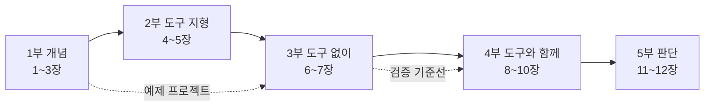

# AI 코딩 에이전트와 함께하는 스펙 주도 개발(SDD) 저술 계획

- 장르: tech-book / 슬러그: `sdd-guidebook` / 저자: Toby-AI / delegation_mode: production
- 계획 작성일: 2026-11-10. 레퍼런스: `sdd-guidebook/01_reference.md`(이하 "레퍼런스", 절 번호는 `§`로 표기)
- 사용자 지정 흐름(순서 고정): ① SDD 개념 → ② 도구 지형(기능·사용법·차이) → ③ 도구 없이 처음부터 하는 SDD → ④ 고른 도구로 개발하기 → ⑤ 전 과정에 스펙 문서 실물

## 제목 후보

1. **『AI 에이전트와 함께하는 스펙 주도 개발』** (부제: 도구 없이 시작해 OpenSpec·Spec Kit·Superpowers까지) — 톤: 정공법·실용. 포지셔닝: 검색되는 정석 제목. 독자가 찾는 단어(AI 에이전트, 스펙 주도 개발, 도구 이름)가 제목과 부제에 다 들어 있다.
2. **『빈칸을 남기지 않는 개발』** (부제: 코딩 에이전트에게 스펙을 건네는 법) — 톤: 문제의식, 훅이 강함. 포지셔닝: 1장의 각성("에이전트는 빈칸을 추측으로 채운다")을 제목으로 끌어올린 판. 서점 매대에서 눈에 띄지만 SDD라는 검색어가 부제에 없다.
3. **『스펙을 먼저, 그러나 필요한 만큼만』** (부제: AI 코딩 에이전트 시대의 SDD 가이드북) — 톤: 균형·판단. 포지셔닝: 과대광고와 회의론 사이. 레퍼런스 §1.9의 결론("SDD는 모든 작업의 기본값이 아니라 큰 변경마다 고르는 선택지")을 제목으로 삼았다.

**추천:** 1번. 이 책의 독자는 이미 에이전트를 쓰고 있고 "SDD를 실제로 어떻게 하나"를 찾아온다. 검색과 목차 훑기에서 바로 찾히는 제목이 가장 쓸모 있다. 3번의 문구는 이 책의 기조를 가장 잘 요약하므로, 1번을 고른다면 3번 문구를 표지 카피나 서문 첫 문장으로 쓰는 편을 권한다.

## 책 특성

- 장르: tech-book (실습 비중이 큰 가이드북)
- 분량: 본문 12장 + 부록 2개. **순수 산문 기준 약 11만~12만 자.** 스펙 실물·코드·표·mermaid 블록은 이 수치에 넣지 않는다 (scaffolds의 소절 자수 기준과 같은 정의). 실물 블록까지 합친 체감 분량은 약 16만~18만 자로 본다.
- 분량 규약 오버라이드: 챕터 목표가 7,000~11,000자이므로 scaffolds의 스케일 규칙을 적용한다 — **소절(`###`) 5~8개, 소절당 순수 산문 3,000자 상한.** 늘어나면 문단을 늘리지 말고 소절을 나눈다.
- 난이도: 중급. AI 코딩 에이전트를 일상적으로 쓰는 현업 개발자 전제. 에이전트 설치법, git 기초, HTTP API 기초는 설명하지 않는다.
- 독자 여정:
  - **진입 상태:** Claude Code·Cursor·Copilot·Codex로 일한다. 에이전트가 요청하지 않은 결정을 멋대로 채우거나, 긴 세션에서 처음 의도를 잃거나, 큰 diff를 검토하다 지친 경험이 있다. Spec Kit·Kiro·Superpowers 이름은 들어 봤지만 무엇을 골라야 할지, 워터폴의 귀환은 아닌지 의심한다.
  - **출구 상태:** (1) 변경 하나를 보고 스펙이 필요한지, 얼마나 무거워야 하는지 고를 수 있다. (2) 도구 없이 인터뷰 → `SPEC.md` → 새 세션 구현 → diff 대조를 돌릴 수 있다. (3) 요구·수용 기준·비목표·결정 기록을 갖춘 스펙을 쓰고 남의 스펙을 검사할 수 있다. (4) OpenSpec·Spec Kit·Superpowers를 제자리에 쓸 수 있다. (5) 검증 관문을 일한 에이전트 밖에 둔다.

## 내러티브 아크

책은 다섯 부로 흐른다. **1부(1~3장) 개념**은 각성에서 시작한다. 1장은 에이전트가 스펙에 없는 결정을 추측으로 채운 실패 장면으로 열고, 스펙·메모리 뱅크·계획을 구분해 SDD의 정의를 세운다. 2장은 "작업 뒤 스펙이 어떻게 되는가"라는 축으로 SDD의 지도를 그리고, 같은 티켓으로 잰 측정이 "변경이 클수록 이득"이라고 말한다는 사실을 보여 준다. 여기서 "SDD는 기본값이 아니라 선택지"라는 책의 기조가 처음 나온다. 3장은 좋은 스펙을 문장 단위로 해부하고, 이 책 끝까지 함께 갈 예제 프로젝트를 소개한다. 사용자가 개념을 "잘" 먼저 설명해 달라고 했으므로, 개념부는 정의만이 아니라 스펙의 수명·무게·작성 기술까지 세 장을 쓴다.

**2부(4~5장) 도구 지형**은 지도 위에 도구를 올린다. 4장은 문서로 통제하는 도구(Spec Kit, OpenSpec, Kiro, cc-sdd, BMAD), 5장은 습관으로 통제하는 도구(Superpowers, mattpocock/skills)와 하네스 내장 플랜 모드를 다룬다. 5장 끝에서 측정·채택·이식성 근거를 놓고 이 책이 실습할 도구 셋을 고른다. 고르는 이유를 독자 앞에서 공개하는 것이 다음 부의 동기가 된다.

**3부(6~7장) 도구 없이**는 가장 작은 SDD를 손으로 돌린다. 6장은 인터뷰로 `SPEC.md`를 끌어내고 "보고만 하는" 검사 세션으로 스펙의 모순을 잡는다. 7장은 새 세션에서 계획하고 만든 뒤, diff를 스펙과 대조하는 검증 루프를 세운다. 검증을 여기 두는 이유는 뒤의 도구 장들이 저마다 내장한 관문을 이 기준선에 비춰 평가하기 위해서다.

**4부(8~10장) 도구와 함께**는 같은 기능을 세 도구로 다시 쓴다. 무게가 가벼운 쪽에서 무거운 쪽으로(OpenSpec → Spec Kit), 그다음 축을 바꿔 습관 계열(Superpowers)로 간다. 장마다 그 도구만 주는 것에 집중하고, 도메인 설명은 반복하지 않는다.

**5부(11~12장) 판단**은 종합이다. 11장은 6~10장에서 만든 네 벌의 스펙을 나란히 놓고 시작해, "다섯 번째 선택지는 스펙을 쓰지 않는 것"으로 넘어가 변경 크기 사다리를 세운다. 12장은 팀으로 가져갈 때와 시간이 지날 때 무엇이 남는지 묻고, 1장의 실패 장면을 회수하며 닫는다.

## 설계 근거

- **채택한 구조:** 5부 12장 + 부록 2개, 사용자 지정 순서 그대로.
  1. **하나의 예제 프로젝트를 끝까지 끌고 간다 (제안 수용, 일부 수정).** 3장에서 소개한 "동네책방 주문 서비스"의 **부분 환불** 기능을 6~7장(도구 없이), 8장(OpenSpec), 9장(Spec Kit), 10장(Superpowers)에서 같은 기능으로 다시 스펙화한다. 독자는 같은 요구가 도구마다 어떤 문서 모양이 되는지 나란히 볼 수 있고, 11장에서 네 벌을 실제로 비교할 수 있다. 수정한 점: (a) 장마다 그 도구만 주는 단계에 무게를 둔다(6장 인터뷰·검사, 8장 델타와 아카이브, 9장 헌법과 품질 관문, 10장 TDD 계획과 두 단계 리뷰). (b) OpenSpec 장에는 후속 변경(C3)을 하나 더 얹어 리빙 스펙이 갱신되는 모습을 보여 준다 — OpenSpec의 고유한 강점은 두 번째 변경에서야 보이기 때문이다. (c) 같은 예제를 네 번 되풀이하는 피로를 막으려고 아래 "예제 프로젝트 정전"을 고정하고, 6장 이후 장은 도메인을 다시 설명하지 않는다.
  2. **검증을 3부(7장)에 둔다.** 레퍼런스 §1.9 판단 6("관문은 작업한 에이전트 밖에 둘 때만 믿을 수 있다")과 §6.2의 자기 판정 관문 측정은 이 책의 가장 실용적인 경고다. 도구 장보다 먼저 도구 없는 검증 루프(사람이 소유한 수용 테스트, 결정적 검사, 대화를 못 본 서브에이전트 리뷰)를 세워야, 8~10장이 각 도구의 `analyze`·`converge`·`verify`·리뷰 스킬을 무비판적으로 가르치지 않고 "이 관문은 누가 판정하나"를 물을 수 있다. 그래서 도구 장마다 "관문을 밖으로 꺼내기" 소절을 하나씩 둔다.
  3. **"언제 쓰지 않는가"를 독립 장(11장)으로 두고(제안 수용), 맛보기는 앞에 깐다.** 스펙 적합성 점수는 2장에서 근거(Uvik 크기별 결과)와 함께 처음 보여 주고, 6장에서 예제 변경을 채점해 스펙을 쓸 이유를 만든다. 사다리 전체(R0~R5, 하향 신호, 시험 계획)는 독자가 스펙의 무게를 직접 느낀 뒤인 11장에 둔다. 무게를 느껴 보지 않은 독자에게 "언제 빼라"는 말은 공허하기 때문이다.
- **도구 선정 (레퍼런스 §8 근거):** 실습 장을 받는 도구는 **OpenSpec, Spec Kit, Superpowers** 셋이다. 네이티브 플랜 모드와 인터뷰 → `SPEC.md`는 "도구"가 아니라 3부의 토대로 쓴다. Kiro·cc-sdd는 EARS와 버그픽스 스펙의 원형으로 3장·4장에서 형식을 가르치고 실습 장은 주지 않는다. mattpocock/skills는 6장에서 인터뷰 보조 수단(`/grill-me`)으로 짧게 언급한다. BMAD는 4장에서 판(v6.12 안정판 / v7 알파)을 밝혀 소개만 한다.
- **기각한 대안 1: 도구마다 그 도구의 대표 예제로 실습한다** (Spec Kit은 README의 사진 앨범 그린필드, OpenSpec은 다크 모드 추가 등). — 기각 사유: 장마다 도메인이 바뀌면 독자가 "스펙 문서 모양의 차이"와 "예제 난이도의 차이"를 구분할 수 없어 사용자의 핵심 요구(스펙 문서 실물 비교)가 무너진다. 공식 예제는 대부분 그린필드인데 레퍼런스 §6.1은 브라운필드가 SDD의 주 무대라고 말한다. 또 공식 예제를 옮기면 원문 재현에 가까워져 인용 범위 문제가 생긴다.
- **기각한 대안 2: 도구 백과형 — 후보 6~8개(Kiro, cc-sdd, BMAD, mattpocock/skills 포함)에 각각 실습 장을 준다.** — 기각 사유: (a) 레퍼런스 §1.9 판단 3대로 이름 있는 도구 사이의 순위는 아직 정할 수 없고, 측정이 있는 도구조차 잡음 대역을 벗어난 것은 OpenSpec 하나다. 도구를 늘려도 독자의 판단 근거가 늘지 않는다. (b) Kiro는 독자층의 하네스(Claude Code·Cursor·Copilot·Codex) 밖의 독점 IDE이고 속성 기반 테스트는 IDE 전용이다. (c) BMAD는 v7 정식 출시가 2026-11 중순으로 예고돼 있어 원고가 나오기 전에 낡을 위험이 가장 크다. (d) 장 수가 15장을 넘으면 개념·도구 없이·판단 부가 상대적으로 얇아진다.
- **기각한 대안 3: 검증과 스펙 리뷰를 책 후반(도구 장 뒤)의 독립 장으로 묶는다.** — 기각 사유: 위 채택 이유 2와 같다. 뒤에 두면 도구 장들이 도구 내장 관문(대개 같은 모델이 판정)을 먼저 가르치게 되고, 독자는 후반에 가서야 그것을 의심하라는 말을 듣는다. 대신 7장에 기준선을 두고 11장 비교표에 "관문 판정자" 열을 넣어 다시 회수한다.
- **기각한 대안 4: "언제 쓰지 않는가"를 1부 맨 앞에 둔다.** — 기각 사유: 사다리의 내리는 신호(마크다운 리뷰가 코드 리뷰보다 길다, 스펙이 diff보다 크다 등)는 스펙의 무게를 겪어 본 독자에게만 읽힌다. 개념부에는 근거와 기조만 두고 판단 도구는 실습 뒤로 미룬다.
- **예제 스택 선택:** Spring Boot(Java) + PostgreSQL + 마이그레이션 스크립트. 한국 현업 백엔드 독자에게 가장 익숙하고, 도구 셋 모두 언어 중립이다. 코드 발췌는 최소로 하고 스펙이 주인공이다. 사용자가 TypeScript(Node.js)를 원하면 예제 정전의 이름만 바꾸면 된다 (아래 "사용자 판단 필요" 참고).
- **신선도 설계:** 도구 장마다 첫머리에 버전 기준 상자를 두고, 끝에 "명령은 바뀌어도 남는 개념" 표를 둔다. 명령 이름(`/opsx:propose`, `/speckit-specify`)이 바뀌어도 독자가 개념(변경 제안, 요구 정의, 명확화, 수렴 점검)으로 옮겨 갈 수 있게 하려는 것이다. 근거: 레퍼런스 §0의 경고(두 도구가 검증일 이후 하루 사이에 새 판을 냄), §2.10의 하네스 교체 연표, OpenSpec 2.0의 `/opsx:*` 명령 파일 제거 예고.

## 용어 표기

- **스펙 주도 개발(SDD)**: 장마다 첫 등장은 "스펙 주도 개발(Spec-Driven Development, SDD)", 이후 "SDD".
- **스펙**: spec. "명세"는 "형식 명세(formal specification)"에만 쓴다. "사양", "명세서"는 쓰지 않는다.
- **스펙 우선형 / 스펙 고정형 / 스펙 소스형**: spec-first / spec-anchored / spec-as-source (레퍼런스 §1.3 표기. 요즘IT 번역본의 "스펙을 소스로"는 첫 등장 때만 병기).
- **리빙 스펙**: living spec. **델타 스펙**: OpenSpec의 변경분 스펙 파일 (보고서의 "스펙 델타" 표기는 쓰지 않는다).
- **수용 기준**: acceptance criteria ("인수 조건", "승인 기준" 쓰지 않음). **비목표**: non-goals, 쉬운 말 풀이는 "안 만들 것". **결정 기록**: Decision Log.
- **하네스**: 에이전트를 감싼 도구 환경(Claude Code, Cursor, Copilot, Codex 등). **에이전트**: 그 안에서 일하는 AI. 둘을 섞지 않는다.
- **플랜 모드**: 하네스 내장 읽기 전용 계획 단계. 제품 고유명은 원문대로(Cursor "Plan Mode", Copilot "Plan 에이전트"). 그 결과물은 **계획**, 파일이면 **계획 파일**. "플랜"은 "플랜 모드"에만 쓴다.
- **컨텍스트 파일**: `CLAUDE.md`, `AGENTS.md` 같은 상시 지시 파일. "메모리 뱅크"는 1장의 개념 구분에서만 쓴다.
- **헌법 파일**: Spec Kit `constitution.md`. **스티어링**: Kiro steering.
- **관문**: gate. **드리프트**: 스펙과 코드가 어긋나는 현상(spec drift).
- **스펙 적합성 점수**: Spec Fit Test (조건 6개 중 참인 수). **변경 크기 사다리**: R0~R5 (바닥층 포함). 계열 기호 F1~F8은 본문에서 되도록 이름(문서 파이프라인, 변경 델타, 스킬 규율, 계획-실행 루프, 네이티브 플랜 모드)으로 부르고, 기호를 쓸 때는 "참고 보고서의 분류"라고 밝힌다.
- **브라운필드 / 그린필드**: 그대로 쓴다.
- **스펙 안의 키워드**: EARS 키워드(`When`, `If … then`, `While`, `Where`, `shall`), RFC 2119 강도어(`SHALL`, `MUST`, `SHOULD`), 시나리오 단계(`GIVEN`/`WHEN`/`THEN`)는 **영어로 두고 변수 부분만 한국어로** 쓴다 (cc-sdd `ears-format.md` 규칙, 레퍼런스 §5.2). OpenSpec `validate`가 단계 키워드 없는 시나리오를 경고하기 때문이기도 하다.
- **명령 표기**: Spec Kit은 Claude Code 설치본 표기 `/speckit-specify`를 기본으로 하고, 장의 첫 등장에서 문서 표기 `/speckit.specify`를 병기한다. OpenSpec은 `/opsx:propose`와 스킬 표기 `/openspec-propose`를 첫 등장에서 함께 적는다(2.0 예고). Codex 표기(`$speckit-specify`, `$openspec-propose`)는 "다른 하네스에서는" 상자에 모은다.

## 예제 프로젝트 정전 (병렬 저술가 공통 기준)

병렬로 쓰는 저술가들이 같은 숫자·이름·규칙을 쓰게 하는 기준이다. 여기 없는 세부를 새로 정해야 하면 그 장 안에서만 쓰고, 다른 장과 충돌할 수 있는 값(금액, 상태 이름, 오류 코드)은 새로 만들지 않는다.

**프로젝트:** 동네책방 주문 서비스 `bookshop-orders`. 동네 서점 여러 곳이 함께 쓰는 온라인 주문 백엔드. Spring Boot(Java) + PostgreSQL, 마이그레이션 스크립트, JUnit 테스트. 이미 운영 중인 브라운필드 저장소다.

**기존 기능(기준선):** 주문 생성, 카드 단일 결제(외부 PG 연동), 주문 단위 쿠폰(정률 또는 정액), 배송 상태 갱신, 배송 전 **전체 취소** `POST /orders/{orderId}/cancel`. 부분 환불은 없다. 주문 상태: `PAID`, `SHIPPED`, `DELIVERED`, `CANCELLED`.

**변경 시리즈 (사다리와 장 배치):**

| 기호 | 변경 | 스펙 적합성 점수(예상) | 단 | 쓰는 장 |
|---|---|---|---|---|
| C0 | 오류 메시지 오타 수정("환뷸" → "환불") | 0 | R0 | 11장 |
| C1 | 전체 취소 사유 200자 길이 검증 추가 | 1~2 | R1 플랜 모드 | 11장 |
| C2 | **부분 환불** (이 책의 주 예제) | 4 (파일 3개 이상, 수용 기준 4개 이상, 결제 경계를 넘음, 스키마·공개 API 변경) | R2 이상 | 3장(문장), 6~7장(`SPEC.md`), 8장, 9장, 10장 |
| C3 | 환불 기간 7일 → 14일, 자유 입력 사유를 사유 코드로 교체 | 3 | R3 델타 | 8장 후반, 11장 |
| C4 | 동시 환불 경쟁 조건과 금액 안분 불변식을 실행 가능한 검사로 | - | R5 | 7장(씨앗), 11장 |

**C2 부분 환불 — 고정 사실:**
- 요청 주체: 서점 관리자(`SHOP_ADMIN`). **자기 서점 주문만** 환불할 수 있다(인가 규칙 — 6장 인터뷰가 끌어내야 할 질문. 레퍼런스 §2.6의 "계획 단계의 어떤 도구도 인가 누락을 짚지 못했다"는 실무자 관찰과 연결).
- API: `POST /orders/{orderId}/refunds` (본문: 환불 항목 목록 `orderItemId`·`quantity`, 사유 `reason`; 헤더 `Idempotency-Key`), `GET /orders/{orderId}/refunds`.
- 스키마: 새 테이블 `refunds`(id, order_id, amount, reason, status, idempotency_key 고유, created_at), `refund_items`(refund_id, order_item_id, quantity, amount). `order_items`에 `refunded_quantity` 열 추가. 주문 상태에 `PARTIALLY_REFUNDED`, `REFUNDED` 추가. 환불 상태: `REQUESTED`, `COMPLETED`, `FAILED`.
- 규칙:
  1. 환불 기간: 배송 완료 시각(`delivered_at`)부터 **168시간(7일) 이내**. (C3에서 336시간/14일로 바뀜)
  2. 항목 단위·수량 단위 부분 환불. 항목별 `refunded_quantity`는 주문 수량을 넘을 수 없다.
  3. 쿠폰 할인 안분: 주문 쿠폰 할인액을 항목 금액 비율로 나눠 환불액에서 뺀다. 원 미만은 버리고, 마지막으로 환불되는 항목에서 남은 차액을 보정한다.
  4. 불변식: 모든 항목을 환불하면 환불액 합계 = 결제 금액 − 배송비.
  5. 같은 `Idempotency-Key` 재요청은 첫 결과를 그대로 돌려준다. 같은 키에 다른 본문이면 거절. 키 보관 기간 24시간.
  6. PG 환불 호출이 실패하면 환불 상태 `FAILED`, 주문 상태·`refunded_quantity`는 바뀌지 않고, 다시 요청할 수 있다.
  7. 일부 항목 환불 → 주문 `PARTIALLY_REFUNDED`, 전 항목 환불 → `REFUNDED`.
  8. 바뀌면 안 되는 동작: 기존 전체 취소 API의 동작(배송 전만, 전액)은 그대로다.
- 오류 응답: 기간 경과 `422 REFUND_WINDOW_EXPIRED` / 수량 초과 `409 REFUND_QUANTITY_EXCEEDED` / 같은 키·다른 본문 `422 IDEMPOTENCY_KEY_REUSED` / PG 실패 `502 PAYMENT_GATEWAY_ERROR` / 다른 서점 주문 `403` / 주문 없음 `404`.
- 비목표: 배송비 환불, 포인트·적립금, 고객 셀프 환불 화면(관리자 API만), 복수 결제 수단, 교환.
- 기준 숫자: 책 A 18,000원 × 1, 책 B 12,000원 × 2 = 상품 42,000원. 정률 쿠폰 10%(4,200원), 배송비 3,000원 → **결제 40,800원**.
  - 책 B 1권 환불: 안분 쿠폰 4,200 × 12,000 / 42,000 = 1,200원 → 환불 10,800원.
  - 전 항목 환불 합계: 16,200 + 10,800 + 10,800 = 37,800원 = 40,800 − 3,000 (불변식 확인).
  - 차액 보정 예(정액 쿠폰 3,000원일 때): A 1,285원, B 857원씩 → 합 2,999원, 마지막 환불 항목에서 1원 보정.
- 6장 검사 세션이 찾아낼 결함 두 개(이 책의 "리뷰 전/후" 실물):
  1. **모순:** 비목표 "배송비는 환불하지 않는다"와 수용 기준 "모든 항목을 환불하면 결제 금액 전액을 돌려준다"가 충돌(결제 금액에 배송비 포함). → 수용 기준을 "결제 금액 − 배송비"로 고침. 3장의 "에이전트는 빈칸은 눈치채도 모순은 못 본다"(레퍼런스 §5.3)를 회수하는 장면.
  2. **빈칸:** "배송 후 7일"의 기준 시각이 없음(배송 완료 시각? 날짜 단위? 시간대?). → 결정 기록에 "`delivered_at`부터 168시간"으로 남김.

**C3 — 고정 사실 (8장):** 환불 기간 168시간 → 336시간(MODIFIED, `(Previously: 168시간)`), 사유 코드 `CHANGE_OF_MIND`·`DAMAGED`·`WRONG_ITEM`·`OTHER` 도입(ADDED), 자유 입력 사유 요구 삭제(REMOVED, `OTHER`일 때만 메모 허용으로 대체).

## 저술 공통 규칙

- **예시 산출물의 정직성:** 도구가 만드는 파일(`proposal.md`, `spec.md`, `tasks.md`, 설계 문서 등)은 **각 도구 템플릿의 실제 헤딩 구조**(레퍼런스 §4.1~§4.6 원문)를 따르되 내용은 이 책의 예제로 채운다. 본문에서는 이것을 "이 책 예제로 채운 예시"라고 밝히고, 실행해서 받은 출력처럼 쓰지 않는다. 에이전트가 특정 상황에서 어떻게 행동했다는 서술은 레퍼런스에 있는 사례만 쓴다. CLI 출력은 레퍼런스에 원문이 있는 것(예: `/opsx:propose` 출력 형태)만 그 형태로 보여 준다.
- **버전 기준 상자:** 도구 장(4·5·8·9·10장)과 플랜 모드를 다루는 6·7장은 첫 소절 앞에 `> 이 장은 {도구} {버전}/{날짜} 기준이다.` 형식의 상자를 둔다. 값은 레퍼런스 §0(2026-11-10 조회)을 따른다: Spec Kit v1.3.3/2026-11-09, OpenSpec v1.17.0/2026-11-09, Superpowers v7.0.2/2026-11-03, cc-sdd v3.1.0/2026-09-23, mattpocock/skills v1.3.2/2026-10-29, BMAD v6.12.4 안정판/2026-10-14, Claude Code 2.1.319 로컬 기준, Kiro는 "문서 접근 2026-11-10 기준".
- **"명령은 바뀌어도 남는 개념" 표:** 8·9·10장 끝(클로징 직전)에 명령 → 개념 → 다른 도구의 대응물 3열 표를 둔다.
- **"다른 하네스에서는" 상자:** 실습 기본 하네스는 Claude Code(세 도구 모두 공식 지원, 도구 없는 SDD의 1차 근거가 Claude Code 공식 모범 사례). 장마다 Cursor·Copilot·Codex 차이를 상자 하나에 모은다(레퍼런스 §2.8, §2.9, §4.1 표, §4.2 표기 표).
- **근거 표시 유지:** 레퍼런스의 (측정)/(주장)/(추론) 구분과 경고 문구를 본문에 살린다. 특히 Uvik 인용 때 조건(서비스 회사 운영, n=50, 모델 1개, 잡음 대역 ±10%p), F4·F6 측정 공백, EARS·GWT 통제 실험 부재, 2025 비판은 날짜·버전과 §6.3 현재 상태를 함께. "3.5시간 대 23분", "헌법 조항 9개", "Superpowers 태스크마다 완성 코드", "보안 결함 73% 감소"를 단정으로 쓰지 않는다(레퍼런스 §4.1, §4.5, §6.4 경고).
- **인용 범위:** 원문 인용은 짧은 구절만. Kiro 실사용 예 `shuk`는 라이선스 표기가 없으므로 링크와 구조 설명, 두 줄 이내 발췌만. 개인 블로그 사례는 요지로.
- **스펙 실물 블록:** 장당 2~5개, 블록당 120줄 이내를 권장. 전체 `SPEC.md`처럼 긴 실물은 장 안에 한 번 전문을 싣고 이후 장에서는 줄 번호나 절 이름으로 가리킨다.
- **"이 장의 핵심" 박스:** 쓰기로 한다. 헤딩은 정확히 `### 이 장의 핵심`, 3~5불릿, 본문 결론만. 개념 밀도가 높은 2·3·5·7·11장에만 둔다.
- **그림:** 구조·흐름은 mermaid로, 캡션 `그림 N. {설명}`(장마다 1부터). 장별 권장 그림은 각 장 항목에 적었다.

## 챕터 목록

### 1부. SDD란 무엇인가

### 1장. 에이전트는 빈칸을 추측으로 채운다 — 스펙 주도 개발이라는 답
- **핵심 질문:** 에이전트가 이렇게 유능해졌는데 왜 다시 "스펙"인가? SDD는 정확히 무엇이고 무엇이 아닌가?
- **주요 내용:**
  - 열 줄 메모로 바로 만들게 했더니 위치·모델·레이아웃을 에이전트가 임의로 정한 사례(McGuinness, 레퍼런스 §3.5 A2)로 "빈칸은 추측으로 채워진다"를 보여 준다. 플래너를 빼자 생성자가 스펙 없이 바로 만들기 시작해 기능이 적은 앱이 나왔다는 Anthropic 실험(§2.2)으로 보강.
  - 작업 정의와 출처별 강조점(Böckeler, GitHub, Spec Kit 선언문, Brooker; §1.1). "자세한 프롬프트의 동의어"로 쓰이는 용어 혼란 경고.
  - 스펙 vs 메모리 뱅크(컨텍스트 파일) vs 계획: 범위·읽히는 시점·수명 표(§1.2). 독자가 이미 쓰는 `CLAUDE.md`와 플랜 모드가 어디에 놓이는지.
  - 왜 지금인가: 에이전트가 오래 일하게 됨, 대화는 남지 않음, 자연어 스펙이 실행 가능해짐과 그 대가인 비결정성(§1.6 동인).
  - SDD는 새것이 아니라 다시 묶은 것: Design by Contract, TDD, BDD, OpenAPI 스키마 우선, EARS, 요구공학이 물려준 것과 매번 실패한 이유("맞춰 두는 비용 > 이득", §1.7). 문학적 프로그래밍은 계보가 아니라 유비라는 점.
- **독자가 얻는 것:** SDD를 한 문장으로 정의하고, 자기가 이미 쓰는 컨텍스트 파일·플랜 모드와 스펙을 구분한다.
- **오프닝 기법:** 실패 장면(in medias res) — 바이브 코딩으로 만든 날씨 앱이 40마일 떨어진 곳의 기온을 보여 주는 장면.
- **클로징 기법:** 열린 질문 — "작업이 끝나면 그 스펙은 어디로 가야 할까?"로 2장의 수명 축을 건넨다.
- **스캐폴드 유형:** 개념 도입형
- **그림:** 스펙·메모리 뱅크·계획의 범위와 수명 비교도.
- **예상 분량:** 7,000~8,000자 (소절 5~6개)

### 2장. 스펙은 얼마나 오래 사는가 — SDD의 지도와 2026년의 좌표
- **핵심 질문:** SDD 방법들은 무엇으로 갈리고, 지금(2026-11) 근거는 SDD가 언제 값을 한다고 말하는가?
- **주요 내용:**
  - 스펙의 수명 세 수준: 스펙 우선형·스펙 고정형·스펙 소스형과 판별 흐름(§1.3의 mermaid). "대부분 도구는 실제로는 스펙 우선형"이라는 관찰. 스펙 소스형의 실험(Monperrus 시연, Tessl의 방향 전환).
  - 통제 단위로 본 세 갈래: 문서 파이프라인 / 스킬 규율 / 계획-실행 루프 (+ 네이티브 플랜 모드). 참고 보고서의 F1~F8 분류는 표 하나로만(§1.5), 계열과 수준이 다른 축임을 짚는다.
  - 근거의 지형: Uvik 벤치마크의 파일 수별 병합률(1~2개 0%p, 3~5개 +15%p, 6개 이상 +30%p)과 시간 비용(스펙 단계 중앙값 12~28분 추가), 읽는 규칙 6가지(§2.5). 스펙 적합성 점수 6조건을 처음 보여 주되 사다리는 11장으로 미룬다.
  - 의견의 여섯 국면과 Radar 링 이력(§1.8): 비전 → 반발 → 반박 → 정렬 → 피로 → 정착한 중간 지대. Vol 35가 OpenSpec을 Trial로 올리면서 문서 난립·지시문 비대를 Caution에 넣은 조합의 의미.
  - 워터폴의 귀환인가(논쟁 4): 절차 비판은 대부분 해소, 문서 양 비판은 유효(§7). 책의 기조 선언: "SDD는 모든 작업의 기본값이 아니라 큰 변경마다 고르는 선택지"와 판단 일곱 가지 중 책 전체가 회수할 셋(크기, 부품의 근거, 밖의 관문).
- **독자가 얻는 것:** 처음 보는 SDD 도구도 "스펙이 작업 뒤 어떻게 되나, 무엇으로 통제하나" 두 질문으로 지도 위에 놓을 수 있다. 숫자를 믿기 전에 볼 조건을 안다.
- **오프닝 기법:** 정의 뒤집기 — "흔히 SDD를 '스펙을 먼저 쓰는 것'이라 한다. 그런데 방법들이 실제로 갈리는 곳은 '다 만든 뒤 스펙이 어떻게 되는가'다."
- **클로징 기법:** 자가 측정 과제 — 지난주 내 변경 다섯 개의 수정 파일 수를 세어 보고, 6개 이상이 몇 개였는지 적어 두자(11장 시험 계획 P0 기준선의 씨앗).
- **스캐폴드 유형:** 사례 분석형 (Uvik 측정과 Radar 이동이라는 사례에서 "선택지" 원리를 뽑는다)
- **그림:** 스펙 수명 판별 흐름(§1.3), 파일 수별 병합률 막대 또는 표.
- **예상 분량:** 8,000~9,000자 (소절 6~7개) + `### 이 장의 핵심`

### 3장. 좋은 스펙의 해부 — 요구, 수용 기준, 비목표, 결정
- **핵심 질문:** 에이전트가 추측할 여지를 줄이는 스펙 문장은 어떻게 쓰는가? 무엇은 빠짐없이 쓰고 무엇은 줄이는가?
- **주요 내용:**
  - 예제 프로젝트 소개: 동네책방 주문 서비스와 부분 환불(C2). "부분 환불 만들어 줘" 한 줄이 남기는 빈칸을 세어 본다(인가, 기간 기준 시각, 쿠폰 안분, 중복 요청, PG 실패, 전체 취소와의 관계).
  - EARS 여섯 문형(원전 예문 + 예제 문장)과 한국어로 쓰는 규칙(키워드는 영어, 변수부는 한국어). 작성 규칙 4가지: 트리거 하나에 요구 하나, "실패하면?"을 `If … then`으로, 머릿속 전제를 `While`로 꺼내기, 구현 방법 쓰지 않기(§5.2). 근거의 한계(2009 사례 1건, LLM 통제 실험 없음)를 숨기지 않는다.
  - 모호함과 모순: 모델은 명시 지시 없이는 거의 묻지 않고, 빈칸보다 모순을 가장 못 잡는다(§5.3 HumanEvalComm, Ambig-SWE). 그래서 "불분명하면 구현 전에 질문하라"를 쓰고, 모순 점검은 사람이 한다. (6장 결함 1의 복선)
  - 수용 기준: Given-When-Then으로 쓰는 이유를 "형식이 품질을 올려서"가 아니라 "실행 가능한 테스트로 바꿀 수 있어서"로 정확히 세운다(§5.4 경고). QUS 기준 중 Atomic·Problem-oriented·Conflict-free. 테스트가 확인할 이름·경로·인터페이스를 스펙에 적는 이유(스펙-오라클 격차).
  - 상세도: "입출력·조건·예외·예시는 빠짐없이, 배경과 저장소 개요는 최소로, 꼭 지킬 제약은 짧게 앞에"(§5.5). should 대신 must. 비목표와 결정 기록의 역할. 계약 세 줄(사전·사후·불변식)과 속성으로 쓰는 불변식(안분 합계) — 스펙 사다리의 위쪽 맛보기(§5.6).
- **스펙 실물:** 예제 요구의 나쁜 문장 → EARS 재작성 3~4쌍(환불 기간, 수량 초과, PG 실패, 인가), 쿠폰 안분 GWT 시나리오(10,800원 예), 계약 세 줄과 불변식, 도구별 문형 비교 표(§5.2 도구별 변형).
- **독자가 얻는 것:** 요구 문장을 EARS와 GWT로 다시 쓰고, 스펙에서 모순·빈칸·구현 서술을 찾아낼 수 있다.
- **오프닝 기법:** 수사적 질문 — "'부분 환불 만들어 줘'라고 한 줄 보내면, 결정 몇 개가 내 손을 떠날까?"
- **클로징 기법:** 다시 쓰기 연습 — 지금 팀 백로그의 요구 하나를 골라 정상 흐름 하나와 `If … then` 하나로 다시 써 보자는 숙제.
- **스캐폴드 유형:** 문제-해결형 (모호한 요구 → 왜 문제인가 → 잘못된 고침(요구를 무작정 늘리기) → 올바른 고침)
- **그림:** 스펙 사다리(자연어 → EARS → GWT → 예시 테스트 → 계약·속성 → 참조 모델 → 형식 명세).
- **예상 분량:** 9,000~10,000자 (소절 6~7개) + 스펙 블록 + `### 이 장의 핵심`

### 2부. 도구 지형

### 4장. 문서로 통제하는 도구들 — Spec Kit, OpenSpec, Kiro, cc-sdd, BMAD
- **핵심 질문:** 문서 파이프라인 계열 도구는 각각 무엇을 스펙으로 삼고, 어떻게 쓰며, 서로 어떻게 다른가?
- **주요 내용:**
  - 2025년 열 달 사이 쏟아진 도구 연표(§1.6)로 지형을 연다. 도구마다 같은 틀로 소개: 무엇이 스펙인가 / 명령 흐름 / 산출물 위치와 모양 / 가벼운 경로 / 강점과 지금도 유효한 약점.
  - Spec Kit: 진입점 넷("independent entry points, not mandatory phases"), 명령 9개 한 줄씩, 기능 폴더 트리, 헌법·clarify·analyze·converge의 성격(append-only, read-only). 실습 상세는 9장.
  - OpenSpec: 변경 폴더와 델타 스펙, archive 병합, core 프로필 6개 명령, 2.0 예고. 실습 상세는 8장.
  - Kiro 스펙: 세 문서 사슬, EARS 요구, Requirements-First / Design-First, Bugfix Spec의 세 문형(`SHALL CONTINUE TO`), Quick Spec, Plan 모드, 속성 기반 테스트(IDE 전용), 스티어링. shuk 예로 2026년 실제 생성 형식(구조만). cc-sdd: Kiro 흐름을 Claude Code·Codex로, 17개 스킬, `spec.json` 승인 상태(관문이 파일로 남음), `--lang ko`, "Code remains the source of truth." 이 책이 실습 장을 주지 않는 이유는 5장 선택에서.
  - BMAD: 역할 에이전트와 작업 크기별 경로, v6.12 `SPEC.md` 다섯 필드. **판 혼동 경고**(문서 사이트는 v7 알파, 안정판 문서는 V6.12 브랜치)와 v7 출시 예고.
  - 문서 계열 내부 비교: F1 내부 구조 표(§2.3), 문서 수(Serverworks: Spec Kit 기능당 약 10개, OpenSpec 변경당 약 4개 — [문서+실무] 성격), GMO의 상황별 판정(1.0 이전 판정임을 명시), 2025 비판의 유효기간 표(§6.3).
- **스펙 실물:** 도구별 스펙 문서 형식 비교 표(§5.7)를 이 장에 싣고, Spec Kit `spec-template.md` 헤딩, OpenSpec 델타 예(원문 Auth/2FA 예, MIT), Kiro `bugfix.md` 세 문형, cc-sdd 수용 기준 다섯 패턴과 `spec.json` 승인 구조를 짧게.
- **독자가 얻는 것:** 문서 계열 도구 다섯을 "무엇이 스펙인가, 얼마나 무겁나, 기존 코드에 붙이기 쉬운가"로 구분한다.
- **오프닝 기법:** 충격적 수치·사실 — 2025년 2월 Harper Reed의 세 파일 블로그 글부터 12월 GSD 저장소까지, 약 열 달 사이 이름 있는 SDD 방법과 도구가 열 개 남짓 쏟아졌다는 연표(레퍼런스 §1.6 표에서 직접 세어 쓴다).
- **클로징 기법:** 한 장 요약 표로 매듭 — 도구 다섯의 "무엇이 스펙인가 / 작업 뒤 스펙의 운명" 두 열 표를 두고 한 문장으로 끝낸다.
- **스캐폴드 유형:** 개념 도입형 (도구마다의 정신 모형을 차례로 도입)
- **그림:** 도구 연표(timeline), F1 세 문서 사슬 vs F2 변경 델타 흐름 비교도.
- **예상 분량:** 10,000~11,000자 (소절 7~8개)

### 5장. 습관으로 통제하는 도구들, 그리고 이 책의 선택
- **핵심 질문:** 문서 대신 질문·계획·TDD·리뷰 습관을 강제하는 도구와 하네스 내장 플랜 모드는 무엇이 다르며, 무엇을 골라야 하는가?
- **주요 내용:**
  - Superpowers: 자동 트리거 스킬("Mandatory workflows, not suggestions"), 기본 흐름 7단계, 산출물(설계 문서, 계획), 두 단계 리뷰. README와 SKILL.md 불일치("complete code")는 SKILL.md 기준. 실습 상세는 10장.
  - mattpocock/skills: "프로세스를 소유하지 않는" 철학, 사용자 호출 / 모델 호출 스킬, `/grill-me`(→ `grilling`), `/to-spec` 템플릿과 테스트 이음매. 채택 신호의 모순(설치 1위, 인터뷰 사용자 0명).
  - 네이티브 플랜 모드: 하네스별 진입·산출물·저장 위치 표(§2.9: Claude Code `~/.claude/plans`·`plansDirectory`, Cursor Save to workspace, Copilot 세션 메모리, Codex `/plan`, Gemini, Kiro). "가장 작은 스펙 우선형"이라는 위치. 계획-실행 루프(GSD, Ralph, ExecPlan)는 짧게.
  - 근거로 비교하기: 주 비교 매트릭스(§2.4 — 점수가 높다고 좋은 것이 아님), Uvik 표의 정직한 읽기, 채택 지표마다 순위가 다르다는 것(§2.7, 별 수 ≠ 채택), 하네스별 지원(§2.8), 하네스 교체 연표(§2.10). F4·F6 측정 공백을 명시.
  - 이 책의 선택(§8): OpenSpec(측정 근거가 가장 두껍고 브라운필드 델타, 모든 하네스), Spec Kit(템플릿이 가장 풍부하고 통합 범위가 가장 넓음, 무게가 값을 하는 조건을 배우기 좋음), Superpowers(다른 축 — 스킬 규율과 TDD·리뷰 내장, 독자 노출이 가장 큼, 측정 공백 명시). 실습 장을 주지 않는 도구와 그 이유(Kiro 하네스 종속, cc-sdd 근거 얇음, mattpocock 실사용 근거 약함, BMAD 판 전환기).
  - 설치하기 전에: 공급망 위험의 크기(§6.2 스킬 26.1% 취약점 등 측정), 설치 전 점검표 7항, SDD 플러그인은 한 번에 하나만, 컨텍스트 비용 줄이는 장치(Spec Kit `--no-model-invocation`, `disable-model-invocation: true`). "어떤 SDD 플러그인도 악성으로 판정된 것은 아니다"를 함께.
- **스펙 실물:** Superpowers 계획 머리말·태스크 골격(원문 헤딩), mattpocock `/to-spec` 헤딩, Claude Code 플랜 모드 진입·승인 선택지.
- **독자가 얻는 것:** 문서 계열과 습관 계열, 플랜 모드의 차이를 말할 수 있고, 이 책의 도구 선택 근거를 자기 상황에 다시 적용할 수 있다. 플러그인을 설치하기 전에 무엇을 확인할지 안다.
- **오프닝 기법:** 인용·일화 — mattpocock/skills README가 다른 프레임워크들을 두고 쓴 짧은 구절("try to help by owning the process", 15단어 미만 인용)과 그 반대편 Superpowers의 "Mandatory workflows" 사이의 긴장.
- **클로징 기법:** 결정 선언 — "이 책은 셋을 고른다"를 이유와 함께 한 문단으로 확정하고, 각 도구에 실습 장 번호를 붙여 끝낸다.
- **스캐폴드 유형:** 비교 대조형
- **그림:** 통제 단위(문서 / 습관 / 반복 단위 / 내장 모드) 2×2 위치도.
- **예상 분량:** 9,000~10,000자 (소절 6~8개) + `### 이 장의 핵심`

### 3부. 도구 없이 시작하는 SDD

### 6장. 도구 없이 ①: 인터뷰로 SPEC.md를 끌어내고 검사하기
- **핵심 질문:** 설치 없이, 평범한 마크다운과 에이전트의 질문 능력만으로 쓸 만한 스펙을 만들 수 있는가?
- **주요 내용:**
  - 먼저 채점: 부분 환불(C2)의 스펙 적합성 점수를 매겨 4점 → 스펙을 쓸 이유를 만든다. 반대로 R0·R1 변경은 이 장의 방법이 과하다는 점도 한 줄로.
  - 1차 근거: Claude Code 공식 모범 사례의 "인터뷰 → `SPEC.md` → 새 세션" 경로와 원문 프롬프트(§3.1). 예제용 한국어 인터뷰 프롬프트(한 번에 질문 하나, 가능하면 객관식, 끝나면 파일에 기록, 코드 금지). 플랜 모드나 `AskUserQuestion`으로 인터뷰를 돌리는 방법, `/grill-me` 같은 보조 스킬은 선택.
  - 인터뷰가 끌어내야 할 질문들: 인가(자기 서점만), 기간 기준 시각, 안분과 차액, 중복 요청, PG 실패, 전체 취소와의 관계. 커뮤니티 수치(질문 20~60개, VelvetShark 32개 중 약 3분의 1은 생각 못 한 질문 — 자기 보고).
  - `SPEC.md` 전문: 목적 / 사용자와 권한 / 만들 것 / 안 만들 것(비목표) / API와 데이터 / 규칙(EARS) / 수용 기준(GWT) / 열린 질문 / 결정 기록. 커뮤니티 최소 키트 구성(§3.2)이 왜 이 절들인지.
  - 검사관 세션: `/clear` 뒤 "보고만, 수정 금지" — 세 질문(만들 것이 테스트 가능한가 / 만들 것과 안 만들 것이 충돌하는가 / 본문 기능이 만들 것에서 빠졌는가, Ray §3.5 A3). 예제에서 결함 둘(배송비 모순, 기준 시각 빈칸)을 찾고 결정 기록으로 고친 **리뷰 전/후**를 줄 단위로 보여 준다. 세 검사가 모두 "없음"일 때 확정.
  - 리뷰 피로 줄이기: 절을 짧게 끊어 확인, 주석 → 반영 → 변경 요약만 받기(§3.4). 저장 위치: 저장소 `docs/specs/` 또는 혼자 시험할 때 `.git/info/exclude`(§3.6 시험 계획).
- **스펙 실물:** 한국어 인터뷰 프롬프트, 검사관 프롬프트, `SPEC.md` 전문(리뷰 후판, 100~140줄), 리뷰 전/후 diff 발췌, 결정 기록 3~4줄.
- **독자가 얻는 것:** 도구 없이 오늘 바로 인터뷰 → `SPEC.md` → 검사 세션을 돌릴 수 있고, 남이 쓴 스펙에서 모순을 찾는 질문 세 개를 갖는다.
- **오프닝 기법:** 상황 가정 — "목요일 오후, 운영팀이 '부분 환불 다음 주엔 되죠?'라고 묻는다고 해보자. 에이전트 창에 한 줄을 치기 직전이다."
- **클로징 기법:** 내일 할 일 체크리스트 — 인터뷰 프롬프트 저장, 검사 질문 세 개 저장, 이번 주 변경 하나에 시험해 보기, 세 줄.
- **스캐폴드 유형:** 문제-해결형
- **그림:** 인터뷰 세션 → `SPEC.md` → 검사관 세션 → 결정 반영 → 재검사 흐름.
- **예상 분량:** 9,000~10,000자 (소절 6~7개) + `SPEC.md` 전문

### 7장. 도구 없이 ②: 새 세션에서 만들고, diff를 스펙으로 검증한다
- **핵심 질문:** 스펙대로 만들어졌는지 누가, 무엇으로 판정해야 믿을 수 있는가?
- **주요 내용:**
  - 새 세션에서 계획하기: 플랜 모드로 `SPEC.md`를 읽혀 계획을 받고, 이름·경로·경계 사례를 직접 확인. 계획을 저장소에 두는 법(`plansDirectory`), `showClearContextOnPlanAccept`로 "새 세션"을 흉내 내기, 승인 선택지(§3.1, §4.7). 계획 안 체크리스트 — "The checklist is the state of the work."(McLeod)
  - 구현 중 규율: 계획 승인 전 구현 금지 가드, 방향이 틀리면 패치하지 말고 버리고 범위를 좁혀 다시(Tane), 세션 크기 경험칙(자기 보고).
  - "완료"를 믿지 않는 이유: 자기 판정 관문 측정(미선언 변경 11회 중 작업 중단 4회, LLM 판정이 실행 평가기가 잡은 실패의 26%를 놓침), "완료라고 했지만 돌지 않는" 사례들(부팅 실패, 측정 없는 성능 주장)(§6.2). 관문 종류별 판정자 표.
  - 검증 루프 기준선: (1) 수용 테스트는 사람이 쓰거나 검토한다 — `SPEC.md`의 GWT를 테스트로 옮기고 "그 동작이 없으면 실패하는가"를 확인(TDFlow, TestSuiteBench, §5.4). (2) 결정적 검사: 테스트, 빌드, 앱 부팅 스모크, `curl`로 실제 호출, 마이그레이션 적용·되돌리기. (3) 대화를 못 본 서브에이전트에게 diff를 `SPEC.md`와 대조시키되 "skip style"(§3.1 원문 경고). (4) "동료의 PR"로 제시하기(Nolan Lawson). (5) 완료 주장에 증거(실행한 명령과 출력)를 요구.
  - C4의 씨앗: 안분 불변식("전 항목 환불 합계 = 결제 − 배송비")을 속성 기반 테스트 하나로 — 스펙 문장이 실행 가능한 검사가 되는 첫 장면. 11장 R5로 이어짐.
  - 병합할 때 스펙은 어디로: 수용 기준과 "바뀌지 않을 동작"을 PR 본문에, 계획은 `
`로 접어 넣기(Brody). 스펙을 계속 둘지는 12장의 질문으로 남긴다.
- **스펙 실물:** 저장소에 둔 계획 파일 발췌(체크리스트 포함), GWT → JUnit 수용 테스트 한 개(짧은 코드), 속성 기반 테스트 스케치, 서브에이전트 리뷰 프롬프트(한국어 각색), PR 본문 템플릿.
- **독자가 얻는 것:** 어떤 도구를 쓰든 바꾸지 않을 검증 기준선 — 사람이 소유한 수용 테스트, 결정적 검사, 분리된 리뷰어 — 을 갖는다.
- **오프닝 기법:** 실패 장면 — "'타입 체크, 빌드, 테스트 모두 통과. 구현 완료.' 앱을 띄우자 의존성 주입이 실패한다."(GPTers 엔라인 사례, 1인 보고임을 밝힘)
- **클로징 기법:** 원칙 한 문장 각인 — "관문은 일한 에이전트 밖에 둔다" 한 줄과, 도구들은 이 관문을 어떻게 다룰지 짧은 여운.
- **스캐폴드 유형:** 사례 분석형 (자기 판정 실패 사례 → 판정자를 분리하라는 원리 → 기준선으로 일반화)
- **그림:** 관문 종류별 판정자와 잡는 것/놓치는 것, 구현 → 검증 루프.
- **예상 분량:** 9,000~10,000자 (소절 6~8개) + `### 이 장의 핵심`

### 4부. 도구와 함께 개발하기

### 8장. OpenSpec으로 개발하기 — 바꿀 부분만 스펙으로
- **핵심 질문:** 기존 코드베이스에서 스펙을 "필요한 만큼만" 쓰고, 그 스펙이 병합 뒤에도 살아 있게 하려면?
- **주요 내용:**
  - 버전 기준 상자(OpenSpec v1.17.0/2026-11-09). 설치(독립 실행 파일 기본, npm은 대안·Node.js 22.12.0 이상), `openspec init` 뒤 구조, 기존 저장소에 붙일 때의 제조사 안내("코드베이스 전체를 문서화하지 말고 바꿀 부분만", 기존 PRD 일괄 변환 금지).
  - C2를 변경으로: `/opsx:explore`(선택) → `/opsx:propose add-partial-refund` → `proposal.md`(Intent / Scope In·Out / Approach), 델타 스펙 `specs/refunds/spec.md`(ADDED Requirements, 요구마다 Scenario), `design.md`, `tasks.md`. 6장 `SPEC.md`에서 무엇이 어디로 옮겨 가는지 대응표. 좋은 요구 기준("One statement, one SHALL/MUST", "코드를 본 적 없는 테스터가 통과 여부를 말할 수 있나").
  - `openspec validate --strict`가 잡는 것(단계 없는 시나리오, 모르는 델타 절). `/opsx:apply` → 7장 기준선으로 검증. 관문을 밖으로 꺼내기: `/opsx:verify`(확장 프로필)는 판정자가 누구인가.
  - `/opsx:archive`: 완료 확인, 미완료 태스크는 경고만, 델타가 메인 스펙 `openspec/specs/refunds/spec.md`로 병합되고 변경은 `archive/YYYY-MM-DD-…`로. 스펙 고정형이 되는 순간.
  - 두 번째 변경 C3: `extend-refund-window`에서 MODIFIED(전문 다시 쓰기 + `(Previously: 168시간)`), ADDED(사유 코드), REMOVED(자유 입력 사유). "MODIFIED는 통째로 교체" 주의, RENAMED는 쓰지 않음(문서 간 불일치). 버그가 나왔을 때 "구현이 틀렸나 스펙이 틀렸나" 먼저 묻기(#821, `/opsx:update`가 이를 얼마나 메우는지는 확인 필요로 표기).
  - 근거와 한계: Uvik에서 잡음 대역 밖 유일(+12%p, 드리프트 2.4%, 스펙 93줄 — 조건 함께), Radar Vol 35 Trial, 마크다운을 많이 만든다는 단서, UI 재설계 실패·중단 사례(Talk Think Do), 사전 거버넌스 장치가 약함. 2.0 명령 표기 변화와 `openspec config set delivery skills`.
- **스펙 실물:** `proposal.md`, 델타 스펙(ADDED) 전문, `tasks.md`, 아카이브 뒤 메인 스펙 발췌, C3 델타(MODIFIED/ADDED/REMOVED) 전문, 아카이브 폴더 트리.
- **독자가 얻는 것:** 브라운필드에서 변경 하나를 OpenSpec으로 제안 → 구현 → 검증 → 아카이브하고, 후속 변경으로 리빙 스펙을 갱신할 수 있다.
- **오프닝 기법:** 앞 장 콜백 — "6장에서 공들여 쓴 `SPEC.md`는 PR이 병합되는 순간 어디로 갈까? 석 달 뒤 환불 기간을 바꾸자는 요청이 오면 우리는 무엇을 고쳐야 할까?"
- **클로징 기법:** 이미지형 매듭 — 두 변경을 마친 뒤의 `openspec/` 폴더 트리를 보여 주고, 그 트리가 무엇을 기억하고 있는지 한 문단으로 끝낸다. 직전에 "명령은 바뀌어도 남는 개념" 표.
- **스캐폴드 유형:** 문제-해결형 (병합 뒤 죽는 스펙 → 잘못된 대안(기존 문서 일괄 변환) → 델타와 아카이브)
- **그림:** 변경 폴더 → 델타 → 아카이브 병합 흐름, MODIFIED 병합 전후 비교.
- **예상 분량:** 9,000~10,000자 (소절 7~8개) + 스펙 블록

### 9장. Spec Kit으로 개발하기 — 헌법에서 converge까지
- **핵심 질문:** 기능 하나에 파일 여러 개를 만드는 무거운 파이프라인은 언제 값을 하고, 그 무게를 어떻게 다루는가?
- **주요 내용:**
  - 버전 기준 상자(Spec Kit v1.3.3/2026-11-09). 설치(`uv tool install specify-cli`, 버전 고정), 기존 프로젝트에 붙이기(`specify integration install claude`), `--no-model-invocation`으로 컨텍스트 비용 줄이기, 하네스별 설치 위치와 호출 표기.
  - 헌법 파일: 템플릿 구조(원칙 칸 5개 + 추가 절 2개 + Governance — "조항 9개"가 아님), 저장소가 이미 지키는 규칙에서 출발(제조사 가이드). 예제 헌법 원칙 다섯(예: 금액은 원 단위 정수, 공개 API 하위 호환, Test-First, 되돌릴 수 있는 마이그레이션, 관측 가능성). 금지 규칙 위주로 쓰는 현장 팁.
  - C2를 `specs/001-partial-refund/`로: `/speckit-specify` → `spec.md`(User Story P1 부분 환불 요청 / P2 쿠폰 안분 / P3 환불 내역 조회, Independent Test, GWT, `FR-001` MUST, `[NEEDS CLARIFICATION: …]`, `SC-001`), `/speckit-clarify`(최대 5문항, `## Clarifications` 세션 기록) — 6장 인터뷰와 무엇이 같고 다른가.
  - `/speckit-plan` → `plan.md`(Technical Context의 "or NEEDS CLARIFICATION" 자리 표시, Constitution Check 관문), `research.md`, `data-model.md`, `contracts/`(환불 API 계약), `quickstart.md`. `/speckit-tasks` → `T001 [P] [US1]` 형식, "Tests are OPTIONAL" 정책과 헌법 Test-First의 긴장을 어떻게 풀지.
  - 관문을 밖으로 꺼내기: `/speckit-analyze`(read-only, 컨텍스트에 올라온 것만 본다는 한계, #4164), `/speckit-implement`, `/speckit-converge`(append-only, 완료 판정은 여전히 에이전트). 7장 기준선과 겹쳐 쓰는 법. 연번 밀림(#4065), 같은 동작이 두 줄로 사는 문제(#4164) 회피 요령.
  - 무게의 손익: 예제에서 생긴 파일 수·줄 수를 6장 `SPEC.md`와 8장 OpenSpec과 비교, Scott Logic(1.0 이전, 증분 2개)·OrangeLoops(태스크 195개, 안정화 4일) 사례와 조건, 2025 비판 중 여전히 유효한 둘(파일 수, 긴 마크다운 검토). 버그 확장·평가 확장이라는 가벼운 진입점. Spec Kit이 맞는 자리(팀·그린필드·합의가 필요한 기능)와 Radar의 "깔끔한 습관을 가진 경험 많은 엔지니어가 가장 큰 가치".
- **스펙 실물:** 헌법 파일 예(원칙 다섯), `spec.md` 전문(80~120줄), `## Clarifications` 세션 발췌, `plan.md` Technical Context·Constitution Check 발췌, `contracts/` 환불 API 일부, `tasks.md` Phase 3 발췌, 기능 폴더 트리.
- **독자가 얻는 것:** Spec Kit 파이프라인을 끝까지 돌려 보고, 어느 단계를 쓰고 어느 단계를 건너뛸지 자기 기준으로 정한다.
- **오프닝 기법:** 충격적 수치·사실 — Scott Logic 실험(Spec Kit 1.0 이전)에서 첫 증분의 코드 689줄에 마크다운 2,577줄이 따라왔다는 사실(조건 병기).
- **클로징 기법:** 손익 계산으로 닫기 — "이 무게가 값을 하는 조건" 세 줄(여러 사람이 합의할 때, 사용자 스토리가 여럿일 때, 헌법이 실제 규칙일 때)로 판정 기준을 남긴다. 직전에 "명령은 바뀌어도 남는 개념" 표.
- **스캐폴드 유형:** 사례 분석형 (같은 기능이 만든 문서 더미라는 사례 → 왜 그렇게 되나 → 무게가 값을 하는 원리)
- **그림:** `specs/001-partial-refund/` 폴더 트리와 명령별 산출물 대응, 9개 명령의 만들기 전/만든 뒤 관문 배치.
- **예상 분량:** 9,000~10,000자 (소절 7~8개) + 스펙 블록

### 10장. Superpowers로 개발하기 — 질문, 계획, TDD, 두 단계 리뷰
- **핵심 질문:** 문서 대신 습관을 강제하는 도구는 스펙을 어디에 남기고, 무엇을 대신 보장하는가?
- **주요 내용:**
  - 버전 기준 상자(Superpowers v7.0.2/2026-11-03). 설치(하네스별), 자동 트리거 스킬이라는 성격(`commands/` 없음, 스킬 이름으로 직접 부를 수도 있음), 텔레메트리 끄기. SessionStart 훅으로 스킬을 다시 넣는 구조(인프런 강의 설명).
  - `brainstorming`: v7.0.2 변화(답이 결과를 바꿀 때만 묻기, 이유부터 묻기, 추천과 함께 선택지 — 불필요한 질문 41 → 23은 제조사 측정). 6장 인터뷰와의 비교. 산출물 `docs/superpowers/specs/YYYY-MM-DD-partial-refund-design.md`(intent·why, goals / non-goals / anti-goals, constraints, approaches, 정한 how, 빌더에게 남긴 것), 프로젝트 규모면 Builder check.
  - `using-git-worktrees` → `writing-plans`: 계획 머리말(Goal, Architecture, Tech Stack, Spec, Global Constraints, Review Focus), Task N의 Files / Interfaces / Steps(실패 테스트 → 실패 확인 → 시그니처대로 구현 → 통과 확인 → 커밋). "시그니처·파일·스펙이 못 박은 값만, 본문은 구현자"(SKILL.md 기준, README의 "complete code"와 다름).
  - 실행: `subagent-driven-development`(태스크마다 새 서브에이전트 + 리뷰, 가장 철저) vs `executing-plans`(인라인, 가장 저렴). `test-driven-development`(테스트 전에 쓴 코드는 지움), `requesting-code-review`(먼저 스펙 준수, 다음 코드 품질, Critical은 진행을 막음), `verification-before-completion`, `finishing-a-development-branch`.
  - 관문을 밖으로 꺼내기: 리뷰어가 새 서브에이전트라는 점은 7장 기준선과 맞지만, 수용 테스트를 누가 소유하는지는 여전히 사람이 정해야 한다. 리빙 스펙이 없으므로 스펙 우선형이라는 위치, 병합 뒤 설계 문서의 운명.
  - 근거와 한계: 독립 측정 없음(F4 공백), 토큰을 더 쓴다는 커뮤니티 주장, 인프런 강의의 초보자 권장(강사 의견). 어울리는 자리: 혼자 하는 중간 크기 기능, TDD 습관을 세우고 싶을 때.
- **스펙 실물:** 설계 문서 전문(60~90줄), 구현 계획 머리말 + Task 1~2(Files/Interfaces/Steps), 두 단계 리뷰 보고 형식 발췌(형식만, 출력으로 꾸미지 않음).
- **독자가 얻는 것:** Superpowers로 같은 기능을 설계 → 계획 → TDD 구현 → 리뷰까지 돌리고, 문서형 도구와 무엇을 맞바꾸는지 안다.
- **오프닝 기법:** 인용·일화 — Jesse Vincent가 Superpowers 발표 직전에 쓴 개인 워크플로(브레인스토밍 세션, 설계자 세션, 구현자 세션의 세 세션, 설계를 200~300단어 절로 끊어 확인)가 어떻게 스킬 묶음이 되었는가.
- **클로징 기법:** 실험 제안 — 다음 중간 크기 변경 하나를 Superpowers로, 그다음 것을 `SPEC.md`로 해 보고 재프롬프트 수·첫 리뷰 수용·스펙에 쓴 시간을 적어 비교하자. 직전에 "명령은 바뀌어도 남는 개념" 표.
- **스캐폴드 유형:** 문제-해결형 (계획 전에 코드부터 쓰는 에이전트 → 문서를 늘리는 대안의 찜찜함 → 습관을 강제하는 대안)
- **그림:** 7단계 흐름과 산출물 위치, 두 단계 리뷰 순서.
- **예상 분량:** 8,500~9,500자 (소절 6~8개) + 스펙 블록

### 5부. 판단

### 11장. 언제 SDD를 쓰지 않는가 — 같은 기능 네 벌, 그리고 변경마다 고르는 사다리
- **핵심 질문:** 네 가지로 써 본 지금, 내 다음 변경에는 무엇을 — 혹은 아무것도 — 쓰지 않을 것인가?
- **주요 내용:**
  - 같은 기능 네 벌의 스펙: `SPEC.md` / OpenSpec / Spec Kit / Superpowers를 표로 나란히 — 파일 수, 스펙 줄 수, 사람이 읽어야 하는 양, 강제로 정하게 만든 결정, 인가·모순 같은 함정을 어디서 잡았나, 관문 판정자, 병합 뒤 스펙의 운명, 하네스 이식성. 이 비교는 이 책 예제 한 건의 관찰이지 측정이 아님을 밝히고, Uvik·Ran the Builder 결과와 겹쳐 읽는다. EARS 형식을 원하면 cc-sdd라는 경로도 한 줄.
  - 다섯 번째 선택지 — 스펙을 쓰지 않기: 스펙 적합성 점수, 사다리 바닥층·R0~R5(진입 신호, 할 일, 내리는 신호), 결정 트리(§3.6 mermaid). 예제 변경 C0(R0: 수용 기준 한두 문장 + 증명 명령 하나), C1(R1: 플랜 모드, 계획 전에 질문받기), C2(R2), C3(R3 델타), C4(R5 실행 가능한 검사)를 사다리에 하나씩 올린다. 모든 문턱값은 보고서가 정한 시작값(추론)임을 명시.
  - 두 번째 축 — 경로 확실성: 경로가 분명/대체로 분명/모름. 낯선 영역 논쟁(Kiro vs Loglass·y-hirakaw)과 조정안("스펙을 읽는 사람이 계획의 옳고 그름을 판단할 수 있는가"). 시각 목표·스파이크 트랙.
  - 내려가는 것도 정상: 하향 신호 표(§6.5), 빼지 말 것(의도를 적는 습관, 사람이 소유한 수용 테스트). 제조사들이 직접 낸 가벼운 경로들.
  - 내 기록으로 고르기: 시험 계획 P0 기준선 1주 → P1 플랜 모드 1주 → R1 대 R2 비교 2주, CSV 머리글, 지표 셋(첫 리뷰 수용률, 재작업률, 스펙 부담). 자기 보고 속도를 믿지 않는 이유(METR RCT). 2장 클로징 과제를 회수.
- **스펙 실물:** 네 벌 비교 표, C0의 "수용 기준 1~2문장 + 증명 명령" 예, C1 플랜 모드 계획 발췌, 시험 기록 CSV 예시 몇 줄.
- **독자가 얻는 것:** 변경 하나를 보고 단을 고르고, 단을 올리고 내릴 신호를 알고, 자기 기록으로 판단을 고친다.
- **오프닝 기법:** 앞 장 콜백 — "6장부터 10장까지 우리는 부분 환불을 네 번 스펙으로 썼다. 이제 파일을 세어 보자."
- **클로징 기법:** 그림으로 닫기 — 결정 트리 한 장을 마지막에 두고 "내려가는 것도 정상 결과다" 한 줄로 끝낸다.
- **스캐폴드 유형:** 비교 대조형
- **그림:** 결정 트리(§3.6), 사다리 단별 진입·하향 신호 도식.
- **예상 분량:** 8,500~9,500자 (소절 6~8개) + `### 이 장의 핵심`

### 12장. 오래 남는 것만 남긴다 — 팀, 드리프트, 그리고 다음 모델
- **핵심 질문:** 혼자 잘 되던 SDD를 팀으로 가져가고 시간이 흐를 때, 무엇을 남기고 무엇을 버려야 하는가?
- **주요 내용:**
  - 스펙의 수명을 정하기: 버린다(PR 첨부) / 스펙 고정형으로 유지 / 계약만 남긴다 / 저장소 밖 작업 항목으로(논쟁 2, §7). 리빙 스펙은 시스템 전체가 아니라 모듈 하나에, 소유자와 보관 계획과 함께.
  - 드리프트와 맞서기: 같은 PR 규칙, 완료 시점 수렴 검사, 델타 병합, 사람이 관리하는 링크는 하나만. redism 문서 자체에 남은 낡은 문장이라는 드리프트 실물.
  - 팀의 이득과 비용: 스펙 파일 98.3%가 단독 저자, 팀 이득에는 공유 절차가 필요, 스펙 검토가 병목이 된 Asana 사례와 한 쪽짜리 설계 문서로의 회복(위험 신호와 확인된 실패 구분). 주니어 이해 점검 세 질문(무엇을, 왜, 어떻게 실패하나)과 그 근거 연구의 범위.
  - 바닥층 다시 보기: 컨텍스트 파일은 짧게, 비표준 사실만, 규칙은 훅과 검사로(§3.7, Radar 지시문 비대 Caution). 상반된 두 측정(Gloaguen vs Lulla)과 함께 지키는 법.
  - 하네스는 바뀐다: 2026년 교체 연표, 오래 남는 것은 저장소의 평범한 마크다운. 새 모델이 나오면 층을 하나씩 빼고 기록한 변경 5~10개를 다시 돌린다(Anthropic 하네스 교훈).
  - 닫는 매듭: 세 문장 권고(큰 변경에는 의도를 먼저, 작은 변경에는 쓰지 않는다 / 검사는 밖에, 수용 테스트는 사람이 / 프레임워크는 기록이 이득을 보일 때만). 1장의 날씨 앱 장면을 회수하며 "빈칸을 누가 채우는가"로 여정을 닫는다.
- **스펙 실물:** 스펙 수명 결정표, 짧은 `CLAUDE.md` 예(40줄 안쪽, 예제 프로젝트용), PR 템플릿의 "스펙 변경" 체크 항목.
- **독자가 얻는 것:** 팀 규칙(스펙 위치, 수명, 같은 PR, 리뷰 분담)과 시간에 따른 재점검 습관을 정한다. 책 전체를 세 문장으로 가져간다.
- **오프닝 기법:** 인용·일화 — 반년 동안 Spec Kit을 쓴 GPTers 황금호랑이의 회고: 검수 스킬 절반을 거의 쓰지 않았다는 자각과 "검수할 수 있는 건 파일뿐"이라는 결론.
- **클로징 기법:** 닫는 매듭 — 여정 회고 + 1장 장면 회수 + 세 문장 권고.
- **스캐폴드 유형:** 종합 정리형
- **그림:** 스펙 수명 결정 흐름, 하네스 교체 연표.
- **예상 분량:** 7,000~8,000자 (소절 5~7개)

### 부록 A. 바로 쓰는 카드 — 프롬프트, 템플릿, 점검표
- **주요 내용:** 6~7장의 한국어 인터뷰·검사관·리뷰 프롬프트, `SPEC.md` 빈 템플릿(절 머리만), EARS 여섯 문형과 한국어 작성 규칙 카드, 수용 기준 점검 질문(QUS 핵심 기준), 스펙 적합성 점수 6조건, 사다리 한 장 요약, 하향 신호, 설치 전 점검표 7항, 시험 기록 CSV 머리글.
- **원칙:** 본문에서 이미 다룬 것만 압축한다. 새 정보 없음. 카드마다 본문 장 번호를 단다.
- **예상 분량:** 산문 2,000~3,000자 + 카드 블록

### 부록 B. 도구 명령 대응표와 버전 기준표 (2026-11-10 기준)
- **주요 내용:** 레퍼런스 §0 버전 기준표, 하네스별 호출 표기(Spec Kit·OpenSpec·Superpowers × Claude Code·Cursor·Copilot·Codex), 개념 → 도구별 명령 대응(변경 제안 / 요구 정의 / 명확화 / 계획 / 태스크 / 구현 / 정합성 점검 / 아카이브·수렴), 원고 확정 뒤 바뀔 수 있는 항목 목록(OpenSpec 2.0, BMAD v7, Claude Code 설정 키)과 공식 문서 위치.
- **예상 분량:** 산문 1,500~2,500자 + 표

## 분량 합계

| 부 | 장 | 순수 산문 목표 |
|---|---|---|
| 1부 | 1~3장 | 24,000~27,000자 |
| 2부 | 4~5장 | 19,000~21,000자 |
| 3부 | 6~7장 | 18,000~20,000자 |
| 4부 | 8~10장 | 26,500~29,500자 |
| 5부 | 11~12장 | 15,500~17,500자 |
| 부록 | A, B | 3,500~5,500자 |
| **합계** | | **약 106,500~120,500자** |

## 통권 변주 배정표

| 장 | 오프닝 | 클로징 | 스캐폴드 |
|---|---|---|---|
| 1 | 실패 장면 | 열린 질문 | 개념 도입형 |
| 2 | 정의 뒤집기 | 자가 측정 과제 | 사례 분석형 |
| 3 | 수사적 질문 | 다시 쓰기 연습 | 문제-해결형 |
| 4 | 충격적 수치·사실 | 한 장 요약 표 | 개념 도입형 |
| 5 | 인용·일화 | 결정 선언 | 비교 대조형 |
| 6 | 상황 가정 | 내일 할 일 체크리스트 | 문제-해결형 |
| 7 | 실패 장면 | 원칙 한 문장 각인 | 사례 분석형 |
| 8 | 앞 장 콜백 | 폴더 트리 이미지 | 문제-해결형 |
| 9 | 충격적 수치·사실 | 손익 계산 | 사례 분석형 |
| 10 | 인용·일화 | 실험 제안 | 문제-해결형 |
| 11 | 앞 장 콜백 | 결정 트리 그림 | 비교 대조형 |
| 12 | 인용·일화 | 닫는 매듭(1장 회수) | 종합 정리형 |

- 인접 장 오프닝 중복 없음. '상황 가정'은 1개 장(6장)으로 1/3 상한 안.
- 클로징은 12개 장이 모두 다르다. 중간 장은 "다음 장에서는 ~를 다룬다" 공식을 쓰지 않는다.

## 병렬 저술 묶음 제안

- 묶음 A: 1~3장 (개념, 예제 정전 소개)
- 묶음 B: 4~5장 + 부록 B (도구 지형, 버전표)
- 묶음 C: 6~8장 (도구 없이 + OpenSpec — `SPEC.md`가 8장 대응표로 바로 이어짐)
- 묶음 D: 9~12장 + 부록 A (Spec Kit, Superpowers, 판단, 카드)

묶음 C와 D는 6장의 `SPEC.md` 내용을 공유해야 하므로, 둘 다 위 "예제 프로젝트 정전"을 기준으로 쓴다. 정전에 없는 세부를 새로 정했다면 그 장 안에서만 쓴다.

## 레퍼런스 한계와 계획에 반영한 것

- F4(Superpowers)·F6(플랜 모드)의 독립 측정 공백, EARS·GWT의 LLM 통제 실험 부재, Spec Kit 1.0 이후 독립 비교 부재 → 해당 장에 근거 수준을 밝히는 문장을 의무로 둔다(2·3·5·9·10·11장).
- 한국 대기업 기술 블로그의 SDD 전용 글이 없다 → 한국 사례는 GPTers·GeekNews·인프런·velog 중심으로 쓰고 "개인 보고"임을 밝힌다.
- Kiro 공식 헤딩 템플릿 부재 → shuk 실사용 예를 구조만 쓴다.
- 신선도 위험(OpenSpec 2.0, BMAD v7 정식 출시, Spec Kit·OpenSpec 일 단위 릴리스, Claude Code 설정 키) → 원고 확정 직전에 §0 버전표를 다시 조회하고 버전 기준 상자와 부록 B를 갱신한다.
- 리서치 보강은 필요하지 않다고 판단한다. 다만 위 신선도 재조회는 편집 단계 전에 한 번 필요하다.

## 사용자 판단이 필요한 것

1. **예제 스택:** Spring Boot(Java) + PostgreSQL을 기본으로 계획했다. TypeScript(Node.js) 등으로 바꾸려면 정전의 이름과 테스트 도구만 바꾸면 된다.
2. **실습 도구 셋:** OpenSpec · Spec Kit · Superpowers. Kiro나 cc-sdd(EARS 흐름)를 실습 장으로 원하면 Superpowers 장과 맞바꾸는 안이 있다(그 경우 측정 공백 대신 하네스 종속·근거 부족을 다루게 된다).
3. **분량:** 순수 산문 약 11만~12만 자(실물 블록 포함 체감 16만~18만 자). 더 얇은 판(8~9만 자)을 원하면 4·5장을 한 장으로 합치고 11·12장을 한 장으로 합치는 10장 구성이 가능하다.
4. **제목:** 1번 추천. 3번 문구를 표지 카피로 쓸지.

## 개정 이력

- 2026-11-10: 초판 작성.

## 승인 기록 (2026-11-10)

- 계획: 12장 + 부록 2개 구성 그대로 승인.
- 제목: 『AI 에이전트와 함께하는 스펙 주도 개발』 — 부제 "도구 없이 시작해 OpenSpec·Spec Kit·Superpowers까지". 표지 카피 후보: "스펙을 먼저, 그러나 필요한 만큼만".
- 실습 도구: OpenSpec · Spec Kit · Superpowers 확정.
- 예제 스택: Spring Boot(Java) + PostgreSQL 확정.
- 병렬 저술 묶음: 위 "병렬 저술 묶음 제안" 그대로 (부록 B는 묶음 B, 부록 A는 묶음 D). 부록 파일은 `chapters/A_draft.md`·`chapters/B_draft.md`.
