# AI 에이전트와 함께하는 스펙 주도 개발

**도구 없이 시작해 OpenSpec·Spec Kit·Superpowers까지**

## 저자
Toby-AI

**판본:** v1.0.0 · 2026-11-10

---

## 판권

**AI 에이전트와 함께하는 스펙 주도 개발**
**판본:** v1.0.0
**발행일:** 2026-11-10
**저자:** Toby-AI
**식별자:** urn:uuid:35706d4e-d35e-49da-bea9-cddd79ade8a6

### 라이선스

이 책은 **CC BY-NC-SA 4.0** 라이선스로 배포된다 — [Creative Commons 저작자표시-비영리-동일조건변경허락 4.0 국제](https://creativecommons.org/licenses/by-nc-sa/4.0/).

- **저작자 표시(BY):** 출처를 밝혀야 한다.
- **비상업적 이용(NC):** 상업적 목적으로 이용할 수 없다.
- **동일조건 변경허락(SA):** 변경·재배포 시 동일한 라이선스를 적용해야 한다.

책 안에서 인용한 도구 문서와 템플릿의 원문, 그리고 각 도구의 이름은 저마다의 저작권자와 라이선스를 따른다.

### 출처

이 책은 [book-writer](https://github.com/tobyilee/book-writer) 하네스 v2.0.0로 자동 생성되었다.

---

## 서문

스펙을 먼저, 그러나 필요한 만큼만. 이 책을 한 줄로 줄이면 이렇다.

코딩 에이전트와 일한 지 꽤 되었다면 이런 장면이 낯설지 않을 것이다. 요청한 적 없는 라이브러리가 의존성에 들어와 있고, 정한 적 없는 오류 문구가 화면에 뜨고, 긴 세션이 끝날 즈음에는 처음에 말한 의도가 어디론가 흘러가 있다. 큰 diff를 한 줄씩 읽다가 "이건 누가 정했지?"라고 중얼거리게 된다. 에이전트가 게을러서 생기는 일이 아니다. 에이전트는 빈칸 앞에서 멈추지 않는다. 묻지 않고, 추측으로 채운다. 1장은 바로 그 장면에서 출발한다.

2025년에 이 문제에 붙은 이름이 스펙 주도 개발(Spec-Driven Development, SDD)이다. 이름이 붙자 도구가 쏟아졌다. 열 달 사이에 이름 있는 방법과 도구가 열한 개 나왔고, 그만큼 과장과 회의도 함께 쏟아졌다. "스펙이 새로운 진실의 원천이 된다"는 선언 옆에 "워터폴이 돌아왔다"는 비판이 섰다. 2026년 11월, 이 책을 마무리하는 지금은 그 소란이 꽤 가라앉았다. 남은 질문은 더 실용적이다. 내 다음 변경에 스펙이 필요한가? 필요하다면 얼마나 무거워야 하는가? 어느 도구를 쓰고, 어느 도구는 쓰지 않을 것인가?

이 책은 그 질문에 답하려고 썼다. 근거가 하는 말은 생각보다 절제되어 있다. 같은 티켓으로 도구를 견준 실무 비교는 아직 하나뿐이고, 그 비교가 가장 분명하게 보여 준 것은 도구 사이의 순위가 아니라 변경의 크기였다. 파일 한두 개를 고치는 일에서 스펙은 아무것도 더하지 않았고, 변경이 커질수록 이득이 커졌다. 그래서 이 책은 SDD를 모든 작업의 기본값으로 가르치지 않는다. 큰 변경마다 고르는 선택지로 가르치고, 고르지 않는 법도 같은 무게로 다룬다.

### 누가 읽으면 좋은가

Claude Code, Cursor, GitHub Copilot, Codex 같은 하네스에서 에이전트와 매일 일하는 현업 개발자를 생각하며 썼다. 에이전트가 멋대로 결정을 채운 경험, 긴 세션에서 의도를 잃은 경험, 큰 diff를 검토하다 지친 경험이 있다면 이 책의 독자다. Spec Kit이나 Superpowers 같은 이름은 들어 봤지만 무엇을 골라야 할지 모르겠다는 사람, 그리고 이게 정말 워터폴의 귀환은 아닌지 의심하는 사람에게도 맞는다.

에이전트 설치법, git 기초, HTTP API 기초는 설명하지 않는다. 예제는 Spring Boot(Java)와 PostgreSQL로 만든 백엔드지만, 코드는 최소로 싣고 스펙 문서가 주인공이다. 다른 언어를 쓰는 독자도 따라오는 데 어려움은 없을 것이다.

이 책을 덮을 때 독자가 할 수 있었으면 하는 일은 다섯 가지다. 변경 하나를 보고 스펙이 필요한지, 얼마나 무거워야 하는지 고른다. 도구 없이 인터뷰 → `SPEC.md` → 새 세션 구현 → diff 대조를 돌린다. 요구·수용 기준·비목표·결정 기록을 갖춘 스펙을 쓰고, 남의 스펙을 검사한다. OpenSpec·Spec Kit·Superpowers를 제자리에 쓴다. 그리고 검증 관문을 일한 에이전트 밖에 둔다.

### 어떻게 읽으면 좋은가

책은 다섯 부로 흐른다.

- **1부 개념(1~3장).** 에이전트가 빈칸을 채우는 문제에서 출발해 SDD를 정의하고, 스펙이 작업 뒤에 어떻게 되느냐로 방법들을 가른다. 3장에서는 좋은 스펙을 문장 단위로 해부하고, 끝까지 함께 갈 예제 프로젝트를 소개한다.
- **2부 도구 지형(4~5장).** 문서로 통제하는 도구(Spec Kit, OpenSpec, Kiro, cc-sdd, BMAD)와 습관으로 통제하는 도구(Superpowers, mattpocock/skills), 그리고 하네스에 이미 들어 있는 플랜 모드를 지도 위에 올린다. 5장 끝에서 이 책이 실습할 도구 셋을 고르고, 고른 이유를 밝힌다.
- **3부 도구 없이(6~7장).** 설치 없이 인터뷰로 `SPEC.md`를 끌어내고, 보고만 하는 검사 세션으로 결함을 잡고, 새 세션에서 만든 뒤 diff를 스펙과 대조한다. 7장에서 세우는 검증 기준선이 뒤의 도구 장들을 재는 자가 된다.
- **4부 도구와 함께(8~10장).** 같은 부분 환불 기능을 OpenSpec, Spec Kit, Superpowers로 다시 만든다. 장마다 그 도구만 주는 것에 집중하고, 끝에 "명령은 바뀌어도 남는 개념" 표를 둔다.
- **5부 판단(11~12장).** 네 벌의 스펙을 나란히 놓고 세어 본 뒤, 스펙을 쓰지 않는 선택지까지 포함한 변경 크기 사다리를 세운다. 12장은 팀으로 가져갈 때와 시간이 흐를 때 무엇을 남길지 묻는다.

처음부터 차례로 읽기를 권한다. 6장부터 10장까지는 같은 예제를 이어서 쓰고, 뒤 장은 앞 장에서 정한 이름과 숫자를 다시 설명하지 않기 때문이다. 다만 사정에 따라 다르게 읽어도 된다. 이미 쓸 도구를 정했다면 3장, 6·7장을 읽은 뒤 그 도구의 장(8·9·10장)으로 건너뛰고 11장으로 오자. 당장 내일 해 볼 것이 필요하다면 2장의 스펙 적합성 점수, 6·7장, 그리고 11장의 사다리가 가장 짧은 길이다. 부록 A에는 본문의 프롬프트와 템플릿과 점검표를, 부록 B에는 도구의 판과 하네스별 명령 표기를 모았다.

### 이 책의 표기와 약속

몇 가지를 미리 정해 두자.

- **참고 보고서.** 이 책의 바탕이 된 조사 보고서 『스펙 주도 개발(SDD) 2026 지도: 방법, 도구, 연구, 그리고 나에게 맞는 길 찾기』를 본문에서는 "참고 보고서"라고 부른다. 계열 기호(F1~F8)나 사다리 단(R0~R5)처럼 보고서가 정한 분류를 쓸 때는 그렇다고 밝힌다.
- **근거의 무게.** 숫자마다 그것이 측정인지, 제조사나 실무자의 주장인지, 여러 출처를 묶은 추론인지를 함께 적었다. 특히 같은 티켓으로 잰 비교(Uvik)를 인용할 때는 서비스 회사가 운영했고 티켓이 50개이며 모델이 하나라는 조건을 매번 붙였다. 측정이 없는 자리는 없다고 적었다.
- **버전 기준.** 도구 장마다 첫머리에 "이 장은 {도구} {버전}/{날짜} 기준이다" 상자를 두었다. 값은 2026년 11월 10일에 공식 저장소와 문서에서 읽은 것이다. Spec Kit과 OpenSpec은 하루 사이에도 새 판을 내니, 따라 하기 전에 부록 B의 공식 문서 위치에서 현재 판을 확인하자.
- **예시 산출물.** `SPEC.md`, `proposal.md`, `spec.md`, 설계 문서와 계획처럼 도구가 만드는 파일은 각 도구 템플릿의 실제 헤딩 구조를 따르되 내용은 이 책의 예제로 채웠다. 본문에서 "이 책 예제로 채운 예시"라고 밝힌 것은 실행해서 받은 출력이 아니다.
- **스펙 안의 영어.** EARS 키워드(`When`, `If … then`, `While`, `Where`, `shall`), 강도어(`SHALL`, `MUST`), 시나리오 단계(`GIVEN`/`WHEN`/`THEN`)는 영어로 두고 변수 부분만 한국어로 썼다. 처음엔 어색하지만, 키워드가 고정되어 있으면 사람도 도구도 문형을 바로 알아본다. 이 책의 예제에서 요구의 주어는 `the 주문 서비스`다.
- **명령 표기.** 실습의 기본 하네스는 Claude Code다. Spec Kit은 Claude Code 설치본 표기(`/speckit-specify`)를, OpenSpec은 `/opsx:propose` 표기를 기본으로 쓰고 다른 하네스의 표기는 장마다 "다른 하네스에서는" 상자와 부록 B에 모았다.

명령 이름은 이 책이 나온 뒤에도 계속 바뀔 것이다. 하지만 에이전트가 빈칸을 채운다는 사실, 그 빈칸 가운데 무엇을 내가 먼저 채울지 골라야 한다는 사실은 쉽게 바뀌지 않는다. 이 책이 건네고 싶은 것은 도구의 사용법보다 그 고르는 기술이다. 이제 첫 장면으로 가 보자.

## 목차

- 서문
- **1부. SDD란 무엇인가**
  - 1장. 에이전트는 빈칸을 추측으로 채운다 — 스펙 주도 개발이라는 답
  - 2장. 스펙은 얼마나 오래 사는가 — SDD의 지도와 2026년의 좌표
  - 3장. 좋은 스펙의 해부 — 요구, 수용 기준, 비목표, 결정
- **2부. 도구 지형**
  - 4장. 문서로 통제하는 도구들 — Spec Kit, OpenSpec, Kiro, cc-sdd, BMAD
  - 5장. 습관으로 통제하는 도구들, 그리고 이 책의 선택
- **3부. 도구 없이 시작하는 SDD**
  - 6장. 도구 없이 ①: 인터뷰로 SPEC.md를 끌어내고 검사하기
  - 7장. 도구 없이 ②: 새 세션에서 만들고, diff를 스펙으로 검증한다
- **4부. 도구와 함께 개발하기**
  - 8장. OpenSpec으로 개발하기 — 바꿀 부분만 스펙으로
  - 9장. Spec Kit으로 개발하기 — 헌법에서 converge까지
  - 10장. Superpowers로 개발하기 — 질문, 계획, TDD, 두 단계 리뷰
- **5부. 판단**
  - 11장. 언제 SDD를 쓰지 않는가 — 같은 기능 네 벌, 그리고 변경마다 고르는 사다리
  - 12장. 오래 남는 것만 남긴다 — 팀, 드리프트, 그리고 다음 모델
- **부록**
  - 부록 A. 바로 쓰는 카드 — 프롬프트, 템플릿, 점검표
  - 부록 B. 도구 명령 대응표와 버전 기준표 (2026-11-10 기준)
- 참고문헌

---

# 1장. 에이전트는 빈칸을 추측으로 채운다 — 스펙 주도 개발이라는 답

앱이 보여 준 기온은 40°F였다. 그 시각 실제 기온은 52°F였다. 앱이 사용자의 위치를 40마일이나 떨어진 곳으로 잡았기 때문이다. 화면에서는 챗봇 창이 정작 봐야 할 예보를 가리고 있었고, 그 챗봇 뒤에서는 구형 모델인 gpt-4o-mini가 돌고 있었다.

누가 이렇게 엉성하게 만들었을까? 2025년 12월 29일 Charles McGuinness가 블로그에 공개한 실험에서, 한 문단짜리 설명만 받고 곧장 만들기 시작한 에이전트의 결과물이다. 에이전트가 게을렀던 것도 아니다. 코드는 돌았고 화면도 떴다. 다만 위치를 어떻게 잡을지, 어떤 모델을 부를지, 챗봇을 화면 어디에 둘지는 그 한 문단 어디에도 적혀 있지 않았다. 에이전트는 그 결정들을 하나도 묻지 않고 스스로 내렸다.

이 장면이 남의 일 같지 않다면 당신도 에이전트와 꽤 오래 일해 본 사람이다. 요청한 적 없는 라이브러리가 의존성에 들어와 있고, 정한 적 없는 오류 문구가 사용자 화면에 뜨고, 긴 세션이 끝날 즈음에는 처음에 말한 의도가 어디론가 흘러가 있다. 큰 diff를 한 줄씩 읽다가 "이건 누가 정했지?"라고 중얼거리게 되는 순간, 문제는 대개 코드보다 앞에 있다.

## 빈칸을 누가 채우는가

### 묻지 않고 내린 결정들

날씨 앱의 실패를 "모델이 아직 부족해서"라고 넘기기 쉽다. 그런데 McGuinness의 실험에는 반대편 조건이 하나 더 있었다. 같은 앱을 이번에는 열 줄짜리 메모에서 시작했다. 메모를 바로 넘기지 않고, 에이전트가 그에게 질문을 하게 했다. 한 번에 하나씩, 질문마다 선택지 두세 개를 붙여서. 질문은 50개쯤 나왔고 답할 때마다 스펙 파일이 갱신됐다. 그다음 에이전트에게 스펙의 빈틈을 묻게 한 뒤 태스크 목록을 만들었고, 태스크 순서대로 구현하되 애매하면 멈추고 묻게 했다. 인터뷰에 한 시간쯤, 구현에 한 시간쯤 들어 MVP가 나왔다고 그는 적었다. 저자 혼자 잰 시간이니 자기 보고로 읽어야 한다.

두 조건에서 무엇이 달라졌을까? 만들려는 앱은 같다. 달라진 것은 결정이 내려진 자리다. 첫 번째 조건에서 위치·모델·레이아웃은 코드 안에서, 에이전트 혼자, 아무도 보지 않는 사이에 정해졌다. 두 번째 조건에서는 같은 결정이 질문과 답의 모양으로 파일 위에 먼저 올라왔다. 사람이 고를 기회를 얻은 것이다.

에이전트가 빈칸 앞에서 멈추지 않는다는 관찰은 연구에서도 되풀이된다. 덜 정해진 DevOps 지시를 2,208개 변형으로 만들어 에이전트를 시험한 UnderSpecBench에서는 실행의 55.8~67.8%가 지켜야 할 행동 경계를 하나 이상 넘었다. 결과를 한 줄로 줄이면 이렇다. 에이전트는 실패하기보다 추측한다. 모르면 멈추고 묻는 동료를 기대했다면 꽤 난감한 결과다.

여기서 붙잡아 둘 문장은 하나다. 스펙에 쓰지 않은 결정도 결국 누군가는 내린다. 그 누군가가 에이전트일 때, 우리는 결정이 내려졌다는 사실조차 diff를 읽다가 뒤늦게 알게 된다.

### 플래너를 뺐더니

"그건 모델이 약할 때 이야기 아닌가?" 이런 반론이 나올 법하다. 모델이 충분히 똑똑해지면 알아서 좋은 결정을 내리지 않을까?

Anthropic이 2026년 3월 24일에 공개한 장기 실행 하네스 글이 이 질문에 단서를 준다. 실험 하네스에는 세 역할이 있었다. 몇 문장짜리 요청을 제품 스펙 전체로 펼치는 플래너, 그 스펙대로 만드는 생성자, 결과를 확인하는 평가자다. 저자는 Opus 4.6으로 넘어오면서 하네스의 일부를 걷어 냈다. 작업을 스프린트로 쪼개던 절차는 더 이상 필요 없었다. 그런데 플래너는 남겼다. 플래너를 빼자 생성자가 스펙을 먼저 쓰지 않고 곧장 만들기 시작했고, 기능이 더 적은 앱이 나왔기 때문이다.

숫자도 눈여겨볼 만하다. 같은 글에서 DAW(디지털 오디오 워크스테이션) 앱을 만든 실행은 3시간 50분에 124.70달러를 썼고, 그중 플래너 단계는 4.7분에 0.46달러였다. 그 실행의 모든 단계 가운데 가장 싼 단계다. 그 단계 하나를 빼자 결과가 나빠졌다. 저자가 앱을 하나씩 직접 돌려 본 결과이니 통계로 읽을 수는 없다. 그래도 방향은 분명하다. 모델이 좋아지면서 빠진 것은 절차였고, 남은 것은 "무엇을 만들지 먼저 적는 일"이었다.

글은 원칙 하나로 맺는다. 하네스의 부품마다 "모델이 혼자서는 못 하는 일"에 대한 가정이 들어 있으니, 새 모델이 나오면 부품을 하나씩 다시 점검하라는 것이다. 이 원칙은 12장에서 다시 꺼낸다. 지금은 두 가지만 챙겨 가자. 똑똑한 모델도 빈칸 앞에서는 채우는 쪽을 택한다. 그리고 그 빈칸을 미리 메우는 단계는 생각보다 싸다.

## SDD라는 이름

### 작업 정의와 네 가지 강조점

이 빈칸 문제에 대해 2025년에 나온 답에 붙은 이름이 스펙 주도 개발(Spec-Driven Development, SDD)이다. 이 책의 바탕이 된 조사 보고서(이하 참고 보고서)는 SDD를 이렇게 정의한다.

> 스펙 주도 개발(SDD)은 AI 에이전트에게 코드를 맡기기 전에 구조화된 자연어 스펙을 먼저 쓰고, 그 스펙을 사람과 에이전트가 함께 따르는 기준으로 삼는 개발 방식이다.

정의 자체는 단순하다. 그런데 출처마다 힘을 주는 곳이 조금씩 다르다. 대표적인 넷을 나란히 놓아 보자.

| 출처 | 날짜 | 스펙이란 | 강조점 |
|---|---|---|---|
| Birgitta Böckeler (Thoughtworks) | 2025-10-15 | 코드보다 먼저 쓰는, 구조화된 행동 중심의 자연어 산출물 | 사람과 에이전트 모두의 진실 원천. 모든 세션에 들어가는 메모리 뱅크와 구분한다 |
| GitHub (Den Delimarsky) | 2025-09-02 | 프로젝트와 함께 진화하는, 살아 있는 실행 가능한 산출물 | 한 번 쓰고 버리는 문서로 보지 않는다 |
| Spec Kit 선언문 `spec-driven.md` | 저장소 문서 | 코드가 섬기는 대상 | 권력 역전(The Power Inversion). 코드가 스펙을 따르고, 유지보수는 스펙을 진화시키는 일 |
| Marc Brooker (AWS) | 2026-04-09 | 요구사항과 핵심 설계 결정을 명시한 문장 | 코드보다 위(upstream)에 있다. 자유 형식도, RFC 2119나 EARS 같은 구조 형식도 된다 |

공통분모는 분명하다. 스펙이 코드보다 먼저 오고, 코드가 스펙을 따른다. 갈리는 곳은 스펙이 얼마나 오래 사느냐다. GitHub과 Spec Kit 선언문은 스펙이 프로젝트와 함께 계속 산다고 본다. Böckeler는 다른 관찰을 내놓는다. 대부분의 도구가 실제로는 작업 전 스펙에서 멈춘다는 것이다. 이 차이가 2장의 축이 된다.

용어의 뿌리도 잠깐 보고 가자. 위키백과의 SDD 항목은 Ostroff, Makalsky, Paige의 2004년 논문 "Agile Specification-Driven Development"를 인용한다. TDD에 Design by Contract를 결합한 연구다. 이 논문을 용어의 첫 공개 사용으로 보는 것은 specdriven.com 연표의 판단이다. 이름 자체는 20년이 넘었고, 2025년에 에이전트라는 새 맥락을 얻었다고 보는 편이 정확하다.

주의할 점이 하나 있다. Böckeler는 이 용어가 이미 "semantically diffused", 그러니까 뜻이 흩어진 상태라고 경고했다. 어떤 사람은 SDD를 "자세한 프롬프트"의 다른 이름으로 쓴다. 둘은 겹치는 데가 있지만 같지 않다. 프롬프트는 대화 안에서 소비되고 끝난다. 스펙은 파일로 남아 다음 세션, 다음 사람, 리뷰하는 서브에이전트가 같은 기준으로 다시 읽는다. 누가 "우리 팀도 SDD 해요"라고 말하면 그 스펙이 어디에 저장되고 누가 다시 읽는지부터 물어보자. 대화가 갈리는 지점이 금방 드러난다.

### 스펙, 메모리 뱅크, 계획

독자 대부분은 이미 스펙 비슷한 것을 쓰고 있다. 저장소 루트에 `CLAUDE.md`나 `AGENTS.md`가 있고, 큰 작업 앞에서는 플랜 모드로 계획을 받는다. 이것들과 스펙은 무엇이 다를까? Böckeler의 구분을 빌려 셋을 나란히 놓으면 차이가 선명해진다.

| 구분 | 범위 | 언제 읽히나 | 수명 | 예 |
|---|---|---|---|---|
| 스펙 | 기능 하나, 또는 변경 하나 | 그 기능을 만들 때 | 작업 뒤 버리거나, 유지하며 코드와 함께 고친다 | Kiro `requirements.md`, OpenSpec 델타 스펙 |
| 메모리 뱅크 (컨텍스트 파일) | 프로젝트 전체 | 모든 세션에 공통으로 | 프로젝트가 끝날 때까지 | `CLAUDE.md`, `AGENTS.md`, Kiro 스티어링, Spec Kit 헌법 파일 |
| 계획 | 이번 작업 하나 | 승인 직후, 구현하는 동안 | 보통 작업 하나 동안 | Claude Code 플랜 모드, Cursor Plan Mode, Codex ExecPlan |

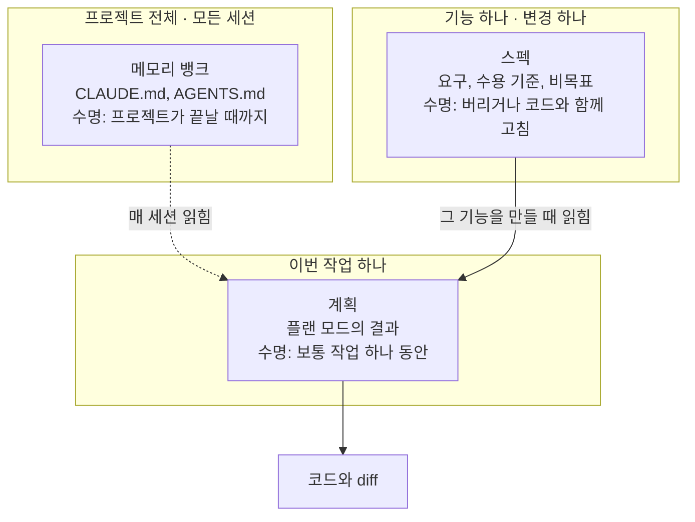
그림 1. 스펙, 메모리 뱅크, 계획의 범위와 수명

메모리 뱅크라는 말이 낯설 수 있지만, 우리가 매일 쓰는 컨텍스트 파일이 여기에 속한다. 빌드 명령이나 저장소 관례처럼 어느 작업에서나 참인 사실을 담고, 그래서 모든 세션에 들어간다. 바로 그 성질 때문에 특정 기능의 요구를 여기에 쌓으면 곤란해진다. 결제 환불 규칙이 매 세션 컨텍스트를 차지하고, 환불과 상관없는 작업에서도 에이전트가 그 규칙을 읽는다. 컨텍스트 파일을 짧게 유지하는 법은 12장에서 다룬다.

계획은 반대쪽 끝에 있다. 이번 작업 하나를 위한 단계 목록이고 수명이 짧다. 짚어 둘 것이 하나 있다. Claude Code의 플랜 모드 계획은 세션과 함께 증발하지 않는다. 기본으로 `~/.claude/plans`에 파일로 저장되고, `plansDirectory` 설정으로 저장소 안에 둘 수도 있다(2026년 11월 공식 문서 기준). 다만 기본 위치가 저장소 밖이라 팀원이나 다음 세션이 찾아 읽기는 어렵다.

스펙은 그 사이에 놓인다. 범위는 기능 하나로, 계획보다 넓고 컨텍스트 파일보다 좁다. 읽히는 때는 그 기능을 만들 때뿐이다. 수명은 정하기 나름이다. 스펙은 "무엇을, 왜"를 담고 계획은 "이번에 어떤 순서로"를 담는다. 그래서 스펙 하나에서 계획이 여러 번 나올 수 있다. 첫 계획이 틀어지면 버리고 다시 받으면 된다. 스펙이 남아 있으니까.

결제 웹훅의 재시도 규칙을 바꾸는 작업 하나에 셋을 대 보면 감이 온다. 테스트를 돌리는 명령과 "이 저장소는 금액을 원 단위 정수로 다룬다" 같은 관례는 컨텍스트 파일에 있다. 재시도를 몇 번, 어떤 간격으로 할지, 끝내 실패하면 무엇을 남길지, 이번에 건드리지 않을 것은 무엇인지는 스펙에 있다. 어느 클래스부터 고치고 어떤 순서로 테스트를 붙일지는 계획에 있다. 셋 중 하나가 다른 둘의 일을 떠맡기 시작하면 문제가 생긴다. 컨텍스트 파일에 기능 요구가 쌓이면 모든 세션이 무거워지고, 계획에 요구가 섞이면 계획을 버릴 때 요구도 함께 버려진다.

물론 경계가 늘 칼같지는 않다. OpenAI 쿡북의 ExecPlan은 계획 파일에 진행 상황(Progress), 예상 밖의 발견(Surprises & Discoveries), 결정 기록(Decision Log), 결과와 회고를 필수 절로 두고, 처음 보는 사람이 그 파일 하나만 읽고 작업을 이어받을 수 있어야 한다고 쓴다. 계획이 스스로 수명을 늘려 스펙 쪽으로 넘어온 셈이다. 그래도 세 칸으로 나눠 보는 습관은 쓸모가 있다. 지금 쓰려는 문장이 어느 칸에 들어가야 하는지 묻는 것만으로도 파일이 제자리를 찾는다.

## 왜 하필 지금인가

### 다섯 가지 동인

요구를 먼저 적자는 말은 새롭지 않다. 그런데 왜 2025년에 SDD 도구가 한꺼번에 쏟아졌을까? 참고 보고서는 동인 다섯 가지를 꼽는다.

첫째, 에이전트가 한 번에 오래 일하게 됐다. OpenAI 쿡북의 ExecPlan 문서는 Codex가 프롬프트 하나로 7시간 넘게 일했다고 적는다. 제조사의 주장이다. 그래도 작업이 길어질수록 대화 기록 밖에 기준 문서가 필요해진다는 점은 분명하다. 일곱 시간 전에 무엇을 하기로 했는지 확인하려고 대화 맨 위까지 스크롤하는 장면을 떠올려 보자. 사람도 에이전트도 지친다.

둘째, 대화만으로 만든 결과는 남지 않는다. 세션이 끝나면 왜 그렇게 정했는지도 함께 사라진다. 석 달 뒤 그 코드를 고치는 사람은 결정의 흔적 없이 코드만 본다.

셋째, 바이브 코딩에 대한 반작용이다. OpenAI의 Sean Grove는 2025 AI Engineer World's Fair에서 스펙이 프로그래밍의 기본 단위가 된다고 말했다. 비전을 밝힌 발표였고 데이터가 붙은 주장은 아니다.

넷째, 자연어 스펙이 실제로 실행 가능해졌다. 문서를 에이전트에 넣으면 코드가 나온다. 대가도 있다. Böckeler가 지적했듯 같은 스펙에서 매번 같은 코드가 나오지는 않는다. 비결정성이 더해진 것이다.

다섯째, "The Specification Paradox"라는 이름이 붙은 주장이다. AI가 코드를 잘 만들수록 사람이 쓴 올바른 스펙에 더 기대게 된다는 역설이다. 손으로 코드를 짜던 시절에는 구현하다가 요구의 모순을 발견하곤 했다. 구현을 넘기면 그 발견의 기회도 같이 넘어간다.

다섯 가지를 한 줄로 묶으면 이렇다. 코드를 만드는 일은 싸졌고, 무엇을 만들지 정하는 일은 여전히 비싸다. 그 비싼 일을 대화에 흘려보내지 말고 파일에 남기자는 것이 SDD다.

테스트를 잘 갖추면 스펙은 없어도 되지 않을까? Böckeler가 2026년 4월 글에서 쓴 구분이 이 질문에 답을 준다. 그는 에이전트를 감싸는 장치를 두 종류로 나눴다. 기능 스펙은 에이전트가 움직이기 전에 방향을 주는 피드포워드 가이드이고, 테스트와 각종 검사는 움직인 뒤에 결과를 재는 센서다. 그리고 사람이 원하는 바를 명확히 정하지 않으면 정확성은 어떤 센서로도 잡을 수 없다고 덧붙였다. 센서는 기준이 있어야 잰다. 그 기준을 적는 곳이 스펙이다. 테스트를 스펙으로 삼는 방법도 물론 있고, 이 책도 7장과 11장에서 그쪽으로 한 걸음씩 나아간다. 다만 그때도 "무엇이 옳은 동작인가"를 누군가 먼저 정해야 한다는 사실은 그대로다.

### 오래된 실천을 다시 묶다

SDD를 처음 접하면 기시감이 든다. Given-When-Then은 BDD에서 봤고, 사전조건·사후조건은 Design by Contract에서 봤다. 그 느낌이 맞다. SDD는 새 발명이라기보다 오래된 실천을 다시 묶은 것에 가깝다. 무엇을 물려받았는지 정리해 보자.

| 이전 실천 | 시기 | SDD가 물려받은 것 |
|---|---|---|
| Design by Contract | 1986 (Meyer, Eiffel) | 사전조건·사후조건·불변식을 먼저 적는 습관 |
| TDD | 약 2000 (Kent Beck) | 테스트를 먼저 쓰는 일, 곧 작은 스펙 |
| BDD, Gherkin | Cucumber 2008 | Given/When/Then. Kiro·OpenSpec의 WHEN/THEN 시나리오 |
| IDL, Thrift, OpenAPI | Thrift 약 2007 외 | 스키마 우선. 생성물은 고치지 않고 다시 생성한다 |
| 모델 주도 개발 (OMG MDA) | 2001 | 원본 모델에서 코드를 생성한다. 스펙 소스형이 되살린 생각 |
| 형식 명세 (VDM, Z, B) | 1970년대~1990년대 | 기계가 참·거짓을 판정하는 스펙 |
| EARS | 2009 (Rolls-Royce) | `When … the system shall …` 같은 요구 문형 |
| 요구공학 | 전통 | 요구 문형, 추적성, 수용 기준 |

이 가운데 EARS는 실패한 실천으로 묶을 수 없다. 지금도 Kiro와 cc-sdd의 요구 문서가 EARS 문형을 쓰고, 3장에서 우리도 직접 써 볼 것이다.

물려받은 정도도 제각각이다. 2026년 1월에 나온 Piskala의 개념 논문은 BDD를 SDD의 가장 직접적인 조상으로 보고, SDD를 기능 수준으로 끌어올린 TDD로 읽는다. 테스트만으로는 기능이나 아키텍처 수준의 의도를 다 적기 어렵다는 한계를 스펙이 메운다는 해석이다. 형식 명세는 반대쪽 끝에 있다. AWS의 Marc Brooker는 TLA+나 Lean 같은 형식 언어를 필요할 때만 가끔 쓴다고 말한다. 대부분의 SDD 스펙은 자연어이고, 기계가 판정하는 부분은 필요한 곳에만 조금씩 붙는다. 이 사다리는 3장 끝에서 다시 그려 본다.

문학적 프로그래밍(Knuth)은 일부러 표에서 뺐다. 설명과 코드를 한곳에 둔다는 생각이 닮아서 SDD의 조상처럼 소개되곤 하지만, 둘을 직접 잇는 1차 출처는 없다. 계보로 보기보다 유비로 보는 편이 정확하다.

그렇다면 이 실천들은 왜 한 번도 모든 팀의 기본값이 되지 못했을까? 참고 보고서가 찾은 반복되는 실패 원인은 하나다. 스펙과 코드를 맞춰 두는 비용이 그로써 얻는 이득보다 컸다. BDD 팀은 좋은 Gherkin을 코드와 맞춰 두기 어려워했고, 모델 주도 개발은 업무용 앱에서 절차 부담에 짓눌렸다. 요구 문서는 쓰는 순간부터 낡기 시작했다. 낡은 스펙이 쌓이는 현상에는 스펙 부채라는 이름까지 붙었다. 읽을수록 믿기 어려워지는 문서를 계속 고쳐 써야 한다니, 생각만 해도 번거로운 일이다.

2025년의 도구들이 다르다는 주장은 바로 이 지점에 걸려 있다. 맞춰 두는 비용을 이제 에이전트가 대신 진다는 것이다. 스펙을 고치면 에이전트가 코드를 따라 고치고, 코드를 바꿀 때는 에이전트가 스펙의 변경분을 쓴다. 참고 보고서는 이것을 측정이 아닌 추론으로 분류한다. 정말 그런지, 어디까지 그런지는 아직 근거가 얇다. 그 근거를 하나씩 들여다보는 것이 2장의 일이다.

여기까지 오면 SDD를 한 문장으로 말할 수 있다. SDD는 에이전트가 추측으로 채울 결정을 코드보다 먼저 파일에 적고, 사람과 에이전트가 그 파일을 같은 기준으로 다시 읽게 하는 방식이다. 날씨 앱의 40마일은 한 문단짜리 설명에서 빠진 결정 하나였을 뿐이다.

질문이 하나 남는다. 작업이 끝나고 PR이 병합되면 그 스펙은 어디로 가야 할까? 버려야 할까, 코드 옆에 남겨 두고 함께 고쳐야 할까, 아니면 스펙만 원본으로 남기고 코드는 언제든 다시 만들 수 있는 것으로 봐야 할까? 이 질문에 어떻게 답하느냐에 따라 SDD 도구들은 전혀 다른 모양으로 갈라진다.

# 2장. 스펙은 얼마나 오래 사는가 — SDD의 지도와 2026년의 좌표

흔히 스펙 주도 개발(Spec-Driven Development, SDD)을 "스펙을 먼저 쓰는 것"이라고 한다. 틀린 말은 아닌데, 이 정의로는 도구를 하나도 구분할 수 없다. Spec Kit도, OpenSpec도, Kiro도, 하네스에 들어 있는 플랜 모드조차도 모두 코드보다 먼저 무언가를 쓴다. 방법들이 실제로 갈리는 곳은 출발선보다 결승선 쪽이다. 다 만든 뒤에 그 스펙은 어떻게 되는가?

1장 끝에서 남긴 질문이 바로 이것이었다. 이 질문 하나로 SDD의 지도를 그리고, 그 위에 2026년 11월 현재의 근거를 올려 보자. 미리 말해 두면, 근거가 하는 말은 생각보다 절제되어 있다.

## 스펙의 세 가지 수명

### 우선형, 고정형, 소스형

Birgitta Böckeler는 2025년 10월 15일 글에서 SDD를 세 수준으로 나눴다. 기준은 하나, 작업이 끝난 뒤 스펙의 운명이다.

| 수준 | 스펙의 운명 | 사람이 고치는 것 | 대표 사례 |
|---|---|---|---|
| 스펙 우선형 (spec-first) | 작업 전에 쓰고 그 작업에 쓴다. 작업 뒤 버려지거나 방치될 수 있다 | 스펙과 코드 | Kiro, Spec Kit |
| 스펙 고정형 (spec-anchored) | 작업 뒤에도 남고, 스펙과 코드를 함께 바꾼다 | 스펙과 코드를 같이 | OpenSpec의 아카이브 병합, Tessl이 목표로 삼았던 모습 |
| 스펙 소스형 (spec-as-source) | 스펙만 원본이고, 코드는 스펙에서 다시 생성한다 | 스펙만 | Tessl Framework 실험 |

한국어로는 요즘IT 번역본(안영회 역, 2025-12-01)으로 이 글을 접한 독자가 많을 것이다. 번역본은 세 수준을 "스펙 우선", "스펙 고정형", "스펙을 소스로"라고 옮겼다. 이 책은 세 번째를 "스펙 소스형"으로 통일한다.

처음 보는 도구를 만나면 두 번만 물으면 된다. 작업 뒤에도 스펙을 유지하는가? 유지한다면, 사람이 코드를 직접 고치는가?

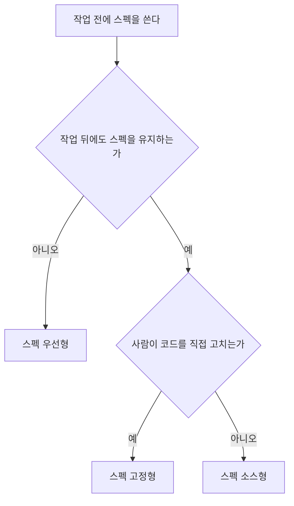
그림 1. 스펙의 수명으로 SDD 방법을 가르는 흐름

이 흐름에 도구를 하나씩 넣어 보면 재미있는 사실이 드러난다. 대부분이 첫 갈림길에서 왼쪽으로 빠진다. 모든 SDD 접근은 스펙 우선형에서 출발하지만, 작업 뒤 스펙을 어떻게 유지할지 전략을 정해 둔 도구는 적다. 그래서 Böckeler는 대부분의 도구가 실제로는 스펙 우선형이라고 봤다. 선언문이 "살아 있는 산출물"을 말하더라도, 병합 뒤에 기능 폴더가 다시 열리지 않는다면 그 스펙은 우선형으로 산다. 도구의 구호와 스펙의 실제 수명은 따로 확인하자.

지도의 가장 먼 끝에 스펙 소스형이 있다. 가능성을 보여 준 시연은 있다. Monperrus는 926단어짜리 스펙과 Claude Code의 첫 구현에서 출발해, 새로 띄운 에이전트가 같은 스펙만 보고 처음부터 다시 올바르게 구현하는 것을 보였다. IEEE Software 게재 예정인 글이고, 시연은 한 번이다. 이 방향을 제품으로 밀던 Tessl은 2025년 9월 Framework 비공개 베타와 Spec Registry를 공개했지만, 2026년 1월 29일 스킬 패키지 관리 플랫폼으로 방향을 틀었다. 넉 달쯤 만의 전환이다. 1장에서 본 모델 주도 개발이 원본 모델에서 코드를 생성하려다 절차 부담에 막혔던 일을 떠올리면, 스펙 소스형은 그 오래된 꿈의 자연어판이라 할 만하다. 2026년 11월 현재로서는 실험 단계에 머물러 있다.

## 무엇으로 통제하는가

### 문서, 습관, 반복

수명이 SDD를 가르는 한 축이라면, 두 번째 축도 있다. 에이전트를 무엇으로 붙잡아 두는가, 곧 통제 단위다. 참고 보고서는 2026년의 SDD 도구가 세 갈래로 다시 묶인다고 본다.

첫째 갈래는 **문서 파이프라인**이다. 요구 → 설계 → 태스크 같은 문서 사슬을 만들고 단계 사이에 승인 관문을 둔다. 통제 단위는 문서와 관문이다. Spec Kit, Kiro 스펙, OpenSpec, BMAD가 여기에 속한다. 둘째 갈래는 **스킬 규율**이다. 고정된 문서 대신 "먼저 질문하라", "계획을 세워라", "테스트부터 써라", "리뷰를 받아라" 같은 습관을 스킬로 강제한다. Superpowers와 mattpocock/skills가 대표다. 셋째 갈래는 **계획-실행 루프**다. 계획 파일이나 태스크 그래프를 새 컨텍스트에서 되풀이해 실행하고, 진행 상황을 파일에 남긴다. GSD나 Ralph 루프 같은 이름이 여기에 있다.

어느 갈래에도 넣기 애매한 것이 하나 더 있다. 하네스에 들어 있는 네이티브 플랜 모드다. 참고 보고서는 이것을 "가장 작은 스펙 우선형"이라고 부른다. 작업 전에 쓰이고, 그 작업에만 쓰이기 때문이다. 계획이 파일로 남는 하네스도 있지만(1장에서 본 Claude Code는 기본으로 저장소 밖 `~/.claude/plans`에 저장한다), 다음 작업의 기준으로 다시 열리는 일은 드물다. 설치 비용이 없다는 점에서, 모든 독자가 이미 손에 쥔 출발점이기도 하다.

참고 보고서는 이 갈래들을 더 잘게 나눠 F1~F8이라는 기호를 붙였다. 연구 노트를 묶어 낸 보고서의 추론이다. 이 책은 본문에서 되도록 계열 이름으로 부르고, 기호를 쓸 때는 참고 보고서의 분류라고 밝힌다.

| 기호 | 계열 | 무엇이 스펙인가 | 대표 도구 |
|---|---|---|---|
| F1 | 단계 게이트형 파이프라인 | 요구 → 설계 → 태스크 문서 사슬과 단계별 승인 | Spec Kit, Kiro 스펙, cc-sdd |
| F2 | 변경 델타형 | 변경마다 쓰는 제안과 델타 스펙. 끝나면 리빙 스펙에 병합 | OpenSpec |
| F3 | 역할 시뮬레이션형 | PM, 아키텍트 같은 역할 에이전트가 차례로 만드는 문서 | BMAD |
| F4 | 스킬 규율형 | 고정 문서 대신 질문·계획·TDD·리뷰 습관을 강제하는 스킬 | Superpowers, mattpocock/skills |
| F5 | 계획-실행 루프형 | 계획 파일이나 태스크 그래프를 새 컨텍스트에서 반복 실행 | GSD, Taskmaster, Ralph 루프 |
| F6 | 네이티브 플랜 모드 | 하네스 내장 읽기 전용 계획 단계의 결과 | Claude Code 플랜 모드, Cursor Plan Mode |
| F7 | 스펙 소스형 실험과 역공학 | 코드를 재생성하는 원본 스펙, 또는 기존 코드에서 복원한 스펙 | Tessl Framework(전환됨), Reversa |
| F8 | 검증 중심형 | 테스트, 속성, 계약, 형식 명세처럼 기계가 판정하는 스펙 | VSDD, Kiro 속성 기반 테스트, Specmatic MCP |

표를 읽을 때 놓치기 쉬운 점이 있다. 계열(통제 단위)과 수준(수명)은 서로 다른 축이다. F1 단계 게이트형 도구도 수명으로 따지면 대부분 스펙 우선형이다. 반면 F2의 OpenSpec은 변경이 끝날 때마다 델타 스펙을 리빙 스펙에 병합하는 아카이브 단계 덕분에 스펙 고정형에 가깝다. 같은 문서 파이프라인 안에서도 스펙의 수명은 이렇게 갈린다. 4장과 5장에서는 이 두 축을 좌표 삼아 도구를 하나씩 지도 위에 올린다.

## 근거의 지형

### 같은 티켓 50개로 잰 측정

지도를 그렸으니 이제 물을 차례다. SDD는 실제로 값을 하는가? 같은 과제로 여러 도구를 나란히 잰 실무 통제 비교는 2026년 11월 현재 하나뿐이다. Uvik이라는 회사가 2026년 10월 15일에 돌리고 11월 2일에 갱신한 벤치마크다.

설계부터 보자. 고객 저장소 다섯 곳에서 티켓 50개를 골랐다. 모두 기존 코드가 있는 브라운필드 Python이다. 유형은 버그 수정, 기능, 리팩터링, 데이터 파이프라인, 테스트 작성이 10개씩이고, 크기는 작음 20개, 중간 20개, 큼 10개였다. 스펙 단계와 구현 단계에 각각 45분 제한을 두었다. 시니어 엔지니어 다섯 명이 어느 도구의 결과인지 모른 채 리뷰했고, 잡음을 재려고 티켓 10개는 다시 돌렸다. 모델은 claude-sonnet-5 하나였다. Kiro만 자체 IDE에서 돌았고 나머지는 모두 Claude Code에서 돌았다.

전체 병합률은 스펙 없이 바로 구현한 대조군이 72%, Spec Kit 80%, Kiro 스펙과 BMAD가 각각 82%, OpenSpec이 84%였다. 리뷰에서 나온 병합 티켓당 결함은 대조군 0.86에 비해 네 도구 모두 낮았고, 스펙 쪽 평균은 0.46이었다. 여기까지만 보면 스펙을 쓰면 다 좋아지는 것처럼 보인다.

흥미로운 장면은 크기별로 쪼갠 결과에서 나온다.

| 수정 파일 수 | 대조군 | 최고 스펙 조건 | 차이 |
|---|---|---|---|
| 1~2개 (작음) | 85% | 85% | 0%p |
| 3~5개 (중간) | 70% | 85% | +15%p |
| 6개 이상 (큼) | 50% | 80% | +30%p |

파일 한두 개를 고치는 티켓에서 스펙은 아무것도 더하지 않았다. 대조군도 85%, 가장 잘한 스펙 조건도 85%다. 파일이 3~5개로 늘면 15%p가 벌어지고, 6개를 넘으면 차이가 30%p로 커진다. 작업 유형으로 나눠 봐도 결은 같다. 버그 수정은 대조군 90%에 스펙 조건 80~90%로 이득이 없었고, 리팩터링은 둘 다 80%였다. 대조군 60%가 스펙 조건에서 최고 90%까지 올라 잡음 대역을 벗어난 것은 기능과 데이터 파이프라인, 두 유형뿐이었다.

비용 쪽은 어떨까? 병합까지 걸린 시간은 대조군이 가장 짧았다. 중앙값 29분이다. 스펙 단계는 티켓마다 중앙값으로 12~28분을 더했다. 작은 티켓에 이 시간을 붙이면 얻는 것 없이 시간만 잃는다. 변경이 클수록 이득이 커지고, 작을수록 비용만 남는다. 이 책의 판단은 대부분 이 한 문장에서 출발한다.

### 숫자를 읽기 전에 볼 조건

이 숫자를 그대로 믿어도 될까? 측정 하나가 책의 기조를 받친다면 그 측정의 한계도 함께 들고 다녀야 한다. 참고 보고서는 Uvik 결과를 옮길 때 붙여야 할 경고를 여섯 가지로 정리했다. 이 책도 그대로 따른다.

가장 먼저 볼 것은 잡음 대역이다. 같은 티켓을 다시 돌렸을 때 병합률이 흔들린 폭이 ±10%p였다. 이 대역을 확실히 벗어난 도구는 OpenSpec(+12%p) 하나뿐이다. Spec Kit(+8%p)은 대역 안에 있고, Kiro와 BMAD(각 +10%p)는 경계에 걸려 있다. 그래서 Uvik 스스로도 도구 순위를 매기지 않았다. "OpenSpec이 1등"이라는 읽기도, "Spec Kit이 꼴찌"라는 읽기도 이 데이터는 허락하지 않는다.

리뷰 결함이 네 도구 모두 대조군보다 낮았다는 점은 순위와 상관없이 읽을 수 있는 결과다. 반대로 시간은 대조군이 가장 짧았다는 점도 함께 적어야 한다. 비용에도 함정이 있다. Kiro의 병합 티켓당 비용(2.35달러)은 대조군(2.43달러)보다 낮게 나왔지만, Kiro만 다른 하네스에서 모델을 손으로 설정해 돌았다. 이 차이를 도구 효과로 읽어서는 곤란하다. 대조군이 플랜 모드를 썼는지도 실험 노트에 없다. 그러니 이 결과를 "문서 파이프라인 대 플랜 모드"의 대결로 읽을 수도 없다.

마지막은 조건이다. Uvik은 Python 개발과 인력 지원 서비스를 파는 회사이고, 이 이해관계를 페이지에 밝혀 두었다. 통제 실험이었고 리뷰는 블라인드였지만, 티켓은 50개이고 모델은 하나다. 크기 칸마다 표본은 더 작아진다. 이 책에서 Uvik 숫자를 인용할 때마다 이 조건을 같이 적는 이유다.

이 조건을 다 붙이고도 크기 신호를 강하게 보는 데는 이유가 있다. 다른 출처들이 같은 방향을 가리킨다. SDD 저장소를 채굴한 연구에서 스펙의 82.0%는 기능(feat) 라벨이 붙은 작업이었고, 실무자들은 버그를 스펙 없이 직접 프롬프트로 고쳤다. OpenSpec의 FAQ도 한 글자 오타 수정에는 절차 부담이 맞지 않는다고 적는다. 측정 하나에 기대기보다 여러 출처가 한 방향으로 모인다는 점이 이 신호의 힘이다.

비어 있는 곳도 분명히 해 두자. 스킬 규율 계열(Superpowers, mattpocock/skills)과 네이티브 플랜 모드는 Uvik이 재지 않았고, 다른 방법과 같은 과제로 잰 독립 측정도 없다. 그러니 "가벼운 방법이 더 낫다"는 결론도, "더 못하다"는 결론도 지금은 낼 수 없다. 점수가 없다는 것은 효과가 없다는 뜻이 아니라 아직 아무도 재지 않았다는 뜻이다.

Uvik은 결과에서 실용적인 규칙 하나를 뽑아냈다. 아래 여섯 조건 가운데 참인 것이 셋 이상이면 스펙을 쓰라는 것이다. 이 책은 참인 조건의 수를 스펙 적합성 점수라고 부른다.

| 번호 | 조건 |
|---|---|
| 1 | 파일 3개 이상을 건드린다 |
| 2 | 수용 기준이 4개 이상이다 |
| 3 | 모듈, 서비스, 저장소 경계를 넘는다 |
| 4 | 스키마나 공개 API를 바꾼다 |
| 5 | 여러 엔지니어나 여러 에이전트가 참여한다 |
| 6 | 규제나 감사 대상이다 |

지금 머릿속에 있는 다음 작업에 이 여섯 줄을 대 보자. 몇 점이 나오는가? 0점짜리 변경과 4점짜리 변경을 어떻게 다르게 다룰지는 11장의 변경 크기 사다리에서 본격적으로 정한다. 지금은 점수를 세는 습관 하나만 들여도 충분하다.

## 의견은 어떻게 움직였나

### 여섯 국면과 Radar의 링

측정과 별개로 업계의 의견도 1년 남짓 사이에 크게 출렁였다. 참고 보고서는 2025년 중반부터 2026년 11월까지를 여섯 국면으로 정리한다. 보고서가 여러 글을 묶어 낸 구분이니 거친 윤곽으로 읽자.

첫 국면은 2025년 중반의 비전이다. 스펙이 새로운 진실의 원천이 된다는 선언이 나왔지만 데이터는 없었다. 2025년 10~12월에는 첫 체험과 반발이 왔다. 직접 써 본 사람들이 절차 부담과 마크다운 검토 피로, 워터폴 같은 느낌을 이야기하기 시작했다. 2026년 1~5월은 반박과 재구성의 시기였다. "워터폴이 아니다"라는 반론이 나왔고, Kiro는 설계 우선 흐름과 버그픽스 스펙을 더해 적응했다. 2026년 봄에는 도구 정렬이 일어났다. 무거운 도구와 가벼운 도구를 비용으로 견주는 글이 이어졌다. 2026년 여름에는 피로가 찾아왔다. "SDD는 어떻게 됐나"라는 물음에, 모델이 좋아져서 plan.md와 검증 루프로 충분한 경우가 많다는 답이 돌아왔다. 그리고 2026년 11월, 정착한 중간 지대에 이른다. 질문이 "SDD를 할까 말까"에서 "하네스 안에서 스펙을 어디까지 둘까"로 옮겨 갔다.

이 흐름을 가장 잘 보여 주는 것이 Thoughtworks Technology Radar의 링 이동이다.

| 항목 | 2025-11 (Vol 33) | 2026-04 (Vol 34) | 2026-11 (Vol 35) |
|---|---|---|---|
| 스펙 주도 개발 (기법) | Assess | - | 현재 판에 없음 |
| GitHub Spec Kit | - | Assess | 현재 판에 없음 |
| OpenSpec | - | Assess | **Trial** |
| AI 기반 문서 난립 | - | - | Caution |
| 에이전트 지시문 비대 | - | - | Caution |

Vol 35가 2026년 11월 판이라는 사실은 페이지에 적혀 있다. Vol 33과 Vol 34라는 번호는 연 2회 발행 주기에서 거꾸로 센 값이다.

눈여겨볼 것은 Vol 35의 조합이다. 같은 판에서 OpenSpec을 Assess에서 Trial로 올리면서, AI가 만드는 문서 난립과 에이전트 지시문 비대를 Caution에 넣었다. 문서 난립 항목은 Spec Kit과 BMAD가 쏟아내는 대량의 마크다운을 지목했고, 지시문 비대에 대해서는 규칙을 훅과 검사로 옮기고 모델이 바뀔 때마다 다시 평가하라고 처방했다. 스펙 고정형 도구 하나를 추천하면서 SDD의 부작용 두 개에 경고를 붙인 셈이다. 참고 보고서는 이 조합을 "SDD를 고르되 문서 양을 통제하라"는 신호로 읽는다.

### 워터폴의 귀환인가

SDD 이야기를 꺼내면 거의 빠짐없이 나오는 질문이 있다. 요구를 먼저 다 쓰고 나서 만든다니, 이거 워터폴 아닌가?

이 비판에는 근거가 있다. Marmelab은 2025년 11월 12일 글에서 컨텍스트 맹목, 마크다운 과부하, 관료주의, 가짜 애자일 스토리, 이중 검토를 문제로 꼽았다. SDD가 개발의 약 80%를 읽는 일로 바꾼다는 추정도 덧붙였는데, 측정이 아니라 저자의 추정이다. Martin Fowler가 2026년 1월 글에서 전한 Kent Beck의 반론은, 구현하는 동안 스펙을 바꿀 만한 것을 아무것도 배우지 않는다는 가정 자체가 이상하다는 것이었다. 두꺼운 요구 문서를 승인받고 석 달 뒤에야 그 문서가 틀렸다는 걸 알게 되는 장면, 경력이 좀 있는 개발자라면 한 번쯤 겪어 봤을 끔찍한 일이다.

반대편의 목소리도 있다. Atomic Object는 2026년 5월 22일 글에서 SDD가 워터폴과 네 가지가 다르다고 정리했다. 스펙을 바꾸는 시점, 병렬로 진행하는 설계, 스펙 안에 들어간 완료 기준, 그리고 개발자가 스펙 수정을 소유한다는 점이다. Marc Brooker는 되풀이해 고치는 대상이 코드에서 스펙으로 옮겨 갔을 뿐이라고 본다.

2026년 11월 시점의 판정은 반반이다. 절차에 대한 비판은 대부분 해소됐다. 제조사들이 버그픽스 스펙, 설계 우선 흐름, 변경 범위 흐름을 내놓으며 스스로 절차를 줄였다. 문서 양에 대한 비판은 여전히 유효하다. 2025년에 Spec Kit을 향했던 비판 일곱 개를 2026년 11월 기준으로 다시 보면, 넷은 해결됐고 하나는 부분적으로 해결됐지만 둘은 그대로 남아 있다. 기능마다 파일이 많다는 것, 그리고 긴 마크다운을 검토하는 부담이다. 2025년의 체험기를 읽을 때 날짜와 도구 버전부터 확인하자는 이유가 여기에 있다. 같은 비판이라도 어떤 것은 이미 낡았고 어떤 것은 지금도 아프다.

## 이 책의 기조

### 선택지로서의 SDD

지도와 근거를 다 펼쳤으니 이 책이 서 있는 자리를 밝혀 두자. 참고 보고서의 결론 판단을 그대로 옮긴다.

> 2026년 11월의 SDD는 모든 작업의 기본 방법이 아니다. 큰 변경마다 고르는 선택지다.

이것은 보고서의 추론이다. 그리고 이 추론을 받치는 일곱 가지 판단 가운데 이 책이 끝까지 붙들고 갈 셋이 있다.

첫째, 스펙의 이득은 큰 변경에서만 측정된다. 앞에서 본 파일 수별 병합률이 근거다. 6장에서 예제 변경의 점수를 매기는 일도, 11장에서 변경마다 단을 고르는 일도 이 판단에서 나온다.

둘째, 가장 강한 근거는 도구보다 부품에 있다. 이름 있는 도구 사이의 우열은 앞서 봤듯 아직 가릴 수 없다. 대신 부품 단위의 근거는 두껍다. 처음부터 정리해 한 번에 건넨 스펙이 대화 속에서 조금씩 자란 스펙보다 충실하게 구현된다는 측정이 있고, 사람이 쓴 테스트를 받은 에이전트가 SWE-Bench Verified에서 94.3%를 냈다는 측정이 있고, 명확화 질문이 정답률을 올린다는 측정이 있다. 이 책이 도구 장(8~10장)보다 도구 없는 SDD(6~7장)를 먼저 두는 까닭이다. 부품을 먼저 손에 익히면 어떤 도구를 만나도 그 도구가 어떤 부품을 어떻게 묶었는지 보인다.

셋째, 관문은 작업한 에이전트 밖에 둘 때만 믿을 수 있다. 자기 작업을 스스로 판정하게 한 오케스트레이터는 블록 점검 247회 동안 선언하지 않은 변경을 11번 기록했고, 그중 작업을 멈춘 것은 4번뿐이었다. 논문 저자들이 직접 운영한 기능 아홉 개의 기록이다. 다른 연구에서는 LLM 판정이 실행 평가기가 잡은 실패의 26%를 놓쳤다. 에이전트가 "완료"라고 말할 때 그 말을 누가 확인하는가? 7장은 이 질문으로 검증의 기준선을 세운다.

선택지라는 말을 가볍게 넘기지 말자. 고른다는 것은 고르지 않을 때도 있다는 뜻이다. 이 책은 SDD를 가르치지만, SDD를 덜어 내는 법도 같은 무게로 다룰 것이다.

그러려면 먼저 내 변경이 어떤 크기인지 알아야 한다. 지난주에 병합한 변경 다섯 개를 떠올려 보자. `git log --stat`을 열어도 좋다. 변경마다 수정한 파일 수를 세어 적고, 그중 6개 이상이 몇 개였는지 표시해 두자. 0개일 수도 있고 다섯 개 전부일 수도 있다. 그 숫자가 이 책을 읽는 내내 당신의 기준선이 된다. 11장에서 이 메모를 다시 꺼낼 것이다.

### 이 장의 핵심

- SDD 방법은 작업 뒤 스펙의 운명에 따라 스펙 우선형·스펙 고정형·스펙 소스형으로 갈리고, 대부분의 도구는 실제로는 스펙 우선형이다.
- 통제 단위로 보면 문서 파이프라인·스킬 규율·계획-실행 루프의 세 갈래와 네이티브 플랜 모드가 있고, 이 축은 수명과 따로 움직인다.
- 같은 티켓으로 잰 유일한 실무 비교(Uvik, 서비스 회사 운영, n=50, 모델 1개, 잡음 대역 ±10%p)에서 스펙의 이득은 수정 파일 수가 많을수록 컸고(1~2개 0%p, 6개 이상 +30%p), 스펙 단계는 티켓마다 12~28분을 더했다.
- 스킬 규율 계열과 플랜 모드는 독립 측정이 없어 다른 방법과 우열을 말할 수 없다.
- 이 책의 기조는 하나다. SDD는 모든 작업의 기본값이 아니라 큰 변경마다 고르는 선택지다.

# 3장. 좋은 스펙의 해부 — 요구, 수용 기준, 비목표, 결정

"부분 환불 만들어 줘." 에이전트 창에 이렇게 한 줄을 보내면, 결정 몇 개가 내 손을 떠날까?

하나나 둘쯤이라고 답했다면 다시 세어 볼 일이다. 이 질문에 제대로 답하려면 구체적인 코드베이스가 필요하다. 이 책의 끝까지 함께 갈 프로젝트를 소개하고, 그 프로젝트의 요구 한 줄을 문장 단위로 해부해 보자. 스펙 주도 개발(Spec-Driven Development, SDD)에서 "좋은 스펙"이란 결국 좋은 문장들의 묶음이기 때문이다.

## 동네책방과 한 줄짜리 요청

### 예제 프로젝트, 그리고 한 줄이 남기는 빈칸

동네책방 주문 서비스 `bookshop-orders`는 동네 서점 여러 곳이 함께 쓰는 온라인 주문 백엔드다. Spring Boot(Java)와 PostgreSQL로 만들었고, 스키마는 마이그레이션 스크립트로 관리하며, 테스트는 JUnit으로 돈다. 이미 운영 중인 브라운필드 저장소다. 지금 되는 일은 주문 생성, 외부 PG와 연동한 카드 단일 결제, 주문 단위 쿠폰(정률 또는 정액), 배송 상태 갱신, 그리고 배송 전 전체 취소(`POST /orders/{orderId}/cancel`)다. 주문 상태는 `PAID`, `SHIPPED`, `DELIVERED`, `CANCELLED` 넷이다. 부분 환불은 없다.

어느 날 운영팀이 요청을 보낸다. 배송이 끝난 뒤에도 일주일 안에는 책 일부만 환불해 줄 수 있게 해 달라는 것이다. 이 책은 이 부분 환불 기능을 6장과 7장에서 도구 없이 한 번, 8장부터 10장까지 OpenSpec·Spec Kit·Superpowers로 한 번씩 다시 스펙으로 쓴다. 같은 요구가 도구마다 어떤 문서가 되는지 나란히 보려는 것이다.

이제 "부분 환불 만들어 줘" 한 줄이 남기는 빈칸을 세어 보자.

먼저 "누가" 환불할 수 있는가. 서점 관리자(`SHOP_ADMIN`)라고 치자. 그러면 A 서점 관리자가 B 서점의 주문을 환불하려 할 때는 어떻게 되는가? 다음은 "언제까지"다. "배송 후 일주일"의 기준 시각이 주문 시각인지, 결제 시각인지, 배송 완료 시각인지 정해야 한다. 일주일이 날짜 단위인지 시간 단위인지, 날짜라면 어느 시간대 기준인지도 남는다. 세 번째는 "얼마"다. 주문에 10% 쿠폰이 걸려 있었다면 책 한 권을 환불할 때 할인을 얼마나 빼야 할까? 나눠서 원 미만이 생기면? 네 번째는 "두 번 오면"이다. 관리자가 버튼을 두 번 누르거나 네트워크가 요청을 재전송하면 환불이 두 번 나가는가? 다섯 번째는 "실패하면"이다. PG 환불 호출이 실패했을 때 주문 상태와 환불 수량은 어떻게 남는가? 마지막은 "이미 있는 것과의 관계"다. 기존 전체 취소 API는 그대로 두는가, 부분 환불에 흡수하는가?

여섯 개다. 수량 단위로 환불하는지, 항목 단위로만 환불하는지까지 치면 더 늘어난다. 그리고 이 질문들 모두에 에이전트는 답을 낸다. 묻지 않고, 코드로. 그중 하나가 돈이 걸린 결정이라는 점을 생각하면 아찔하다.

특히 첫 번째 빈칸은 쉽게 묻힌다. 2026년 4월 Ran the Builder에 실린 실무자 비교에서, 계획 단계에 쓴 어떤 도구도 인가 누락을 짚지 못했다. 한 실무자가 기능 하나로 본 관찰이라 일반화할 수는 없다. 그래도 경고로는 충분하다. 문서를 만들어 주는 도구가 있어도 "누가 할 수 있는가"는 사람이 먼저 적어야 한다.

## 요구를 문장으로 쓰기

### EARS 여섯 문형

빈칸이 많다는 걸 알고 나면 흔히 이렇게 반응한다. 프롬프트에 조건을 더 많이 적자. 생각나는 규칙을 전부 나열하면 되지 않을까?

그 방법은 생각만큼 잘 듣지 않는다. Findings of ACL 2026에 실린 Yang 외의 연구에서는 요구를 그냥 다 적는 것이 일관되게 도움이 되지 않았다. 모델이 지킬 수 있는 지시의 수에는 한계가 있고, 늘어난 요구끼리 서로 부딪히기도 했다. 단순한 지시를 최대 500개까지 늘려 본 IFScale 실험에서는 가장 좋은 모델도 정확도가 68%에 그쳤고, 앞쪽 지시를 더 잘 지키는 편향이 나타났다(2025년 7월 모델 기준 프리프린트). 문장을 늘리는 것으로는 부족하다. 문장 하나하나가 좋아야 한다.

좋은 요구 문장의 틀로 가장 오래 쓰인 것이 EARS(Easy Approach to Requirements Syntax)다. Alistair Mavin 등이 2009년 Rolls-Royce에서 제트 엔진 제어 시스템의 감항 규정을 분석하며 만들었고, 같은 해 RE'09에서 발표했다. 일반형은 이렇다. "While \<선택적 사전조건\>, when \<선택적 트리거\>, the \<시스템 이름\> shall \<시스템 응답\>." 절의 순서가 시간 순서를 따른다는 점이 핵심이다. 사전조건이 먼저 성립하고, 그다음 트리거가 참이 되어야 응답이 요구된다.

| 문형 | 키워드 | 원전 예문 | 동네책방 예문 |
|---|---|---|---|
| 항상 (Ubiquitous) | 없음 | The mobile phone shall have a mass of less than XX grams. | The 주문 서비스 shall 모든 금액을 원 단위 정수로 다룬다. |
| 상태 (State-driven) | `While` | While there is no card in the ATM, the ATM shall display "insert card to begin". | While 주문 상태가 `PAID`이면, the 주문 서비스 shall 전체 취소 요청을 지금과 같이 전액 취소로 처리한다. |
| 사건 (Event-driven) | `When` | When "mute" is selected, the laptop shall suppress all audio output. | When 서점 관리자가 환불 항목 목록과 사유를 담아 환불을 요청하면, the 주문 서비스 shall 항목별 환불액을 계산해 PG에 환불을 요청한다. |
| 선택 기능 (Optional feature) | `Where` | Where the car has a sunroof, the car shall have a sunroof control panel on the driver door. | Where 주문에 쿠폰이 적용되어 있으면, the 주문 서비스 shall 쿠폰 할인액을 항목 금액 비율로 안분해 환불액에서 뺀다. |
| 원치 않는 동작 (Unwanted behaviour) | `If … then` | If an invalid credit card number is entered, then the website shall display "please re-enter credit card details". | If 환불 요청 시각이 `delivered_at`부터 168시간을 넘었으면, then the 주문 서비스 shall 요청을 거절하고 `422 REFUND_WINDOW_EXPIRED`를 돌려준다. |
| 복합 (Complex) | 조합 | While the aircraft is on ground, when reverse thrust is commanded, the engine control system shall enable reverse thrust. | While 같은 `Idempotency-Key`의 보관 기간(24시간)이 지나지 않았으면, when 같은 키와 같은 본문으로 환불 요청이 다시 오면, the 주문 서비스 shall 첫 요청의 결과를 그대로 돌려준다. |

표의 원전 예문은 Mavin이 운영하는 EARS 소개 페이지의 문장이다(2009년 논문의 예시는 항공기 엔진 제어 요구다). 한국어로 쓸 때는 cc-sdd의 `ears-format.md` 규칙을 따른다. `When`, `If`, `While`, `Where`, `shall` 같은 키워드와 고정 구는 영어로 두고, 변수 부분만 한국어로 쓴다. 주어는 "the system"보다 구체적인 시스템 이름이 낫다. 이 책은 `bookshop-orders`의 요구 주어를 `the 주문 서비스`로 쓴다. 영어와 한국어가 한 문장에 섞여 처음엔 어색하지만, 키워드가 영어로 고정되어 있으면 사람도 도구도 문형을 바로 알아본다. 뒤에서 쓸 수용 기준 시나리오의 `GIVEN`/`WHEN`/`THEN`도 같은 원칙으로 영어로 둔다. 8장에서 볼 OpenSpec의 `validate`는 단계 키워드가 없는 시나리오를 경고하기도 한다.

표에서 `Where` 예문은 조금 조심해서 읽자. EARS의 `Where`는 원래 제품 구성에 따라 있거나 없는 기능에 쓰는 문형이다. 쿠폰은 주문마다 붙거나 안 붙는 요소라서 여기에 넣었지만, `While 주문에 쿠폰이 적용된 상태이면`으로 써도 뜻은 통한다. 문형 선택이 늘 자명하지는 않다는 관찰은 연구에도 있다(Salari 외, 2025). 팀 안에서 한 번 정해 두고 같은 틀을 쓰는 편이 낫다.

원치 않는 동작에 문형을 따로 둔 데는 이유가 있다. Mavin은 초기 요구에서 빠지는 내용의 주된 출처가 장애·교란·오사용 처리라고 봤다. 실패 처리에 전용 틀이 있으면 쓰는 사람이 "이게 실패하면?"을 한 번 더 묻게 되고, 나중에 그 요구를 찾기도 쉽다.

효과는 어땠을까? 2009년 사례에서 원래 요구 36개를 EARS로 다시 쓰자 47개가 됐고, 요구당 평균 단어 수는 36.9에서 25.6으로 줄었다. 여덟 가지 결함 유형 가운데 복잡함, 누락, 중복, 구현 서술, 검증 불가 다섯 가지가 재작성본에서 사라졌다. 요구는 늘고 문장은 짧아진 것이다. 다만 저자 스스로 단서를 붙였다. 표본이 36개로 작고, 안전 관련 상위 요구에 한정되며, 막연함을 분류하는 일이 주관적이었다. 누락이 "사라졌다"는 결과도 조심해서 읽으라고 적었다. 원치 않는 동작 일부를 찾아냈을 뿐, 다른 누락까지 잡았다는 증거는 없다는 것이다. 그리고 하나 더 분명히 해 두자. EARS가 LLM 코딩 에이전트의 출력을 자유 서술보다 낫게 만든다는 통제 실험은 2026년 11월 현재 찾을 수 없다. 이 책이 EARS를 권하는 근거는 결함이 줄었다는 2009년의 사례와, 조건이 명시된 요구가 정답률을 높인다는 간접 근거를 합친 것이다.

### 다시 쓴 네 문장

EARS 사례에서 끌어낸 작성 규칙은 네 가지로 줄일 수 있다. 한 문장에는 트리거 하나만 둔다. 트리거가 둘이면 요구를 둘로 나눈다. 정상 흐름을 하나 쓸 때마다 "이게 실패하면?"을 묻고 `If … then` 요구를 따로 쓴다. 머릿속에만 있는 전제는 `While` 절로 꺼낸다. 그리고 어떻게 만들지는 쓰지 않는다. 이 규칙으로 운영팀 요청에서 나올 법한 문장 네 개를 다시 써 보자.

```text
[고치기 전] 배송 후 일주일 안에는 환불이 가능해야 한다.
[다시 쓴 요구]
- When 서점 관리자가 배송 완료 시각(delivered_at)부터 168시간 안에 주문 항목의
  환불을 요청하면, the 주문 서비스 shall 요청한 항목과 수량의 환불액을 계산해
  PG에 환불을 요청한다.
- If 환불 요청 시각이 delivered_at부터 168시간을 넘었으면, then the 주문 서비스
  shall 요청을 거절하고 422 REFUND_WINDOW_EXPIRED를 돌려준다.

[고치기 전] 환불 수량은 적절히 검증한다.
[다시 쓴 요구]
- If 요청 수량과 그 항목의 refunded_quantity를 더한 값이 주문 수량을 넘으면,
  then the 주문 서비스 shall 요청을 거절하고 409 REFUND_QUANTITY_EXCEEDED를
  돌려준다.

[고치기 전] PG 환불 API에서 오류가 나면 재시도 로직으로 처리한다.
[다시 쓴 요구]
- If PG 환불 호출이 실패하면, then the 주문 서비스 shall 환불 상태를 FAILED로
  기록하고, 주문 상태와 각 항목의 refunded_quantity를 바꾸지 않고,
  502 PAYMENT_GATEWAY_ERROR를 돌려준다.

[고치기 전] 관리자는 주문을 부분 환불할 수 있다.
[다시 쓴 요구]
- While 요청자가 SHOP_ADMIN 권한으로 인증된 상태이면, when 요청자가 자기 서점이
  받은 주문의 환불을 요청하면, the 주문 서비스 shall 환불 요청을 처리한다.
- If 요청자가 그 주문을 받은 서점의 관리자가 아니면, then the 주문 서비스 shall
  요청을 거절하고 403을 돌려준다.
```

첫 문장은 기준 시각이 빠진 전형적인 빈칸이다. "일주일"을 "`delivered_at`부터 168시간"으로 바꾸면 날짜 경계와 시간대를 둘러싼 질문이 한꺼번에 사라진다. 그리고 정상 흐름 옆에 `If … then` 요구가 하나 붙었다. 기간이 지난 요청을 어떻게 할지가 원래 문장에는 없었다.

두 번째 문장의 "적절히"는 아무것도 정하지 않는 단어다. 무엇이 적절한지는 결국 에이전트가 정한다. 다시 쓴 요구는 비교할 값(요청 수량 + 이미 환불된 수량)과 넘었을 때의 결과(409와 오류 코드)를 함께 적었다.

세 번째 문장이 가장 찜찜하다. "재시도 로직"은 구현 방법이고, 정작 실패했을 때 바깥에서 무엇이 보여야 하는지는 빠져 있다. 다시 쓴 요구는 방법 대신 결과를 적었다. 환불은 `FAILED`로 남고, 주문 상태와 수량은 그대로다. 그대로이니 관리자는 다시 요청할 수 있다. 재시도를 할지, 몇 번 할지는 설계의 몫으로 남는다.

네 번째 문장은 "관리자"라는 단어 뒤에 전제가 숨어 있었다. 어느 서점의 관리자인가? `While` 절로 인증 상태를 꺼내고, 남의 서점 주문이라는 실패 경우를 `If … then`으로 따로 세우자 빈칸이 드러났다.

여기서 한 가지 의문이 생긴다. 구현 방법을 쓰지 말라면서 `refunded_quantity`라는 열 이름과 오류 코드는 왜 적었을까? 기준은 바깥에서 보이는가다. 테스트가 확인할 이름, 경로, 인터페이스는 스펙에 적는 편이 낫다. SWE-Milestone 연구에서 마일스톤 98개 중 25개가 스펙에 없는 이름이나 경로에 기대는 테스트를 갖고 있었고, 그런 단위는 80.6%가 실패했다(비교 단위는 48.4%). 반대로 재시도 루프, 잠금 전략, 어느 클래스에 메서드를 둘지 같은 안쪽 사정은 적지 않는다. 그 결정은 계획과 설계에서 내린다.

도구들도 저마다 EARS를 변형해 쓴다. 4장에서 도구를 볼 때 이 차이를 알아 두면 문서가 덜 낯설다.

| 도구 | 요구 문형 | 원전 EARS와의 차이 |
|---|---|---|
| Kiro | `WHEN ... THE SYSTEM SHALL ...` | 대문자, 주어를 THE SYSTEM으로 고정(실사용 예는 Glossary의 컴포넌트 이름을 주어로 쓴다). 버그 스펙에는 EARS에 없는 `SHALL CONTINUE TO`를 더한다 |
| cc-sdd | `When ..., the [system] shall ...` 등 다섯 문형 | 원전 문형을 그대로 쓴다. 한국어 작성 규칙의 출처 |
| OpenSpec | `The system SHALL ...` 한 문장 + GIVEN/WHEN/THEN 시나리오 | EARS를 쓰지 않는다. 요구 하나에 SHALL 하나 |
| Spec Kit | `System MUST ...`(FR) + Given/When/Then | EARS를 쓰지 않는다. RFC 2119 강도어 |

Kiro의 `SHALL CONTINUE TO`는 우리 표의 상태 문형 예문과 같은 일을 한다. 부분 환불을 만들면서도 배송 전 전체 취소는 지금처럼 전액으로 동작해야 한다. 바뀌면 안 되는 동작을 요구로 적어 두면 에이전트가 기존 코드를 "정리"하다가 망가뜨리는 일을 막을 수 있다.

## 에이전트가 보지 못하는 것

### 빈칸보다 모순

문장을 잘 써도 남는 문제가 있다. 에이전트는 스펙의 결함을 얼마나 알아챌까?

HumanEvalComm 연구(TOSEM 2025)는 HumanEval 문제 164개를 모순·모호·불완전하게 고쳐 변형 762개를 만들고, 모델이 구현 전에 질문하는지를 봤다. ChatGPT(GPT-3.5)는 결함 있는 문제의 14.21%에서만 질문했고, 정답률(Pass@1)은 65.58%에서 31.34%로 떨어졌다. 결함 종류별로 보면 더 선명하다. 정보가 빠진 불완전한 문제에는 31.68%의 비율로 물었지만, 모호한 문제와 모순된 문제에는 각각 5.84%만 물었다. 한 줄로 줄이면, 에이전트는 빈칸은 눈치채도 모순은 못 본다. 빠진 정보는 그나마 알아채지만 서로 부딪히는 문장은 거의 그냥 지나친다. GPT-4급 이후 모델은 평가하지 않은 연구라는 점은 감안해야 한다.

최근 모델에서도 기본값은 비슷하다. ICLR 2026 채택으로 표기된 Ambig-SWE에서 모델들은 명시적인 지시가 없으면 "거의 묻지 않았다". 묻게 하면 효과는 컸다. 상호작용을 허용하자 비상호작용 대비 최대 74%까지 성능이 올랐고, Claude Sonnet 4는 정보가 완전한 이슈를 받았을 때 성능의 약 89%를 되찾았다. 연구진은 가장 효과적인 질문을 "specific, actionable, and task-level"이라고 정리했다.

두 연구에서 실천 규칙 두 개가 나온다. 하나, 스펙이나 에이전트 지시에 "불분명한 점이 있으면 구현 전에 질문하라"를 명시한다. 기본값으로는 묻지 않으니까. 둘, 모순 점검은 사람이 한다. 넘기기 전에 "두 문장이 같은 상황에 다른 결과를 요구하는가"만 따로 훑어보자. 비목표 한 줄과 수용 기준 한 줄이 부딪히는 경우는 따로 읽으면 둘 다 멀쩡해 보여서 더 놓치기 쉽다. 6장에서 우리가 쓴 스펙에서도 정확히 그런 모순이 하나 나온다.

에이전트의 질문을 받을 때 걸러 낼 것도 있다. 질문이 변수 이름이나 내부 함수 구조 같은 구현 세부를 묻는다면 그건 스펙 질문으로 보기 어렵다. 파일 위치처럼 에이전트가 저장소를 읽고 스스로 찾을 수 있는 정보도 스펙에 적지 않아도 된다. 스펙이 답해야 할 질문은 기대 동작과 실패 양상에 관한 것이다.

모르는 값을 지어내지 않게 하는 장치도 함께 알아 두자. 확정하지 못한 결정은 스펙 안에 "열린 질문"으로 남긴다. Spec Kit은 같은 일을 `[NEEDS CLARIFICATION: ...]` 표기로 한다. 빈칸을 숨기지 않고 표시해 두면, 적어도 에이전트가 그 자리를 조용히 채우지는 않는다.

## 수용 기준, 비목표, 결정 기록

### 수용 기준은 테스트로 옮길 수 있게

요구 문장 다음은 수용 기준이다. 수용 기준은 흔히 Given-When-Then(GWT)으로 쓴다. 왜 GWT일까? "이 형식으로 쓰면 에이전트 구현 품질이 올라가서"라고 답하고 싶어지지만, 그 답을 받칠 직접 통제 실험은 찾을 수 없다. 근거에 맞는 답은 따로 있다. GWT로 쓴 수용 기준은 실행 가능한 테스트로 거의 그대로 옮길 수 있고, 그 테스트를 사람이 소유할 수 있다.

사람이 소유한 테스트가 왜 중요한지는 측정이 말해 준다. TDFlow(EACL 2026)에서 사람이 쓴 테스트를 받은 에이전트는 SWE-Bench Verified 94.3%를 기록했다. 연구진이 꼽은 주된 장애물은 좋은 재현 테스트를 쓰는 일이었다. 수용 기준을 테스트로 옮기기 쉬운 모양으로 써 두면 그 장애물이 낮아진다.

부분 환불의 수용 기준을 써 보자. 기준 숫자는 이렇다. 책 A 18,000원 한 권, 책 B 12,000원 두 권으로 상품 합계 42,000원. 정률 쿠폰 10%(4,200원)와 배송비 3,000원이 붙어 결제 금액은 40,800원이다. 아래는 이 책 예제로 채운 예시다.

```gherkin
Scenario: 정률 쿠폰 주문에서 책 B 한 권을 환불한다
  GIVEN 주문 항목이 책 A 18,000원 × 1, 책 B 12,000원 × 2(상품 합계 42,000원)이다
    AND 정률 쿠폰 10%(4,200원)와 배송비 3,000원이 적용되어 결제 금액은 40,800원이다
    AND 주문 상태는 DELIVERED이고 delivered_at부터 168시간이 지나지 않았다
  WHEN 이 주문을 받은 서점의 SHOP_ADMIN이 POST /orders/{orderId}/refunds 로
       책 B 1권의 환불을 요청하면
  THEN 책 B 1권의 안분 쿠폰은 4,200 × 12,000 / 42,000 = 1,200원이다
    AND 환불액은 12,000 − 1,200 = 10,800원이다
    AND 책 B의 refunded_quantity는 1이다
    AND 주문 상태는 PARTIALLY_REFUNDED다

Scenario: 모든 항목을 환불하면 환불액 합계는 결제 금액에서 배송비를 뺀 값이다
  GIVEN 위와 같은 주문이다
  WHEN 서점 관리자가 책 A 1권과 책 B 2권을 모두 환불하면
  THEN 환불액 합계는 16,200 + 10,800 + 10,800 = 37,800원이다
    AND 37,800원은 결제 금액 40,800원에서 배송비 3,000원을 뺀 값과 같다
    AND 주문 상태는 REFUNDED다

Scenario: 정액 쿠폰의 원 미만 차액은 마지막으로 환불되는 항목에서 보정한다
  GIVEN 같은 상품에 정액 쿠폰 3,000원이 적용되어 결제 금액은 42,000원이다
  WHEN 서점 관리자가 모든 항목을 환불하면
  THEN 항목별 안분액은 원 미만을 버려 책 A 1,285원, 책 B 857원씩이고 합은 2,999원이다
    AND 마지막으로 환불되는 항목의 안분액에 남은 1원을 더해 안분 합계는 3,000원이 된다
    AND 환불액 합계는 39,000원으로, 결제 금액 42,000원에서 배송비 3,000원을 뺀 값과 같다
```

시나리오마다 숫자가 들어 있다는 점을 눈여겨보자. "쿠폰 할인을 비율대로 뺀다"는 문장만으로는 테스트를 쓸 수 없다. 1,200원이라는 기대값이 있어야 테스트가 실패할 수 있다. Midolo 외의 연구에서도 실패하던 프롬프트를 테스트 통과까지 고쳐 보니, 고친 프롬프트의 57%에는 알고리즘 세부가, 44%에는 입출력 형식이 보태져 있었다(함수 수준 Python, 프리프린트). 안분 공식과 기대 금액이 바로 그 알고리즘 세부다.

수용 기준을 점검할 잣대로는 사용자 스토리 품질 기준인 QUS(Lucassen 외, 2016)에서 세 가지를 빌려 오자. 하나의 기준은 정확히 한 기능만 요구한다(Atomic). 해결책 말고 문제를 쓴다(Problem-oriented). 다른 기준과 모순되지 않는다(Conflict-free). 앞의 둘은 문장 하나만 보고 판단할 수 있지만, 마지막 하나는 기준 집합 전체를 봐야 보인다. 같은 틀에는 여러 해석을 낳는 말을 피하는 모호함 없음(Unambiguous)과, 기준을 다 구현하면 빠진 단계 없이 기능이 완성되는 완결성(Complete)도 있다. 완결성 역시 집합 전체를 봐야 보인다. 이 연구의 자동 점검 도구는 다섯 기준만으로도 스토리 1,023개 가운데 평균 56%에서 결함을 하나 이상 찾았다. 그 다섯 가운데 집합 단위 기준은 Unique·Uniform처럼 겉모양을 보는 둘뿐이었다. 모순 없음이나 완결성처럼 뜻을 따져야 하는 집합 기준은 도구로 잡기 어렵다고 보는 편이 맞다. 집합 전체를 한 번 읽는 일은 사람에게 남는다.

### 상세도, 비목표, 결정 기록

그렇다면 스펙은 얼마나 자세해야 할까? 앞에서 요구를 무작정 늘리는 것은 답이 될 수 없다고 했다. 반대로 너무 적게 쓰면 어떻게 될까? Yang 외의 연구에서 모델이 명시하지 않은 요구를 알아서 맞힌 비율은 41.1%였고, 덜 정한 프롬프트는 모델이나 프롬프트가 바뀔 때 회귀할 가능성이 두 배였다. 지금 모델이 알아서 맞혀 주는 요구라도 모델을 바꿨을 때 깨지면 곤란한 것이라면 적어 두자. 이 연구는 코딩 에이전트가 아닌 LLM 앱 프롬프트를 대상으로 했다는 점도 같이 기억해 두자.

참고 보고서는 이 근거들을 묶어 실천 규칙 하나로 정리했다. 입출력·조건·예외·예시는 빠짐없이, 배경 설명과 저장소 개요는 최소로, 꼭 지킬 제약은 짧게 앞에. 이 균형점을 저장소 수준 과제에서 잰 연구는 아직 없으니, 측정이라기보다 추론으로 받아들이자. 강도어도 신경 쓸 만하다. SDD 저장소 114개를 채점한 EPIC 연구에서 한 팀은 "should" 대신 "must"를 썼다. 에이전트가 "should"를 선택 사항으로 읽을 수 있어서다(상관 관찰이고 인과는 아니다). EARS의 `shall`, OpenSpec의 `SHALL`, Spec Kit의 `MUST`가 모두 같은 구실을 한다.

비목표와 결정 기록은 상세도와 반대 방향에서 스펙을 단단하게 만든다. 비목표는 "안 만들 것"이다. 에이전트는 친절해서, 부분 환불을 만들다가 배송비 환불이나 고객용 환불 화면까지 만들어 줄지도 모른다. 비목표는 그 샛길을 막는다. 결정 기록은 왜 그렇게 정했는지를 남긴다. 석 달 뒤 누군가 "원 미만은 왜 버렸지?"라고 물을 때 대답할 문서가 이것이다. 커뮤니티의 도구 없는 SDD 사례들이 여러 출처에서 반복해 쓰는 구성 요소도 이 둘이다.

```markdown
## 안 만들 것 (비목표)
- 배송비 환불. 환불액에 배송비는 들어가지 않는다.
- 포인트·적립금 환불.
- 고객이 직접 신청하는 환불 화면. 이번 변경은 서점 관리자 API만 만든다.
- 복수 결제 수단. 카드 단일 결제만 다룬다.
- 교환.

## 결정 기록
- D1. 쿠폰 할인은 항목 금액 비율로 안분하고 원 미만은 버린다. 남은 차액은
  마지막으로 환불되는 항목에서 보정한다.
  이유: 모든 항목을 환불했을 때 안분 합계가 쿠폰 할인액과 정확히 같아야 한다.
  기각: 반올림. 항목에 따라 합계가 1원 많거나 적어져 결국 보정이 필요하다.
- D2. 같은 Idempotency-Key의 재요청은 첫 결과를 그대로 돌려주고,
  같은 키에 다른 본문이 오면 422 IDEMPOTENCY_KEY_REUSED로 거절한다. 키는 24시간 보관한다.
  이유: 관리자 화면의 중복 클릭과 네트워크 재전송이 이중 환불로 이어지지 않게 한다.
- D3. 고객 셀프 환불은 이번 범위에서 뺀다.
  이유: 관리자 API로 환불 규칙과 PG 연동을 먼저 검증한다.
```

이 블록도 이 책 예제로 채운 예시다. 결정 기록에는 기각한 대안까지 적어 두자. 다음 사람이 "반올림하면 안 되나?"라는 같은 질문을 처음부터 다시 하지 않아도 된다.

## 계약과 불변식

### 스펙 사다리의 위쪽

지금까지 쓴 것은 모두 자연어였다. 조금만 더 올라가 보자. Design by Contract의 사전조건·사후조건·불변식은 스펙을 기계가 확인할 수 있는 성질 쪽으로 한 걸음 옮긴다. 기능 하나마다 세 줄이면 된다. 호출 전에 참이어야 할 것, 호출 뒤에 참이 될 것, 언제나 참인 것.

```text
환불 요청 처리 (POST /orders/{orderId}/refunds)

사전조건  요청자는 이 주문을 받은 서점의 SHOP_ADMIN이다.
          요청 시각은 delivered_at부터 168시간 안이다.
          항목마다 요청 수량 + refunded_quantity ≤ 주문 수량이다.
사후조건  환불이 COMPLETED면 요청한 항목의 refunded_quantity가 요청 수량만큼 늘고,
          주문 상태는 PARTIALLY_REFUNDED 또는 REFUNDED다.
          환불이 FAILED면 주문 상태와 모든 refunded_quantity가 요청 전과 같다.
불변식    항목마다 0 ≤ refunded_quantity ≤ 주문 수량이다.
          한 주문의 완료된 환불액 합계 ≤ 결제 금액 − 배송비다.
          모든 항목을 환불하면 완료된 환불액 합계 = 결제 금액 − 배송비다.
```

마지막 불변식이 특히 쓸모 있다. "어떤 순서로, 몇 번에 나눠 환불하든 전부 환불하면 합계는 결제 금액 빼기 배송비다." 이 문장은 특정 예시 하나보다 훨씬 많은 경우를 덮는다. 무작위로 주문과 환불 순서를 만들어 이 성질을 확인하는 속성 기반 테스트로 바로 옮길 수 있기 때문이다. 7장에서 이 불변식을 실제 테스트로 만들어 본다.

이런 성질은 스펙에 직접 적어 두어야 한다. 에이전트에게 문서에서 속성을 스스로 찾게 하면 대부분을 놓친다. API 메서드 40개를 대상으로 한 연구에서 GPT-4는 API 문서에서 뽑을 수 있는 속성 가운데 21%만 올바른 속성 기반 테스트로 만들었다(프리프린트). 성질을 사람이 문장으로 적어 주면 에이전트가 할 일은 그 문장을 테스트로 옮기는 것으로 줄어든다.

지금까지 밟아 온 단계를 사다리로 그리면 이렇다.


그림 1. 스펙 사다리. 오른쪽으로 갈수록 기계가 판정하는 부분이 늘고 비용도 커진다

사다리의 꼭대기에는 실행 가능한 참조 모델과 형식 명세가 있다. AWS는 2011년부터 TLA+를 대형 서비스 10개에 적용해 모든 경우에서 미묘한 버그를 찾거나 공격적인 최적화에 확신을 얻었고, S3 ShardStore는 실행 가능한 참조 모델을 구현의 스펙으로 삼아 16건의 문제가 운영에 들어가기 전에 막았다. 둘 다 분산 시스템 핵심부의 사례다. 부분 환불 같은 업무 코드라면 계약과 속성 단까지가 비용 대비 효율적이라는 것이 참고 보고서의 판단인데, 이것도 측정이 아닌 추론이다. 동시에 두 환불이 들어오는 경쟁 조건처럼 시험으로 상태 공간을 다 덮기 어려운 곳이 생기면 그때 한 칸 더 오르면 된다. 이 이야기는 11장에서 이어진다.

이 장에서 해부한 것을 손에 익히는 데는 긴 시간이 필요하지 않다. 지금 팀 백로그에서 요구 하나를 골라 보자. 그 요구를 정상 흐름 하나(`When … the … shall …`)와 실패 흐름 하나(`If … then the … shall …`)로 다시 써 보자. 다 쓰고 나서 세 가지만 확인하자. 문장마다 트리거가 하나인가, 실패했을 때 바깥에서 보이는 결과가 적혀 있는가, 구현 방법이 섞여 들어가지 않았는가. 두 문장을 쓰는 데 10분이 안 걸릴 것이다. 그런데 그 10분 동안 원래 요구에 없던 질문이 적어도 하나는 생길 것이다. 그 질문이 바로 에이전트가 묻지 않고 채웠을 빈칸이다.

### 이 장의 핵심

- "부분 환불 만들어 줘" 같은 한 줄 요청에는 인가, 기간의 기준 시각, 금액 안분, 중복 요청, 외부 호출 실패, 기존 기능과의 관계 같은 빈칸이 숨어 있고, 에이전트는 묻지 않고 그 빈칸을 채운다.
- EARS는 키워드를 영어로 두고 변수부만 한국어로 쓴다. 한 문장에 트리거 하나, 실패는 `If … then`으로 따로, 숨은 전제는 `While`로 꺼내고, 구현 방법은 쓰지 않는다. 다만 테스트가 확인할 이름·경로·오류 코드는 적는다.
- 모델은 명시 지시 없이는 거의 묻지 않고, 빈칸보다 모순을 더 못 본다. 그래서 "불분명하면 구현 전에 질문하라"를 쓰고, 모순 점검은 사람이 한다.
- 수용 기준을 GWT로 쓰는 근거는 형식 자체의 효과보다 실행 가능한 테스트로 옮겨 사람이 소유할 수 있다는 데 있다. 기대값이 숫자로 들어가야 테스트가 실패할 수 있다.
- 비목표는 샛길을 막고 결정 기록은 이유와 기각한 대안을 남긴다. 계약 세 줄과 불변식은 스펙을 속성 기반 테스트로 옮길 재료가 된다.

# 4장. 문서로 통제하는 도구들 — Spec Kit, OpenSpec, Kiro, cc-sdd, BMAD

2025년 2월 16일, Harper Reed가 블로그에 자기 코드 생성 워크플로를 적었다. `spec.md`를 쓰고, 그것으로 `prompt_plan.md`를 만들고, `todo.md`로 진행을 챙기는 파일 세 개짜리 방법이었다. 설치할 도구는 하나도 없었다. 그로부터 2025년 12월 14일 GSD 저장소가 생기기까지 약 열 달 동안, 이름이 붙은 스펙 주도 개발(Spec-Driven Development, SDD) 방법과 도구가 열한 개 나왔다. 한 달에 하나꼴이다. 같은 기간에 Kiro는 발표에서 정식 출시까지 갔고, 이듬해 2월에는 mattpocock/skills가 뒤를 이었다.

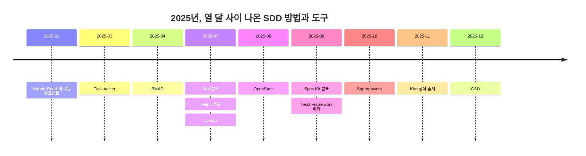
그림 1. 2025년 SDD 방법과 도구 연표 (저장소 생성일 또는 발표일 기준)

이름이 이만큼 쏟아지면 무엇부터 봐야 할지 막막해진다. 별 수로 줄을 세우고 싶은 유혹도 생긴다. 하지만 별은 관심을 셀 뿐 쓰임을 세지 않는다. 그렇다면 처음 보는 도구 앞에서 무엇을 물어야 할까? 문서를 주된 통제 수단으로 삼는 다섯 도구부터 같은 질문으로 하나씩 열어 보자.

> 이 장은 Spec Kit v1.3.3/2026-11-09, OpenSpec v1.17.0/2026-11-09, cc-sdd v3.1.0/2026-09-23, BMAD v6.12.4 안정판/2026-10-14 기준이다. Kiro는 버전 번호가 없는 독점 제품이라 문서 접근 2026-11-10 기준으로 적는다. Spec Kit과 OpenSpec은 하루 사이에도 새 판을 내므로, 명령을 따라 하기 전에 공식 문서를 함께 확인하자.

## 다섯 질문으로 같은 틀에 놓기

2장에서 SDD 도구를 통제 단위로 세 갈래로 나눴다. 문서 파이프라인, 스킬 규율, 계획-실행 루프다. 여기서 볼 다섯 도구는 모두 첫 갈래에 속한다. 에이전트가 무엇을 만들지는 문서가 정하고, 다음 단계로 넘어갈지는 그 문서를 사람이 확인하는 관문이 정한다. 참고 보고서의 분류로 말하면 Spec Kit·Kiro·cc-sdd는 단계 게이트형(F1), OpenSpec은 변경 델타형(F2), BMAD는 역할 시뮬레이션형(F3)이다. 기호는 이 정도만 기억해 두면 충분하다.

같은 갈래 안에서도 도구마다 생김새가 꽤 다르다. 그래서 도구 하나를 만날 때마다 다섯 가지를 같은 순서로 물어보자. 첫째, 무엇이 스펙인가. 파일 하나인지, 문서 여러 개의 사슬인지, 변경분만 적은 조각인지를 본다. 둘째, 명령은 어떤 순서로 흐르는가. 셋째, 산출물은 저장소 어디에 어떤 모양으로 남는가. 넷째, 작은 변경을 위한 가벼운 경로가 있는가. 다섯째, 강점은 무엇이고, 지금도 유효한 약점은 무엇인가.

다섯째 질문에서 "지금도"를 붙인 데는 이유가 있다. 2025년 가을에 쓰인 체험기 상당수는 지금의 도구와 다른 판을 다룬다. Spec Kit만 해도 그때 나온 비판 일곱 가지 중 네 가지는 이미 해결됐다. 그래서 오래된 비판을 옮길 때는 그 비판이 나온 날짜와 판, 그리고 지금의 상태를 함께 적는다.

2장의 수명 축도 잠깐 떠올려 보자. 통제 단위와 스펙의 수명은 다른 축이다. 같은 문서 파이프라인이라도 Spec Kit·Kiro·cc-sdd는 대부분 스펙 우선형으로 쓰이고, OpenSpec은 아카이브 단계 덕분에 스펙 고정형에 가깝다. 두 흐름을 나란히 놓으면 차이가 잘 보인다.

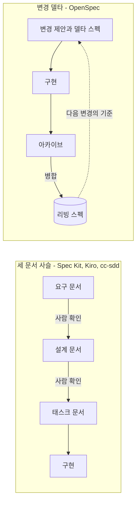
그림 2. 세 문서 사슬과 변경 델타의 흐름 비교

왼쪽 사슬은 기능 하나를 위해 문서를 차례로 쌓고, 구현이 끝나면 그 문서 묶음이 기능 폴더에 남는다. 오른쪽은 바꿀 부분만 적고, 끝나면 그 조각을 시스템 전체의 스펙에 녹여 넣는다. 이 차이가 뒤에서 여러 번 다시 나온다.

## Spec Kit: 헌법에서 converge까지

Spec Kit은 GitHub가 2025년 9월 2일 발표한 도구다. 스펙은 기능 하나마다 만드는 폴더 `specs/<NNN>-<short-name>/`의 문서 묶음이다. 여기에 프로젝트 전체가 지킬 원칙을 담은 헌법 파일 `.specify/memory/constitution.md`가 하나 더 붙는다. 헌법 파일은 기능마다 바뀌지 않으므로 1장에서 구분한 컨텍스트 파일에 더 가깝다.

명령은 에이전트 채팅 안에서 하나씩 부르고, 결과를 검토한 뒤 다음으로 넘어간다. 공식 문서는 `/speckit.specify`처럼 점으로 적지만 Claude Code에 설치되는 실제 이름은 `/speckit-specify`다. 2026년 판의 Spec Kit은 진입점을 넷으로 나눴다. SDD 본 흐름, 버그 수정, 아이디어 평가, 직접 만든 프로세스다. 문서는 이것들을 "independent entry points, not mandatory phases"라고 부른다. 필요한 진입점만 골라 쓰라는 뜻으로 읽으면 된다.

| 명령 (Claude Code 표기) | 하는 일 | 쓰거나 읽는 파일 |
|---|---|---|
| `/speckit-constitution` | 프로젝트 원칙을 세우거나 고친다 | `.specify/memory/constitution.md` |
| `/speckit-specify` | 요구와 사용자 스토리를 정의한다 | `spec.md`, `checklists/requirements.md` |
| `/speckit-clarify` | 계획 전에 모호한 곳을 묻는다 (선택) | `spec.md`에 `## Clarifications` 추가 |
| `/speckit-plan` | 기술 구현 계획을 만든다 | `plan.md`, `research.md`, `data-model.md`, `quickstart.md`, `contracts/` |
| `/speckit-checklist` | 요구 품질 점검표를 만든다 (선택) | `checklists/*.md` |
| `/speckit-tasks` | 계획을 태스크로 쪼갠다 | `tasks.md` |
| `/speckit-analyze` | 구현 전에 산출물 사이 정합성을 본다 (선택) | 읽기만 한다 |
| `/speckit-implement` | 태스크를 실행한다 | `tasks.md`를 읽고 코드를 쓴다 |
| `/speckit-converge` | 구현을 산출물과 견줘 남은 일을 덧붙인다 | `tasks.md`에 태스크만 추가 |

```text
specs/001-partial-refund/
├── spec.md
├── plan.md
├── research.md
├── data-model.md
├── quickstart.md
├── contracts/
├── tasks.md
└── checklists/
```

관문 명령들의 성격을 눈여겨보자. `clarify`는 한 세션에 최대 다섯 문항을 묻고 답을 `spec.md`의 `## Clarifications` 아래 날짜별로 남긴다. `analyze`는 파일을 고치지 않는 읽기 전용이다. `converge`는 코드를 spec·plan·tasks와 비교해 빠진 작업을 `tasks.md`에 덧붙이기만 한다. 스펙 문서를 고치지 않으니 상시 동기화 장치로 보기는 어렵다. 다 됐는지를 판정하는 쪽도 여전히 에이전트다.

`spec.md` 템플릿은 사용자 스토리를 우선순위별로 세우고, 스토리마다 혼자서 시험할 수 있는 방법(Independent Test)과 Given/When/Then 시나리오를 요구한다. 기능 요구는 `FR-001`처럼 번호를 단 `MUST` 문장이고, 모르는 값은 지어내지 말고 `[NEEDS CLARIFICATION: …]`로 남기라고 한다. 이 책의 예제로 채우면 이런 모양이 된다.

```markdown
# Feature Specification: 부분 환불
**Feature Branch**: `001-partial-refund`
**Created**: 2026-11-10
**Status**: Draft
**Input**: User description: "서점 관리자가 배송 완료된 주문의 일부 항목을 환불한다"

## User Scenarios & Testing *(mandatory)*
### User Story 1 - 부분 환불 요청 (Priority: P1)
**Why this priority**: 지금은 배송 전 전체 취소만 있고, 배송 뒤에는 환불할 방법이 없다.
**Independent Test**: 책 B 1권만 환불 요청해 환불액 10,800원과 주문 상태 `PARTIALLY_REFUNDED`를 확인한다.
**Acceptance Scenarios**:
1. **Given** 결제 40,800원 주문이 배송 완료된 지 48시간, **When** 서점 관리자가 책 B 1권 환불을 요청하면, **Then** 10,800원이 환불되고 주문 상태는 `PARTIALLY_REFUNDED`가 된다

## Requirements *(mandatory)*
### Functional Requirements
- **FR-001**: System MUST 자기 서점 주문에 대해서만 `SHOP_ADMIN`의 환불 요청을 받는다
- **FR-002**: System MUST 환불 요청을 [NEEDS CLARIFICATION: "배송 후 7일"의 기준 시각 — 배송 완료 시각인가, 날짜 단위인가?] 안에서만 받는다
- **FR-003**: System MUST 항목의 `refunded_quantity`가 주문 수량을 넘게 되는 요청을 `409 REFUND_QUANTITY_EXCEEDED`로 거절한다
```

이 책 예제로 채운 예시이고, 도구를 실행해서 받은 출력은 아니다. 헤딩과 표기 규칙만 템플릿 원문을 따랐다. `FR-002`의 빈칸은 6장에서 검사 세션이 찾아낼 바로 그 빈칸이다.

가벼운 경로도 있다. 버그 수정 확장(`specify extension add bug`)과 아이디어 평가 확장(`specify extension add assess`)이 본 흐름 없이 따로 돈다. 강점은 템플릿이 가장 풍부하다는 점, 그리고 통합 키 43개로 거의 모든 하네스에 설치된다는 점이다. 약점도 분명하다. 기능 하나에 파일이 많다. Böckeler는 2025년 9월 체험에서 스펙 하나에 파일 8개를 셌고, 2026년 비교 글들도 기능당 7개 이상, 많게는 약 10개를 적었다. 긴 마크다운을 검토하는 부담도 남아 있다. 이 둘은 2026년 11월에도 유효한 비판이다. 손으로 직접 돌리는 실습은 9장에서 한다.

## OpenSpec: 바꿀 부분만 적고, 끝나면 합친다

OpenSpec은 Fission AI가 2025년 8월에 연 저장소에서 시작했다. 이 도구에서 스펙은 두 층이다. 하나는 `openspec/specs/<domain>/spec.md`에 있는 리빙 스펙으로, 원문 주석은 이것을 "Source of truth"라고 부른다. 다른 하나는 변경마다 만드는 폴더 `openspec/changes/<change-name>/` 안의 델타 스펙이다. 변경 폴더에는 `proposal.md`, `design.md`, `tasks.md`와 함께 이번에 바뀌는 요구만 적은 `specs/` 조각이 들어간다.

```text
openspec/
├── specs/                 # 시스템 동작의 기준 (리빙 스펙)
│   └── <domain>/spec.md
├── changes/               # 변경마다 폴더 하나
│   └── <change-name>/
│       ├── proposal.md
│       ├── design.md
│       ├── tasks.md
│       └── specs/<domain>/spec.md   # 델타 스펙
└── config.yaml            # 선택
```

기본 `core` 프로필의 명령은 여섯 개다. `/opsx:propose`(스킬 표기 `/openspec-propose`)로 변경을 만들고 계획 산출물을 한 번에 받는다. 생각을 먼저 정리하고 싶으면 그 앞에 `/opsx:explore`를 쓴다. `/opsx:apply`로 구현하고, `/opsx:update`로 계획 산출물을 고치고, `/opsx:sync`로 델타를 메인 스펙에 합치고, `/opsx:archive`로 변경을 보관한다. 아카이브는 미완료 태스크가 있어도 막지 않고 경고만 한다. 끝나면 변경 폴더는 `openspec/changes/archive/YYYY-MM-DD-<name>/`으로 옮겨지고, 산출물은 감사 기록으로 그대로 남는다.

두 가지 표기를 함께 적는 데는 이유가 있다. v1.17.0(2026-11-09)이 2.0에서 `/opsx:*` 명령 파일을 없애고 스킬만 남긴다고 예고했기 때문이다. 미리 옮겨 가려면 `openspec config set delivery skills && openspec update`를 쓴다. 이 부분은 원고가 나온 뒤에도 바뀔 수 있으니 공식 저장소의 이슈 #2022를 함께 확인하자.

델타 스펙의 모양이 이 도구의 얼굴이다. 공식 문서의 예(MIT 라이선스)를 줄여 옮기면 이렇다.

```markdown
# Delta for Auth

## ADDED Requirements
### Requirement: Two-Factor Authentication
The system MUST support TOTP-based two-factor authentication.
#### Scenario: 2FA enrollment
- GIVEN a user without 2FA enabled
- WHEN the user enables 2FA in settings
- THEN a QR code is displayed for authenticator app setup

## MODIFIED Requirements
### Requirement: Session Expiration
The system MUST expire sessions after 15 minutes of inactivity.
(Previously: 30 minutes)

## REMOVED Requirements
### Requirement: Remember Me
(Deprecated in favor of 2FA. Users should re-authenticate each session.)
```

아카이브 때 `ADDED`는 메인 스펙에 덧붙고, `REMOVED`는 지워지고, `MODIFIED`는 기존 요구를 통째로 갈아 끼운다. 그래서 `MODIFIED`에는 바뀐 한 줄이 아니라 요구 전문을 다시 적어야 한다. 처음 쓰는 사람이 가장 자주 넘어지는 곳이니 주의해야 한다. 형식 검사도 점점 엄격해지는 중이다. v1.16.0부터 `openspec validate`는 단계 키워드가 없는 시나리오를 경고하고 `--strict`면 실패시킨다. v1.16.1부터는 모르는 델타 절에 넣은 요구를 거부한다.

제조사 안내도 이 도구의 성격을 잘 보여 준다. 시작할 때 코드베이스 전체를 문서화하지 말고 바꿀 부분만 쓰라고 한다. 기존 PRD를 한꺼번에 변환하면 아무도 믿지 않는 크고 낡은 스펙이 생긴다는 경고다. FAQ는 한 글자 오타 수정에는 이 절차가 맞지 않는다고 적는다. 강점은 브라운필드에 바로 붙는다는 것, 그리고 산출물이 짧다는 것이다. 약점은 Spec Kit 헌법 같은 사전 거버넌스 장치가 약하다는 점이다(추론). 리빙 스펙을 살려 두려면 팀의 규율이 따로 필요하다는 지적도 있다. 두 번째 변경에서 리빙 스펙이 갱신되는 모습은 8장에서 직접 확인한다.

## Kiro 스펙: IDE 안의 세 문서 사슬

Kiro는 AWS가 2025년 7월 14일 발표하고 11월 17일 정식 출시한 Code OSS 기반 IDE다. 지금은 IDE 외에 CLI와 Web에서도 같은 스펙 흐름(기능·버그픽스·퀵 스펙)을 쓴다. 모든 스펙은 `.kiro/specs/<name>/` 아래 세 문서로 남는다. 요구를 담은 `requirements.md`(버그라면 `bugfix.md`), 설계를 담은 `design.md`, 실행 단위를 담은 `tasks.md`다. 설치 없이 저장소에 스펙 폴더를 기본으로 남기는 하네스는 드물어서 이 점이 눈에 띈다.

기능 스펙은 두 갈래로 시작한다. 요구에서 출발하는 Requirements-First와 설계에서 출발하는 Design-First다. Design-First와 버그픽스 스펙은 2026년 2월에 추가됐는데, 계기는 "모든 사람이 요구사항에서 출발하지 않는다"는 사용자 의견이었다. 요구 문장은 EARS의 `WHEN [condition/event] THE SYSTEM SHALL [expected behavior]` 형태다. 3장에서 다룬 그 문형이다. CLI에서는 `/spec new <name>`으로 시작하고, 단계마다 `Ctrl+X`로 문서를 열어 줄 단위로 의견을 단다.

버그픽스 스펙은 형식이 특히 단단하다. 현재 동작, 기대 동작, 바뀌면 안 되는 동작을 세 문형으로 나눠 쓴다. 문형은 Kiro 문서 원문 그대로 두고, 내용만 이 책 예제의 오타 수정(C0)으로 채워 보자.

```markdown
## Current Behavior (Defect)
WHEN 환불 기간이 지난 요청을 거절할 때 THEN the system 오류 메시지에 '환불'을 '환뷸'로 적어 돌려준다

## Expected Behavior (Correct)
WHEN 환불 기간이 지난 요청을 거절할 때 THEN the system SHALL 오류 메시지에 '환불'로 적어 돌려준다

## Unchanged Behavior (Regression Prevention)
WHEN 환불 기간이 지난 요청을 거절할 때 THEN the system SHALL CONTINUE TO `422 REFUND_WINDOW_EXPIRED` 코드로 응답한다
```

세 번째 문형 `SHALL CONTINUE TO`가 이 형식의 백미다. 고치다가 망가뜨리면 안 되는 것을 스펙에 못 박아 둔다. 다만 오타 하나에 문서 세 개를 쓰는 것이 맞을까? 그 답은 11장에서 이 변경을 다시 만날 때 정한다. 가벼운 경로도 여럿이다. 퀵 스펙은 시작할 때 범위와 경계 사례를 한 번에 묻고 승인 관문 없이 세 문서를 만든다. Plan 모드는 계획을 대화 안에만 두고 `.kiro/specs/`에 저장하지 않는다. 문서는 15~60분짜리 작업에 Plan 모드를 권한다. 프로젝트 전체에 걸린 정보는 스티어링 파일 `.kiro/steering/`의 `product.md`, `tech.md`, `structure.md`에 둔다.

2026년에 Kiro가 실제로 생성하는 문서의 모양은 공식 템플릿이 공개되어 있지 않다. 그래서 공개 저장소 `darko-mesaros/shuk`의 `.kiro/specs/upload-only/`가 좋은 참고가 된다. 라이선스 표기가 없어 여기서는 구조만 옮긴다. `requirements.md`는 Introduction 다음에 Glossary를 두고, 거기서 정의한 컴포넌트 이름(`CLI_Parser` 같은 것)을 EARS의 주어 자리에 쓴다. `design.md`에는 Correctness Properties 절이 있어 속성마다 그 속성이 검증하는 요구 번호를 단다. `tasks.md`는 요구 번호 추적 표기와 함께 끝에 태스크 의존 그래프를 JSON으로 붙인다.

강점은 EARS와 버그픽스 스펙이라는 형식의 원형을 가장 단단하게 갖췄다는 점이다. 요구 전체에서 모순과 빠진 경계 사례를 찾는 Analyze Requirements 기능도 있다. 제조사는 LLM 자동 형식화와 SMT 솔버를 쓴다고 설명한다(주장). 속성 기반 테스트도 내장하지만 IDE에서만 된다. 약점은 하네스 종속이다. 스펙 기능은 Kiro 안에서만 돈다. 2025년 9월 체험에서 작은 버그가 사용자 스토리 4개와 수용 기준 16개로 불어났다는 비판은 버그픽스 스펙과 퀵 스펙이 나오기 전 이야기다. 지금은 부분 해결 상태로 보되, 독립 재검증은 아직 없다.

## cc-sdd: Kiro의 흐름을 다른 하네스로

Kiro의 방식이 마음에 들지만 쓰는 하네스가 Claude Code나 Codex라면 어떻게 해야 할까? 일본 개발자 gotalab의 cc-sdd가 그 자리를 채운다. 기원은 2025년 7월의 Zenn 글로, Kiro 스펙 흐름을 Claude Code 명령 일곱 개로 재현해 결과를 Kiro에서 그대로 쓰려는 시도였다. 지금은 스킬 17개로 커졌다. 산출물은 Kiro와 호환되는 `.kiro/specs/<feature>/` 아래 `requirements.md`, `design.md`, `tasks.md`, 그리고 `spec.json`이다. 안정 지원은 Claude Code와 Codex이고, 나머지 하네스는 베타다.

```bash
# 터미널
npx cc-sdd@latest --claude-skills --lang ko
# 에이전트 채팅 (이 책 예제로 채운 인자)
/kiro-discovery 부분 환불
/kiro-spec-init partial-refund
/kiro-spec-requirements partial-refund
/kiro-spec-design partial-refund
/kiro-spec-tasks partial-refund
/kiro-impl partial-refund
```

`--lang ko`로 산출물을 한국어로 받을 수 있다는 점이 국내 독자에게는 반갑다. 요구 템플릿은 EARS 다섯 패턴을 영어 키워드로 고정하고 변수 부분만 채우게 한다. 이 책이 3장에서 정한 표기 규칙도 여기서 왔다. 아래 예는 다섯 패턴을 이 책 예제로 채운 것이고, 그 아래 `spec.json`은 템플릿의 승인 상태 부분만 옮겼다.

```markdown
#### Acceptance Criteria
1. When 서점 관리자가 환불을 요청하면, the 주문 서비스 shall 항목별 환불액을 계산해 PG 환불을 호출한다
2. If PG 환불 호출이 실패하면, then the 주문 서비스 shall 환불 상태를 `FAILED`로 남기고 `502 PAYMENT_GATEWAY_ERROR`로 응답한다
3. While 같은 `Idempotency-Key`의 보관 기간(24시간)이 지나지 않은 동안, the 주문 서비스 shall 같은 본문의 재요청에 첫 결과를 그대로 돌려준다
4. Where 주문 단위 쿠폰 기능이 포함되면, the 주문 서비스 shall 쿠폰 할인액을 항목 금액 비율로 안분해 환불액에서 뺀다
5. The 주문 서비스 shall 다른 서점 주문에 대한 환불 요청을 `403`으로 거절한다
```

```json
{
  "phase": "initialized",
  "approvals": {
    "requirements": { "generated": false, "approved": false },
    "design": { "generated": false, "approved": false },
    "tasks": { "generated": false, "approved": false }
  },
  "ready_for_implementation": false
}
```

`spec.json`이 흥미로운 이유는 단계 관문이 대화가 아니라 파일에 남는다는 데 있다. 요구를 승인했는지, 구현 준비가 됐는지를 나중에 누구든 열어 볼 수 있다. 설계 문서도 꼼꼼하다. Boundary Commitments 절에 이 스펙이 소유하는 것과 경계 밖의 것을 적고, 그 경계가 태스크의 `_Boundary:_` 주석으로 이어진다.

이 도구의 입장은 README 한 줄에 담겨 있다. "Code remains the source of truth." 스펙은 시스템 부분 사이의 계약이라는 뜻이다. 가벼운 경로도 문서에 있다. `/kiro-discovery`가 스펙 없이 바로 구현하라고 답할 수 있고, 한 세션에 끝나는 혼자 하는 일이나 프로토타입에는 cc-sdd가 필요 없다고 적는다. 정직하게 덧붙일 점도 있다. README 스스로 "Installing 17 skills does not verify that a host can run the full autonomous loop."라고 경고한다. 그리고 이 도구는 어떤 통제 비교에도 들어가지 않았다. 일본 팀들의 현장 보고가 몇 건 있지만 모두 자기 보고다.

## BMAD: 역할 에이전트와 판이 둘인 문서

BMAD는 2025년 4월에 시작된 BMad Code의 방법론이다. 다른 도구들이 문서 템플릿을 준다면 BMAD는 역할을 준다. 안정판 v6.12에는 분석가(Mary), 제품 관리자(John), 아키텍트(Winston), 개발자(Amelia), UX 디자이너(Sally) 다섯 에이전트가 있고, 이들이 차례로 문서를 만든다. 설치는 `npx bmad-method install`이고, 결과는 `_bmad/` 폴더에 들어간다.

스펙의 중심은 `bmad-spec` 스킬이 쓰는 `SPEC.md`다. 다섯 필드로 이루어진다. 왜(Why), 능력(Capabilities, 능력마다 의도와 성공 조건), 제약(Constraints), 비목표(Non-goals), 성공 신호(Success signal)다. 이 파일은 스킬만 쓴다. 문서 원문은 "`bmad-spec` is the only writer of `SPEC.md`. Do not hand-edit it"이라고 못 박는다. 고치고 싶으면 스킬을 다시 돌려 능력 ID를 유지한 채 갱신한다. 입력으로 넣을 자료는 수만 토큰, 약 40쪽이 현실적 상한이라고 한다.

작업 크기별 경로가 분명한 것도 특징이다. 한 세션 크기면 바로 `bmad-build`로 가고, 에픽 크기면 `stories.yaml`로 스토리를 나눈 뒤 스토리마다 만들고, 약 20세션이 넘으면 프로젝트 경로를 탄다. 제조사는 가벼운 경로를 직접 적었다. "You don't need BMad for an obvious, low-risk edit."

그런데 BMAD에는 독특한 함정이 하나 있다. 판이 둘이다. 공식 문서 사이트(docs.bmad-method.org)는 버전 배너 없이 v7 알파의 내용을 보여 준다. 그 사이트에는 제품 책임자 Sofia와 `tickets.toml`이 나오지만, `npx bmad-method install`로 설치되는 안정판에는 둘 다 없다. 반대로 안정판의 `bmad-spec`과 `SPEC.md`는 사이트에 없다. 안정판 문서는 GitHub의 `V6.12` 브랜치 `docs/`에 있고, 한국어 문서도 거기 있다. 문서를 보며 따라 하다 명령이 안 맞으면 꽤 난감하다. 판부터 확인하자.

v7은 README상 2026년 11월 중순 정식 출시 예정이다. 알파 설치는 `npx skills add bmad-code-org/BMAD-METHOD --skill '*'`처럼 스킬 묶음 방식으로 바뀌었고, 원문은 "Expect breaking changes between updates."라고 경고한다. 이 책이 BMAD에 실습 장을 주지 않는 이유 가운데 하나가 이 시기 문제다. 강점은 여러 이해관계자가 합의해야 하는 큰 작업에서 역할과 경로를 미리 갖춰 준다는 점이다. 약점은 문서 양이다. Thoughtworks Radar Vol 35는 AI가 만드는 문서 난립을 Caution에 올리면서 Spec Kit과 BMAD의 대량 마크다운을 지목했다.

## 같은 요구, 다섯 가지 모양

도구마다 스펙이 얼마나 다르게 생겼는지 한눈에 보고 싶다면, 같은 요구 하나를 다섯 도구의 문형으로 써 보는 편이 빠르다. 환불 기간 규칙을 골라 보자. "배송 완료 시각부터 168시간이 지나면 환불을 거절한다." 아래는 모두 이 책 예제로 채운 예시이고, 문형과 표기만 각 도구의 템플릿을 따랐다.

```markdown
<!-- Spec Kit: spec.md의 기능 요구 -->
- **FR-002**: System MUST 배송 완료 시각(`delivered_at`)부터 168시간이 지난 요청을 `422 REFUND_WINDOW_EXPIRED`로 거절한다

<!-- OpenSpec: 델타 스펙의 요구와 시나리오 -->
### Requirement: 환불 기간
The system SHALL `delivered_at`부터 168시간 이내의 환불 요청만 받는다.
#### Scenario: 기간 경과
- GIVEN `delivered_at`이 2026-11-02T10:00:00+09:00인 주문
- WHEN 2026-11-09T10:00:01+09:00에 환불을 요청한다
- THEN 422 `REFUND_WINDOW_EXPIRED`를 응답한다

<!-- Kiro: requirements.md의 수용 기준 (Glossary에 정의한 컴포넌트 주문_서비스를 주어로) -->
1. WHEN 서점 관리자가 `delivered_at`부터 168시간이 지난 주문에 환불을 요청하면 THE 주문_서비스 SHALL `422 REFUND_WINDOW_EXPIRED`로 거절한다

<!-- cc-sdd: requirements.md의 If 패턴 -->
2. If 환불 요청 시각이 `delivered_at`부터 168시간을 넘으면, then the 주문 서비스 shall `422 REFUND_WINDOW_EXPIRED`로 거절한다

<!-- BMAD v6.12: SPEC.md의 능력 하나 (필드 이름만 원문) -->
Capability: 기간 안의 부분 환불
  intent: 배송 완료 뒤 168시간 안에만 서점 관리자가 항목 단위로 환불한다
  success condition: 168시간이 지난 요청은 모두 거절되고 환불액이 생기지 않는다
```

같은 규칙인데 무게중심이 미묘하게 다르다. Spec Kit은 번호 붙은 `MUST` 문장으로 기능 목록을 세우고 시나리오는 사용자 스토리 쪽에 따로 둔다. OpenSpec은 요구 하나에 시나리오를 바로 붙여 한 덩어리로 다룬다. Kiro와 cc-sdd는 조건과 반응을 EARS 문형으로 쪼개고, Kiro는 주어 자리에 컴포넌트 이름을 넣는다. BMAD는 문장 형식보다 의도와 성공 조건이라는 두 칸을 채우게 한다.

| 도구 | 요구 문장 | 수용 기준 | 추적 표기 |
|---|---|---|---|
| Spec Kit | `**FR-001**: System MUST ...` | 사용자 스토리별 Given/When/Then | `T012 [P] [US1]`, `SC-001`, `[NEEDS CLARIFICATION: ...]` |
| OpenSpec | `The system SHALL ...` (한 문장에 SHALL 하나) | `#### Scenario:` GIVEN/WHEN/THEN | `## ADDED/MODIFIED/REMOVED Requirements`, `(Previously: ...)` |
| Kiro | EARS `WHEN ... THE SYSTEM SHALL ...` | User Story + 번호 목록 | `_Requirements: 1.1_`, `**Validates: Requirements 1.2**` |
| cc-sdd | EARS 다섯 패턴 `When ..., the [system] shall ...` | Objective + Acceptance Criteria | `_Boundary:_`, `_Depends:_`, `_Requirements:_` |
| BMAD v6.12 | Why / Capabilities / Constraints / Non-goals / Success signal | 능력별 성공 조건 | 능력 ID |

어느 모양이 가장 좋을까? 아쉽게도 이 질문에 답할 측정은 아직 없다. EARS나 Given-When-Then이 에이전트의 결과물을 자유 서술보다 낫게 만든다는 통제 실험을 찾지 못했다는 사실은 3장에서 짚었다. 지금 쓸 수 있는 기준은 형식 자체보다 그 형식이 이어지는 곳에 있다. 테스트로 옮기기 쉬운가, 팀이 이미 쓰는 문형과 맞는가, 하네스를 바꿔도 남는가.

## 문서 계열 안에서 견줘 보기

다섯 도구를 나란히 놓으면 무엇이 보일까? 먼저 세 문서 사슬을 쓰는 단계 게이트형 셋의 내부 구조부터 보면 이렇다.

| 도구 | 핵심 단계 수 | 승인 관문 | 산출물 위치 | 가벼운 경로 |
|---|---|---|---|---|
| Spec Kit | 6 (+ 선택 2, analyze 1) | 단계마다 사람이 다음 명령을 부름 (추론) | `.specify/memory/`, 기능별 `specs/` 폴더 | 버그 확장, 평가 확장 |
| Kiro 스펙 | 3 | 있음, 퀵 스펙은 없음 | `.kiro/specs/<name>/` | 퀵 스펙, 버그픽스 스펙, Plan 모드 |
| cc-sdd | 6 (discovery부터 impl까지) | `spec.json` 승인 상태 | Kiro 호환 스펙 폴더 | discovery의 "스펙 없이 바로 구현" |

문서의 양은 도구마다 크게 다르다. 2026년 8월 Serverworks의 비교는 Spec Kit이 기능당 약 10개, OpenSpec이 변경당 약 4개의 문서를 만든다고 적었다. 같은 글에서 AWS Labs의 AI-DLC는 단위당 40~50개였다. 이 숫자들은 문서와 실무 경험을 묶은 정리이지 통제된 측정은 아니다. 그래도 방향은 다른 보고들과 같다.

상황별로 고르는 감도 참고할 만하다. GMO Media는 2025년 12월 Claude Code에서 세 도구를 비교하고 이렇게 정리했다. 기존 서비스를 바꾸면 OpenSpec, 그린필드에서 견고한 팀 작업이면 Spec Kit, 그린필드에서 문서 언어의 일관성이 중요하면 cc-sdd. 변경을 메인 스펙에 병합하는 아카이브 단계는 셋 중 OpenSpec에만 있다는 관찰도 덧붙였다. 다만 Spec Kit 1.0(2026-08-21) 이전의 판정이라는 점은 기억해 두자.

판정의 날짜가 중요한 이유는 2025년의 비판들이 얼마나 낡았는지를 보면 실감난다.

| 대상 | 2025 비판 | 2026-11 상태 |
|---|---|---|
| Spec Kit | 항상 새 브랜치를 만든다 | 해결 (v0.10.0부터 선택 훅) |
| Spec Kit | 버그에도 무거운 흐름 | 해결 (버그 확장) |
| Spec Kit | 코드가 스펙을 따랐는지 확인 루프 없음 | 부분 해결 (converge, 완료 판정은 여전히 에이전트) |
| Spec Kit | 기능마다 파일이 많다 | 여전히 유효 |
| Spec Kit | 긴 마크다운 검토 부담 | 여전히 유효 (Radar Vol 35) |
| Kiro | 작은 버그가 사용자 스토리 4개, 수용 기준 16개 | 부분 해결 (버그픽스 스펙, 퀵 스펙), 독립 재검증 없음 |
| Kiro | IDE에 묶인다 | 부분 해결 (IDE·CLI·Web, 속성 기반 테스트는 IDE 전용) |

절차가 무겁다는 비판은 대부분 제조사가 가벼운 경로를 내면서 풀렸다. 남은 것은 문서의 양이다. 2장에서 본 Radar의 신호, 곧 OpenSpec을 Trial로 올리면서 문서 난립을 Caution에 넣은 조합과도 맞아떨어진다.

> **다른 하네스에서는.** Spec Kit은 Codex에서 `$speckit-specify`, Cursor·Copilot에서 `/speckit-specify`로 부른다. OpenSpec은 Cursor와 Copilot(IDE)에서 `/opsx-propose`, Codex에서 `$openspec-propose`다. Copilot CLI는 사용자 정의 프롬프트 파일을 지원하지 않아 OpenSpec 명령이 IDE에서만 된다. cc-sdd는 Codex에서 `$kiro-*`로 부른다. Kiro 스펙은 Kiro 밖에서는 쓸 수 없다. 전체 대응표는 부록 B에 모았다.

다섯 도구를 두 질문으로 접으면 이렇게 된다.

| 도구 | 무엇이 스펙인가 | 작업 뒤 스펙의 운명 |
|---|---|---|
| Spec Kit | 기능 폴더의 문서 묶음 (`spec.md`부터 `tasks.md`까지) + 헌법 파일 | 기능 폴더에 남는다. 다음 기능이 고치지는 않는다 |
| OpenSpec | 변경 폴더의 제안과 델타 스펙 | 아카이브 때 리빙 스펙에 병합된다 |
| Kiro 스펙 | `.kiro/specs/<name>/`의 세 문서 | 남는다. 동기화는 사람이 Sync Files로 시작한다 |
| cc-sdd | Kiro 호환 세 문서 + `spec.json` | 남지만, 기준은 코드다 |
| BMAD | 스킬이 쓰는 `SPEC.md`와 역할별 문서 | 스킬로만 갱신된다 |

문서로 통제한다는 말은 결국 작업이 끝난 뒤 그 문서를 어디에 둘지 미리 정해 둔다는 뜻이다.

# 5장. 습관으로 통제하는 도구들, 그리고 이 책의 선택

mattpocock/skills의 README는 다른 프레임워크들을 이름으로 부른다. GSD, BMAD, Spec Kit 같은 접근은 "try to help by owning the process", 곧 프로세스를 소유하는 방식으로 도우려 한다는 것이다. 그러고는 자기는 프로세스를 소유하지 않겠다며 작은 스킬 몇 개만 내놓는다. 같은 스킬 묶음 진영에 있는 Superpowers는 정반대 자리에 깃발을 꽂는다. 이 도구의 README는 자기 스킬을 "Mandatory workflows, not suggestions."라고 부른다. 에이전트는 어떤 작업이든 시작하기 전에 맞는 스킬이 있는지부터 확인해야 한다는 뜻이다.

두 도구 모두 4장의 도구들처럼 문서 템플릿을 앞세우지 않는다. 대신 에이전트가 일하는 습관을 바꾸려 한다. 그런데 한쪽은 습관을 강제하고, 다른 쪽은 고르게 둔다. 프로세스는 누가 쥐어야 할까? 사람일까, 도구일까? 아니면 하네스에 이미 들어 있는 플랜 모드만으로 충분할까? 스펙 주도 개발(Spec-Driven Development, SDD)의 나머지 갈래를 살펴보고, 그 끝에서 이 책이 실습할 도구를 고르자.

> 이 장은 Superpowers v7.0.2/2026-11-03, mattpocock/skills v1.3.2/2026-10-29, Claude Code 2.1.319(로컬 설치본) 기준이다. 비교에 쓰는 Spec Kit·OpenSpec 값은 각각 v1.3.3·v1.17.0/2026-11-09 기준이고, 채택 지표는 2026-11-09 판독값이다. 플러그인과 플랜 모드 설정은 자주 바뀌니 공식 문서를 함께 확인하자.

## 문서 대신 습관을 고정한다

4장의 도구들은 문서와 승인 관문으로 에이전트를 묶었다. 이 장의 도구들은 묶는 대상이 다르다. 참고 보고서의 분류로 스킬 규율형(F4)은 질문하기, 계획 쓰기, 테스트 먼저 쓰기, 리뷰받기 같은 행동 순서를 스킬로 만들어 에이전트가 지키게 한다. 계획-실행 루프형(F5)은 계획 파일이나 태스크 그래프를 새 컨텍스트에서 되풀이해 돌리는 반복 단위로 통제한다. 네이티브 플랜 모드(F6)는 하네스가 원래 가진 읽기 전용 계획 단계다.

스펙은 어디에 있을까? 스킬 규율형에도 문서는 나온다. Superpowers는 설계 문서와 구현 계획을 남긴다. 다만 그 문서를 작업 뒤 시스템 전체의 스펙에 합치는 단계가 없다. 그래서 2장의 수명 축으로 보면 스펙 우선형이다(추론). 플랜 모드는 더 짧다. 작업 직전에 쓰이고, 그 작업에만 쓰이고, 따로 보관하지 않으면 그대로 잊힌다. 참고 보고서는 이것을 "가장 작은 스펙 우선형"이라고 부른다.

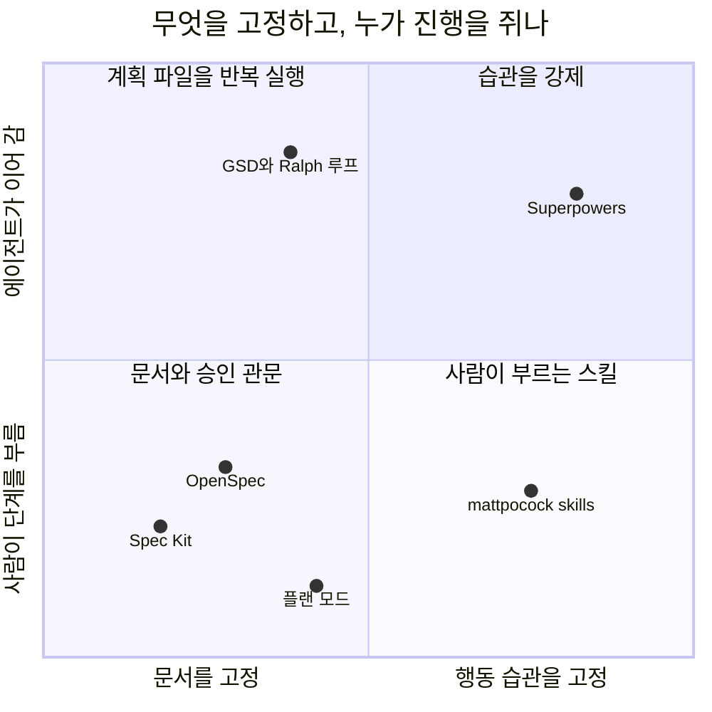
그림 1. 통제 단위로 본 도구들의 위치 (좌표는 이 책의 배치이며 측정값이 아니다)

가로축은 무엇을 고정하는가, 세로축은 누가 다음 단계로 넘기는가다. 문서 파이프라인은 왼쪽 아래에 모인다. 사람이 명령을 하나씩 부르고 문서를 확인한다. Superpowers는 오른쪽 위다. 조건이 맞으면 스킬이 스스로 켜지고, 에이전트는 정해진 순서를 건너뛸 수 없다. mattpocock/skills는 같은 습관 쪽이지만 사람이 부를 때만 움직이는 스킬이 많아 아래로 내려온다.

## Superpowers: 건너뛸 수 없게 만든 일곱 단계

Superpowers는 Jesse Vincent가 2025년 10월 9일 발표한 스킬 묶음이다. 자동 트리거 스킬로만 이루어져 있어서 저장소에 `commands/` 디렉터리가 아예 없다. 필요하면 `/brainstorming`처럼 스킬 이름으로 직접 부를 수도 있다. Claude Code에서는 `/plugin install superpowers@claude-plugins-official`로 설치한다.

기본 흐름은 일곱 단계다. 먼저 `brainstorming`이 만들기 전에 끼어들어 질문으로 의도와 이유를 끌어내고, 이해한 바를 되읽어 준다. 작은 변경이면 채팅에서 합의하고 끝내지만, 프로젝트 규모면 설계 문서를 쓴다. 설계가 승인되면 `using-git-worktrees`가 새 브랜치의 격리된 작업 공간을 만들고 테스트 기준선이 깨끗한지 확인한다. `writing-plans`는 일을 2~5분 단위 태스크로 쪼갠다. 실행은 태스크마다 새 서브에이전트를 띄우고 리뷰하는 `subagent-driven-development`나, 현재 세션에서 인라인으로 돌리고 마지막에 한 번 리뷰하는 `executing-plans` 중 하나다. 앞의 것이 가장 철저하고 뒤의 것이 가장 저렴하다. 구현 중에는 `test-driven-development`가 RED-GREEN-REFACTOR를 지키게 하는데, 테스트보다 먼저 쓴 코드는 지운다. `requesting-code-review`는 태스크 사이에 심각도별로 보고하고, Critical이 나오면 진행을 막는다. 끝으로 `finishing-a-development-branch`가 테스트를 확인하고 병합할지, PR을 낼지, 남길지, 버릴지를 묻는다.

리뷰가 두 단계라는 점도 기억해 두자. 먼저 스펙을 지켰는지 보고, 그다음 코드 품질을 본다. 순서를 뒤집으면 깔끔하지만 스펙과 다른 코드가 좋은 평을 받을 수 있다.

산출물은 두 가지다. 설계 문서는 `docs/superpowers/specs/YYYY-MM-DD-<topic>-design.md`에 커밋하고, 의도와 이유, 목표와 비목표와 반목표(anti-goals), 제약, 검토한 접근, 정한 방법, 빌더에게 남긴 것을 담는다. 구현 계획은 `docs/superpowers/plans/YYYY-MM-DD-<feature-name>.md`에 둔다. 계획의 머리말과 태스크 골격을 이 책 예제로 채우면 이런 모양이다.

```markdown
# 부분 환불 Implementation Plan

> **For agentic workers:** REQUIRED SUB-SKILL: Use superpowers:subagent-driven-development (recommended) or superpowers:executing-plans to implement this plan task-by-task.

**Goal:** 서점 관리자가 배송 완료 주문의 항목 일부를 수량 단위로 환불한다.
**Architecture:** 환불 기간·수량·쿠폰 안분을 정책 객체로 나누고, PG 환불 결과에 따라 환불 상태를 남긴다.
**Tech Stack:** Spring Boot, PostgreSQL, JUnit
**Spec:** docs/superpowers/specs/2026-11-10-partial-refund-design.md

## Global Constraints
- 기존 전체 취소 API(`POST /orders/{orderId}/cancel`)의 동작은 바꾸지 않는다.
- 금액은 원 단위로 계산하고 원 미만은 버린다.

## Review Focus
- 서점 관리자가 자기 서점 주문만 환불할 수 있는가

### Task 1: 환불 기간 정책

**Files:**
- Create: `src/main/java/com/bookshop/orders/refund/RefundWindowPolicy.java`
- Test: `src/test/java/com/bookshop/orders/refund/RefundWindowPolicyTest.java`

**Interfaces:**
- Consumes: `java.time.Clock`(생성자 주입), 주문의 `delivered_at`
- Produces: `boolean isWithinWindow(Instant deliveredAt)`

- [ ] **Step 1: Write the failing test** (배송 완료 168시간 1초 뒤의 요청은 기간 밖)
- [ ] **Step 2: Run test to verify it fails**
- [ ] **Step 3: Implement `boolean isWithinWindow(Instant deliveredAt)` in `RefundWindowPolicy.java`**
- [ ] **Step 4: Run test to verify it passes**
- [ ] **Step 5: Commit**
```

헤딩과 단계 이름은 `writing-plans` 스킬 원문의 구조를 따랐고, 내용은 이 책 예제로 채운 예시다. 눈여겨볼 곳은 Step 3이다. 계획에는 시그니처와 파일, 스펙이 못 박은 값만 들어가고 메서드 본문은 없다. 스킬 원문도 정확한 시그니처와 파일, 스펙이 정한 값까지만 주고 본문은 구현자가 쓴다고 적는다. 그런데 README에는 아직 태스크마다 "complete code"를 준다는 문구가 남아 있다. 저장소 안에서 두 문서가 어긋나는 셈이라 좀 찜찜하다. 이 책은 실제로 동작하는 `SKILL.md`를 기준으로 삼는다.

v7.0.2의 `brainstorming`은 묻는 방식도 바꿨다. 답이 결과를 바꿀 때만 묻고, 이유를 말하지 않았으면 이유부터 묻고, 선택지가 있으면 추천과 함께 보여 준다. 제조사는 블라인드 채점 테스트에서 불필요한 질문이 41개에서 23개로 줄었다고 밝혔다. 제조사가 직접 잰 숫자이고 독립 측정은 아니다. 프로젝트 규모의 설계 문서는 새 서브에이전트가 빌더 입장에서 읽어 보는 Builder check를 거친다. v7.0.0에서 예전의 스펙 문서 리뷰어를 대신한 장치다. 국내 강의 하나는 SessionStart 훅이 세션 시작과 `/clear`, compact 뒤에 `using-superpowers` 스킬을 다시 넣어 주는 구조, 그리고 브레인스토밍이 작업을 Spike, Bounded, Architecture로 나누는 방식을 자세히 풀어 준다. 브레인스토밍 시각 도구가 버전을 알리는 로고를 불러오는 텔레메트리도 있는데, `SUPERPOWERS_DISABLE_TELEMETRY`로 끌 수 있다. 같은 기능을 끝까지 돌려 보는 실습은 10장에서 한다.

## mattpocock/skills: 프로세스는 당신 것

mattpocock/skills는 2026년 2월 3일에 생긴 저장소다. 스킬을 두 종류로 나눈 것이 핵심이다. 사용자 호출 스킬은 사람이 직접 입력해야 실행되고, 여러 단계를 엮는 오케스트레이션을 맡는다. 모델 호출 스킬은 에이전트가 알아서 꺼내 쓰는 작은 규율이다. 사용자 호출 스킬은 모델 호출 스킬을 부를 수 있지만 다른 사용자 호출 스킬은 부르지 않는다. 단계를 어떤 순서로 이을지는 결국 사람이 정한다는 뜻이다.

스펙과 관련된 스킬은 두 개다. `/grill-me`는 의외로 단순하다. `SKILL.md` 본문이 "grilling 스킬을 불러라"라는 한 줄뿐이고, 실제 인터뷰 규율은 모델 호출 스킬 `grilling`에 있다. `/to-spec`은 이미 나눈 대화를 스펙으로 정리해 이슈 트래커에 올린다. 설명은 "no interview, just synthesis"라고 하지만, 기능을 시험할 이음매(seam) 하나만큼은 사용자와 확인한다. 가능하면 가장 높은 곳에 하나를 두라고 한다. 다 쓰면 이슈에 `ready-for-agent` 라벨을 단다. 템플릿 헤딩을 이 책 예제로 채우면 이렇다.

```markdown
## Problem Statement
배송이 끝난 주문은 일부만 돌려줄 방법이 없다. 전체 취소는 배송 전에만 된다.

## Solution
서점 관리자용 부분 환불 API를 둔다. 항목·수량 단위로 환불하고, 쿠폰 할인은 항목 금액 비율로 안분한다.

## User Stories
1. As a 서점 관리자, I want 배송 완료 주문에서 책 한 권만 환불하기, so that 손상된 책만 돌려줄 수 있다
2. As a 서점 관리자, I want 같은 요청을 다시 보내도 한 번만 환불되기, so that 재시도 때문에 이중 환불이 생기지 않는다
3. As a 서점 관리자, I want PG 환불이 실패하면 다시 요청할 수 있기, so that 실패한 환불이 주문 상태를 망가뜨리지 않는다

## Implementation Decisions
환불 상태는 REQUESTED, COMPLETED, FAILED 셋이다. 주문 상태에 PARTIALLY_REFUNDED와 REFUNDED를 더한다.

## Testing Decisions
테스트 이음매는 `POST /orders/{orderId}/refunds` HTTP 경계 하나로 둔다.

## Out of Scope
배송비 환불, 포인트·적립금, 고객 셀프 환불 화면, 복수 결제 수단, 교환

## Further Notes
```

원문 지침은 User Stories를 길게 번호 붙여 쓰라고 하고, Implementation Decisions에는 파일 경로나 코드 조각을 넣지 말라고 한다. 금방 낡기 때문이다. 공유 용어는 `GLOSSARY.md`에 모은다. 설치하고 나면 저장소마다 한 번 `/setup-matt-pocock-skills`를 돌려 이슈 트래커와 문서 위치를 정한다.

채택 신호는 묘하게 엇갈린다. 2026년 11월 9일 기준으로 GitHub 별 318,438개, skills.sh 설치 32.2M으로 두 지표 모두 1위다. 그런데 스펙 디렉터리를 세는 SpecMine에는 신호가 없고, SDD 실무자 인터뷰 응답자 21명 가운데 지금 이 도구를 쓰는 사람은 0명이었다. 설치 수가 사용을 말해 주지 않는다는 좋은 예다. 절차를 직접 짜려는 숙련 개발자에게는 자유가 장점이지만, 처음 시작하는 사람에게는 안내가 적다(추론). 이 책은 6장에서 인터뷰를 거들 보조 수단으로 `/grill-me`를 짧게 다룬다.

## 하네스에 이미 있는 것: 플랜 모드

플러그인을 하나도 설치하지 않아도 계획을 먼저 받는 방법이 있다. 독자가 쓰는 하네스는 거의 모두 플랜 모드를 갖고 있다. 다만 하네스마다 생김새와 계획이 남는 곳이 다르다.

| 하네스 | 진입 | 계획이 남는 곳 | 저장소에 기본 저장 |
|---|---|---|---|
| Claude Code | `Shift+Tab`, 프롬프트 앞 `/plan`, `claude --permission-mode plan` | `~/.claude/plans` (`plansDirectory`로 저장소 안 지정) | 아니오 (설정하면 예) |
| Cursor | `Shift+Tab`, 모드 선택기 | 홈 디렉터리, Save to workspace로 작업 공간에 | 선택 |
| VS Code Copilot | `/plan` 또는 에이전트 목록의 Plan | Local: 세션 메모리 `/memories/session/plan.md` | 아니오 |
| Codex CLI | `/plan` (작업 중에는 못 씀) | 공식 문서에 없음 | 확인 안 됨 |
| Gemini CLI | `/plan`, `Shift+Tab` | 문서에 없음 | 문서에 없음 |
| Kiro | Plan 모드 (IDE, CLI의 `Shift+Tab`·`/plan`) | 대화 컨텍스트 | 아니오 |

Claude Code를 예로 들면, 플랜 모드에서 에이전트는 파일을 읽고 탐색용 셸 명령을 돌리고 계획을 쓰지만 소스는 고치지 않는다. 계획을 다 쓰면 다음 선택지가 나온다.

```text
# 진입 (셋 중 하나)
Shift+Tab                       # default → acceptEdits → plan 순환
/plan 부분 환불 구현 계획을 세워 줘. SPEC.md를 먼저 읽어.
claude --permission-mode plan

# 계획 승인 선택지
Yes, and use auto mode          # auto를 못 쓰면 Yes, auto-accept edits
Yes, manually approve edits
No, keep planning
# showClearContextOnPlanAccept를 켜면 맨 앞에 추가된다
Yes, clear context and …
```

`Ctrl+G`로 계획을 편집기에서 직접 고칠 수 있고, 마지막 설정을 켜면 대화를 비우고 계획만 들고 구현을 시작한다. 7장에서 "새 세션"을 한 세션 안에서 흉내 낼 때 이 장치를 쓴다.

업계는 플랜 모드를 꽤 무겁게 본다. Agent OS v3는 2026년 1월 변경 기록에서 플랜 모드를 "the industry-standard approach to spec-driven development in 2026+"라고 부르며 자기 구현 단계를 없앴다. 반면 한 국내 강의는 플랜 모드가 모호한 곳을 스스로 채우고 바로 구현한다고 평했다(강사 의견). 둘 다 맞는 말일 수 있다. 플랜 모드는 계획을 먼저 보게 해 주지만, 무엇을 물어야 하는지까지 대신 알려 주지는 않는다.

큰 스펙을 플랜 모드에 통째로 넣는 것도 조심해야 한다. 컬리 기술 블로그는 2025년 12월 30쪽짜리 스펙을 한 번에 넣었더니 항목이 빠지고 요청하지 않은 기능이 생겼다고 적었다. 처방은 요청을 작게 여러 번 나누고, 실행 전에 플랜 모드로 계획을 확인하는 것이었다. 어디까지를 플랜 모드에 맡길지에 대해서는 intent-driven.dev가 내놓은 절충안도 참고할 만하다. 빠른 실험, 버릴 프로토타입, 작고 고립된 기능은 플랜 모드로 하고, 운영 시스템이나 팀 작업, 규정 준수가 걸린 일, 브라운필드 변경은 SDD로 한다. 처음에는 플랜 모드로 탐색하고 나중에 SDD로 넘어가는 순서도 권한다. 이 경계는 11장의 사다리에서 다시 정교하게 다듬는다.

계획-실행 루프도 짧게 짚어 두자. GSD는 실행자마다 새 200k 토큰 컨텍스트를 주고 `ROADMAP.md`, `PLAN.md`, `STATE.md` 같은 파일로 진행을 잇는다. Ralph 루프의 원형은 `while :; do cat PROMPT.md | claude-code ; done` 한 줄이다. OpenAI Cookbook의 ExecPlan은 템플릿이다. 처음 보는 사람이 계획 파일 하나로 작업을 이어받을 수 있게 진행 기록과 결정 기록 같은 리빙 절을 둔다. 여러 세션에 걸친 큰 작업에는 의미가 있지만, 이 책의 주제인 변경 하나의 스펙과는 결이 달라 여기서 멈춘다.

## 근거 위에 나란히 놓기

이제 4장과 이 장의 도구를 한자리에 놓아 보자. 참고 보고서의 비교 매트릭스에서 몇 열을 옮기면 이렇다. 미리 일러두자면, 점수가 높다고 좋은 도구는 아니다. D3이 높으면 무겁고, D7이 높으면 하네스를 바꾸기 쉽고, D11은 효과의 근거가 얼마나 두꺼운지를 뜻한다.

| 도구 | D1 SDD 수준 | D3 절차 부담 | D4 브라운필드 | D7 이식성 | D10 검증 강도 | D11 효과 근거 |
|---|---|---|---|---|---|---|
| Spec Kit | 2 | 4/2 | 3 | 4 | 2 | 4± [측정] |
| Kiro 스펙 | 2 | 3/1 | 3 | 1 | 2/4 | 3± [측정] |
| cc-sdd | 2 | 3 | 4 | 2 | 2/3 | 2 [실무] |
| OpenSpec | 3 | 2 | 4 | 4 | 1/2 | 3+ [측정+실무] |
| BMAD | 1 | 4/2 | ? | 3 | ? | 3± [측정+실무] |
| Superpowers | 1 | 3/1 | ? | 4 | 3 | 1- [주장] |
| mattpocock/skills | 1 | 2 | ? | 3 | ? | 1 [주장] |
| 네이티브 플랜 모드 | 0 | 1 | 2 | 1 | 1 | 1 [주장] |

`4/2`는 기본 경로와 가벼운 경로의 점수다. 여기서 오해하기 쉬운 곳이 D11이다. Superpowers와 플랜 모드가 1점인 것은 효과가 없다는 뜻이 아니라 다른 방법과 같은 과제로 잰 독립 측정이 없다는 뜻이다. 반대로 D10을 보면 TDD를 워크플로에 넣은 Superpowers가 3점으로, 기본 경로가 LLM 판정에 기대는 대부분의 문서 파이프라인(2점)보다 높다.

측정이 있는 쪽은 어떨까? 같은 티켓으로 도구를 견준 실무 통제 비교는 2장에서 본 Uvik 벤치마크 하나다. 핵심 행만 다시 옮긴다.

| 지표 | OpenSpec | Kiro 스펙 | BMAD | Spec Kit | 대조군 |
|---|---|---|---|---|---|
| 병합률 | 84% | 82% | 82% | 80% | 72% |
| 잡음 대역 ±10%p 밖인가 | 예 | 경계 | 경계 | 아니오 | - |
| 스펙 단계 시간 중앙값 | 12분 | 16분 | 28분 | 18분 | - |
| 스펙 길이 중앙값 | 93줄 | 106줄 | 188줄 | 132줄 | - |
| 스펙 드리프트 | 2.4% | 4.9% | 12.2% | 12.5% | - |

조건을 함께 읽어야 한다. Python 개발과 인력 지원 서비스를 파는 회사가 운영한 실험이고, 브라운필드 Python 티켓 50개, 모델은 claude-sonnet-5 하나, 리뷰는 도구를 모르는 시니어 다섯 명이 했다. 잡음 대역을 벗어난 것은 OpenSpec(+12%p) 하나이고, Uvik 스스로도 순위를 매기지 않는다. 시간은 대조군이 가장 짧았다(병합까지 중앙값 29분). 그리고 Superpowers, mattpocock/skills, 플랜 모드는 이 실험에 없다. 대조군이 플랜 모드를 썼는지도 기록에 없어서, 이 표를 "문서 파이프라인 대 플랜 모드"로 읽을 수도 없다.

표본이 더 작은 비교도 하나 있다. 2026년 4월 Ran the Builder에 실린 글은 기존 serverless Python 서비스에 중간 크기 기능 하나를 네 방법으로 만들어 보고, 작성자의 13개 범주 루브릭으로 OpenSpec(v1.2.0)에 5점 만점에 4.00점을 줬다. Spec Kit은 v0.1.6 시점으로 2.77점이었다. 작성자 스스로 매우 주관적이라고 밝혔고, 평가한 판도 지금보다 한참 앞선다. 오히려 오래 기억할 만한 것은 따로 있다. 계획 단계의 어떤 도구도 인가 누락을 짚지 못했다는 관찰이다(실무자 1명의 주장). 6장의 인터뷰가 "자기 서점 주문만"이라는 질문을 일부러 끌어내려는 이유가 여기 있다.

채택 지표는 지표마다 순위가 다르다. 별은 mattpocock/skills(318,438)와 Superpowers(314,546)가 앞서고, npm 월 다운로드는 OpenSpec이 3,920,829건이다. 인터뷰 응답자 21명이 지금 쓰는 도구는 OpenSpec 7명(파생 포함), Spec Kit 3명, Superpowers 3명이었는데, 응답자 가운데 8명은 도구 제작자였다. 어느 숫자도 혼자서는 쓰임을 말하지 못한다.

하네스 쪽 사정도 셈에 넣어야 한다. 2026년에만 Roo Code 확장이 종료됐고(5월), Windsurf가 Devin Desktop으로 바뀌며 계획 폴더 경로가 달라졌고(6월), AWS는 Amazon Q Developer IDE 플러그인의 지원 종료를 발표했다(4월 발표, 2027년 4월 종료). OpenSpec도 2.0에서 명령 표기를 바꾼다. 하네스가 바뀌어도 살아남는 것은 저장소 안의 평범한 마크다운이다.

## 설치하기 전에

도구를 고르기 전에 짚어 둘 위험이 하나 더 있다. 스킬과 플러그인은 코드다. 2026년 연구 하나는 스킬 31,132개를 분석해 26.1%에서 취약점을 하나 이상 찾았고, 스크립트가 든 스킬은 그 비율이 2.12배였다. 보안 회사 Snyk의 조사는 공개 스킬 3,984개에서 사람이 직접 확인한 악성 페이로드 76개를 찾았고, 그중 91%가 프롬프트 주입이었다. Claude Code 문서도 분명히 적는다. 플러그인은 훅을 셸 명령으로 실행하고 MCP 서버를 띄울 수 있으며, 권한 규칙과 샌드박스는 Claude의 도구 호출만 덮을 뿐 플러그인이 스스로 실행하는 코드는 덮지 않는다. 자동 업데이트되면 검토한 파일이 디스크에서 바뀔 수도 있다. 생각만 해도 아찔하다.

공정하게 덧붙이면, 참고 보고서는 어떤 SDD 플러그인도 악성이거나 취약하다고 판정하지 않았다. 특정 SDD 프레임워크를 감사한 보안 보고를 찾지 못했을 뿐이다. 그러니 겁먹고 피할 일은 아니다. 다만 설치 전에 아래 일곱 가지는 확인하는 편이 낫다.

| 점검 | 확인할 것 |
|---|---|
| 1. 출처 | 공식이거나 사람이 검토하는 큐레이션 마켓플레이스인가 |
| 2. 버전 | 버전을 고정했거나 자동 업데이트를 껐는가 |
| 3. 훅과 서버 | `hooks/hooks.json`과 `.mcp.json`을 직접 읽었는가 |
| 4. 설치 목록 | `/plugin` 상세 화면의 "Will install" 목록(CLI에서는 `claude --plugin-dir <dir> plugin details <name>`)을 봤는가 |
| 5. 스캐너 | `uvx mcp-scan@latest --skills`나 `snyk aibom`을 돌렸는가 |
| 6. 조직 정책 | 마켓플레이스 허용 목록, 관리형 훅, `pluginTrustMessage`가 있는가 |
| 7. 라이선스 | 조건을 확인했는가 (예: spec-workflow-mcp는 GPL-3.0, Taskmaster는 MIT + Commons Clause) |

컨텍스트 비용도 위험의 한 종류다. 켜진 플러그인에서 에이전트가 스스로 부를 수 있는 스킬은 이름과 설명이 매 턴 컨텍스트에 들어간다. 공식 마켓플레이스가 플러그인마다 컨텍스트 비용 추정치를 보여 주니 설치 전에 한 번 들여다보자. 그리고 SDD 플러그인은 한 번에 하나만 켜는 편이 좋다. 둘을 켜면 어느 쪽이 도왔는지 알 수 없고 비용만 는다(추론). Spec Kit의 `--no-model-invocation` 옵션이나 mattpocock/skills의 사용자 호출 스킬처럼 `disable-model-invocation: true`를 붙이는 장치가 이 비용을 줄인다.

## 이 책의 선택

이제 고를 차례다. 기준은 측정 근거, 독자가 쓰는 하네스에서 돌아가는가, 기존 코드베이스에 붙이기 쉬운가, 그리고 스펙 문서의 모양을 보여 주기 좋은가다.

OpenSpec은 근거가 가장 두껍다. 같은 과제로 잰 비교에서 잡음 대역을 벗어난 유일한 도구이고, 산출물이 가장 짧고, 바꿀 부분만 쓰는 델타 흐름이 브라운필드에 맞는다. Thoughtworks Radar Vol 35도 OpenSpec을 Trial로 올렸다. 독자가 쓰는 네 하네스 모두에 공식 설치 경로가 있다(Copilot은 IDE에서만 명령이 된다). Spec Kit은 측정상 우위는 없다. 대신 템플릿이 가장 풍부해서 "기능 하나에 스펙 문서가 어떻게 생겼나"를 가장 자세히 보여 주고, 통합 범위도 가장 넓다. 무게가 언제 값을 하는지 배우기에도 좋은 교재다. Superpowers는 다른 축을 보여 주려고 고른다. 문서 대신 습관을 강제하고, TDD와 두 단계 리뷰를 내장했다. 독자층 노출이 가장 큰 스킬 규율형의 대표이고, 국내 강의가 초보자에게 권하는 출발점이기도 하다. 여기서 숨기지 말아야 할 사실이 있다. Superpowers의 효과를 다른 방법과 같은 과제로 잰 독립 측정은 아직 없다. 10장은 이 공백을 그대로 밝히고 시작한다.

실습 장을 받지 못한 도구에도 이유가 있다. Kiro는 독자층의 하네스 밖에 있는 독점 IDE이고 속성 기반 테스트는 IDE에서만 된다. 대신 EARS와 버그픽스 스펙의 형식은 3장과 4장에서 가르쳤다. cc-sdd는 Kiro식 흐름을 Claude Code와 Codex에서 한국어로 보여 줄 유일한 수단이지만 측정과 채택 근거가 얇다. mattpocock/skills는 설치 수와 실사용 근거가 따로 논다. BMAD는 v7 정식 출시를 앞둔 판 전환기라 원고가 나오기 전에 낡을 위험이 가장 크다. 플랜 모드와 인터뷰로 쓰는 `SPEC.md`는 도구라기보다 토대다. 6·7장이 이 위에 선다.

> **다른 하네스에서는.** Superpowers는 Cursor 에이전트 채팅에서 `/add-plugin superpowers`, Codex CLI에서는 `/plugins`에서 검색해 설치하고, Copilot은 CLI에서만 설치 경로가 있다. mattpocock/skills는 Claude Code·Codex·Copilot에 플러그인 설치가 있고, Cursor는 `npx skills@latest add mattpocock/skills -a cursor`를 쓴다. mattpocock/skills를 두 경로로 함께 설치하면 스킬이 두 번 보이니 하네스마다 하나의 경로만 쓰자. 플랜 모드는 하네스마다 계획이 남는 곳이 다르다는 점을 위 표로 확인하자. Spec Kit과 OpenSpec의 하네스별 표기는 부록 B에 모았다.

그래서 이 책은 셋을 고른다. 8장에서 OpenSpec으로 바꿀 부분만 스펙으로 쓰고, 9장에서 Spec Kit으로 같은 기능에 헌법부터 converge까지 무거운 파이프라인을 돌리고, 10장에서 Superpowers로 문서 대신 질문·계획·TDD·리뷰 습관을 따라간다. 가벼운 쪽에서 무거운 쪽으로 간 다음 축을 바꾸는 순서다. 셋 모두 같은 부분 환불 기능을 다루니, 11장에서 네 벌의 스펙을 나란히 놓고 직접 세어 볼 수 있다.

### 이 장의 핵심

- 스킬 규율형은 문서 대신 질문·계획·TDD·리뷰라는 행동 순서를 고정한다. Superpowers는 그 순서를 강제하고, mattpocock/skills는 사람이 고르게 둔다.
- 플랜 모드는 설치 없이 쓰는 가장 작은 스펙 우선형이다. 계획이 남는 곳은 하네스마다 다르다.
- 같은 과제로 잰 측정은 문서 계열에만 있고, 잡음 대역을 벗어난 것은 OpenSpec 하나다. 스킬 규율형과 플랜 모드는 측정이 없을 뿐 효과가 없다고 확인된 것은 아니다.
- 별 수, 다운로드 수, 설치 수, 인터뷰 응답은 서로 다른 것을 센다. 어느 하나로 순위를 정하지 않는다.
- 플러그인은 코드다. 출처·버전·훅을 확인하고, SDD 플러그인은 한 번에 하나만 켠다.

# 6장. 도구 없이 ①: 인터뷰로 SPEC.md를 끌어내고 검사하기

목요일 오후, 운영팀이 메신저로 묻는다고 해보자. "부분 환불, 다음 주엔 되죠?" 지난주에도 책 한 권이 모서리가 찢긴 채 배송됐다. 배송을 마친 주문은 전체 취소조차 되지 않으니 서점 관리자는 손쓸 방법이 없었다. 당신은 에이전트 창을 열었다. 커서가 깜빡인다. "주문에 부분 환불 기능 추가해 줘." 이제 엔터만 누르면 된다.

잠깐 손을 멈추자. 3장에서 우리는 이 한 줄이 남기는 빈칸을 세어 봤다. 누가 환불할 수 있는가, 7일은 언제부터 세는가, 쿠폰 할인은 어떻게 나누는가, 같은 요청이 두 번 오면 어떻게 하는가, PG가 실패하면 무엇이 남는가, 기존 전체 취소와는 어떤 관계인가. 1장에서 본 대로 에이전트는 이 빈칸 앞에서 멈추지 않는다. 묻지 않고 채운다. 그리고 우리는 그 결정을 diff를 읽다가 뒤늦게 발견한다.

설치할 도구는 없다. 평범한 마크다운 파일 하나와, 에이전트에게 원래 있는 질문하는 능력이면 된다. 정말 그것으로 충분할까? 부분 환불을 처음부터 끝까지 손으로 스펙화하면서 확인해 보자.

> 이 장은 Claude Code 2.1.319(로컬 설치본, 공식 문서 접근 2026-11-10) 기준이다. 인터뷰와 검사 프롬프트는 하네스와 상관없이 쓸 수 있는 평범한 문장이다. 하네스별 차이는 장 끝의 상자에 모았다.

## 한 줄을 치기 전에

### 점수부터 매겨 보자

스펙을 쓰기 전에 먼저 물을 것이 있다. 이 변경에 스펙이 필요하긴 한가? 2장에서 소개한 스펙 적합성 점수를 꺼내자. 조건 여섯 개 가운데 참인 것을 센다. 파일 3개 이상을 건드리는가, 수용 기준이 4개 이상인가, 모듈·서비스·저장소 경계를 넘는가, 스키마나 공개 API를 바꾸는가, 여러 엔지니어나 여러 에이전트가 참여하는가, 규제나 감사 대상인가.

부분 환불은 앞의 넷이 참이다. 컨트롤러와 서비스와 마이그레이션만 해도 파일이 셋을 넘는다. 기간, 수량, 쿠폰, 중복 요청, PG 실패만 꼽아도 수용 기준이 다섯이다. 외부 PG를 호출하니 결제 경계를 넘고, 새 테이블과 새 API가 생긴다. 이 작업을 혼자 하고 감사 대상도 아니니 뒤의 둘은 거짓이다. 점수는 4점이다.

Uvik 규칙은 3점 이상이면 스펙을 쓰라고 한다. 이 문턱은 서비스 회사 한 곳이 브라운필드 Python 티켓 50개를 모델 하나로 돌린 벤치마크에서 나온 시작값이다. 그러니 절대 기준으로 받기보다 내 기록으로 고쳐 갈 출발점으로 쓰는 편이 낫다. 구현 경로는 대체로 분명하고, 혼자 하는 일이며, 스펙이 이 변경과 함께 끝나도 된다. 참고 보고서의 사다리로 보면 R2, 즉 한 파일 스펙 자리다. 사다리 전체는 11장에서 다룬다.

반대 방향도 한 줄 짚어 두자. 오류 메시지의 "환뷸"을 "환불"로 고치는 변경(0점)이나 취소 사유에 200자 길이 검증을 넣는 변경(1~2점)에 이 장의 방법을 쓰면 과하다. 수용 기준 한두 문장과 그것을 증명할 명령 하나, 많아야 플랜 모드면 충분하다. 이 인터뷰 기법을 정리해 공개한 VelvetShark도 요구가 이미 분명하거나 변경이 작으면 과하다고 스스로 적었다.

### 프롬프트를 다듬는 대신 인터뷰를 시키자

점수가 4점이니 스펙을 쓰기로 하자. 그런데 어떻게 쓸까? 흔히 떠올리는 방법은 둘이다. 둘 다 그럴듯하지만 뒷맛이 찜찜하다.

첫째, 내가 한 시간쯤 들여 프롬프트를 길고 꼼꼼하게 다듬는다. 이 방법의 한계는 분명하다. 프롬프트에는 내가 이미 생각한 것만 들어간다. VelvetShark는 에이전트에게 받은 질문 32개 가운데 약 3분의 1이 자기가 생각하지 못한 것이었다고 적었다. 혼자 다듬은 프롬프트에서는 그 3분의 1이 통째로 빠진다. 자기 보고 수치지만 경험과 크게 어긋나지 않는다.

둘째, 에이전트에게 바로 "부분 환불 스펙을 써 줘"라고 맡긴다. 그러면 깔끔한 문서가 나온다. 문제는 그 문서의 빈칸이 이미 채워져 있다는 점이다. 3장에서 본 연구들이 이 상황을 잘 보여 준다. Ambig-SWE에서는 명시적으로 지시하지 않으면 모델이 거의 묻지 않았다. HumanEvalComm에서 ChatGPT(GPT-3.5)는 결함 있는 문제의 14.21%에서만 질문했다. 두 연구 모두 벤치마크 과제이고 최신 모델을 다 시험한 것도 아니다. 그래도 방향은 같다. 묻게 만들지 않으면 묻지 않는다.

그렇다면 어떻게 해야 할까? Claude Code 공식 모범 사례가 답을 준다. 원하는 것을 아직 다 정하지 못했다면 프롬프트를 다듬지 말고 Claude에게 나를 인터뷰하게 하고, 결과를 `SPEC.md`에 쓰게 하라는 것이다. 그다음 문장이 이 장과 다음 장의 뼈대다. "Once `SPEC.md` exists, start a fresh session to build from it." 새 세션은 깨끗한 컨텍스트와 글로 적힌 완료 정의를 가지고 시작한다. 문서는 공개 API에 속도 제한을 붙이는 예를 들며, 이때 Claude가 사용자별 제한인지 키별 제한인지, 한도를 넘은 요청은 어떻게 할지, 무엇을 범위 밖에 둘지를 객관식으로 묻는다고 설명한다. 프레임워크 없는 스펙 주도 개발(Spec-Driven Development, SDD)의 1차 근거가 하네스 제조사의 문서 안에 있는 셈이다.

## 인터뷰 세션

### 한국어 인터뷰 프롬프트

공식 문서의 예문은 영어 한 문장이다. 그대로 써도 동작하지만, 부분 환불처럼 결제가 얽힌 변경이라면 몇 줄을 더 붙여 두면 좋다. 커뮤니티의 최소 키트들이 되풀이해 쓰는 장치를 모아 이 책 예제에 맞게 고쳐 쓰면 이렇다.

```text
부분 환불 기능을 추가하려고 하는데 아직 다 정하지 못했습니다.
스펙을 쓸 수 있을 때까지 저를 인터뷰해 주세요.

- 질문은 한 번에 하나씩 해 주세요. 가능하면 선택지 2~4개를 주고,
  추천하는 선택지 하나에 이유를 붙여 주세요.
- 먼저 저장소에서 주문, 결제, 쿠폰, 전체 취소 코드를 읽어 주세요.
  코드를 읽어서 알 수 있는 것은 묻지 마세요.
- 다음 범주는 빠뜨리지 마세요: 누가 요청할 수 있는가(인가),
  실패했을 때의 동작, 같은 요청이 두 번 올 때, 기존 기능과의 관계.
- 인터뷰 중에는 코드를 쓰지 말고 어떤 파일도 고치지 마세요.
- 더 물을 것이 없으면 docs/specs/partial-refund/SPEC.md를
  다음 절 순서로 써 주세요: 목적 / 사용자와 권한 / 만들 것 / 안 만들 것 /
  API와 데이터 / 규칙 / 수용 기준 / 열린 질문 / 결정 기록.
  규칙은 EARS 문형으로(키워드는 영어, 나머지는 한국어),
  수용 기준은 GIVEN/WHEN/THEN으로 써 주세요.
```

줄마다 출처가 있다. 한 번에 하나씩, 가능하면 객관식이라는 규칙은 Jesse Vincent와 Charles McGuinness가 각자 쓰던 방식이다. 추천과 이유를 붙이게 한 것은 내가 고르는 시간을 줄이려는 장치다. 저장소를 먼저 읽게 한 줄은 3장에서 본 작성 규칙과 맞닿아 있다. 파일 위치나 변수 이름처럼 에이전트가 스스로 찾을 수 있는 것은 스펙 질문이 아니다. "인가"를 범주로 못 박은 데도 이유가 있다. 기존 서비스에 중간 크기 기능 하나를 붙여 본 Ran the Builder의 실무자는 계획 단계의 어떤 도구도 인가 누락을 짚지 못했다고 적었다. 실무자 한 명의 관찰이지만 결제 기능에서 놓치기엔 너무 비싼 빈칸이다. 코드를 쓰지 말라는 줄은 Ray의 인터뷰 세션에서 가져왔다.

이 프롬프트를 어디서 돌릴지는 고르면 된다. 평범한 채팅에서 돌려도 되고, Claude Code라면 플랜 모드에서 돌려도 된다. 플랜 모드는 파일을 읽고 계획을 쓰지만 소스는 고치지 않으므로, 인터뷰 도중 에이전트가 성급하게 코드를 쓰기 시작하는 사고를 구조적으로 막아 준다. 이 경우 마지막의 `SPEC.md` 쓰기는 플랜 모드를 나온 뒤에 맡기면 깔끔하다. VelvetShark는 `AskUserQuestion` 도구로 객관식 인터뷰를 하게 하고, 이 지시를 `~/.claude/commands/interview.md` 슬래시 명령으로 저장해 두고 썼다. mattpocock/skills(v1.3.2/2026-10-29 기준)의 `/grill-me`도 같은 일을 하는 보조 수단이다. 이 스킬은 본문이 한 줄뿐이고 실제 인터뷰 규율은 `grilling` 스킬에 들어 있다. 어느 쪽이든 선택 사항이다. 핵심은 도구가 아니라 위의 몇 줄이다.

### 인터뷰가 끌어내야 할 질문들

아래는 이 책 예제로 채운 대화의 일부다. 실제 세션에서 받아 적은 기록은 아니고, 인터뷰가 어떤 결정을 끌어내야 하는지 보여 주려고 만든 예시다.

```text
Q1. 부분 환불은 누가 요청하나요?
    (a) 고객이 직접  (b) 서점 관리자(SHOP_ADMIN)만 [추천]  (c) 둘 다
    추천 이유: 고객용 화면까지 만들면 범위가 크게 늘어납니다.
A.  (b). 고객 화면은 이번에 만들지 않습니다.

Q2. 서점 관리자는 어느 주문을 환불할 수 있나요?
    (a) 모든 서점의 주문  (b) 자기 서점 주문만 [추천]
A.  (b). 다른 서점 주문이면 403으로 막아 주세요.

Q3. 환불 기간에 제한이 있나요?
    (a) 없음  (b) 배송 후 7일  (c) 배송 후 14일
A.  (b)

Q4. 주문 쿠폰이 있을 때 환불액은 어떻게 정할까요?
    (a) 쿠폰을 무시하고 상품가 그대로
    (b) 쿠폰 할인액을 항목 금액 비율로 나눠 뺀다 [추천]
    (c) 첫 환불에서 쿠폰 할인 전액을 뺀다
A.  (b)

Q5. 나눈 금액의 원 미만은 어떻게 할까요?
    (a) 반올림  (b) 버리고, 마지막 환불에서 차액을 보정 [추천]
A.  (b)

Q6. 배송비는 어떻게 할까요?
    (a) 마지막 항목을 환불할 때 함께 돌려준다  (b) 환불하지 않는다
A.  (b)

Q7. 같은 환불 요청이 두 번 오면(네트워크 재시도 등) 어떻게 할까요?
    (a) 두 번 처리  (b) Idempotency-Key로 첫 결과를 돌려준다 [추천]
A.  (b). 같은 키에 본문이 다르면 거절하고, 키는 24시간 보관합니다.

Q8. PG 환불 호출이 실패하면 무엇을 남길까요?
    (a) 아무것도 기록하지 않는다
    (b) 환불을 FAILED로 기록하고 주문은 그대로 둔다 [추천]
A.  (b). 다시 요청할 수 있어야 합니다.
```

질문 여덟 개가 3장에서 센 빈칸 여섯 개를 거의 다 덮는다. Q1과 Q2가 인가를, Q4와 Q5가 안분과 차액을, Q7이 중복 요청을, Q8이 PG 실패를 정했다. 인터뷰가 이어지면 PG 실패 뒤 재요청에는 어떤 키를 쓰는지, 배송 전 주문은 어떻게 하는지, 전체 취소 API는 그대로 두는지 같은 질문이 따라 나온다. 그런데 Q3을 다시 보자. "배송 후 7일"이라고 답했다. 7일은 정확히 언제부터 세는가? 이 질문은 아무도 하지 않았다. 묻는 쪽도 답하는 쪽도 지나쳤다. 이 빈칸은 뒤에서 다시 만난다.

인터뷰 중에 곤란한 순간도 두 번쯤 온다. 하나는 에이전트가 구현 세부를 묻는 경우다. "환불 금액 계산을 별도 클래스로 뺄까요?" 같은 질문이 나오면 "그건 구현할 때 정해도 됩니다"라고 답하고 넘어가자. 3장의 작성 규칙대로 클래스 구조나 내부 함수에 관한 질문은 스펙이 답할 몫이 아니다. 다른 하나는 내가 답을 모르는 경우다. 운영팀에 확인해야 하는 정책 질문이 대표적이다. 이때 그럴듯한 답을 즉석에서 지어내기보다 "모르겠습니다, 열린 질문으로 남겨 주세요"라고 답하는 편이 낫다. 열린 질문 절은 바로 그런 항목이 갈 자리이고, 그 절이 비어야 확정할 수 있다. 에이전트가 추측으로 채우던 빈칸을 이번에는 내가 추측으로 채운다면, 인터뷰를 한 의미가 사라진다.

질문 개수의 감도 잡아 두자. VelvetShark는 보통 20~30개, 복잡한 기능이면 40~60개라고 적었다. McGuinness는 약 50개를 받았고 25~100개를 권했다. 둘 다 자기 보고다. 개수보다 중요한 기준은 따로 있다. 인터뷰가 끝났을 때 내가 "그건 아직 안 정했는데"라고 말할 항목이 남아 있지 않은가를 보자.

## 결과물: SPEC.md

인터뷰가 끝나면 에이전트가 `SPEC.md`를 쓴다. 절이 아홉 개인 데는 이유가 있다. 커뮤니티의 최소 키트를 여러 출처에서 모아 보면 같은 구성 요소가 되풀이해 나온다. 범위 폭발과 샛길을 막는 비목표, 왜 그렇게 정했는지 남기는 결정 기록, 그리고 테스트로 옮길 수 있는 수용 기준이다. Ray는 "만들 것"과 "안 만들 것"을 나란히 두었고, VelvetShark는 157줄짜리 스펙에 비목표 절을 따로 두었다. 규칙을 EARS로, 수용 기준을 GWT로 쓰는 방법은 3장에서 다뤘다.

세 가지를 더 신경 썼다. 첫째는 테스트가 확인할 이름을 스펙에 적은 것이다. 경로, 헤더, 오류 코드, 상태 이름이 모두 적혀 있다. SWE-Milestone 연구에서는 스펙에 없는 이름이나 경로에 기대는 테스트가 붙은 단위의 80.6%가 실패했다. 7장에서 이 수용 기준을 JUnit 테스트로 옮길 때 이 이름들이 그대로 쓰인다. 둘째는 예시 데이터다. 수용 기준의 기준 주문 O-1은 테스트와 시드 데이터로 고스란히 복사된다. 그래서 숫자가 틀리면 그 오류가 코드 전체로 번진다. Ray가 검사 세션에서 예시 날짜와 타임스탬프가 1년 어긋난 것을 찾아내고 경고한 이유가 바로 이것이다. 금액은 한 번 더 손으로 계산해 두자.

셋째는 머리말 셋째 줄의 "바뀌지 않을 동작"이다. 4장에서 본 Kiro 버그픽스 스펙의 세 번째 문형, 곧 고치는 동안에도 계속 지켜야 할 동작을 따로 적는 생각을 빌려 왔다. 무엇을 바꿀지만 적어 두면 무엇을 건드리지 말아야 하는지는 빈칸으로 남는다. 전체 취소 API는 이번 변경과 같은 주문 상태를 만지니 이 빈칸이 특히 위험하다. 그래서 같은 약속을 머리말, 규칙 R10, 수용 기준 AC9 세 곳에서 붙잡았다.

아래는 이 책 예제로 쓴, 검사를 마친 판의 전문이다. 검사 전 초안과 다른 곳은 머리말의 상태 줄, 규칙 하나, 수용 기준 둘, 그리고 결정 기록 끝의 두 줄뿐이다. 무엇이 왜 바뀌었는지는 바로 다음 절에서 줄 번호로 따라가 보자.

```markdown
# SPEC: 부분 환불

- 저장소: bookshop-orders
- 상태: 확정 (검사 2회차, 세 항목 모두 "없음")
- 바뀌지 않을 동작: 배송 전 전체 취소 `POST /orders/{orderId}/cancel`

## 1. 목적

배송을 마친 주문에서 일부 항목, 일부 수량만 환불할 수 있게 한다.
지금은 배송 전 전체 취소만 있어서, 한 권이 파손되어 와도
주문 데이터에 환불 기록을 남길 방법이 없다.

## 2. 사용자와 권한

- 요청 주체는 서점 관리자(`SHOP_ADMIN`)다.
- 서점 관리자는 자기 서점의 주문만 환불할 수 있다.
- 고객은 이 API를 호출하지 않는다.

## 3. 만들 것

- M1. 항목 단위, 수량 단위 부분 환불 요청 API
- M2. 주문 쿠폰 할인의 항목별 안분과 원 미만 차액 보정
- M3. `Idempotency-Key`로 중복 요청 처리
- M4. PG 환불 실패 기록과 재요청
- M5. 주문별 환불 내역 조회 API
- M6. 주문 상태 `PARTIALLY_REFUNDED`, `REFUNDED`

## 4. 안 만들 것

- 배송비는 환불하지 않는다.
- 포인트와 적립금은 다루지 않는다.
- 고객 셀프 환불 화면은 만들지 않는다. 관리자 API만 만든다.
- 복수 결제 수단은 다루지 않는다. 카드 단일 결제만 전제한다.
- 교환은 다루지 않는다.

## 5. API와 데이터

### POST /orders/{orderId}/refunds

- 헤더: `Idempotency-Key` (필수)
- 본문 예:

      { "items": [ { "orderItemId": 2, "quantity": 1 } ],
        "reason": "책 모서리 파손" }

- `reason`은 자유 입력 문자열이며 필수다.
- 성공하면 `201`과 환불 하나(`refundId`, `amount`, `status`, `items`)를 돌려준다.
- 요청 형식 오류는 기존 API와 같은 `400` 응답을 따른다.
- 오류 응답은 기존 API의 오류 본문 형식을 따르고, `code`에 오류 코드를 담는다.

### GET /orders/{orderId}/refunds

- 그 주문의 환불 목록을 생성 순서대로 돌려준다.
- 환불마다 `refundId`, `amount`, `reason`, `status`, `items`, `createdAt`

### 스키마

- 새 테이블 `refunds`: id, order_id, amount, reason, status,
  idempotency_key(고유), created_at
- 새 테이블 `refund_items`: refund_id, order_item_id, quantity, amount
- `order_items.refunded_quantity` 열 추가 (기본값 0)
- 주문 상태 추가: `PARTIALLY_REFUNDED`, `REFUNDED`
- 환불 상태: `REQUESTED`, `COMPLETED`, `FAILED`
- 금액은 모두 원 단위 정수다.

## 6. 규칙

- R1. When 서점 관리자가 환불을 요청하면, the 주문 서비스 shall 요청 항목의
  환불액을 계산해 PG 환불을 호출하고 환불을 기록한다.
- R2. If 요청 시각이 `delivered_at`부터 168시간을 넘으면, then the 주문 서비스
  shall `422 REFUND_WINDOW_EXPIRED`로 거절한다.
- R3. If 이미 환불된 수량과 요청 수량의 합이 주문 수량을 넘으면, then the
  주문 서비스 shall `409 REFUND_QUANTITY_EXCEEDED`로 거절한다.
- R4. The 주문 서비스 shall 주문 쿠폰 할인액을 항목 금액 비율로 나눠 환불액에서
  뺀다. 원 미만은 버리고, 주문의 마지막 남은 수량을 환불할 때 차액을 보정한다.
- R5. When 같은 `Idempotency-Key`와 같은 본문으로 다시 요청하면, the 주문 서비스
  shall 첫 결과를 그대로 돌려준다. 키는 24시간 보관한다.
- R6. If 같은 `Idempotency-Key`에 다른 본문이 오면, then the 주문 서비스
  shall `422 IDEMPOTENCY_KEY_REUSED`로 거절한다.
- R7. If PG 환불 호출이 실패하면, then the 주문 서비스 shall 환불을 `FAILED`로
  기록하고 `502 PAYMENT_GATEWAY_ERROR`를 응답한다. 주문 상태와
  `refunded_quantity`는 바꾸지 않는다.
- R8. When 환불이 `COMPLETED`가 되면, the 주문 서비스 shall 남은 수량이 있으면
  주문을 `PARTIALLY_REFUNDED`로, 남은 수량이 없으면 `REFUNDED`로 바꾼다.
- R9. If 다른 서점의 주문이면, then the 주문 서비스 shall `403`으로 거절한다.
  주문이 없으면 `404`로 거절한다.
- R10. The 주문 서비스 shall 전체 취소 API의 기존 동작(배송 전만, 전액)을 바꾸지 않는다.

## 7. 수용 기준

기준 주문 O-1: 책 A 18,000원 × 1, 책 B 12,000원 × 2 (상품 42,000원),
정률 쿠폰 10%(4,200원), 배송비 3,000원, 결제 40,800원,
`delivered_at` = 2026-11-02T10:00:00+09:00

- AC1. 부분 환불
  GIVEN 주문 O-1 / WHEN 책 B 1권 환불 /
  THEN 환불액 10,800원, 주문 `PARTIALLY_REFUNDED`, 책 B `refunded_quantity` 1
- AC2. 전 항목 환불
  GIVEN 주문 O-1 / WHEN 책 A 1권, 책 B 2권을 차례로 모두 환불 /
  THEN 환불액 합계 37,800원(= 결제 40,800원 − 배송비 3,000원), 주문 `REFUNDED`
- AC3. 차액 보정
  GIVEN O-1과 같은 상품, 정액 쿠폰 3,000원 / WHEN 책 A, 책 B, 책 B 순서로 환불 /
  THEN 안분 쿠폰 1,285원, 857원, 858원 (합 3,000원)
- AC4. 환불 기간
  GIVEN 주문 O-1 / WHEN 2026-11-09T10:00:00+09:00에 요청 / THEN 접수
  WHEN 2026-11-09T10:00:01+09:00에 요청 / THEN `422 REFUND_WINDOW_EXPIRED`
- AC5. 수량 초과
  GIVEN 책 B 1권이 환불된 O-1 / WHEN 책 B 2권 요청 /
  THEN `409 REFUND_QUANTITY_EXCEEDED`, 아무것도 바뀌지 않음
- AC6. 중복 요청
  GIVEN 키 K로 책 B 1권 환불 완료 / WHEN 키 K, 같은 본문 / THEN 첫 응답 그대로, 환불 1건
  WHEN 키 K, 다른 본문 / THEN `422 IDEMPOTENCY_KEY_REUSED`
- AC7. PG 실패
  GIVEN PG가 실패를 응답 / WHEN 책 B 1권 환불 /
  THEN `502 PAYMENT_GATEWAY_ERROR`, 환불 `FAILED`, 주문 `DELIVERED`, `refunded_quantity` 0
  AND 새 키로 다시 요청하면 정상 처리
- AC8. 인가
  GIVEN 서점 X 관리자와 서점 Y의 주문 / WHEN 환불 요청 / THEN `403`, 기록 없음
- AC9. 전체 취소 회귀
  GIVEN `PAID` 상태 주문 / WHEN 전체 취소 / THEN 기존과 같이 전액 취소

## 8. 열린 질문

- 없음. 다음 변경으로 미룬 것: 자유 입력 사유를 사유 코드로 정리할지.

## 9. 결정 기록

- D1 (인터뷰) 환불은 `SHOP_ADMIN`이 자기 서점 주문에만 한다. 서점 여러 곳이 한 백엔드를 쓰기 때문이다.
- D2 (인터뷰) `delivered_at`이 없는 주문(배송 전, 취소됨)은 기간 밖으로 보고 R2로 거절한다. 배송 전에는 전체 취소를 쓴다.
- D3 (인터뷰) PG 실패 뒤 재요청은 새 `Idempotency-Key`로 한다. 같은 키는 첫 결과(`FAILED`)를 돌려준다.
- D4 (검사 1회차) 환불 기간은 `delivered_at`부터 168시간이다. 날짜가 아니라 시각으로 비교하고, 168시간이 되는 시각까지 받는다.
- D5 (검사 1회차) 전 항목 환불 합계는 결제 금액에서 배송비를 뺀 값이다. "안 만들 것"의 배송비 항목에 맞췄다.
```

132줄이다. 감을 잡기 위해 견줘 보면, Uvik 측정에서 도구별 스펙 길이 중앙값은 93줄에서 188줄 사이였다. 한 파일에 결제 기능 하나를 담기에 지나치게 길지도 짧지도 않은 분량이다. AC3의 숫자가 맞는지도 확인해 두자. 정액 쿠폰 3,000원을 상품 42,000원에 비율로 나누면 책 A는 1,285.7원, 책 B는 한 권에 857.1원이다. 원 미만을 버리면 1,285원과 857원 두 번, 합이 2,999원이니 마지막으로 환불되는 책 B에서 1원을 더 빼 858원이 된다. 이때 환불액 합계는 39,000원으로, 결제 42,000원에서 배송비 3,000원을 뺀 값과 정확히 같다.

## 검사관 세션

### 보고만 하고 고치지 않는다

초안이 나왔으면 바로 구현으로 가고 싶어진다. 그 전에 한 단계만 더 거치자. `/clear`로 대화를 비우거나 새 세션을 열고, 이번에는 에이전트에게 검사관 역할을 맡긴다. 이 방식은 Ray가 "30일 바이브 코딩" 시리즈 8일차(2026-09-21)에 가계부 앱 스펙에서 쓴 흐름을 그대로 가져온 것이다. 인터뷰 세션, `/clear`, 검사 세션, 결정 반영, 재검사 순서로 돈다.

왜 굳이 세션을 바꿀까? 인터뷰 세션의 컨텍스트에는 초안을 만든 추론이 고스란히 남아 있다. 그 컨텍스트에서 다시 읽으면 문서에 적힌 것보다 머릿속에 있던 것을 읽게 된다. 깨끗한 세션은 파일만 읽는다. 다음 장에서 구현을 맡을 세션도 파일만 읽는다. 검사관은 그 구현 세션의 눈으로 미리 읽어 주는 셈이다.

```text
docs/specs/partial-refund/SPEC.md를 읽고 아래 세 가지만 보고해 주세요.
파일은 고치지 마세요.

1. "만들 것", "규칙", "수용 기준"의 각 항목이 테스트 가능한가?
   기준이 되는 값(시각, 단위, 경계)이 정해지지 않은 문장도 여기에 넣어 주세요.
2. 어떤 문장이 "안 만들 것"과 충돌하거나, 두 문장이 같은 상황에
   서로 다른 결과를 요구하는가? 두 문장의 줄 번호를 함께 적어 주세요.
3. 본문(API, 규칙, 수용 기준)에 나오는 기능 가운데 "만들 것"에 없는 것이 있는가?

항목마다 줄 번호와 이유를 적고, 문제가 없으면 "없음"이라고만 써 주세요.
```

Ray의 원래 질문 세 개는 "만들 것"이 테스트 가능한가, "만들 것"과 "안 만들 것"이 충돌하는가, 본문에 나온 기능이 "만들 것"에서 빠졌는가였다. 여기서는 두 번째 질문을 넓혀 스펙 안의 두 문장끼리 부딪히는 경우까지 보게 했다. 3장에서 본 대로 모델은 자기모순을 가장 못 잡는다. 그러니 그 질문만큼은 이름을 불러서 따로 묻는 것이 좋다.

"파일은 고치지 마세요"라는 줄도 중요하다. Spec Kit 이슈 #737(2025-10-04)에는 구현 도중 "이 태스크 순서를 바꿔야 할까?"라고 물었더니 답 대신 코드를 고쳐 버렸다는 보고가 있다. 질문을 받은 에이전트는 고치는 쪽으로 기울기 쉽다. 검사관이 문서를 직접 고치면 사람이 결정할 기회가 사라진다. 그래서 보고와 결정을 나눈다.

### 두 결함: 모순 하나, 빈칸 하나

검사 전 초안에 이 프롬프트를 돌렸을 때의 보고서를 이 책 예제로 채워 보면 이렇다. 줄 번호는 검사 전 초안 기준인데, 초안에는 결정 기록 끝의 두 줄(131~132행)이 없을 뿐 나머지 줄 위치는 위 전문과 같아 그대로 따라 읽을 수 있다.

```text
1. 테스트 가능성
   - SPEC.md:70  R2 "배송 후 7일" — 7일을 배송 완료 시각부터 세는지,
     출고일부터 세는지, 날짜 단위(7일째 자정까지)인지 시각 단위인지,
     어느 시간대인지 정해지지 않아 경계 테스트를 쓸 수 없습니다.
   - SPEC.md:105-106  AC4 "배송 후 7일째 / 8일째" — 같은 이유입니다.
2. 충돌
   - SPEC.md:30 "배송비는 환불하지 않는다" ↔ SPEC.md:100 AC2
     "결제 금액 전액(40,800원)을 돌려준다" — 결제 금액 40,800원에
     배송비 3,000원이 들어 있어, 전 항목을 환불하는 같은 상황에
     두 문장이 다른 금액을 요구합니다.
3. 누락
   - 없음
```

첫 번째는 빈칸이다. 인터뷰의 Q3에서 지나쳤던 바로 그 질문이 돌아왔다. "배송 후 7일"은 사람에게는 충분히 분명하게 들린다. 하지만 테스트를 쓰려는 순간 막힌다. 11월 2일 오전 10시에 배송이 끝났다면 11월 9일 오전 10시 정각의 요청은 받는가? 11월 9일 밤 11시는? 에이전트에게 이 빈칸을 그냥 넘겼다면 날짜 단위로 자를지 시각 단위로 자를지를 혼자 골랐을 것이고, 우리는 그 선택을 운영 중 고객 문의로 알게 됐을 것이다.

두 번째는 모순이다. 인터뷰에서 나는 배송비를 환불하지 않는다고 답했다(Q6). 그런데 에이전트가 수용 기준을 쓰면서 전 항목 환불의 결과를 "결제 금액 전액"으로 적었다. 따로 읽으면 두 문장 모두 자연스럽다. 결제 금액에 배송비가 들어 있다는 사실을 함께 떠올려야 비로소 부딪힌다. 3장에서 "에이전트는 빈칸은 눈치채도 모순은 못 본다"고 했던 바로 그런 결함이다. HumanEvalComm에서 ChatGPT의 질문 비율은 불완전한 문제에서 31.68%, 모순된 문제에서 5.84%였다.

그렇다면 이 예에서는 왜 검사관이 모순을 찾았을까? 그렇게 물었기 때문이다. 두 번째 질문이 "같은 상황에 다른 결과를 요구하는 두 문장"을 콕 집어 찾게 했다. 물론 그렇게 물어도 놓칠 수 있다. 하지만 묻지 않으면 거의 찾지 못한다는 것이 연구가 보여 준 방향이다. 넘기기 전에 사람이 수용 기준과 비목표를 한 번 나란히 읽는 습관은 버리지 말자.

## 고치고, 다시 검사한다

### 리뷰 전/후

결함을 찾았으면 고칠 차례다. 다만 고치는 결정은 사람이 내린다. 배송비 모순을 푸는 방법은 두 가지다. 비목표를 지우고 배송비를 돌려주거나, 수용 기준을 고쳐 배송비를 빼거나. 어느 쪽이 맞는지는 코드가 알려 주지 않는다. 운영 정책이 정한다. 이 예제에서는 배송비를 돌려주지 않기로 했다. 결정을 말해 주면 에이전트가 `SPEC.md`를 고치고, 그 결정을 결정 기록에 한 줄씩 남긴다.

```diff
@@ SPEC.md:4 @@
-- 상태: 초안 (인터뷰 세션 작성)
+- 상태: 확정 (검사 2회차, 세 항목 모두 "없음")
@@ SPEC.md:70 (R2) @@
-- R2. If 요청 시각이 배송 후 7일을 넘으면, then the 주문 서비스
+- R2. If 요청 시각이 `delivered_at`부터 168시간을 넘으면, then the 주문 서비스
@@ SPEC.md:100 (AC2) @@
-  THEN 결제 금액 전액(40,800원)을 돌려준다, 주문 `REFUNDED`
+  THEN 환불액 합계 37,800원(= 결제 40,800원 − 배송비 3,000원), 주문 `REFUNDED`
@@ SPEC.md:105 (AC4) @@
-  GIVEN 주문 O-1 / WHEN 배송 후 7일째에 요청 / THEN 접수
-  WHEN 배송 후 8일째에 요청 / THEN `422 REFUND_WINDOW_EXPIRED`
+  GIVEN 주문 O-1 / WHEN 2026-11-09T10:00:00+09:00에 요청 / THEN 접수
+  WHEN 2026-11-09T10:00:01+09:00에 요청 / THEN `422 REFUND_WINDOW_EXPIRED`
@@ SPEC.md:131 (결정 기록) @@
+- D4 (검사 1회차) 환불 기간은 `delivered_at`부터 168시간이다. 날짜가 아니라 시각으로 비교하고, 168시간이 되는 시각까지 받는다.
+- D5 (검사 1회차) 전 항목 환불 합계는 결제 금액에서 배송비를 뺀 값이다. "안 만들 것"의 배송비 항목에 맞췄다.
```

빈칸을 메운 방식을 눈여겨보자. "7일"을 "168시간"으로 바꾸고 기준이 되는 열 이름 `delivered_at`을 적었다. 그러자 AC4가 경계 시각 두 개로 바뀌었다. 하나는 정확히 168시간이 되는 시각, 다른 하나는 거기서 1초가 지난 시각이다. 모호한 규칙은 수용 기준에서 경계 값을 쓸 수 없다는 형태로 드러나고, 규칙을 고치면 수용 기준이 저절로 날카로워진다.

결정 기록을 따로 두는 이유도 있다. 다음 장의 구현 세션은 이 인터뷰도, 검사 보고도 보지 못한다. 그 세션에 남는 것은 파일뿐이다. "168시간"만 적혀 있으면 누군가 나중에 "그냥 7일로 하지?"라며 날짜 단위로 되돌릴 수 있다. D4는 그 시도를 막는 한 줄이다. Ray도 같은 이유로 검사를 마친 스펙에 Decision Log 절을 덧붙였다.

고친 다음에는 같은 검사관 프롬프트를 새 세션에서 한 번 더 돌린다. 세 항목이 모두 "없음"으로 돌아오면 그때 확정한다. 무언가 또 나오면 결정하고 고친 뒤 다시 돌린다. 이 반복의 끝을 "세 검사가 모두 없음"으로 못 박아 두는 것이 Ray 흐름의 핵심이다.

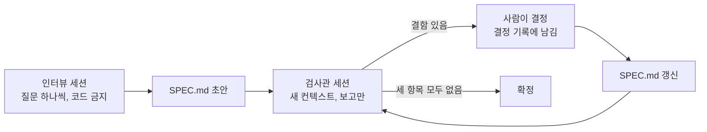
그림 1. 인터뷰에서 확정까지. 검사관은 고치지 않고 보고만 하며, 결정은 사람이 내린다

혹시 검사관이 매번 뭔가를 찾아내서 끝나지 않으면 어떻게 할까? Claude Code 모범 사례는 문제를 찾으라는 리뷰어는 늘 무언가를 찾아낸다고 경고한다. 그 지적을 다 고치다 보면 불필요한 추상화와 일어날 수 없는 경우를 위한 테스트가 늘어난다. 질문을 세 개로 좁혀 둔 것이 이 위험을 줄이는 장치다. 세 질문 밖의 지적은 보고서에 와도 무시하자.

### 리뷰 피로를 줄이고, SPEC.md를 둘 곳

132줄을 매번 처음부터 다시 읽는 일은 생각보다 번거롭다. 커뮤니티가 찾은 장치 몇 개가 피로를 덜어 준다. Jesse Vincent는 브레인스토밍 단계에서 설계를 200~300단어 단위의 절로 끊고, 절마다 확인을 받았다. 에이전트가 다 끝났다고 판단하면 긴 글을 한꺼번에 쏟아내고, 그러면 사람은 그 글을 읽지 않게 된다는 관찰에서 나온 규칙이다. 인터뷰가 끝날 때 `SPEC.md`를 한 번에 받지 말고 절마다 보여 달라고 하면 같은 효과를 얻는다. Boris Tane과 Hartley Brody는 문서에 직접 주석을 달고, 에이전트가 반영한 뒤 바뀐 점의 요약만 받는 방식을 쓴다. 고친 뒤에는 위의 diff처럼 바뀐 줄만 보면 된다.

파일을 어디에 둘지도 정해 두자. 팀 저장소라면 `docs/specs/partial-refund/SPEC.md`처럼 저장소 안에 두고 코드와 같은 PR로 올리는 편이 낫다. 혼자 이 방법을 시험해 보는 단계라면 팀원들이 낯선 파일을 마주치지 않게 `SPEC.md`를 `.git/info/exclude`에 넣는 방법도 있다. 이때 PR 본문에는 수용 기준과 바뀌지 않을 동작만 옮겨 적는다. 어느 쪽이든 스펙은 채팅이 아니라 파일에 있어야 한다. 반년 동안 Spec Kit을 써 온 GPTers의 한 사용자는 회고에서 결국 검수할 수 있는 건 파일뿐이라는 요지의 결론에 이르렀다. 대화는 세션과 함께 사라지지만 파일은 다음 세션에도, 다음 사람에게도 남는다.

> **다른 하네스에서는.** 인터뷰와 검사관 프롬프트는 평범한 문장이라 어느 하네스에서나 그대로 쓴다. `/clear` 대신 새 채팅을 열면 검사관 세션이 된다. 객관식 질문 도구 `AskUserQuestion`은 Claude Code의 것이다. Cursor의 Plan Mode는 계획을 쓰기 전에 명확화 질문을 먼저 하므로 인터뷰를 돌리기에 잘 맞는다. VS Code Copilot은 `/plan`에 원하는 결과, 제약, 검증 방법을 함께 주라고 안내한다. Codex CLI에도 `/plan`이 있지만 작업 중에는 쓸 수 없다. mattpocock/skills의 `/grill-me`는 Claude Code, Copilot, Codex, Gemini CLI에 공식 설치 경로가 있고 Cursor는 범용 경로로만 쓸 수 있다.

내일 아침 할 일은 세 가지면 충분하다.

- [ ] 위의 인터뷰 프롬프트를 슬래시 명령이나 텍스트 파일로 저장한다.
- [ ] 검사관 질문 세 개를 따로 저장하고, "파일은 고치지 마세요"를 지우지 않는다.
- [ ] 이번 주 변경 가운데 스펙 적합성 점수가 3점 이상인 것 하나를 골라 인터뷰부터 확정까지 돌려 보고, 질문 수와 걸린 시간을 적어 둔다.

마지막 줄에서 적어 둔 숫자는 11장에서 다시 쓴다. 이제 `SPEC.md`가 생겼다. 이 파일만 들고 새 세션을 열 차례다.

# 7장. 도구 없이 ②: 새 세션에서 만들고, diff를 스펙으로 검증한다

"타입 체크 통과. 빌드 통과. 테스트 통과. 구현 완료."

에이전트의 마지막 보고에 체크 표시가 나란히 붙어 있다. 기분 좋게 앱을 띄운다. 기동 로그가 몇 줄 흐르더니 스택 트레이스가 쏟아진다. 의존성 주입이 해석되지 않는다. 그걸 고치자 이번에는 Logger가 순환 참조를 일으키고, 그다음에는 DB 어댑터 초기화가 실패한다. 방금 "완료"라고 했던 그 코드다.

이 장면은 GPTers의 엔라인이 스펙 주도 개발(Spec-Driven Development, SDD)용 자작 하네스, 이름하여 "SDD 하네스"를 만들며 적은 실패 목록에서 가져왔다. 글에는 날짜가 없고, 한 사람의 보고이며 정량 수치도 없다. 그래도 낯설지 않은 장면이다. 그의 에이전트는 타입 체크, 빌드, 테스트만 통과하면 완료를 선언했다. 거짓말을 한 것은 아니다. 확인하라고 한 것을 확인했을 뿐이다. 문제는 확인할 목록을 정하고, 그 목록을 통과했다고 판정한 쪽이 일한 에이전트 자신이었다는 데 있다.

6장에서 우리는 확정된 `SPEC.md`를 손에 넣었다. 이제 그 파일로 만들 차례다. 그런데 다 만들고 나면 누가, 무엇으로 "스펙대로 됐다"고 판정해야 그 말을 믿을 수 있을까?

> 이 장은 Claude Code 2.1.319(로컬 설치본, 공식 문서 접근 2026-11-10) 기준이다. `plansDirectory`, `showClearContextOnPlanAccept` 같은 설정 키는 하네스 판이 바뀌면 이름이나 동작이 달라질 수 있으니 공식 설정 문서를 함께 확인하자.

## 새 세션에서 계획하기

### SPEC.md만 들고 플랜 모드로

새 세션을 연다. 인터뷰의 대화도, 검사관의 보고도 없는 깨끗한 컨텍스트다. 이 세션에 건넬 것은 `SPEC.md` 하나다. Claude Code 모범 사례가 새 세션을 권하는 이유가 여기 있다. 깨끗한 컨텍스트와 글로 적힌 완료 정의만으로 시작하면, 앞선 대화에서 흘린 말 대신 파일에 적힌 말을 기준으로 일하게 된다.

바로 구현을 시키지 말고 먼저 계획을 받자. `Shift+Tab`으로 모드를 돌려 플랜 모드로 들어가도 되고, `claude --permission-mode plan`으로 시작해도 되고, 프롬프트 앞에 `/plan`을 붙여도 된다. 상태 표시줄에 `⏸ plan mode on`이 보이면 그 세션은 파일을 읽고 탐색용 명령을 돌리고 계획을 쓰지만 소스는 고치지 않는다.

```text
/plan docs/specs/partial-refund/SPEC.md를 읽고 구현 계획을 세워 주세요.
- 수정하거나 추가할 파일 경로를 모두 적고, 파일마다 바꿀 내용을 한두 줄로
- SPEC.md 6절 규칙 R1~R10과 7절 수용 기준 AC1~AC9를 어느 단계, 어느 테스트가
  다루는지 연결해 주세요
- 마이그레이션은 되돌리는 스크립트까지 포함해 주세요
- 단계마다 체크리스트를 두고, 단계를 마칠 때마다 체크해 주세요
- SPEC.md에 없는 결정이 필요하면 계획에 넣지 말고 "질문" 절에 남겨 주세요
```

계획이 나오면 읽는다. 처음부터 끝까지 다 읽기 부담스럽다면 세 가지만이라도 직접 확인하자. 이름과 경로가 맞는가(`delivered_at`, `refunded_quantity`, `/orders/{orderId}/refunds`), 경계 사례가 들어갔는가(168시간 정각과 1초 뒤, PG 실패 뒤 새 키로 재요청), 그리고 바뀌지 않을 동작을 지키는 단계가 있는가(전체 취소 회귀 테스트). 고칠 곳이 있으면 `Ctrl+G`로 계획을 편집기에서 직접 고칠 수 있다.

마지막 줄에 이유가 있다. 계획 단계에서 에이전트가 스펙의 빈칸을 혼자 메우면 6장의 수고가 무너진다. 그래서 빈칸을 발견하면 계획에 슬쩍 넣지 말고 질문으로 꺼내 놓게 했다. 질문이 나오면 답을 정하고, 그 답을 `SPEC.md`의 결정 기록에도 한 줄 남기자. 스펙이 계속 사실을 말하게 하는 가장 싼 방법이다. 구현 도중에 같은 일이 생겨도 순서는 같다. 계획과 스펙이 어긋나는 결정이 나오면 스펙의 결정 기록을 먼저 고치고, 계획은 그다음에 고친다. 순서를 거꾸로 하면 계획 파일은 최신인데 스펙은 낡은 상태가 되고, 8장에서 볼 드리프트가 바로 그 틈에서 시작된다.

계획을 승인할 때는 선택지가 셋이다. Yes, and use auto mode(auto 모드를 쓸 수 없으면 Yes, auto-accept edits), Yes, manually approve edits, No, keep planning. 결제 코드를 처음 만지는 단계라면 편집을 하나씩 승인하는 쪽이 마음 편하다.

### 계획을 저장소에 두고, 체크리스트를 상태로

Claude Code의 계획은 파일로 저장된다. 다만 기본 위치가 `~/.claude/plans`, 곧 저장소 밖이다. 세션이 끝나면 계획이 어디 있는지 팀원은 모르고 다음 세션도 찾기 어렵다. 설정 하나로 저장소 안으로 옮기자.

```json
{
  "plansDirectory": "./docs/plans",
  "showClearContextOnPlanAccept": true
}
```

`.claude/settings.json`에 넣는 두 줄이다. `plansDirectory`는 프로젝트 루트 기준 경로를 받는다. 루트 밖 경로나 macOS·Linux에서 백슬래시가 든 경로는 무시되고 기본 위치로 돌아간다. `showClearContextOnPlanAccept`를 켜면 승인 선택지 맨 앞에 Yes, clear context and …가 생긴다. 계획을 승인하면서 대화 컨텍스트를 비우고 계획만으로 구현을 시작하는 선택지다. 세션을 새로 열지 않고도 "새 세션"을 흉내 낼 수 있는 셈이다.

저장소에 남은 계획은 이런 모양이 된다. 이 책 예제로 채운 발췌다.

```markdown
# 부분 환불 구현 계획

- 스펙: docs/specs/partial-refund/SPEC.md (확정판)
- 바뀌지 않을 동작: 전체 취소 API — AC9 회귀 테스트로 확인

## 1단계 스키마
- [x] migrations/012_add_partial_refund.up.sql, .down.sql
      (refunds, refund_items, order_items.refunded_quantity, 주문 상태 두 개)
- [x] 검증: scripts/db.sh로 적용 → 되돌리기 → 다시 적용

## 2단계 금액 계산 (R4 · AC1, AC2, AC3)
- [x] refund/RefundCalculator.java: 안분, 원 미만 버림, 마지막 수량에서 차액 보정
- [ ] RefundCalculatorTest: 10,800원 / 합계 37,800원 / 1,285·857·858원
- [ ] RefundInvariantTest: 전 수량 환불 합계 = 결제 금액 − 배송비

## 3단계 환불 API (R1~R3, R5~R9 · AC4~AC8)
- [ ] refund/RefundController.java: POST, GET /orders/{orderId}/refunds
- [ ] refund/RefundService.java: 권한(403/404) → 기간(422) → 수량(409)
      → 멱등 키 → PG 호출 → 상태 갱신
- [ ] PartialRefundAcceptanceTest: AC1~AC9

## 4단계 마감
- [ ] scripts/verify-refund.sh 통과 (빌드, 마이그레이션, 부팅, 실제 호출)
- [ ] 서브에이전트 리뷰: diff ↔ SPEC.md, 정확성 빈틈 0건

## 질문 (SPEC.md에 없는 결정)
- 없음
```

체크 표시가 진행 상황을 말해 준다. 2단계 중간까지 왔다. 이 세션이 끊기거나 컨텍스트가 넘쳐도 다음 세션은 이 파일을 읽고 정확히 여기서 이어 간다. Sam McLeod는 이 원리를 한 문장으로 요약했다. "The checklist is the state of the work." 진행 상태가 대화에 있지 않고 파일에 있으니 새 세션이 길을 잃지 않는다. GeekNews의 한 댓글도 계획 파일을 저장소 안에 두고 실행 결과까지 적게 했더니 컨텍스트가 잘 유지됐다고 전했다.

## 구현하는 동안

### 승인 전에는 만들지 않고, 틀리면 버린다

플랜 모드를 쓰면 승인 전에는 소스가 바뀌지 않는다. 구현 금지 가드가 구조로 들어 있는 셈이다. 플랜 모드 없이 계획을 주고받는다면 이 가드를 말로 세워야 한다. Boris Tane은 계획에 주석을 달아 수정을 요청할 때마다 끝에 `don't implement yet`를 붙였다. 그 말이 없으면 에이전트가 계획이 충분하다고 판단하는 순간 코드를 쓰기 시작한다고 그는 적었다. Hartley Brody도 계획 중에 구현을 시작하는 문제를 명시적인 금지로 막았다.

구현이 엉뚱한 방향으로 가면 어떻게 할까? 덧대어 고치고 싶은 마음이 든다. 이미 꽤 만들었고, 조금만 손보면 될 것 같다. Tane의 처방은 반대다. 패치하지 말고 git 변경을 버린 뒤, 범위를 좁혀 다시 시작한다. 틀린 가정 위에 쌓은 코드는 고칠수록 그 가정을 더 단단하게 만든다. 그는 계획 없이 시작한 작업을 되돌리는 데 15분쯤 든다고 적었다. 부분 환불이라면 "1단계부터 3단계까지"를 "2단계 금액 계산만"으로 좁혀 다시 계획을 받는 식이다. 버리는 데 드는 비용은 계획 파일과 `SPEC.md`가 남아 있기에 작다.

세션을 얼마나 길게 끌고 갈지도 정해 두면 좋다. McLeod는 계획이 작고 사용량이 약 40~50K 토큰 아래일 때만 같은 세션을 이어 가고, 200K 모델은 약 160K, 1M 모델은 250~300K 아래로 유지한다고 적었다. Jesse Vincent는 구현자 세션에 태스크를 3~4개씩만 맡기면서 계획에서 벗어나지 말라고 못 박았고, 컨텍스트를 줄일 때 `/compact`보다 `/clear`를 썼다. 둘 다 자기 보고이고 모델마다 사정이 다르다. 그래도 공통점은 분명하다. 긴 세션을 믿기보다 파일을 믿는다.

## 왜 "완료"를 믿지 않는가

### 자기 판정 관문이 놓치는 것

이제 이 장의 질문으로 돌아가자. 다 만든 에이전트가 "완료"라고 말하면 그 말을 어디까지 믿을 수 있을까?

측정이 하나 있다. 관문형 워크플로를 감사한 연구에서, 작업한 모델이 자기 작업의 관문까지 판정하는 오케스트레이터를 돌려 보니 블록 점검 247회 동안 선언하지 않은 변경이 11회 기록됐다. 그중 작업을 멈춘 것은 4회뿐이었다. 저자들이 기능 9개를 직접 운영하며 잰 숫자다. 단서도 함께 읽어야 한다. 저자들은 그 11회가 주로 자기들이 진행 중에 낸 요청과 환경에서 나왔다고 적었고, 결정적 검사와 자기 판정을 직접 맞대어 비교하지는 않았다. 다른 측정도 같은 쪽을 가리킨다. Verus-SpecGym에서는 LLM 판정이 실행 평가기가 잡은 실패의 26%를 놓쳤다.

현장 사례도 있다. Nolan Lawson의 에이전트는 SQL 최적화로 쿼리가 빨라졌다고 측정 없이 주장했는데, 벤치마크와 `EXPLAIN`을 요구하자 오히려 느려진 것으로 드러났다. Netguru의 규제 사례에서는 시스템 일부가 아예 기동하지 못하는데도 테스트가 통과했다. 이 일에서 나온 규칙이 하나 있다. 테스트는 검증하는 동작이 없으면 실패해야 한다.

왜 이런 일이 생길까? 관문마다 판정자가 있고, 판정자마다 잡는 것과 놓치는 것이 다르기 때문이다.

| 관문 | 판정자 | 잘 잡는 것 | 놓치는 것 |
|---|---|---|---|
| 지시문만 있는 관문 | 작업한 같은 모델 | 모델이 스스로 알아챈 문제 | 모델이 넘어가기로 한 문제 |
| 결정적 검사 (파일 목록, 테스트, 린트) | 프로그램 | 선언하지 않은 변경, 깨진 테스트 | 스펙 자체의 오류 |
| 속성 기반 테스트 | 무작위 입력 생성기 | 속성을 어기는 입력 | 속성이 담지 않은 요구 |
| 사람 검토 | 사람 | 의도와 다른 스펙 | 긴 문서 검토의 피로 |

참고 보고서가 정리한 이 표에서 첫 줄이 이 장의 핵심이다. 일한 모델이 판정하는 관문은 그 모델이 넘어가기로 한 문제를 구조적으로 보지 못한다. 결정적 검사가 자기 판정보다 믿을 만하다는 판단 자체는 측정이 아니라 추론이다. 하지만 아래 세 줄은 적어도 판정자가 일한 쪽과 다르다. 그렇다면 남은 일은 분명하다. 판정자를 일한 에이전트 밖으로 꺼내자.

## 검증 루프 기준선

판정자를 밖으로 꺼내는 방법을 다섯 가지로 묶었다. 이 다섯이 이 책의 검증 기준선이다. 8장부터 도구를 하나씩 들일 때마다, 그 도구의 관문이 이 기준선의 어느 칸을 채우는지 비춰 볼 것이다.

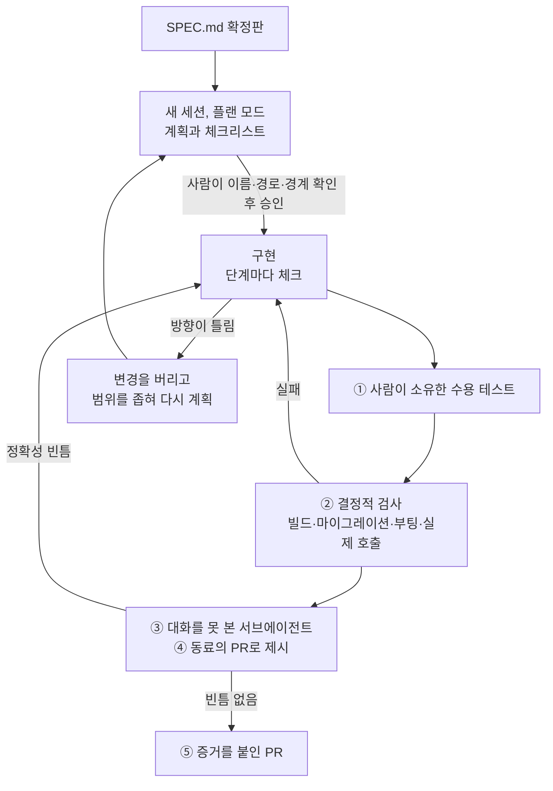
그림 1. 구현과 검증 루프. 판정은 일한 세션 밖의 사람, 프로그램, 새 서브에이전트가 내린다

### ① 수용 테스트는 사람이 소유한다

테스트를 누가 써야 할까? 측정이 꽤 분명하게 말한다. 사람이 쓴 테스트를 준 TDFlow는 SWE-Bench Lite에서 88.8%(차순위보다 27.8점 높음), SWE-Bench Verified에서 94.3%를 풀었다. 800회 실행 가운데 테스트를 속여 통과한 경우는 7회였고, 저자들이 꼽은 주된 장애물은 좋은 재현 테스트를 쓰는 일이었다. 반대로 상세 스펙이 있는 앱 165개로 에이전트에게 테스트를 쓰게 한 TestSuiteBench에서는 최전선 에이전트의 변이 점수가 60%를 넘지 못했다. 에이전트가 쓴 테스트는 통과는 잘 하지만 버그를 잘 못 잡는다는 뜻이다.

그러니 `SPEC.md`의 수용 기준을 테스트로 옮기는 일은 사람이 맡자. 직접 쓰거나, 에이전트에게 초안을 받되 한 줄씩 검토한다. 아래는 AC1과 AC7을 옮긴 JUnit 테스트다. 이 책 예제로 쓴 코드이며 import와 테스트 도우미(`OrderFixtures`, `FakePaymentGateway`, `shopAdmin`, `refundBody`)는 생략했다.

```java
// SPEC.md 7절의 AC1, AC7을 옮긴 수용 테스트
@SpringBootTest
@AutoConfigureMockMvc
class PartialRefundAcceptanceTest {

    @Autowired MockMvc mvc;
    @Autowired OrderFixtures fixtures;   // 기준 주문 O-1을 만드는 픽스처
    @Autowired FakePaymentGateway pg;    // 테스트 설정에 등록한 PG 대역

    @Test
    @DisplayName("AC1. 책 B 1권을 환불하면 10,800원, 주문은 PARTIALLY_REFUNDED")
    void refundOneCopyOfBookB() throws Exception {
        Order o1 = fixtures.orderO1(SHOP_X);
        pg.respondSuccess();

        mvc.perform(post("/orders/{orderId}/refunds", o1.id())
                .with(shopAdmin(SHOP_X))
                .header("Idempotency-Key", "ac1")
                .contentType(MediaType.APPLICATION_JSON)
                .content(refundBody(o1.itemId("B"), 1, "책 모서리 파손")))
            .andExpect(status().isCreated())
            .andExpect(jsonPath("$.amount").value(10_800));

        Order after = fixtures.reload(o1);
        assertThat(after.status()).isEqualTo(OrderStatus.PARTIALLY_REFUNDED);
        assertThat(after.item("B").refundedQuantity()).isEqualTo(1);
    }

    @Test
    @DisplayName("AC7. PG가 실패하면 502, 환불은 FAILED, 주문과 수량은 그대로")
    void paymentGatewayFailureLeavesOrderUntouched() throws Exception {
        Order o1 = fixtures.orderO1(SHOP_X);
        pg.respondFailure();

        mvc.perform(post("/orders/{orderId}/refunds", o1.id())
                .with(shopAdmin(SHOP_X))
                .header("Idempotency-Key", "ac7-first")
                .contentType(MediaType.APPLICATION_JSON)
                .content(refundBody(o1.itemId("B"), 1, "책 모서리 파손")))
            .andExpect(status().isBadGateway())
            .andExpect(jsonPath("$.code").value("PAYMENT_GATEWAY_ERROR"));

        Order after = fixtures.reload(o1);
        assertThat(after.status()).isEqualTo(OrderStatus.DELIVERED);
        assertThat(after.item("B").refundedQuantity()).isZero();
        assertThat(fixtures.refundsOf(o1))
            .extracting(Refund::status)
            .containsExactly(RefundStatus.FAILED);

        pg.respondSuccess();             // AND 새 키로 다시 요청하면 정상 처리
        mvc.perform(post("/orders/{orderId}/refunds", o1.id())
                .with(shopAdmin(SHOP_X))
                .header("Idempotency-Key", "ac7-retry")
                .contentType(MediaType.APPLICATION_JSON)
                .content(refundBody(o1.itemId("B"), 1, "책 모서리 파손")))
            .andExpect(status().isCreated());
    }
}
```

테스트 안의 문자열을 보자. 경로 `/orders/{orderId}/refunds`, 헤더 `Idempotency-Key`, 금액 10,800, 오류 코드 `PAYMENT_GATEWAY_ERROR`, 상태 `PARTIALLY_REFUNDED`와 `FAILED`. 모두 `SPEC.md`에 그대로 적힌 이름이다. 6장에서 테스트가 확인할 이름을 스펙에 적어 두자고 한 이유가 여기서 드러난다. 오류 코드를 응답 본문의 `code`에서 꺼낸다는 사실까지 스펙 5절에 한 줄로 적혀 있으니, 테스트가 스펙 밖의 추측에 기대지 않는다.

테스트를 다 썼으면 한 가지를 더 확인하자. 이 테스트는 그 동작이 없으면 실패하는가? 손으로 돌연변이를 하나씩 넣어 보면 된다. `RefundCalculator`에서 쿠폰 안분을 잠시 지우면 AC1이 12,000원으로 실패하는가? PG 실패 처리에서 `FAILED` 기록을 빼면 AC7이 실패하는가? 실패하지 않는다면 그 테스트는 그 동작 말고 다른 무언가를 확인하고 있다. 통과 표시만 보고 안심하고 있었다면 아찔한 일이다.

### ② 결정적 검사: 빌드, 마이그레이션, 부팅, 실제 호출

수용 테스트가 통과해도 앱이 뜨지 않을 수 있다. 이 장의 첫 장면이 그랬다. 그래서 "완료"의 정의에 프로그램이 판정하는 검사를 붙인다. 판정은 에이전트가 쓴 문장이 아니라 스크립트의 종료 코드가 한다.

```bash
#!/usr/bin/env bash
# scripts/verify-refund.sh — "완료"라고 말하기 전에 돌리는 결정적 검사
set -euo pipefail

# 1. 빌드와 전체 테스트 (수용 테스트, 속성 테스트 포함)
./gradlew clean build

# 2. 마이그레이션: 빈 DB에 적용 → 되돌리기 → 다시 적용 → 시드
#    (db.sh는 예제 저장소의 스크립트, 시드의 delivered_at은 현재 시각 하루 전)
./scripts/db.sh drop
./scripts/db.sh up
./scripts/db.sh down
./scripts/db.sh up
./scripts/db.sh seed

# 3. 부팅 스모크: 앱이 실제로 뜨는가 (actuator를 쓰는 경우)
./gradlew bootRun > build/boot.log 2>&1 &
APP_PID=$!
trap 'kill "$APP_PID" 2>/dev/null || true' EXIT
for _ in $(seq 1 30); do
  curl -sf http://localhost:8080/actuator/health > /dev/null && break
  sleep 2
done
curl -sf http://localhost:8080/actuator/health > /dev/null \
  || { echo "부팅 실패: build/boot.log를 확인하세요"; exit 1; }

# 4. 실제 호출: 시드 주문 O-1(주문 번호 1001)에서 책 B 1권 → 10,800원
curl -sf -X POST http://localhost:8080/orders/1001/refunds \
  -H "Authorization: Bearer ${SHOP_X_ADMIN_TOKEN}" \
  -H "Idempotency-Key: smoke-$(date +%s)" \
  -H "Content-Type: application/json" \
  -d '{"items":[{"orderItemId":2,"quantity":1}],"reason":"스모크"}' \
  | grep -q '"amount":10800'

echo "verify-refund: OK"
```

네 단계는 각각 다른 실패를 잡는다. 빌드는 컴파일 오류와 깨진 테스트를, 마이그레이션 왕복은 되돌릴 수 없는 스키마 변경을, 부팅 스모크는 엔라인이 겪은 의존성 주입과 초기화 오류를, 실제 호출은 테스트 대역 뒤에 숨은 설정 오류를 잡는다. 엔라인의 처방도 완료 조건에 앱 부팅 스모크 테스트를 넣는 것이었다.

세부 두 곳에는 이유가 있다. 마이그레이션을 적용하고 끝내지 않고 되돌린 뒤 다시 적용하는 까닭은, 운영에서 배포를 물려야 할 때 `down` 스크립트가 처음 실행되는 일을 막기 위해서다. 그때 처음 돌려 보는 스크립트가 실패하면 정말 난감하다. 시드 주문의 `delivered_at`을 현재 시각 하루 전으로 넣는 까닭은 R2 때문이다. `SPEC.md`의 O-1처럼 날짜를 2026-11-02로 박아 두면, 일주일 뒤에는 스모크 호출이 `422 REFUND_WINDOW_EXPIRED`로 실패한다. 스펙의 예시 데이터는 고정 값이어야 하고, 스모크용 시드는 시간이 흘러도 같은 결과를 내야 한다. 둘은 목적이 다르다.

결정적 검사에도 맹점은 있다. 앞의 표가 말하듯 프로그램은 스펙 자체의 오류를 잡지 못한다. 스펙이 배송비를 돌려준다고 잘못 적혀 있었다면 테스트도 스크립트도 그 잘못을 충실히 통과시켰을 것이다. 그 몫은 6장의 검사관 세션과 사람이 맡았다. 기준선의 각 칸은 서로의 맹점을 덮으려고 함께 있다.

이 스크립트를 에이전트에게 돌리게 해도 괜찮다. 판정자가 바뀌지 않기 때문이다. 에이전트가 무엇이라고 말하든 종료 코드가 0이 아니면 완료가 아니다. 계획 파일의 4단계 체크 항목에도 이 스크립트를 걸어 두었다. Claude Code 문서도 완료 주장에는 증거, 곧 실행한 명령과 그 출력을 요구하라고 권한다.

### ③ 대화를 못 본 리뷰어, ④ 동료의 PR, ⑤ 증거

테스트와 스크립트가 통과하면 마지막으로 diff를 `SPEC.md`와 대조한다. 이 대조를 구현한 세션에게 맡기면 앞의 표 첫 줄로 돌아가게 된다. 그래서 대화를 보지 못한 새 서브에이전트에게 맡긴다. Claude Code 모범 사례의 리뷰 프롬프트를 한국어로 각색하고, 커뮤니티가 찾은 장치 두 개를 더했다.

```text
서브에이전트를 써서 지금 브랜치의 diff를 docs/specs/partial-refund/SPEC.md와
대조해 주세요. 이 diff는 동료가 올린 PR이고, 리뷰만 합니다. 파일은 고치지 마세요.

- 6절 규칙 R1~R10이 각각 구현되었는가? 구현된 파일과 줄을 적고, 없으면 "없음".
- 7절 수용 기준 AC1~AC9마다 테스트가 있는가? 그 테스트가 SPEC.md의 경로,
  오류 코드, 금액을 그대로 확인하는가?
- "안 만들 것"에 있는 동작(배송비 환불 등)을 만든 곳이 있는가?

정확성에 영향을 주는 빈틈만 보고하고, 스타일은 건너뛰어 주세요.
```

마지막 줄을 지우지 말자. 공식 문서의 원래 예문도 "skip style"로 끝나고, 문서는 그 이유를 이렇게 경고한다. 문제를 찾으라는 리뷰어는 늘 무언가를 찾아내고, 그걸 다 고치다 보면 불필요한 추상화와 일어날 수 없는 경우를 위한 테스트가 늘어난다. 리뷰 범위를 스펙 대조로 좁히는 것이 이 위험을 막는다. Claude Code에는 대화를 보지 않는 리뷰를 맡기는 `/code-review`도 있다.

"동료가 올린 PR"이라는 표현은 Nolan Lawson에게서 빌렸다. 그는 리뷰를 새 세션에서 하고, 내 코드라고 말하지 말고 동료의 PR로 내밀라고 권했다. 내 코드라고 하면 에이전트가 아첨한다는 관찰이다. 그는 새 버그가 더 나오지 않을 때까지 같은 리뷰 프롬프트를 되풀이했다. "파일은 고치지 마세요"는 엔라인의 처방에서 왔다. 그는 리뷰어 에이전트가 코드를 직접 고치던 문제를 리뷰어의 쓰기 권한을 도구 수준에서 빼는 방식으로 막았다. 말로 금지하는 것보다 서브에이전트 정의에서 쓰기 도구를 아예 빼 두는 편이 단단하다.

다섯 번째는 증거다. 리뷰어가 "빈틈 없음"이라고 보고하고 스크립트가 `verify-refund: OK`를 찍었다면, 그 두 출력을 PR에 그대로 붙인다. 에이전트의 "완료"라는 한 단어가 그 자리를 대신하지 못하게 하는 마지막 장치다.

## C4의 씨앗: 불변식을 실행 가능한 검사로

수용 기준 AC2는 주문 O-1 하나로 불변식을 확인한다. 전 항목을 환불하면 합계가 결제 금액에서 배송비를 뺀 값과 같다. 그런데 이 약속은 O-1에만 해당하지 않는다. 항목이 다섯 개인 주문, 정액 쿠폰이 붙은 주문, 한 권씩 다섯 번에 나눠 환불한 주문에서도 성립해야 한다. 이런 "언제나 참인 성질"은 예시 하나보다 속성 테스트로 확인하는 편이 낫다.

```java
// SPEC.md AC2의 "환불액 합계 = 결제 금액 − 배송비"를 모든 주문으로 넓힌 스케치
class RefundInvariantTest {

    private final RefundCalculator calculator = new RefundCalculator();

    @RepeatedTest(500)
    void 전_수량을_어떤_순서로_나눠_환불해도_합계는_결제금액_빼기_배송비(RepetitionInfo info) {
        long seed = info.getCurrentRepetition();          // 실패하면 이 시드로 재현
        Random random = new Random(seed);
        OrderSnapshot order = RandomOrders.order(random); // 항목 1~5개, 수량 1~3, 정률·정액 쿠폰
        List<RefundRequest> parts = RandomOrders.splitAll(order, random); // 전 수량을 임의 묶음·순서로

        long total = 0;
        for (RefundRequest part : parts) {
            total += calculator.refundAmount(order, part);
            order = order.afterRefund(part);
        }

        assertThat(total)
            .as("seed=%d", seed)
            .isEqualTo(order.paidAmount() - order.shippingFee());
    }
}
```

JUnit만으로 쓴 스케치다. 이 테스트는 DB도 웹 계층도 거치지 않고 `RefundCalculator` 하나만 겨눈다. 그래서 500번을 돌려도 빌드에 주는 부담이 작고, ②의 스크립트 첫 단계에서 다른 테스트와 함께 돈다. 실패하면 메시지에 찍힌 시드로 같은 주문을 다시 만들어 디버깅하면 된다. 속성 기반 테스트 라이브러리를 쓰면 무작위 입력 생성과 함께, 실패한 입력을 가장 작은 반례로 줄여 주는 기능까지 얻는다. 스펙 문장 하나가 실행 가능한 검사로 바뀌는 첫 장면이다.

이 속성을 누가 찾았는지도 눈여겨보자. 우리가 6장에서 직접 `SPEC.md`에 적었다. API 문서에서 뽑아낼 수 있는 속성 가운데 GPT-4가 올바른 속성 기반 테스트로 만든 비율이 21%였다는 연구가 있다. 문서에서 속성을 알아서 찾게 두면 대부분을 놓친다는 뜻이다. 앞의 판정자 표도 함께 떠올리자. 속성 테스트는 속성이 담지 않은 요구를 잡지 못한다. 동시에 들어온 환불 두 건이 같은 책을 두 번 돌려주는 경쟁 조건은 이 테스트 밖에 있다. 그 경쟁 조건과 이 불변식을 함께 실행 가능한 검사로 올리는 일이 예제 변경 C4이고, 11장 사다리의 R5 단에서 다시 만난다.

## 병합할 때 스펙은 어디로

검증을 마쳤으면 PR을 연다. 이때 `SPEC.md`에서 무엇을 PR로 옮길까? Hartley Brody는 계획 문서를 PR 본문의 `<details>` 블록에 접어 넣었다. 리뷰어는 필요할 때만 펼쳐 보고, 계획은 PR과 함께 기록으로 남는다. 여기에 6장에서 말한 두 가지, 수용 기준과 바뀌지 않을 동작을 본문에 펼쳐 두자.

```markdown
## 부분 환불 (스펙: docs/specs/partial-refund/SPEC.md)

### 수용 기준
- [x] AC1 부분 환불 10,800원 — PartialRefundAcceptanceTest
- [x] AC2 전 항목 환불 합계 37,800원 — PartialRefundAcceptanceTest, RefundInvariantTest
- [x] AC3 차액 보정 1,285 / 857 / 858원 — RefundCalculatorTest
- [x] AC4 환불 기간 168시간 경계 — PartialRefundAcceptanceTest
- [x] AC5 수량 초과 409 — PartialRefundAcceptanceTest
- [x] AC6 중복 요청 — PartialRefundAcceptanceTest
- [x] AC7 PG 실패 502와 재요청 — PartialRefundAcceptanceTest
- [x] AC8 다른 서점 주문 403 — PartialRefundAcceptanceTest
- [x] AC9 전체 취소 회귀 — CancelOrderRegressionTest

### 바뀌지 않을 동작
- 배송 전 전체 취소 `POST /orders/{orderId}/cancel` (배송 전만, 전액)

### 검증 증거
- `scripts/verify-refund.sh` → `verify-refund: OK` (출력 첨부)
- 서브에이전트 리뷰: 정확성 빈틈 0건 (보고 첨부)

<details>
<summary>구현 계획 (docs/plans/)</summary>

(승인한 계획 파일 전문)

</details>
```

PR 리뷰어가 가장 먼저 보는 것은 수용 기준 목록과 증거다. 132줄짜리 스펙 전체를 읽게 할 필요는 없다. 무엇을 약속했고, 무엇을 건드리지 않았고, 무엇으로 확인했는지만 보이면 된다. 검토 부담은 SDD를 향한 2025년의 불만 가운데 2026년 11월까지 살아남은 몇 안 되는 것이다. 참고 보고서가 한국과 일본 실무자들의 글을 모아 정리한 바로는 가장 큰 불만이 생성된 마크다운의 검토 부담이었고, Loglass는 기능마다 계획 문서를 맞추는 데 1~2시간이 들었다고 적었다. 그 부담을 PR 리뷰어에게까지 넘길 이유는 없다. 스펙을 읽고 검사하는 일은 6장에서 이미 마쳤다. PR에서는 그 결과만 확인하면 된다.

남는 질문이 하나 있다. PR이 병합된 뒤 `docs/specs/partial-refund/SPEC.md`는 어떻게 할까? 계속 두고 고쳐 가야 할까, 이 변경과 함께 끝난 문서로 보고 놓아 둘까? 혼자 하는 이번 변경에서는 놓아 둬도 괜찮다. 하지만 석 달 뒤 환불 기간을 바꾸자는 요청이 오면 이 질문이 다시 고개를 든다. OpenSpec은 이 질문에 도구로 답하고, 12장은 팀의 규칙으로 다시 묻는다.

> **다른 하네스에서는.** 계획 파일의 자리가 하네스마다 다르다. Cursor의 Plan Mode는 계획을 홈 디렉터리에 두고 Save to workspace로 작업 공간에 저장할 수 있다. VS Code Copilot의 Plan 에이전트는 Local에서 계획을 세션 메모리(`/memories/session/plan.md`)에 두므로 프로젝트 파일이 아니다. Open in Editor로 편집 가능한 사본을 열어 저장소에 옮기자. Codex CLI의 `/plan`은 계획을 어디에 저장하는지 공식 문서에 적혀 있지 않다. 어느 하네스든 "승인한 계획을 `docs/plans/`에 파일로 남겨 주세요"라는 한 줄을 덧붙이면 같은 효과를 얻는다. 수용 테스트와 검증 스크립트, 리뷰 프롬프트는 하네스를 바꿔도 그대로 쓴다.

### 이 장의 핵심

- 새 세션은 `SPEC.md`만 들고 플랜 모드에서 시작한다. 계획은 `plansDirectory`로 저장소에 두고, 그 안의 체크리스트를 작업 상태로 쓴다.
- 일한 에이전트가 판정하는 관문은 그 에이전트가 넘어가기로 한 문제를 보지 못한다. 판정자를 일한 쪽 밖으로 꺼낸다.
- 검증 기준선은 사람이 소유한 수용 테스트, 종료 코드로 판정하는 결정적 검사, 대화를 못 본 리뷰어, 그리고 PR에 붙이는 증거다.
- 수용 테스트는 "그 동작이 없으면 실패하는가"로 다시 검사하고, 스펙에 적은 불변식은 속성 테스트로 넓힌다.

관문은 일한 에이전트 밖에 둔다. 이 한 문장이 3부에서 가져갈 전부다. 다음 세 도구는 저마다 관문을 품고 있다. 정합성 점검, 수렴 검사, 검증 명령, 리뷰 스킬. 이름이 무엇이든 그 앞에서 던질 질문은 하나면 된다. 이 판정은 누가 내리는가?

# 8장. OpenSpec으로 개발하기 — 바꿀 부분만 스펙으로

6장에서 공들여 쓴 `SPEC.md`는 PR이 병합되는 순간 어디로 갈까? 7장 마지막 절에서 남겨 둔 질문이다. 석 달 뒤 운영팀이 환불 기간을 7일에서 14일로 늘리고, 자유 입력 사유를 정해진 사유 코드로 바꾸자고 요청한다. 그때 우리는 무엇을 고쳐야 할까?

어느 선택지도 개운하지 않다. PR 본문에 접어 넣은 계획은 병합된 PR 목록 깊숙이 가라앉았다. 저장소에 남긴 `SPEC.md`도 고민거리다. 새 변경용 `SPEC.md`를 하나 더 쓰면 옛 파일의 "168시간"이 낡은 채 남고, 옛 파일을 고치면 두 변경의 인터뷰와 검사 기록이 뒤섞인다. Spec Kit 이슈 #620(2025-09-27)이 바로 이 상황을 물었다. 로그인 기능의 스펙이 몇 달 뒤 2단계 인증 기능 때문에 부분적으로 낡았는데, 원본을 고칠지 이력으로 둘지 묻는 글이었다. 댓글의 한 사용자는 그것이 바로 OpenSpec의 핵심 기능이라고 답했다.

그렇다면 아예 처음부터 시스템 전체의 스펙을 써 두면 어떨까? 주문, 결제, 쿠폰, 배송까지 기존 코드를 역공학해 스펙으로 옮겨 두면 다음 변경은 그 스펙을 고치기만 하면 된다. 그럴듯하지만 찜찜하다. 한 번도 검사받지 않은 수천 줄의 스펙이 생기고, 그 스펙은 코드가 바뀔 때마다 조용히 낡아 간다. OpenSpec 제조사도 이 길을 말린다. 시작할 때 코드베이스 전체를 문서화하지 말고 바꿀 부분만 쓰라고 하고, 기존 PRD를 한꺼번에 변환하면 아무도 믿지 않는 크고 낡은 스펙을 만들기 쉽다고 경고한다.

OpenSpec의 답은 그 사이에 있다. 바꿀 부분만 델타 스펙으로 쓰고, 변경이 끝나면 델타를 리빙 스펙에 병합한다. 스펙은 변경이 한 번 지나갈 때마다 그 변경이 건드린 만큼만 자란다. 같은 부분 환불(C2)을 이번에는 OpenSpec으로 만들고, 석 달 뒤의 두 번째 변경(C3)까지 이어서 해 보자. 이 도구의 진짜 강점은 두 번째 변경에서야 보인다.

> 이 장은 OpenSpec v1.17.0/2026-11-09 기준이다. 이 판은 2.0에서 `/opsx:*` 명령 파일을 없애고 스킬만 남긴다고 예고했으므로, 명령은 처음 나올 때 스킬 표기를 함께 적는다. 하루 사이에도 새 판이 나오는 도구이니 따라 하기 전에 공식 저장소의 릴리스 노트를 확인하자.

## 설치하고, 기존 저장소에 붙이기

### 설치와 초기화

v1.15.0(2026-10-24)부터 기본 설치 방법이 바뀌었다. 이제는 Node.js가 필요 없는 독립 실행 파일이 기본이다. 2026년 10월 24일 이전 글에서 `npm install -g`로 시작하는 안내를 봤다면, 그 내용은 기본 설치 방법으로는 낡았다.

```bash
# macOS / Linux (독립 실행 파일, ~/.local/bin에 설치)
curl -fsSL https://raw.githubusercontent.com/Fission-AI/OpenSpec/main/scripts/binary/install.sh | sh

# 버전을 고정하고 싶을 때
curl -fsSL https://raw.githubusercontent.com/Fission-AI/OpenSpec/main/scripts/binary/install.sh | OPENSPEC_VERSION=v1.17.0 sh

# 패키지 관리자 경로 (Node.js 22.12.0 이상, v1.16.0부터)
npm install -g @fission-ai/openspec@latest

cd bookshop-orders && openspec init
```

버전 고정 줄은 설치 문서가 안내하는 `OPENSPEC_VERSION` 환경 변수를 설치 스크립트(`sh`)에 넘기는 형태다. 문서는 변수 이름과 값의 예(`v1.15.0`)까지만 적고 명령 줄 전체는 보여 주지 않지만, 설치 스크립트가 이 환경 변수를 읽어 해당 릴리스를 받는다(v1.17.0 `install.sh` 기준).

`openspec init`을 돌리면 저장소 루트에 `openspec/` 폴더가 생긴다. 안에는 시스템의 현재 동작을 담는 `specs/`, 변경마다 폴더를 하나씩 두는 `changes/`, 선택 사항인 `config.yaml`이 있다. Claude Code에는 스킬이 `.claude/skills/openspec-*/SKILL.md`에, 명령이 `.claude/commands/opsx/<id>.md`에 설치된다. 기본 `core` 프로필의 명령 여섯 개는 4장에서 봤다. `/opsx:verify`나 `/opsx:onboard`는 확장 프로필에 있어서 `openspec config profile`로 프로필을 고른 뒤 `openspec update`를 돌려야 생긴다.

### 빈 specs/에서 시작한다

init 직후 `openspec/specs/`는 비어 있다. 운영 중인 `bookshop-orders`의 주문, 결제, 쿠폰, 배송, 전체 취소 가운데 어느 것도 스펙으로는 존재하지 않는다. 앞에서 말한 그 유혹이 고개를 든다. 채우지 말자.

OpenSpec은 스펙을 나중에 붙일 수 있게 설계됐고, Thoughtworks Technology Radar도 이 점을 들어 브라운필드에 맞는다고 평했다. 스펙은 변경이 지나간 자리에만 생긴다. 부분 환불을 마치면 `specs/refunds/`가 생기고, 다른 영역은 누군가 그 영역을 바꿀 때 생긴다. 첫 순환에서는 확장 프로필의 `/opsx:onboard`가 안내를 맡는데, 이때도 첫 변경으로 이번 주에 하려던 작고 진짜인 작업을 고르라고 권한다.

그렇다면 6장에서 `SPEC.md`에 적었던 "바뀌지 않을 동작"은 어디에 둘까? 전체 취소 API에 대한 메인 스펙이 없으니 델타로 "이 동작은 그대로"라고 적을 자리도 마땅치 않다. 이 장에서는 그 약속을 두 곳에 나눠 둔다. 하나는 제안서의 범위 밖 목록이고, 다른 하나는 태스크 목록의 회귀 테스트다. 말로 하는 약속과 실행하는 약속을 함께 두는 셈이다.

## C2를 변경으로 제안하기

### explore에서 propose까지

변경을 만들기 전에 생각을 정리하고 싶으면 `/opsx:explore`를 쓴다. 선택 단계다. 이 장에서는 6장의 `SPEC.md`가 이미 있으니 explore 대화에서 그 파일을 읽히고 빠진 결정이 없는지만 확인한다. 처음부터 시작한다면 6장의 인터뷰 프롬프트를 이 단계에서 그대로 돌리자. 도구가 바뀌어도 인터뷰가 막아 주는 빈칸은 같다.

생각이 정리되면 변경을 제안한다. `/opsx:propose add-partial-refund`(스킬 표기 `/openspec-propose`)다. 공식 문서가 보여 주는 출력 형태에 이 책 예제의 이름을 넣으면 다음과 같다. 실제로 실행해서 받은 출력이 아니라 형태를 보여 주는 예시다.

```text
You: /opsx:propose add-partial-refund

AI:  Created openspec/changes/add-partial-refund/
     ✓ proposal.md
     ✓ specs/refunds/spec.md
     ✓ design.md
     ✓ tasks.md
     Ready for implementation. Run /opsx:apply.
```

변경 이름은 무엇을 하는지 동사로 시작하는 짧은 이름이 좋다. OpenSpec의 스펙 작성 안내에는 이런 기준이 있다. "A good change has one intent you can say in a sentence." 부분 환불은 한 문장으로 말할 수 있다. 배송을 마친 주문에서 서점 관리자가 일부 항목과 수량을 환불하게 한다.

### proposal.md, 그리고 SPEC.md가 옮겨 가는 자리

`proposal.md`는 OpenSpec 템플릿의 헤딩 구조(`# Proposal:` → `## Intent` → `## Scope` → `## Approach`)를 따른다. 아래는 이 책 예제로 채운 예시다.

```markdown
# Proposal: 부분 환불 추가

## Intent
배송을 마친 주문에서 서점 관리자(`SHOP_ADMIN`)가 일부 항목, 일부 수량을 환불할 수 있게 한다.
지금은 배송 전 전체 취소만 있어서 파손된 책 한 권도 주문 데이터에 환불로 남길 방법이 없다.

## Scope
In scope:
- 항목 단위, 수량 단위 환불 요청 API `POST /orders/{orderId}/refunds`
- 쿠폰 할인 안분과 원 미만 차액 보정
- `Idempotency-Key`로 중복 요청 처리, PG 환불 실패 기록과 재요청
- 환불 내역 조회 API `GET /orders/{orderId}/refunds`
- 주문 상태 `PARTIALLY_REFUNDED`, `REFUNDED`

Out of scope:
- 배송비 환불, 포인트와 적립금, 고객 셀프 환불 화면, 복수 결제 수단, 교환
- 전체 취소 API(`POST /orders/{orderId}/cancel`)의 동작 변경 — 회귀 테스트로 지킨다

## Approach
새 `refunds`, `refund_items` 테이블과 `order_items.refunded_quantity` 열을 추가한다.
금액 계산은 한 곳에 모으고, PG 환불 호출의 성공과 실패를 환불 상태로 기록한다.
전체 취소 흐름은 건드리지 않는다.
```

6장의 `SPEC.md`는 절 아홉 개짜리 한 파일이었다. OpenSpec에서는 그 내용이 네 파일로 흩어진다. 무엇이 어디로 가는지 대응표로 보자.

| 6장 `SPEC.md` | OpenSpec의 자리 | 달라지는 점 |
|---|---|---|
| 1 목적 | `proposal.md` `## Intent` | 한 문장으로 말할 수 있는 의도 하나 |
| 3 만들 것, 4 안 만들 것 | `proposal.md` `## Scope` (In / Out) | 비목표가 범위 밖 목록이 된다 |
| 2 사용자와 권한, 6 규칙 | 델타 스펙 `### Requirement:` | EARS 문장이 `The system SHALL` 한 문장으로 |
| 7 수용 기준 | 델타 스펙 `#### Scenario:` | 수용 기준이 요구마다 흩어져 붙는다 |
| 5 API와 데이터 | `design.md`, 일부는 시나리오 | 경로와 오류 코드는 시나리오에도 남는다 |
| 9 결정 기록 | `design.md` `### Decision:` | 결정마다 제목이 붙는다 |
| 바뀌지 않을 동작 | `proposal.md` Out of scope + `tasks.md` 회귀 테스트 | 메인 스펙이 없어서 두 곳에 나눠 둔다 |
| 8 열린 질문 | 다음 변경 후보 | "사유를 코드로"는 C3가 된다 |
| (없음) | `tasks.md` | 7장의 계획 체크리스트에 해당한다 |

가장 크게 달라지는 곳은 수용 기준이다. `SPEC.md`에서는 AC1~AC9가 한 절에 모여 있었다. OpenSpec에서는 수용 기준이 각자 자기 요구 밑으로 흩어진다. 한눈에 훑기는 조금 불편해지지만, 요구를 고치거나 지울 때 그 요구의 시나리오가 함께 따라온다. 이 차이가 두 번째 변경에서 큰 힘을 발휘한다.

## 델타 스펙: 바꿀 부분만, 요구마다 시나리오

변경 폴더의 심장은 델타 스펙 `openspec/changes/add-partial-refund/specs/refunds/spec.md`다. `refunds`는 이번에 처음 생기는 능력이므로 모든 요구가 `## ADDED Requirements` 아래에 들어간다. 새 능력이니 `## Purpose`도 함께 적는다. 이 Purpose는 아카이브 때 새 메인 스펙의 Purpose가 된다. 아래는 이 책 예제로 채운 전문이고, 헤딩과 키워드는 OpenSpec 문서 형식을 따랐다.

```markdown
# Delta for Refunds

## Purpose
배송을 마친 주문의 부분 환불. 요청 권한, 환불 기간, 수량, 금액 계산,
중복 요청, PG 실패, 환불 뒤 주문 상태, 환불 내역 조회를 다룬다.

## ADDED Requirements

### Requirement: 환불 요청 권한
The system SHALL 서점 관리자(`SHOP_ADMIN`)가 자기 서점에 있는 주문만 환불하게 한다.

#### Scenario: 다른 서점의 주문
- GIVEN 서점 X의 관리자와 서점 Y의 배송 완료 주문
- WHEN 관리자가 환불을 요청한다
- THEN 403을 응답하고 환불을 기록하지 않는다

#### Scenario: 없는 주문
- GIVEN 서점 X의 관리자
- WHEN 존재하지 않는 주문 번호로 환불을 요청한다
- THEN 404를 응답한다

### Requirement: 환불 기간
The system SHALL `delivered_at`부터 168시간 이내의 환불 요청만 받는다.

#### Scenario: 경계 시각
- GIVEN `delivered_at`이 2026-11-02T10:00:00+09:00인 주문
- WHEN 2026-11-09T10:00:00+09:00에 환불을 요청한다
- THEN 환불이 접수된다

#### Scenario: 기간 경과
- GIVEN 같은 주문
- WHEN 2026-11-09T10:00:01+09:00에 환불을 요청한다
- THEN 422 `REFUND_WINDOW_EXPIRED`를 응답한다

#### Scenario: 배송 전 주문
- GIVEN `delivered_at`이 없는 주문
- WHEN 환불을 요청한다
- THEN 422 `REFUND_WINDOW_EXPIRED`를 응답한다

### Requirement: 수량 한도
The system SHALL 항목별 환불 수량의 합이 주문 수량을 넘는 요청을 거절한다.

#### Scenario: 수량 초과
- GIVEN 책 B 2권 가운데 1권이 이미 환불된 주문
- WHEN 책 B 2권을 환불 요청한다
- THEN 409 `REFUND_QUANTITY_EXCEEDED`를 응답하고 아무것도 바꾸지 않는다

### Requirement: 쿠폰 할인 안분
The system SHALL 주문 쿠폰 할인액을 항목 금액 비율로 나누고 원 미만은 버려 환불액에서 뺀다.

#### Scenario: 정률 쿠폰 주문에서 한 권 환불
- GIVEN 책 A 18,000원 × 1, 책 B 12,000원 × 2, 정률 쿠폰 10%, 배송비 3,000원, 결제 40,800원인 주문
- WHEN 책 B 1권을 환불한다
- THEN 안분 쿠폰은 1,200원이고 환불액은 10,800원이며 책 B의 `refunded_quantity`는 1이다

### Requirement: 안분 차액 보정
The system SHALL 원 미만을 버려 남은 쿠폰 차액을 주문의 마지막 남은 수량을 환불할 때 보정한다.

#### Scenario: 정액 쿠폰 차액
- GIVEN 같은 상품에 정액 쿠폰 3,000원인 주문
- WHEN 책 A, 책 B, 책 B 순서로 모두 환불한다
- THEN 안분 쿠폰은 1,285원, 857원, 858원이다

### Requirement: 전 항목 환불 합계
The system SHALL 주문의 모든 수량을 환불한 뒤 환불액 합계가 결제 금액에서 배송비를 뺀 값과 같게 한다.

#### Scenario: 정률 쿠폰 주문 전부 환불
- GIVEN 결제 40,800원, 배송비 3,000원인 주문
- WHEN 모든 항목을 차례로 환불한다
- THEN 환불액 합계는 37,800원이다

### Requirement: 중복 요청
The system SHALL 같은 `Idempotency-Key`로 24시간 안에 다시 온 같은 요청에 첫 결과를 그대로 돌려준다.

#### Scenario: 같은 키, 같은 본문
- GIVEN 키 K로 책 B 1권 환불을 마친 주문
- WHEN 키 K와 같은 본문으로 다시 요청한다
- THEN 첫 응답을 그대로 돌려주고 환불은 한 건만 남는다

#### Scenario: 같은 키, 다른 본문
- GIVEN 같은 주문
- WHEN 키 K와 다른 본문으로 요청한다
- THEN 422 `IDEMPOTENCY_KEY_REUSED`를 응답한다

### Requirement: PG 환불 실패
The system SHALL PG 환불 호출이 실패하면 환불을 `FAILED`로 기록하고 주문 상태와 `refunded_quantity`를 그대로 둔다.

#### Scenario: 실패 뒤 새 키로 재요청
- GIVEN PG가 환불 실패를 응답하는 상태
- WHEN 책 B 1권을 환불 요청한다
- THEN 502 `PAYMENT_GATEWAY_ERROR`를 응답하고 환불은 `FAILED`, 주문은 `DELIVERED`로 남는다
- AND 새 키로 다시 요청하면 환불이 처리된다

### Requirement: 환불 뒤 주문 상태
The system SHALL 환불이 완료되면 남은 수량이 있는 주문은 `PARTIALLY_REFUNDED`로, 남은 수량이 없는 주문은 `REFUNDED`로 바꾼다.

#### Scenario: 일부와 전부
- GIVEN 책 A 1권, 책 B 2권이 든 배송 완료 주문
- WHEN 책 B 1권을 환불한다
- THEN 주문은 `PARTIALLY_REFUNDED`가 된다
- AND 나머지를 모두 환불하면 주문은 `REFUNDED`가 된다

### Requirement: 환불 사유
The system SHALL 환불 요청마다 자유 입력 사유(`reason`)를 받아 기록한다.

#### Scenario: 사유 기록
- WHEN 사유 "책 모서리 파손"으로 환불한다
- THEN 환불 내역에 그 사유가 남는다

### Requirement: 환불 내역 조회
The system SHALL `GET /orders/{orderId}/refunds`로 그 주문의 환불을 생성 순서대로 돌려준다.

#### Scenario: 두 번 환불한 주문
- GIVEN 환불이 두 번 있었던 주문
- WHEN 환불 내역을 조회한다
- THEN 두 환불이 금액, 사유, 상태, 항목과 함께 생성 순서대로 나온다
```

요구 열한 개에 시나리오 열다섯 개다. 6장의 규칙 R1~R9와 수용 기준 AC1~AC8이 거의 그대로 옮겨 왔다. 전체 취소에 관한 R10과 AC9는 앞에서 정한 대로 제안서와 태스크로 갔다. 옮기는 동안 모양이 몇 군데 달라졌다.

먼저 문형이다. 3장과 4장에서 봤듯이 OpenSpec은 EARS 대신 `The system SHALL ...` 한 문장을 쓰고, 조건은 시나리오의 GIVEN과 WHEN으로 내려보낸다. `SPEC.md`의 R2는 "If 요청 시각이 ... 넘으면, then ... 거절한다"였다. 여기서는 "168시간 이내의 요청만 받는다"는 요구 하나와, 경계 시각·기간 경과·배송 전 주문이라는 시나리오 셋으로 나뉘었다. 6장 결정 기록의 D2(배송 전 주문)와 D4(168시간 정각까지 받는다)는 결정 문장으로 남지 않고 시나리오로 굳었다.

다음은 쪼개진 요구다. `SPEC.md`의 R4는 안분과 차액 보정을 한 문장에 담았다. OpenSpec 안내는 이렇게 쓴다. "One statement, one `SHALL`/`MUST`." 그래서 "쿠폰 할인 안분"과 "안분 차액 보정"을 두 요구로 나눴고, 전 항목 환불의 불변식도 따로 떼어 냈다. 요구마다 시나리오를 하나 이상 두고, 경계와 오류 사례를 시나리오로 따로 세우라는 것도 안내의 체크리스트 항목이다.

마지막으로 요구마다 이 질문을 던져 보자. "could a tester who's never seen the code tell whether it passed?" "PG 환불 실패"는 통과한다. 502, `FAILED`, `DELIVERED`가 모두 바깥에서 관찰할 수 있는 값이다. 반면 "금액 계산은 `RefundCalculator`가 맡는다"는 테스터가 볼 수 없는 구현 세부이니 `design.md`로 보낸다.

하나 더 기억해 두자. 열 번째 요구 "환불 사유"는 자유 입력 사유를 받는다고 적었다. 이 요구는 석 달 뒤 두 번째 변경에서 삭제된다. 그때 이 요구의 이름이 정확히 무엇이었는지가 중요해진다.

## design.md, tasks.md, 그리고 validate

### 설계와 태스크

`design.md`에는 테스터가 볼 수 없는 결정이 들어간다. 6장 결정 기록 가운데 구현 방식에 관한 것과 스키마, 데이터 흐름이 이리로 온다. 헤딩은 템플릿대로 `## Technical Approach`, `## Architecture Decisions`, `## Data Flow`, `## File Changes`를 따랐다. 아래는 이 책 예제로 채운 발췌다.

```markdown
# Design: 부분 환불 추가

## Technical Approach
환불은 새 `refund` 패키지에서 처리하고, 전체 취소 흐름은 건드리지 않는다.

## Architecture Decisions

### Decision: 금액 계산은 RefundCalculator 한 곳에서
안분, 원 미만 버림, 차액 보정을 한 클래스가 맡는다. 속성 테스트가 이 클래스를 겨눈다.

### Decision: PG 실패 뒤 재요청은 새 키로
같은 키는 첫 결과(`FAILED`)를 돌려준다. 재시도는 서점 관리자가 새 키로 요청한다.

## Data Flow
요청 → 권한 → 기간 → 수량 → 멱등 키 → 금액 계산 → `refunds` 저장(`REQUESTED`)
→ PG 환불 → `COMPLETED` 또는 `FAILED` → 주문 상태와 `refunded_quantity` 갱신

## File Changes
- migrations/012_add_partial_refund.up.sql, .down.sql
- refund/RefundController.java, RefundService.java, RefundCalculator.java
- order/OrderStatus.java (상태 두 개 추가)
```

`tasks.md`는 7장의 계획 체크리스트와 같은 일을 한다. OpenSpec 안내가 권하는 태스크 작성법은 네 가지다. 계층 번호(1.1, 1.2)를 쓰고, 한 세션에 끝낼 크기로 자르고, 태스크마다 검증 방법을 적고, 테스트와 문서는 마지막에 몰아서 하지 말고 각 그룹 안에 둔다. 아래도 이 책 예제로 채운 예시다.

```markdown
# Tasks

## 1. 스키마
- [ ] 1.1 refunds, refund_items 테이블, order_items.refunded_quantity 열, 주문 상태 두 개 추가
      (검증: 빈 DB에 적용 → 되돌리기 → 다시 적용)

## 2. 금액 계산
- [ ] 2.1 RefundCalculator: 쿠폰 안분과 원 미만 버림 (검증: 10,800원 시나리오 테스트)
- [ ] 2.2 마지막 남은 수량에서 차액 보정 (검증: 1,285 / 857 / 858원 시나리오 테스트)
- [ ] 2.3 전 수량 환불 합계 속성 테스트 (검증: 합계 = 결제 금액 − 배송비)

## 3. 환불 API
- [ ] 3.1 POST: 권한 403/404, 기간 422, 수량 409 (검증: 시나리오별 수용 테스트)
- [ ] 3.2 Idempotency-Key 처리 (검증: 같은 키 같은 본문 / 다른 본문 테스트)
- [ ] 3.3 PG 환불 호출과 FAILED 기록 (검증: PG 대역이 실패할 때 502, 상태 그대로)
- [ ] 3.4 주문 상태 전이 (검증: PARTIALLY_REFUNDED → REFUNDED 테스트)
- [ ] 3.5 GET 환불 내역 (검증: 두 번 환불한 주문 테스트)

## 4. 회귀와 마감
- [ ] 4.1 전체 취소 회귀 테스트 (검증: 배송 전 전액 취소가 그대로)
- [ ] 4.2 scripts/verify-refund.sh 통과 (검증: 종료 코드 0)
```

4.1이 "바뀌지 않을 동작"을 실행하는 약속이다. 4.2는 7장에서 만든 결정적 검사 스크립트를 그대로 가져왔다. 도구가 바뀌어도 기준선은 바뀌지 않는다.

### validate가 잡는 것

구현에 들어가기 전에 형식을 검사하자. `openspec validate --strict`다. v1.16.0부터 `validate`는 WHEN이나 GIVEN 단계, 또는 THEN 단계가 없는 `Scenario:`를 경고하고, `--strict`를 주면 실패로 처리한다. v1.16.1부터는 `## DEPRECATED Requirements`처럼 OpenSpec이 모르는 델타 절에 요구를 넣으면 `validate`가 실패하고 `archive`도 거부한다. 전에는 경고만 하고 그 요구를 조용히 버렸다. 생각만 해도 아찔한 동작이다. 누군가 `## CHANGED Requirements`라고 적은 요구가 아카이브 때 소리 없이 사라졌다면, 그 사실을 아는 사람은 아무도 없었을 것이다.

`validate`는 7장 판정자 표의 둘째 줄, 결정적 검사에 속한다. 판정자가 프로그램이고, 같은 입력에 늘 같은 답을 낸다. 대신 형식만 본다. 시나리오가 THEN을 갖췄는지는 알아도, 그 THEN의 금액이 맞는지는 모른다. 10,800원을 11,800원으로 잘못 적어도 `validate`는 통과한다. 내용의 옳고 그름은 여전히 6장의 검사관 질문과 사람의 몫이다.

## 구현하고, 관문을 밖으로 꺼내기

`/opsx:apply`(스킬 표기 `/openspec-apply-change`)로 구현을 시작한다. 에이전트가 `tasks.md`를 읽고 태스크를 하나씩 처리하며 체크한다. 여기서부터는 7장의 기준선을 그대로 겹쳐 쓰면 된다. 다만 대조의 기준이 `SPEC.md`에서 델타 스펙으로 바뀐다.

수용 테스트는 시나리오에서 옮기고, 시나리오 이름을 테스트의 표시 이름으로 쓴다. "AC1" 대신 "쿠폰 할인 안분 / 정률 쿠폰 주문에서 한 권 환불" 같은 식이다. 테스트는 여전히 사람이 쓰거나 검토하고, 결정적 검사는 태스크 4.2의 `scripts/verify-refund.sh`가 맡는다. 서브에이전트 리뷰 프롬프트는 7장의 것에서 대조 대상만 바꾼다. "`openspec/changes/add-partial-refund/specs/refunds/spec.md`의 Requirement마다 구현이 있는가, Scenario마다 테스트가 있는가"로 묻고, "스타일은 건너뛰어 주세요"와 "파일은 고치지 마세요"는 그대로 둔다.

OpenSpec에도 관문 명령이 있다. 확장 프로필의 `/opsx:verify`다. 문서는 이 명령이 세 차원을 본다고 설명한다. 완전성(태스크를 다 했고 요구가 다 구현됐고 시나리오가 덮였는가), 정확성(구현이 스펙의 의도와 맞고 경계 사례를 다루는가), 일관성(설계 결정이 코드에 반영됐는가)이다. 문제는 CRITICAL, WARNING, SUGGESTION으로 보고하고, 아카이브를 막지는 않는다. 그렇다면 7장 끝에서 정한 질문을 던져 보자. 이 판정은 누가 내리는가? 하네스 안의 에이전트가 실행하는 명령이니 판정자는 대개 같은 하네스의 에이전트이고(추론), 7장 표의 첫 줄에 가깝다. 써도 좋지만 종료 코드로 판정하는 스크립트와 대화를 못 본 리뷰어를 대신하게 두지는 말자.

`/opsx:archive`도 관문이 아니다. 공식 문서 그대로 "Archive won't block on incomplete tasks, but will warn." 완료는 그 앞의 검증 단계가 판정한다.

구현 중에 버그를 찾으면 어떻게 할까? OpenSpec 이슈 #821(2026-03-10)은 `/opsx:apply` 뒤 버그를 찾을 때마다 코드, `spec.md`, `design.md`, `tasks.md`를 고치라고 따로따로 지시해야 하는 불편을 짚고, 원인이 구현인지 스펙인지 먼저 판정하는 `/opsx:repair`를 제안했다. 이 이슈는 2026년 8월 "not planned"로 닫히고 토론 게시판으로 옮겨졌다. 지금 core 프로필의 `/opsx:update`는 계획 산출물을 고치고 서로 맞춰 두는 명령인데, 문서는 이 명령이 코드는 고치지 않는다고 밝힌다. 그러니 #821이 바란 것 가운데 `/opsx:update`가 맡는 것은 계획 산출물 쪽뿐이다. 순서는 제안자의 것을 따르자. 고치기 전에 먼저 묻는다. 구현이 틀렸나, 스펙이 틀렸나? 스펙이 틀렸다면 델타 스펙부터 고치고 코드는 그다음이다.

## 아카이브: 스펙이 병합 뒤에도 살아남는 순간

구현과 검증이 끝나면 두 명령이 남는다. `/opsx:sync`는 델타 스펙을 메인 스펙에 병합하고, `/opsx:archive`는 변경을 닫는다. 아카이브는 델타가 아직 동기화되지 않았으면 동기화를 제안하고, 변경 폴더를 `openspec/changes/archive/YYYY-MM-DD-<name>/`으로 옮겨 모든 산출물을 감사 기록으로 보존한다.

병합에는 규칙이 있다(concepts 문서 기준). `## ADDED Requirements`의 요구는 메인 스펙에 덧붙는다. `## MODIFIED Requirements`의 요구는 메인 스펙의 같은 이름 요구를 통째로 교체한다. `## REMOVED Requirements`의 요구는 메인 스펙에서 지워진다. 새 능력의 `## Purpose`는 새 메인 스펙의 Purpose가 되고, 이미 있는 스펙에서는 무시된다. 마지막 요구까지 지우면 능력 자체를 은퇴시키고 스펙 파일을 지우는데, 변경 폴더의 `.openspec.yaml`에 `retire_capabilities: true`가 있을 때만 그렇다.

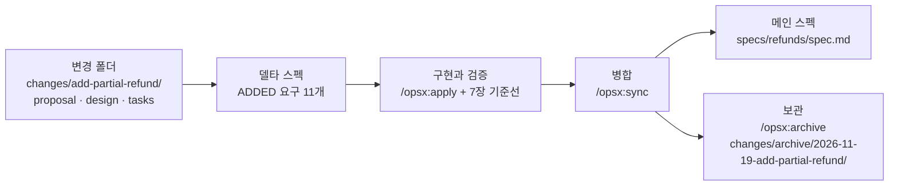
그림 1. 변경 폴더에서 아카이브까지. 델타는 메인 스펙에 병합되고, 변경 폴더는 감사 기록으로 보관된다

부분 환불은 모든 요구가 ADDED였으니 병합 결과는 단순하다. `openspec/specs/refunds/spec.md`가 새로 생기고, 델타의 Purpose와 요구 열한 개가 그대로 들어간다. 아래는 이 책 예제로 채운 그 메인 스펙의 앞부분 발췌다. 형식은 공식 문서의 메인 스펙 예를 따라 적었다. 새 능력의 제목 줄은 sync 스킬과 `openspec archive`가 모두 능력 폴더 이름을 그대로 넣어 `# refunds Specification`으로 만든다(v1.17.0 소스 기준).

```markdown
# refunds Specification

## Purpose
배송을 마친 주문의 부분 환불. 요청 권한, 환불 기간, 수량, 금액 계산,
중복 요청, PG 실패, 환불 뒤 주문 상태, 환불 내역 조회를 다룬다.

## Requirements

### Requirement: 환불 요청 권한
The system SHALL 서점 관리자(`SHOP_ADMIN`)가 자기 서점에 있는 주문만 환불하게 한다.

#### Scenario: 다른 서점의 주문
- GIVEN 서점 X의 관리자와 서점 Y의 배송 완료 주문
- WHEN 관리자가 환불을 요청한다
- THEN 403을 응답하고 환불을 기록하지 않는다

(… 시나리오 하나 생략 …)

### Requirement: 환불 기간
The system SHALL `delivered_at`부터 168시간 이내의 환불 요청만 받는다.

(… 시나리오 셋과 요구 아홉 개가 이어진다 …)
```

이 순간이 2장에서 본 스펙의 수명 가운데 스펙 고정형(spec-anchored)으로 넘어가는 지점이다. 6장의 `SPEC.md`는 변경이 끝나면 할 일을 다 한 스펙 우선형 문서였다. 이제 부분 환불의 현재 동작은 `specs/refunds/spec.md`에 살아 있고, 그 동작이 생겨난 경위는 지우지 않는 아카이브 폴더가 기억한다.

## 두 번째 변경: 환불 기간을 늘리고 사유를 코드로

### MODIFIED, ADDED, REMOVED

석 달이 지났다. 운영팀이 정리한 요청은 둘이다. 환불 기간을 7일에서 14일로 늘린다. 그리고 자유 입력 사유를 정해진 사유 코드로 바꾸되, 목록에 없는 사유는 "기타"와 메모로 받는다. 이번에는 `SPEC.md`를 새로 쓰지 않는다. `/opsx:propose extend-refund-window`로 변경을 만들고, 델타 스펙에 바뀌는 부분만 적는다. 아래는 이 책 예제로 채운 델타다.

```markdown
# Delta for Refunds

## MODIFIED Requirements

### Requirement: 환불 기간
The system SHALL `delivered_at`부터 336시간 이내의 환불 요청만 받는다.
(Previously: 168시간)

#### Scenario: 경계 시각
- GIVEN `delivered_at`이 2026-11-02T10:00:00+09:00인 주문
- WHEN 2026-11-16T10:00:00+09:00에 환불을 요청한다
- THEN 환불이 접수된다

#### Scenario: 기간 경과
- GIVEN 같은 주문
- WHEN 2026-11-16T10:00:01+09:00에 환불을 요청한다
- THEN 422 `REFUND_WINDOW_EXPIRED`를 응답한다

#### Scenario: 배송 전 주문
- GIVEN `delivered_at`이 없는 주문
- WHEN 환불을 요청한다
- THEN 422 `REFUND_WINDOW_EXPIRED`를 응답한다

## ADDED Requirements

### Requirement: 환불 사유 코드
The system SHALL 환불 요청마다 사유 코드(`reasonCode`) `CHANGE_OF_MIND`, `DAMAGED`, `WRONG_ITEM`, `OTHER` 가운데 하나를 받아 기록한다.

#### Scenario: 파손 환불
- WHEN 사유 코드 `DAMAGED`로 환불한다
- THEN 환불 내역에 `DAMAGED`가 남는다

#### Scenario: 목록에 없는 코드
- WHEN 사유 코드 `LATE_DELIVERY`로 환불을 요청한다
- THEN 기존 요청 형식 오류와 같은 400을 응답한다

### Requirement: 기타 사유 메모
The system SHALL 사유 코드가 `OTHER`일 때만 메모(`memo`)를 받는다.

#### Scenario: OTHER와 메모
- WHEN 사유 코드 `OTHER`, 메모 "선물이 겹침"으로 환불한다
- THEN 환불 내역에 코드와 메모가 함께 남는다

#### Scenario: OTHER가 아닌 코드에 메모
- WHEN 사유 코드 `DAMAGED`에 메모를 붙여 요청한다
- THEN 400을 응답한다

## REMOVED Requirements

### Requirement: 환불 사유
(사유 코드로 대체한다. 자유 입력은 사유 코드 `OTHER`의 메모로만 남는다.)
```

세 절이 모두 쓰였다. 환불 기간은 바뀐 동작이라 `## MODIFIED Requirements`에 들어갔고, 요구 문장 아래에 `(Previously: 168시간)`을 남겼다. 사유 코드와 기타 메모는 새 동작이라 `## ADDED Requirements`다. 자유 입력 사유는 없어지는 동작이라 `## REMOVED Requirements`에 이름만 적고 대체 사유를 괄호로 달았다. 이 이름은 첫 번째 변경의 요구 이름 "환불 사유"와 글자 하나까지 같아야 한다. 메인 스펙에서 지울 요구를 이름으로 가리키기 때문이다(추론).

RENAMED 절은 쓰지 말자. `/opsx:sync` 설명은 RENAMED도 해석한다고 적지만 델타 형식을 설명하는 concepts 문서의 표에는 없다. 문서끼리 어긋나는 지점이니, 이름을 바꿔야 하면 REMOVED와 ADDED로 나눠 적는 편이 안전하다.

눈치챘겠지만 이 변경에는 의도가 둘이다. "변경 하나 = 의도 하나"라는 기준에 비추면 두 변경으로 나누는 편이 낫다. 같은 정책 개정에서 나와 같은 날 배포하는 데다, 세 절을 한 델타에서 보여 주려는 이 장의 사정도 있어 여기서는 묶었다. 실제 저장소라면 `extend-refund-window`와 `add-refund-reason-codes`로 나누는 쪽을 먼저 고려하자. 이미 쌓인 자유 입력 사유를 사유 코드 `OTHER`와 메모로 옮길지 같은 데이터 이전 결정은 이 변경의 `design.md`가 맡는다.

### MODIFIED는 통째로 갈아 끼운다

MODIFIED 절에서 가장 흔히 밟는 함정이 있다. 바뀐 숫자만 적고 싶어지는 것이다. 바뀐 것은 168이 336이 된 것뿐이니, 요구 문장 한 줄과 `(Previously: 168시간)`만 적으면 될 것 같다. 그런데 병합 규칙을 다시 보자. MODIFIED의 요구는 메인 스펙의 같은 이름 요구를 통째로 교체한다. 공식 문서도 전체 새 버전을 적어야 한다고 못 박는다.

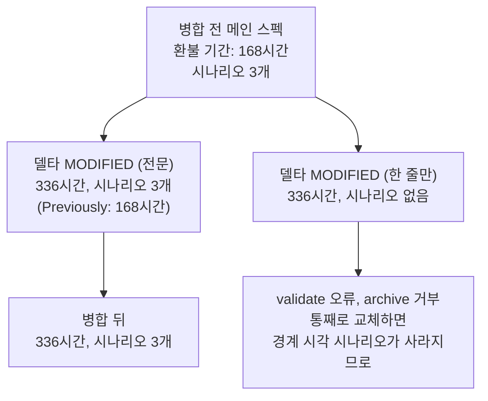
그림 2. MODIFIED 병합 전후. 요구가 통째로 교체되므로 시나리오까지 전문을 다시 적는다. 시나리오를 빠뜨린 MODIFIED는 v1.17.0의 validate와 archive가 막는다

그래서 위 델타의 MODIFIED에는 시나리오 셋을 모두 다시 적었다. 경계 시각은 11월 9일에서 16일로 바뀌었고, 값이 그대로인 배송 전 주문 시나리오도 함께 옮겼다. v1.17.0에서는 이 실수를 도구가 상당 부분 막아 준다. `validate`는 시나리오가 하나도 없는 ADDED·MODIFIED 요구를 오류로 보고, 메인 스펙에 있는 시나리오를 빠뜨린 MODIFIED 블록도 오류로 잡는다. `openspec archive`는 그런 변경의 병합을 거부한다. 다만 `/opsx:sync`는 에이전트가 수행하는 스킬이고, 스킬 지침은 델타에 언급되지 않은 시나리오를 보존하라고 적는다. 한 줄만 적은 MODIFIED를 `validate` 없이 sync하면 168시간 시절의 경계 시나리오가 336시간 요구 아래 그대로 남을 수 있다(추론). 그러니 습관을 하나 들이자. sync를 돌린 뒤 `git diff openspec/specs/`로 메인 스펙이 실제로 어떻게 바뀌었는지 읽는 것이다. 이번 변경이라면 diff는 길지 않다. 숫자 몇 개가 바뀌고, 요구 둘이 늘고, 하나가 줄어든다. 그 짧은 diff를 읽는 몇 분이 석 달 뒤의 드리프트를 막는다.

## 근거와 한계

OpenSpec을 고른 근거는 어디까지 믿어도 될까? 같은 티켓으로 도구를 잰 비교는 5장에서 본 Uvik 벤치마크(실행 2026-10-15) 하나다. OpenSpec 조건은 티켓 50개 가운데 42개를 병합해 84%였고, 스펙 없는 대조군 72%보다 12%p 높았다. 네 도구 가운데 잡음 대역 ±10%p를 벗어난 것은 OpenSpec 하나였다. 스펙 드리프트는 2.4%로 가장 낮았고, 스펙 단계 시간 중앙값은 12분, 스펙 길이 중앙값은 93줄로 가장 짧았다. 조건도 함께 옮기자. 서비스 회사가 자기 팀으로 돌렸고, 브라운필드 Python 티켓 50개에 모델은 claude-sonnet-5 하나였으며, OpenSpec 버전 번호는 기록되지 않았다. 공짜도 아니었다. 병합까지 시간 중앙값은 36분으로 대조군 29분보다 길었다.

Thoughtworks Technology Radar Vol 35(2026-11-04)는 OpenSpec을 Trial로 올리며 맨 프롬프트보다 예측 가능하고 의도치 않은 변경이 적다고 평했다. 단서도 달았다. 마크다운을 많이 만들고, 리빙 스펙을 유지하려면 규율이 필요하다.

실패 사례도 있다. .NET Razor Pages 화면 재설계에 OpenSpec을 쓴 한 개발자는 두 시간쯤 뒤 새 화면이 원래와 거의 같았고 평범한 `Instructions.md`가 더 빠르고 쌌다고 적었다(단일 실험). Talk Think Do는 2026년 6월 1일 사용을 중단했다. 저장소 안의 스펙 때문에 이해관계자가 범위와 비용 변화를 볼 수 없었다는 이유였고, 계획을 Claude Team과 Azure DevOps 작업 항목으로 옮기되 계획 규율은 지켰다. Spec Kit의 헌법 파일 같은 사전 거버넌스 장치가 약하다는 점도 기억해 두자(추론).

마지막은 표기다. v1.17.0의 공지는 짧다. "command files (`/opsx:*`) go away in OpenSpec 2.0." 스킬은 남는다. 미리 옮겨 가려면 `openspec config set delivery skills && openspec update`, 계획은 이슈 #2022에 있다. 예전 명령 `/openspec:proposal` 등도 아직 동작하지만 제조사는 OPSX 명령을 권한다. 원고가 나온 뒤 가장 먼저 바뀔 곳이니 공식 문서를 함께 확인하자.

> **다른 하네스에서는.** OpenSpec은 명령 파일을 설치하는 방식에 따라 표기가 달라진다. Claude Code와 Gemini CLI는 `/opsx:propose`, Cursor·Devin Desktop·Copilot(IDE)·Trae는 `/opsx-propose`, Codex CLI는 `$openspec-propose`로 부른다. 스킬만 쓰는 하네스(Zed Agent, 공유 `.agents` 등)는 `/openspec-propose`, `/openspec-apply-change` 같은 스킬 이름을 쓴다. Copilot CLI는 사용자 정의 프롬프트 파일을 지원하지 않아 `/opsx-*`가 IDE에서만 된다. 이 책이 문서에서 확인한 스킬 이름은 이 둘뿐이므로, 나머지 명령의 스킬 이름은 설치된 `.claude/skills/openspec-*/` 폴더 이름으로 확인하자(v1.17.0 저장소에서는 sync·verify 스킬 폴더가 `openspec-sync-specs`, `openspec-verify-change`다. 부록 B).

### 명령은 바뀌어도 남는 개념

| 명령 (Claude Code 표기) | 남는 개념 | 다른 도구의 대응물 |
|---|---|---|
| `/opsx:explore` | 변경을 정하기 전에 생각을 정리하는 탐색 | 6장 인터뷰, 플랜 모드, Superpowers `brainstorming` |
| `/opsx:propose` (`/openspec-propose`) | 변경 제안: 의도, 범위, 델타 스펙, 설계, 태스크를 한 묶음으로 | 6장 `SPEC.md`, Spec Kit `/speckit-specify`·`/speckit-plan`·`/speckit-tasks` |
| `openspec validate --strict` | 스펙 형식을 프로그램이 판정하는 검사 | 7장 결정적 검사. Spec Kit `/speckit-analyze`는 에이전트가 판정하는 읽기 전용 점검 |
| `/opsx:apply` (`/openspec-apply-change`) | 태스크 목록대로 구현 | 7장 새 세션 구현, Spec Kit `/speckit-implement`, Superpowers `executing-plans` |
| `/opsx:update` | 구현 중 바뀐 결정을 계획 산출물에 되돌려 맞추기 | 6장 결정 기록 갱신 |
| `/opsx:sync` | 변경분을 리빙 스펙에 병합 | 같은 단계가 드물다. Spec Kit은 완료 시점 수렴 검사(`/speckit-converge`)로 드리프트를 다룬다 |
| `/opsx:archive` | 변경을 닫고 감사 기록으로 보존 | 7장 PR 본문에 접어 넣은 계획 |

이 책 예제의 두 변경을 마친 뒤 `openspec/` 폴더는 이런 모습이다.

```text
openspec/
├── specs/
│   └── refunds/
│       └── spec.md                  # 지금의 동작: 336시간, 사유 코드, 요구 12개
├── changes/
│   └── archive/
│       ├── 2026-11-19-add-partial-refund/
│       │   ├── proposal.md          # 왜 부분 환불이 생겼나
│       │   ├── design.md
│       │   ├── tasks.md             # 모두 체크됨
│       │   └── specs/refunds/spec.md
│       └── 2027-02-18-extend-refund-window/
│           ├── proposal.md          # 왜 14일이 되었나
│           ├── design.md
│           ├── tasks.md
│           └── specs/refunds/spec.md   # MODIFIED · ADDED · REMOVED
└── config.yaml
```

이 트리는 두 가지를 따로 기억한다. 위쪽 `specs/refunds/spec.md`는 지금 이 시스템이 무엇을 하는지를 기억한다. 환불 기간은 336시간이고, 사유는 네 가지 코드 가운데 하나이며, 자유 입력은 기타 메모로만 남는다. 아래쪽 아카이브는 그 동작이 언제, 왜 그렇게 되었는지를 기억한다. 2026년 11월에 부분 환불이 들어왔고, 2027년 2월에 기간이 두 배가 되었으며, 그 이유는 각 폴더의 제안서에 한 문단으로 남아 있다. 6장의 `SPEC.md` 한 장으로는 둘 다 기억하기 어려웠다. 석 달 뒤 누군가 "환불 기간이 왜 14일이죠?"라고 물으면, 이제 대화 기록을 뒤질 필요 없이 이 트리를 열면 된다.

# 9장. Spec Kit으로 개발하기 — 헌법에서 converge까지

코드 689줄에 마크다운 2,577줄이 따라왔다. 2025년 11월, Scott Logic의 한 개발자가 Spec Kit으로 기능 하나의 첫 증분을 만들고 남긴 기록이다. 에이전트가 일한 시간은 33분 30초였다. 그런데 사람이 그 결과를 검토하는 데는 3.5시간이 걸렸고, 그중 plan 단계 문서 2,067줄을 읽는 데만 약 2시간이 들었다. 같은 저자가 Spec Kit 없이 잰 기준선은 에이전트 8분, 코드 1,000줄, 코드 검토 15분, 기능 테스트 9분이었다. 저자는 스펙 없이 하는 쪽이 약 10배 빠르다고 판정했다.

숫자를 받아 들기 전에 조건부터 보자. Spec Kit 1.0(2026-08-21)이 나오기 전 판이었고, Copilot과 Claude Sonnet 4.5 조합이었으며, 한 사람이 증분 두 개를 잰 결과다. 1.0 이후 같은 방식으로 다시 잰 기록은 아직 찾지 못했다. 2차 인용에 자주 보이는 "3.5시간 대 23분"이라는 비교도 쓰지 말자. 23분 30초는 두 번째 증분의 에이전트 시간이라서 첫 증분의 사람 검토 시간과 나란히 놓을 수 없는 값이다.

그래도 이 기록이 던지는 질문은 여전히 유효하다. 스펙 주도 개발(Spec-Driven Development, SDD) 도구 가운데 가장 많은 문서를 만드는 축에 선 Spec Kit은 그 문서 더미로 무엇을 사는가? 답은 직접 돌려 봐야 나온다. 8장에서 OpenSpec으로 다룬 부분 환불을 이번에는 Spec Kit 파이프라인에 처음부터 끝까지 태워 보자. 어느 문서가 일을 하고 어느 문서가 짐이 되는지는 그다음에 따져도 늦지 않다.

> 이 장은 Spec Kit v1.3.3/2026-11-09 기준이다. Spec Kit은 며칠 간격으로 새 판을 내므로 명령과 템플릿은 공식 저장소에서 함께 확인하자.

## 설치하고, 헌법부터

### 기존 저장소에 붙이기

Spec Kit을 쓰려면 Python 3.11 이상과 `uv`가 있어야 한다. CLI는 `specify-cli`라는 이름으로 설치한다. 책과 같은 판으로 따라 하려면 버전을 고정해 두는 편이 낫다.

```bash
# 판 고정 설치 (v1.3.3 릴리스 노트의 형식)
uv tool install specify-cli --from git+https://github.com/github/spec-kit.git@v1.3.3

# 이미 운영 중인 저장소에 Claude Code 통합만 붙인다
cd bookshop-orders
specify integration install claude
```

설치가 끝나면 Claude Code용 스킬이 `.claude/skills/speckit-<command>/SKILL.md`에 생긴다. 공식 문서는 명령을 `/speckit.specify`처럼 점으로 적지만, Claude Code 설치본에서 실제로 부르는 이름은 `/speckit-specify`다. 이 장은 설치본 표기를 쓴다.

설정 하나는 미리 생각해 두자. 기본값에서는 Spec Kit 스킬이 모두 모델 호출 가능 상태라서 스킬 설명이 늘 컨텍스트에 들어간다. 부분 환불 하나를 만드는 동안에도 명령 아홉 개의 설명이 계속 자리를 차지하는 셈이다. 새로 초기화할 때 아래 옵션을 주면 코어 스킬에 `disable-model-invocation: true`가 들어가서, 사람이 직접 부를 때만 실행된다. 기존 저장소에 `integration install`로 붙였다면 생성된 `SKILL.md` 머리말에 이 줄이 있는지 확인해 보자.

```bash
specify init my-project --integration claude --integration-options="--no-model-invocation"
```

기존 저장소에 붙일 때 제조사가 권하는 순서도 기억해 두자. 먼저 작업 중인 변경을 커밋하거나 stash한다. 첫 기능으로 기존 시스템 전체를 문서화하겠다고 나서지 말고, 범위가 정해진 작은 변경을 고른다. 헌법은 저장소가 이미 지키고 있는 규칙에서 출발한다. 부분 환불은 운영 중인 저장소에 엔드포인트 두 개와 테이블 두 개를 더하는 일이니 범위가 분명한 첫 기능으로 알맞다.

Spec Kit README는 진입점을 넷으로 나눈다. SDD, 버그 수정, 아이디어 평가, 직접 만든 프로세스다. 원문은 이 넷을 "independent entry points, not mandatory phases"라고 부른다. 아홉 개 명령을 매번 다 돌려야 하는 사슬로 볼 필요는 없다는 뜻이다. 여기서는 SDD 진입점을 끝까지 돌려 본 뒤, 장 끝에서 어느 단계를 건너뛸지 다시 고르겠다.

> **다른 하네스에서는**
> 단계는 같고 설치 위치와 호출 표기만 다르다. Codex CLI는 통합 키 `codex`로 `.agents/skills/speckit-<command>/SKILL.md`에 설치되고 `$speckit-specify`로 부른다. Cursor는 `cursor-agent` 키로 `.cursor/skills/`에, GitHub Copilot은 `copilot` 키로 `.github/skills/`에 설치되며 둘 다 `/speckit-specify`로 부른다. 여러 에이전트를 한 저장소에서 함께 쓰는 팀은 `--integration none`으로 시작하는 경로도 있다.

### 헌법 파일: 저장소가 이미 지키는 규칙에서

`/speckit-constitution`(문서 표기 `/speckit.constitution`)은 `.specify/memory/constitution.md`를 만들거나 고친다. 기능마다 새로 쓰지 않고, 모든 기능의 계획이 통과해야 할 프로젝트 원칙을 담는다. 1장의 구분으로 치면 스펙보다는 컨텍스트 파일 쪽에 가깝다.

템플릿 구조부터 정확히 짚자. 헌법에는 조항 9개가 들어간다는 설명이 종종 보인다. 실제 템플릿 파일이 만드는 칸은 원칙 다섯 개(`[PRINCIPLE_1_NAME]`부터 `[PRINCIPLE_5_NAME]`까지), 추가 절 두 개, 그리고 `## Governance`다. "아홉 조항"은 방법론 문서 `spec-driven.md`가 설명용으로 쓰는 틀이고, 그 문서조차 IV~VI 조항은 프로젝트가 정의한다고 적는다. 칸 수에 매이지 말고 우리 저장소의 규칙을 채우면 된다.

`bookshop-orders`가 이미 지키는 규칙은 무엇일까? 금액은 원 단위 정수로 다룬다. 공개 API는 하위 호환을 깨지 않는다. 마이그레이션은 되돌릴 수 있어야 한다. 모두 코드 리뷰에서 이미 여러 번 지적해 온 것들이다. 그것을 템플릿 칸에 옮긴 결과가 아래 헌법이다. 이 책 예제로 채운 예시이고, 도구가 생성한 출력이 아니다.

```markdown
<!-- .specify/memory/constitution.md — 이 책 예제로 채운 예시 -->
# bookshop-orders Constitution

## Core Principles

### I. 금액은 원 단위 정수
금액은 원 단위 `long`으로만 계산하고 저장한다. `double`·`float`로 금액을 다루지 않는다.
원 미만 처리 규칙은 기능 스펙이 정한다.

### II. 공개 API 하위 호환
기존 엔드포인트의 경로, 응답 필드, 상태 코드의 의미를 바꾸거나 지우지 않는다.
새 동작은 새 엔드포인트나 새 필드로만 더한다.

### III. Test-First (NON-NEGOTIABLE)
수용 시나리오마다 실패하는 테스트를 먼저 쓰고, 실패를 확인한 뒤 구현한다.
테스트 없이 들어온 프로덕션 코드는 병합하지 않는다.

### IV. 되돌릴 수 있는 마이그레이션
스키마 변경마다 되돌리기 스크립트를 함께 둔다.
같은 릴리스 안에서 운영 데이터를 지우는 마이그레이션은 만들지 않는다.

### V. 관측 가능성
외부 PG 경계를 넘는 호출은 주문 ID와 멱등 키를 구조화 로그로 남긴다.
로그에 카드 정보를 남기지 않는다.

## Security Requirements
`SHOP_ADMIN` API는 요청자의 서점과 대상 주문의 서점이 같은지 서비스 진입점에서 확인한다.
컨트롤러가 받은 주문 ID를 확인 없이 믿지 않는다.

## Development Workflow
스펙 변경과 코드 변경은 같은 PR에 담는다.
PG 연동 코드를 고친 PR은 사람 리뷰 없이 병합하지 않는다.

## Governance
헌법 개정은 PR로 제안하고, 개정 이유를 이 절 아래에 한 줄씩 남긴다.

**Version**: 1.0.0 | **Ratified**: 2026-11-10 | **Last Amended**: 2026-11-10
```

두 가지를 눈여겨보자. 첫째, 원칙 대부분이 "~하지 않는다"로 쓰여 있다. Spec Kit 사용기를 쓴 한 실무자는 헌법에 TDD를 강제하고 허용 규칙보다 금지 규칙을 쓰라고 권한다(velog, 2026-04-26, 개인 보고). 허용 규칙은 에이전트가 넓게 해석할 여지를 남기지만, 금지 규칙은 위반 여부가 diff에서 바로 드러난다.

둘째, 보안 절에 서점 일치 확인을 적었다. 6장 인터뷰가 인가를 따로 물었던 이유를 떠올려 보자. 기존 서비스에 기능 하나를 붙여 세 도구를 비교한 Ran the Builder 글(2026-04)에서는 계획 단계의 어떤 도구도 인가 누락을 짚지 못했다. 실무자 한 명의 관찰이지만, 인가는 기능마다 잊기 쉬운 규칙이라는 점만은 분명하다. 그런 규칙은 기능 스펙보다 헌법에 두는 편이 낫다. 한 번 적어 두면 모든 기능의 Constitution Check가 그 줄을 다시 읽게 되기 때문이다.

## 부분 환불을 기능 폴더로

### `/speckit-specify`: 사용자 스토리로 나눈 spec.md

이제 기능을 정의하자. `/speckit-specify`(문서 표기 `/speckit.specify`)에 몇 줄짜리 설명을 넘긴다. 6장에서 만든 `SPEC.md`가 이미 있다면 그 내용을 입력으로 줘도 된다. 여기서는 Spec Kit의 관문이 무엇을 잡아 주는지 보려고 일부러 설명을 짧게 줬다.

```text
/speckit-specify 서점 관리자가 배송 완료된 주문의 일부 항목을 수량 단위로 환불한다.
주문 쿠폰 할인은 항목 금액 비율로 나눠 환불액에서 뺀다. 같은 요청이 두 번 와도
환불은 한 번만 일어난다. PG 환불이 실패하면 아무것도 바뀌지 않고 다시 요청할 수 있다.
기존 전체 취소 API는 바꾸지 않는다. 배송비, 포인트, 고객 셀프 환불 화면, 교환은 범위 밖이다.
```

이 명령은 `specs/001-partial-refund/spec.md`와 `checklists/requirements.md`를 쓰고, 정해진 기능 폴더 경로를 `.specify/feature.json`의 `"feature_directory"`에 남긴다. 폴더 이름의 `001`은 기본 번호 방식인 세 자리 연번이고, 설정을 바꾸면 `YYYYMMDD-HHMMSS` 시각으로 붙일 수도 있다. git 브랜치는 따로다. v0.10.0부터 브랜치는 `before_specify` 훅이 있을 때만 만든다. 방법론 문서 `spec-driven.md`의 예시에는 아직 "브랜치를 만든다"고 적혀 있는데, 이것은 v0.10.0 이전 동작이니 헷갈리지 말자.

아래는 specify 직후, clarify를 돌리기 전의 `spec.md`다. 헤딩은 `spec-template.md` 원문 구조를 따르고 내용은 이 책 예제로 채웠다.

```markdown
# Feature Specification: 부분 환불

**Feature Branch**: `001-partial-refund`
**Created**: 2026-11-10
**Status**: Draft
**Input**: User description: "서점 관리자가 배송 완료된 주문의 일부 항목을 수량 단위로 환불한다. ..."

## User Scenarios & Testing *(mandatory)*

### User Story 1 - 부분 환불 요청 (Priority: P1)
서점 관리자는 배송이 끝난 주문에서 항목 일부를 수량 단위로 환불한다.

**Why this priority**: 지금은 배송 전 전체 취소만 있어서 배송 뒤 생긴 항목 하나의 문제를 이 서비스 안에서 처리할 수 없다.
**Independent Test**: 결제 40,800원 주문에서 책 B 1권을 환불 요청하고 응답 금액과 주문 상태만 확인하면 단독으로 검증된다.

**Acceptance Scenarios**:
1. **Given** 책 A 18,000원 × 1, 책 B 12,000원 × 2, 정률 쿠폰 10%, 배송비 3,000원으로 40,800원을 결제하고 배송이 끝난 주문, **When** 서점 관리자가 책 B 1권 환불을 요청하면, **Then** 10,800원이 환불되고 주문 상태는 `PARTIALLY_REFUNDED`가 된다.
2. **Given** 책 B 2권을 이미 모두 환불한 주문, **When** 책 B 1권 환불을 다시 요청하면, **Then** `409 REFUND_QUANTITY_EXCEEDED`로 거절되고 아무것도 바뀌지 않는다.
3. **Given** 배송 후 7일이 지난 주문 [NEEDS CLARIFICATION: 7일의 기준 시각 — 배송 완료 시각인가, 날짜 단위인가, 어느 시간대인가?], **When** 환불을 요청하면, **Then** `422 REFUND_WINDOW_EXPIRED`로 거절된다.
4. **Given** 다른 서점의 주문, **When** 서점 관리자가 환불을 요청하면, **Then** `403`으로 거절된다.

### User Story 2 - 쿠폰 할인 안분 (Priority: P2)
환불액에서 주문 쿠폰 할인의 해당 몫을 정확히 뺀다.

**Why this priority**: 금액이 1원이라도 틀리면 고객 분쟁과 정산 오류로 바로 이어진다.
**Independent Test**: 안분 계산만 떼어 금액 표와 대조하면 단독으로 검증된다.

**Acceptance Scenarios**:
1. **Given** User Story 1의 주문, **When** 전 항목을 차례로 환불하면, **Then** 환불액 합계는 37,800원(결제 금액 − 배송비)이다.
2. **Given** 같은 구성에 정액 쿠폰 3,000원이 적용된 주문, **When** 전 항목을 환불하면, **Then** 원 미만을 버려 생긴 1원 차액은 마지막으로 환불되는 항목에서 보정된다.

### User Story 3 - 환불 내역 조회 (Priority: P3)
서점 관리자는 주문의 환불 내역을 본다.

**Why this priority**: 운영 문의에 답하려면 필요하지만 환불 자체가 먼저다.
**Independent Test**: 환불 두 건이 있는 주문을 조회해 두 건의 금액과 상태를 확인한다.

**Acceptance Scenarios**:
1. **Given** 환불 두 건이 있는 주문, **When** `GET /orders/{orderId}/refunds`를 호출하면, **Then** 두 건이 생성 순서대로 금액, 상태와 함께 나온다.

### Edge Cases
- 같은 `Idempotency-Key`, 같은 본문으로 다시 요청하면 첫 결과를 그대로 돌려준다.
- 같은 키에 다른 본문이 오면 `422 IDEMPOTENCY_KEY_REUSED`로 거절한다.
- 키 보관 기간 [NEEDS CLARIFICATION: 키를 얼마나 보관하는가?]
- PG 환불 호출이 실패하면 환불은 `FAILED`, 주문 상태와 `refunded_quantity`는 그대로다.
- 배송 전 주문은 이 기능의 대상이 아니다. 기존 `POST /orders/{orderId}/cancel`을 쓴다.

## Requirements *(mandatory)*

### Functional Requirements
- **FR-001**: System MUST 서점 관리자(`SHOP_ADMIN`)가 자기 서점 주문에 대해서만 `POST /orders/{orderId}/refunds`로 항목·수량 단위 환불을 요청하게 한다.
- **FR-002**: System MUST 배송 후 7일이 지난 요청을 `422 REFUND_WINDOW_EXPIRED`로 거절한다. [NEEDS CLARIFICATION: 기준 시각]
- **FR-003**: System MUST 항목별 누계 환불 수량(`refunded_quantity`)이 주문 수량을 넘게 되는 요청을 `409 REFUND_QUANTITY_EXCEEDED`로 거절한다.
- **FR-004**: System MUST 주문 쿠폰 할인액을 항목 금액 비율로 나눠 환불액에서 빼고, 원 미만은 버리며, 남은 차액은 마지막으로 환불되는 항목에서 보정한다.
- **FR-005**: System MUST 같은 `Idempotency-Key` 재요청에 첫 결과를 그대로 돌려주고, 같은 키에 다른 본문이 오면 `422 IDEMPOTENCY_KEY_REUSED`로 거절한다.
- **FR-006**: System MUST PG 환불 호출이 실패하면 환불 상태를 `FAILED`로 남기고 주문 상태와 `refunded_quantity`를 바꾸지 않으며 `502 PAYMENT_GATEWAY_ERROR`를 돌려준다.
- **FR-007**: System MUST 일부 항목을 환불하면 주문 상태를 `PARTIALLY_REFUNDED`로, 전 항목을 환불하면 `REFUNDED`로 바꾼다.
- **FR-008**: System MUST 기존 전체 취소 API(배송 전, 전액)의 동작을 바꾸지 않는다.
- **FR-009**: System MUST `GET /orders/{orderId}/refunds`로 주문의 환불 내역을 돌려준다. 주문이 없으면 `404`다.

### Key Entities *(include if feature involves data)*
- **Refund**: 환불 한 건. 금액, 사유, 상태(`REQUESTED`, `COMPLETED`, `FAILED`), 고유한 멱등 키.
- **RefundItem**: 환불에 포함된 주문 항목, 수량, 항목별 환불액.
- **OrderItem**(기존): 누계 환불 수량 `refunded_quantity`를 새로 가진다.

## Success Criteria *(mandatory)*

### Measurable Outcomes
- **SC-001**: 전 항목을 환불한 모든 주문에서 환불액 합계가 결제 금액 − 배송비와 1원도 다르지 않다.
- **SC-002**: 같은 요청을 여러 번 보내도 환불은 한 번만 일어난다.
- **SC-003**: 서점 관리자는 운영팀 도움 없이 항목 1개 환불을 요청 한 번으로 끝낸다.

## Assumptions
- 배송비는 환불하지 않는다. 포인트·적립금, 고객 셀프 환불 화면, 복수 결제 수단, 교환은 범위 밖이다.
- 결제는 카드 단일 결제(외부 PG)뿐이다.
- 수용 시나리오마다 자동화 테스트를 요청한다.
```

템플릿이 무엇을 강제했는지 보자. 먼저 사용자 스토리마다 우선순위와 Independent Test를 요구한다. 그래서 US1만 떼어 내도 그 자체로 검증 가능한 최소 기능이 되도록 경계를 긋게 된다. 기능 요구는 EARS가 아니라 RFC 2119식 `MUST` 문장에 `FR-` 번호를 붙이고, 수용 기준은 Given/When/Then으로 쓴다. Success Criteria에는 "기술에 얽매이지 않고 측정 가능해야 한다"는 주석이 붙어 있어서 SC-001처럼 구현과 무관한 문장을 쓰게 된다.

가장 쓸모 있는 장치는 `[NEEDS CLARIFICATION: …]`이다. 템플릿은 모르는 값을 지어내지 말고 이 표시로 남기라고 지시한다. 위 스펙에는 기준 시각과 키 보관 기간 두 곳이 남았다. 6장 검사관 세션이 찾아낸 빈칸이 여기서는 처음부터 표시된 채 나온 셈이다.

반대로 템플릿에 없는 칸도 있다. 비목표 절이 따로 없어서 "안 만들 것"을 Assumptions에 넣었다. 마지막 줄 "수용 시나리오마다 자동화 테스트를 요청한다"가 왜 필요한지는 tasks 단계에서 드러난다.

### `/speckit-clarify`: 다섯 문항으로 빈칸 닫기

`/speckit-clarify`(문서 표기 `/speckit.clarify`, 예전 이름 `/quizme`)는 계획 전에 모호함을 푸는 선택 관문이다. 공식 설명은 현재 스펙의 덜 정해진 곳에 대해 "up to five targeted questions"를 묻는다고 하고, 명령 템플릿은 세션 전체에서 최대 다섯 문항으로 제한한다. 답은 `spec.md` 안에 `## Clarifications` 절과 `### Session YYYY-MM-DD` 소절로 쌓인다. 아래는 이 책 예제로 채운 세션 기록이다.

```markdown
## Clarifications

### Session 2026-11-10
- Q: "배송 후 7일"은 무엇을 기준으로 재나요? → A: 배송 완료 시각 `delivered_at`부터 168시간. 날짜 경계와 시간대는 따지지 않는다.
- Q: `Idempotency-Key`는 얼마나 보관하나요? → A: 24시간.
- Q: PG 실패 뒤 다시 요청할 때 같은 키를 써도 되나요? → A: 새 키로 요청한다. 같은 키는 첫 결과(`FAILED`)를 그대로 돌려준다.
- Q: 환불 내역 조회도 자기 서점 주문만 볼 수 있나요? → A: 그렇다. 다른 서점 주문은 `403`이다.
```

답이 기록되면 해당 요구 줄도 바뀌어야 한다. FR-002는 이렇게 고쳐진다.

```diff
- **FR-002**: System MUST 배송 후 7일이 지난 요청을 `422 REFUND_WINDOW_EXPIRED`로 거절한다. [NEEDS CLARIFICATION: 기준 시각]
+ **FR-002**: System MUST 배송 완료 시각(`delivered_at`)부터 168시간이 지난 요청을 `422 REFUND_WINDOW_EXPIRED`로 거절한다.
```

세 번째 문항을 다시 보자. 규칙 하나(같은 키는 첫 결과를 돌려준다)와 규칙 둘(PG가 실패하면 다시 요청할 수 있다)을 함께 읽으면, 재요청에는 새 키가 필요하다는 결론이 나온다. 두 규칙 모두 스펙에 있었지만 둘을 합친 결과는 어디에도 적혀 있지 않았다. 구현자가 같은 키로 재시도하는 클라이언트를 만들었다면 영원히 `FAILED`만 돌려받는 난감한 상황이 됐을 것이다. 명확화의 값은 이런 문장 사이의 틈에서 나온다.

그렇다면 6장 인터뷰와 무엇이 같고 무엇이 다를까? 질문을 받아 빈칸을 채우고 답을 파일에 남긴다는 점은 같다. 차이는 출발점과 상한이다. 6장 인터뷰는 빈 종이에서 출발해 질문을 수십 개까지 이어 갔고, clarify는 이미 쓴 스펙에서 출발해 다섯 문항 안에서 멈춘다. 그리고 공식 설명이 말하는 대상은 "underspecified areas", 즉 덜 정해진 곳이다.

이 예시를 채우면서 배송비 모순 같은 문장 간 충돌은 일부러 질문 목록에 넣지 않았다. clarify가 찾으라고 설계된 대상이 빈칸이기도 하고, 3장에서 봤듯 모델은 빈칸보다 모순을 훨씬 못 잡기 때문이다. 그러니 clarify가 끝난 `spec.md`에도 6장의 검사 질문 세 개를 사람이 한 번 돌리는 편이 낫다. 특히 "두 문장이 같은 상황에 다른 결과를 요구하는가"는 사람 몫으로 남겨 두자. clarify를 여러 번 반복하면 경계 사례, 정하지 않은 정책, 모호한 도메인 용어가 더 드러난다는 현장 보고도 있다(앞의 velog 글, 개인 보고). 다만 반복할수록 시간도 함께 든다는 점은 잊지 말자.

요구의 품질을 따로 점검하고 싶다면 `/speckit-checklist`도 있다. `checklists/` 아래에 요구 품질 점검표를 만드는 또 하나의 선택 관문이다.

### `/speckit-plan`과 `/speckit-tasks`: 관문이 붙은 계획

스펙이 정리되면 기술 계획으로 넘어간다. `/speckit-plan`에는 스택과 제약을 준다.

```text
/speckit-plan 기존 Spring Boot + PostgreSQL 저장소에 붙인다. 스키마는 마이그레이션 스크립트로 바꾸고,
PG 환불 호출은 기존 결제 클라이언트를 재사용한다. 헌법을 지킨다.
```

이 명령은 기능 폴더에 `plan.md`, `research.md`, `data-model.md`, `quickstart.md`, `contracts/`를 만든다. 핵심은 `plan.md`의 두 절이다.

```markdown
# Implementation Plan: 부분 환불

## Summary
서점 관리자용 부분 환불 API 두 개를 추가한다. 안분 계산과 환불 기간 판정은 순수 계산으로 떼고,
PG 환불 호출은 기존 결제 클라이언트를 재사용한다.

## Technical Context
**Language/Version**: Java 21
**Primary Dependencies**: Spring Boot 3, 기존 PG 결제 클라이언트
**Storage**: PostgreSQL — `refunds`, `refund_items` 신설, `order_items.refunded_quantity` 추가
**Testing**: JUnit 5, 실제 PostgreSQL에 붙는 통합 테스트
**Target Platform**: 기존 `bookshop-orders` 서비스
**Project Type**: 웹 서비스(단일 백엔드)
**Performance Goals**: NEEDS CLARIFICATION
**Constraints**: 금액은 원 단위 `long`. 같은 주문에 동시 요청이 와도 수량 초과가 생기지 않는다
**Scale/Scope**: NEEDS CLARIFICATION

## Constitution Check
*GATE: Must pass before Phase 0 research. Re-check after Phase 1 design.*
- [x] I. 금액은 원 단위 정수 — 안분은 `long`, 버림 규칙은 FR-004
- [x] II. 공개 API 하위 호환 — 새 엔드포인트만 추가, 전체 취소는 FR-008로 고정
- [x] III. Test-First — 수용 시나리오별 테스트 태스크를 구현 태스크 앞에 둔다
- [x] IV. 되돌릴 수 있는 마이그레이션 — 테이블 생성과 열 추가마다 되돌리기 스크립트
- [ ] V. 관측 가능성 — PG 환불 호출의 로그 필드 미정 → research.md에서 정한다
- [x] Security — 서점 일치 확인을 서비스 진입점에 둔다
```

Technical Context의 항목마다 템플릿 기본값에는 "`or NEEDS CLARIFICATION`"이 붙어 있다. 모르는 값을 지어내지 말라는 자리 표시다. 위 계획에서는 성능 목표와 규모가 그 상태로 남았다. 이런 자리를 에이전트가 그럴듯한 숫자로 채우게 두면 아무도 합의한 적 없는 목표가 계획에 들어간다. 사람이 정하거나, 이번 기능에는 "목표 없음"이라고 적자.

Constitution Check는 계획 단계의 관문이다. 헌법 원칙을 한 줄씩 대조하고, 연구 단계 전에 통과해야 하며, 설계 뒤에 다시 확인한다. V번처럼 체크가 비면 그 공백이 `research.md`의 숙제가 된다. `contracts/`에는 환불 API 계약을 둔다. 아래는 요청 본문과 오류 응답만 발췌한 예시다.

```yaml
# specs/001-partial-refund/contracts/refunds.yaml — 이 책 예제로 채운 예시(발췌)
paths:
  /orders/{orderId}/refunds:
    post:
      parameters:
        - { name: orderId, in: path, required: true }
        - { name: Idempotency-Key, in: header, required: true }
      requestBody:
        content:
          application/json:
            schema:
              type: object
              required: [items, reason]
              properties:
                items:
                  type: array
                  items:
                    type: object
                    required: [orderItemId, quantity]
                    properties:
                      orderItemId: { type: integer }
                      quantity: { type: integer }
                reason: { type: string }
      responses:
        # 성공 응답은 발췌에서 뺐다
        '403': { description: 다른 서점의 주문 }
        '404': { description: 주문 없음 }
        '409': { description: REFUND_QUANTITY_EXCEEDED }
        '422': { description: REFUND_WINDOW_EXPIRED 또는 IDEMPOTENCY_KEY_REUSED }
        '502': { description: PAYMENT_GATEWAY_ERROR }
```

`quickstart.md`는 사람이 손으로 기능을 확인하는 절차를 담기에 알맞은 자리다. 7장의 결정적 검사 가운데 `curl`로 실제 호출하는 단계를 여기에 적어 두면 리뷰어도 같은 절차를 돌릴 수 있다.

`/speckit-tasks`는 계획을 `tasks.md`로 쪼갠다. 줄 형식은 `[ID] [P?] [Story] Description`이다. `[P]`는 다른 파일이라 의존 없이 병렬로 할 수 있다는 표시이고, `[US1]`은 사용자 스토리 번호다. 아래는 Phase 3 발췌다.

```markdown
## Phase 3: User Story 1 - 부분 환불 요청 (Priority: P1) 🎯 MVP

### Tests for User Story 1 (OPTIONAL - only if tests requested) ⚠️
- [ ] T010 [P] [US1] 책 B 1권 환불 → 10,800원, PARTIALLY_REFUNDED 수용 테스트 in src/test/java/com/bookshop/orders/refund/PartialRefundAcceptanceTest.java
- [ ] T011 [P] [US1] 누계 수량 초과 → 409 REFUND_QUANTITY_EXCEEDED 테스트 in src/test/java/com/bookshop/orders/refund/RefundQuantityTest.java
- [ ] T012 [P] [US1] delivered_at + 168시간 경과 → 422 REFUND_WINDOW_EXPIRED 테스트 in src/test/java/com/bookshop/orders/refund/RefundWindowPolicyTest.java
- [ ] T013 [P] [US1] 다른 서점 주문 → 403 테스트 in src/test/java/com/bookshop/orders/refund/RefundAuthorizationTest.java

### Implementation for User Story 1
- [ ] T014 [US1] refunds·refund_items 생성, order_items.refunded_quantity 추가 마이그레이션과 되돌리기 스크립트 in migrations/012_add_partial_refund.up.sql, .down.sql
- [ ] T015 [P] [US1] Refund, RefundItem 엔티티 in src/main/java/com/bookshop/orders/refund/
- [ ] T016 [P] [US1] RefundWindowPolicy(delivered_at부터 168시간) in src/main/java/com/bookshop/orders/refund/RefundWindowPolicy.java
- [ ] T017 [US1] RefundService.requestRefund — 서점 일치, 기간, 수량 확인 뒤 PG 환불 호출 in src/main/java/com/bookshop/orders/refund/RefundService.java
- [ ] T018 [US1] POST /orders/{orderId}/refunds 컨트롤러 in src/main/java/com/bookshop/orders/refund/RefundController.java

**Checkpoint**: At this point, User Story 1 should be fully functional and testable independently
```

테스트 소절 제목의 "OPTIONAL"이 보이는가? tasks 템플릿의 정책은 "Tests are OPTIONAL - only include them if explicitly requested in the feature specification"이다. 헌법은 Test-First를 양보할 수 없는 원칙이라고 적었는데, 태스크 템플릿은 스펙이 요청하지 않으면 테스트를 빼도 된다고 말한다. 두 문서가 서로 다른 기본값을 가진 셈이다. 이 긴장을 푸는 가장 단순한 방법이 앞서 `spec.md`의 Assumptions에 넣은 한 줄이다. 스펙이 테스트를 명시적으로 요청하면 템플릿의 조건이 참이 된다. 그리고 implement로 넘어가기 전에, 테스트 태스크가 구현 태스크보다 앞에 있는지 눈으로 한 번 확인하자.

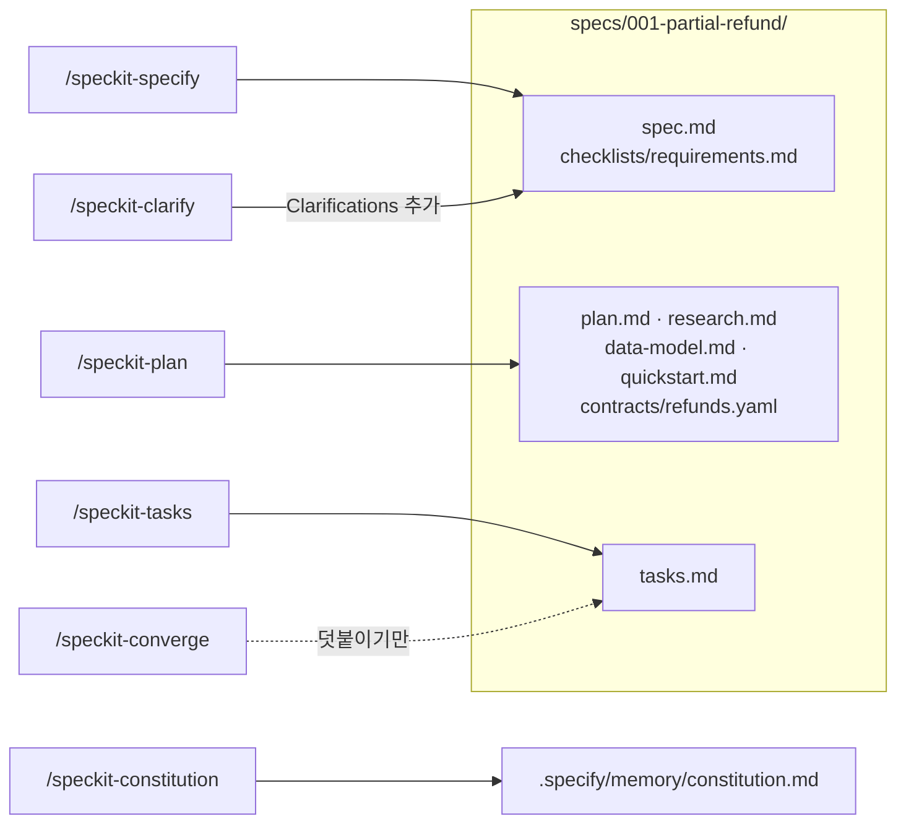

그림 1. 명령별 산출물과 `specs/001-partial-refund/` 기능 폴더

## 관문과 무게

### 관문을 밖으로 꺼내기: analyze, implement, converge

`/speckit-analyze`는 태스크를 만든 뒤, 구현하기 전에 산출물 사이의 정합성을 점검하는 선택 관문이다. 공식 설명은 이 명령이 "read-only"이고 파일을 고치지 않는다고 적는다. 부분 환불이라면 FR마다 대응하는 태스크가 있는지, `spec.md`의 오류 코드와 `contracts/`의 응답이 같은지, Constitution Check의 빈칸이 태스크로 이어졌는지를 살피게 하는 단계다.

다만 analyze의 깨끗한 결과를 너무 믿지는 말자. 이슈 #4164(2026-08-17)가 그 이유를 보여 준다. 에이전트는 spec, plan, tasks에서 비슷한 문구를 grep해 관련 작업을 찾는다. 그래서 요구 문구가 바뀌면 기존 요구를 못 찾고 새 줄을 더해, 같은 동작에 살아 있는 줄이 두 개가 된다. 그런데 analyze는 컨텍스트에 올라온 것만 보기 때문에 결과가 깨끗하게 나온다. 이슈 #4065(2026-08-12)는 다른 함정을 짚는다. `FR-###`, `T###`, `CHK###`가 연번이라 하나를 중간에 끼우면 뒤 번호가 다 밀리고, 다른 문서의 참조가 조용히 엉뚱한 항목을 가리킨다. 두 이슈의 제안은 2026-11 기준으로 채택되지 않았다.

피할 방법은 없을까? 이 책의 제안은 세 가지다. 번호는 중간에 끼우지 말고 끝에 덧붙인다. 요구를 고칠 때는 문구가 아니라 `FR-002` 같은 ID로 찾아 그 줄을 직접 고친다. 다른 문서에서 참조할 때는 ID 옆에 짧은 제목을 함께 적어, 번호가 밀려도 사람이 어긋남을 알아챌 수 있게 한다.

`/speckit-implement`는 `tasks.md`를 읽고 코드를 쓴다. 이슈 #737(2025-10-04)에는 구현 중에 질문을 던지면 답 대신 코드를 고쳐 버린다는 보고가 있다. 구현 도중 묻고 싶은 것이 생기면 질문 전용 모드나 별도 세션을 쓰는 편이 안전하다. 댓글에서는 Copilot의 Ask 모드가 처방으로 나왔다.

`/speckit-converge`는 구현을 산출물과 비교해 남은 일을 덧붙인다. 공식 설명은 이 명령이 "append-only"라고 한다. 코드를 고치거나 지우지 않고, 유일하게 쓸 수 있는 것은 `tasks.md`에 태스크를 더하는 일이다. 덧붙는 절은 아래 같은 모양이 된다(이 책 예제로 채운 예시).

```markdown
## Phase 6: Convergence
- [ ] T041 [US2] 정액 쿠폰 1원 차액 보정이 마지막으로 환불되는 항목이 아니라 첫 항목에 붙는다 — FR-004와 대조해 수정 in src/main/java/com/bookshop/orders/refund/RefundCalculator.java
```

README는 converge가 `Converged`를 보고할 때까지 implement와 converge를 반복하라고 한다. 구현이 스펙을 따랐는지 확인하는 루프가 없다는 2025년의 비판은 이 명령으로 부분적으로 해소됐다. "부분적으로"인 이유는 분명하다. `Converged`라는 판정을 내리는 것도 여전히 에이전트이기 때문이다.

7장의 기준선을 여기에 겹쳐 보자. 첫째, 수용 테스트는 사람이 소유한다. T010~T013의 테스트 코드를 implement 전에 사람이 읽고, "그 동작이 없으면 실패하는가"를 확인한다. 둘째, 결정적 검사를 돌린다. 테스트와 빌드에 더해 앱 부팅 스모크, `quickstart.md`의 `curl` 호출, 마이그레이션 적용과 되돌리기를 실행한다. 셋째, 대화를 보지 못한 서브에이전트에게 diff를 `spec.md`와 대조시키되 스타일은 건너뛰게 한다. converge의 `Converged`는 이 셋 가운데 하나를 대신하지 않는다. 그 판정은 판정자 목록에 이름 하나를 더할 뿐이다.

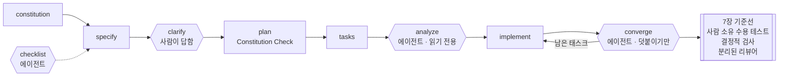

그림 2. 아홉 명령 사이의 품질 관문과 판정자. 만들기 전 관문은 clarify·checklist·analyze, 만든 뒤 관문은 converge다.

### 무게의 손익

이제 파일을 세어 보자. 부분 환불 하나로 기능 폴더에 생긴 파일은 `spec.md`, `checklists/requirements.md`, `plan.md`, `research.md`, `data-model.md`, `quickstart.md`, `contracts/refunds.yaml`, `tasks.md`로 여덟 개다. 여기에 저장소 전체에 하나뿐인 헌법 파일과 `.specify/feature.json`이 더해진다. 6장의 `SPEC.md`는 파일 하나였고, 8장의 OpenSpec 변경은 `proposal.md`, 델타 스펙, `design.md`, `tasks.md`로 네 개였다. Serverworks가 문서 기준으로 센 "Spec Kit 기능당 약 10개, OpenSpec 변경당 약 4개"와 거의 같은 비율이다. 그쪽 수치도 측정이 아니라 문서와 실무를 보고 센 값이라는 점은 함께 적어 두자.

길이도 비슷한 이야기를 한다. 같은 티켓으로 잰 Uvik 벤치마크(서비스 회사가 운영, 브라운필드 Python 티켓 50개, 모델 하나, 잡음 대역 ±10%p)에서 스펙 길이 중앙값은 Spec Kit 132줄, OpenSpec 93줄이었다. 스펙 단계 시간 중앙값은 각각 18분과 12분, 스펙 드리프트는 12.5%와 2.4%였다. 병합률은 Spec Kit 80%로 대조군 72%보다 8%p 높았지만 잡음 대역 안이었다.

현장 사례는 비용이 어디에 몰리는지 보여 준다. OrangeLoops(2026-05, NestJS와 React Native)는 태스크 195개를 만들었다. 백엔드 구현은 약 1시간 6분에 끝났는데, 테스트·버그 수정·시드·시니어 리뷰·안정화에 4일이 들었다. 생성된 클라이언트가 인증 토큰 헤더 동작을 옮기지 않아 권한 오류가 반복됐고, 에이전트가 시간 기록 파일을 덮어쓰는 바람에 "지표 기록은 에이전트가 편집하는 작업 공간 밖에 두라"는 교훈도 남았다. 모두 자기 보고다. 구현이 빨라진 만큼 검증이 뒤로 밀린 모양새가 찜찜할 만큼 7장의 경고와 닮았다.

2025년에 나온 Spec Kit 비판 가운데 무엇이 아직 유효한지도 정리해 두자. 항상 새 브랜치를 만든다는 비판은 v0.10.0에서, 버그에도 무거운 흐름을 강요한다는 비판은 버그 확장으로, 설치가 번거롭다는 비판은 `uv tool install`로 해결됐다. 여전히 유효한 것은 둘이다. 기능마다 파일이 많다는 것, 그리고 긴 마크다운을 사람이 검토해야 한다는 것이다. Thoughtworks Technology Radar Vol 35(2026-11)도 AI 기반 문서 난립을 Caution에 올리며 Spec Kit과 BMAD의 대량 마크다운을 지목했다.

무게를 덜어 내는 진입점도 있다. 버그라면 `specify extension add bug` 뒤 `/speckit-bug-assess` → `/speckit-bug-fix` → `/speckit-bug-test`로 가고, 판정은 `verified`, `partial`, `failed` 셋이다. 만들지 말지부터 고민되는 아이디어라면 평가 확장이 `go`, `needs-clarification`, `kill` 가운데 하나로 판정한다. 아홉 명령을 다 돌리지 않아도 된다는 README의 말은 이런 경로로 구체화돼 있다.

Radar는 Spec Kit을 두고 주로 브라운필드에서 쓰이며, 깔끔한 코딩·아키텍처 습관을 가진 경험 많은 엔지니어가 가장 큰 가치를 얻는다고 평했다. 문서가 많다는 것은 읽고 판단할 사람이 있어야 값을 한다는 뜻이기도 하다. 헌법을 실제 리뷰 기준으로 쓰는 팀, 사용자 스토리 우선순위를 놓고 합의해야 하는 팀이라면 그 문서 더미는 합의의 기록이 된다. 혼자 하는 작은 변경이라면 같은 더미가 검토해야 할 짐으로 돌아온다.

### 명령은 바뀌어도 남는 개념

| 명령 (Claude Code 설치본) | 남는 개념 | 다른 도구의 대응물 |
|---|---|---|
| `/speckit-constitution` | 프로젝트 원칙(상시 규칙) | 컨텍스트 파일(`CLAUDE.md`, `AGENTS.md`), Kiro 스티어링 |
| `/speckit-specify` | 요구 정의 | 6장 `SPEC.md`, OpenSpec 델타 스펙(`/opsx:propose`), Superpowers 설계 문서 |
| `/speckit-clarify` | 명확화(빈칸 닫기) | 6장 인터뷰, Superpowers `brainstorming`, Kiro Analyze Requirements |
| `/speckit-checklist` | 요구 품질 점검 | 6장 검사관 세션 |
| `/speckit-plan` | 기술 계획과 원칙 대조 | 플랜 모드 계획, OpenSpec `design.md`, Superpowers `writing-plans` |
| `/speckit-tasks` | 태스크 분해 | OpenSpec `tasks.md`, 계획 안 체크리스트 |
| `/speckit-analyze` | 구현 전 산출물 정합성 점검 | OpenSpec `openspec validate --strict`(형식 점검) |
| `/speckit-implement` | 구현 | `/opsx:apply`, Superpowers `subagent-driven-development` |
| `/speckit-converge` | 구현 뒤 수렴 점검 | OpenSpec `/opsx:verify`(확장 프로필), 7장 diff 대조 |

명령 이름은 판마다 바뀔 수 있다. 점 표기가 하이픈 표기로 바뀐 것처럼 말이다. 하지만 원칙, 요구, 명확화, 계획, 태스크, 정합성, 수렴이라는 일곱 개념은 다른 도구로 옮겨 가도 그대로 남는다.

그렇다면 이 무게는 언제 값을 할까? 부분 환불을 끝까지 돌려 본 손익을 세 줄로 남기자.

- **여러 사람이 합의해야 할 때.** `spec.md`의 우선순위와 Independent Test, `plan.md`의 Constitution Check는 합의의 흔적을 파일로 남긴다. 혼자라면 그 흔적을 읽을 사람이 나 하나뿐이다.
- **사용자 스토리가 여럿일 때.** P1, P2, P3가 각자 독립적으로 테스트 가능할 만큼 크다면, 스토리 단위로 자른 태스크와 체크포인트가 일을 나눠 준다. 스토리가 하나뿐이라면 6장의 `SPEC.md` 한 장으로 충분하다.
- **헌법이 실제 규칙일 때.** 저장소가 이미 리뷰에서 지키는 규칙을 적었다면 Constitution Check는 기능마다 그 규칙을 다시 대조하는 관문이 된다. 아무도 읽지 않는 선언문이라면 컨텍스트만 차지하는 문서다.

세 줄 가운데 하나도 참이 아니라면 Spec Kit의 문서 더미는 2,577줄 쪽으로 기운다. 둘 이상이 참이라면 그 더미는 합의를 기록하는 장부가 된다.

# 10장. Superpowers로 개발하기 — 질문, 계획, TDD, 두 단계 리뷰

2025년 10월 5일, Jesse Vincent는 9월 한 달 동안 코딩 에이전트를 어떻게 써 왔는지 블로그에 적었다. 그는 세션을 셋으로 나눴다. 첫 세션은 브레인스토밍이었다. 설계를 200~300단어짜리 절로 끊고 절마다 확인받았다. 에이전트는 끝났다고 판단하면 긴 글을 한꺼번에 쏟아 내고, 사람은 그런 글을 읽지 않게 된다는 관찰에서 나온 규칙이었다. 두 번째 설계자 세션은 계획을 리뷰하며 어긋난 곳을 표시했다. 세 번째 구현자 세션은 태스크를 서너 개씩 받아 계획에서 벗어나지 않고 구현했고, 컨텍스트가 차면 `/compact` 대신 `/clear`로 비웠다. 나흘 뒤인 10월 9일, 그는 Superpowers를 발표했다. 한 사람의 작업 습관이 스킬 묶음이 된 순간이다.

Vincent가 세션을 나누고 절마다 멈춘 이유를 생각해 보자. 문서를 더 많이 쓰고 싶어서였을까? 그보다는 에이전트가 너무 일찍 코드를 쓰기 시작하고, 사람이 그 속도를 따라 읽지 못하는 문제를 막으려는 쪽에 가깝다. 이 문제는 다른 실무자들도 겪었다. Boris Tane은 계획을 고쳐 달라고 할 때마다 끝에 `don't implement yet`을 붙였다. 그 한 줄이 없으면 에이전트가 계획이 충분하다고 판단하는 순간 코드를 쓰기 시작했기 때문이다. 계획을 읽고 있는데 저쪽에서 이미 파일이 바뀌고 있는 상황, 겪어 본 사람이라면 얼마나 난감한지 안다.

9장의 Spec Kit은 이 문제를 문서로 풀었다. 단계마다 파일을 남기고 사람이 다음 명령을 부를 때까지 기다리게 했다. 그 무게가 어디로 가는지도 함께 봤다. 그렇다면 문서를 늘리지 않고 막을 수는 없을까? 질문하고, 계획하고, 테스트부터 쓰고, 리뷰받는 순서 자체를 에이전트의 습관으로 만드는 길이 있다. Superpowers README는 자기 스킬을 "Mandatory workflows, not suggestions"라고 부른다. 스펙 주도 개발(Spec-Driven Development, SDD)을 문서가 아닌 습관으로 강제하는 도구가 부분 환불을 어떻게 다루는지 따라가 보자.

> 이 장은 Superpowers v7.0.2/2026-11-03 기준이다. v7.0.0(2026-10-10)에서 brainstorming이 다시 쓰였을 만큼 스킬 내용이 빠르게 바뀌므로, 따라 하기 전에 저장소의 SKILL.md를 함께 확인하자.

## 습관을 설치한다

### 설치와 자동 트리거

Claude Code에서는 공식 마켓플레이스나 Superpowers 마켓플레이스로 설치한다.

```bash
# Claude Code — 공식 마켓플레이스
/plugin install superpowers@claude-plugins-official

# 또는 Superpowers 마켓플레이스
/plugin marketplace add obra/superpowers-marketplace
/plugin install superpowers@superpowers-marketplace
```

설치하고 나면 슬래시 명령 목록이 늘어나지 않는다는 점이 먼저 눈에 띈다. Superpowers는 명령이 아니라 조건이 맞으면 스스로 켜지는 스킬 묶음이고, 저장소에는 `commands/` 디렉터리가 없다(2026-11-10 확인). README의 표현대로 에이전트는 작업을 시작하기 전에 관련 스킬이 있는지부터 확인한다. 필요하면 `/brainstorming`처럼 스킬 이름으로 직접 부를 수도 있다(v7.0.1 릴리스 노트).

스킬이 긴 세션에서도 잊히지 않는 구조도 알아 두자. 인프런 강의 "클로드 코드의 정석"의 설명에 따르면, SessionStart 훅이 세션 시작과 `/clear`, compact 뒤에 `using-superpowers` 스킬을 다시 넣는다. 5장에서 본 대로 플러그인의 훅은 셸 명령으로 실행되고, 권한 규칙과 샌드박스는 플러그인이 스스로 실행하는 코드를 덮지 않는다. 설치 전에 `hooks/hooks.json`을 직접 읽어 보는 것이 5장 점검표의 셋째 항목이었다. 이 플러그인이야말로 그 점검이 필요한 경우다.

두 가지를 더 챙기자. 브레인스토밍의 시각 도구는 버전을 알리는 로고를 불러오는데, 이 텔레메트리는 환경 변수 `SUPERPOWERS_DISABLE_TELEMETRY`로 끌 수 있다. 그리고 9장에서 Spec Kit을 같은 저장소에 설치했다면 이번 실습 동안에는 꺼 두자. SDD 플러그인을 둘 켜 두면 어느 쪽이 도왔는지 알 수 없고 비용만 늘어난다.

> **다른 하네스에서는**
> Cursor는 에이전트 채팅에서 `/add-plugin superpowers`. Codex CLI는 `/plugins`에서 superpowers를 검색해 Install Plugin. Gemini CLI는 `gemini extensions install https://github.com/obra/superpowers`. GitHub Copilot CLI는 `copilot plugin marketplace add obra/superpowers-marketplace` 뒤 `copilot plugin install superpowers@superpowers-marketplace`. 스킬 내용은 같지만 하네스마다 훅과 서브에이전트 지원이 달라서 이 장의 흐름이 똑같이 재현된다는 보장은 없다.

### brainstorming: 결과를 바꾸는 질문만

"부분 환불을 만들자"고 말을 꺼내면 `brainstorming`이 먼저 켜진다. 만들기 전에 발동해서 질문으로 의도와 이유를 끌어내고, 이해한 바를 되읽어 주는 스킬이다. 작은 변경이면 채팅에서 합의하고 끝내고, 프로젝트 규모면 설계 문서를 남긴다. 강의 설명에 따르면 이 스킬은 작업을 Spike, Bounded, Architecture로 나눠 다룬다.

v7.0.2에서 질문하는 방식이 달라졌다. 답이 결과를 바꿀 때만 묻는다. 사용자가 이유를 말하지 않았으면 이유부터 묻는다. 선택지가 있으면 추천과 함께 보여 준다. 제조사의 블라인드 채점 테스트에서 불필요한 질문이 41개(7.0.1)에서 23개로 줄었다고 한다. 제조사가 직접 잰 숫자라는 점은 기억해 두자.

6장의 인터뷰와 나란히 놓으면 성격 차이가 보인다. 6장은 빈 종이에서 시작해 질문을 수십 개까지 이어 가며 빈칸을 남김없이 끌어냈다. brainstorming은 결과를 바꾸는 질문만 남기려고 애쓴다. 그렇다면 부분 환불에서 결과를 바꾸는 질문은 무엇일까? 다른 서점 주문도 환불할 수 있는가. 7일은 어느 시각부터 재는가. 쿠폰 안분의 1원 차액은 어느 항목이 떠안는가. PG가 실패하면 무엇이 바뀌고 무엇이 그대로인가. 재요청에는 같은 멱등 키를 쓰는가. 반대로 클래스 이름이나 로그 문구는 답이 무엇이든 결과가 크게 달라지지 않는다. 이런 것은 빌더에게 남긴다.

질문에 답할 때도 요령이 있다. Vincent는 Superpowers를 내놓기 전부터 질문은 하나씩, 가능하면 객관식으로 받는 방식을 썼다. 선택지에 답하기만 하면 되니 대화가 빨라진다. 다만 추천 선택지를 그대로 고르기 전에 이유를 한 줄 덧붙이자. "배송 완료 시각부터 168시간, 운영팀이 이미 그 기준으로 고객에게 안내하고 있으니까"처럼 이유가 붙은 답은 설계 문서의 Intent and why 절로 그대로 옮겨 간다. 이유 없이 고른 답은 석 달 뒤 누구도 설명하지 못하는 결정이 된다.

질문이 줄어든 만큼 놓치는 것도 생길 수 있다. 특히 3장에서 본 대로 모델은 빈칸보다 모순을 훨씬 못 잡는다. 질문을 아끼는 스킬일수록 문장 사이의 충돌은 사람이 직접 보는 편이 낫다. 설계 문서가 나오면 6장의 검사 질문 세 개를 그대로 한 번 돌려 보자.

### 설계 문서: 의도와 경계를 한 장에

합의가 끝나면 설계 문서가 `docs/superpowers/specs/YYYY-MM-DD-<topic>-design.md`에 커밋된다(사용자가 다른 위치를 선호하면 그쪽이 우선이다). `brainstorming` SKILL.md가 설계 문서에 담으라고 하는 것은 의도와 이유, 목표·비목표·anti-goals, 제약, 접근법, 정한 how, 빌더에게 남긴 것이다. 아래는 이 목록을 절로 삼아 이 책 예제로 채운 예시다. 헤딩 이름은 SKILL.md가 고정한 것이 아니고 목록을 그대로 옮긴 것이다.

```markdown
<!-- docs/superpowers/specs/2026-11-10-partial-refund-design.md — 이 책 예제로 채운 예시 -->
# 부분 환불 설계

## Intent and why
서점 관리자(`SHOP_ADMIN`)가 배송 완료된 주문의 일부 항목을 수량 단위로 환불한다.
지금은 배송 전 전체 취소(`POST /orders/{orderId}/cancel`)만 있어서
배송 뒤 생긴 항목 하나의 문제를 이 서비스 안에서 처리할 방법이 없다.

## Goals
- `POST /orders/{orderId}/refunds`: 항목(`orderItemId`, `quantity`) 목록과 사유(`reason`), 헤더 `Idempotency-Key`
- `GET /orders/{orderId}/refunds`: 주문의 환불 내역
- 쿠폰 할인 안분이 반영된, 1원도 틀리지 않는 환불액
- 같은 요청이 여러 번 와도 환불은 한 번

## Non-goals
- 배송비 환불, 포인트·적립금, 고객 셀프 환불 화면, 복수 결제 수단, 교환

## Anti-goals (결과로 나타나면 실패인 것)
- 기존 전체 취소 API의 동작(배송 전만, 전액)이 바뀐다
- 다른 서점의 주문을 환불하거나 조회할 수 있다
- 금액 계산에 `double`·`float`가 끼어든다

## Constraints
- 기간: `delivered_at`부터 168시간 이내. 지나면 `422 REFUND_WINDOW_EXPIRED`
- 수량: 항목별 `refunded_quantity` ≤ 주문 수량. 넘으면 `409 REFUND_QUANTITY_EXCEEDED`
- 안분: 주문 쿠폰 할인액 × 항목 금액 ÷ 상품 합계, 원 미만 버림, 남은 차액은 마지막으로 환불되는 항목에서 보정
- 불변식: 전 항목을 환불하면 환불액 합계 = 결제 금액 − 배송비
- 멱등: 같은 키 재요청은 첫 결과 그대로, 같은 키·다른 본문은 `422 IDEMPOTENCY_KEY_REUSED`, 키 보관 24시간
- PG 실패: 환불 `FAILED`, 주문 상태·`refunded_quantity` 그대로, `502 PAYMENT_GATEWAY_ERROR`, 새 키로 재요청 가능
- 상태: 일부 환불 `PARTIALLY_REFUNDED`, 전부 환불 `REFUNDED` / 환불 `REQUESTED`, `COMPLETED`, `FAILED`
- 권한: 다른 서점 주문 `403`, 주문 없음 `404`
- 기준 숫자: A 18,000원 × 1, B 12,000원 × 2, 정률 쿠폰 10%, 배송비 3,000원 → 결제 40,800원,
  B 1권 환불 10,800원, 전 항목 합계 37,800원

## Approaches
1. 환불을 별도 테이블로 두고 주문 상태를 확장한다 (추천)
   — 환불 이력이 남고, 전체 취소 흐름을 건드리지 않는다.
2. 전체 취소 API에 "부분" 옵션을 더한다 (기각)
   — anti-goal 1을 깨뜨릴 위험이 가장 크다.
3. 주문 시점에 항목별 환불액을 미리 계산해 저장한다 (기각)
   — 차액 보정이 "마지막으로 환불되는 항목"에 달려 있어 미리 정할 수 없다.

## Decided how
- 새 테이블 `refunds`(id, order_id, amount, reason, status, idempotency_key 고유, created_at),
  `refund_items`(refund_id, order_item_id, quantity, amount), `order_items.refunded_quantity` 열 추가
- 안분 계산은 순수 계산 클래스 `RefundCalculator`로 떼어 금액 표로 테스트한다
- 기간 판정은 `Clock`을 주입받는 `RefundWindowPolicy`가 맡는다

## Left to the builder
- `refund` 패키지 안의 클래스 배치, 저장소 쿼리, 로그 문구
- 같은 주문의 동시 요청을 직렬화하는 방법. 단, 어떤 순서로 와도 수량 초과가 생기면 안 된다
```

6장의 `SPEC.md`와 비교하면 두 가지가 다르다. 하나는 anti-goals다. 비목표가 "이번에 만들지 않을 것"이라면, 이 책은 anti-goals를 "결과로 나타나면 실패인 것"으로 채웠다. 전체 취소 동작이 바뀌는 것은 비목표 목록에 넣으면 어색하지만 anti-goal로는 정확하다. 다른 하나는 Approaches다. 기각한 대안과 그 이유가 남아 있으니, 나중에 누군가 "전체 취소에 옵션 하나 더하면 되지 않나?"라고 물을 때 답이 이미 문서에 있다.

이 문서를 한 번에 읽어 내려가지 말고 절 단위로 끊어 확인하자. Vincent가 설계를 200~300단어 절로 나눈 이유가 바로 여기에 있다. Constraints 절은 특히 한 줄씩 9장의 FR이나 6장의 규칙과 대조해 볼 만하다. 숫자 하나가 다르면 테스트도 다르게 써진다. 긴 설계를 끝까지 읽은 척하고 승인하는 것은 번거로움을 피하는 대가로 나중의 디버깅을 사는 일이다.

프로젝트 규모의 설계라면 v7.0.0부터 Builder check를 거친다. 새 서브에이전트가 빌더 입장에서 설계 문서를 읽는 단계다(이전의 spec-document reviewer를 대체했다). 이 서브에이전트는 설계를 만든 대화를 보지 못했다. 7장에서 세운 "대화를 못 본 리뷰어"와 같은 자리에 선다는 뜻이다. 결제 경계를 넘는 부분 환불이라면 거치는 편이 낫다.

## 계획하고 만든다

### worktree와 writing-plans: 시그니처까지만 정하는 계획

설계가 승인되면 `using-git-worktrees`가 새 브랜치로 격리된 작업 공간을 만들고, 거기서 테스트가 깨끗하게 통과하는 기준선을 확인한다. 이미 깨져 있는 테스트를 이번 변경 탓으로 오해하지 않게 해 주는 단계다.

다음은 `writing-plans`다. 계획은 `docs/superpowers/plans/YYYY-MM-DD-<feature-name>.md`에 쓰이고, 2~5분 단위 태스크로 쪼개진다. 계획 머리말에는 Goal, Architecture, Tech Stack, Spec(구현할 설계 문서 경로), 그리고 Global Constraints와 Review Focus 절이 온다. 태스크마다 Files, Interfaces, 그리고 다섯 단계의 체크박스가 붙는다.

여기서 하나를 바로잡고 가자. README는 아직 계획이 태스크마다 "complete code"를 담는다고 적지만, `writing-plans` SKILL.md(2026-09-25)의 기준은 다르다. 코드 단계에는 "the exact signature (name, parameters, return type), the file it lives in, and the specific values the spec pins"만 적고, 본문은 구현자가 쓴다. 코드 블록은 시그니처와 테스트만으로 정해지지 않는 알고리즘에만 둔다. 저장소 안에서 README와 스킬이 어긋나는 셈인데, 실제로 동작하는 것은 스킬이니 이 장은 SKILL.md를 기준으로 삼는다. 아래 계획도 그 기준대로 채운 예시다.

```markdown
<!-- docs/superpowers/plans/2026-11-10-partial-refund.md — 이 책 예제로 채운 예시(머리말과 Task 1~2) -->
# 부분 환불 Implementation Plan

> **For agentic workers:** REQUIRED SUB-SKILL: Use superpowers:subagent-driven-development (recommended) or superpowers:executing-plans to implement this plan task-by-task. ...

**Goal:** 서점 관리자가 배송 완료 주문의 일부 항목을 수량 단위로 환불하게 한다.
**Architecture:** 새 `refund` 패키지에 순수 계산(안분, 기간)과 서비스·컨트롤러를 둔다.
기존 주문·결제 코드는 상태 갱신과 PG 환불 호출 지점만 건드린다.
**Tech Stack:** Java, Spring Boot, PostgreSQL, JUnit 5
**Spec:** docs/superpowers/specs/2026-11-10-partial-refund-design.md

## Global Constraints
- 금액은 원 단위 `long`. `double`·`float` 금지
- 전체 취소(`POST /orders/{orderId}/cancel`)의 코드와 테스트는 수정하지 않는다
- 모든 태스크는 실패하는 테스트부터

## Review Focus
- 1원 차액 보정이 마지막으로 환불되는 항목에 붙는가
- 서점 일치 확인이 서비스 진입점에 있는가

### Task 1: RefundCalculator

**Files:**
- Create: `src/main/java/com/bookshop/orders/refund/RefundCalculator.java`
- Test: `src/test/java/com/bookshop/orders/refund/RefundCalculatorTest.java`

**Interfaces:**
- Consumes: 주문 항목 금액, 주문 쿠폰 할인액, 이미 환불된 항목·수량
- Produces: `long refundAmount(OrderSnapshot order, RefundRequest request)`

- [ ] **Step 1: Write the failing test** — 정률 10% 주문에서 B 1권 → 10,800원 / 전 항목 → 16,200 + 10,800 + 10,800 = 37,800원 /
      정액 3,000원 주문에서 A 1,285원, B 857원씩 → 합 2,999원, 마지막 환불 항목에서 1원 보정
- [ ] **Step 2: Run test to verify it fails** (Run: `./gradlew test --tests '*RefundCalculatorTest'` / Expected: FAIL)
- [ ] **Step 3: Implement `long refundAmount(OrderSnapshot order, RefundRequest request)` in `RefundCalculator.java`**
- [ ] **Step 4: Run test to verify it passes**
- [ ] **Step 5: Commit**

### Task 2: RefundWindowPolicy

**Files:**
- Create: `src/main/java/com/bookshop/orders/refund/RefundWindowPolicy.java`
- Test: `src/test/java/com/bookshop/orders/refund/RefundWindowPolicyTest.java`

**Interfaces:**
- Consumes: `java.time.Clock`(생성자 주입), 주문의 `delivered_at`
- Produces: `boolean isWithinWindow(Instant deliveredAt)`

- [ ] **Step 1: Write the failing test** — 경과 167시간 59분 → true / 정확히 168시간 → true / 168시간 1초 → false
- [ ] **Step 2: Run test to verify it fails** (Run: `./gradlew test --tests '*RefundWindowPolicyTest'` / Expected: FAIL)
- [ ] **Step 3: Implement `boolean isWithinWindow(Instant deliveredAt)` in `RefundWindowPolicy.java`**
- [ ] **Step 4: Run test to verify it passes**
- [ ] **Step 5: Commit**
```

Task 1의 Step 1을 다시 보자. 테스트가 확인할 금액이 전부 계획에 적혀 있다. 3장에서 "테스트가 확인할 이름·경로·인터페이스를 스펙에 적는다"고 했던 규칙이 계획 단계까지 내려온 모습이다. 구현자는 이 값들을 바꿀 수 없고, 바꿀 수 있는 것은 메서드 본문뿐이다.

Task 2에는 설계 문서에 없던 값이 하나 있다. 정확히 168시간은 안인가, 밖인가? 설계는 "168시간 이내"라고만 했다. 계획을 쓰다 이런 경계가 보이면 계획 안에서 슬쩍 정하지 말고 설계로 돌아가 정한 뒤 고정하는 편이 낫다. 여기서는 "이내"를 문자 그대로 읽어 정각은 허용하기로 하고, 그 결정을 설계 문서의 Constraints에도 한 줄 더한다고 하자. 시그니처와 고정 값만 적는 계획은 이런 빈칸을 드러내는 데 유리하다. 값을 못 박아야 테스트를 쓸 수 있으니, 못 박을 수 없는 곳이 저절로 보인다.

### 실행과 두 단계 리뷰

계획이 서면 실행 경로를 고른다. `subagent-driven-development`는 태스크마다 새 서브에이전트를 띄우고 태스크 사이에 리뷰를 넣는다. 가장 철저한 경로다. `executing-plans`는 현재 세션에서 인라인으로 실행하고 마지막에 브랜치 전체를 한 번 리뷰한다. README는 이쪽을 가장 저렴하다고 소개한다. 부분 환불처럼 금액과 인가가 걸린 기능이라면 태스크마다 리뷰하는 쪽이 어울린다.

두 경로의 차이는 리뷰 횟수만이 아니다. 태스크마다 새 서브에이전트가 뜬다는 것은 구현자의 컨텍스트가 태스크 하나 크기로 유지된다는 뜻이기도 하다. Vincent가 구현자 세션에서 `/compact` 대신 `/clear`를 쓰고 태스크를 서너 개씩만 맡긴 것과 같은 효과를 도구가 자동으로 만든다. 3부에서 본 세션 크기 경험칙을 사람이 따로 지키지 않아도 된다는 점에서, 이 경로의 비용에는 세션 관리의 수고를 덜어 주는 몫도 들어 있다.

각 태스크 안에서는 `test-driven-development`가 RED-GREEN-REFACTOR를 강제한다. 이 스킬은 테스트보다 먼저 쓴 코드를 지운다. 처음 보면 과격하게 느껴지지만, Tane이 매번 붙이던 `don't implement yet`을 스킬이 대신 지켜 주는 셈이다.

태스크 사이에는 `requesting-code-review`가 끼어든다. 계획과 대조한 리뷰 결과가 심각도별로 보고되고, Critical이 나오면 다음 태스크로 넘어가지 못한다. 두 단계 리뷰는 `subagent-driven-development` 경로에 붙어 있다. README는 이 스킬을 "two-stage review (spec compliance, then code quality)"라고 소개한다. v7.0.2의 SKILL.md에서는 태스크마다 띄우는 리뷰어 하나가 두 판정을 차례로 낸다. 먼저 스펙 준수를 보고, 그다음에 코드 품질을 본다.

순서가 왜 중요할까? 스펙을 어긴 코드의 품질부터 다듬으면 틀린 동작을 더 깔끔하게 만드는 데 시간을 쓰게 된다. 7장에서 옮긴 Claude Code 모범 사례의 경고도 같은 방향이다. 문제를 찾으라는 리뷰어는 늘 무언가를 찾아내고, 그걸 다 고치면 불필요한 추상화와 일어날 수 없는 경우의 테스트가 생긴다. 두 단계로 나누면 "스펙대로인가"라는 질문이 스타일 지적에 묻히지 않는다. 아래는 리뷰 결과를 읽을 때 이 책이 쓰는 점검 틀이다. 도구가 내는 보고 형식이 아니며, 실제 보고 형식은 `requesting-code-review` 스킬 원문에서 확인하자.

```text
[1단계 — 스펙 준수] 기준: docs/superpowers/specs/2026-11-10-partial-refund-design.md
  - Constraints 줄마다: 구현이 있는가? 그 값을 고정한 테스트가 있는가?
  - Anti-goals 줄마다: 그것을 깨뜨리는 변경이 diff에 있는가?
  - Global Constraints: 전체 취소 코드·테스트가 바뀌지 않았는가?
[2단계 — 코드 품질] 1단계가 통과한 뒤에만 읽는다
  - Critical은 다음 태스크로 넘어가기 전에 처리, 나머지는 기록하고 판단
```

모든 태스크가 끝나면 이름 그대로 완료를 주장하기 전에 확인하게 하는 `verification-before-completion`과, 마감 스킬 `finishing-a-development-branch`가 이어진다. 마감 스킬은 테스트를 확인하고, 병합·PR·보관·폐기 가운데 하나를 고르게 한 뒤 worktree를 정리한다.

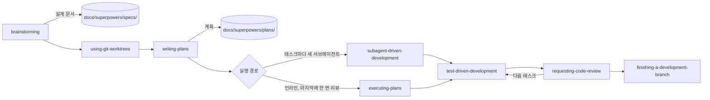

그림 1. Superpowers 기본 흐름 일곱 단계와 산출물 위치

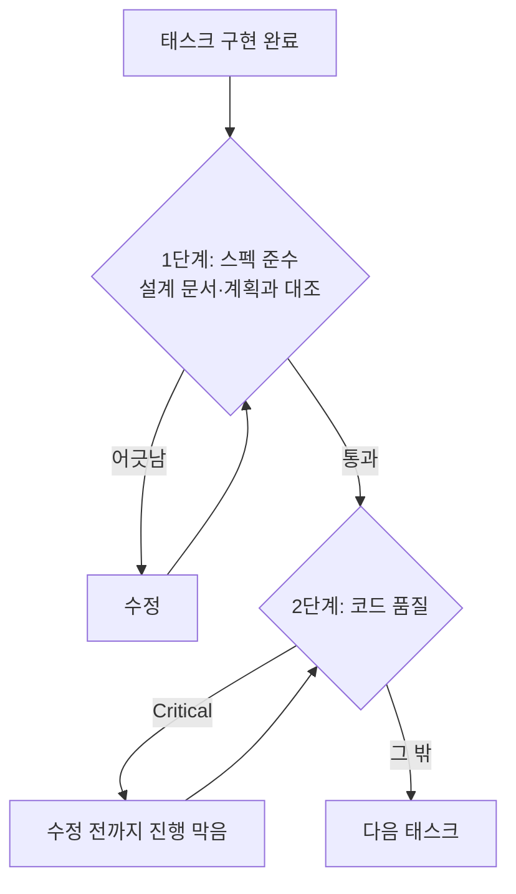

그림 2. `subagent-driven-development`의 태스크 리뷰가 보는 두 단계의 순서. 스펙 준수를 먼저, 코드 품질을 그다음에 본다.

## 습관이 보장하지 않는 것

### 관문을 밖으로 꺼내기

7장의 기준선에 Superpowers를 비춰 보자. 반가운 점이 먼저 있다. 리뷰어가 태스크마다 새로 뜨는 서브에이전트이고, Builder check도 설계를 만든 대화를 보지 못한 서브에이전트가 한다. 기준선의 셋째 항목인 "대화를 못 본 리뷰어"를 도구가 기본값으로 갖춘 셈이다. TDD 스킬 덕분에 테스트라는 결정적 검사도 태스크마다 돈다.

그런데 수용 테스트는 누가 쓰는가? Step 1의 실패 테스트를 쓰는 것은 구현을 맡은 서브에이전트다. 계획에 금액이 못 박혀 있어서 엉뚱한 값을 확인할 여지는 줄었지만, 테스트의 모양과 강도는 여전히 에이전트가 정한다. 7장에서 본 TestSuiteBench에서 최전선 에이전트가 쓴 테스트의 변이 점수는 60%에 못 미쳤다. 그러니 Task 1과 Task 2의 Step 1이 끝난 시점, 구현을 시작하기 전에 사람이 테스트를 한 번 읽자. "이 동작이 없으면 이 테스트가 실패하는가"만 확인하면 된다.

이때 기준으로 삼을 규칙이 하나 있다. 규제 환경에서 시스템 일부가 시작조차 못 하는데 테스트는 통과한 사례를 겪은 Netguru는 "테스트는 검증하는 동작이 없으면 실패해야 한다"는 규칙을 세웠다. Task 1의 테스트라면, 차액 보정 코드를 지웠을 때 정액 쿠폰 시나리오가 실제로 실패하는지 한 번 확인해 보면 된다.

단위 테스트 밖의 결정적 검사도 따로 챙겨야 한다. 앱 부팅 스모크, `curl`로 두 엔드포인트를 실제로 호출하기, 마이그레이션 적용과 되돌리기는 태스크 단위 TDD가 저절로 덮어 주지 않는다. 계획의 마지막 태스크로 넣거나 `finishing-a-development-branch` 전에 직접 돌리자. 7장의 사례처럼 타입 체크와 테스트가 모두 통과했는데 앱이 뜨지 않는 일은 이 흐름에서도 얼마든지 생길 수 있다.

병합한 뒤에는 어떻게 될까? 설계 문서와 계획은 `docs/superpowers/` 아래에 커밋된 채 남는다. 하지만 Superpowers에는 그 문서를 다음 변경에 맞춰 갱신하는 장치가 없다. 리빙 스펙이 없으니 2장의 분류로는 스펙 우선형이다. 석 달 뒤 환불 기간을 336시간으로 늘리는 변경이 오면, `2026-11-10-partial-refund-design.md`에는 여전히 168시간이 적혀 있을 것이다. 8장의 OpenSpec이 아카이브로 메인 스펙을 갱신한 것과 대조적이다. 새 설계 문서를 쓸 때 옛 문서 첫 줄에 "이후 변경: …-design.md"라고 한 줄 남겨 두면, 낡은 문서를 진실로 믿는 사고는 막을 수 있다. 이 문서를 아예 PR 기록으로만 볼지는 12장에서 다시 묻겠다.

### 근거와 한계, 어울리는 자리

정직하게 말하면 Superpowers의 효과를 다른 방법과 같은 과제로 잰 독립 측정은 없다. Uvik 벤치마크는 문서 계열 도구 넷과 대조군만 쟀고, 5장의 비교 매트릭스에서도 Superpowers의 효과 근거는 주장 수준이었다. 손에 쥔 숫자는 brainstorming의 불필요한 질문 41개 → 23개라는 제조사 측정 하나다. Superpowers와 GSD가 대체로 토큰을 더 쓴다는 HN 댓글도 있지만 이것 역시 사용자 주장이다. 가벼운 방법이 더 낫다는 결론도, 더 못하다는 결론도 지금 근거로는 낼 수 없다.

대신 구조상의 강점은 분명하다. 문서 1차 출처를 기준으로 검증 강도를 매긴 비교에서 기본값이 높게 나온 두 도구 가운데 하나가 Superpowers였다. TDD와 리뷰를 워크플로 안에 넣었기 때문이다. 한국 강의도 이 점을 짚는다. 인프런 "Claude Code 실전 업무 자동화"의 강사는 플랜 모드가 모호함을 스스로 채우고 바로 구현하는 데 비해 Superpowers는 되묻고 대안을 검토하고 검증 가드레일을 세운다며 초보자에게 권한다. 강사 의견이지만 이 장에서 따라온 흐름과 들어맞는다.

어울리는 자리를 정리해 보자. 혼자 하는 중간 크기 기능, 그리고 TDD 습관을 몸에 붙이고 싶을 때다. 작은 변경은 brainstorming이 채팅 합의로 끝내 주니 생각보다 가볍다. 반대로 여러 사람이 오래 참조할 리빙 스펙이 필요하다면 이 도구만으로는 모자란다. 토큰 한도가 빠듯한 환경이라면 `executing-plans` 쪽을 고르거나 사용량을 먼저 재 보자.

### 명령은 바뀌어도 남는 개념

| 스킬 | 남는 개념 | 다른 도구의 대응물 |
|---|---|---|
| `brainstorming` | 명확화와 의도 합의 | 6장 인터뷰, `/speckit-clarify`, `/opsx:explore` |
| 설계 문서(`docs/superpowers/specs/`) | 스펙 | 6장 `SPEC.md`, Spec Kit `spec.md`, OpenSpec 델타 스펙 |
| `using-git-worktrees` | 격리된 작업 공간과 깨끗한 기준선 | Spec Kit `before_specify` 훅의 브랜치 생성 |
| `writing-plans` | 계획과 태스크 분해 | `/speckit-plan`·`/speckit-tasks`, OpenSpec `tasks.md`, 플랜 모드 계획 |
| `subagent-driven-development` / `executing-plans` | 구현과 분리된 리뷰(두 단계 리뷰는 앞쪽) | `/speckit-implement`, `/opsx:apply`, 7장 서브에이전트 diff 대조 |
| `test-driven-development` | 테스트 우선 | Spec Kit 헌법의 Test-First 원칙 |
| `requesting-code-review` | 태스크 사이 리뷰, 심각도별 보고 | 7장 서브에이전트 diff 대조 |
| `finishing-a-development-branch` | 마감과 정리 | `/opsx:archive`, `/speckit-converge` |

스킬 이름은 판마다 바뀔 수 있다. v7.0.0에서 spec-document reviewer가 Builder check로 바뀐 것처럼 말이다. 그래도 질문, 설계, 계획, 테스트 우선, 분리된 리뷰, 마감이라는 순서는 다른 도구에서도 그대로 찾을 수 있다.

이제 실험을 하나 제안한다. 다음 중간 크기 변경 하나는 Superpowers로, 그다음 변경은 6장의 `SPEC.md` 방식으로 해 보자. 그리고 세 가지만 적어 두자. 에이전트에게 다시 지시한 횟수, 첫 리뷰에서 그대로 받아들였는지, 스펙과 설계에 쓴 시간이다. 두 변경이 끝나면 어느 쪽이 내 저장소에서 값을 했는지 감이 아니라 기록으로 말할 수 있다. 그 기록이 몇 줄 쌓이면, 습관을 강제하는 도구와 문서를 남기는 도구 사이의 선택은 남의 평가가 아닌 내 숫자의 문제가 된다.

# 11장. 언제 SDD를 쓰지 않는가 — 같은 기능 네 벌, 그리고 변경마다 고르는 사다리

6장부터 10장까지 우리는 부분 환불을 네 번 스펙으로 썼다. 도구 없이 `SPEC.md` 한 장으로, OpenSpec의 변경 폴더로, Spec Kit의 기능 폴더로, Superpowers의 설계 문서와 계획으로. 이제 파일을 세어 보자.

세기 전에 질문 하나를 먼저 던져 두자. 네 벌을 다 써 본 지금, 내 다음 변경에는 무엇을 쓸 것인가? 그리고 무엇을 쓰지 않을 것인가? 스펙 주도 개발(Spec-Driven Development, SDD)을 배우는 책이 마지막 판단 장에서 "쓰지 않는 법"을 다루는 것이 이상하게 들릴 수 있다. 하지만 2장에서 세운 기조를 떠올려 보자. SDD는 모든 작업의 기본값이 아니고 큰 변경마다 고르는 선택지다. 고른다는 말에는 고르지 않을 수도 있다는 뜻이 함께 들어 있다.

## 같은 기능, 네 벌의 스펙

### 네 벌을 나란히

먼저 요구 하나를 골라 네 벌에서 같은 줄을 찾아보자. 환불 기간 규칙이다.

```markdown
<!-- ① 6장 SPEC.md — 6. 규칙 R2, 9. 결정 기록 D4 -->
- R2. If 요청 시각이 `delivered_at`부터 168시간을 넘으면, then the 주문 서비스
  shall `422 REFUND_WINDOW_EXPIRED`로 거절한다.
- D4 (검사 1회차) 환불 기간은 `delivered_at`부터 168시간이다. 날짜가 아니라 시각으로 비교하고, 168시간이 되는 시각까지 받는다.

<!-- ② 8장 OpenSpec — openspec/changes/add-partial-refund/specs/refunds/spec.md (발췌) -->
### Requirement: 환불 기간
The system SHALL `delivered_at`부터 168시간 이내의 환불 요청만 받는다.

#### Scenario: 경계 시각
- GIVEN `delivered_at`이 2026-11-02T10:00:00+09:00인 주문
- WHEN 2026-11-09T10:00:00+09:00에 환불을 요청한다
- THEN 환불이 접수된다

#### Scenario: 기간 경과
- GIVEN 같은 주문
- WHEN 2026-11-09T10:00:01+09:00에 환불을 요청한다
- THEN 422 `REFUND_WINDOW_EXPIRED`를 응답한다

<!-- ③ 9장 Spec Kit — specs/001-partial-refund/spec.md -->
- **FR-002**: System MUST 배송 완료 시각(`delivered_at`)부터 168시간이 지난 요청을 `422 REFUND_WINDOW_EXPIRED`로 거절한다.

<!-- ④ 10장 Superpowers — 설계 문서 Constraints, 계획 Task 2 -->
- 기간: `delivered_at`부터 168시간 이내. 지나면 `422 REFUND_WINDOW_EXPIRED`
- [ ] **Step 1: Write the failing test** — 경과 167시간 59분 → true / 정확히 168시간 → true / 168시간 1초 → false
```

내용은 네 벌 모두 같다. 기준 시각도, 시간 수도, 오류 코드도 같다. 다른 것은 그 결정이 사는 자리다. ①은 EARS 문형으로 실패 조건을 한 문장에 담고, "정확히 168시간은 안인가"라는 경계는 결정 기록 D4에 따로 남겼다. ②는 요구 한 문장에 시나리오를 붙였고, 같은 경계가 "경계 시각" 시나리오의 두 시각으로 굳었다. ③은 번호가 붙은 `MUST` 문장으로 다른 문서가 참조할 수 있게 했지만, 정각이 안인지 밖인지는 "지난"이라는 말에 맡겼다. ④는 그 경계를 계획 Task 2에서 테스트할 값으로 못 박았다. 시그니처와 고정 값을 요구하는 계획 형식이 경계를 드러낸 것이다. ③처럼 경계를 문장에 맡긴 스펙도 수용 테스트로 옮기는 순간 같은 질문을 만난다. 그 질문을 스펙 단계에서 만나느냐 테스트 단계에서 만나느냐의 차이다.

이제 기능 전체를 나란히 놓아 보자. 아래 표는 이 책의 예제 한 건을 네 방식으로 써 본 관찰이다. 같은 과제로 반복해 잰 측정이 아니다.

| 항목 | ① `SPEC.md` (6~7장) | ② OpenSpec (8장) | ③ Spec Kit (9장) | ④ Superpowers (10장) |
|---|---|---|---|---|
| 파일 수 | 1 (계획 파일은 따로) | 변경 폴더에 4 (`proposal.md`, 델타 스펙, `design.md`, `tasks.md`) | 기능 폴더에 8 + 헌법 1 | 2 (설계 문서, 계획) |
| 스펙 분량 (이 책 실물) | `SPEC.md` 132줄 | 델타 스펙 116줄 | `spec.md`만 76줄, 폴더 전체는 그 몇 배 | 설계 문서 50줄 남짓 + 태스크 수에 비례하는 계획 |
| 사람이 읽어야 하는 양 | 한 장 + diff | 네 파일 + diff | 여덟 파일, 그중 plan 단계가 가장 김 | 설계 + 계획 + 태스크마다 리뷰 보고 |
| 강제로 정하게 만든 결정 | 인터뷰가 묻는 만큼, 비목표·결정 기록 절 | 변경 의도 하나, Scope In/Out, 요구마다 시나리오 | 스토리 우선순위와 Independent Test, 측정 가능한 성공 기준, Technical Context, 헌법 대조 | anti-goals, 기각한 접근, 빌더에게 남길 것, 태스크마다 시그니처와 고정 값 |
| 함정을 잡은 곳 | 인가는 인터뷰 질문, 배송비 모순과 기준 시각 빈칸은 검사관 세션 | 6장 결과를 옮겨 와 해소된 채 시작, `validate --strict`는 형식만 점검 | 기준 시각·키 보관은 `[NEEDS CLARIFICATION]`과 clarify, 인가는 헌법 보안 절 | 결과를 바꾸는 질문과 Constraints, 168시간 정각 경계는 계획의 고정 값 |
| 관문 판정자 | 사람(검사 질문), 프로그램(테스트·부팅·`curl`), 분리된 서브에이전트 | 프로그램(`validate`, 형식), 에이전트(`/opsx:verify`, 확장 프로필) | 사람(clarify 답), 에이전트(analyze·converge) | 새 서브에이전트(두 단계 리뷰), 프로그램(TDD) |
| 병합 뒤 스펙 | PR에 첨부하거나 정리 — 스펙 우선형 | 아카이브로 메인 스펙에 병합 — 스펙 고정형 | 기능 폴더가 남지만 다음 기능이 갱신하지 않으면 낡음 — 스펙 우선형 | 설계 문서가 남지만 갱신 장치 없음 — 스펙 우선형 |
| 하네스 이식성 | 어디서나 (평범한 마크다운) | Claude Code·Cursor·Copilot(IDE)·Codex·Gemini·Kiro | 통합 키 43개 | Claude Code·Cursor·Copilot CLI·Codex·Gemini |

표에서 눈에 띄는 줄은 "함정을 잡은 곳"이다. 인가 누락과 문장 사이의 모순을 잡은 것은 네 벌 모두에서 결국 사람이었다. 인터뷰에서 사람이 질문에 답했고, 검사관 세션에서 사람이 충돌을 판정했고, 헌법에 사람이 보안 절을 적었다. 도구가 해 준 일은 그 질문을 던질 자리를 만들어 준 것이다. Ran the Builder의 비교(2026-04, 실무자 1명)에서 계획 단계의 어떤 도구도 인가 누락을 짚지 못했다는 관찰과도 맞아떨어진다.

"사람이 읽어야 하는 양" 줄도 그냥 넘기지 말자. 네 벌 가운데 무엇이 가장 좋으냐는 질문보다, 내가 이번 변경에 읽기 시간을 얼마나 낼 수 있느냐는 질문이 더 정직하다. 9장 첫머리의 Scott Logic 기록에서 에이전트 시간은 33분 30초였고 사람 검토는 3.5시간이었다. 문서가 많을수록 결정은 많이 남지만, 그 결정을 사람이 실제로 읽었을 때만 값이 생긴다. 읽지 않고 승인한 여덟 파일은 읽고 승인한 한 장보다 못하다.

"병합 뒤 스펙" 줄에서는 네 벌 가운데 셋이 스펙 우선형이라는 점이 보인다. 2장에서 대부분의 도구가 실제로는 스펙 우선형이라고 했던 관찰이 우리 예제에서도 그대로 나온 셈이다. 작업이 끝난 뒤에도 스펙을 코드와 함께 고치는 구조를 가진 것은 OpenSpec의 아카이브 하나였다. 그 스펙을 계속 둘지, PR과 함께 보낼지는 다음 장의 질문으로 남겨 두자.

마지막 줄인 하네스 이식성도 가볍게 보지 말자. 네 벌 가운데 어느 하네스에서도 그대로 읽히는 것은 ①뿐이다. 나머지 셋은 공식 지원 범위가 넓지만, 지원한다는 표시가 같은 기능을 보장하지는 않는다. cc-sdd README의 말처럼 스킬을 설치했다고 그 하네스가 전체 흐름을 돌릴 수 있다는 검증이 되지는 않는다. 2026년에만 하네스 종료와 개명 발표가 여러 건 있었다는 점까지 생각하면, 어떤 도구를 쓰든 결정의 원본은 평범한 마크다운으로 저장소에 남기는 편이 안전하다.

이 표를 다른 근거와 겹쳐 읽자. 같은 티켓으로 잰 Uvik 벤치마크(서비스 회사 운영, n=50, 모델 하나, 잡음 대역 ±10%p)에서 잡음 대역 밖으로 나간 도구는 OpenSpec(+12%p) 하나였고, 스펙 드리프트도 OpenSpec 2.4%, Spec Kit 12.5%였다. Superpowers와 플랜 모드 기반의 `SPEC.md` 경로는 그 비교에 아예 없었다. 이 책의 표는 측정이 비어 있는 자리를 관찰로 메울 뿐 순위를 대신하지 않는다. EARS 문형을 파이프라인 안에서 쓰고 싶다면 Kiro 흐름을 Claude Code와 Codex로 옮긴 cc-sdd라는 경로도 있다는 점만 덧붙여 둔다.

## 변경마다 고르는 사다리

### 다섯 번째 선택지: 스펙을 쓰지 않기

네 벌 옆에 다섯 번째 선택지를 놓자. 아무 스펙도 쓰지 않는 것이다. 언제 그래야 할까? 2장과 6장에서 맛본 스펙 적합성 점수가 첫 갈림길이다. 여섯 조건 가운데 참인 것을 센다.

| 번호 | 조건 |
|---|---|
| 1 | 파일 3개 이상을 건드린다 |
| 2 | 수용 기준이 4개 이상이다 |
| 3 | 모듈, 서비스, 저장소 경계를 넘는다 |
| 4 | 스키마나 공개 API를 바꾼다 |
| 5 | 여러 엔지니어나 여러 에이전트가 참여한다 |
| 6 | 규제나 감사 대상이다 |

조건마다 이유가 있다. 파일 수와 경계는 에이전트가 한 번에 머리에 담아야 할 범위를, 수용 기준 수는 빠뜨리기 쉬운 동작의 수를 말한다. 스키마와 공개 API는 되돌리기 비싼 결정이고, 여러 사람과 규제는 결정이 내 머릿속 밖에서도 읽혀야 한다는 뜻이다. 요컨대 점수는 "이 변경에서 추측으로 채워질 빈칸이 몇 개나 될까"를 어림하는 도구다.

Uvik 규칙은 셋 이상이면 스펙을 쓰라고 한다. 0~1점이거나 운영 핫픽스·오타라면 R0, 2점이면 R1, 3점 이상이면 구현 경로가 얼마나 분명한지를 다시 묻는다. 부분 환불은 1~4번이 참이라 4점이었다. 한 가지 주의할 구간이 있다. 2점짜리 변경을 R1로 보내는 규칙은 참고 보고서의 추론이고, 이 구간을 시험한 출처는 없다. 에이전트가 내가 보기 전에 엉뚱한 길로 간 적이 있는 종류의 변경이라면 1점이어도 R1로 올려 보는 식으로, 이 구간은 처음부터 내 기록으로 고쳐 쓰겠다고 생각하는 편이 낫다.

점수가 첫 갈림길이라면, 그다음은 사다리다. 표 맨 아래의 바닥층은 따로 오르는 단이라기보다 모든 단 밑에 깔리는 층이다. 같은 교정을 두 번 입력했다면 R0 변경을 하는 중에도 컨텍스트 파일에 한 줄을 더할 때다. 이 층을 어떻게 짧게 유지할지는 12장에서 다시 본다. 참고 보고서는 변경 크기에 따라 바닥층과 R0~R5의 단을 두고, 단마다 올라갈 신호와 머무는 동안 할 일, 내려올 신호를 적었다.

| 단 | 이름 | 진입 신호 | 머무는 동안 할 일 | 내리는 신호 |
|---|---|---|---|---|
| 바닥 | 짧은 컨텍스트 파일 | 같은 교정을 두 번 입력함 | 에이전트가 추론할 수 없는 비표준 사실만 | 약 150줄을 넘음 |
| R0 | 프롬프트와 검사 | 오타, 한 줄 수정, 핫픽스 | 수용 기준 1~2문장 + 변경을 증명할 명령 하나 | 없음 |
| R1 | 플랜 모드 | 점수 2점 | 계획 전에 질문받기, 이름·경로·경계 사례를 직접 확인 | R0에서 잘 병합되던 변경에 시간만 더함 |
| R2 | 한 파일 스펙 | 3점 이상, 경로가 대체로 분명, 계획이 세션 사이에 사라짐 | 인터뷰 → `SPEC.md` → 새 세션 → diff 대조 | 스펙이 diff보다 길어짐 |
| R3 | 변경 범위 프레임워크 | R2가 관문을 통과했고 여러 사람·세션·에이전트 | 변경 모양에 맞는 프레임워크 하나만 | 마크다운 리뷰가 코드 리뷰보다 길고 수용률 그대로 |
| R4 | 리빙 스펙 | 결정이 세션이나 사람보다 오래 살아야 함 | 시스템 전체가 아니라 모듈 하나, 소유자와 보관 계획 | 스펙 리뷰가 팀을 막음 |
| R5 | 실행 가능한 검사 | 수용 기준 반복, 규제, 믿을 수 없는 "완료" | 그 동작이 없으면 실패하는 검사를 에이전트 밖에 | 동작이 틀렸는데 검사가 통과, 유지 비용이 잡은 결함보다 큼 |

여기서 꼭 짚어 둘 것이 있다. 이 표의 모든 문턱값은 보고서가 정한 시작값이고 추론이다. 근거 쪽에서 가장 강한 신호는 변경 크기다. Uvik에서 수정 파일 1~2개짜리 티켓은 대조군과 최고 스펙 조건이 모두 85%로 같았고, 6개 이상에서는 대조군 50%, 최고 스펙 조건 80%로 벌어졌다. 하지만 그 측정도 한 회사의 브라운필드 Python 티켓 50개와 모델 하나에서 나왔다. 사다리는 내 기록으로 고쳐 쓸 초안으로 받아 두자.

보고서는 사다리를 오르내리는 규칙도 다섯 개로 정리했다. 경력이 아니라 변경마다 고른다. 변경 크기가 첫 갈림길이다. 증거로 올린다. 한 단은 내 변경에서 관문을 통과한 뒤에야 내 천장이 된다. 내려가는 것도 정상 결과다. 오래 남길 부분은 저장소의 평범한 마크다운에 둔다. 셋째 규칙이 특히 중요하다. R2가 내 저장소에서 관문을 통과한 기록이 있어야 비로소 R3를 시험할 자격이 생긴다는 뜻이다. 도구를 설치한 것만으로는 그 단에 서지 못한다.

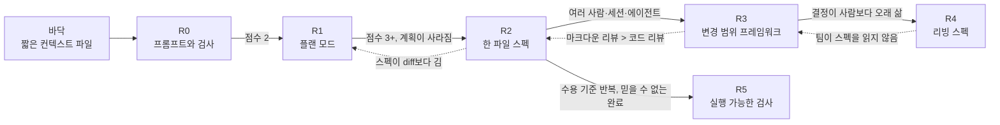

그림 1. 변경 크기 사다리의 단별 진입 신호(실선)와 하향 신호(점선)

### 예제 변경을 사다리에 올리기

추상적인 표보다 우리 저장소의 변경 다섯 개로 따져 본다. 부분 환불(C2), 8장 후반의 후속 변경(C3), 7장에서 씨앗을 심은 불변식 검사(C4)에 작은 변경 둘(C0, C1)을 더해 하나씩 단에 올린다.

C0은 오류 메시지의 "환뷸"을 "환불"로 고치는 일이다. 4장에서 Kiro 버그픽스 스펙의 세 문형으로 써 본 바로 그 변경이고, 그때 미뤄 둔 질문, 곧 오타 하나에 문서 세 개가 맞느냐에 대한 답이 여기 있다. 점수는 0점, R0이다. 스펙은 쓰지 않는다. 그래도 적을 것은 있다. 수용 기준 한두 문장과 변경을 증명할 명령 하나면 된다.

```text
수용 기준: 환불 관련 오류 메시지에 "환뷸"이 남지 않는다. 메시지 키와 다른 문구는 바뀌지 않는다.
증명 명령: grep -rn "환뷸" src/   # 결과 0줄
          ./gradlew test
```

이 오타 하나에 OpenSpec 변경 폴더를 만들거나 Spec Kit 아홉 명령을 돌린다고 상상해 보자. 끔찍한 낭비다. OpenSpec FAQ도 한 글자 오타 수정에는 절차 부담이 맞지 않는다고 적는다.

C1은 전체 취소 사유에 200자 길이 검증을 더하는 일이다. 건드리는 파일은 요청 객체와 테스트 정도라 점수는 1~2점, R1 플랜 모드가 알맞다. 1점으로 세면 규칙상 R0이지만, 아래에서 볼 "문자 수인가 바이트 수인가"처럼 에이전트가 조용히 골라 버릴 질문이 있어서 앞에서 말한 대로 R1로 올렸다. R1에서 할 일은 계획 전에 질문을 받는 것, 그리고 계획 속 이름·경로·경계 사례를 직접 읽어 확인하는 것이다. Claude Code라면 프롬프트 앞에 `/plan`을 붙이고 "계획을 쓰기 전에 불분명한 점을 먼저 질문해 줘"라고 덧붙인다. 7장에서처럼 `plansDirectory`를 `"./docs/plans"`로 두면 계획이 저장소 안에 남는다.

```markdown
<!-- docs/plans/cancel-reason-length.md — 플랜 모드 계획, 이 책 예제로 채운 예시(발췌) -->
# 전체 취소 사유 200자 길이 검증

## 계획 전에 확인한 것
- 200자는 바이트가 아니라 문자 수로 센다. 앞뒤 공백을 자른 뒤 센다
- 초과하면 기존 취소 API의 입력 검증 오류 응답 형식을 그대로 따른다
- 배송 전·전액이라는 취소 조건은 바꾸지 않는다

## 변경
1. 취소 요청 객체의 사유 필드에 길이 검증 추가
2. 테스트 추가: 200자는 통과, 201자는 거절
3. 기존 취소 테스트가 그대로 통과하는지 확인

## 증명
- ./gradlew test --tests '*CancelOrder*'
```

"문자 수인가 바이트 수인가"는 한글 사유에서 결과를 바꾸는 질문이다. 질문 없이 계획을 받았다면 에이전트가 둘 중 하나를 조용히 골랐을 것이다. R1의 가치는 이 한 줄에 있다.

C2 부분 환불은 4점이다. 구현 경로가 대체로 분명하고 혼자 한다면 R2 한 파일 스펙, 즉 6~7장의 경로가 끝이다. 팀이 함께 쓰고 여러 세션에 걸친다면 R3로 올라가 기존 코드에 붙는 델타 흐름(8장)이나 합의용 파이프라인(9장)을 고른다. C3 환불 기간 확장과 사유 코드 도입은 3점이고, 이미 리빙 스펙이 있는 영역을 고치는 일이라 8장 후반에서 본 R3 델타가 제자리다. 같은 변경을 R2로 한다면 어떨까? 새 `SPEC.md`에 "168시간을 336시간으로"라고 쓰면 되지만, 그 문장은 병합과 함께 사라지고 6장의 `SPEC.md`에는 여전히 168시간이 남는다. 이미 스펙을 남겨 두기로 한 영역이라면, 바뀐 부분만 적어 남은 스펙에 합치는 델타가 가장 싼 길이다. 반대로 C2를 처음 만들 때 스펙을 남기지 않기로 했다면 C3도 R2로 충분하다. 단은 변경 하나만 보고 정하는 것이 아니라 그 영역이 지금까지 어떻게 기록돼 왔는지와 함께 정해진다.

C4는 축이 다르다. 동시 환불 경쟁 조건과 "전 항목 환불 합계 = 결제 금액 − 배송비" 불변식은 문장을 아무리 다듬어도 지켜졌는지 눈으로 확인하기 어렵다. 같은 수용 기준이 리뷰마다 반복되고, 에이전트의 "완료" 보고를 믿을 수 없는 자리다. 그래서 R5로 간다. 7장에서 심어 둔 속성 기반 테스트 하나를 키워, 무작위 주문 구성과 동시 요청에서도 불변식이 깨지지 않는지 검사한다. 이 검사는 검사받는 에이전트 밖에, 그 동작이 없으면 실패하도록 둔다.

### 두 번째 축: 경로 확실성

점수가 3점 이상이면 결정 트리는 하나를 더 묻는다. 구현 경로를 아는가?

Loglass(Zenn, 2025-10-08)는 작업을 경로가 분명한 것, 대체로 분명한 것, 모르는 것으로 나눴고 Spec Kit은 가운데에서만 이득이 있었다고 보고했다. 경로가 분명하면 플랜 모드로 충분하고, 경로를 모르면 생성된 계획을 사람이 검토할 수 없다는 것이다. 약 2개월 동안 여러 도구를 써 본 y-hirakaw(Zenn, 2026-03-15)도 리팩터링과 잘 아는 변경에는 맞지만 새 기술이나 낯선 스택에서는 설계를 판단할 수 없어 맞지 않았다고 했다. 둘 다 실무자 주장이다.

그런데 Kiro 문서는 정반대로 권한다. 낯선 영역일수록 승인 관문이 있는 표준 Feature 스펙을 쓰라는 것이다. 어느 쪽이 맞을까? 참고 보고서의 조정안은 두 주장의 공통 조건을 찾는다. 스펙을 읽는 사람이 계획의 옳고 그름을 판단할 수 있는가. 판단할 수 있다면 승인 관문이 쓸모 있고, 판단할 수 없다면 관문은 도장 찍기가 된다.

부분 환불에 이 질문을 대 보자. 우리는 Spring Boot와 PostgreSQL 저장소를 알고, 환불 규칙도 3장과 6장에서 문장으로 정리했다. 계획을 읽고 "여기서 행 잠금이 빠졌다"고 말할 수 있는 사람이 있다. 그래서 경로가 대체로 분명한 쪽에 놓였다. 같은 기능을 처음 보는 결제 대행사 SDK 위에 올린다면 이야기가 달라진다. 계획이 SDK 호출 순서를 그럴듯하게 적어도, 그것이 맞는지 판단할 사람이 없다.

판단할 수 없을 때는 스파이크 트랙으로 비켜 가자. 시간 상자를 정한 프로토타입으로 경로를 먼저 배우고, 배운 것을 적은 뒤 점수를 다시 매긴다. 보고서는 사다리 옆에 곁가지 트랙을 둘 더 둔다. 감사 요구가 있는 변경은 G 트랙으로 가서 요구를 잠그고 CI 관문과 사람의 결정 지점을 둔다. 몇 시간 넘게 무인으로 돌릴 작업은 H 트랙으로 가서, 통과 표시가 있는 기능 목록과 진행 파일을 두고 루프마다 항목 하나를 새 컨텍스트로 처리한다. 부분 환불에는 둘 다 해당하지 않지만, 결제 규정 감사가 붙는 날이 오면 G 트랙을 떠올리자.

시각적 목표나 주관적 목표도 비슷하다. .NET Razor Pages 화면 재설계에 OpenSpec을 썼더니 약 2시간 뒤 새 화면이 원본과 거의 같았고 평범한 지시 파일이 더 빠르고 쌌다는 보고(단일 실험의 주장)가 있다. 화면은 스펙 문장보다 스크린샷을 보며 작게 반복하는 편이 낫다.

## 내려가기와 기록하기

### 내려가는 것도 정상이다

사다리에서는 내려가는 것도 움직임이다. 방법이 아프기 시작하면 층을 빼는 것 역시 같은 사다리 위에서 일어나는 일이다. 참고 보고서가 정리한 하향 신호 가운데 자주 만날 것만 추려 보자.

| 신호 | 내려갈 단 | 먼저 할 일 |
|---|---|---|
| 0~2점 변경이 스펙을 거치고, 스펙 부담이 에이전트 실행 시간보다 큼 | R0 또는 R1 | 적합성 점수로 다시 보냄 |
| 마크다운 리뷰가 2주 동안 코드 리뷰보다 길고 수용률 변화 없음 | R3 → R2 | 문서 수 줄이기, 요구사항은 꼼꼼히·설계는 훑기, 델타 흐름이나 `SPEC.md` |
| 스펙이 코드나 diff보다 큼 | R2 | 이번에 바꿀 부분만 |
| 같은 실패가 두 번 | 단 유지, 바닥층이나 R5로 | 스펙 문장을 늘리지 않고 테스트·훅·규칙으로 |
| 큰 스펙을 한 번에 넣었더니 항목이 빠짐 | R2 → R1 | 나누고, 플랜 모드·할 일 목록·서브에이전트 |
| 팀이 스펙을 읽지 않음, 실험 중 스펙이 낡음 | R4 → R3 | 빌드 뒤 버리는 스펙 |
| 2주 동안 안 쓴 플러그인 | 플러그인 제거 | 평범한 파일 설정과 비교 |

넷째 줄을 눈여겨보자. 같은 실패가 두 번 나면 스펙에 문장을 한 줄 더 쓰고 싶어진다. 그 충동을 참고 테스트나 훅으로 옮기라는 신호다. 문장은 다음 세션에서 잊힐 수 있지만, 실패하는 테스트는 잊히지 않는다.

내려갈 때 빼지 말아야 할 것도 있다. 방법을 버린 팀들도 의도를 적는 습관은 지키고 그 주변 층만 뺐다. 하향은 대개 무거운 프레임워크에서 가벼운 스펙으로 가는 움직임이고, 스펙을 아예 없애는 경우는 드물다. 사람이 소유한 수용 테스트도 끝까지 남긴다.

내려간 실제 사례도 있다. Talk Think Do(2026-06)는 OpenSpec을 쓰다 중단했다. 저장소 안의 스펙이 계획을 엔지니어링 도구에 묶어 버려서 이해관계자가 범위와 비용 변화를 볼 수 없었기 때문이다. 이 팀은 계획을 작업 항목으로 옮기면서도 계획 규율 자체는 유지했다. 위 표에는 없는 신호지만 "이해관계자가 범위·비용 변화를 못 봄"이라는 하향 신호가 정확히 이 경우다. 단은 그대로 두고, 계획이 사는 곳만 바꾼 것이다.

제조사들도 이미 내려가는 길을 냈다는 점이 흥미롭다. Spec Kit은 버그 수정과 아이디어 평가 진입점을, Kiro는 퀵 스펙과 버그픽스 스펙과 플랜 모드를, BMAD는 "You don't need BMad for an obvious, low-risk edit."라는 문장을 내놓았다. Superpowers는 작은 변경을 채팅 합의로 끝내고, cc-sdd의 discovery는 스펙이 필요 없다고 답할 수 있다. Spec Kit README에는 이런 문장도 있다. "Stopping with a documented reason is also a useful outcome." 이유를 적고 멈추는 것도 결과라는 말이다.

### 내 기록으로 고르기

사다리의 문턱값을 내 것으로 바꾸는 방법은 하나다. 기록하는 것이다. 참고 보고서가 제안한 최소 시험 계획은 이렇다. 먼저 P0 기준선으로 1주 동안 평소대로 일하며 변경 10개 이상을 기록한다. 다음 1주는 P1, 점수 2점 변경에 플랜 모드를 쓴다. 그다음 2주는 3점 이상 변경을 R1과 R2로 나눠 비교한다. 지표는 셋이다. 첫 리뷰에서 그대로 받아들여진 비율, 다시 손본 비율, 그리고 스펙에 든 부담이다.

2장 끝에서 지난주 변경 다섯 개의 수정 파일 수를 세어 두자고 했다. 그 숫자가 이 기록의 `files` 열 첫 줄이 된다. 머리글은 아래처럼 시작하면 된다. 값은 이 책 예제로 채운 예시다.

```csv
date,change,files,fit_score,rung,reprompts,first_review_pass,review_min,spec_min
2026-11-16,C0 환불 메시지 오타,1,0,R0,0,true,2,0
2026-11-17,C1 취소 사유 길이 검증,2,1,R1,1,true,10,4
2026-11-19,C2 부분 환불,9,4,R2,3,false,55,40
```

열마다 뜻을 정해 두자. `reprompts`는 첫 지시 뒤에 방향을 바로잡으려고 다시 지시한 횟수다. `first_review_pass`는 리뷰에서 수정 요청 없이 받아들여졌는지다. `review_min`과 `spec_min`은 사람이 리뷰와 스펙에 쓴 분 단위 시간이다. 6장 끝에서 적어 둔 인터뷰 시간은 `spec_min` 열에 들어가고, 질문 수는 그 변경 줄 옆에 메모로 남겨 두면 된다. 스펙 부담은 `spec_min`이 에이전트 실행 시간이나 `review_min`에 비해 얼마나 큰지로 본다. 하향 신호 표의 첫 줄이 바로 이 비교에서 나온다.

왜 굳이 기록할까? 체감은 믿기 어렵기 때문이다. METR의 무작위 통제 실험(숙련 오픈소스 개발자 16명, 과제 246개)에서 AI를 쓰면 완료 시간이 19% 늘었는데, 개발자들은 20% 줄었다고 믿었다. SDD도 마찬가지다. 스펙을 쓰고 나면 일이 잘된 것 같은 느낌이 든다. 그 느낌이 `first_review_pass` 열에서도 보이는지 확인하자.

4주가 지나면 표를 단별로 묶어 보자. 이 책의 제안은 단순하다. 3점 이상 변경에서 R2의 첫 리뷰 수용률이 R1보다 눈에 띄게 높지 않다면, 그 종류의 변경은 R1에 머문다. 높다면 R2가 내 천장이 되고, 그때 비로소 R3를 시험해 볼 근거가 생긴다. 변경 열 개 남짓한 기록으로 통계적 결론을 낼 수는 없지만, "느낌상 좋았다"보다는 훨씬 단단한 출발점이다.

팀 저장소에서 혼자 시험한다면 `SPEC.md`와 계획 파일을 `.git/info/exclude`에 넣고, PR 본문에는 수용 기준과 바뀌지 않을 동작만 옮기자. 플러그인은 user나 local 범위로 설치해 동료의 환경을 건드리지 않는 편이 낫다.

### 이 장의 핵심

- 같은 기능을 네 방식으로 써 보면 내용은 같고 결정이 사는 자리가 다르다. 인가 누락과 모순을 잡은 것은 네 벌 모두 사람이었다.
- 스펙 적합성 점수가 첫 갈림길이다. 0~1점이면 R0, 2점이면 R1, 3점 이상이면 구현 경로를 다시 묻는다.
- 사다리의 모든 문턱값은 시작값이다. 크기 신호가 가장 강하지만 그 측정도 조건이 좁다.
- 경로를 판단할 수 없으면 승인 관문은 도장 찍기가 된다. 스파이크로 먼저 배우고 점수를 다시 매긴다.
- 내려가는 것도 정상이다. 다만 의도를 적는 습관과 사람이 소유한 수용 테스트는 남긴다.

### 결정 트리 한 장

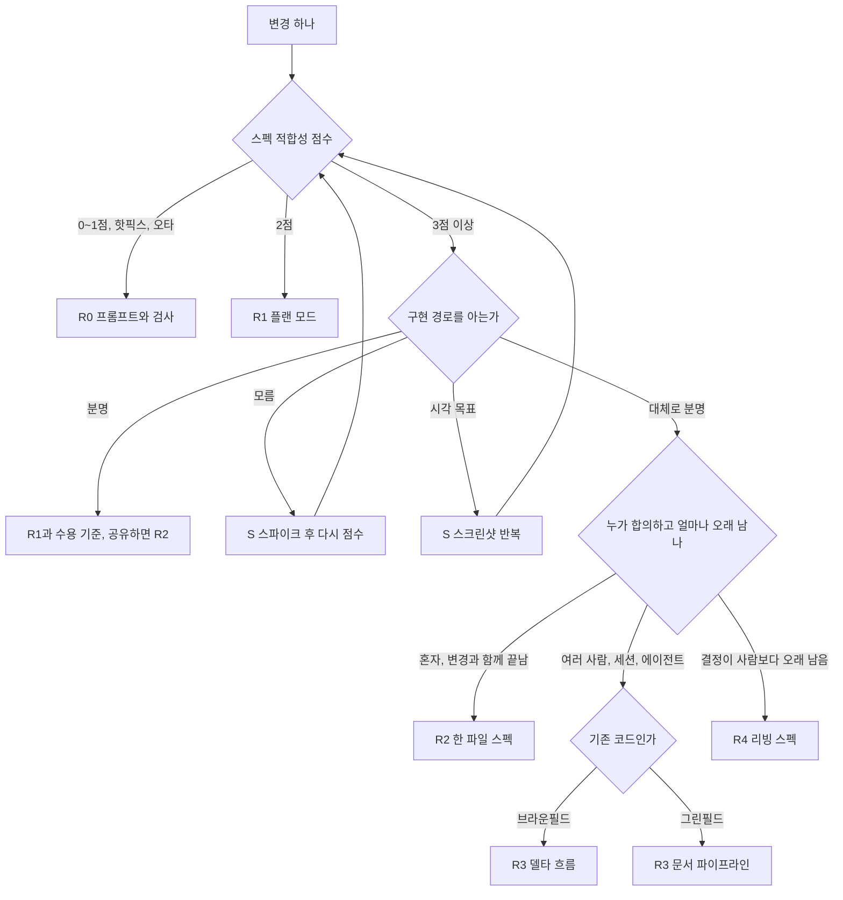

그림 2. 변경 하나에서 단을 고르는 결정 트리 (참고 보고서의 사다리를 옮김, 문턱값은 시작값)

다음 변경을 이 트리 맨 위에 올려 보자. 어느 끝에 닿든, 내려가는 것도 정상 결과다.

# 12장. 오래 남는 것만 남긴다 — 팀, 드리프트, 그리고 다음 모델

2026년 8월, 반년 가까이 Spec Kit으로 개발해 온 한 개발자가 GPTers에 회고를 올렸다. 닉네임은 황금호랑이. 6장 끝에서 한 줄로 스쳐 간 그 회고다. 회고를 쓰면서 그는 자기가 쓰던 검수 스킬을 다시 나눠 봤다. 만들기 전에 쓰는 것(`clarify`, `checklist`)과 만든 뒤에 쓰는 것(`analyze`, `converge`)이다. 9장에서 본 공식 흐름에서는 `analyze`도 구현 전에 돌리는 관문이지만, 그의 분류는 자기가 실제로 돌리던 순서를 따랐다. 그리고 앞의 둘을 거의 쓰지 않았다는 사실을 깨달았다. 반년 동안 쌓아 온 신뢰가 사실은 검수 단계의 절반을 건너뛴 위에 서 있었던 것이다. 그가 내린 결론의 요지는 단순하다. 검수할 수 있는 것은 파일뿐이다. 맥락과 결정과 제약을 채팅에 흘려보내지 말고 스펙·계획·노트 파일로 남겨 Git으로 공유해야, 나중에 누군가 그것을 검수할 수 있다.

이 회고는 이 책이 걸어온 길을 거꾸로 비춘다. 1부에서 우리는 에이전트가 빈칸을 추측으로 채운다는 데서 출발해 스펙 주도 개발(Spec-Driven Development, SDD)을 정의했고, 스펙이 작업 뒤에 어떻게 되느냐로 방법들을 갈랐고, 좋은 스펙 문장을 해부했다. 2부에서는 문서로 통제하는 도구와 습관으로 통제하는 도구를 지도 위에 올렸다. 3부에서는 도구 없이 인터뷰와 `SPEC.md`와 검증 루프를 손으로 돌렸고, 4부에서는 같은 부분 환불을 OpenSpec, Spec Kit, Superpowers로 다시 썼다. 11장에서는 네 벌을 나란히 놓고, 쓰지 않는 선택지까지 포함한 사다리를 세웠다.

여기까지는 대체로 혼자, 그리고 변경 하나의 시간 안에서 일어난 일이었다. 그렇다면 이 방식을 팀으로 가져가고 시간이 흐르면 무엇이 남을까? 황금호랑이의 결론을 이 장의 기준으로 삼자. 남길 것은 파일로 남기고, 파일로 남길 가치가 없는 것은 과감히 버린다.

## 무엇을 얼마나 오래 남길까

### 스펙의 수명을 정한다

변경이 병합된 다음 그 스펙은 어디로 가야 할까? 1장 끝에 남겨 둔 이 질문에 2장은 수명의 세 수준으로 답했다. 이제는 그 답을 팀 규칙으로 바꿀 차례다. 참고 보고서는 선택지를 넷으로 정리한다. 버린다, 스펙 고정형으로 유지한다, 계약만 남긴다, 저장소 밖 작업 항목으로 옮긴다.

| 선택 | 어울리는 때 | 이 책 예제에서 | 근거 |
|---|---|---|---|
| 버린다 (PR에 첨부) | 결정이 변경과 함께 끝난다 | C1 취소 사유 검증의 계획 | Brody는 계획을 PR 본문 `<details>`에 접어 넣음, TOKIUM은 구현 뒤 문서를 지움 |
| 스펙 고정형으로 유지 | 결정이 세션이나 사람보다 오래 살아야 한다 | 환불 모듈의 리빙 스펙(8장 아카이브) | Spec Kit #620 참여자들은 하나로 합친 최신 스펙을 원함 |
| 계약만 남긴다 | 코드가 진실 원천이고 부분 사이 약속만 지키면 된다 | `contracts/refunds.yaml`, 안분 불변식과 수용 테스트 | cc-sdd "Code remains the source of truth." |
| 저장소 밖 작업 항목 | 이해관계자가 범위와 비용 변화를 봐야 한다 | 운영팀과 공유하는 환불 기능 일정 | Talk Think Do가 계획을 작업 항목으로 옮김 |

이 선택을 두고 현장의 의견은 실제로 갈린다. 남기자는 쪽은 스펙을 프로젝트와 함께 진화하는 산출물로 본다. GitHub의 Spec Kit 출시 글이 그렇고, Marc Brooker는 스펙을 버전 관리되는 리빙 산출물로 불렀으며, LayerX는 현실적인 목표가 스펙 고정형이라고 적었다. 버리자는 쪽에서는 유지 비용이 생산성을 갉아먹었다는 GeekNews 댓글과, 요청하지 않은 지식 베이스가 기억을 여러 층에 흩어 놓는다며 스펙을 쓰고 빌드하는 두 단계만 남긴 "Rotten specs" 글이 있다. 어느 쪽이 옳은지보다 중요한 것은 변경을 시작할 때 미리 정해 두는 일이다. 병합한 뒤에 "이 스펙을 어떻게 하지?"라고 묻기 시작하면 대개 아무도 고치지 않는 파일이 남는다.

넷 가운데 하나만 고를 필요는 없다. 부분 환불이라면 계획 파일은 PR에 접어 넣고, 환불 규칙은 OpenSpec 메인 스펙이나 `docs/specs/` 아래 한 파일로 남기고, API 계약과 불변식 테스트는 코드와 함께 둘 수 있다. Brody의 분리법도 쓸모 있다. 기존 시스템을 설명한 연구 문서는 다음 변경에서 다시 쓰고, 변경 하나를 위한 계획 문서는 일회용으로 다룬다.

리빙 스펙을 고른다면 두 가지를 함께 정하자. 하나는 범위다. 리빙 스펙은 모듈 하나로 좁히고, 시스템 전체를 덮으려 하지 말자. 다른 하나는 소유자와 보관 계획이다. 누가 그 스펙을 고치고, 언제 낡았다고 선언하고 정리할지를 정해 두지 않으면, 아무도 믿지 않는 큰 문서가 하나 더 생길 뿐이다.

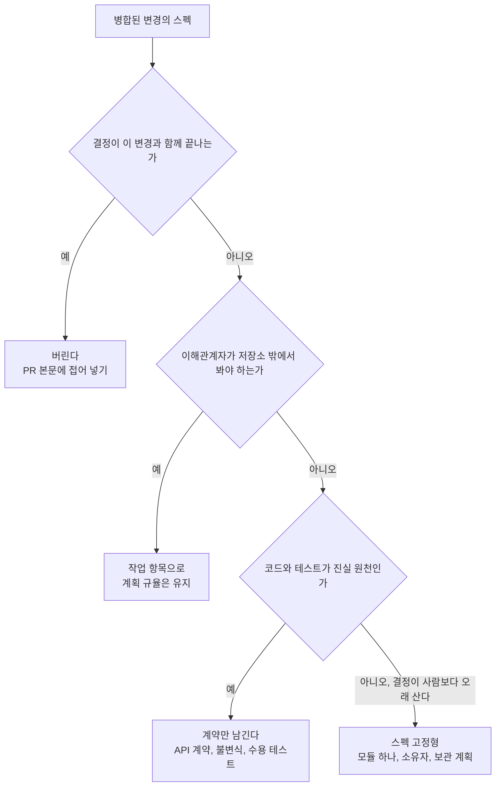

그림 1. 병합 뒤 스펙의 수명을 정하는 흐름

### 드리프트와 맞선다

스펙을 남기기로 했다면 그다음 적은 드리프트다. 스펙과 코드가 조용히 어긋나는 일이다. 실무자들은 스펙과 코드를 맞춰 보는 일을 주로 작업이 끝나는 시점에만 한다는 조사도 있다. 그 사이에 어긋남이 쌓인다.

맞서는 장치는 이미 책 곳곳에서 만났다. 가장 단순한 것은 같은 PR 규칙이다. 동작을 바꾸는 코드 변경과 그 동작을 적은 스펙 변경을 같은 PR에 담는다. 9장 헌법의 Development Workflow 절에 적어 둔 바로 그 규칙이다. 완료 시점에는 수렴 검사를 돌린다. Spec Kit의 converge가 그 자리에 있다. 변경이 끝날 때 델타를 메인 스펙에 병합하는 OpenSpec의 아카이브도 같은 문제를 다른 방향에서 푼다. 버그가 나면 코드를 고치기 전에 "구현이 틀렸나, 스펙이 틀렸나"부터 묻자. OpenSpec 이슈 #821이 제안한 순서다.

사람이 손으로 관리하는 연결은 최소로 줄이는 편이 낫다. 개인 SDD 프레임워크를 설계한 redism의 노트(2026-04)는 문서 사이 링크 가운데 사람이 관리하는 것은 `parent` 하나만 두고, `children`은 스크립트로 계산해 어긋날 수 없게 했다. 흥미롭게도 그 설계 노트 자체에 결정 045와 어긋나는 낡은 문장이 남아 있다. 자기 승인과 검증 없는 완료 선언을 구조적으로 막겠다고 공들인 문서조차 드리프트를 피하지 못한 것이다. 드리프트는 의지가 아니라 장치로 막아야 한다는 것을 이보다 잘 보여 주는 실물은 드물다.

한 가지 위안도 있다. 스펙을 남기지 않기로 한 변경에는 드리프트도 없다. 버린 스펙은 낡을 일이 없기 때문이다. 앞 절에서 수명을 먼저 정하자고 한 이유가 여기에도 있다. 남길 스펙이 적을수록 지켜야 할 연결도 적다. Radar Vol 35가 AI가 고친 산문을 의미 단위로 검토하는 기법을 Assess에 올린 것도 같은 고민의 연장이다. 남긴 문서가 많아질수록 그 문서를 누가, 어떻게 다시 읽을지가 새 문제로 떠오른다.

팀이 바로 쓸 수 있는 장치로 PR 템플릿에 항목 몇 개를 더해 보자. 아래는 이 책 예제로 채운 예시다.

```markdown
## 스펙 변경
- [ ] 이 PR은 동작을 바꾼다 → 같은 PR에 스펙(또는 델타) 변경이 있다: `docs/specs/...`
- [ ] 이 PR은 동작을 바꾸지 않는다 (리팩터링, 오타, 테스트만)
- 바뀌지 않을 동작: 예) 전체 취소 `POST /orders/{orderId}/cancel`은 배송 전·전액 그대로
- 수용 기준 → 테스트: 예) "책 B 1권 환불 → 10,800원" → `PartialRefundAcceptanceTest`
- 버그 수정이라면: [ ] 구현 오류  [ ] 스펙 오류 (스펙 오류면 스펙부터 고쳤다)

<details><summary>계획 파일</summary>

(docs/plans/ 아래 계획을 여기에 붙인다)

</details>
```

## 사람과 도구가 바뀔 때

### 팀으로 가져갈 때

혼자 잘 되던 방식이 팀에서도 잘 될까? 조심스럽게 보자. 공개 저장소의 스펙 파일을 채굴한 연구에서 스펙 파일의 98.3%는 저자가 한 명이었다. 팀이 스펙을 함께 검토하는 모습은 조직 환경에서만 보였다. 팀의 이득은 저절로 생기지 않고, 공유된 절차가 있어야 생긴다는 뜻이다.

Asana의 3개월 보고(2026-09, 팀 자체 보고)는 그 절차의 이득과 비용을 함께 보여 준다. 엔지니어 약 절반이 시도했고, 주간 사용자는 30~50명이었다. Admin Console 마이그레이션에서는 설정 66개, 마이그레이션 약 150건 가운데 91%가 수정이 필요 없었고, 계획보다 한 달 넘게 빨리 출시했다. 하지만 인프라 팀에서는 스펙 검토가 병목이 됐다. 데이터 마이그레이션에서는 두 작업이 서로 경쟁해 중복 필드를 만들 수 있었는데, 스펙이 그 결함을 그대로 코드와 테스트로 옮겼다. 팀은 구현을 멈추고 한 쪽짜리 설계 문서와 동료 의견으로 돌아갔다. 주당 PR 38% 증가나 구현 코드 추가량 약 2.66배 같은 숫자는 통제 비교가 아니어서 확인된 실패라기보다 위험 신호로 읽어야 한다. 그리고 보고서는 완료된 스펙에 소유자와 보관 계획이 필요하다고 결론지었다.

이 사례에서 두 가지를 가져가자. 하나는 스펙 리뷰도 사람의 시간을 쓰는 일이라 병목이 될 수 있다는 점이다. 11장 사다리 표에서 R4의 내리는 신호로 적은 "스펙 리뷰가 팀을 막음"이 바로 이것이다. 다른 하나는 스펙이 틀리면 그 틀림이 테스트까지 따라간다는 점이다. 스펙에서 나온 테스트가 통과했다고 의도가 맞았다는 보장은 없다.

그렇다면 팀은 스펙 리뷰를 어떻게 나눠야 할까? 11장의 하향 신호 표가 실마리를 준다. 마크다운 리뷰가 코드 리뷰보다 길어질 때 먼저 할 일로 "요구사항은 꼼꼼히, 설계는 훑기"가 적혀 있었다. 팀 규칙으로 옮기면 이렇다. 수용 기준과 바뀌지 않을 동작은 리뷰어 한 명이 줄 단위로 읽고 서명한다. 설계와 계획은 작성자가 책임지고, 리뷰어는 기각한 대안과 위험한 결정만 훑는다. Asana가 병목을 겪은 뒤 돌아간 한 쪽짜리 설계 문서와 동료 의견도 결국 사람이 꼼꼼히 읽을 분량을 줄이는 쪽이었다.

팀에 주니어가 있다면 한 가지를 더 챙기자. diff를 받기 전에 세 질문으로 스스로 점검하게 한다. 이 변경은 무엇을 하는가, 왜 이 방법인가, 어떻게 실패할 수 있는가. 각각 0~3점으로 매겨 본다. 테스트가 실패하면 먼저 손으로 디버깅해 보고, 결과를 확인할 수 있을 때만 위임하고, 수용 테스트는 직접 쓰거나 검토한다. 근거는 Anthropic의 무작위 통제 실험(엔지니어 52명)이다. AI를 쓴 그룹의 이해도 퀴즈 점수는 50%로 직접 코딩한 그룹의 67%보다 낮았고, 격차는 디버깅에서 가장 컸다. 다만 이 연구가 시험한 것은 SDD가 아닌 일반 AI 코딩이라는 점을 함께 적어 두자.

### 바닥층 다시 보기

11장에서 바닥층은 모든 단 밑에 깔린다고 했다. 그 바닥층, 즉 `CLAUDE.md`나 `AGENTS.md` 같은 컨텍스트 파일은 팀으로 갈수록 쉽게 불어난다. 누군가 실수할 때마다 한 줄씩 더해지기 때문이다. Thoughtworks Technology Radar Vol 35(2026-11)가 에이전트 지시문 비대를 Caution에 올리며 내린 처방은 규칙을 훅과 검사로 옮기고 모델이 바뀔 때마다 다시 평가하라는 것이었다.

측정은 엇갈린다. Gloaguen 등의 연구에서는 컨텍스트 파일이 성공률을 대체로 올리지 못했고 추론 비용을 평균 20% 넘게 올렸으며, 저장소 개요는 도움이 되지 않았다. Lulla 등의 연구(저장소 10개, PR 124개)에서는 런타임 중앙값이 28.64%, 출력 토큰이 16.58% 줄었고 완료율은 비슷했다. 설정과 지표가 달라서 어느 쪽이 틀렸다고 말할 수는 없다. 두 결과를 함께 지키는 방법은 이렇다. 에이전트가 스스로 추론할 수 없는 비표준 관행만 적고, 저장소 개요는 빼고, 파일을 바꾸기 전후를 잰다.

현장 기록도 같은 방향을 가리킨다. 한 커뮤니티 사용자는 항상 읽히는 지시 파일을 752줄에서 약 40줄로 줄이고 세부 규칙은 필요할 때만 읽는 파일로 옮겨 세션당 약 35%의 컨텍스트를 아꼈다고 보고했다(자기 보고). 약 150줄을 넘으면 나누라는 실무자 경험칙도 있다. 그리고 공개 저장소의 지시문을 조사한 연구에서는 지시의 74.0%가 이유를 적지 않았다. 이유가 없는 규칙은 지켜야 할 때와 아닐 때를 에이전트가 구분할 수 없다.

Claude Code 모범 사례가 권하는 내용은 검증 명령, 오해하기 쉬운 코드, 저장소에 없는 결정, 두 번 고친 것 정도다. 예외 없이 지켜야 하는 규칙은 훅으로 옮긴다. 이 기준으로 `bookshop-orders`의 `CLAUDE.md`를 써 보면 이 정도면 충분하다. 이 책 예제로 채운 예시다.

```markdown
# bookshop-orders — 에이전트용 메모

## 검증 명령
- 테스트: `./gradlew test`
- 부팅 확인: `./gradlew bootRun`이 오류 없이 뜨는지 본다. 테스트 통과만으로 완료라고 하지 않는다
- 마이그레이션: 새 스크립트는 적용과 되돌리기를 둘 다 돌려 본다

## 오해하기 쉬운 것
- 금액은 원 단위 `long`이다. `double`로 바꾸지 않는다 (1원 오차가 정산 분쟁이 된다)
- `POST /orders/{orderId}/cancel`은 배송 전·전액 전용이다. 부분 환불은 `refund` 패키지다
- 쿠폰 안분의 1원 차액은 마지막으로 환불되는 항목이 떠안는다. 항목마다 반올림하지 않는다

## 저장소에 없는 결정
- 환불 기간은 `delivered_at`부터 168시간으로 잰다. 날짜 경계와 시간대는 쓰지 않는다 (결정 기록: `docs/specs/`)
- 서점 관리자 API는 서비스 진입점에서 서점 일치를 확인한다

## 스펙과 계획
- 스펙: `docs/specs/` — 동작을 바꾸는 PR은 같은 PR에서 스펙도 고친다
- 계획: `docs/plans/` — 병합 때 PR 본문에 접어 넣는다

## 두 번 고친 것
- 테스트에서 현재 시각을 직접 부르지 않는다. `Clock`을 주입한다
```

스무 줄 남짓이다. 저장소 구조 설명이나 "깔끔한 코드를 쓰자" 같은 문장은 없다. 에이전트가 코드에서 읽을 수 있거나, 어차피 지키지 않을 문장이기 때문이다.

### 하네스는 바뀐다

2026년 한 해만 봐도 하네스는 쉬지 않고 바뀌었다. 확장이 종료되고, 저장소가 이사하고, 제품 이름이 바뀌고, 명령 파일이 사라질 예정이다.

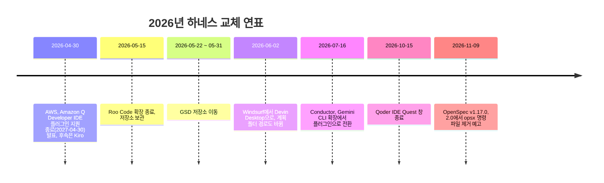

그림 2. 2026년 하네스 교체 연표

이 연표가 주는 교훈은 단순하다. 하네스가 사라져도 남는 것은 저장소 안의 평범한 마크다운이다. 이 책이 도구 장마다 "명령은 바뀌어도 남는 개념" 표를 둔 이유도 여기에 있다. `/opsx:propose`가 `/openspec-propose`로 바뀌어도 "변경 제안"이라는 개념과 `proposal.md`라는 파일은 남는다. 오래 남길 결정은 특정 하네스의 기능이 아니라 그 파일에 적어 두자.

스펙을 원본으로 두고 코드를 매번 다시 생성하자는 스펙 소스형의 실험도 같은 교훈을 남겼다. 2장에서 본 Tessl은 2025년 9월 프레임워크를 비공개 베타로, 스펙 레지스트리를 공개로 내놓았다가 약 넉 달 뒤인 2026년 1월 스킬 패키지 관리 플랫폼으로 방향을 틀었다. 특정 도구의 형식에 결정을 묶어 둘수록 그 도구의 방향 전환에 함께 흔들린다. 평범한 마크다운은 화려하지 않지만, 어느 하네스에서든 열린다.

모델도 바뀐다. Anthropic은 2026년 3월 장기 실행 하네스 글에서, Opus 4.6으로 넘어가며 스프린트 구조를 뺐지만 플래너와 평가자는 남겼다고 썼다. 플래너를 빼 보니 생성자가 스펙을 먼저 쓰지 않고 바로 만들기 시작했고, 기능이 적은 앱이 나왔다. 그 글의 교훈은 하네스의 부품마다 "모델이 혼자서는 못 하는 일"에 대한 가정이 들어 있으니, 새 모델이 나오면 하네스를 다시 점검하라는 것이다.

이 교훈을 우리 방식으로 옮기면 이렇다. 새 모델이 나오면 층을 한 번에 하나씩 빼 보고, 11장에서 기록해 둔 변경 5~10개를 다시 돌린다. 첫 리뷰 수용률이 그대로라면 그 층은 이제 필요 없다. 떨어진다면 그 층에 담긴 가정은 아직 유효하다. 기록이 있어야 이 실험을 할 수 있다는 점에서, 11장의 CSV 몇 줄은 다음 모델을 맞이할 준비이기도 하다.

## 닫는 매듭

### 빈칸을 누가 채우는가

이 장을 연 황금호랑이의 회고를 다시 떠올려 보자. 검수할 수 있는 것은 파일뿐이라는 결론은 이 책이 도구마다 확인한 사실과도 겹친다. `SPEC.md`든, 델타 스펙이든, `spec.md`든, 설계 문서든, 사람이 다시 읽고 판정할 수 있는 형태로 남은 것만이 다음 세션과 다음 동료에게 전해졌다. 채팅에만 있던 결정은 세션과 함께 사라졌다.

긴 여정이었다. 열두 장을 세 문장으로 줄이면 이렇다.

1. 큰 변경에는 코드보다 의도를 먼저 적고, 작은 변경에는 적지 않는다.
2. 검사는 작업한 에이전트 밖에 두고, 수용 테스트는 사람이 소유한다.
3. 프레임워크는 내 기록이 이득을 보일 때만 더하고, 보이지 않으면 뺀다.

첫 문장은 2장의 크기 신호와 11장의 사다리에서 왔다. 둘째 문장은 7장의 검증 기준선에서 왔고, 8~10장에서 도구마다 "이 관문은 누가 판정하나"를 물으며 다시 확인했다. 셋째 문장은 4부의 도구 장들과 11장의 기록 습관이 만나는 자리다. 셋 다 특정 도구의 이름을 담고 있지 않다는 점을 눈여겨보자. 도구 이름은 이 책이 나온 뒤에도 계속 바뀌겠지만, 이 세 문장은 다음 모델과 다음 하네스에서도 그대로 쓸 수 있다.

1장의 장면으로 돌아가 보자. Charles McGuinness는 한 문단짜리 스펙으로 날씨 앱을 바로 만들게 했다. 에이전트는 위치를 40마일 떨어진 곳으로 잡아 52°F여야 할 기온을 40°F로 보여 줬고, 챗봇 창으로 예보를 가렸고, 구형 모델을 골랐다. 위치도, 레이아웃도, 모델도 스펙에 없던 결정이었다. 에이전트는 그 빈칸을 추측으로 채웠다. 같은 사람이 이번에는 열 줄짜리 메모에서 시작해 질문 50개쯤에 답했고, 인터뷰 한 시간과 구현 한 시간 만에 MVP를 만들었다고 적었다(자기 보고).

이 책 내내 우리가 다룬 것은 결국 그 빈칸이었다. 에이전트는 앞으로도 빈칸을 채울 것이다. 모델이 좋아질수록 더 그럴듯하게 채울 것이다. 그러니 물어야 할 것은 빈칸이 있느냐가 아니라 누가 그 빈칸을 채우느냐다. 오타 하나라면 에이전트에게 맡겨도 된다. 부분 환불처럼 인가와 금액과 경계 시각이 걸린 변경이라면, 그 빈칸은 우리가 먼저 채우고 파일로 남기자. 어느 쪽인지 고르는 일, 그것이 이 책이 건네고 싶었던 기술이다.

# 부록 A. 바로 쓰는 카드 — 프롬프트, 템플릿, 점검표

본문에서 다룬 프롬프트와 템플릿과 점검표를 한곳에 모았다. 새로운 내용은 없다. 카드마다 처음 다룬 장을 적어 두었으니, 왜 그렇게 쓰는지 궁금하면 그 장으로 돌아가자. 프롬프트는 6·7장에 실린 문구 그대로다. 복사해 쓰되, 부분 환불 자리에 내 변경을, 경로와 읽을 코드 영역과 규칙·수용 기준 번호 자리에 내 저장소의 것을 넣으면 된다.

카드를 쓰는 순서는 대개 이렇다. 변경 하나가 오면 먼저 스펙 적합성 점수(A.7)로 단을 고른다(A.8). R2 이상이면 인터뷰 프롬프트(A.1)로 `SPEC.md`(A.4)를 끌어내고, 요구 문장은 EARS 카드(A.5)로, 수용 기준은 점검 질문(A.6)으로 다듬는다. 검사관 프롬프트(A.2)로 모순과 빈칸을 잡은 뒤 새 세션에서 구현하고, diff 리뷰 프롬프트(A.3)로 대조한다. 도구를 설치하기 전에는 A.9를, 결과를 기록할 때는 A.10을 꺼내자.

## 프롬프트 카드

### A.1 인터뷰 프롬프트 (6장)

원하는 것을 아직 다 정하지 못했을 때 쓴다. 한 번에 질문 하나, 가능하면 추천을 붙인 선택지로 받고, 코드를 읽어서 알 수 있는 것은 묻지 않게 하고, 코드는 쓰지 않게 한다. 끝나면 파일에 남기게 하는 것이 핵심이다. 대화는 세션과 함께 사라지지만 파일은 남는다.

```text
부분 환불 기능을 추가하려고 하는데 아직 다 정하지 못했습니다.
스펙을 쓸 수 있을 때까지 저를 인터뷰해 주세요.

- 질문은 한 번에 하나씩 해 주세요. 가능하면 선택지 2~4개를 주고,
  추천하는 선택지 하나에 이유를 붙여 주세요.
- 먼저 저장소에서 주문, 결제, 쿠폰, 전체 취소 코드를 읽어 주세요.
  코드를 읽어서 알 수 있는 것은 묻지 마세요.
- 다음 범주는 빠뜨리지 마세요: 누가 요청할 수 있는가(인가),
  실패했을 때의 동작, 같은 요청이 두 번 올 때, 기존 기능과의 관계.
- 인터뷰 중에는 코드를 쓰지 말고 어떤 파일도 고치지 마세요.
- 더 물을 것이 없으면 docs/specs/partial-refund/SPEC.md를
  다음 절 순서로 써 주세요: 목적 / 사용자와 권한 / 만들 것 / 안 만들 것 /
  API와 데이터 / 규칙 / 수용 기준 / 열린 질문 / 결정 기록.
  규칙은 EARS 문형으로(키워드는 영어, 나머지는 한국어),
  수용 기준은 GIVEN/WHEN/THEN으로 써 주세요.
```

### A.2 검사관 프롬프트 (6장)

`/clear` 뒤 새 세션에서 쓴다. 고치지 말고 보고만 하게 하는 것이 요점이다. 세 검사가 모두 "없음"일 때 스펙을 확정한다. 세 질문 밖의 지적은 보고서에 와도 무시하자.

```text
docs/specs/partial-refund/SPEC.md를 읽고 아래 세 가지만 보고해 주세요.
파일은 고치지 마세요.

1. "만들 것", "규칙", "수용 기준"의 각 항목이 테스트 가능한가?
   기준이 되는 값(시각, 단위, 경계)이 정해지지 않은 문장도 여기에 넣어 주세요.
2. 어떤 문장이 "안 만들 것"과 충돌하거나, 두 문장이 같은 상황에
   서로 다른 결과를 요구하는가? 두 문장의 줄 번호를 함께 적어 주세요.
3. 본문(API, 규칙, 수용 기준)에 나오는 기능 가운데 "만들 것"에 없는 것이 있는가?

항목마다 줄 번호와 이유를 적고, 문제가 없으면 "없음"이라고만 써 주세요.
```

### A.3 diff 리뷰 프롬프트 (7장)

수용 테스트와 결정적 검사가 통과한 뒤, 대화를 보지 못한 서브에이전트에게 맡긴다. 마지막 줄을 빼지 말자. 문제를 찾으라는 리뷰어는 늘 무언가를 찾아내고, 스타일 지적까지 다 고치면 불필요한 추상화가 생긴다. 에이전트가 완료라고 말하면 실행한 명령과 그 출력을 증거로 함께 요구하자.

```text
서브에이전트를 써서 지금 브랜치의 diff를 docs/specs/partial-refund/SPEC.md와
대조해 주세요. 이 diff는 동료가 올린 PR이고, 리뷰만 합니다. 파일은 고치지 마세요.

- 6절 규칙 R1~R10이 각각 구현되었는가? 구현된 파일과 줄을 적고, 없으면 "없음".
- 7절 수용 기준 AC1~AC9마다 테스트가 있는가? 그 테스트가 SPEC.md의 경로,
  오류 코드, 금액을 그대로 확인하는가?
- "안 만들 것"에 있는 동작(배송비 환불 등)을 만든 곳이 있는가?

정확성에 영향을 주는 빈틈만 보고하고, 스타일은 건너뛰어 주세요.
```

## 템플릿 카드

### A.4 `SPEC.md` 빈 템플릿 (6장)

머리말 세 줄과 절 머리만 둔다. 절 번호는 6장의 전문과 같아서 A.3 프롬프트의 "6절 규칙", "7절 수용 기준"이 그대로 맞는다. 규칙은 EARS 문형(A.5)으로, 수용 기준은 GIVEN/WHEN/THEN으로 쓴다. 절마다 무엇을 쓰는지는 6장의 전문을 보자. 4절 "안 만들 것"(비목표)과 9절 결정 기록은 비어 있더라도 지우지 말자. 비목표는 범위가 새는 가장 흔한 출구를 막고, 결정 기록은 석 달 뒤 "왜 168시간이지?"라는 질문에 답한다.

```markdown
# SPEC: {변경 이름}

- 저장소: {저장소 이름}
- 상태: 초안
- 바뀌지 않을 동작: {이번 변경이 건드리면 안 되는 기존 동작}

## 1. 목적
## 2. 사용자와 권한
## 3. 만들 것
## 4. 안 만들 것
## 5. API와 데이터
## 6. 규칙
## 7. 수용 기준
## 8. 열린 질문
## 9. 결정 기록
```

### A.5 EARS 여섯 문형과 한국어 작성 규칙 (3장)

키워드와 고정 구(`While`, `When`, `Where`, `If … then`, `shall`)는 영어로 두고 변수 부분만 한국어로 쓴다. 주어는 구체적인 시스템 이름으로 쓴다. 이 책은 `bookshop-orders`의 요구 주어를 `the 주문 서비스`로 썼다.

| 문형 | 틀 | 예제 |
|---|---|---|
| 항상 (Ubiquitous) | The {시스템} shall {응답} | The 주문 서비스 shall 금액을 원 단위 정수로 계산한다. |
| 상태 (State-driven) | While {상태}, the {시스템} shall {응답} | While PG 환불 호출이 진행 중이면, the 주문 서비스 shall 환불 상태를 `REQUESTED`로 둔다. |
| 사건 (Event-driven) | When {트리거}, the {시스템} shall {응답} | When 서점 관리자가 책 B 1권 환불을 요청하면, the 주문 서비스 shall 10,800원을 환불한다. |
| 선택 기능 (Optional) | Where {기능이 포함되면}, the {시스템} shall {응답} | Where 주문에 쿠폰이 적용돼 있으면, the 주문 서비스 shall 할인액을 항목 금액 비율로 나눠 뺀다. |
| 원치 않는 동작 (Unwanted) | If {트리거}, then the {시스템} shall {응답} | If PG 환불 호출이 실패하면, then the 주문 서비스 shall 환불을 `FAILED`로 남기고 `refunded_quantity`를 바꾸지 않는다. |
| 복합 (Complex) | While {상태}, when {트리거}, the {시스템} shall {응답} | While 요청 시각이 `delivered_at`부터 168시간 이내이면, when 서점 관리자가 환불을 요청하면, the 주문 서비스 shall 요청을 처리한다. |

작성 규칙 네 가지:

1. 요구 한 문장에 트리거 하나. 트리거가 둘이면 요구를 둘로 나눈다.
2. 정상 흐름마다 "이게 실패하면?"을 묻고 `If … then` 요구를 따로 쓴다.
3. 머릿속에만 있는 전제는 `While` 절로 꺼낸다.
4. 어떻게 만들지는 쓰지 않는다.

근거의 한계도 함께 기억하자. EARS의 결함 감소 근거는 2009년 사례 연구 한 건(요구 36개)이고, EARS가 코딩 에이전트의 출력 품질을 올린다는 통제 실험은 아직 없다.

### A.6 수용 기준 점검 질문 (3장, 7장)

| 질문 | 바탕 |
|---|---|
| 이 기준은 정확히 한 기능만 요구하는가? | QUS Atomic |
| 문제만 쓰고 해결책은 쓰지 않았는가? | QUS Problem-oriented |
| 여러 해석을 낳는 말은 없는가? | QUS Unambiguous |
| 다른 기준과 같은 상황에 다른 결과를 요구하지 않는가? | QUS Conflict-free |
| 기준을 다 구현하면 빠진 단계 없이 기능이 완성되는가? | QUS Complete |
| 테스트가 확인할 이름·경로·인터페이스가 스펙에 적혀 있는가? | 스펙-오라클 격차 |
| 그 동작이 없으면 이 기준의 테스트가 실패하는가? | 7장 검증 기준선 |

모순 없음과 완결성처럼 기준 집합 전체를 봐야 하는 질문은 도구로 잡기 어렵다고 보는 편이 맞다. 사람이 집합 전체를 한 번 읽자.

## 점검표 카드

### A.7 스펙 적합성 점수 (2장, 6장, 11장)

참인 조건의 수를 센다. 셋 이상이면 스펙을 쓴다. 0~1점이면 R0, 2점이면 R1로 가고, 3점 이상이면 구현 경로를 아는지 다시 묻는다. 부분 환불은 1~4번이 참이라 4점이었다.

| 번호 | 조건 |
|---|---|
| 1 | 파일 3개 이상을 건드린다 |
| 2 | 수용 기준이 4개 이상이다 |
| 3 | 모듈, 서비스, 저장소 경계를 넘는다 |
| 4 | 스키마나 공개 API를 바꾼다 |
| 5 | 여러 엔지니어나 여러 에이전트가 참여한다 |
| 6 | 규제나 감사 대상이다 |

### A.8 사다리 한 장 요약과 하향 신호 (11장)

모든 문턱값은 시작값이다. 내 기록으로 고쳐 쓰자.

| 단 | 언제 | 할 일 |
|---|---|---|
| 바닥 | 같은 교정을 두 번 입력함 | 컨텍스트 파일에 비표준 사실만 한 줄씩 |
| R0 | 0~1점, 오타, 핫픽스 | 수용 기준 1~2문장 + 증명 명령 하나 |
| R1 | 2점 | 플랜 모드, 계획 전에 질문받기, 이름·경로·경계 사례 직접 확인 |
| R2 | 3점 이상, 경로가 대체로 분명, 혼자 | 인터뷰 → `SPEC.md` → 새 세션 → diff 대조 |
| R3 | R2가 관문을 통과했고 여러 사람·세션·에이전트 | 변경 모양에 맞는 프레임워크 하나만 |
| R4 | 결정이 사람보다 오래 살아야 함 | 모듈 하나에 리빙 스펙, 소유자와 보관 계획 |
| R5 | 수용 기준 반복, 믿을 수 없는 "완료" | 그 동작이 없으면 실패하는 검사를 에이전트 밖에 |
| S | 경로를 모름, 시각 목표 | 시간 상자 프로토타입, 배운 것을 적고 다시 점수 |

| 하향 신호 | 갈 곳 |
|---|---|
| 0~2점 변경이 스펙을 거치고 스펙 부담이 실행 시간보다 큼 | R0 또는 R1 |
| 마크다운 리뷰가 2주 동안 코드 리뷰보다 길고 수용률 그대로 | R3 → R2 |
| 스펙이 코드나 diff보다 큼 | R2, 바꿀 부분만 |
| 같은 실패가 두 번 | 스펙 문장 대신 테스트·훅·규칙 |
| 큰 스펙을 한 번에 넣었더니 항목이 빠짐 | R2 → R1, 나눠서 |
| 팀이 스펙을 읽지 않음 | R4 → R3, 빌드 뒤 버리는 스펙 |
| 2주 동안 안 쓴 플러그인 | 제거 |
| 새 모델이 나옴 | 층 하나씩 빼고 기록한 변경 5~10개 재실행 |

내려갈 때도 의도를 적는 습관과 사람이 소유한 수용 테스트는 남긴다.

### A.9 설치 전 점검표 7항 (5장)

1. 출처: 공식 마켓플레이스나 사람이 검토하는 큐레이션 마켓플레이스인가?
2. 버전을 고정했거나 자동 업데이트를 껐는가?
3. `hooks/hooks.json`과 `.mcp.json`을 직접 읽었는가?
4. `/plugin` 상세 화면의 "Will install" 목록이나 `claude --plugin-dir <dir> plugin details <name>`로 설치 내용을 확인했는가?
5. `uvx mcp-scan@latest --skills`나 `snyk aibom`으로 검사했는가?
6. 조직 정책(마켓플레이스 허용 목록, 관리형 훅, `pluginTrustMessage`)과 맞는가?
7. 라이선스를 확인했는가?

플러그인의 훅은 셸 명령으로 실행되고, 권한 규칙과 샌드박스는 플러그인이 스스로 실행하는 코드를 덮지 않는다. 자동 업데이트되면 검토한 파일이 디스크에서 바뀔 수도 있다. 그래서 2번과 3번을 건너뛰지 않는 편이 낫다. 그리고 SDD 플러그인은 한 번에 하나만 켠다. 둘을 켜면 어느 쪽이 도왔는지 알 수 없고 비용만 는다.

### A.10 시험 기록 CSV 머리글 (11장)

```csv
date,change,files,fit_score,rung,reprompts,first_review_pass,review_min,spec_min
```

`reprompts`는 방향을 바로잡으려고 다시 지시한 횟수, `first_review_pass`는 첫 리뷰에서 수정 요청 없이 받아들여졌는지, `review_min`과 `spec_min`은 사람이 리뷰와 스펙에 쓴 분 단위 시간이다.

P0 기준선 1주(변경 10개 이상) → P1 플랜 모드 1주 → R1 대 R2 비교 2주. 지표는 첫 리뷰 수용률, 재작업률, 스펙 부담 세 가지다. 체감 속도는 믿지 말고 이 열들로 판단하자.

# 부록 B. 도구 명령 대응표와 버전 기준표 (2026-11-10 기준)

이 부록은 책 전체에서 쓴 도구의 판, 하네스별 호출 표기, 그리고 개념과 명령의 대응을 한곳에 모은 참조표다. 본문을 읽다가 "이 명령이 Codex에서는 뭐였지?" 하는 순간에 펼쳐 보면 된다.

먼저 주의할 점이 있다. 여기 적힌 값은 모두 2026년 11월 10일에 공식 저장소와 문서에서 읽은 것이다. Spec Kit과 OpenSpec은 이 책의 자료를 모으는 동안에도 하루 사이에 새 판을 냈다. 그러니 표를 그대로 믿기보다, 따라 하기 전에 아래 "공식 문서 위치"에서 현재 판을 확인하는 편이 낫다. 명령 이름이 바뀌어도 당황할 필요는 없다. 세 번째 표의 개념 열은 오래 남는다.

## 버전 기준표

| 도구 | 기준 판 / 날짜 | 라이선스 | 이 책에서 | 비고 |
|---|---|---|---|---|
| GitHub Spec Kit | v1.3.3 / 2026-11-09 | MIT | 4장, 9장 | 1.0.0은 2026-08-21 |
| OpenSpec | v1.17.0 / 2026-11-09 | MIT | 4장, 8장 | 2.0에서 `/opsx:*` 명령 파일 제거 예고 |
| Superpowers | v7.0.2 / 2026-11-03 | MIT | 5장, 10장 | v7.0.0(2026-10-10)에서 `brainstorming` 재작성 |
| cc-sdd | v3.1.0 / 2026-09-23 | MIT | 4장 | 마지막 푸시 2026-10-22 |
| mattpocock/skills | v1.3.2 / 2026-10-29 | MIT | 5장, 6장 | 마지막 푸시 2026-11-09 |
| BMAD Method | v6.12.4 안정판 / 2026-10-14 | MIT + 상표 | 4장 | v7은 미리보기 알파, 2026-11 중순 정식 출시 예정 |
| Kiro | 버전 번호 없음 (문서 접근 2026-11-10) | 독점 | 3장, 4장 | 정식 출시 2025-11-17 |
| Claude Code | 2.1.319 (로컬 설치본 `claude --version`) | - | 6장, 7장 외 | 문서에 버전 표기 없음 |

날짜는 각 판의 릴리스 날짜다. 별 수와 다운로드 수는 일부러 넣지 않았다. 5장에서 봤듯이 그 숫자들은 관심과 요청을 셀 뿐 쓰임을 세지 않는다. BMAD는 판에 특히 주의하자. 이 책이 다룬 `bmad-spec`과 `SPEC.md`는 안정판 v6.12의 것이고, v7 알파에는 다른 역할과 산출물이 나온다. Kiro는 버전 번호가 없어 문서를 읽은 날짜로만 기준을 남겼다. Kiro 문서는 대부분 갱신일 표기도 없으니, 다시 볼 때는 읽은 날짜를 직접 적어 두는 편이 낫다.

## 하네스별 호출 표기

같은 단계라도 하네스마다 부르는 표기가 다르다. 단계 자체는 같으니 표기만 바꿔 읽으면 된다. 본문은 Claude Code 표기를 기본으로 썼다.

| 도구 | Claude Code | Cursor | GitHub Copilot | Codex CLI |
|---|---|---|---|---|
| Spec Kit (문서 표기 `/speckit.specify`) | `/speckit-specify` | `/speckit-specify` | `/speckit-specify` | `$speckit-specify` |
| Spec Kit 설치 위치 | `.claude/skills/speckit-<command>/` | `.cursor/skills/speckit-<command>/` | `.github/skills/speckit-<command>/` | `.agents/skills/speckit-<command>/` |
| OpenSpec 명령 | `/opsx:propose` | `/opsx-propose` | `/opsx-propose` (IDE만) | `$openspec-propose` |
| OpenSpec 스킬 (2.0 이후 표준 후보) | `/openspec-propose` | 설치 위치 `.cursor/skills/openspec-*/`, 호출 표기는 문서에 없음 | 설치 위치 `.github/skills/openspec-*/`, 호출 표기는 문서에 없음 | `$openspec-propose` |
| Superpowers 설치 | `/plugin install superpowers@claude-plugins-official` | `/add-plugin superpowers` | `copilot plugin install superpowers@superpowers-marketplace` (CLI) | `/plugins`에서 검색 후 설치 |
| Superpowers 호출 | 자동 트리거, 직접 부를 때 `/brainstorming` | 자동 트리거 | 자동 트리거 | 자동 트리거 (직접 부르는 표기는 문서에 없음) |

몇 가지를 덧붙인다. Spec Kit을 기존 저장소에 붙일 때는 `specify integration install claude`처럼 통합 키를 쓴다. Cursor의 통합 키는 `cursor-agent`, Copilot은 `copilot`, Codex는 `codex`다. 여러 에이전트를 함께 쓰는 팀은 `--integration none`을 고르기도 한다. OpenSpec은 Copilot CLI가 사용자 정의 프롬프트 파일을 지원하지 않아 IDE에서만 명령이 된다. Superpowers는 슬래시 명령 디렉터리가 없는 스킬 묶음이라 조건이 맞으면 스스로 켜진다. v7.0.1 릴리스 노트는 이름이나 `/brainstorming`으로 브레인스토밍을 요청하는 경우를 언급하지만, 하네스별 호출 표기는 적지 않는다. OpenSpec도 Cursor와 Copilot에 스킬을 설치하지만 스킬을 직접 부르는 표기는 문서에 없으니, 이 두 하네스에서는 위 줄의 `/opsx-propose` 명령을 쓰자. OpenSpec 스킬 폴더 이름이 명령 이름과 늘 같지는 않다는 점도 기억하자. v1.17.0 저장소에서 sync와 verify의 스킬 폴더는 `openspec-sync-specs`, `openspec-verify-change`다. 설치된 `.claude/skills/openspec-*/` 폴더 이름으로 확인하는 편이 확실하다.

## 개념에서 명령으로

명령은 바뀌어도 개념은 남는다. 도구 없이 하는 방법(6·7장)을 첫 열에 두고, 세 실습 도구에서 같은 개념을 맡는 명령이나 스킬을 나란히 놓았다.

| 개념 | 도구 없이 (6·7장) | OpenSpec (8장) | Spec Kit (9장) | Superpowers (10장) |
|---|---|---|---|---|
| 프로젝트 원칙 | 컨텍스트 파일(`CLAUDE.md`, `AGENTS.md`) | 헌법 같은 전용 장치는 약하다 (추론, `config.yaml`은 프로젝트 설정) | `/speckit-constitution` | 계획마다 Global Constraints |
| 변경 제안 | 인터뷰 프롬프트 | `/opsx:propose` → `proposal.md` | `/speckit-specify` → 기능 폴더 생성 | `brainstorming` |
| 요구 정의 | `SPEC.md` | 델타 스펙 `specs/<domain>/spec.md` | `spec.md` | 설계 문서 `docs/superpowers/specs/` |
| 명확화 | 인터뷰, 검사관 세션 | `/opsx:explore` (제안 전) | `/speckit-clarify` | `brainstorming`의 질문 |
| 계획 | 플랜 모드 | `design.md` (propose가 생성) | `/speckit-plan` | `writing-plans` |
| 태스크 | 계획 안 체크리스트 | `tasks.md` (propose가 생성) | `/speckit-tasks` | 계획의 Task N |
| 계획 수정 | `SPEC.md` 고치고 결정 기록 | `/opsx:update` | 커뮤니티 Spec Refine 확장 | 설계 문서와 계획을 고쳐 다시 승인 (추론) |
| 구현 | 새 세션에서 구현 | `/opsx:apply` | `/speckit-implement` | `subagent-driven-development` 또는 `executing-plans` |
| 정합성 점검 | 대화를 못 본 서브에이전트의 diff 대조 | `openspec validate --strict`, `/opsx:verify` (확장 프로필) | `/speckit-analyze` (읽기 전용), `/speckit-checklist` | `requesting-code-review`, `verification-before-completion` |
| 아카이브·수렴 | PR 본문에 수용 기준 남기기 | `/opsx:sync`, `/opsx:archive` | `/speckit-converge` (태스크 덧붙이기만) | `finishing-a-development-branch` |

마지막 두 줄은 특히 조심해서 읽자. "정합성 점검"과 "수렴"이라는 이름이 같아도 판정자는 다르다. `openspec validate`는 형식을 검사하는 프로그램이고, `/speckit-analyze`와 `/speckit-converge`는 같은 에이전트가 판정한다. 7장의 기준선대로 수용 테스트와 결정적 검사를 일한 에이전트 밖에 두는 일은 어느 도구를 쓰든 따로 해야 한다.

실습 장을 주지 않은 도구는 대표 명령만 적는다.

| 도구 | 대표 흐름 | 비고 |
|---|---|---|
| Kiro 스펙 | IDE의 Spec 또는 CLI `/spec new <name>` → `/spec run <name>` | 산출물 `.kiro/specs/<name>/`, 가벼운 경로는 퀵 스펙과 Plan 모드 |
| cc-sdd | `/kiro-discovery` → `/kiro-spec-init` → `/kiro-spec-requirements` → `/kiro-spec-design` → `/kiro-spec-tasks` → `/kiro-impl` | Codex는 `$kiro-*`, 한국어 산출물은 `--lang ko` |
| BMAD v6.12 | `npx bmad-method install` → `bmad-spec` → `bmad-build` | 모르면 `bmad-help` |
| mattpocock/skills | `/grill-me` 또는 `/grill-with-docs` → `/to-spec` → `/to-tickets` → `/implement` | 저장소마다 처음 한 번 `/setup-matt-pocock-skills` (흐름 조합은 추론) |

## 원고 확정 뒤 바뀔 수 있는 것

아래 항목은 이 책이 나온 뒤에 달라질 가능성이 높다. 본문과 다르게 동작하면 먼저 여기를 의심하자. 다시 확인할 때는 순서를 정해 두면 덜 번거롭다. 릴리스 노트에서 현재 판과 breaking 표시를 먼저 보고, 그다음 명령 문서에서 이 부록의 두 번째 표가 아직 맞는지 보고, 마지막으로 하네스 설정 문서에서 키 이름이 그대로인지 본다. 판이 바뀌었는데 개념 표의 칸이 그대로라면 본문의 흐름은 대부분 그대로 쓸 수 있다.

| 항목 | 지금 (2026-11-10) | 확인할 곳 |
|---|---|---|
| OpenSpec 2.0 | `/opsx:*` 명령 파일이 사라지고 스킬만 남는다고 예고. 미리 옮기려면 `openspec config set delivery skills && openspec update` | OpenSpec 릴리스 노트, 이슈 #2022 |
| BMAD v7 | main 브랜치 미리보기 알파. 설치가 `npx skills add bmad-code-org/BMAD-METHOD --skill '*'` 같은 스킬 방식으로 바뀌고 산출물 폴더가 `_bmad-output`. 원문 경고 "Expect breaking changes between updates." | BMAD README. 문서 사이트는 버전 배너 없이 v7 알파를 보여 주므로 안정판은 `V6.12` 브랜치 `docs/` |
| Claude Code 플랜 모드 설정 키 | `plansDirectory`, `showClearContextOnPlanAccept`, `useAutoModeDuringPlan`, `defaultMode: "plan"`, VS Code `claudeCode.initialPermissionMode` | Claude Code permission modes, settings 문서 |
| Spec Kit 릴리스 | 하루 단위로 새 판이 나온다. 버전을 고정하려면 `uv tool install specify-cli --from git+https://github.com/github/spec-kit.git@v1.3.3` | Spec Kit 릴리스 노트 |
| Spec Kit 미채택 제안 | 연번 밀림(#4065), 비슷한 문구로 같은 동작이 두 줄로 사는 문제(#4164)의 제안이 미채택 | Spec Kit 이슈 |
| OpenSpec 문서 불일치 | `/opsx:sync` 설명은 RENAMED 절을 언급하지만 개념 문서의 델타 표에는 없다. 이 책은 ADDED/MODIFIED/REMOVED만 썼다 | OpenSpec `commands.md`, `concepts.md` |
| OpenSpec `/opsx:update` | 원인이 구현인지 스펙인지 먼저 판정하는 `/opsx:repair` 제안(#821)은 2026년 8월 "not planned"로 닫히고 토론 게시판으로 옮겨졌다. `/opsx:update`는 계획 산출물만 고치고 코드는 고치지 않는다 | OpenSpec 이슈 #821, `commands.md` |
| Spec Kit 방법론 문서 | `spec-driven.md` 예시는 아직 브랜치를 자동으로 만든다고 적지만, v0.10.0부터 브랜치는 선택 훅으로만 만든다 | Spec Kit `spec-driven.md` |
| Superpowers 문서 불일치 | README는 계획에 "complete code"를 준다고 적지만 `writing-plans` 스킬은 시그니처·파일·값만 준다. 이 책은 스킬을 따랐다 | Superpowers `skills/writing-plans/SKILL.md` |

## 공식 문서 위치

| 도구 | 위치 |
|---|---|
| Spec Kit | https://github.com/github/spec-kit (한국어 README.ko.md), https://github.github.io/spec-kit/ |
| OpenSpec | https://github.com/Fission-AI/OpenSpec (`docs/`), 릴리스 https://github.com/Fission-AI/OpenSpec/releases |
| Superpowers | https://github.com/obra/superpowers |
| cc-sdd | https://github.com/gotalab/cc-sdd |
| mattpocock/skills | https://github.com/mattpocock/skills |
| BMAD Method | https://github.com/bmad-code-org/BMAD-METHOD (안정판 문서는 `V6.12` 브랜치 `docs/`, 한국어 `docs/ko-kr/`) |
| Kiro | https://kiro.dev/docs/specs/ |
| Claude Code | https://code.claude.com/docs/en/permission-modes , https://code.claude.com/docs/en/best-practices |
| Cursor Plan Mode | https://cursor.com/docs/agent/plan-mode |
| VS Code Copilot 계획 | https://code.visualstudio.com/docs/agents/run/planning |
| Codex CLI 슬래시 명령 | https://developers.openai.com/codex/cli/slash-commands |

표를 다시 조회할 때는 버전 번호만 보지 말고 날짜도 함께 적어 두자. "{버전}/{날짜} 기준"으로 남긴 기록이 있어야 나중에 무엇이 바뀌었는지 알 수 있다.

# 참고문헌

이 목록은 이 책을 쓰며 모은 리서치 원장의 참고문헌을 그대로 옮긴 것이다. 정렬은 원장의 순서(자료 유형별, 수집 순)를 따랐고, 첫 열은 원장의 자료 번호다. 괄호 안의 "메타만"은 서지 정보만 확인하고 본문을 직접 읽지 못한 항목, "라이선스 확인 필요"는 라이선스 표기를 확인하지 못한 항목이라는 원장의 표시다. 마지막 묶음은 참고 보고서 『스펙 주도 개발(SDD) 2026 지도』가 인용한 출처 가운데 이 책의 리서치가 다시 인용한 것만 보고서의 번호(rN)와 함께 옮겼다. 제목, 자료 유형, 날짜는 보고서 참고문헌 목록의 표기 그대로이고 보고서에 날짜가 없는 항목은 날짜를 비웠다. 보고서가 같은 URL에 번호를 여럿 붙인 경우는 한 행으로 합치고 번호를 함께 적었다.

## 공식 문서와 1차 웹 자료 (접근 2026-11-10)

| 태그 | 출처 |
|---|---|
| web-1 | GitHub. Spec Kit README. https://github.com/github/spec-kit (한국어판 README.ko.md, 2026-11-04 커밋) |
| web-2 | GitHub. Spec Kit Integrations CLI. https://github.github.io/spec-kit/integrations/cli.html |
| web-3 | GitHub. Spec Kit Agentic SDD reference. https://github.github.io/spec-kit/reference/agentic-sdd.html |
| web-4 | GitHub. Spec Kit templates. https://github.com/github/spec-kit/tree/main/templates |
| web-5 | GitHub. spec-driven.md. https://github.com/github/spec-kit/blob/main/spec-driven.md |
| web-6 | Kiro. Specs. https://kiro.dev/docs/specs/ |
| web-7 | Kiro. Feature specs (requirements-first, tech-design-first). https://kiro.dev/docs/specs/feature-specs/ (상위 페이지 2026-08-04) |
| web-8 | Kiro. Bugfix specs / Quick spec / Plan. https://kiro.dev/docs/specs/bugfix-specs.md , https://kiro.dev/docs/specs/quick-spec.md , https://kiro.dev/docs/specs/plan.md |
| web-9 | Kiro. Spec best practices. https://kiro.dev/docs/specs/best-practices.md |
| web-10 | darko-mesaros. shuk `.kiro/specs/upload-only/`. https://github.com/darko-mesaros/shuk/tree/main/.kiro/specs/upload-only (2026-06-09, 라이선스 확인 필요) |
| web-11 | Kiro. Steering / Installation. https://kiro.dev/docs/steering/ , https://kiro.dev/docs/getting-started/installation.md |
| web-12 | Alistair Mavin. EARS. https://alistairmavin.com/ears/ |
| web-13 | Fission-AI. OpenSpec installation / releases. https://github.com/Fission-AI/OpenSpec/blob/main/docs/installation.md , https://github.com/Fission-AI/OpenSpec/releases |
| web-14 | Fission-AI. OpenSpec commands / supported tools / CLI. https://github.com/Fission-AI/OpenSpec/blob/main/docs/commands.md |
| web-15 | Fission-AI. OpenSpec concepts / writing specs. https://github.com/Fission-AI/OpenSpec/blob/main/docs/concepts.md (2026-10-14) |
| web-16 | gotalab. cc-sdd README. https://github.com/gotalab/cc-sdd |
| web-17 | gotalab. cc-sdd skill reference. https://github.com/gotalab/cc-sdd/blob/main/docs/guides/skill-reference.md |
| web-18 | gotalab. cc-sdd spec templates·EARS rules. `tools/cc-sdd/templates/shared/settings/` (저장소 내 경로) |
| web-19 | BMad Code. BMAD-METHOD README. https://github.com/bmad-code-org/BMAD-METHOD |
| web-20 | BMad Code. BMAD v6.12 docs. https://github.com/bmad-code-org/BMAD-METHOD/blob/V6.12/docs/reference/skills-and-agents.md |
| web-21 | Jesse Vincent. Superpowers README / releases. https://github.com/obra/superpowers |
| web-22 | Jesse Vincent. brainstorming / writing-plans SKILL.md. https://github.com/obra/superpowers/blob/main/skills/brainstorming/SKILL.md (writing-plans 2026-09-25) |
| web-23 | Matt Pocock. skills README. https://github.com/mattpocock/skills |
| web-24 | Matt Pocock. to-spec / grilling SKILL.md. https://github.com/mattpocock/skills/blob/main/skills/engineering/to-spec/SKILL.md (2026-08-19) |
| web-25 | Anthropic. Claude Code best practices. https://code.claude.com/docs/en/best-practices |
| web-26 | Anthropic. Claude Code permission modes / common workflows / settings. https://code.claude.com/docs/en/permission-modes , https://code.claude.com/docs/en/common-workflows |
| web-27 | Cursor plan mode https://cursor.com/docs/agent/plan-mode / VS Code planning https://code.visualstudio.com/docs/agents/run/planning (2026-11-04) / Codex slash commands https://developers.openai.com/codex/cli/slash-commands |

## 논문 (조회 2026-11-10)

| 태그 | 서지 |
|---|---|
| pap-1 | Mavin, Wilkinson, Harwood, Novak. Easy Approach to Requirements Syntax (EARS). RE 2009. DOI 10.1109/RE.2009.9 |
| pap-2 | Mavin, Wilkinson. Big Ears. RE 2010. DOI 10.1109/RE.2010.39 (메타만) |
| pap-3 | Mavin, Wilkinson, Gregory, Uusitalo. Listens Learned. RE 2016. DOI 10.1109/RE.2016.38 (메타만) |
| pap-4 | Salari, Enoiu, Afzal, Seceleanu. EARS in PLC Programs. SN Computer Science 6, 2025. DOI 10.1007/s42979-025-03843-3 |
| pap-5 | Wu, Fard. HumanEvalComm. 2025. DOI 10.1145/3715109 / arXiv 2406.00215 |
| pap-6 | Vijayvargiya, Zhou, Yerukola, Sap, Neubig. Ambig-SWE. ICLR 2026 (채택 표기). arXiv 2502.13069 |
| pap-7 | Femmer, Méndez Fernández, Wagner, Eder. Rapid quality assurance with Requirements Smells. JSS 2017. DOI 10.1016/j.jss.2016.02.047 |
| pap-8 | Villamizar 외. On the Impact of Requirement Smells in LLM-Based Code Generation. 2026. arXiv 2609.29208 |
| pap-9 | Meng, Ma, Gao, Peng. LLM-based Agents for Automated Bug Fixing. 2026. DOI 10.1145/3744916.3773269 / arXiv 2411.10213 |
| pap-10 | Lucassen, Dalpiaz, van der Werf, Brinkkemper. Quality User Story framework. REJ 2016. DOI 10.1007/s00766-016-0250-x |
| pap-11 | Rathnayake, Shahin, Abaei. BDD Scenario Generation with LLMs. 2026. arXiv 2603.04729 |
| pap-12 | Siddeeq 외. Epic-Organized vs. Requirement-Aligned Gherkin. 2026. arXiv 2607.01980 |
| pap-13 | Hassani, Sabetzadeh, Amyot. From Law to Gherkin. 2025. arXiv 2508.20744 |
| pap-14 | Karpurapu 외. LLMs in BDD Acceptance Test Formulation. IEEE Access 2024. DOI 10.1109/ACCESS.2024.3391815 |
| pap-15 | Shi, Yang, Chen. AutoGlue. 2026. arXiv 2607.19703 |
| pap-16 | Midolo, Giagnorio, Zampetti, Tufano, Bavota, Di Penta. Guidelines to Prompt LLMs for Code Generation. 2026. arXiv 2601.13118 |
| pap-17 | Yang, Shi, Ma, Liu, Kästner, Wu. What Prompts Don't Say. Findings of ACL 2026. DOI 10.18653/v1/2026.findings-acl.441 / arXiv 2505.13360 |
| pap-18 | Jaroslawicz, Whiting, Shah, Maamari. IFScale. 2025. arXiv 2507.11538 |
| pap-19 | Meyer. Applying "Design by Contract". IEEE Computer 1992. DOI 10.1109/2.161279 (메타만) |
| pap-20 | Newcombe 외. How Amazon Web Services Uses Formal Methods. CACM 2015. DOI 10.1145/2699417 (2014 저자 원고에서 수치 확인) |
| pap-21 | Bornholt 외. Lightweight Formal Methods ... Amazon S3. SOSP 2021. DOI 10.1145/3477132.3483540 |
| pap-22 | Jackson. Alloy. TOSEM 2002. DOI 10.1145/505145.505149 (메타만) |
| pap-23 | Misu, Lopes, Ma, Noble. AI-Assisted Synthesis of Verified Dafny Methods. FSE 2024. DOI 10.1145/3643763 / arXiv 2402.00247 |
| pap-24 | Vikram, Lemieux, Sunshine, Padhye. Can LLMs Write Good Property-Based Tests? arXiv 2307.04346 |
| pap-25 | Maaz, DeVoe, Hatfield-Dodds, Carlini. Agentic Property-Based Testing. 2025. arXiv 2510.09907 |
| pap-26 | He, Chen, Zhang, Gao, Sheng. PGS. 2025. arXiv 2506.18315 |

## 실무자·커뮤니티 자료 (조회 2026-11-10)

| 태그 | 출처 |
|---|---|
| C1 | Harper Reed. My LLM codegen workflow atm. 2025-02-16. https://harper.blog/2025/02/16/my-llm-codegen-workflow-atm/ |
| C2 | Radek Sienkiewicz (VelvetShark). Stop prompting Claude Code - let it interview you. 2026-01-02. https://velvetshark.com/stop-prompting-claude-code-let-it-interview-you |
| C3 | Charles McGuinness. Stop Writing Specs for AI. 2025-12-29. https://mcguinnessai.substack.com/p/vibe-specing |
| C4 | Ray. 30 Days of Vibe Coding, Day 8. 2026-09-21. https://israynotarray.com/en/ai/2026/09/21/write-spec-md-with-claude-code/ |
| C5 | Boris Tane. How I Use Claude Code. 2026-02-11. https://boristane.com/blog/how-i-use-claude-code/ |
| C6 | GeekNews 26907 (C5 번역과 댓글). 2026-02-23. https://news.hada.io/topic?id=26907 |
| C7 | Jesse Vincent. How I'm using coding agents in September, 2025. 2025-10-05. https://blog.fsck.com/2025/10/05/how-im-using-coding-agents-in-september-2025 |
| C8 | Hartley Brody. Markdown is the new source code. 2026-03-09. https://blog.hartleybrody.com/markdown-research-planning/ |
| C9 | Sam McLeod. Plan, Document, Act, Review flow. 2025-04-28 (2026-07 개정). https://smcleod.net/2025/04/my-plan-document-act-review-flow-for-agentic-software-development/ |
| C10 | Nolan Lawson. How I use AI agents to write code. 2025-12-22. https://nolanlawson.com/2025/12/22/how-i-use-ai-agents-to-write-code/ |
| C11 | GeekNews 22425 (Dzombak 번역과 댓글). 2025-08-09. https://news.hada.io/topic?id=22425 |
| C12 | Drew Breunig. The Spec-Driven Development Triangle. 2026-03-04. https://www.dbreunig.com/2026/03/04/the-spec-driven-development-triangle.html / whenwords https://simonwillison.net/2026/Jan/10/a-software-library-with-no-code/ |
| C13 | Peter Steinberger. Just Talk To It. 2025-10. https://steipete.me/posts/just-talk-to-it |
| C14 | spec-kit #75. 2025-09-08. https://github.com/github/spec-kit/issues/75 |
| C15 | spec-kit #620. 2025-09-27. https://github.com/github/spec-kit/issues/620 |
| C16 | spec-kit #737. 2025-10-04. https://github.com/github/spec-kit/issues/737 |
| C17 | spec-kit #4065. 2026-08-12. https://github.com/github/spec-kit/issues/4065 |
| C18 | spec-kit #4164. 2026-08-17. https://github.com/github/spec-kit/issues/4164 |
| C19 | OpenSpec #821. 2026-03-10. https://github.com/Fission-AI/OpenSpec/issues/821 |
| C20 | Reddit r/GithubCopilot u/boolean_autocrat (미러 스냅샷 2026-04-24). https://reddit.sentinel-team.org/posts/1sus656/snapshots/2026-04-24T23%3A20%3A04.257979Z |
| C21 | IT Chronicles (Medium). Spec Driven Development Is Wasting Tokens (본문 미확인). https://medium.com/it-chronicles/is-your-safe-choice-burning-your-budget-1cfddf8782e4 |
| C22 | fikuri. Kiro: the good, bad and ugly. 2025-09-13. https://dev.to/fikuri/kiro-the-good-bad-and-ugly-part-in-my-personal-experience-1neh |
| C23 | 稲田 大陸 (AWS Japan). builders.flash 2026-06-02 (제조사 측). https://aws.amazon.com/jp/builders-flash/202606/organize-kiro-sdd-evolution/ |
| C24 | Alejandro Wurm (OrangeLoops). Spec Kit + Claude Code Case Study. 2026-05-19. https://orangeloops.com/2026/05/spec-driven-development-with-ai-a-spec-kit-claude-code-case-study/ |
| C25 | 엔라인 (GPTers). Claude Code로 간단 'SDD 하네스' 만들기. 날짜 미표기. https://www.gpters.org/dev/post/creating-simple-sdd-harness-O0tS9jEK2cYtqmK |
| C26 | 황금호랑이 (GPTers). [Claude Code + SpecKit] 지속 운영 가능할까? 2026-08-05. https://www.gpters.org/nocode/post/can-program-developed-ai-UGafnfTxUVMDget |
| C27 | GeekNews 25949 (Osmani 번역과 댓글). 2026-01-19. https://news.hada.io/topic?id=25949 |
| C28 | 달레(Dale Seo). 스펙 주도 개발. 2026-03-21. https://daleseo.com/spec-driven-development/ |
| C29 | redism. claudie-workflow Step 003 설계 v2 (gist). 2026-04-16. https://gist.github.com/redism/657cd03200eede5df4b2943569984d4d |
| C30 | tekart. OpenGoal. GeekNews 35168, 2026-10-11. https://news.hada.io/topic?id=35168 |
| C31 | pentaxzs. Superpowers 사용기. GeekNews 29552, 2026-05-16. https://news.hada.io/topic?id=29552 |
| C32 | jh941213/my-cc-harness. 2026-11-10 조회 별 125. https://github.com/jh941213/my-cc-harness |

## 참고 보고서를 거쳐 인용한 출처 (서지는 참고 보고서의 참고문헌 목록을 그대로 옮김)

| rN | 출처 |
|---|---|
| r1, r283 | Understanding Spec-Driven-Development: Kiro, spec-kit, and Tessl (블로그, 2025-10-15) / Understanding Spec-Driven-Development: Kiro, spec-kit, and Tessl (Böckeler) (블로그, 2025-10-15). https://martinfowler.com/articles/exploring-gen-ai/sdd-3-tools.html |
| r2 | Spec-driven development with AI: Get started with a new open source toolkit (블로그, 2025-09-02). https://github.blog/ai-and-ml/generative-ai/spec-driven-development-with-ai-get-started-with-a-new-open-source-toolkit/ |
| r3 | Claude Code docs: Plugins overview (문서). https://code.claude.com/docs/en/plugins |
| r5 | Cursor blog: Plan Mode (블로그, 2025-10-07). https://cursor.com/blog/plan-mode |
| r7, r9 | Uvik Spec-Driven Development Benchmark 2026 (블로그, 2026-10-15) / Uvik Software SDD Benchmark 2026 (블로그, 2026-11-02). https://uvik.net/blog/spec-driven-development-benchmark/ |
| r8, r26 | Spec-Driven Development as Prescribed and as Practiced (arXiv 2608.25202) (논문, 2026-08-25) / Spec-Driven Development as Prescribed and as Practiced (arXiv 2608.25202 v4) (논문, 2026-10-15). https://arxiv.org/html/2608.25202v4 |
| r10 | Agent OS CHANGELOG (저장소, 2026-01-20). https://github.com/buildermethods/agent-os/blob/main/CHANGELOG.md |
| r11 | Anthropic Engineering, Harness design for long-running application development (블로그, 2026-03-24). https://www.anthropic.com/engineering/harness-design-long-running-apps |
| r12, r212 | Thoughtworks Technology Radar: OpenSpec (문서, 2026-11-04) / Thoughtworks Radar: OpenSpec (뉴스, 2026-11-04). https://www.thoughtworks.com/radar/tools/openspec |
| r13, r223 | Thoughtworks Technology Radar: Techniques (Vol 35) (문서, 2026-11-04) / Thoughtworks Radar Vol 35 Techniques (뉴스, 2026-11). https://www.thoughtworks.com/radar/techniques |
| r14 | Kiro docs, Specs (문서). https://kiro.dev/docs/specs.md |
| r15 | TRAE docs, Workflow: Spec & Plan (문서). https://docs.trae.ai/solo/spec-and-plan-as-different-workflows?_lang=en |
| r16 | When the Specification Emerges: Benchmarking Faithfulness Loss in Long-Horizon Coding Agents (논문, 2026-03-17). https://arxiv.org/abs/2603.17104 |
| r17 | The Specification Gap: Coordination Failure Under Partial Knowledge in Code Agents (논문, 2026-03-25). https://arxiv.org/abs/2603.24284 |
| r18 | SpecPath: Testing Coding Agents Across Contract-Equivalent Specification Histories (논문, 2026-08-10). https://arxiv.org/abs/2608.09799 |
| r19 | LLM-Based Test-Driven Interactive Code Generation: User Study and Empirical Evaluation (논문, 2024-04-15). https://arxiv.org/abs/2404.10100 |
| r20 | TDFlow: Agentic Workflows for Test Driven Development (논문, 2025-10-27). https://arxiv.org/abs/2510.23761 |
| r22 | TestSuiteBench: Coding Agents Struggle to Generate Strong Test Suites from Specifications (논문, 2026-10-09). https://arxiv.org/abs/2610.13065 |
| r23 | A Gated Spec-Driven Workflow: An Audit-Trail Study of Coding-Agent Work (논문, 2026-11-03). https://arxiv.org/abs/2611.05094 |
| r24 | mattpocock/skills (저장소). https://github.com/mattpocock/skills |
| r25 | skills.sh repo pages (문서). https://skills.sh/mattpocock/skills |
| r27 | Fission-AI/OpenSpec README (저장소). https://github.com/Fission-AI/OpenSpec |
| r28 | npm downloads API (last month) (문서, 2026-11-07). https://api.npmjs.org/downloads/point/last-month/@fission-ai/openspec |
| r29 | Snyk, ToxicSkills (블로그, 2026-02-05). https://snyk.io/blog/toxicskills-malicious-ai-agent-skills-clawhub |
| r30 | Agent Skills in the Wild, arXiv 2601.10338 (논문, 2026-01-15). https://arxiv.org/abs/2601.10338 |
| r31 | Claude Code docs, Plugin security and trust (문서). https://code.claude.com/docs/en/plugins/security |
| r32, r36, r108, r182 | github/spec-kit README (저장소, 2026-11-06) / github/spec-kit repository (GitHub API metadata) (저장소, 2025-08-21) / Spec Kit README (저장소) / github/spec-kit (저장소, v1.3.2 2026-11-06). https://github.com/github/spec-kit |
| r34 | Claude Codeで仕様書駆動開発！3つのツール比較（OpenSpec / spec-kit / cc-sdd） (Zenn, GMO Media) (블로그, 2025-12-11). https://zenn.dev/gmomedia/articles/8ccf71e50858de |
| r35 | Spec Kit CHANGELOG (저장소). https://github.com/github/spec-kit/blob/main/CHANGELOG.md |
| r37 | Kiro docs: Quick Spec (문서, 2026-08-04). https://kiro.dev/docs/specs/quick-spec/ |
| r38 | Kiro blog: Kiro is generally available (블로그, 2025-11-17). https://kiro.dev/blog/general-availability/ |
| r39 | kirodotdev/Kiro (저장소). https://github.com/kirodotdev/Kiro |
| r40 | OpenSpec docs: Using OpenSpec in an Existing Project (문서). https://raw.githubusercontent.com/Fission-AI/OpenSpec/main/docs/existing-projects.md |
| r42 | BMAD docs: Choose a Planning Path (문서). https://docs.bmad-method.org/plan/choose-a-planning-path/ |
| r43, r77 | bmad-code-org/BMAD-METHOD (저장소, v6.12.4 2026-10-14) / BMAD-METHOD README (저장소). https://github.com/bmad-code-org/BMAD-METHOD |
| r44, r45 | GitHub gotalab/cc-sdd (저장소, 2025-07-17) / gotalab/cc-sdd README (저장소). https://github.com/gotalab/cc-sdd |
| r47 | Inflearn: 일잘러 장피엠, 내 암묵지를 에이전트에게 알려주는 요령 (courseId 344586, unitId 501124) (강의). https://www.inflearn.com/courses/lecture?courseId=344586&unitId=501124 |
| r48 | obra/superpowers (저장소, v7.0.2 2026-11-03). https://github.com/obra/superpowers |
| r50 | GSD Core: The phase loop (문서). https://github.com/open-gsd/gsd-core/blob/main/docs/explanation/the-phase-loop.md |
| r51, r79 | open-gsd/gsd-core repository (저장소, 2026-05-22) / open-gsd/gsd-core README (저장소). https://github.com/open-gsd/gsd-core |
| r53 | Best practices for Claude Code (문서). https://code.claude.com/docs/en/best-practices |
| r54 | Kiro: Frontier teams and spec-driven development (문서). https://kiro.dev/topics/frontier-teams/ |
| r55 | Grounding AI Agents in Contracts: An Empirical Evaluation of Spec-Driven Test Generation (논문, 2026-08-17). https://arxiv.org/abs/2608.17177 |
| r59 | Spec Kit spec-driven.md (문서). https://github.com/github/spec-kit/blob/main/spec-driven.md |
| r60 | Spec Driven Development isn't Waterfall (블로그, 2026-04-09). https://brooker.co.za/blog/2026/04/09/waterfall-vs-spec.html |
| r61 | History of Specifications in Software (specdriven.com) (블로그). https://specdriven.com/timeline |
| r62 | Wikipedia: Spec-driven development (문서). https://en.wikipedia.org/wiki/Spec-driven_development |
| r63 | agentsmd/agents.md (저장소). https://github.com/agentsmd/agents.md |
| r64 | Kiro docs: Steering (문서). https://kiro.dev/docs/steering/ |
| r65 | Claude Code docs: Common workflows (문서). https://code.claude.com/docs/en/common-workflows |
| r66, r154 | Using PLANS.md for multi-hour problem solving (문서). https://developers.openai.com/cookbook/articles/codex_exec_plans |
| r67 | Tessl launches spec-driven development tools (블로그, 2025-09-23). https://tessl.io/blog/tessl-launches-spec-driven-framework-and-registry |
| r68 | 스펙 주도 개발(SDD) 심층 탐구하기 (Yozm IT, translation of Birgitta Bockeler) (블로그, 2025-12-01). https://yozm.wishket.com/magazine/detail/3477/ |
| r69, r350 | Spec-Driven Development: From Code to Contract in the Age of AI Coding Assistants (논문, 2026-01-30) / Spec-Driven Development: From Code to Contract in the Age of AI Coding Assistants (arXiv 2602.00180) (논문, 2026-01-30). https://arxiv.org/html/2602.00180v1 |
| r70, r237 | Specification-Driven Development as the Foundation of AI-Native Enterprise Software Engineering (논문, 2026-07-18). https://arxiv.org/abs/2607.16680 |
| r71, r227 | Bootstrapping Coding Agents: The Specification Is the Program (논문, 2026-03-18). https://arxiv.org/abs/2603.17399 |
| r72 | From Prompt to Process: a Process Taxonomy and Comparative Assessment of Frameworks Supporting AI Software Development Agents (논문, 2026-06-03). https://arxiv.org/abs/2606.04967 |
| r73, r74 | Spec-Driven Development for Agentic Software Engineering: Harnessing Human-Agent Teamwork (논문, 2026-08-31). https://arxiv.org/abs/2609.00252 |
| r75 | Harness engineering for coding agent users (Böckeler) (블로그, 2026-04-02). https://martinfowler.com/articles/harness-engineering.html |
| r80 | eyaltoledano/claude-task-master README (저장소). https://github.com/eyaltoledano/claude-task-master |
| r81 | Geoffrey Huntley, Ralph Wiggum as a software engineer (블로그, 2025-07-14). https://ghuntley.com/ralph/ |
| r82 | Announcing skills on Tessl (블로그, 2026-01-29). https://tessl.io/blog/skills-are-software-and-they-need-a-lifecycle-introducing-skills-on-tessl |
| r84 | VSDD gist by dollspace-gay (저장소, 2026-02-28). https://gist.github.com/dollspace-gay/d8d3bc3ecf4188df049d7a4726bb2a00 |
| r85 | Kiro blog: Does your code match your spec? (블로그, 2025-11-17). https://kiro.dev/blog/property-based-testing/ |
| r89 | Introducing Kiro (블로그, 2025-07-14). https://kiro.dev/blog/introducing-kiro/ |
| r90 | Superpowers (blog announcement) (블로그, 2025-10-09). https://blog.fsck.com/2025/10/09/superpowers/ |
| r91 | awslabs/aidlc-workflows README (저장소). https://github.com/awslabs/aidlc-workflows |
| r92, r152 | gsd-build/get-shit-done (archived) (저장소) / gsd-build/get-shit-done (저장소). https://github.com/gsd-build/get-shit-done |
| r93, r125 | gemini-cli-extensions/conductor README (저장소) / gemini-cli-extensions/conductor (저장소, conductor-v0.4.1 2026-03-11). https://github.com/gemini-cli-extensions/conductor |
| r94 | The New Code (recap of Sean Grove talk) (강의, 2025-09-24). https://sungsoo.github.io/2025/09/24/the-new-code.html |
| r95 | The Specification Paradox: Rethinking Requirements Engineering in the Age of AI (논문, 2026-08-17). https://arxiv.org/abs/2608.16618 |
| r97 | Spec-Driven Development: Everything Old Is New Again (블로그, 2026-04-28). https://superluminar.io/2026/04/28/spec-driven-development-everything-old-is-new-again/ |
| r98 | Getting Started with Spec-Driven Development (workshop guide) (문서). https://adzerk.github.io/spec-driven-workshop/guide.html |
| r101 | Spec Kit command reference (agentic SDD) (문서). https://github.github.io/spec-kit/reference/agentic-sdd.html |
| r102 | Spec Kit plan command template (저장소). https://github.com/github/spec-kit/blob/main/templates/commands/plan.md |
| r103 | Spec Kit converge command template (저장소). https://github.com/github/spec-kit/blob/main/templates/commands/converge.md |
| r104 | PyPI JSON for specify-cli (문서). https://pypi.org/pypi/specify-cli/json |
| r105 | Spec Kit specify command template (저장소). https://github.com/github/spec-kit/blob/main/templates/commands/specify.md |
| r106 | GitHub Spec Kit README (저장소). https://raw.githubusercontent.com/github/spec-kit/main/README.md |
| r107 | Claude Code + Spec Kit으로 스펙 주도 개발(SDD) 시작하기 (블로그, 2026-04-26). https://velog.io/@jw_kim/Claude-Code-Spec-Kit%EC%9C%BC%EB%A1%9C-%EC%8A%A4%ED%8E%99-%EC%A3%BC%EB%8F%84-%EA%B0%9C%EB%B0%9CSDD-%EC%8B%9C%EC%9E%91%ED%95%98%EA%B8%B0 |
| r109 | Spec Kit docs: Existing projects (문서). https://github.github.io/spec-kit/how-to/existing-projects.html |
| r114 | Kiro blog: Design-first and Bugfix specs (블로그, 2026-02-18). https://kiro.dev/blog/specs-bugfix-and-design-first/ |
| r115 | Kiro docs: Bugfix Specs (문서, 2026-08-04). https://kiro.dev/docs/specs/bugfix-specs/ |
| r116 | Kiro docs: Analyze Requirements (문서, 2026-09-02). https://kiro.dev/docs/specs/analyze-requirements/ |
| r117 | Kiro docs: Correctness with property-based tests (문서). https://kiro.dev/docs/specs/correctness/ |
| r118 | Kiro docs, Specs best practices (문서). https://kiro.dev/docs/specs/best-practices.md |
| r120 | cc-sdd v3で仕様駆動開発を体感する (Qiita, y-morimatsu) (블로그, 2026-04-17). https://qiita.com/y-morimatsu/items/efc7f0286fa936e2218f |
| r122 | Kiroの仕様書駆動開発プロセスをClaude Codeで徹底的に再現した (Zenn, Gota) (블로그, 2025-07-19). https://zenn.dev/gotalab/articles/3db0621ce3d6d2 |
| r123 | cc-sdd docs: Why cc-sdd? A philosophy note (문서). https://github.com/gotalab/cc-sdd/blob/main/docs/guides/why-cc-sdd.md |
| r124 | Evolving Spec-Driven Development: Conductor Now Supports Antigravity (블로그, 2026-07-16). https://developers.googleblog.com/evolving-spec-driven-development-conductor-now-supports-antigravity/ |
| r128 | AI-DLC guide: Phases and stages (문서). https://github.com/awslabs/aidlc-workflows/blob/main/docs/guide/04-phases-and-stages.md |
| r136 | OpenSpec docs: FAQ (문서). https://raw.githubusercontent.com/Fission-AI/OpenSpec/main/docs/faq.md |
| r142 | addyosmani/agent-skills README and metadata (저장소, 2026-02-15). https://github.com/addyosmani/agent-skills |
| r143 | agent-skills spec-driven-development SKILL.md (저장소). https://github.com/addyosmani/agent-skills/blob/main/skills/spec-driven-development/SKILL.md |
| r144 | addyosmani/agent-skills spec-driven-development skill (Tessl registry) (저장소). https://tessl.io/registry/skills/github/addyosmani/agent-skills/spec-driven-development |
| r145 | EveryInc/compound-engineering-plugin README (저장소, 2025-10-09). https://github.com/EveryInc/compound-engineering-plugin |
| r146 | Every: Compound Engineering: How Every Codes With Agents (블로그). https://every.to/chain-of-thought/compound-engineering-how-every-codes-with-agents |
| r151 | GitHub classmethod/tsumiki (저장소, 2025-07-24). https://github.com/classmethod/tsumiki |
| r156 | claude-plugins-official ralph-loop plugin README (저장소). https://github.com/anthropics/claude-plugins-official/tree/main/plugins/ralph-loop |
| r157 | Anthropic Engineering, Effective harnesses for long-running agents (블로그, 2025-11-26). https://www.anthropic.com/engineering/effective-harnesses-for-long-running-agents |
| r158 | GitHub Q00/ouroboros (저장소, 2026-01-14). https://github.com/Q00/ouroboros |
| r159 | Inflearn: Jae Gyu Lee, Q5. 우로보로스는 어떻게 만들어졌나? (courseId 343420, unitId 481411) (강의). https://www.inflearn.com/courses/lecture?courseId=343420&unitId=481411 |
| r171 | Amp docs, Models and subagents (문서). https://ampcode.com/docs/models-and-subagents |
| r172 | Plan mode is now available in Gemini CLI (블로그, 2026-03-11). https://developers.googleblog.com/plan-mode-now-available-in-gemini-cli/ |
| r177 | OpenCode docs source, agents.mdx (저장소). https://github.com/anomalyco/opencode/blob/dev/packages/web/src/content/docs/agents.mdx |
| r178 | RooCodeInc/Roo-Code (저장소). https://github.com/RooCodeInc/Roo-Code |
| r179 | Devin Desktop FAQ (문서). https://docs.devin.ai/desktop/devin-desktop-faq |
| r180 | Qoder docs, Quest window retirement notice (문서). https://docs.qoder.com/release-notes/quest-retirement-notice.md |
| r181 | Amazon Q Developer end-of-support announcement (블로그, 2026-04-30). https://aws.amazon.com/blogs/devops/amazon-q-developer-end-of-support-announcement/ |
| r195 | Codex docs: AGENTS.md (문서). https://learn.chatgpt.com/docs/agent-configuration/agents-md |
| r203 | Kiro changelog: Kiro CLI announcement (문서, 2025-11-17). https://kiro.dev/changelog/kiro-cli-announcement |
| r211 | 仕様駆動開発ツールを比較する — Spec Kit / AI-DLC / Kiro / OpenSpec (Serverworks) (블로그, 2026-08-25). https://blog.serverworks.co.jp/spec-driven-development-tools-comparison |
| r213 | ypyl: OpenSpec vs GitHub Spec-Kit hands-on comparison (블로그, 2026-06-03). https://ypyl.github.io/programming/2026/06/03/openspec-vs-spec-kit-sdd.html |
| r214 | Cursor docs: Agent modes (문서). https://cursor.com/docs/agent/modes |
| r215 | Spec Kit Agents: Context-Grounded Agentic Workflows (논문, 2026-04-07). https://arxiv.org/abs/2604.05278 |
| r216 | Citation Discipline in Spec-Driven Development: A Cross-Model Empirical Study (논문, 2026-06-28). https://arxiv.org/abs/2606.30689 |
| r217, r222 | I Tested Three Spec-Driven AI Tools. Here's My Honest Take. (Ran the Builder) (블로그, 2026-04-13) / I Tested Three Spec-Driven AI Tools. Here's My Honest Take (Ran the Builder) (블로그, 2026-04-13). https://ranthebuilder.cloud/blog/i-tested-three-spec-driven-ai-tools-here-s-my-honest-take/ |
| r218 | Hacker News: Get Shit Done: A meta-prompting, context engineering and spec-driven dev system (포럼, 2026-03-17). https://hn.algolia.com/api/v1/items/47417804 |
| r220 | From Prompt to Process: a Process Taxonomy and Comparative Assessment of Frameworks Supporting AI Software Development Agents (arXiv 2606.04967) (논문, 2026-06-03). https://export.arxiv.org/api/query?id_list=2606.04967 |
| r221, r298 | Thoughtworks Radar: GitHub Spec Kit (뉴스, 2026-04-15) / Thoughtworks Technology Radar: GitHub Spec Kit (문서, 2026-04-15). https://www.thoughtworks.com/radar/languages-and-frameworks/github-spec-kit |
| r224 | Plan Mode vs Spec-Driven Development (intent-driven.dev) (블로그, 2025-12-28). https://intent-driven.dev/knowledge/plan-mode-vs-sdd/ |
| r225 | pypistats specify-cli (문서). https://pypistats.org/api/packages/specify-cli/recent |
| r228 | ClarifyGPT: Empowering LLM-based Code Generation with Intention Clarification (논문, 2023-10-17). https://arxiv.org/abs/2310.10996 |
| r229 | Understanding and Bridging the Planner-Coder Gap (논문, 2025-10-12). https://arxiv.org/abs/2510.10460 |
| r230 | AxDafny: Agentic Verified Code Generation in Dafny (논문, 2026-06-30). https://arxiv.org/abs/2606.32007 |
| r231 | Gloaguen 등. Evaluating AGENTS.md: Are Repository-Level Context Files Helpful for Coding Agents? (논문, 2026-02-12). https://arxiv.org/abs/2602.11988 |
| r232 | METR. Measuring the Impact of Early-2025 AI on Experienced Open-Source Developer Productivity (논문, 2025-07-12). https://arxiv.org/abs/2507.09089 |
| r233 | Constitutional Spec-Driven Development: Enforcing Security by Construction in AI-Assisted Code Generation (논문, 2026-01-31). https://arxiv.org/abs/2602.02584 |
| r234 | Spec-Driven Development as Prescribed and as Practiced (논문, 2026-08-25). https://arxiv.org/abs/2608.25202 |
| r235 | The EPIC Framework for Spec-Driven Development (논문, 2026-10-06). https://arxiv.org/abs/2610.07534 |
| r242 | The Spec Growth Engine: Spec-Anchored, Code-Coupled, Drift-Enforced Architecture for AI-Assisted Software Development (논문, 2026-06-25). https://arxiv.org/abs/2606.27045 |
| r244 | SWE-Milestone. What the Specification Did Not Say: Specification-Oracle Gaps in Test-Graded Coding-Agent Benchmarks (논문, 2026-10-22). https://arxiv.org/abs/2610.30635 |
| r245 | Coding Agents Are Guessing: Measuring Action-Boundary Violations in Underspecified DevOps Instructions (논문, 2026-07-02). https://arxiv.org/abs/2607.02294 |
| r248 | ClarifyCodeBench: Evaluating LLMs on Clarifying Ambiguous Requirements for Code Generation (논문, 2026-07-01). https://arxiv.org/abs/2607.00711 |
| r249 | Clarity Is Not Assumed: Understanding LLM-Based Code Generation under Ambiguous Requirements (논문, 2026-04-23). https://arxiv.org/abs/2604.21505 |
| r250 | Automated Repair of Ambiguous Problem Descriptions for LLM-Based Code Generation (논문, 2025-05-12). https://arxiv.org/abs/2505.07270 |
| r262 | Verus-SpecGym: An Agentic Environment for Evaluating Specification Autoformalization (논문, 2026-05-26). https://arxiv.org/abs/2605.26457 |
| r263 | When Verification Is Not Agreement: Cross-Agent LLM-to-Dafny Formalization (논문, 2026-11-04). https://arxiv.org/abs/2611.07073 |
| r264 | Automating Formal Verification with Reinforcement Learning and Recursive Inference (논문, 2026-05-29). https://arxiv.org/abs/2605.30914 |
| r265 | Lulla 등. On the Impact of AGENTS.md Files on the Efficiency of AI Coding Agents (논문, 2026-01-28). https://arxiv.org/abs/2601.20404 |
| r266 | Configuration Smells in AGENTS.md Files: Common Mistakes in Configuring Coding Agents (논문, 2026-06-14). https://arxiv.org/abs/2606.15828 |
| r267 | Do Coding Agents Follow AGENTS.md? The Effect of Policy Wording on Instruction Compliance (논문, 2026-11-03). https://arxiv.org/abs/2611.04367 |
| r268 | What Open-Source Projects Tell Their Coding Agents: A Census of AGENTS.md and CLAUDE.md (논문, 2026-10-22). https://arxiv.org/abs/2610.31715 |
| r275 | Lost in the Middle: How Language Models Use Long Contexts (논문, 2023-07-06). https://arxiv.org/abs/2307.03172 |
| r278 | Adoption and Impact of Command-Line AI Coding Agents: Microsoft's Early 2026 Rollout of Claude Code and GitHub Copilot CLI (논문, 2026-07-01). https://arxiv.org/abs/2607.01418 |
| r285 | Thoughtworks Technology Radar: Spec-driven development (문서, 2025-11-05). https://www.thoughtworks.com/radar/techniques/spec-driven-development |
| r287 | Spec-Driven Development: The Waterfall Strikes Back (Marmelab) (블로그, 2025-11-12). https://marmelab.com/blog/2025/11/12/spec-driven-development-waterfall-strikes-back.html |
| r290, r291 | Putting Spec Kit Through Its Paces: Radical Idea or Reinvented Waterfall? (Scott Logic) (블로그, 2025-11-26) / Scott Logic, Putting Spec Kit Through Its Paces (블로그, 2025-11-26). https://blog.scottlogic.com/2025/11/26/putting-spec-kit-through-its-paces-radical-idea-or-reinvented-waterfall.html |
| r292 | Martin Fowler, Fragments: January 8 (블로그, 2026-01-08). https://martinfowler.com/fragments/2026-01-08.html |
| r293 | How to write a good spec for AI agents (Addy Osmani) (블로그, 2026-01-13). https://addyosmani.com/blog/good-spec/ |
| r297 | Spec Driven Development isn't Waterfall (Marc Brooker) (블로그, 2026-04-09). https://brooker.co.za/blog/2026/04/09/waterfall-vs-spec |
| r299 | Thoughtworks podcast: What is spec-driven development? (영상, 2026-05-28). https://www.thoughtworks.com/insights/podcasts/technology-podcasts/what-is-spec-driven-development |
| r301 | Ask HN: What Happened to Spec-Driven Development? (포럼, 2026-08-05). https://hn.algolia.com/api/v1/items/49182353 |
| r302 | Hacker News: OpenSpec - A lightweight and configurable AI spec framework (포럼, 2026-09-16). https://hn.algolia.com/api/v1/items/49734264 |
| r303 | Thoughtworks Technology Radar (Vol 35 home) (문서, 2026-11). https://www.thoughtworks.com/radar |
| r306 | Spec-Driven Development Isn't Waterfall (Allstacks) (블로그, 2026-03-12). https://www.allstacks.com/blog/spec-driven-development-isnt-waterfall-why-the-ai-coding-bottleneck-changed-everything |
| r307 | Spec-Driven Development Is Not Waterfall (Atomic Object) (블로그, 2026-05-22). https://spin.atomicobject.com/spec-driven-vs-waterfall/ |
| r309 | Spec-Driven Development Is the Prose-Spec Drift Trap Reborn (Frisinger, dev.to) (블로그). https://dev.to/tmfrisinger/spec-driven-development-is-the-prose-spec-drift-trap-reborn-4p99 |
| r321 | Requirements analysis: catching requirement bugs before they become code (Kiro) (블로그, 2026-05-12). https://kiro.dev/blog/deep-spec-analysis/ |
| r322 | Qoder docs, customer case 500,000 lines of agent-written code (블로그). https://docs.qoder.com/customer-cases/qoder-case-50agent.md |
| r325 | GitHub의 Spec Kit - 고품질 소프트웨어를 더 빠르게 개발하기 (GeekNews topic 23074) (포럼, 2025-09-15). https://news.hada.io/topic?id=23074 |
| r326 | 스펙 주도 개발(SDD): 워터폴의 귀환 (GeekNews topic 24400) (포럼, 2025-11-17). https://news.hada.io/topic?id=24400 |
| r328 | Claude Code를 활용한 예측 가능한 바이브 코딩 전략 (Kurly tech blog) (블로그, 2025-12-17). https://helloworld.kurly.com/blog/vibe-coding-with-claude-code/ |
| r329 | Kiro와 함께 Augmented Coding 기반 소프트웨어 개발하기 (AWS Korea tech blog) (블로그, 2025-08-21). https://aws.amazon.com/ko/blogs/tech/augmented-coding-with-kiro |
| r333 | Inflearn: 실용주의개발, superpowers 심층 분석 및 활용 (courseId 342076, unitId 496792) (강의). https://www.inflearn.com/courses/lecture?courseId=342076&unitId=496792 |
| r337 | 7人チームで仕様駆動開発 (cc-sdd)を運用してみた (Qiita, Hakuhodo Technologies) (블로그, 2025-12-11). https://qiita.com/YusukeKyokawa/items/2761ebb21cb5c72d0730 |
| r338 | cc-sddで71ファイルのユーザー管理機能実装を手戻りなく進めた話 (Zenn, 91works) (블로그, 2025-11-28). https://zenn.dev/91works/articles/1f725ab39c31c2 |
| r339 | cc-sddを仕様駆動じゃないけど使ってみたら認知負荷から解放された (Zenn, TOKIUM) (블로그, 2026-03-27). https://zenn.dev/tokium_dev/articles/cc-sdd-without-sdd |
| r340 | 結局仕様駆動開発は良いのか (Zenn, y-hirakaw) (블로그, 2026-03-15). https://zenn.dev/z_maruhira/articles/07b2e8bdfe1fa2 |
| r341 | spec-kit の導入で開発スピードは上がるのか？ (Zenn, Loglass) (블로그, 2025-10-08). https://zenn.dev/loglass/articles/0bbe0d693594f1 |
| r345 | 目にやさしい仕様駆動開発「spec-workflow-mcp」がもたらすブルーベリー効果 (Zenn, LayerX) (블로그, 2025-12-02). https://zenn.dev/layerx/articles/60b46a2e9ac94e |
| r346 | Spec-driven development: The Good Parts - and what we learned after three months (Asana) (블로그, 2026-09-16). https://asana.com/inside-asana/spec-driven-development |
| r348 | AI-assisted SDLC in a regulated industry: case study (Netguru) (블로그, 2026-11-06). https://www.netguru.com/blog/ai-assisted-sdlc-regulated-industry |
| r349 | Spec-Driven Development in Regulated Industries: Governance, Compliance and Audit Trails (SoftwareSeni) (블로그, 2026-05-29). https://www.softwareseni.com/spec-driven-development-in-regulated-industries-governance-compliance-and-audit-trails |
| r351 | OpenSpec Spec-Driven Development Failed My Experiment: Instructions.md Was Simpler and Faster (블로그). https://dev.to/incomplete_developer/openspec-spec-driven-development-failed-my-experiment-instructionsmd-was-simpler-and-faster-3a5d |
| r352 | Rotten specs (DEV Community) (블로그). https://dev.to/irr123/rotten-specs-83a |
| r354 | Why We Moved Away from OpenSpec (Talk Think Do) (블로그, 2026-06-01). https://talkthinkdo.com/ai-velocity-report/moving-away-from-openspec/ |
| r358 | Shen and Tamkin, How AI Impacts Skill Formation, arXiv 2601.20245 (논문, 2026-01-28). https://arxiv.org/abs/2601.20245 |
| r366 | The AGENTS.md Maturity Curve (Codex Knowledge Base) (블로그, 2026-07-19). https://codex.danielvaughan.com/2026/07/19/agents-md-maturity-curve-evolution-project-context-codex-cli/ |
| r369 | How Your Credentials Are Leaked by LLM Agent Skills, arXiv 2604.03070 (논문, 2026-04-03). https://arxiv.org/abs/2604.03070 |
| r373 | Spec Kit issue #1191 (저장소, 2025-11-15). https://github.com/github/spec-kit/issues/1191 |
| r374 | OpenSpec README (저장소). https://raw.githubusercontent.com/Fission-AI/OpenSpec/main/README.md |
| r375 | Kiro docs: Specs (문서, 2026-10-15). https://kiro.dev/docs/specs/ |
