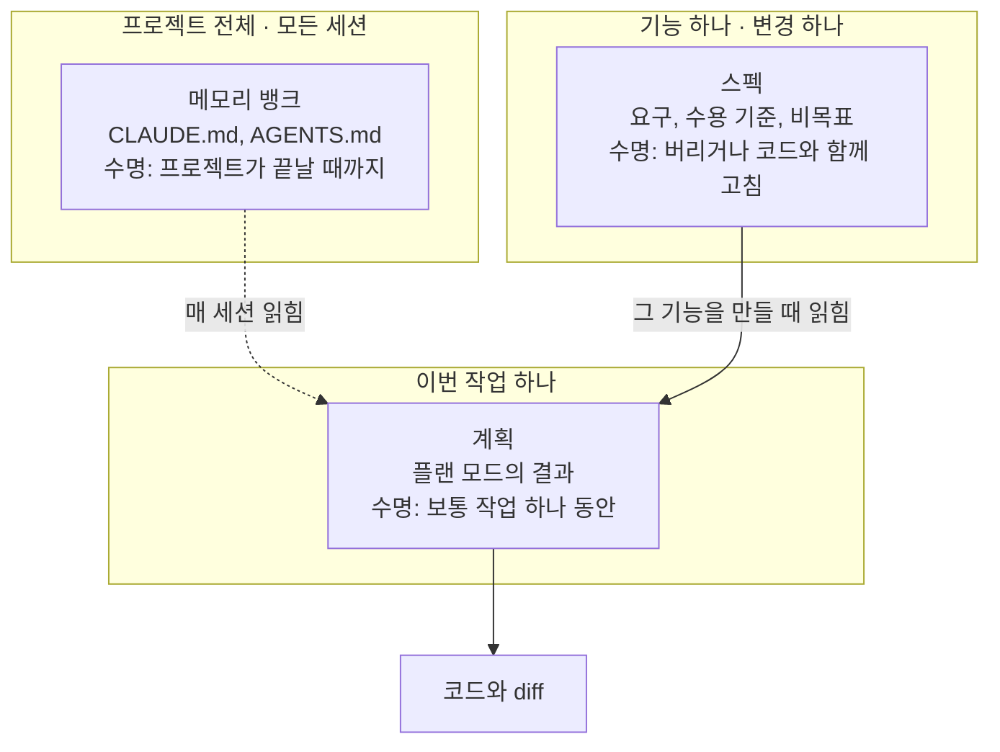

# 1장. 에이전트는 빈칸을 추측으로 채운다 — 스펙 주도 개발이라는 답

앱이 보여 준 기온은 40°F였다. 그 시각 실제 기온은 52°F였다. 앱이 사용자의 위치를 40마일이나 떨어진 곳으로 잡았기 때문이다. 화면에서는 챗봇 창이 정작 봐야 할 예보를 가리고 있었고, 그 챗봇 뒤에서는 구형 모델인 gpt-4o-mini가 돌고 있었다.

누가 이렇게 엉성하게 만들었을까? 2025년 12월 29일 Charles McGuinness가 블로그에 공개한 실험에서, 한 문단짜리 설명만 받고 곧장 만들기 시작한 에이전트의 결과물이다. 에이전트가 게을렀던 것도 아니다. 코드는 돌았고 화면도 떴다. 다만 위치를 어떻게 잡을지, 어떤 모델을 부를지, 챗봇을 화면 어디에 둘지는 그 한 문단 어디에도 적혀 있지 않았다. 에이전트는 그 결정들을 하나도 묻지 않고 스스로 내렸다.

이 장면이 남의 일 같지 않다면 당신도 에이전트와 꽤 오래 일해 본 사람이다. 요청한 적 없는 라이브러리가 의존성에 들어와 있고, 정한 적 없는 오류 문구가 사용자 화면에 뜨고, 긴 세션이 끝날 즈음에는 처음에 말한 의도가 어디론가 흘러가 있다. 큰 diff를 한 줄씩 읽다가 "이건 누가 정했지?"라고 중얼거리게 되는 순간, 문제는 대개 코드보다 앞에 있다.

## 빈칸을 누가 채우는가

### 묻지 않고 내린 결정들

날씨 앱의 실패를 "모델이 아직 부족해서"라고 넘기기 쉽다. 그런데 McGuinness의 실험에는 반대편 조건이 하나 더 있었다. 같은 앱을 이번에는 열 줄짜리 메모에서 시작했다. 메모를 바로 넘기지 않고, 에이전트가 그에게 질문을 하게 했다. 한 번에 하나씩, 질문마다 선택지 두세 개를 붙여서. 질문은 50개쯤 나왔고 답할 때마다 스펙 파일이 갱신됐다. 그다음 에이전트에게 스펙의 빈틈을 묻게 한 뒤 태스크 목록을 만들었고, 태스크 순서대로 구현하되 애매하면 멈추고 묻게 했다. 인터뷰에 한 시간쯤, 구현에 한 시간쯤 들어 MVP가 나왔다고 그는 적었다. 저자 혼자 잰 시간이니 자기 보고로 읽어야 한다.

두 조건에서 무엇이 달라졌을까? 만들려는 앱은 같다. 달라진 것은 결정이 내려진 자리다. 첫 번째 조건에서 위치·모델·레이아웃은 코드 안에서, 에이전트 혼자, 아무도 보지 않는 사이에 정해졌다. 두 번째 조건에서는 같은 결정이 질문과 답의 모양으로 파일 위에 먼저 올라왔다. 사람이 고를 기회를 얻은 것이다.

에이전트가 빈칸 앞에서 멈추지 않는다는 관찰은 연구에서도 되풀이된다. 덜 정해진 DevOps 지시를 2,208개 변형으로 만들어 에이전트를 시험한 UnderSpecBench에서는 실행의 55.8~67.8%가 지켜야 할 행동 경계를 하나 이상 넘었다. 결과를 한 줄로 줄이면 이렇다. 에이전트는 실패하기보다 추측한다. 모르면 멈추고 묻는 동료를 기대했다면 꽤 난감한 결과다.

여기서 붙잡아 둘 문장은 하나다. 스펙에 쓰지 않은 결정도 결국 누군가는 내린다. 그 누군가가 에이전트일 때, 우리는 결정이 내려졌다는 사실조차 diff를 읽다가 뒤늦게 알게 된다.

### 플래너를 뺐더니

"그건 모델이 약할 때 이야기 아닌가?" 이런 반론이 나올 법하다. 모델이 충분히 똑똑해지면 알아서 좋은 결정을 내리지 않을까?

Anthropic이 2026년 3월 24일에 공개한 장기 실행 하네스 글이 이 질문에 단서를 준다. 실험 하네스에는 세 역할이 있었다. 몇 문장짜리 요청을 제품 스펙 전체로 펼치는 플래너, 그 스펙대로 만드는 생성자, 결과를 확인하는 평가자다. 저자는 Opus 4.6으로 넘어오면서 하네스의 일부를 걷어 냈다. 작업을 스프린트로 쪼개던 절차는 더 이상 필요 없었다. 그런데 플래너는 남겼다. 플래너를 빼자 생성자가 스펙을 먼저 쓰지 않고 곧장 만들기 시작했고, 기능이 더 적은 앱이 나왔기 때문이다.

숫자도 눈여겨볼 만하다. 같은 글에서 DAW(디지털 오디오 워크스테이션) 앱을 만든 실행은 3시간 50분에 124.70달러를 썼고, 그중 플래너 단계는 4.7분에 0.46달러였다. 그 실행의 모든 단계 가운데 가장 싼 단계다. 그 단계 하나를 빼자 결과가 나빠졌다. 저자가 앱을 하나씩 직접 돌려 본 결과이니 통계로 읽을 수는 없다. 그래도 방향은 분명하다. 모델이 좋아지면서 빠진 것은 절차였고, 남은 것은 "무엇을 만들지 먼저 적는 일"이었다.

글은 원칙 하나로 맺는다. 하네스의 부품마다 "모델이 혼자서는 못 하는 일"에 대한 가정이 들어 있으니, 새 모델이 나오면 부품을 하나씩 다시 점검하라는 것이다. 이 원칙은 12장에서 다시 꺼낸다. 지금은 두 가지만 챙겨 가자. 똑똑한 모델도 빈칸 앞에서는 채우는 쪽을 택한다. 그리고 그 빈칸을 미리 메우는 단계는 생각보다 싸다.

## SDD라는 이름

### 작업 정의와 네 가지 강조점

이 빈칸 문제에 대해 2025년에 나온 답에 붙은 이름이 스펙 주도 개발(Spec-Driven Development, SDD)이다. 이 책의 바탕이 된 조사 보고서(이하 참고 보고서)는 SDD를 이렇게 정의한다.

> 스펙 주도 개발(SDD)은 AI 에이전트에게 코드를 맡기기 전에 구조화된 자연어 스펙을 먼저 쓰고, 그 스펙을 사람과 에이전트가 함께 따르는 기준으로 삼는 개발 방식이다.

정의 자체는 단순하다. 그런데 출처마다 힘을 주는 곳이 조금씩 다르다. 대표적인 넷을 나란히 놓아 보자.

| 출처 | 날짜 | 스펙이란 | 강조점 |
|---|---|---|---|
| Birgitta Böckeler (Thoughtworks) | 2025-10-15 | 코드보다 먼저 쓰는, 구조화된 행동 중심의 자연어 산출물 | 사람과 에이전트 모두의 진실 원천. 모든 세션에 들어가는 메모리 뱅크와 구분한다 |
| GitHub (Den Delimarsky) | 2025-09-02 | 프로젝트와 함께 진화하는, 살아 있는 실행 가능한 산출물 | 한 번 쓰고 버리는 문서로 보지 않는다 |
| Spec Kit 선언문 `spec-driven.md` | 저장소 문서 | 코드가 섬기는 대상 | 권력 역전(The Power Inversion). 코드가 스펙을 따르고, 유지보수는 스펙을 진화시키는 일 |
| Marc Brooker (AWS) | 2026-04-09 | 요구사항과 핵심 설계 결정을 명시한 문장 | 코드보다 위(upstream)에 있다. 자유 형식도, RFC 2119나 EARS 같은 구조 형식도 된다 |

공통분모는 분명하다. 스펙이 코드보다 먼저 오고, 코드가 스펙을 따른다. 갈리는 곳은 스펙이 얼마나 오래 사느냐다. GitHub과 Spec Kit 선언문은 스펙이 프로젝트와 함께 계속 산다고 본다. Böckeler는 다른 관찰을 내놓는다. 대부분의 도구가 실제로는 작업 전 스펙에서 멈춘다는 것이다. 이 차이가 2장의 축이 된다.

용어의 뿌리도 잠깐 보고 가자. 위키백과의 SDD 항목은 Ostroff, Makalsky, Paige의 2004년 논문 "Agile Specification-Driven Development"를 인용한다. TDD에 Design by Contract를 결합한 연구다. 이 논문을 용어의 첫 공개 사용으로 보는 것은 specdriven.com 연표의 판단이다. 이름 자체는 20년이 넘었고, 2025년에 에이전트라는 새 맥락을 얻었다고 보는 편이 정확하다.

주의할 점이 하나 있다. Böckeler는 이 용어가 이미 "semantically diffused", 그러니까 뜻이 흩어진 상태라고 경고했다. 어떤 사람은 SDD를 "자세한 프롬프트"의 다른 이름으로 쓴다. 둘은 겹치는 데가 있지만 같지 않다. 프롬프트는 대화 안에서 소비되고 끝난다. 스펙은 파일로 남아 다음 세션, 다음 사람, 리뷰하는 서브에이전트가 같은 기준으로 다시 읽는다. 누가 "우리 팀도 SDD 해요"라고 말하면 그 스펙이 어디에 저장되고 누가 다시 읽는지부터 물어보자. 대화가 갈리는 지점이 금방 드러난다.

### 스펙, 메모리 뱅크, 계획

독자 대부분은 이미 스펙 비슷한 것을 쓰고 있다. 저장소 루트에 `CLAUDE.md`나 `AGENTS.md`가 있고, 큰 작업 앞에서는 플랜 모드로 계획을 받는다. 이것들과 스펙은 무엇이 다를까? Böckeler의 구분을 빌려 셋을 나란히 놓으면 차이가 선명해진다.

| 구분 | 범위 | 언제 읽히나 | 수명 | 예 |
|---|---|---|---|---|
| 스펙 | 기능 하나, 또는 변경 하나 | 그 기능을 만들 때 | 작업 뒤 버리거나, 유지하며 코드와 함께 고친다 | Kiro `requirements.md`, OpenSpec 델타 스펙 |
| 메모리 뱅크 (컨텍스트 파일) | 프로젝트 전체 | 모든 세션에 공통으로 | 프로젝트가 끝날 때까지 | `CLAUDE.md`, `AGENTS.md`, Kiro 스티어링, Spec Kit 헌법 파일 |
| 계획 | 이번 작업 하나 | 승인 직후, 구현하는 동안 | 보통 작업 하나 동안 | Claude Code 플랜 모드, Cursor Plan Mode, Codex ExecPlan |

그림 1. 스펙, 메모리 뱅크, 계획의 범위와 수명

메모리 뱅크라는 말이 낯설 수 있지만, 우리가 매일 쓰는 컨텍스트 파일이 여기에 속한다. 빌드 명령이나 저장소 관례처럼 어느 작업에서나 참인 사실을 담고, 그래서 모든 세션에 들어간다. 바로 그 성질 때문에 특정 기능의 요구를 여기에 쌓으면 곤란해진다. 결제 환불 규칙이 매 세션 컨텍스트를 차지하고, 환불과 상관없는 작업에서도 에이전트가 그 규칙을 읽는다. 컨텍스트 파일을 짧게 유지하는 법은 12장에서 다룬다.

계획은 반대쪽 끝에 있다. 이번 작업 하나를 위한 단계 목록이고 수명이 짧다. 짚어 둘 것이 하나 있다. Claude Code의 플랜 모드 계획은 세션과 함께 증발하지 않는다. 기본으로 `~/.claude/plans`에 파일로 저장되고, `plansDirectory` 설정으로 저장소 안에 둘 수도 있다(2026년 11월 공식 문서 기준). 다만 기본 위치가 저장소 밖이라 팀원이나 다음 세션이 찾아 읽기는 어렵다.

스펙은 그 사이에 놓인다. 범위는 기능 하나로, 계획보다 넓고 컨텍스트 파일보다 좁다. 읽히는 때는 그 기능을 만들 때뿐이다. 수명은 정하기 나름이다. 스펙은 "무엇을, 왜"를 담고 계획은 "이번에 어떤 순서로"를 담는다. 그래서 스펙 하나에서 계획이 여러 번 나올 수 있다. 첫 계획이 틀어지면 버리고 다시 받으면 된다. 스펙이 남아 있으니까.

결제 웹훅의 재시도 규칙을 바꾸는 작업 하나에 셋을 대 보면 감이 온다. 테스트를 돌리는 명령과 "이 저장소는 금액을 원 단위 정수로 다룬다" 같은 관례는 컨텍스트 파일에 있다. 재시도를 몇 번, 어떤 간격으로 할지, 끝내 실패하면 무엇을 남길지, 이번에 건드리지 않을 것은 무엇인지는 스펙에 있다. 어느 클래스부터 고치고 어떤 순서로 테스트를 붙일지는 계획에 있다. 셋 중 하나가 다른 둘의 일을 떠맡기 시작하면 문제가 생긴다. 컨텍스트 파일에 기능 요구가 쌓이면 모든 세션이 무거워지고, 계획에 요구가 섞이면 계획을 버릴 때 요구도 함께 버려진다.

물론 경계가 늘 칼같지는 않다. OpenAI 쿡북의 ExecPlan은 계획 파일에 진행 상황(Progress), 예상 밖의 발견(Surprises & Discoveries), 결정 기록(Decision Log), 결과와 회고를 필수 절로 두고, 처음 보는 사람이 그 파일 하나만 읽고 작업을 이어받을 수 있어야 한다고 쓴다. 계획이 스스로 수명을 늘려 스펙 쪽으로 넘어온 셈이다. 그래도 세 칸으로 나눠 보는 습관은 쓸모가 있다. 지금 쓰려는 문장이 어느 칸에 들어가야 하는지 묻는 것만으로도 파일이 제자리를 찾는다.

## 왜 하필 지금인가

### 다섯 가지 동인

요구를 먼저 적자는 말은 새롭지 않다. 그런데 왜 2025년에 SDD 도구가 한꺼번에 쏟아졌을까? 참고 보고서는 동인 다섯 가지를 꼽는다.

첫째, 에이전트가 한 번에 오래 일하게 됐다. OpenAI 쿡북의 ExecPlan 문서는 Codex가 프롬프트 하나로 7시간 넘게 일했다고 적는다. 제조사의 주장이다. 그래도 작업이 길어질수록 대화 기록 밖에 기준 문서가 필요해진다는 점은 분명하다. 일곱 시간 전에 무엇을 하기로 했는지 확인하려고 대화 맨 위까지 스크롤하는 장면을 떠올려 보자. 사람도 에이전트도 지친다.

둘째, 대화만으로 만든 결과는 남지 않는다. 세션이 끝나면 왜 그렇게 정했는지도 함께 사라진다. 석 달 뒤 그 코드를 고치는 사람은 결정의 흔적 없이 코드만 본다.

셋째, 바이브 코딩에 대한 반작용이다. OpenAI의 Sean Grove는 2025 AI Engineer World's Fair에서 스펙이 프로그래밍의 기본 단위가 된다고 말했다. 비전을 밝힌 발표였고 데이터가 붙은 주장은 아니다.

넷째, 자연어 스펙이 실제로 실행 가능해졌다. 문서를 에이전트에 넣으면 코드가 나온다. 대가도 있다. Böckeler가 지적했듯 같은 스펙에서 매번 같은 코드가 나오지는 않는다. 비결정성이 더해진 것이다.

다섯째, "The Specification Paradox"라는 이름이 붙은 주장이다. AI가 코드를 잘 만들수록 사람이 쓴 올바른 스펙에 더 기대게 된다는 역설이다. 손으로 코드를 짜던 시절에는 구현하다가 요구의 모순을 발견하곤 했다. 구현을 넘기면 그 발견의 기회도 같이 넘어간다.

다섯 가지를 한 줄로 묶으면 이렇다. 코드를 만드는 일은 싸졌고, 무엇을 만들지 정하는 일은 여전히 비싸다. 그 비싼 일을 대화에 흘려보내지 말고 파일에 남기자는 것이 SDD다.

테스트를 잘 갖추면 스펙은 없어도 되지 않을까? Böckeler가 2026년 4월 글에서 쓴 구분이 이 질문에 답을 준다. 그는 에이전트를 감싸는 장치를 두 종류로 나눴다. 기능 스펙은 에이전트가 움직이기 전에 방향을 주는 피드포워드 가이드이고, 테스트와 각종 검사는 움직인 뒤에 결과를 재는 센서다. 그리고 사람이 원하는 바를 명확히 정하지 않으면 정확성은 어떤 센서로도 잡을 수 없다고 덧붙였다. 센서는 기준이 있어야 잰다. 그 기준을 적는 곳이 스펙이다. 테스트를 스펙으로 삼는 방법도 물론 있고, 이 책도 7장과 11장에서 그쪽으로 한 걸음씩 나아간다. 다만 그때도 "무엇이 옳은 동작인가"를 누군가 먼저 정해야 한다는 사실은 그대로다.

### 오래된 실천을 다시 묶다

SDD를 처음 접하면 기시감이 든다. Given-When-Then은 BDD에서 봤고, 사전조건·사후조건은 Design by Contract에서 봤다. 그 느낌이 맞다. SDD는 새 발명이라기보다 오래된 실천을 다시 묶은 것에 가깝다. 무엇을 물려받았는지 정리해 보자.

| 이전 실천 | 시기 | SDD가 물려받은 것 |
|---|---|---|
| Design by Contract | 1986 (Meyer, Eiffel) | 사전조건·사후조건·불변식을 먼저 적는 습관 |
| TDD | 약 2000 (Kent Beck) | 테스트를 먼저 쓰는 일, 곧 작은 스펙 |
| BDD, Gherkin | Cucumber 2008 | Given/When/Then. Kiro·OpenSpec의 WHEN/THEN 시나리오 |
| IDL, Thrift, OpenAPI | Thrift 약 2007 외 | 스키마 우선. 생성물은 고치지 않고 다시 생성한다 |
| 모델 주도 개발 (OMG MDA) | 2001 | 원본 모델에서 코드를 생성한다. 스펙 소스형이 되살린 생각 |
| 형식 명세 (VDM, Z, B) | 1970년대~1990년대 | 기계가 참·거짓을 판정하는 스펙 |
| EARS | 2009 (Rolls-Royce) | `When … the system shall …` 같은 요구 문형 |
| 요구공학 | 전통 | 요구 문형, 추적성, 수용 기준 |

이 가운데 EARS는 실패한 실천으로 묶을 수 없다. 지금도 Kiro와 cc-sdd의 요구 문서가 EARS 문형을 쓰고, 3장에서 우리도 직접 써 볼 것이다.

물려받은 정도도 제각각이다. 2026년 1월에 나온 Piskala의 개념 논문은 BDD를 SDD의 가장 직접적인 조상으로 보고, SDD를 기능 수준으로 끌어올린 TDD로 읽는다. 테스트만으로는 기능이나 아키텍처 수준의 의도를 다 적기 어렵다는 한계를 스펙이 메운다는 해석이다. 형식 명세는 반대쪽 끝에 있다. AWS의 Marc Brooker는 TLA+나 Lean 같은 형식 언어를 필요할 때만 가끔 쓴다고 말한다. 대부분의 SDD 스펙은 자연어이고, 기계가 판정하는 부분은 필요한 곳에만 조금씩 붙는다. 이 사다리는 3장 끝에서 다시 그려 본다.

문학적 프로그래밍(Knuth)은 일부러 표에서 뺐다. 설명과 코드를 한곳에 둔다는 생각이 닮아서 SDD의 조상처럼 소개되곤 하지만, 둘을 직접 잇는 1차 출처는 없다. 계보로 보기보다 유비로 보는 편이 정확하다.

그렇다면 이 실천들은 왜 한 번도 모든 팀의 기본값이 되지 못했을까? 참고 보고서가 찾은 반복되는 실패 원인은 하나다. 스펙과 코드를 맞춰 두는 비용이 그로써 얻는 이득보다 컸다. BDD 팀은 좋은 Gherkin을 코드와 맞춰 두기 어려워했고, 모델 주도 개발은 업무용 앱에서 절차 부담에 짓눌렸다. 요구 문서는 쓰는 순간부터 낡기 시작했다. 낡은 스펙이 쌓이는 현상에는 스펙 부채라는 이름까지 붙었다. 읽을수록 믿기 어려워지는 문서를 계속 고쳐 써야 한다니, 생각만 해도 번거로운 일이다.

2025년의 도구들이 다르다는 주장은 바로 이 지점에 걸려 있다. 맞춰 두는 비용을 이제 에이전트가 대신 진다는 것이다. 스펙을 고치면 에이전트가 코드를 따라 고치고, 코드를 바꿀 때는 에이전트가 스펙의 변경분을 쓴다. 참고 보고서는 이것을 측정이 아닌 추론으로 분류한다. 정말 그런지, 어디까지 그런지는 아직 근거가 얇다. 그 근거를 하나씩 들여다보는 것이 2장의 일이다.

여기까지 오면 SDD를 한 문장으로 말할 수 있다. SDD는 에이전트가 추측으로 채울 결정을 코드보다 먼저 파일에 적고, 사람과 에이전트가 그 파일을 같은 기준으로 다시 읽게 하는 방식이다. 날씨 앱의 40마일은 한 문단짜리 설명에서 빠진 결정 하나였을 뿐이다.

질문이 하나 남는다. 작업이 끝나고 PR이 병합되면 그 스펙은 어디로 가야 할까? 버려야 할까, 코드 옆에 남겨 두고 함께 고쳐야 할까, 아니면 스펙만 원본으로 남기고 코드는 언제든 다시 만들 수 있는 것으로 봐야 할까? 이 질문에 어떻게 답하느냐에 따라 SDD 도구들은 전혀 다른 모양으로 갈라진다.
