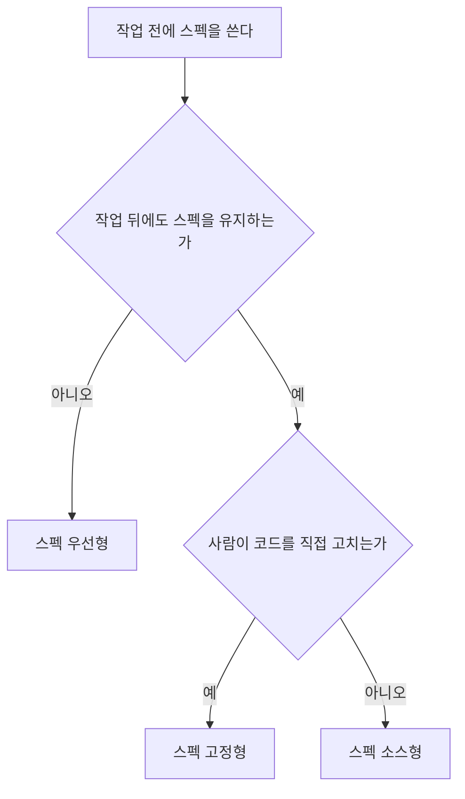

# 2장. 스펙은 얼마나 오래 사는가 — SDD의 지도와 2026년의 좌표

흔히 스펙 주도 개발(Spec-Driven Development, SDD)을 "스펙을 먼저 쓰는 것"이라고 한다. 틀린 말은 아닌데, 이 정의로는 도구를 하나도 구분할 수 없다. Spec Kit도, OpenSpec도, Kiro도, 하네스에 들어 있는 플랜 모드조차도 모두 코드보다 먼저 무언가를 쓴다. 방법들이 실제로 갈리는 곳은 출발선보다 결승선 쪽이다. 다 만든 뒤에 그 스펙은 어떻게 되는가?

1장 끝에서 남긴 질문이 바로 이것이었다. 이 질문 하나로 SDD의 지도를 그리고, 그 위에 2026년 11월 현재의 근거를 올려 보자. 미리 말해 두면, 근거가 하는 말은 생각보다 절제되어 있다.

## 스펙의 세 가지 수명

### 우선형, 고정형, 소스형

Birgitta Böckeler는 2025년 10월 15일 글에서 SDD를 세 수준으로 나눴다. 기준은 하나, 작업이 끝난 뒤 스펙의 운명이다.

| 수준 | 스펙의 운명 | 사람이 고치는 것 | 대표 사례 |
|---|---|---|---|
| 스펙 우선형 (spec-first) | 작업 전에 쓰고 그 작업에 쓴다. 작업 뒤 버려지거나 방치될 수 있다 | 스펙과 코드 | Kiro, Spec Kit |
| 스펙 고정형 (spec-anchored) | 작업 뒤에도 남고, 스펙과 코드를 함께 바꾼다 | 스펙과 코드를 같이 | OpenSpec의 아카이브 병합, Tessl이 목표로 삼았던 모습 |
| 스펙 소스형 (spec-as-source) | 스펙만 원본이고, 코드는 스펙에서 다시 생성한다 | 스펙만 | Tessl Framework 실험 |

한국어로는 요즘IT 번역본(안영회 역, 2025-12-01)으로 이 글을 접한 독자가 많을 것이다. 번역본은 세 수준을 "스펙 우선", "스펙 고정형", "스펙을 소스로"라고 옮겼다. 이 책은 세 번째를 "스펙 소스형"으로 통일한다.

처음 보는 도구를 만나면 두 번만 물으면 된다. 작업 뒤에도 스펙을 유지하는가? 유지한다면, 사람이 코드를 직접 고치는가?

그림 1. 스펙의 수명으로 SDD 방법을 가르는 흐름

이 흐름에 도구를 하나씩 넣어 보면 재미있는 사실이 드러난다. 대부분이 첫 갈림길에서 왼쪽으로 빠진다. 모든 SDD 접근은 스펙 우선형에서 출발하지만, 작업 뒤 스펙을 어떻게 유지할지 전략을 정해 둔 도구는 적다. 그래서 Böckeler는 대부분의 도구가 실제로는 스펙 우선형이라고 봤다. 선언문이 "살아 있는 산출물"을 말하더라도, 병합 뒤에 기능 폴더가 다시 열리지 않는다면 그 스펙은 우선형으로 산다. 도구의 구호와 스펙의 실제 수명은 따로 확인하자.

지도의 가장 먼 끝에 스펙 소스형이 있다. 가능성을 보여 준 시연은 있다. Monperrus는 926단어짜리 스펙과 Claude Code의 첫 구현에서 출발해, 새로 띄운 에이전트가 같은 스펙만 보고 처음부터 다시 올바르게 구현하는 것을 보였다. IEEE Software 게재 예정인 글이고, 시연은 한 번이다. 이 방향을 제품으로 밀던 Tessl은 2025년 9월 Framework 비공개 베타와 Spec Registry를 공개했지만, 2026년 1월 29일 스킬 패키지 관리 플랫폼으로 방향을 틀었다. 넉 달쯤 만의 전환이다. 1장에서 본 모델 주도 개발이 원본 모델에서 코드를 생성하려다 절차 부담에 막혔던 일을 떠올리면, 스펙 소스형은 그 오래된 꿈의 자연어판이라 할 만하다. 2026년 11월 현재로서는 실험 단계에 머물러 있다.

## 무엇으로 통제하는가

### 문서, 습관, 반복

수명이 SDD를 가르는 한 축이라면, 두 번째 축도 있다. 에이전트를 무엇으로 붙잡아 두는가, 곧 통제 단위다. 참고 보고서는 2026년의 SDD 도구가 세 갈래로 다시 묶인다고 본다.

첫째 갈래는 **문서 파이프라인**이다. 요구 → 설계 → 태스크 같은 문서 사슬을 만들고 단계 사이에 승인 관문을 둔다. 통제 단위는 문서와 관문이다. Spec Kit, Kiro 스펙, OpenSpec, BMAD가 여기에 속한다. 둘째 갈래는 **스킬 규율**이다. 고정된 문서 대신 "먼저 질문하라", "계획을 세워라", "테스트부터 써라", "리뷰를 받아라" 같은 습관을 스킬로 강제한다. Superpowers와 mattpocock/skills가 대표다. 셋째 갈래는 **계획-실행 루프**다. 계획 파일이나 태스크 그래프를 새 컨텍스트에서 되풀이해 실행하고, 진행 상황을 파일에 남긴다. GSD나 Ralph 루프 같은 이름이 여기에 있다.

어느 갈래에도 넣기 애매한 것이 하나 더 있다. 하네스에 들어 있는 네이티브 플랜 모드다. 참고 보고서는 이것을 "가장 작은 스펙 우선형"이라고 부른다. 작업 전에 쓰이고, 그 작업에만 쓰이기 때문이다. 계획이 파일로 남는 하네스도 있지만(1장에서 본 Claude Code는 기본으로 저장소 밖 `~/.claude/plans`에 저장한다), 다음 작업의 기준으로 다시 열리는 일은 드물다. 설치 비용이 없다는 점에서, 모든 독자가 이미 손에 쥔 출발점이기도 하다.

참고 보고서는 이 갈래들을 더 잘게 나눠 F1~F8이라는 기호를 붙였다. 연구 노트를 묶어 낸 보고서의 추론이다. 이 책은 본문에서 되도록 계열 이름으로 부르고, 기호를 쓸 때는 참고 보고서의 분류라고 밝힌다.

| 기호 | 계열 | 무엇이 스펙인가 | 대표 도구 |
|---|---|---|---|
| F1 | 단계 게이트형 파이프라인 | 요구 → 설계 → 태스크 문서 사슬과 단계별 승인 | Spec Kit, Kiro 스펙, cc-sdd |
| F2 | 변경 델타형 | 변경마다 쓰는 제안과 델타 스펙. 끝나면 리빙 스펙에 병합 | OpenSpec |
| F3 | 역할 시뮬레이션형 | PM, 아키텍트 같은 역할 에이전트가 차례로 만드는 문서 | BMAD |
| F4 | 스킬 규율형 | 고정 문서 대신 질문·계획·TDD·리뷰 습관을 강제하는 스킬 | Superpowers, mattpocock/skills |
| F5 | 계획-실행 루프형 | 계획 파일이나 태스크 그래프를 새 컨텍스트에서 반복 실행 | GSD, Taskmaster, Ralph 루프 |
| F6 | 네이티브 플랜 모드 | 하네스 내장 읽기 전용 계획 단계의 결과 | Claude Code 플랜 모드, Cursor Plan Mode |
| F7 | 스펙 소스형 실험과 역공학 | 코드를 재생성하는 원본 스펙, 또는 기존 코드에서 복원한 스펙 | Tessl Framework(전환됨), Reversa |
| F8 | 검증 중심형 | 테스트, 속성, 계약, 형식 명세처럼 기계가 판정하는 스펙 | VSDD, Kiro 속성 기반 테스트, Specmatic MCP |

표를 읽을 때 놓치기 쉬운 점이 있다. 계열(통제 단위)과 수준(수명)은 서로 다른 축이다. F1 단계 게이트형 도구도 수명으로 따지면 대부분 스펙 우선형이다. 반면 F2의 OpenSpec은 변경이 끝날 때마다 델타 스펙을 리빙 스펙에 병합하는 아카이브 단계 덕분에 스펙 고정형에 가깝다. 같은 문서 파이프라인 안에서도 스펙의 수명은 이렇게 갈린다. 4장과 5장에서는 이 두 축을 좌표 삼아 도구를 하나씩 지도 위에 올린다.

## 근거의 지형

### 같은 티켓 50개로 잰 측정

지도를 그렸으니 이제 물을 차례다. SDD는 실제로 값을 하는가? 같은 과제로 여러 도구를 나란히 잰 실무 통제 비교는 2026년 11월 현재 하나뿐이다. Uvik이라는 회사가 2026년 10월 15일에 돌리고 11월 2일에 갱신한 벤치마크다.

설계부터 보자. 고객 저장소 다섯 곳에서 티켓 50개를 골랐다. 모두 기존 코드가 있는 브라운필드 Python이다. 유형은 버그 수정, 기능, 리팩터링, 데이터 파이프라인, 테스트 작성이 10개씩이고, 크기는 작음 20개, 중간 20개, 큼 10개였다. 스펙 단계와 구현 단계에 각각 45분 제한을 두었다. 시니어 엔지니어 다섯 명이 어느 도구의 결과인지 모른 채 리뷰했고, 잡음을 재려고 티켓 10개는 다시 돌렸다. 모델은 claude-sonnet-5 하나였다. Kiro만 자체 IDE에서 돌았고 나머지는 모두 Claude Code에서 돌았다.

전체 병합률은 스펙 없이 바로 구현한 대조군이 72%, Spec Kit 80%, Kiro 스펙과 BMAD가 각각 82%, OpenSpec이 84%였다. 리뷰에서 나온 병합 티켓당 결함은 대조군 0.86에 비해 네 도구 모두 낮았고, 스펙 쪽 평균은 0.46이었다. 여기까지만 보면 스펙을 쓰면 다 좋아지는 것처럼 보인다.

흥미로운 장면은 크기별로 쪼갠 결과에서 나온다.

| 수정 파일 수 | 대조군 | 최고 스펙 조건 | 차이 |
|---|---|---|---|
| 1~2개 (작음) | 85% | 85% | 0%p |
| 3~5개 (중간) | 70% | 85% | +15%p |
| 6개 이상 (큼) | 50% | 80% | +30%p |

파일 한두 개를 고치는 티켓에서 스펙은 아무것도 더하지 않았다. 대조군도 85%, 가장 잘한 스펙 조건도 85%다. 파일이 3~5개로 늘면 15%p가 벌어지고, 6개를 넘으면 차이가 30%p로 커진다. 작업 유형으로 나눠 봐도 결은 같다. 버그 수정은 대조군 90%에 스펙 조건 80~90%로 이득이 없었고, 리팩터링은 둘 다 80%였다. 대조군 60%가 스펙 조건에서 최고 90%까지 올라 잡음 대역을 벗어난 것은 기능과 데이터 파이프라인, 두 유형뿐이었다.

비용 쪽은 어떨까? 병합까지 걸린 시간은 대조군이 가장 짧았다. 중앙값 29분이다. 스펙 단계는 티켓마다 중앙값으로 12~28분을 더했다. 작은 티켓에 이 시간을 붙이면 얻는 것 없이 시간만 잃는다. 변경이 클수록 이득이 커지고, 작을수록 비용만 남는다. 이 책의 판단은 대부분 이 한 문장에서 출발한다.

### 숫자를 읽기 전에 볼 조건

이 숫자를 그대로 믿어도 될까? 측정 하나가 책의 기조를 받친다면 그 측정의 한계도 함께 들고 다녀야 한다. 참고 보고서는 Uvik 결과를 옮길 때 붙여야 할 경고를 여섯 가지로 정리했다. 이 책도 그대로 따른다.

가장 먼저 볼 것은 잡음 대역이다. 같은 티켓을 다시 돌렸을 때 병합률이 흔들린 폭이 ±10%p였다. 이 대역을 확실히 벗어난 도구는 OpenSpec(+12%p) 하나뿐이다. Spec Kit(+8%p)은 대역 안에 있고, Kiro와 BMAD(각 +10%p)는 경계에 걸려 있다. 그래서 Uvik 스스로도 도구 순위를 매기지 않았다. "OpenSpec이 1등"이라는 읽기도, "Spec Kit이 꼴찌"라는 읽기도 이 데이터는 허락하지 않는다.

리뷰 결함이 네 도구 모두 대조군보다 낮았다는 점은 순위와 상관없이 읽을 수 있는 결과다. 반대로 시간은 대조군이 가장 짧았다는 점도 함께 적어야 한다. 비용에도 함정이 있다. Kiro의 병합 티켓당 비용(2.35달러)은 대조군(2.43달러)보다 낮게 나왔지만, Kiro만 다른 하네스에서 모델을 손으로 설정해 돌았다. 이 차이를 도구 효과로 읽어서는 곤란하다. 대조군이 플랜 모드를 썼는지도 실험 노트에 없다. 그러니 이 결과를 "문서 파이프라인 대 플랜 모드"의 대결로 읽을 수도 없다.

마지막은 조건이다. Uvik은 Python 개발과 인력 지원 서비스를 파는 회사이고, 이 이해관계를 페이지에 밝혀 두었다. 통제 실험이었고 리뷰는 블라인드였지만, 티켓은 50개이고 모델은 하나다. 크기 칸마다 표본은 더 작아진다. 이 책에서 Uvik 숫자를 인용할 때마다 이 조건을 같이 적는 이유다.

이 조건을 다 붙이고도 크기 신호를 강하게 보는 데는 이유가 있다. 다른 출처들이 같은 방향을 가리킨다. SDD 저장소를 채굴한 연구에서 스펙의 82.0%는 기능(feat) 라벨이 붙은 작업이었고, 실무자들은 버그를 스펙 없이 직접 프롬프트로 고쳤다. OpenSpec의 FAQ도 한 글자 오타 수정에는 절차 부담이 맞지 않는다고 적는다. 측정 하나에 기대기보다 여러 출처가 한 방향으로 모인다는 점이 이 신호의 힘이다.

비어 있는 곳도 분명히 해 두자. 스킬 규율 계열(Superpowers, mattpocock/skills)과 네이티브 플랜 모드는 Uvik이 재지 않았고, 다른 방법과 같은 과제로 잰 독립 측정도 없다. 그러니 "가벼운 방법이 더 낫다"는 결론도, "더 못하다"는 결론도 지금은 낼 수 없다. 점수가 없다는 것은 효과가 없다는 뜻이 아니라 아직 아무도 재지 않았다는 뜻이다.

Uvik은 결과에서 실용적인 규칙 하나를 뽑아냈다. 아래 여섯 조건 가운데 참인 것이 셋 이상이면 스펙을 쓰라는 것이다. 이 책은 참인 조건의 수를 스펙 적합성 점수라고 부른다.

| 번호 | 조건 |
|---|---|
| 1 | 파일 3개 이상을 건드린다 |
| 2 | 수용 기준이 4개 이상이다 |
| 3 | 모듈, 서비스, 저장소 경계를 넘는다 |
| 4 | 스키마나 공개 API를 바꾼다 |
| 5 | 여러 엔지니어나 여러 에이전트가 참여한다 |
| 6 | 규제나 감사 대상이다 |

지금 머릿속에 있는 다음 작업에 이 여섯 줄을 대 보자. 몇 점이 나오는가? 0점짜리 변경과 4점짜리 변경을 어떻게 다르게 다룰지는 11장의 변경 크기 사다리에서 본격적으로 정한다. 지금은 점수를 세는 습관 하나만 들여도 충분하다.

## 의견은 어떻게 움직였나

### 여섯 국면과 Radar의 링

측정과 별개로 업계의 의견도 1년 남짓 사이에 크게 출렁였다. 참고 보고서는 2025년 중반부터 2026년 11월까지를 여섯 국면으로 정리한다. 보고서가 여러 글을 묶어 낸 구분이니 거친 윤곽으로 읽자.

첫 국면은 2025년 중반의 비전이다. 스펙이 새로운 진실의 원천이 된다는 선언이 나왔지만 데이터는 없었다. 2025년 10~12월에는 첫 체험과 반발이 왔다. 직접 써 본 사람들이 절차 부담과 마크다운 검토 피로, 워터폴 같은 느낌을 이야기하기 시작했다. 2026년 1~5월은 반박과 재구성의 시기였다. "워터폴이 아니다"라는 반론이 나왔고, Kiro는 설계 우선 흐름과 버그픽스 스펙을 더해 적응했다. 2026년 봄에는 도구 정렬이 일어났다. 무거운 도구와 가벼운 도구를 비용으로 견주는 글이 이어졌다. 2026년 여름에는 피로가 찾아왔다. "SDD는 어떻게 됐나"라는 물음에, 모델이 좋아져서 plan.md와 검증 루프로 충분한 경우가 많다는 답이 돌아왔다. 그리고 2026년 11월, 정착한 중간 지대에 이른다. 질문이 "SDD를 할까 말까"에서 "하네스 안에서 스펙을 어디까지 둘까"로 옮겨 갔다.

이 흐름을 가장 잘 보여 주는 것이 Thoughtworks Technology Radar의 링 이동이다.

| 항목 | 2025-11 (Vol 33) | 2026-04 (Vol 34) | 2026-11 (Vol 35) |
|---|---|---|---|
| 스펙 주도 개발 (기법) | Assess | - | 현재 판에 없음 |
| GitHub Spec Kit | - | Assess | 현재 판에 없음 |
| OpenSpec | - | Assess | **Trial** |
| AI 기반 문서 난립 | - | - | Caution |
| 에이전트 지시문 비대 | - | - | Caution |

Vol 35가 2026년 11월 판이라는 사실은 페이지에 적혀 있다. Vol 33과 Vol 34라는 번호는 연 2회 발행 주기에서 거꾸로 센 값이다.

눈여겨볼 것은 Vol 35의 조합이다. 같은 판에서 OpenSpec을 Assess에서 Trial로 올리면서, AI가 만드는 문서 난립과 에이전트 지시문 비대를 Caution에 넣었다. 문서 난립 항목은 Spec Kit과 BMAD가 쏟아내는 대량의 마크다운을 지목했고, 지시문 비대에 대해서는 규칙을 훅과 검사로 옮기고 모델이 바뀔 때마다 다시 평가하라고 처방했다. 스펙 고정형 도구 하나를 추천하면서 SDD의 부작용 두 개에 경고를 붙인 셈이다. 참고 보고서는 이 조합을 "SDD를 고르되 문서 양을 통제하라"는 신호로 읽는다.

### 워터폴의 귀환인가

SDD 이야기를 꺼내면 거의 빠짐없이 나오는 질문이 있다. 요구를 먼저 다 쓰고 나서 만든다니, 이거 워터폴 아닌가?

이 비판에는 근거가 있다. Marmelab은 2025년 11월 12일 글에서 컨텍스트 맹목, 마크다운 과부하, 관료주의, 가짜 애자일 스토리, 이중 검토를 문제로 꼽았다. SDD가 개발의 약 80%를 읽는 일로 바꾼다는 추정도 덧붙였는데, 측정이 아니라 저자의 추정이다. Martin Fowler가 2026년 1월 글에서 전한 Kent Beck의 반론은, 구현하는 동안 스펙을 바꿀 만한 것을 아무것도 배우지 않는다는 가정 자체가 이상하다는 것이었다. 두꺼운 요구 문서를 승인받고 석 달 뒤에야 그 문서가 틀렸다는 걸 알게 되는 장면, 경력이 좀 있는 개발자라면 한 번쯤 겪어 봤을 끔찍한 일이다.

반대편의 목소리도 있다. Atomic Object는 2026년 5월 22일 글에서 SDD가 워터폴과 네 가지가 다르다고 정리했다. 스펙을 바꾸는 시점, 병렬로 진행하는 설계, 스펙 안에 들어간 완료 기준, 그리고 개발자가 스펙 수정을 소유한다는 점이다. Marc Brooker는 되풀이해 고치는 대상이 코드에서 스펙으로 옮겨 갔을 뿐이라고 본다.

2026년 11월 시점의 판정은 반반이다. 절차에 대한 비판은 대부분 해소됐다. 제조사들이 버그픽스 스펙, 설계 우선 흐름, 변경 범위 흐름을 내놓으며 스스로 절차를 줄였다. 문서 양에 대한 비판은 여전히 유효하다. 2025년에 Spec Kit을 향했던 비판 일곱 개를 2026년 11월 기준으로 다시 보면, 넷은 해결됐고 하나는 부분적으로 해결됐지만 둘은 그대로 남아 있다. 기능마다 파일이 많다는 것, 그리고 긴 마크다운을 검토하는 부담이다. 2025년의 체험기를 읽을 때 날짜와 도구 버전부터 확인하자는 이유가 여기에 있다. 같은 비판이라도 어떤 것은 이미 낡았고 어떤 것은 지금도 아프다.

## 이 책의 기조

### 선택지로서의 SDD

지도와 근거를 다 펼쳤으니 이 책이 서 있는 자리를 밝혀 두자. 참고 보고서의 결론 판단을 그대로 옮긴다.

> 2026년 11월의 SDD는 모든 작업의 기본 방법이 아니다. 큰 변경마다 고르는 선택지다.

이것은 보고서의 추론이다. 그리고 이 추론을 받치는 일곱 가지 판단 가운데 이 책이 끝까지 붙들고 갈 셋이 있다.

첫째, 스펙의 이득은 큰 변경에서만 측정된다. 앞에서 본 파일 수별 병합률이 근거다. 6장에서 예제 변경의 점수를 매기는 일도, 11장에서 변경마다 단을 고르는 일도 이 판단에서 나온다.

둘째, 가장 강한 근거는 도구보다 부품에 있다. 이름 있는 도구 사이의 우열은 앞서 봤듯 아직 가릴 수 없다. 대신 부품 단위의 근거는 두껍다. 처음부터 정리해 한 번에 건넨 스펙이 대화 속에서 조금씩 자란 스펙보다 충실하게 구현된다는 측정이 있고, 사람이 쓴 테스트를 받은 에이전트가 SWE-Bench Verified에서 94.3%를 냈다는 측정이 있고, 명확화 질문이 정답률을 올린다는 측정이 있다. 이 책이 도구 장(8~10장)보다 도구 없는 SDD(6~7장)를 먼저 두는 까닭이다. 부품을 먼저 손에 익히면 어떤 도구를 만나도 그 도구가 어떤 부품을 어떻게 묶었는지 보인다.

셋째, 관문은 작업한 에이전트 밖에 둘 때만 믿을 수 있다. 자기 작업을 스스로 판정하게 한 오케스트레이터는 블록 점검 247회 동안 선언하지 않은 변경을 11번 기록했고, 그중 작업을 멈춘 것은 4번뿐이었다. 논문 저자들이 직접 운영한 기능 아홉 개의 기록이다. 다른 연구에서는 LLM 판정이 실행 평가기가 잡은 실패의 26%를 놓쳤다. 에이전트가 "완료"라고 말할 때 그 말을 누가 확인하는가? 7장은 이 질문으로 검증의 기준선을 세운다.

선택지라는 말을 가볍게 넘기지 말자. 고른다는 것은 고르지 않을 때도 있다는 뜻이다. 이 책은 SDD를 가르치지만, SDD를 덜어 내는 법도 같은 무게로 다룰 것이다.

그러려면 먼저 내 변경이 어떤 크기인지 알아야 한다. 지난주에 병합한 변경 다섯 개를 떠올려 보자. `git log --stat`을 열어도 좋다. 변경마다 수정한 파일 수를 세어 적고, 그중 6개 이상이 몇 개였는지 표시해 두자. 0개일 수도 있고 다섯 개 전부일 수도 있다. 그 숫자가 이 책을 읽는 내내 당신의 기준선이 된다. 11장에서 이 메모를 다시 꺼낼 것이다.

### 이 장의 핵심

- SDD 방법은 작업 뒤 스펙의 운명에 따라 스펙 우선형·스펙 고정형·스펙 소스형으로 갈리고, 대부분의 도구는 실제로는 스펙 우선형이다.
- 통제 단위로 보면 문서 파이프라인·스킬 규율·계획-실행 루프의 세 갈래와 네이티브 플랜 모드가 있고, 이 축은 수명과 따로 움직인다.
- 같은 티켓으로 잰 유일한 실무 비교(Uvik, 서비스 회사 운영, n=50, 모델 1개, 잡음 대역 ±10%p)에서 스펙의 이득은 수정 파일 수가 많을수록 컸고(1~2개 0%p, 6개 이상 +30%p), 스펙 단계는 티켓마다 12~28분을 더했다.
- 스킬 규율 계열과 플랜 모드는 독립 측정이 없어 다른 방법과 우열을 말할 수 없다.
- 이 책의 기조는 하나다. SDD는 모든 작업의 기본값이 아니라 큰 변경마다 고르는 선택지다.
