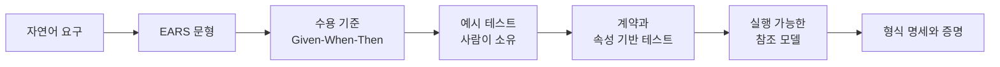

# 3장. 좋은 스펙의 해부 — 요구, 수용 기준, 비목표, 결정

"부분 환불 만들어 줘." 에이전트 창에 이렇게 한 줄을 보내면, 결정 몇 개가 내 손을 떠날까?

하나나 둘쯤이라고 답했다면 다시 세어 볼 일이다. 이 질문에 제대로 답하려면 구체적인 코드베이스가 필요하다. 이 책의 끝까지 함께 갈 프로젝트를 소개하고, 그 프로젝트의 요구 한 줄을 문장 단위로 해부해 보자. 스펙 주도 개발(Spec-Driven Development, SDD)에서 "좋은 스펙"이란 결국 좋은 문장들의 묶음이기 때문이다.

## 동네책방과 한 줄짜리 요청

### 예제 프로젝트, 그리고 한 줄이 남기는 빈칸

동네책방 주문 서비스 `bookshop-orders`는 동네 서점 여러 곳이 함께 쓰는 온라인 주문 백엔드다. Spring Boot(Java)와 PostgreSQL로 만들었고, 스키마는 마이그레이션 스크립트로 관리하며, 테스트는 JUnit으로 돈다. 이미 운영 중인 브라운필드 저장소다. 지금 되는 일은 주문 생성, 외부 PG와 연동한 카드 단일 결제, 주문 단위 쿠폰(정률 또는 정액), 배송 상태 갱신, 그리고 배송 전 전체 취소(`POST /orders/{orderId}/cancel`)다. 주문 상태는 `PAID`, `SHIPPED`, `DELIVERED`, `CANCELLED` 넷이다. 부분 환불은 없다.

어느 날 운영팀이 요청을 보낸다. 배송이 끝난 뒤에도 일주일 안에는 책 일부만 환불해 줄 수 있게 해 달라는 것이다. 이 책은 이 부분 환불 기능을 6장과 7장에서 도구 없이 한 번, 8장부터 10장까지 OpenSpec·Spec Kit·Superpowers로 한 번씩 다시 스펙으로 쓴다. 같은 요구가 도구마다 어떤 문서가 되는지 나란히 보려는 것이다.

이제 "부분 환불 만들어 줘" 한 줄이 남기는 빈칸을 세어 보자.

먼저 "누가" 환불할 수 있는가. 서점 관리자(`SHOP_ADMIN`)라고 치자. 그러면 A 서점 관리자가 B 서점의 주문을 환불하려 할 때는 어떻게 되는가? 다음은 "언제까지"다. "배송 후 일주일"의 기준 시각이 주문 시각인지, 결제 시각인지, 배송 완료 시각인지 정해야 한다. 일주일이 날짜 단위인지 시간 단위인지, 날짜라면 어느 시간대 기준인지도 남는다. 세 번째는 "얼마"다. 주문에 10% 쿠폰이 걸려 있었다면 책 한 권을 환불할 때 할인을 얼마나 빼야 할까? 나눠서 원 미만이 생기면? 네 번째는 "두 번 오면"이다. 관리자가 버튼을 두 번 누르거나 네트워크가 요청을 재전송하면 환불이 두 번 나가는가? 다섯 번째는 "실패하면"이다. PG 환불 호출이 실패했을 때 주문 상태와 환불 수량은 어떻게 남는가? 마지막은 "이미 있는 것과의 관계"다. 기존 전체 취소 API는 그대로 두는가, 부분 환불에 흡수하는가?

여섯 개다. 수량 단위로 환불하는지, 항목 단위로만 환불하는지까지 치면 더 늘어난다. 그리고 이 질문들 모두에 에이전트는 답을 낸다. 묻지 않고, 코드로. 그중 하나가 돈이 걸린 결정이라는 점을 생각하면 아찔하다.

특히 첫 번째 빈칸은 쉽게 묻힌다. 2026년 4월 Ran the Builder에 실린 실무자 비교에서, 계획 단계에 쓴 어떤 도구도 인가 누락을 짚지 못했다. 한 실무자가 기능 하나로 본 관찰이라 일반화할 수는 없다. 그래도 경고로는 충분하다. 문서를 만들어 주는 도구가 있어도 "누가 할 수 있는가"는 사람이 먼저 적어야 한다.

## 요구를 문장으로 쓰기

### EARS 여섯 문형

빈칸이 많다는 걸 알고 나면 흔히 이렇게 반응한다. 프롬프트에 조건을 더 많이 적자. 생각나는 규칙을 전부 나열하면 되지 않을까?

그 방법은 생각만큼 잘 듣지 않는다. Findings of ACL 2026에 실린 Yang 외의 연구에서는 요구를 그냥 다 적는 것이 일관되게 도움이 되지 않았다. 모델이 지킬 수 있는 지시의 수에는 한계가 있고, 늘어난 요구끼리 서로 부딪히기도 했다. 단순한 지시를 최대 500개까지 늘려 본 IFScale 실험에서는 가장 좋은 모델도 정확도가 68%에 그쳤고, 앞쪽 지시를 더 잘 지키는 편향이 나타났다(2025년 7월 모델 기준 프리프린트). 문장을 늘리는 것으로는 부족하다. 문장 하나하나가 좋아야 한다.

좋은 요구 문장의 틀로 가장 오래 쓰인 것이 EARS(Easy Approach to Requirements Syntax)다. Alistair Mavin 등이 2009년 Rolls-Royce에서 제트 엔진 제어 시스템의 감항 규정을 분석하며 만들었고, 같은 해 RE'09에서 발표했다. 일반형은 이렇다. "While \<선택적 사전조건\>, when \<선택적 트리거\>, the \<시스템 이름\> shall \<시스템 응답\>." 절의 순서가 시간 순서를 따른다는 점이 핵심이다. 사전조건이 먼저 성립하고, 그다음 트리거가 참이 되어야 응답이 요구된다.

| 문형 | 키워드 | 원전 예문 | 동네책방 예문 |
|---|---|---|---|
| 항상 (Ubiquitous) | 없음 | The mobile phone shall have a mass of less than XX grams. | The 주문 서비스 shall 모든 금액을 원 단위 정수로 다룬다. |
| 상태 (State-driven) | `While` | While there is no card in the ATM, the ATM shall display "insert card to begin". | While 주문 상태가 `PAID`이면, the 주문 서비스 shall 전체 취소 요청을 지금과 같이 전액 취소로 처리한다. |
| 사건 (Event-driven) | `When` | When "mute" is selected, the laptop shall suppress all audio output. | When 서점 관리자가 환불 항목 목록과 사유를 담아 환불을 요청하면, the 주문 서비스 shall 항목별 환불액을 계산해 PG에 환불을 요청한다. |
| 선택 기능 (Optional feature) | `Where` | Where the car has a sunroof, the car shall have a sunroof control panel on the driver door. | Where 주문에 쿠폰이 적용되어 있으면, the 주문 서비스 shall 쿠폰 할인액을 항목 금액 비율로 안분해 환불액에서 뺀다. |
| 원치 않는 동작 (Unwanted behaviour) | `If … then` | If an invalid credit card number is entered, then the website shall display "please re-enter credit card details". | If 환불 요청 시각이 `delivered_at`부터 168시간을 넘었으면, then the 주문 서비스 shall 요청을 거절하고 `422 REFUND_WINDOW_EXPIRED`를 돌려준다. |
| 복합 (Complex) | 조합 | While the aircraft is on ground, when reverse thrust is commanded, the engine control system shall enable reverse thrust. | While 같은 `Idempotency-Key`의 보관 기간(24시간)이 지나지 않았으면, when 같은 키와 같은 본문으로 환불 요청이 다시 오면, the 주문 서비스 shall 첫 요청의 결과를 그대로 돌려준다. |

표의 원전 예문은 Mavin이 운영하는 EARS 소개 페이지의 문장이다(2009년 논문의 예시는 항공기 엔진 제어 요구다). 한국어로 쓸 때는 cc-sdd의 `ears-format.md` 규칙을 따른다. `When`, `If`, `While`, `Where`, `shall` 같은 키워드와 고정 구는 영어로 두고, 변수 부분만 한국어로 쓴다. 주어는 "the system"보다 구체적인 시스템 이름이 낫다. 이 책은 `bookshop-orders`의 요구 주어를 `the 주문 서비스`로 쓴다. 영어와 한국어가 한 문장에 섞여 처음엔 어색하지만, 키워드가 영어로 고정되어 있으면 사람도 도구도 문형을 바로 알아본다. 뒤에서 쓸 수용 기준 시나리오의 `GIVEN`/`WHEN`/`THEN`도 같은 원칙으로 영어로 둔다. 8장에서 볼 OpenSpec의 `validate`는 단계 키워드가 없는 시나리오를 경고하기도 한다.

표에서 `Where` 예문은 조금 조심해서 읽자. EARS의 `Where`는 원래 제품 구성에 따라 있거나 없는 기능에 쓰는 문형이다. 쿠폰은 주문마다 붙거나 안 붙는 요소라서 여기에 넣었지만, `While 주문에 쿠폰이 적용된 상태이면`으로 써도 뜻은 통한다. 문형 선택이 늘 자명하지는 않다는 관찰은 연구에도 있다(Salari 외, 2025). 팀 안에서 한 번 정해 두고 같은 틀을 쓰는 편이 낫다.

원치 않는 동작에 문형을 따로 둔 데는 이유가 있다. Mavin은 초기 요구에서 빠지는 내용의 주된 출처가 장애·교란·오사용 처리라고 봤다. 실패 처리에 전용 틀이 있으면 쓰는 사람이 "이게 실패하면?"을 한 번 더 묻게 되고, 나중에 그 요구를 찾기도 쉽다.

효과는 어땠을까? 2009년 사례에서 원래 요구 36개를 EARS로 다시 쓰자 47개가 됐고, 요구당 평균 단어 수는 36.9에서 25.6으로 줄었다. 여덟 가지 결함 유형 가운데 복잡함, 누락, 중복, 구현 서술, 검증 불가 다섯 가지가 재작성본에서 사라졌다. 요구는 늘고 문장은 짧아진 것이다. 다만 저자 스스로 단서를 붙였다. 표본이 36개로 작고, 안전 관련 상위 요구에 한정되며, 막연함을 분류하는 일이 주관적이었다. 누락이 "사라졌다"는 결과도 조심해서 읽으라고 적었다. 원치 않는 동작 일부를 찾아냈을 뿐, 다른 누락까지 잡았다는 증거는 없다는 것이다. 그리고 하나 더 분명히 해 두자. EARS가 LLM 코딩 에이전트의 출력을 자유 서술보다 낫게 만든다는 통제 실험은 2026년 11월 현재 찾을 수 없다. 이 책이 EARS를 권하는 근거는 결함이 줄었다는 2009년의 사례와, 조건이 명시된 요구가 정답률을 높인다는 간접 근거를 합친 것이다.

### 다시 쓴 네 문장

EARS 사례에서 끌어낸 작성 규칙은 네 가지로 줄일 수 있다. 한 문장에는 트리거 하나만 둔다. 트리거가 둘이면 요구를 둘로 나눈다. 정상 흐름을 하나 쓸 때마다 "이게 실패하면?"을 묻고 `If … then` 요구를 따로 쓴다. 머릿속에만 있는 전제는 `While` 절로 꺼낸다. 그리고 어떻게 만들지는 쓰지 않는다. 이 규칙으로 운영팀 요청에서 나올 법한 문장 네 개를 다시 써 보자.

```text
[고치기 전] 배송 후 일주일 안에는 환불이 가능해야 한다.
[다시 쓴 요구]
- When 서점 관리자가 배송 완료 시각(delivered_at)부터 168시간 안에 주문 항목의
  환불을 요청하면, the 주문 서비스 shall 요청한 항목과 수량의 환불액을 계산해
  PG에 환불을 요청한다.
- If 환불 요청 시각이 delivered_at부터 168시간을 넘었으면, then the 주문 서비스
  shall 요청을 거절하고 422 REFUND_WINDOW_EXPIRED를 돌려준다.

[고치기 전] 환불 수량은 적절히 검증한다.
[다시 쓴 요구]
- If 요청 수량과 그 항목의 refunded_quantity를 더한 값이 주문 수량을 넘으면,
  then the 주문 서비스 shall 요청을 거절하고 409 REFUND_QUANTITY_EXCEEDED를
  돌려준다.

[고치기 전] PG 환불 API에서 오류가 나면 재시도 로직으로 처리한다.
[다시 쓴 요구]
- If PG 환불 호출이 실패하면, then the 주문 서비스 shall 환불 상태를 FAILED로
  기록하고, 주문 상태와 각 항목의 refunded_quantity를 바꾸지 않고,
  502 PAYMENT_GATEWAY_ERROR를 돌려준다.

[고치기 전] 관리자는 주문을 부분 환불할 수 있다.
[다시 쓴 요구]
- While 요청자가 SHOP_ADMIN 권한으로 인증된 상태이면, when 요청자가 자기 서점이
  받은 주문의 환불을 요청하면, the 주문 서비스 shall 환불 요청을 처리한다.
- If 요청자가 그 주문을 받은 서점의 관리자가 아니면, then the 주문 서비스 shall
  요청을 거절하고 403을 돌려준다.
```

첫 문장은 기준 시각이 빠진 전형적인 빈칸이다. "일주일"을 "`delivered_at`부터 168시간"으로 바꾸면 날짜 경계와 시간대를 둘러싼 질문이 한꺼번에 사라진다. 그리고 정상 흐름 옆에 `If … then` 요구가 하나 붙었다. 기간이 지난 요청을 어떻게 할지가 원래 문장에는 없었다.

두 번째 문장의 "적절히"는 아무것도 정하지 않는 단어다. 무엇이 적절한지는 결국 에이전트가 정한다. 다시 쓴 요구는 비교할 값(요청 수량 + 이미 환불된 수량)과 넘었을 때의 결과(409와 오류 코드)를 함께 적었다.

세 번째 문장이 가장 찜찜하다. "재시도 로직"은 구현 방법이고, 정작 실패했을 때 바깥에서 무엇이 보여야 하는지는 빠져 있다. 다시 쓴 요구는 방법 대신 결과를 적었다. 환불은 `FAILED`로 남고, 주문 상태와 수량은 그대로다. 그대로이니 관리자는 다시 요청할 수 있다. 재시도를 할지, 몇 번 할지는 설계의 몫으로 남는다.

네 번째 문장은 "관리자"라는 단어 뒤에 전제가 숨어 있었다. 어느 서점의 관리자인가? `While` 절로 인증 상태를 꺼내고, 남의 서점 주문이라는 실패 경우를 `If … then`으로 따로 세우자 빈칸이 드러났다.

여기서 한 가지 의문이 생긴다. 구현 방법을 쓰지 말라면서 `refunded_quantity`라는 열 이름과 오류 코드는 왜 적었을까? 기준은 바깥에서 보이는가다. 테스트가 확인할 이름, 경로, 인터페이스는 스펙에 적는 편이 낫다. SWE-Milestone 연구에서 마일스톤 98개 중 25개가 스펙에 없는 이름이나 경로에 기대는 테스트를 갖고 있었고, 그런 단위는 80.6%가 실패했다(비교 단위는 48.4%). 반대로 재시도 루프, 잠금 전략, 어느 클래스에 메서드를 둘지 같은 안쪽 사정은 적지 않는다. 그 결정은 계획과 설계에서 내린다.

도구들도 저마다 EARS를 변형해 쓴다. 4장에서 도구를 볼 때 이 차이를 알아 두면 문서가 덜 낯설다.

| 도구 | 요구 문형 | 원전 EARS와의 차이 |
|---|---|---|
| Kiro | `WHEN ... THE SYSTEM SHALL ...` | 대문자, 주어를 THE SYSTEM으로 고정(실사용 예는 Glossary의 컴포넌트 이름을 주어로 쓴다). 버그 스펙에는 EARS에 없는 `SHALL CONTINUE TO`를 더한다 |
| cc-sdd | `When ..., the [system] shall ...` 등 다섯 문형 | 원전 문형을 그대로 쓴다. 한국어 작성 규칙의 출처 |
| OpenSpec | `The system SHALL ...` 한 문장 + GIVEN/WHEN/THEN 시나리오 | EARS를 쓰지 않는다. 요구 하나에 SHALL 하나 |
| Spec Kit | `System MUST ...`(FR) + Given/When/Then | EARS를 쓰지 않는다. RFC 2119 강도어 |

Kiro의 `SHALL CONTINUE TO`는 우리 표의 상태 문형 예문과 같은 일을 한다. 부분 환불을 만들면서도 배송 전 전체 취소는 지금처럼 전액으로 동작해야 한다. 바뀌면 안 되는 동작을 요구로 적어 두면 에이전트가 기존 코드를 "정리"하다가 망가뜨리는 일을 막을 수 있다.

## 에이전트가 보지 못하는 것

### 빈칸보다 모순

문장을 잘 써도 남는 문제가 있다. 에이전트는 스펙의 결함을 얼마나 알아챌까?

HumanEvalComm 연구(TOSEM 2025)는 HumanEval 문제 164개를 모순·모호·불완전하게 고쳐 변형 762개를 만들고, 모델이 구현 전에 질문하는지를 봤다. ChatGPT(GPT-3.5)는 결함 있는 문제의 14.21%에서만 질문했고, 정답률(Pass@1)은 65.58%에서 31.34%로 떨어졌다. 결함 종류별로 보면 더 선명하다. 정보가 빠진 불완전한 문제에는 31.68%의 비율로 물었지만, 모호한 문제와 모순된 문제에는 각각 5.84%만 물었다. 한 줄로 줄이면, 에이전트는 빈칸은 눈치채도 모순은 못 본다. 빠진 정보는 그나마 알아채지만 서로 부딪히는 문장은 거의 그냥 지나친다. GPT-4급 이후 모델은 평가하지 않은 연구라는 점은 감안해야 한다.

최근 모델에서도 기본값은 비슷하다. ICLR 2026 채택으로 표기된 Ambig-SWE에서 모델들은 명시적인 지시가 없으면 "거의 묻지 않았다". 묻게 하면 효과는 컸다. 상호작용을 허용하자 비상호작용 대비 최대 74%까지 성능이 올랐고, Claude Sonnet 4는 정보가 완전한 이슈를 받았을 때 성능의 약 89%를 되찾았다. 연구진은 가장 효과적인 질문을 "specific, actionable, and task-level"이라고 정리했다.

두 연구에서 실천 규칙 두 개가 나온다. 하나, 스펙이나 에이전트 지시에 "불분명한 점이 있으면 구현 전에 질문하라"를 명시한다. 기본값으로는 묻지 않으니까. 둘, 모순 점검은 사람이 한다. 넘기기 전에 "두 문장이 같은 상황에 다른 결과를 요구하는가"만 따로 훑어보자. 비목표 한 줄과 수용 기준 한 줄이 부딪히는 경우는 따로 읽으면 둘 다 멀쩡해 보여서 더 놓치기 쉽다. 6장에서 우리가 쓴 스펙에서도 정확히 그런 모순이 하나 나온다.

에이전트의 질문을 받을 때 걸러 낼 것도 있다. 질문이 변수 이름이나 내부 함수 구조 같은 구현 세부를 묻는다면 그건 스펙 질문으로 보기 어렵다. 파일 위치처럼 에이전트가 저장소를 읽고 스스로 찾을 수 있는 정보도 스펙에 적지 않아도 된다. 스펙이 답해야 할 질문은 기대 동작과 실패 양상에 관한 것이다.

모르는 값을 지어내지 않게 하는 장치도 함께 알아 두자. 확정하지 못한 결정은 스펙 안에 "열린 질문"으로 남긴다. Spec Kit은 같은 일을 `[NEEDS CLARIFICATION: ...]` 표기로 한다. 빈칸을 숨기지 않고 표시해 두면, 적어도 에이전트가 그 자리를 조용히 채우지는 않는다.

## 수용 기준, 비목표, 결정 기록

### 수용 기준은 테스트로 옮길 수 있게

요구 문장 다음은 수용 기준이다. 수용 기준은 흔히 Given-When-Then(GWT)으로 쓴다. 왜 GWT일까? "이 형식으로 쓰면 에이전트 구현 품질이 올라가서"라고 답하고 싶어지지만, 그 답을 받칠 직접 통제 실험은 찾을 수 없다. 근거에 맞는 답은 따로 있다. GWT로 쓴 수용 기준은 실행 가능한 테스트로 거의 그대로 옮길 수 있고, 그 테스트를 사람이 소유할 수 있다.

사람이 소유한 테스트가 왜 중요한지는 측정이 말해 준다. TDFlow(EACL 2026)에서 사람이 쓴 테스트를 받은 에이전트는 SWE-Bench Verified 94.3%를 기록했다. 연구진이 꼽은 주된 장애물은 좋은 재현 테스트를 쓰는 일이었다. 수용 기준을 테스트로 옮기기 쉬운 모양으로 써 두면 그 장애물이 낮아진다.

부분 환불의 수용 기준을 써 보자. 기준 숫자는 이렇다. 책 A 18,000원 한 권, 책 B 12,000원 두 권으로 상품 합계 42,000원. 정률 쿠폰 10%(4,200원)와 배송비 3,000원이 붙어 결제 금액은 40,800원이다. 아래는 이 책 예제로 채운 예시다.

```gherkin
Scenario: 정률 쿠폰 주문에서 책 B 한 권을 환불한다
  GIVEN 주문 항목이 책 A 18,000원 × 1, 책 B 12,000원 × 2(상품 합계 42,000원)이다
    AND 정률 쿠폰 10%(4,200원)와 배송비 3,000원이 적용되어 결제 금액은 40,800원이다
    AND 주문 상태는 DELIVERED이고 delivered_at부터 168시간이 지나지 않았다
  WHEN 이 주문을 받은 서점의 SHOP_ADMIN이 POST /orders/{orderId}/refunds 로
       책 B 1권의 환불을 요청하면
  THEN 책 B 1권의 안분 쿠폰은 4,200 × 12,000 / 42,000 = 1,200원이다
    AND 환불액은 12,000 − 1,200 = 10,800원이다
    AND 책 B의 refunded_quantity는 1이다
    AND 주문 상태는 PARTIALLY_REFUNDED다

Scenario: 모든 항목을 환불하면 환불액 합계는 결제 금액에서 배송비를 뺀 값이다
  GIVEN 위와 같은 주문이다
  WHEN 서점 관리자가 책 A 1권과 책 B 2권을 모두 환불하면
  THEN 환불액 합계는 16,200 + 10,800 + 10,800 = 37,800원이다
    AND 37,800원은 결제 금액 40,800원에서 배송비 3,000원을 뺀 값과 같다
    AND 주문 상태는 REFUNDED다

Scenario: 정액 쿠폰의 원 미만 차액은 마지막으로 환불되는 항목에서 보정한다
  GIVEN 같은 상품에 정액 쿠폰 3,000원이 적용되어 결제 금액은 42,000원이다
  WHEN 서점 관리자가 모든 항목을 환불하면
  THEN 항목별 안분액은 원 미만을 버려 책 A 1,285원, 책 B 857원씩이고 합은 2,999원이다
    AND 마지막으로 환불되는 항목의 안분액에 남은 1원을 더해 안분 합계는 3,000원이 된다
    AND 환불액 합계는 39,000원으로, 결제 금액 42,000원에서 배송비 3,000원을 뺀 값과 같다
```

시나리오마다 숫자가 들어 있다는 점을 눈여겨보자. "쿠폰 할인을 비율대로 뺀다"는 문장만으로는 테스트를 쓸 수 없다. 1,200원이라는 기대값이 있어야 테스트가 실패할 수 있다. Midolo 외의 연구에서도 실패하던 프롬프트를 테스트 통과까지 고쳐 보니, 고친 프롬프트의 57%에는 알고리즘 세부가, 44%에는 입출력 형식이 보태져 있었다(함수 수준 Python, 프리프린트). 안분 공식과 기대 금액이 바로 그 알고리즘 세부다.

수용 기준을 점검할 잣대로는 사용자 스토리 품질 기준인 QUS(Lucassen 외, 2016)에서 세 가지를 빌려 오자. 하나의 기준은 정확히 한 기능만 요구한다(Atomic). 해결책 말고 문제를 쓴다(Problem-oriented). 다른 기준과 모순되지 않는다(Conflict-free). 앞의 둘은 문장 하나만 보고 판단할 수 있지만, 마지막 하나는 기준 집합 전체를 봐야 보인다. 같은 틀에는 여러 해석을 낳는 말을 피하는 모호함 없음(Unambiguous)과, 기준을 다 구현하면 빠진 단계 없이 기능이 완성되는 완결성(Complete)도 있다. 완결성 역시 집합 전체를 봐야 보인다. 이 연구의 자동 점검 도구는 다섯 기준만으로도 스토리 1,023개 가운데 평균 56%에서 결함을 하나 이상 찾았다. 그 다섯 가운데 집합 단위 기준은 Unique·Uniform처럼 겉모양을 보는 둘뿐이었다. 모순 없음이나 완결성처럼 뜻을 따져야 하는 집합 기준은 도구로 잡기 어렵다고 보는 편이 맞다. 집합 전체를 한 번 읽는 일은 사람에게 남는다.

### 상세도, 비목표, 결정 기록

그렇다면 스펙은 얼마나 자세해야 할까? 앞에서 요구를 무작정 늘리는 것은 답이 될 수 없다고 했다. 반대로 너무 적게 쓰면 어떻게 될까? Yang 외의 연구에서 모델이 명시하지 않은 요구를 알아서 맞힌 비율은 41.1%였고, 덜 정한 프롬프트는 모델이나 프롬프트가 바뀔 때 회귀할 가능성이 두 배였다. 지금 모델이 알아서 맞혀 주는 요구라도 모델을 바꿨을 때 깨지면 곤란한 것이라면 적어 두자. 이 연구는 코딩 에이전트가 아닌 LLM 앱 프롬프트를 대상으로 했다는 점도 같이 기억해 두자.

참고 보고서는 이 근거들을 묶어 실천 규칙 하나로 정리했다. 입출력·조건·예외·예시는 빠짐없이, 배경 설명과 저장소 개요는 최소로, 꼭 지킬 제약은 짧게 앞에. 이 균형점을 저장소 수준 과제에서 잰 연구는 아직 없으니, 측정이라기보다 추론으로 받아들이자. 강도어도 신경 쓸 만하다. SDD 저장소 114개를 채점한 EPIC 연구에서 한 팀은 "should" 대신 "must"를 썼다. 에이전트가 "should"를 선택 사항으로 읽을 수 있어서다(상관 관찰이고 인과는 아니다). EARS의 `shall`, OpenSpec의 `SHALL`, Spec Kit의 `MUST`가 모두 같은 구실을 한다.

비목표와 결정 기록은 상세도와 반대 방향에서 스펙을 단단하게 만든다. 비목표는 "안 만들 것"이다. 에이전트는 친절해서, 부분 환불을 만들다가 배송비 환불이나 고객용 환불 화면까지 만들어 줄지도 모른다. 비목표는 그 샛길을 막는다. 결정 기록은 왜 그렇게 정했는지를 남긴다. 석 달 뒤 누군가 "원 미만은 왜 버렸지?"라고 물을 때 대답할 문서가 이것이다. 커뮤니티의 도구 없는 SDD 사례들이 여러 출처에서 반복해 쓰는 구성 요소도 이 둘이다.

```markdown
## 안 만들 것 (비목표)
- 배송비 환불. 환불액에 배송비는 들어가지 않는다.
- 포인트·적립금 환불.
- 고객이 직접 신청하는 환불 화면. 이번 변경은 서점 관리자 API만 만든다.
- 복수 결제 수단. 카드 단일 결제만 다룬다.
- 교환.

## 결정 기록
- D1. 쿠폰 할인은 항목 금액 비율로 안분하고 원 미만은 버린다. 남은 차액은
  마지막으로 환불되는 항목에서 보정한다.
  이유: 모든 항목을 환불했을 때 안분 합계가 쿠폰 할인액과 정확히 같아야 한다.
  기각: 반올림. 항목에 따라 합계가 1원 많거나 적어져 결국 보정이 필요하다.
- D2. 같은 Idempotency-Key의 재요청은 첫 결과를 그대로 돌려주고,
  같은 키에 다른 본문이 오면 422 IDEMPOTENCY_KEY_REUSED로 거절한다. 키는 24시간 보관한다.
  이유: 관리자 화면의 중복 클릭과 네트워크 재전송이 이중 환불로 이어지지 않게 한다.
- D3. 고객 셀프 환불은 이번 범위에서 뺀다.
  이유: 관리자 API로 환불 규칙과 PG 연동을 먼저 검증한다.
```

이 블록도 이 책 예제로 채운 예시다. 결정 기록에는 기각한 대안까지 적어 두자. 다음 사람이 "반올림하면 안 되나?"라는 같은 질문을 처음부터 다시 하지 않아도 된다.

## 계약과 불변식

### 스펙 사다리의 위쪽

지금까지 쓴 것은 모두 자연어였다. 조금만 더 올라가 보자. Design by Contract의 사전조건·사후조건·불변식은 스펙을 기계가 확인할 수 있는 성질 쪽으로 한 걸음 옮긴다. 기능 하나마다 세 줄이면 된다. 호출 전에 참이어야 할 것, 호출 뒤에 참이 될 것, 언제나 참인 것.

```text
환불 요청 처리 (POST /orders/{orderId}/refunds)

사전조건  요청자는 이 주문을 받은 서점의 SHOP_ADMIN이다.
          요청 시각은 delivered_at부터 168시간 안이다.
          항목마다 요청 수량 + refunded_quantity ≤ 주문 수량이다.
사후조건  환불이 COMPLETED면 요청한 항목의 refunded_quantity가 요청 수량만큼 늘고,
          주문 상태는 PARTIALLY_REFUNDED 또는 REFUNDED다.
          환불이 FAILED면 주문 상태와 모든 refunded_quantity가 요청 전과 같다.
불변식    항목마다 0 ≤ refunded_quantity ≤ 주문 수량이다.
          한 주문의 완료된 환불액 합계 ≤ 결제 금액 − 배송비다.
          모든 항목을 환불하면 완료된 환불액 합계 = 결제 금액 − 배송비다.
```

마지막 불변식이 특히 쓸모 있다. "어떤 순서로, 몇 번에 나눠 환불하든 전부 환불하면 합계는 결제 금액 빼기 배송비다." 이 문장은 특정 예시 하나보다 훨씬 많은 경우를 덮는다. 무작위로 주문과 환불 순서를 만들어 이 성질을 확인하는 속성 기반 테스트로 바로 옮길 수 있기 때문이다. 7장에서 이 불변식을 실제 테스트로 만들어 본다.

이런 성질은 스펙에 직접 적어 두어야 한다. 에이전트에게 문서에서 속성을 스스로 찾게 하면 대부분을 놓친다. API 메서드 40개를 대상으로 한 연구에서 GPT-4는 API 문서에서 뽑을 수 있는 속성 가운데 21%만 올바른 속성 기반 테스트로 만들었다(프리프린트). 성질을 사람이 문장으로 적어 주면 에이전트가 할 일은 그 문장을 테스트로 옮기는 것으로 줄어든다.

지금까지 밟아 온 단계를 사다리로 그리면 이렇다.


그림 1. 스펙 사다리. 오른쪽으로 갈수록 기계가 판정하는 부분이 늘고 비용도 커진다

사다리의 꼭대기에는 실행 가능한 참조 모델과 형식 명세가 있다. AWS는 2011년부터 TLA+를 대형 서비스 10개에 적용해 모든 경우에서 미묘한 버그를 찾거나 공격적인 최적화에 확신을 얻었고, S3 ShardStore는 실행 가능한 참조 모델을 구현의 스펙으로 삼아 16건의 문제가 운영에 들어가기 전에 막았다. 둘 다 분산 시스템 핵심부의 사례다. 부분 환불 같은 업무 코드라면 계약과 속성 단까지가 비용 대비 효율적이라는 것이 참고 보고서의 판단인데, 이것도 측정이 아닌 추론이다. 동시에 두 환불이 들어오는 경쟁 조건처럼 시험으로 상태 공간을 다 덮기 어려운 곳이 생기면 그때 한 칸 더 오르면 된다. 이 이야기는 11장에서 이어진다.

이 장에서 해부한 것을 손에 익히는 데는 긴 시간이 필요하지 않다. 지금 팀 백로그에서 요구 하나를 골라 보자. 그 요구를 정상 흐름 하나(`When … the … shall …`)와 실패 흐름 하나(`If … then the … shall …`)로 다시 써 보자. 다 쓰고 나서 세 가지만 확인하자. 문장마다 트리거가 하나인가, 실패했을 때 바깥에서 보이는 결과가 적혀 있는가, 구현 방법이 섞여 들어가지 않았는가. 두 문장을 쓰는 데 10분이 안 걸릴 것이다. 그런데 그 10분 동안 원래 요구에 없던 질문이 적어도 하나는 생길 것이다. 그 질문이 바로 에이전트가 묻지 않고 채웠을 빈칸이다.

### 이 장의 핵심

- "부분 환불 만들어 줘" 같은 한 줄 요청에는 인가, 기간의 기준 시각, 금액 안분, 중복 요청, 외부 호출 실패, 기존 기능과의 관계 같은 빈칸이 숨어 있고, 에이전트는 묻지 않고 그 빈칸을 채운다.
- EARS는 키워드를 영어로 두고 변수부만 한국어로 쓴다. 한 문장에 트리거 하나, 실패는 `If … then`으로 따로, 숨은 전제는 `While`로 꺼내고, 구현 방법은 쓰지 않는다. 다만 테스트가 확인할 이름·경로·오류 코드는 적는다.
- 모델은 명시 지시 없이는 거의 묻지 않고, 빈칸보다 모순을 더 못 본다. 그래서 "불분명하면 구현 전에 질문하라"를 쓰고, 모순 점검은 사람이 한다.
- 수용 기준을 GWT로 쓰는 근거는 형식 자체의 효과보다 실행 가능한 테스트로 옮겨 사람이 소유할 수 있다는 데 있다. 기대값이 숫자로 들어가야 테스트가 실패할 수 있다.
- 비목표는 샛길을 막고 결정 기록은 이유와 기각한 대안을 남긴다. 계약 세 줄과 불변식은 스펙을 속성 기반 테스트로 옮길 재료가 된다.
