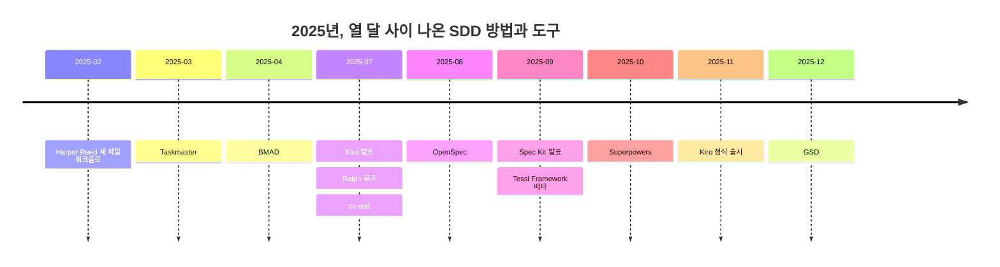
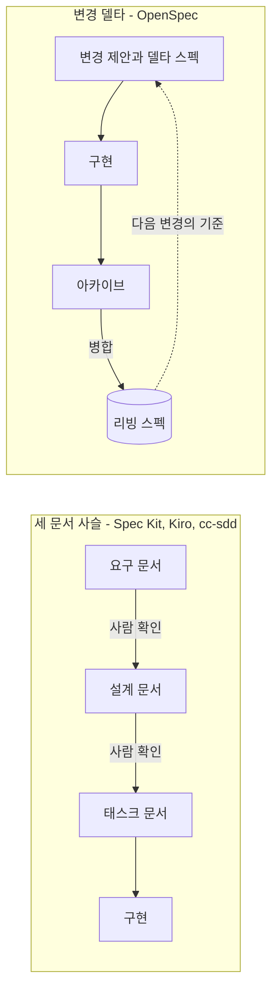

# 4장. 문서로 통제하는 도구들 — Spec Kit, OpenSpec, Kiro, cc-sdd, BMAD

2025년 2월 16일, Harper Reed가 블로그에 자기 코드 생성 워크플로를 적었다. `spec.md`를 쓰고, 그것으로 `prompt_plan.md`를 만들고, `todo.md`로 진행을 챙기는 파일 세 개짜리 방법이었다. 설치할 도구는 하나도 없었다. 그로부터 2025년 12월 14일 GSD 저장소가 생기기까지 약 열 달 동안, 이름이 붙은 스펙 주도 개발(Spec-Driven Development, SDD) 방법과 도구가 열한 개 나왔다. 한 달에 하나꼴이다. 같은 기간에 Kiro는 발표에서 정식 출시까지 갔고, 이듬해 2월에는 mattpocock/skills가 뒤를 이었다.


그림 1. 2025년 SDD 방법과 도구 연표 (저장소 생성일 또는 발표일 기준)

이름이 이만큼 쏟아지면 무엇부터 봐야 할지 막막해진다. 별 수로 줄을 세우고 싶은 유혹도 생긴다. 하지만 별은 관심을 셀 뿐 쓰임을 세지 않는다. 그렇다면 처음 보는 도구 앞에서 무엇을 물어야 할까? 문서를 주된 통제 수단으로 삼는 다섯 도구부터 같은 질문으로 하나씩 열어 보자.

> 이 장은 Spec Kit v1.3.3/2026-11-09, OpenSpec v1.17.0/2026-11-09, cc-sdd v3.1.0/2026-09-23, BMAD v6.12.4 안정판/2026-10-14 기준이다. Kiro는 버전 번호가 없는 독점 제품이라 문서 접근 2026-11-10 기준으로 적는다. Spec Kit과 OpenSpec은 하루 사이에도 새 판을 내므로, 명령을 따라 하기 전에 공식 문서를 함께 확인하자.

### 다섯 질문으로 같은 틀에 놓기

2장에서 SDD 도구를 통제 단위로 세 갈래로 나눴다. 문서 파이프라인, 스킬 규율, 계획-실행 루프다. 여기서 볼 다섯 도구는 모두 첫 갈래에 속한다. 에이전트가 무엇을 만들지는 문서가 정하고, 다음 단계로 넘어갈지는 그 문서를 사람이 확인하는 관문이 정한다. 참고 보고서의 분류로 말하면 Spec Kit·Kiro·cc-sdd는 단계 게이트형(F1), OpenSpec은 변경 델타형(F2), BMAD는 역할 시뮬레이션형(F3)이다. 기호는 이 정도만 기억해두면 충분하다.

같은 갈래 안에서도 도구마다 생김새가 꽤 다르다. 그래서 도구 하나를 만날 때마다 다섯 가지를 같은 순서로 물어보자. 첫째, 무엇이 스펙인가. 파일 하나인지, 문서 여러 개의 사슬인지, 변경분만 적은 조각인지를 본다. 둘째, 명령은 어떤 순서로 흐르는가. 셋째, 산출물은 저장소 어디에 어떤 모양으로 남는가. 넷째, 작은 변경을 위한 가벼운 경로가 있는가. 다섯째, 강점은 무엇이고, 지금도 유효한 약점은 무엇인가.

다섯째 질문에서 "지금도"를 붙인 데는 이유가 있다. 2025년 가을에 쓰인 체험기 상당수는 지금의 도구와 다른 판을 다룬다. Spec Kit만 해도 그때 나온 비판 일곱 가지 중 네 가지는 이미 해결됐다. 그래서 오래된 비판을 옮길 때는 그 비판이 나온 날짜와 판, 그리고 지금의 상태를 함께 적는다.

2장의 수명 축도 잠깐 떠올려 보자. 통제 단위와 스펙의 수명은 다른 축이다. 같은 문서 파이프라인이라도 Spec Kit·Kiro·cc-sdd는 대부분 스펙 우선형으로 쓰이고, OpenSpec은 아카이브 단계 덕분에 스펙 고정형에 가깝다. 두 흐름을 나란히 놓으면 차이가 잘 보인다.


그림 2. 세 문서 사슬과 변경 델타의 흐름 비교

왼쪽 사슬은 기능 하나를 위해 문서를 차례로 쌓고, 구현이 끝나면 그 문서 묶음이 기능 폴더에 남는다. 오른쪽은 바꿀 부분만 적고, 끝나면 그 조각을 시스템 전체의 스펙에 녹여 넣는다. 이 차이가 뒤에서 여러 번 다시 나온다.

### Spec Kit: 헌법에서 converge까지

Spec Kit은 GitHub가 2025년 9월 2일 발표한 도구다. 스펙은 기능 하나마다 만드는 폴더 `specs/<NNN>-<short-name>/`의 문서 묶음이다. 여기에 프로젝트 전체가 지킬 원칙을 담은 헌법 파일 `.specify/memory/constitution.md`가 하나 더 붙는다. 헌법 파일은 기능마다 바뀌지 않으므로 1장에서 구분한 컨텍스트 파일에 더 가깝다.

명령은 에이전트 채팅 안에서 하나씩 부르고, 결과를 검토한 뒤 다음으로 넘어간다. 공식 문서는 `/speckit.specify`처럼 점으로 적지만 Claude Code에 설치되는 실제 이름은 `/speckit-specify`다. 2026년 판의 Spec Kit은 진입점을 넷으로 나눴다. SDD 본 흐름, 버그 수정, 아이디어 평가, 직접 만든 프로세스다. 문서는 이것들을 "independent entry points, not mandatory phases"라고 부른다. 필요한 진입점만 골라 쓰라는 뜻으로 읽으면 된다.

| 명령 (Claude Code 표기) | 하는 일 | 쓰거나 읽는 파일 |
|---|---|---|
| `/speckit-constitution` | 프로젝트 원칙을 세우거나 고친다 | `.specify/memory/constitution.md` |
| `/speckit-specify` | 요구와 사용자 스토리를 정의한다 | `spec.md`, `checklists/requirements.md` |
| `/speckit-clarify` | 계획 전에 모호한 곳을 묻는다 (선택) | `spec.md`에 `## Clarifications` 추가 |
| `/speckit-plan` | 기술 구현 계획을 만든다 | `plan.md`, `research.md`, `data-model.md`, `quickstart.md`, `contracts/` |
| `/speckit-checklist` | 요구 품질 점검표를 만든다 (선택) | `checklists/*.md` |
| `/speckit-tasks` | 계획을 태스크로 쪼갠다 | `tasks.md` |
| `/speckit-analyze` | 구현 전에 산출물 사이 정합성을 본다 (선택) | 읽기만 한다 |
| `/speckit-implement` | 태스크를 실행한다 | `tasks.md`를 읽고 코드를 쓴다 |
| `/speckit-converge` | 구현을 산출물과 견줘 남은 일을 덧붙인다 | `tasks.md`에 태스크만 추가 |

```text
specs/001-partial-refund/
├── spec.md
├── plan.md
├── research.md
├── data-model.md
├── quickstart.md
├── contracts/
├── tasks.md
└── checklists/
```

관문 명령들의 성격을 눈여겨보자. `clarify`는 한 세션에 최대 다섯 문항을 묻고 답을 `spec.md`의 `## Clarifications` 아래 날짜별로 남긴다. `analyze`는 파일을 고치지 않는 읽기 전용이다. `converge`는 코드를 spec·plan·tasks와 비교해 빠진 작업을 `tasks.md`에 덧붙이기만 한다. 스펙 문서를 고치지 않으니 상시 동기화 장치로 보기는 어렵다. 다 됐는지를 판정하는 쪽도 여전히 에이전트다.

`spec.md` 템플릿은 사용자 스토리를 우선순위별로 세우고, 스토리마다 혼자서 시험할 수 있는 방법(Independent Test)과 Given/When/Then 시나리오를 요구한다. 기능 요구는 `FR-001`처럼 번호를 단 `MUST` 문장이고, 모르는 값은 지어내지 말고 `[NEEDS CLARIFICATION: …]`로 남기라고 한다. 이 책의 예제로 채우면 이런 모양이 된다.

```markdown
# Feature Specification: 부분 환불
**Feature Branch**: `001-partial-refund`
**Created**: 2026-11-10
**Status**: Draft
**Input**: User description: "서점 관리자가 배송 완료된 주문의 일부 항목을 환불한다"

## User Scenarios & Testing *(mandatory)*
### User Story 1 - 부분 환불 요청 (Priority: P1)
**Why this priority**: 지금은 배송 전 전체 취소만 있고, 배송 뒤에는 환불할 방법이 없다.
**Independent Test**: 책 B 1권만 환불 요청해 환불액 10,800원과 주문 상태 `PARTIALLY_REFUNDED`를 확인한다.
**Acceptance Scenarios**:
1. **Given** 결제 40,800원 주문이 배송 완료된 지 48시간, **When** 서점 관리자가 책 B 1권 환불을 요청하면, **Then** 10,800원이 환불되고 주문 상태는 `PARTIALLY_REFUNDED`가 된다

## Requirements *(mandatory)*
### Functional Requirements
- **FR-001**: System MUST 자기 서점 주문에 대해서만 `SHOP_ADMIN`의 환불 요청을 받는다
- **FR-002**: System MUST 항목의 `refunded_quantity`가 주문 수량을 넘게 되는 요청을 `409 REFUND_QUANTITY_EXCEEDED`로 거절한다
- **FR-003**: System MUST 환불 요청을 [NEEDS CLARIFICATION: "배송 후 7일"의 기준 시각 — 배송 완료 시각인가, 날짜 단위인가?] 안에서만 받는다
```

이 책 예제로 채운 예시이고, 도구를 실행해서 받은 출력은 아니다. 헤딩과 표기 규칙만 템플릿 원문을 따랐다. `FR-003`의 빈칸은 6장에서 검사 세션이 찾아낼 바로 그 빈칸이다.

가벼운 경로도 있다. 버그 수정 확장(`specify extension add bug`)과 아이디어 평가 확장(`specify extension add assess`)이 본 흐름 없이 따로 돈다. 강점은 템플릿이 가장 풍부하다는 점, 그리고 통합 키 43개로 거의 모든 하네스에 설치된다는 점이다. 약점도 분명하다. 기능 하나에 파일이 많다. Böckeler는 2025년 9월 체험에서 스펙 하나에 파일 8개를 셌고, 2026년 비교 글들도 기능당 7~10개 이상을 적었다. 긴 마크다운을 검토하는 부담도 남아 있다. 이 둘은 2026년 11월에도 유효한 비판이다. 손으로 직접 돌리는 실습은 9장에서 한다.

### OpenSpec: 바꿀 부분만 적고, 끝나면 합친다

OpenSpec은 Fission AI가 2025년 8월에 연 저장소에서 시작했다. 이 도구에서 스펙은 두 층이다. 하나는 `openspec/specs/<domain>/spec.md`에 있는 리빙 스펙으로, 원문 주석은 이것을 "Source of truth"라고 부른다. 다른 하나는 변경마다 만드는 폴더 `openspec/changes/<change-name>/` 안의 델타 스펙이다. 변경 폴더에는 `proposal.md`, `design.md`, `tasks.md`와 함께 이번에 바뀌는 요구만 적은 `specs/` 조각이 들어간다.

```text
openspec/
├── specs/                 # 시스템 동작의 기준 (리빙 스펙)
│   └── <domain>/spec.md
├── changes/               # 변경마다 폴더 하나
│   └── <change-name>/
│       ├── proposal.md
│       ├── design.md
│       ├── tasks.md
│       └── specs/<domain>/spec.md   # 델타 스펙
└── config.yaml            # 선택
```

기본 `core` 프로필의 명령은 여섯 개다. `/opsx:propose`(스킬 표기 `/openspec-propose`)로 변경을 만들고 계획 산출물을 한 번에 받는다. 생각을 먼저 정리하고 싶으면 그 앞에 `/opsx:explore`를 쓴다. `/opsx:apply`로 구현하고, `/opsx:update`로 계획 산출물을 고치고, `/opsx:sync`로 델타를 메인 스펙에 합치고, `/opsx:archive`로 변경을 보관한다. 아카이브는 미완료 태스크가 있어도 막지 않고 경고만 한다. 끝나면 변경 폴더는 `openspec/changes/archive/YYYY-MM-DD-<name>/`으로 옮겨지고, 산출물은 감사 기록으로 그대로 남는다.

두 가지 표기를 함께 적는 데는 이유가 있다. v1.17.0(2026-11-09)이 2.0에서 `/opsx:*` 명령 파일을 없애고 스킬만 남긴다고 예고했기 때문이다. 미리 옮겨 가려면 `openspec config set delivery skills && openspec update`를 쓴다. 이 부분은 원고가 나온 뒤에도 바뀔 수 있으니 공식 저장소의 이슈 #2022를 함께 확인하자.

델타 스펙의 모양이 이 도구의 얼굴이다. 공식 문서의 예(MIT 라이선스)를 줄여 옮기면 이렇다.

```markdown
# Delta for Auth

## ADDED Requirements
### Requirement: Two-Factor Authentication
The system MUST support TOTP-based two-factor authentication.
#### Scenario: 2FA enrollment
- GIVEN a user without 2FA enabled
- WHEN the user enables 2FA in settings
- THEN a QR code is displayed for authenticator app setup

## MODIFIED Requirements
### Requirement: Session Expiration
The system MUST expire sessions after 15 minutes of inactivity.
(Previously: 30 minutes)

## REMOVED Requirements
### Requirement: Remember Me
(Deprecated in favor of 2FA. Users should re-authenticate each session.)
```

아카이브 때 `ADDED`는 메인 스펙에 덧붙고, `REMOVED`는 지워지고, `MODIFIED`는 기존 요구를 통째로 갈아 끼운다. 그래서 `MODIFIED`에는 바뀐 한 줄이 아니라 요구 전문을 다시 적어야 한다. 처음 쓰는 사람이 가장 자주 넘어지는 곳이니 주의해야 한다. 형식 검사도 점점 엄격해지는 중이다. v1.16.0부터 `openspec validate`는 단계 키워드가 없는 시나리오를 경고하고 `--strict`면 실패시킨다. v1.16.1부터는 모르는 델타 절에 넣은 요구를 거부한다.

제조사 안내도 이 도구의 성격을 잘 보여 준다. 시작할 때 코드베이스 전체를 문서화하지 말고 바꿀 부분만 쓰라고 한다. 기존 PRD를 한꺼번에 변환하면 아무도 믿지 않는 크고 낡은 스펙이 생긴다는 경고다. FAQ는 한 글자 오타 수정에는 이 절차가 맞지 않는다고 적는다. 강점은 브라운필드에 바로 붙는다는 것, 그리고 산출물이 짧다는 것이다. 약점은 Spec Kit 헌법 같은 사전 거버넌스 장치가 약하다는 점이다(추론). 리빙 스펙을 살려 두려면 팀의 규율이 따로 필요하다는 지적도 있다. 두 번째 변경에서 리빙 스펙이 갱신되는 모습은 8장에서 직접 확인한다.

### Kiro 스펙: IDE 안의 세 문서 사슬

Kiro는 AWS가 2025년 7월 14일 발표하고 11월 17일 정식 출시한 Code OSS 기반 IDE다. 지금은 IDE 외에 CLI와 Web에서도 같은 스펙 기능을 쓴다. 모든 스펙은 `.kiro/specs/<name>/` 아래 세 문서로 남는다. 요구를 담은 `requirements.md`(버그라면 `bugfix.md`), 설계를 담은 `design.md`, 실행 단위를 담은 `tasks.md`다. 설치 없이 저장소에 스펙 폴더를 기본으로 남기는 하네스는 드물어서 이 점이 눈에 띈다.

기능 스펙은 두 갈래로 시작한다. 요구에서 출발하는 Requirements-First와 설계에서 출발하는 Design-First다. Design-First와 버그픽스 스펙은 2026년 2월에 추가됐는데, 계기는 "모든 사람이 요구사항에서 출발하지 않는다"는 사용자 의견이었다. 요구 문장은 EARS의 `WHEN [condition/event] THE SYSTEM SHALL [expected behavior]` 형태다. 3장에서 다룬 그 문형이다. CLI에서는 `/spec new <name>`으로 시작하고, 단계마다 `Ctrl+X`로 문서를 열어 줄 단위로 의견을 단다.

버그픽스 스펙은 형식이 특히 단단하다. 현재 동작, 기대 동작, 바뀌면 안 되는 동작을 세 문형으로 나눠 쓴다. 문형은 Kiro 문서 원문 그대로 두고, 내용만 이 책 예제의 오타 수정(C0)으로 채워 보자.

```markdown
## Current Behavior (Defect)
WHEN 환불 기간이 지난 요청을 거절할 때 THEN the system 오류 메시지에 '환불'을 '환뷸'로 적어 돌려준다

## Expected Behavior (Correct)
WHEN 환불 기간이 지난 요청을 거절할 때 THEN the system SHALL 오류 메시지에 '환불'로 적어 돌려준다

## Unchanged Behavior (Regression Prevention)
WHEN 환불 기간이 지난 요청을 거절할 때 THEN the system SHALL CONTINUE TO `422 REFUND_WINDOW_EXPIRED` 코드로 응답한다
```

세 번째 문형 `SHALL CONTINUE TO`가 이 형식의 백미다. 고치다가 망가뜨리면 안 되는 것을 스펙에 못 박아 둔다. 다만 오타 하나에 문서 세 개를 쓰는 것이 맞을까? 그 답은 11장에서 이 변경을 다시 만날 때 정한다. 가벼운 경로도 여럿이다. 퀵 스펙은 시작할 때 범위와 경계 사례를 한 번에 묻고 승인 관문 없이 세 문서를 만든다. Plan 모드는 계획을 대화 안에만 두고 `.kiro/specs/`에 저장하지 않는다. 문서는 15~60분짜리 작업에 Plan 모드를 권한다. 프로젝트 전체에 걸린 정보는 스티어링 파일 `.kiro/steering/`의 `product.md`, `tech.md`, `structure.md`에 둔다.

2026년에 Kiro가 실제로 생성하는 문서의 모양은 공식 템플릿이 공개되어 있지 않다. 그래서 공개 저장소 `darko-mesaros/shuk`의 `.kiro/specs/upload-only/`가 좋은 참고가 된다. 라이선스 표기가 없어 여기서는 구조만 옮긴다. `requirements.md`는 Introduction 다음에 Glossary를 두고, 거기서 정의한 컴포넌트 이름(`CLI_Parser` 같은 것)을 EARS의 주어 자리에 쓴다. `design.md`에는 Correctness Properties 절이 있어 요구 번호마다 검증할 속성을 연결한다. `tasks.md`는 요구 번호 추적 표기와 함께 끝에 태스크 의존 그래프를 JSON으로 붙인다.

강점은 EARS와 버그픽스 스펙이라는 형식의 원형을 가장 단단하게 갖췄다는 점이다. 요구 전체에서 모순과 빠진 경계 사례를 찾는 Analyze Requirements 기능도 있다. 제조사는 LLM 자동 형식화와 SMT 솔버를 쓴다고 설명한다(주장). 속성 기반 테스트도 내장하지만 IDE에서만 된다. 약점은 하네스 종속이다. 스펙 기능은 Kiro 안에서만 돈다. 2025년 9월 체험에서 작은 버그가 사용자 스토리 4개와 수용 기준 16개로 불어났다는 비판은 버그픽스 스펙과 퀵 스펙이 나오기 전 이야기다. 지금은 부분 해결 상태로 보되, 독립 재검증은 아직 없다.

### cc-sdd: Kiro의 흐름을 다른 하네스로

Kiro의 방식이 마음에 들지만 쓰는 하네스가 Claude Code나 Codex라면 어떻게 해야 할까? 일본 개발자 gotalab의 cc-sdd가 그 자리를 채운다. 기원은 2025년 7월의 Zenn 글로, Kiro 스펙 흐름을 Claude Code 명령 일곱 개로 재현해 결과를 Kiro에서 그대로 쓰려는 시도였다. 지금은 스킬 17개로 커졌다. 산출물은 Kiro와 호환되는 `.kiro/specs/<feature>/` 아래 `requirements.md`, `design.md`, `tasks.md`, 그리고 `spec.json`이다. 안정 지원은 Claude Code와 Codex이고, 나머지 하네스는 베타다.

```bash
# 터미널
npx cc-sdd@latest --claude-skills --lang ko
# 에이전트 채팅 (이 책 예제로 채운 인자)
/kiro-discovery 부분 환불
/kiro-spec-init partial-refund
/kiro-spec-requirements partial-refund
/kiro-spec-design partial-refund
/kiro-spec-tasks partial-refund
/kiro-impl partial-refund
```

`--lang ko`로 산출물을 한국어로 받을 수 있다는 점이 국내 독자에게는 반갑다. 요구 템플릿은 EARS 다섯 패턴을 영어 키워드로 고정하고 변수 부분만 채우게 한다. 이 책이 3장에서 정한 표기 규칙도 여기서 왔다. 아래 예는 다섯 패턴을 이 책 예제로 채운 것이고, 그 아래 `spec.json`은 템플릿의 승인 상태 부분만 옮겼다.

```markdown
#### Acceptance Criteria
1. When 서점 관리자가 환불을 요청하면, the 환불 서비스 shall 항목별 환불액을 계산해 PG 환불을 호출한다
2. If PG 환불 호출이 실패하면, then the 환불 서비스 shall 환불 상태를 `FAILED`로 남기고 `502 PAYMENT_GATEWAY_ERROR`로 응답한다
3. While 같은 `Idempotency-Key`의 보관 기간(24시간)이 지나지 않은 동안, the 환불 서비스 shall 같은 본문의 재요청에 첫 결과를 그대로 돌려준다
4. Where 주문 단위 쿠폰 기능이 포함되면, the 환불 서비스 shall 쿠폰 할인액을 항목 금액 비율로 안분해 환불액에서 뺀다
5. The 환불 서비스 shall 다른 서점 주문에 대한 환불 요청을 `403`으로 거절한다
```

```json
{
  "phase": "initialized",
  "approvals": {
    "requirements": { "generated": false, "approved": false },
    "design": { "generated": false, "approved": false },
    "tasks": { "generated": false, "approved": false }
  },
  "ready_for_implementation": false
}
```

`spec.json`이 흥미로운 이유는 단계 관문이 대화가 아니라 파일에 남는다는 데 있다. 요구를 승인했는지, 구현 준비가 됐는지를 나중에 누구든 열어 볼 수 있다. 설계 문서도 꼼꼼하다. Boundary Commitments 절에 이 스펙이 소유하는 것과 경계 밖의 것을 적고, 그 경계가 태스크의 `_Boundary:_` 주석으로 이어진다.

이 도구의 입장은 README 한 줄에 담겨 있다. "Code remains the source of truth." 스펙은 시스템 부분 사이의 계약이라는 뜻이다. 가벼운 경로도 문서에 있다. `/kiro-discovery`가 스펙 없이 바로 구현하라고 답할 수 있고, 한 세션에 끝나는 혼자 하는 일이나 프로토타입에는 cc-sdd가 필요 없다고 적는다. 정직하게 덧붙일 점도 있다. README 스스로 "Installing 17 skills does not verify that a host can run the full autonomous loop."라고 경고한다. 그리고 이 도구는 어떤 통제 비교에도 들어가지 않았다. 일본 팀들의 현장 보고가 몇 건 있지만 모두 자기 보고다.

### BMAD: 역할 에이전트와 판이 둘인 문서

BMAD는 2025년 4월에 시작된 BMad Code의 방법론이다. 다른 도구들이 문서 템플릿을 준다면 BMAD는 역할을 준다. 안정판 v6.12에는 분석가(Mary), 제품 관리자(John), 아키텍트(Winston), 개발자(Amelia), UX 디자이너(Sally) 다섯 에이전트가 있고, 이들이 차례로 문서를 만든다. 설치는 `npx bmad-method install`이고, 결과는 `_bmad/` 폴더에 들어간다.

스펙의 중심은 `bmad-spec` 스킬이 쓰는 `SPEC.md`다. 다섯 필드로 이루어진다. 왜(Why), 능력(Capabilities, 능력마다 의도와 성공 조건), 제약(Constraints), 비목표(Non-goals), 성공 신호(Success signal)다. 이 파일은 스킬만 쓴다. 문서 원문은 "`bmad-spec` is the only writer of `SPEC.md`. Do not hand-edit it"이라고 못 박는다. 고치고 싶으면 스킬을 다시 돌려 능력 ID를 유지한 채 갱신한다. 입력으로 넣을 자료는 수만 토큰, 약 40쪽이 현실적 상한이라고 한다.

작업 크기별 경로가 분명한 것도 특징이다. 한 세션 크기면 바로 `bmad-build`로 가고, 에픽 크기면 `stories.yaml`로 스토리를 나눈 뒤 스토리마다 만들고, 약 20세션이 넘으면 프로젝트 경로를 탄다. 제조사는 가벼운 경로를 직접 적었다. "You don't need BMad for an obvious, low-risk edit."

그런데 BMAD에는 독특한 함정이 하나 있다. 판이 둘이다. 공식 문서 사이트(docs.bmad-method.org)는 버전 배너 없이 v7 알파의 내용을 보여 준다. 그 사이트에는 제품 책임자 Sofia와 `tickets.toml`이 나오지만, `npx bmad-method install`로 설치되는 안정판에는 둘 다 없다. 반대로 안정판의 `bmad-spec`과 `SPEC.md`는 사이트에 없다. 안정판 문서는 GitHub의 `V6.12` 브랜치 `docs/`에 있고, 한국어 문서도 거기 있다. 문서를 보며 따라 하다 명령이 안 맞으면 꽤 난감하다. 판부터 확인하자.

v7은 README상 2026년 11월 중순 정식 출시 예정이다. 알파 설치는 `npx skills add bmad-code-org/BMAD-METHOD --skill '*'`처럼 스킬 묶음 방식으로 바뀌었고, 원문은 "Expect breaking changes between updates."라고 경고한다. 이 책이 BMAD에 실습 장을 주지 않는 이유 가운데 하나가 이 시기 문제다. 강점은 여러 이해관계자가 합의해야 하는 큰 작업에서 역할과 경로를 미리 갖춰 준다는 점이다. 약점은 문서 양이다. Thoughtworks Radar Vol 35는 AI가 만드는 문서 난립을 Caution에 올리면서 Spec Kit과 BMAD의 대량 마크다운을 지목했다.

### 같은 요구, 다섯 가지 모양

도구마다 스펙이 얼마나 다르게 생겼는지 한눈에 보고 싶다면, 같은 요구 하나를 다섯 도구의 문형으로 써 보는 편이 빠르다. 환불 기간 규칙을 골라 보자. "배송 완료 시각부터 168시간이 지나면 환불을 거절한다." 아래는 모두 이 책 예제로 채운 예시이고, 문형과 표기만 각 도구의 템플릿을 따랐다.

```markdown
<!-- Spec Kit: spec.md의 기능 요구 -->
- **FR-003**: System MUST 배송 완료 시각(`delivered_at`)부터 168시간이 지난 환불 요청을 `422 REFUND_WINDOW_EXPIRED`로 거절한다

<!-- OpenSpec: 델타 스펙의 요구와 시나리오 -->
### Requirement: 환불 기간
The system SHALL 배송 완료 시각(`delivered_at`)부터 168시간이 지난 환불 요청을 거절한다.
#### Scenario: 기간이 지난 요청
- GIVEN `delivered_at`부터 169시간이 지난 주문
- WHEN 서점 관리자가 환불을 요청하면
- THEN `422 REFUND_WINDOW_EXPIRED`로 응답한다

<!-- Kiro: requirements.md의 수용 기준 (Glossary 컴포넌트를 주어로) -->
1. WHEN 서점 관리자가 `delivered_at`부터 168시간이 지난 주문에 환불을 요청하면 THE Refund_Service SHALL `422 REFUND_WINDOW_EXPIRED`로 거절한다

<!-- cc-sdd: requirements.md의 If 패턴 -->
2. If 환불 요청 시각이 `delivered_at`부터 168시간을 넘으면, then the 환불 서비스 shall `422 REFUND_WINDOW_EXPIRED`로 거절한다

<!-- BMAD v6.12: SPEC.md의 능력 하나 (필드 이름만 원문) -->
Capability: 기간 안의 부분 환불
  intent: 배송 완료 뒤 168시간 안에만 서점 관리자가 항목 단위로 환불한다
  success condition: 168시간이 지난 요청은 모두 거절되고 환불액이 생기지 않는다
```

같은 규칙인데 무게중심이 미묘하게 다르다. Spec Kit은 번호 붙은 `MUST` 문장으로 기능 목록을 세우고 시나리오는 사용자 스토리 쪽에 따로 둔다. OpenSpec은 요구 하나에 시나리오를 바로 붙여 한 덩어리로 다룬다. Kiro와 cc-sdd는 조건과 반응을 EARS 문형으로 쪼개고, Kiro는 주어 자리에 컴포넌트 이름을 넣는다. BMAD는 문장 형식보다 의도와 성공 조건이라는 두 칸을 채우게 한다.

| 도구 | 요구 문장 | 수용 기준 | 추적 표기 |
|---|---|---|---|
| Spec Kit | `**FR-001**: System MUST ...` | 사용자 스토리별 Given/When/Then | `T012 [P] [US1]`, `SC-001`, `[NEEDS CLARIFICATION: ...]` |
| OpenSpec | `The system SHALL ...` (한 문장에 SHALL 하나) | `#### Scenario:` GIVEN/WHEN/THEN | `## ADDED/MODIFIED/REMOVED Requirements`, `(Previously: ...)` |
| Kiro | EARS `WHEN ... THE SYSTEM SHALL ...` | User Story + 번호 목록 | `_Requirements: 1.1_`, `**Validates: Requirements 1.2**` |
| cc-sdd | EARS 다섯 패턴 `When ..., the [system] shall ...` | Objective + Acceptance Criteria | `_Boundary:_`, `_Depends:_`, `_Requirements:_` |
| BMAD v6.12 | Why / Capabilities / Constraints / Non-goals / Success signal | 능력별 성공 조건 | 능력 ID |

어느 모양이 가장 좋을까? 아쉽게도 이 질문에 답할 측정은 아직 없다. EARS나 Given-When-Then이 에이전트의 결과물을 자유 서술보다 낫게 만든다는 통제 실험을 찾지 못했다는 사실은 3장에서 짚었다. 지금 쓸 수 있는 기준은 형식 자체보다 그 형식이 이어지는 곳에 있다. 테스트로 옮기기 쉬운가, 팀이 이미 쓰는 문형과 맞는가, 하네스를 바꿔도 남는가.

### 문서 계열 안에서 견줘 보기

다섯 도구를 나란히 놓으면 무엇이 보일까? 먼저 세 문서 사슬을 쓰는 단계 게이트형 셋의 내부 구조부터 보면 이렇다.

| 도구 | 핵심 단계 수 | 승인 관문 | 산출물 위치 | 가벼운 경로 |
|---|---|---|---|---|
| Spec Kit | 6 (+ 선택 2, analyze 1) | 단계마다 사람이 다음 명령을 부름 (추론) | `.specify/memory/`, 기능별 `specs/` 폴더 | 버그 확장, 평가 확장 |
| Kiro 스펙 | 3 | 있음, 퀵 스펙은 없음 | `.kiro/specs/<name>/` | 퀵 스펙, 버그픽스 스펙, Plan 모드 |
| cc-sdd | 6 (discovery부터 impl까지) | `spec.json` 승인 상태 | Kiro 호환 스펙 폴더 | discovery의 "스펙 없이 바로 구현" |

문서의 양은 도구마다 크게 다르다. 2026년 8월 Serverworks의 비교는 Spec Kit이 기능당 약 10개, OpenSpec이 변경당 약 4개의 문서를 만든다고 적었다. 같은 글에서 AWS Labs의 AI-DLC는 단위당 40~50개였다. 이 숫자들은 문서와 실무 경험을 묶은 정리이지 통제된 측정은 아니다. 그래도 방향은 다른 보고들과 같다.

상황별로 고르는 감도 참고할 만하다. GMO Media는 2025년 12월 Claude Code에서 세 도구를 비교하고 이렇게 정리했다. 기존 서비스를 바꾸면 OpenSpec, 그린필드에서 견고한 팀 작업이면 Spec Kit, 그린필드에서 문서 언어의 일관성이 중요하면 cc-sdd. 변경을 메인 스펙에 병합하는 아카이브 단계는 셋 중 OpenSpec에만 있다는 관찰도 덧붙였다. 다만 Spec Kit 1.0(2026-08-21) 이전의 판정이라는 점은 기억해두자.

판정의 날짜가 중요한 이유는 2025년의 비판들이 얼마나 낡았는지를 보면 실감난다.

| 대상 | 2025 비판 | 2026-11 상태 |
|---|---|---|
| Spec Kit | 항상 새 브랜치를 만든다 | 해결 (v0.10.0부터 선택 훅) |
| Spec Kit | 버그에도 무거운 흐름 | 해결 (버그 확장) |
| Spec Kit | 코드가 스펙을 따랐는지 확인 루프 없음 | 부분 해결 (converge, 완료 판정은 여전히 에이전트) |
| Spec Kit | 기능마다 파일이 많다 | 여전히 유효 |
| Spec Kit | 긴 마크다운 검토 부담 | 여전히 유효 (Radar Vol 35) |
| Kiro | 작은 버그가 사용자 스토리 4개, 수용 기준 16개 | 부분 해결 (버그픽스 스펙, 퀵 스펙), 독립 재검증 없음 |
| Kiro | IDE에 묶인다 | 부분 해결 (IDE·CLI·Web, 속성 기반 테스트는 IDE 전용) |

절차가 무겁다는 비판은 대부분 제조사가 가벼운 경로를 내면서 풀렸다. 남은 것은 문서의 양이다. 2장에서 본 Radar의 신호, 곧 OpenSpec을 Trial로 올리면서 문서 난립을 Caution에 넣은 조합과도 맞아떨어진다.

> **다른 하네스에서는.** Spec Kit은 Codex에서 `$speckit-specify`, Cursor·Copilot에서 `/speckit-specify`로 부른다. OpenSpec은 Cursor와 Copilot(IDE)에서 `/opsx-propose`, Codex에서 `$openspec-propose`다. Copilot CLI는 사용자 정의 프롬프트 파일을 지원하지 않아 OpenSpec 명령이 IDE에서만 된다. cc-sdd는 Codex에서 `$kiro-*`로 부른다. Kiro 스펙은 Kiro 밖에서는 쓸 수 없다. 전체 대응표는 부록 B에 모았다.

다섯 도구를 두 질문으로 접으면 이렇게 된다.

| 도구 | 무엇이 스펙인가 | 작업 뒤 스펙의 운명 |
|---|---|---|
| Spec Kit | 기능 폴더의 문서 묶음 (`spec.md`부터 `tasks.md`까지) + 헌법 파일 | 기능 폴더에 남는다. 다음 기능이 고치지는 않는다 |
| OpenSpec | 변경 폴더의 제안과 델타 스펙 | 아카이브 때 리빙 스펙에 병합된다 |
| Kiro 스펙 | `.kiro/specs/<name>/`의 세 문서 | 남는다. 동기화는 사람이 Sync Files로 시작한다 |
| cc-sdd | Kiro 호환 세 문서 + `spec.json` | 남지만, 기준은 코드다 |
| BMAD | 스킬이 쓰는 `SPEC.md`와 역할별 문서 | 스킬로만 갱신된다 |

문서로 통제한다는 말은 결국 작업이 끝난 뒤 그 문서를 어디에 둘지 미리 정해 둔다는 뜻이다.
