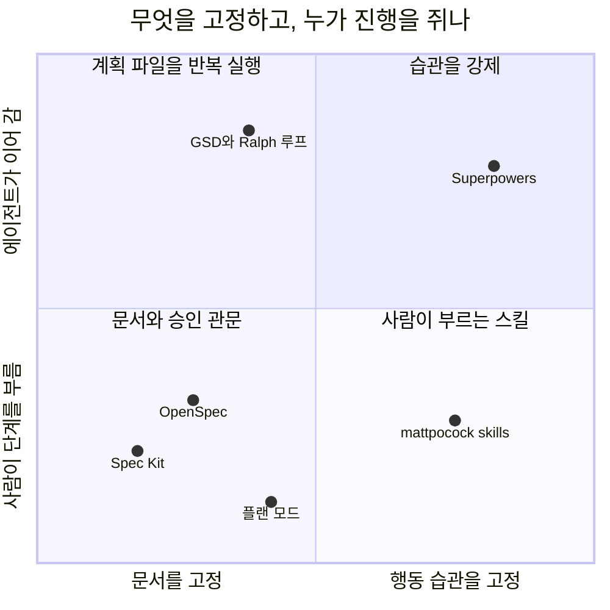

# 5장. 습관으로 통제하는 도구들, 그리고 이 책의 선택

mattpocock/skills의 README는 다른 프레임워크들을 이름으로 부른다. GSD, BMAD, Spec Kit 같은 접근은 "try to help by owning the process", 곧 프로세스를 소유하는 방식으로 도우려 한다는 것이다. 그러고는 자기는 프로세스를 소유하지 않겠다며 작은 스킬 몇 개만 내놓는다. 같은 스킬 묶음 진영에 있는 Superpowers는 정반대 자리에 깃발을 꽂는다. 이 도구의 README는 자기 스킬을 "Mandatory workflows, not suggestions."라고 부른다. 에이전트는 어떤 작업이든 시작하기 전에 맞는 스킬이 있는지부터 확인해야 한다는 뜻이다.

두 도구 모두 4장의 도구들처럼 문서 템플릿을 앞세우지 않는다. 대신 에이전트가 일하는 습관을 바꾸려 한다. 그런데 한쪽은 습관을 강제하고, 다른 쪽은 고르게 둔다. 프로세스는 누가 쥐어야 할까? 사람일까, 도구일까? 아니면 하네스에 이미 들어 있는 플랜 모드만으로 충분할까? 스펙 주도 개발(Spec-Driven Development, SDD)의 나머지 갈래를 살펴보고, 그 끝에서 이 책이 실습할 도구를 고르자.

> 이 장은 Superpowers v7.0.2/2026-11-03, mattpocock/skills v1.3.2/2026-10-29, Claude Code 2.1.319(로컬 설치본) 기준이다. 비교에 쓰는 Spec Kit·OpenSpec 값은 각각 v1.3.3·v1.17.0/2026-11-09 기준이고, 채택 지표는 2026-11-09 판독값이다. 플러그인과 플랜 모드 설정은 자주 바뀌니 공식 문서를 함께 확인하자.

### 문서 대신 습관을 고정한다

4장의 도구들은 문서와 승인 관문으로 에이전트를 묶었다. 이 장의 도구들은 묶는 대상이 다르다. 참고 보고서의 분류로 스킬 규율형(F4)은 질문하기, 계획 쓰기, 테스트 먼저 쓰기, 리뷰받기 같은 행동 순서를 스킬로 만들어 에이전트가 지키게 한다. 계획-실행 루프형(F5)은 계획 파일이나 태스크 그래프를 새 컨텍스트에서 되풀이해 돌리는 반복 단위로 통제한다. 네이티브 플랜 모드(F6)는 하네스가 원래 가진 읽기 전용 계획 단계다.

스펙은 어디에 있을까? 스킬 규율형에도 문서는 나온다. Superpowers는 설계 문서와 구현 계획을 남긴다. 다만 그 문서를 작업 뒤 시스템 전체의 스펙에 합치는 단계가 없다. 그래서 2장의 수명 축으로 보면 스펙 우선형이다(추론). 플랜 모드는 더 짧다. 작업 직전에 쓰이고, 그 작업에만 쓰이고, 따로 보관하지 않으면 그대로 잊힌다. 참고 보고서는 이것을 "가장 작은 스펙 우선형"이라고 부른다.


그림 1. 통제 단위로 본 도구들의 위치 (좌표는 이 책의 배치이며 측정값이 아니다)

가로축은 무엇을 고정하는가, 세로축은 누가 다음 단계로 넘기는가다. 문서 파이프라인은 왼쪽 아래에 모인다. 사람이 명령을 하나씩 부르고 문서를 확인한다. Superpowers는 오른쪽 위다. 조건이 맞으면 스킬이 스스로 켜지고, 에이전트는 정해진 순서를 건너뛸 수 없다. mattpocock/skills는 같은 습관 쪽이지만 사람이 부를 때만 움직이는 스킬이 많아 아래로 내려온다.

### Superpowers: 건너뛸 수 없게 만든 일곱 단계

Superpowers는 Jesse Vincent가 2025년 10월 9일 발표한 스킬 묶음이다. 자동 트리거 스킬로만 이루어져 있어서 저장소에 `commands/` 디렉터리가 아예 없다. 필요하면 `/brainstorming`처럼 스킬 이름으로 직접 부를 수도 있다. Claude Code에서는 `/plugin install superpowers@claude-plugins-official`로 설치한다.

기본 흐름은 일곱 단계다. 먼저 `brainstorming`이 만들기 전에 끼어들어 질문으로 의도와 이유를 끌어내고, 이해한 바를 되읽어 준다. 작은 변경이면 채팅에서 합의하고 끝내지만, 프로젝트 규모면 설계 문서를 쓴다. 설계가 승인되면 `using-git-worktrees`가 새 브랜치의 격리된 작업 공간을 만들고 테스트 기준선이 깨끗한지 확인한다. `writing-plans`는 일을 2~5분 단위 태스크로 쪼갠다. 실행은 태스크마다 새 서브에이전트를 띄우고 리뷰하는 `subagent-driven-development`나, 현재 세션에서 인라인으로 돌리고 마지막에 한 번 리뷰하는 `executing-plans` 중 하나다. 앞의 것이 가장 철저하고 뒤의 것이 가장 저렴하다. 구현 중에는 `test-driven-development`가 RED-GREEN-REFACTOR를 지키게 하는데, 테스트보다 먼저 쓴 코드는 지운다. `requesting-code-review`는 태스크 사이에 심각도별로 보고하고, Critical이 나오면 진행을 막는다. 끝으로 `finishing-a-development-branch`가 테스트를 확인하고 병합할지, PR을 낼지, 남길지, 버릴지를 묻는다.

리뷰가 두 단계라는 점도 기억해두자. 먼저 스펙을 지켰는지 보고, 그다음 코드 품질을 본다. 순서를 뒤집으면 깔끔하지만 스펙과 다른 코드가 좋은 평을 받을 수 있다.

산출물은 두 가지다. 설계 문서는 `docs/superpowers/specs/YYYY-MM-DD-<topic>-design.md`에 커밋하고, 의도와 이유, 목표와 비목표와 반목표(anti-goals), 제약, 검토한 접근, 정한 방법, 빌더에게 남긴 것을 담는다. 구현 계획은 `docs/superpowers/plans/YYYY-MM-DD-<feature-name>.md`에 둔다. 계획의 머리말과 태스크 골격을 이 책 예제로 채우면 이런 모양이다.

```markdown
# 부분 환불 Implementation Plan

> **For agentic workers:** REQUIRED SUB-SKILL: Use superpowers:subagent-driven-development (recommended) or superpowers:executing-plans to implement this plan task-by-task.

**Goal:** 서점 관리자가 배송 완료 주문의 항목 일부를 수량 단위로 환불한다.
**Architecture:** 환불 기간·수량·쿠폰 안분을 정책 객체로 나누고, PG 환불 결과에 따라 환불 상태를 남긴다.
**Tech Stack:** Spring Boot, PostgreSQL, JUnit
**Spec:** docs/superpowers/specs/2026-11-10-partial-refund-design.md

## Global Constraints
- 기존 전체 취소 API(`POST /orders/{orderId}/cancel`)의 동작은 바꾸지 않는다.
- 금액은 원 단위로 계산하고 원 미만은 버린다.

## Review Focus
- 서점 관리자가 자기 서점 주문만 환불할 수 있는가

### Task 1: 환불 기간 정책

**Files:**
- Create: `src/main/java/com/bookshop/orders/refund/RefundWindowPolicy.java`
- Test: `src/test/java/com/bookshop/orders/refund/RefundWindowPolicyTest.java`

**Interfaces:**
- Consumes: 주문의 `delivered_at`
- Produces: `boolean isWithinWindow(Instant deliveredAt, Instant requestedAt)`

- [ ] **Step 1: Write the failing test** (배송 완료 168시간 1초 뒤의 요청은 기간 밖)
- [ ] **Step 2: Run test to verify it fails**
- [ ] **Step 3: Implement `isWithinWindow(Instant deliveredAt, Instant requestedAt) -> boolean` in `RefundWindowPolicy.java`**
- [ ] **Step 4: Run test to verify it passes**
- [ ] **Step 5: Commit**
```

헤딩과 단계 이름은 `writing-plans` 스킬 원문의 구조를 따랐고, 내용은 이 책 예제로 채운 예시다. 눈여겨볼 곳은 Step 3이다. 계획에는 시그니처와 파일, 스펙이 못 박은 값만 들어가고 메서드 본문은 없다. 스킬 원문도 정확한 시그니처와 파일, 스펙이 정한 값까지만 주고 본문은 구현자가 쓴다고 적는다. 그런데 README에는 아직 태스크마다 "complete code"를 준다는 문구가 남아 있다. 저장소 안에서 두 문서가 어긋나는 셈이라 좀 찜찜하다. 이 책은 실제로 동작하는 `SKILL.md`를 기준으로 삼는다.

v7.0.2의 `brainstorming`은 묻는 방식도 바꿨다. 답이 결과를 바꿀 때만 묻고, 이유를 말하지 않았으면 이유부터 묻고, 선택지가 있으면 추천과 함께 보여 준다. 제조사는 블라인드 채점 테스트에서 불필요한 질문이 41개에서 23개로 줄었다고 밝혔다. 제조사가 직접 잰 숫자이고 독립 측정은 아니다. 프로젝트 규모의 설계 문서는 새 서브에이전트가 빌더 입장에서 읽어 보는 Builder check를 거친다. v7.0.0에서 예전의 스펙 문서 리뷰어를 대신한 장치다. 국내 강의 하나는 SessionStart 훅이 세션 시작과 `/clear`, compact 뒤에 `using-superpowers` 스킬을 다시 넣어 주는 구조, 그리고 브레인스토밍이 작업을 Spike, Bounded, Architecture로 나누는 방식을 자세히 풀어 준다. 브레인스토밍 시각 도구가 버전을 알리는 로고를 불러오는 텔레메트리도 있는데, `SUPERPOWERS_DISABLE_TELEMETRY`로 끌 수 있다. 같은 기능을 끝까지 돌려 보는 실습은 10장에서 한다.

### mattpocock/skills: 프로세스는 당신 것

mattpocock/skills는 2026년 2월 3일에 생긴 저장소다. 스킬을 두 종류로 나눈 것이 핵심이다. 사용자 호출 스킬은 사람이 직접 입력해야 실행되고, 여러 단계를 엮는 오케스트레이션을 맡는다. 모델 호출 스킬은 에이전트가 알아서 꺼내 쓰는 작은 규율이다. 사용자 호출 스킬은 모델 호출 스킬을 부를 수 있지만 다른 사용자 호출 스킬은 부르지 않는다. 단계를 어떤 순서로 이을지는 결국 사람이 정한다는 뜻이다.

스펙과 관련된 스킬은 두 개다. `/grill-me`는 의외로 단순하다. `SKILL.md` 본문이 "grilling 스킬을 불러라"라는 한 줄뿐이고, 실제 인터뷰 규율은 모델 호출 스킬 `grilling`에 있다. `/to-spec`은 이미 나눈 대화를 스펙으로 정리해 이슈 트래커에 올린다. 설명은 "no interview, just synthesis"라고 하지만, 기능을 시험할 이음매(seam) 하나만큼은 사용자와 확인한다. 가능하면 가장 높은 곳에 하나를 두라고 한다. 다 쓰면 이슈에 `ready-for-agent` 라벨을 단다. 템플릿 헤딩을 이 책 예제로 채우면 이렇다.

```markdown
## Problem Statement
배송이 끝난 주문은 일부만 돌려줄 방법이 없다. 전체 취소는 배송 전에만 된다.

## Solution
서점 관리자용 부분 환불 API를 둔다. 항목·수량 단위로 환불하고, 쿠폰 할인은 항목 금액 비율로 안분한다.

## User Stories
1. As a 서점 관리자, I want 배송 완료 주문에서 책 한 권만 환불하기, so that 손상된 책만 돌려줄 수 있다
2. As a 서점 관리자, I want 같은 요청을 다시 보내도 한 번만 환불되기, so that 재시도 때문에 이중 환불이 생기지 않는다
3. As a 서점 관리자, I want PG 환불이 실패하면 다시 요청할 수 있기, so that 실패한 환불이 주문 상태를 망가뜨리지 않는다

## Implementation Decisions
환불 상태는 REQUESTED, COMPLETED, FAILED 셋이다. 주문 상태에 PARTIALLY_REFUNDED와 REFUNDED를 더한다.

## Testing Decisions
테스트 이음매는 `POST /orders/{orderId}/refunds` HTTP 경계 하나로 둔다.

## Out of Scope
배송비 환불, 포인트·적립금, 고객 셀프 환불 화면, 복수 결제 수단, 교환

## Further Notes
```

원문 지침은 User Stories를 길게 번호 붙여 쓰라고 하고, Implementation Decisions에는 파일 경로나 코드 조각을 넣지 말라고 한다. 금방 낡기 때문이다. 공유 용어는 `GLOSSARY.md`에 모은다. 설치하고 나면 저장소마다 한 번 `/setup-matt-pocock-skills`를 돌려 이슈 트래커와 문서 위치를 정한다.

채택 신호는 묘하게 엇갈린다. 2026년 11월 9일 기준으로 GitHub 별 318,438개, skills.sh 설치 32.2M으로 두 지표 모두 1위다. 그런데 스펙 디렉터리를 세는 SpecMine에는 신호가 없고, SDD 실무자 인터뷰 응답자 21명 가운데 지금 이 도구를 쓰는 사람은 0명이었다. 설치 수가 사용을 말해 주지 않는다는 좋은 예다. 절차를 직접 짜려는 숙련 개발자에게는 자유가 장점이지만, 처음 시작하는 사람에게는 안내가 적다(추론). 이 책은 6장에서 인터뷰를 거들 보조 수단으로 `/grill-me`를 짧게 다룬다.

### 하네스에 이미 있는 것: 플랜 모드

플러그인을 하나도 설치하지 않아도 계획을 먼저 받는 방법이 있다. 독자가 쓰는 하네스는 거의 모두 플랜 모드를 갖고 있다. 다만 하네스마다 생김새와 계획이 남는 곳이 다르다.

| 하네스 | 진입 | 계획이 남는 곳 | 저장소에 기본 저장 |
|---|---|---|---|
| Claude Code | `Shift+Tab`, 프롬프트 앞 `/plan`, `claude --permission-mode plan` | `~/.claude/plans` (`plansDirectory`로 저장소 안 지정) | 아니오 (설정하면 예) |
| Cursor | `Shift+Tab`, 모드 선택기 | 홈 디렉터리, Save to workspace로 작업 공간에 | 선택 |
| VS Code Copilot | `/plan` 또는 에이전트 목록의 Plan | Local: 세션 메모리 `/memories/session/plan.md` | 아니오 |
| Codex CLI | `/plan` (작업 중에는 못 씀) | 공식 문서에 없음 | 확인 안 됨 |
| Gemini CLI | `/plan`, `Shift+Tab` | 문서에 없음 | 문서에 없음 |
| Kiro | Plan 모드 (IDE, CLI의 `Shift+Tab`·`/plan`) | 대화 컨텍스트 | 아니오 |

Claude Code를 예로 들면, 플랜 모드에서 에이전트는 파일을 읽고 탐색용 셸 명령을 돌리고 계획을 쓰지만 소스는 고치지 않는다. 계획을 다 쓰면 다음 선택지가 나온다.

```text
# 진입 (셋 중 하나)
Shift+Tab                       # default → acceptEdits → plan 순환
/plan 부분 환불 구현 계획을 세워 줘. SPEC.md를 먼저 읽어.
claude --permission-mode plan

# 계획 승인 선택지
Yes, and use auto mode          # auto를 못 쓰면 Yes, auto-accept edits
Yes, manually approve edits
No, keep planning
# showClearContextOnPlanAccept를 켜면 맨 앞에 추가된다
Yes, clear context and …
```

`Ctrl+G`로 계획을 편집기에서 직접 고칠 수 있고, 마지막 설정을 켜면 대화를 비우고 계획만 들고 구현을 시작한다. 7장에서 "새 세션"을 한 세션 안에서 흉내 낼 때 이 장치를 쓴다.

업계는 플랜 모드를 꽤 무겁게 본다. Agent OS v3는 2026년 1월 변경 기록에서 플랜 모드를 "the industry-standard approach to spec-driven development in 2026+"라고 부르며 자기 구현 단계를 없앴다. 반면 한 국내 강의는 플랜 모드가 모호한 곳을 스스로 채우고 바로 구현한다고 평했다(강사 의견). 둘 다 맞는 말일 수 있다. 플랜 모드는 계획을 먼저 보게 해 주지만, 무엇을 물어야 하는지까지 대신 알려 주지는 않는다.

큰 스펙을 플랜 모드에 통째로 넣는 것도 조심해야 한다. 컬리 기술 블로그는 2025년 12월 30쪽짜리 스펙을 한 번에 넣었더니 항목이 빠지고 요청하지 않은 기능이 생겼다고 적었다. 처방은 요청을 작게 여러 번 나누고, 실행 전에 플랜 모드로 계획을 확인하는 것이었다. 어디까지를 플랜 모드에 맡길지에 대해서는 intent-driven.dev가 내놓은 절충안도 참고할 만하다. 빠른 실험, 버릴 프로토타입, 작고 고립된 기능은 플랜 모드로 하고, 운영 시스템이나 팀 작업, 규정 준수가 걸린 일, 브라운필드 변경은 SDD로 한다. 처음에는 플랜 모드로 탐색하고 나중에 SDD로 넘어가는 순서도 권한다. 이 경계는 11장의 사다리에서 다시 정교하게 다듬는다.

계획-실행 루프도 짧게 짚어 두자. GSD는 실행자마다 새 200k 토큰 컨텍스트를 주고 `ROADMAP.md`, `PLAN.md`, `STATE.md` 같은 파일로 진행을 잇는다. Ralph 루프의 원형은 `while :; do cat PROMPT.md | claude-code ; done` 한 줄이다. OpenAI Cookbook의 ExecPlan은 템플릿이다. 처음 보는 사람이 계획 파일 하나로 작업을 이어받을 수 있게 진행 기록과 결정 기록 같은 리빙 절을 둔다. 여러 세션에 걸친 큰 작업에는 의미가 있지만, 이 책의 주제인 변경 하나의 스펙과는 결이 달라 여기서 멈춘다.

### 근거 위에 나란히 놓기

이제 4장과 이 장의 도구를 한자리에 놓아 보자. 참고 보고서의 비교 매트릭스에서 몇 열을 옮기면 이렇다. 미리 일러두자면, 점수가 높다고 좋은 도구는 아니다. D3이 높으면 무겁고, D7이 높으면 하네스를 바꾸기 쉽고, D11은 효과의 근거가 얼마나 두꺼운지를 뜻한다.

| 도구 | D1 SDD 수준 | D3 절차 부담 | D4 브라운필드 | D7 이식성 | D10 검증 강도 | D11 효과 근거 |
|---|---|---|---|---|---|---|
| Spec Kit | 2 | 4/2 | 3 | 4 | 2 | 4± [측정] |
| Kiro 스펙 | 2 | 3/1 | 3 | 1 | 2/4 | 3± [측정] |
| cc-sdd | 2 | 3 | 4 | 2 | 2/3 | 2 [실무] |
| OpenSpec | 3 | 2 | 4 | 4 | 1/2 | 3+ [측정+실무] |
| BMAD | 1 | 4/2 | ? | 3 | ? | 3± [측정+실무] |
| Superpowers | 1 | 3/1 | ? | 4 | 3 | 1- [주장] |
| mattpocock/skills | 1 | 2 | ? | 3 | ? | 1 [주장] |
| 네이티브 플랜 모드 | 0 | 1 | 2 | 1 | 1 | 1 [주장] |

`4/2`는 기본 경로와 가벼운 경로의 점수다. 여기서 오해하기 쉬운 곳이 D11이다. Superpowers와 플랜 모드가 1점인 것은 효과가 없다는 뜻이 아니라 다른 방법과 같은 과제로 잰 독립 측정이 없다는 뜻이다. 반대로 D10을 보면 TDD를 워크플로에 넣은 Superpowers가 3점으로, 기본 경로가 LLM 판정에 기대는 대부분의 문서 파이프라인(2점)보다 높다.

측정이 있는 쪽은 어떨까? 같은 티켓으로 도구를 견준 실무 통제 비교는 2장에서 본 Uvik 벤치마크 하나다. 핵심 행만 다시 옮긴다.

| 지표 | OpenSpec | Kiro 스펙 | BMAD | Spec Kit | 대조군 |
|---|---|---|---|---|---|
| 병합률 | 84% | 82% | 82% | 80% | 72% |
| 잡음 대역 ±10%p 밖인가 | 예 | 경계 | 경계 | 아니오 | - |
| 스펙 단계 시간 중앙값 | 12분 | 16분 | 28분 | 18분 | - |
| 스펙 길이 중앙값 | 93줄 | 106줄 | 188줄 | 132줄 | - |
| 스펙 드리프트 | 2.4% | 4.9% | 12.2% | 12.5% | - |

조건을 함께 읽어야 한다. Python 개발과 인력 지원 서비스를 파는 회사가 운영한 실험이고, 브라운필드 Python 티켓 50개, 모델은 claude-sonnet-5 하나, 리뷰는 도구를 모르는 시니어 다섯 명이 했다. 잡음 대역을 벗어난 것은 OpenSpec(+12%p) 하나이고, Uvik 스스로도 순위를 매기지 않는다. 시간은 대조군이 가장 짧았다(병합까지 중앙값 29분). 그리고 Superpowers, mattpocock/skills, 플랜 모드는 이 실험에 없다. 대조군이 플랜 모드를 썼는지도 기록에 없어서, 이 표를 "문서 파이프라인 대 플랜 모드"로 읽을 수도 없다.

표본이 더 작은 비교도 하나 있다. 2026년 4월 Ran the Builder에 실린 글은 기존 serverless Python 서비스에 중간 크기 기능 하나를 네 방법으로 만들어 보고, 작성자의 13개 범주 루브릭으로 OpenSpec(v1.2.0)에 5점 만점에 4.00점을 줬다. Spec Kit은 v0.1.6 시점으로 2.77점이었다. 작성자 스스로 매우 주관적이라고 밝혔고, 평가한 판도 지금보다 한참 앞선다. 오히려 오래 기억할 만한 것은 따로 있다. 계획 단계의 어떤 도구도 인가 누락을 짚지 못했다는 관찰이다(실무자 1명의 주장). 6장의 인터뷰가 "자기 서점 주문만"이라는 질문을 일부러 끌어내려는 이유가 여기 있다.

채택 지표는 지표마다 순위가 다르다. 별은 mattpocock/skills(318,438)와 Superpowers(314,546)가 앞서고, npm 월 다운로드는 OpenSpec이 3,920,829건이다. 인터뷰 응답자 21명이 지금 쓰는 도구는 OpenSpec 7명(파생 포함), Spec Kit 3명, Superpowers 3명이었는데, 응답자 가운데 8명은 도구 제작자였다. 어느 숫자도 혼자서는 쓰임을 말하지 못한다.

하네스 쪽 사정도 셈에 넣어야 한다. 2026년에만 Roo Code 확장이 종료됐고(5월), Windsurf가 Devin Desktop으로 바뀌며 계획 폴더 경로가 달라졌고(6월), AWS는 Amazon Q Developer IDE 플러그인의 지원 종료를 발표했다(4월 발표, 2027년 4월 종료). OpenSpec도 2.0에서 명령 표기를 바꾼다. 하네스가 바뀌어도 살아남는 것은 저장소 안의 평범한 마크다운이다.

### 설치하기 전에

도구를 고르기 전에 짚어 둘 위험이 하나 더 있다. 스킬과 플러그인은 코드다. 2026년 연구 하나는 스킬 31,132개를 분석해 26.1%에서 취약점을 하나 이상 찾았고, 스크립트가 든 스킬은 그 비율이 2.12배였다. 보안 회사 Snyk의 조사는 공개 스킬 3,984개에서 사람이 직접 확인한 악성 페이로드 76개를 찾았고, 그중 91%가 프롬프트 주입이었다. Claude Code 문서도 분명히 적는다. 플러그인은 훅을 셸 명령으로 실행하고 MCP 서버를 띄울 수 있으며, 권한 규칙과 샌드박스는 Claude의 도구 호출만 덮을 뿐 플러그인이 스스로 실행하는 코드는 덮지 않는다. 자동 업데이트되면 검토한 파일이 디스크에서 바뀔 수도 있다. 생각만 해도 아찔하다.

공정하게 덧붙이면, 참고 보고서는 어떤 SDD 플러그인도 악성이거나 취약하다고 판정하지 않았다. 특정 SDD 프레임워크를 감사한 보안 보고를 찾지 못했을 뿐이다. 그러니 겁먹고 피할 일은 아니다. 다만 설치 전에 아래 일곱 가지는 확인하는 편이 낫다.

| 점검 | 확인할 것 |
|---|---|
| 1. 출처 | 공식이거나 사람이 검토하는 큐레이션 마켓플레이스인가 |
| 2. 버전 | 버전을 고정했거나 자동 업데이트를 껐는가 |
| 3. 훅과 서버 | `hooks/hooks.json`과 `.mcp.json`을 직접 읽었는가 |
| 4. 설치 목록 | `/plugin` 상세 화면의 "Will install" 목록을 봤는가 |
| 5. 스캐너 | `uvx mcp-scan@latest --skills`나 `snyk aibom`을 돌렸는가 |
| 6. 조직 정책 | 마켓플레이스 허용 목록, 관리형 훅, `pluginTrustMessage`가 있는가 |
| 7. 라이선스 | 조건을 확인했는가 (예: spec-workflow-mcp는 GPL-3.0, Taskmaster는 MIT + Commons Clause) |

컨텍스트 비용도 위험의 한 종류다. 켜진 플러그인에서 에이전트가 스스로 부를 수 있는 스킬은 이름과 설명이 매 턴 컨텍스트에 들어간다. 공식 마켓플레이스가 플러그인마다 컨텍스트 비용 추정치를 보여 주니 설치 전에 한 번 들여다보자. 그리고 SDD 플러그인은 한 번에 하나만 켜는 편이 좋다. 둘을 켜면 어느 쪽이 도왔는지 알 수 없고 비용만 는다(추론). Spec Kit의 `--no-model-invocation` 옵션이나 mattpocock/skills의 사용자 호출 스킬처럼 `disable-model-invocation: true`를 붙이는 장치가 이 비용을 줄인다.

### 이 책의 선택

이제 고를 차례다. 기준은 측정 근거, 독자가 쓰는 하네스에서 돌아가는가, 기존 코드베이스에 붙이기 쉬운가, 그리고 스펙 문서의 모양을 보여 주기 좋은가다.

OpenSpec은 근거가 가장 두껍다. 같은 과제로 잰 비교에서 잡음 대역을 벗어난 유일한 도구이고, 산출물이 가장 짧고, 바꿀 부분만 쓰는 델타 흐름이 브라운필드에 맞는다. Thoughtworks Radar Vol 35도 OpenSpec을 Trial로 올렸다. 독자가 쓰는 네 하네스 모두에 공식 설치 경로가 있다(Copilot은 IDE에서만 명령이 된다). Spec Kit은 측정상 우위는 없다. 대신 템플릿이 가장 풍부해서 "기능 하나에 스펙 문서가 어떻게 생겼나"를 가장 자세히 보여 주고, 통합 범위도 가장 넓다. 무게가 언제 값을 하는지 배우기에도 좋은 교재다. Superpowers는 다른 축을 보여 주려고 고른다. 문서 대신 습관을 강제하고, TDD와 두 단계 리뷰를 내장했다. 독자층 노출이 가장 큰 스킬 규율형의 대표이고, 국내 강의가 초보자에게 권하는 출발점이기도 하다. 여기서 숨기지 말아야 할 사실이 있다. Superpowers의 효과를 다른 방법과 같은 과제로 잰 독립 측정은 아직 없다. 10장은 이 공백을 그대로 밝히고 시작한다.

실습 장을 받지 못한 도구에도 이유가 있다. Kiro는 독자층의 하네스 밖에 있는 독점 IDE이고 속성 기반 테스트는 IDE에서만 된다. 대신 EARS와 버그픽스 스펙의 형식은 3장과 4장에서 가르쳤다. cc-sdd는 Kiro식 흐름을 Claude Code와 Codex에서 한국어로 보여 줄 유일한 수단이지만 측정과 채택 근거가 얇다. mattpocock/skills는 설치 수와 실사용 근거가 따로 논다. BMAD는 v7 정식 출시를 앞둔 판 전환기라 원고가 나오기 전에 낡을 위험이 가장 크다. 플랜 모드와 인터뷰로 쓰는 `SPEC.md`는 도구라기보다 토대다. 6·7장이 이 위에 선다.

> **다른 하네스에서는.** Superpowers는 Cursor 에이전트 채팅에서 `/add-plugin superpowers`, Codex CLI에서는 `/plugins`에서 검색해 설치하고, Copilot은 CLI에서만 설치 경로가 있다. mattpocock/skills는 Claude Code·Codex·Copilot에 플러그인 설치가 있고, Cursor는 `npx skills@latest add mattpocock/skills -a cursor`를 쓴다. 둘 다 설치하면 스킬이 두 번 보이니 하네스마다 하나의 경로만 쓰자. 플랜 모드는 하네스마다 계획이 남는 곳이 다르다는 점을 위 표로 확인하자. Spec Kit과 OpenSpec의 하네스별 표기는 부록 B에 모았다.

그래서 이 책은 셋을 고른다. 8장에서 OpenSpec으로 바꿀 부분만 스펙으로 쓰고, 9장에서 Spec Kit으로 같은 기능에 헌법부터 converge까지 무거운 파이프라인을 돌리고, 10장에서 Superpowers로 문서 대신 질문·계획·TDD·리뷰 습관을 따라간다. 가벼운 쪽에서 무거운 쪽으로 간 다음 축을 바꾸는 순서다. 셋 모두 같은 부분 환불 기능을 다루니, 11장에서 네 벌의 스펙을 나란히 놓고 직접 세어 볼 수 있다.

### 이 장의 핵심

- 스킬 규율형은 문서 대신 질문·계획·TDD·리뷰라는 행동 순서를 고정한다. Superpowers는 그 순서를 강제하고, mattpocock/skills는 사람이 고르게 둔다.
- 플랜 모드는 설치 없이 쓰는 가장 작은 스펙 우선형이다. 계획이 남는 곳은 하네스마다 다르다.
- 같은 과제로 잰 측정은 문서 계열에만 있고, 잡음 대역을 벗어난 것은 OpenSpec 하나다. 스킬 규율형과 플랜 모드는 측정이 없을 뿐 효과가 없다고 확인된 것은 아니다.
- 별 수, 다운로드 수, 설치 수, 인터뷰 응답은 서로 다른 것을 센다. 어느 하나로 순위를 정하지 않는다.
- 플러그인은 코드다. 출처·버전·훅을 확인하고, SDD 플러그인은 한 번에 하나만 켠다.
