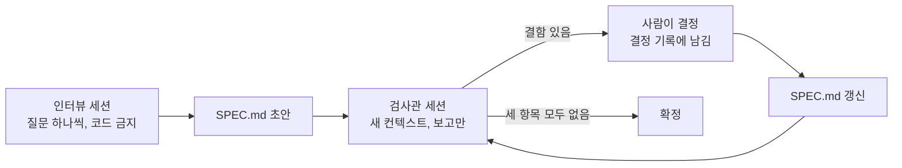

# 6장. 도구 없이 ①: 인터뷰로 SPEC.md를 끌어내고 검사하기

목요일 오후, 운영팀이 메신저로 묻는다고 해보자. "부분 환불, 다음 주엔 되죠?" 지난주에도 책 한 권이 모서리가 찢긴 채 배송됐다. 배송을 마친 주문은 전체 취소조차 되지 않으니 서점 관리자는 손쓸 방법이 없었다. 당신은 에이전트 창을 열었다. 커서가 깜빡인다. "주문에 부분 환불 기능 추가해 줘." 이제 엔터만 누르면 된다.

잠깐 손을 멈추자. 3장에서 우리는 이 한 줄이 남기는 빈칸을 세어 봤다. 누가 환불할 수 있는가, 7일은 언제부터 세는가, 쿠폰 할인은 어떻게 나누는가, 같은 요청이 두 번 오면 어떻게 하는가, PG가 실패하면 무엇이 남는가, 기존 전체 취소와는 어떤 관계인가. 1장에서 본 대로 에이전트는 이 빈칸 앞에서 멈추지 않는다. 묻지 않고 채운다. 그리고 우리는 그 결정을 diff를 읽다가 뒤늦게 발견한다.

설치할 도구는 없다. 평범한 마크다운 파일 하나와, 에이전트에게 원래 있는 질문하는 능력이면 된다. 정말 그것으로 충분할까? 부분 환불을 처음부터 끝까지 손으로 스펙화하면서 확인해 보자.

> 이 장은 Claude Code 2.1.319(로컬 설치본, 공식 문서 접근 2026-11-10) 기준이다. 인터뷰와 검사 프롬프트는 하네스와 상관없이 쓸 수 있는 평범한 문장이다. 하네스별 차이는 장 끝의 상자에 모았다.

## 한 줄을 치기 전에

### 점수부터 매겨 보자

스펙을 쓰기 전에 먼저 물을 것이 있다. 이 변경에 스펙이 필요하긴 한가? 2장에서 소개한 스펙 적합성 점수를 꺼내자. 조건 여섯 개 가운데 참인 것을 센다. 파일 3개 이상을 건드리는가, 수용 기준이 4개 이상인가, 모듈·서비스·저장소 경계를 넘는가, 스키마나 공개 API를 바꾸는가, 여러 엔지니어나 여러 에이전트가 참여하는가, 규제나 감사 대상인가.

부분 환불은 앞의 넷이 참이다. 컨트롤러와 서비스와 마이그레이션만 해도 파일이 셋을 넘는다. 기간, 수량, 쿠폰, 중복 요청, PG 실패만 꼽아도 수용 기준이 다섯이다. 외부 PG를 호출하니 결제 경계를 넘고, 새 테이블과 새 API가 생긴다. 이 작업을 혼자 하고 감사 대상도 아니니 뒤의 둘은 거짓이다. 점수는 4점이다.

Uvik 규칙은 3점 이상이면 스펙을 쓰라고 한다. 이 문턱은 서비스 회사 한 곳이 브라운필드 Python 티켓 50개를 모델 하나로 돌린 벤치마크에서 나온 시작값이다. 그러니 절대 기준으로 받기보다 내 기록으로 고쳐 갈 출발점으로 쓰는 편이 낫다. 구현 경로는 대체로 분명하고, 혼자 하는 일이며, 스펙이 이 변경과 함께 끝나도 된다. 참고 보고서의 사다리로 보면 R2, 즉 한 파일 스펙 자리다. 사다리 전체는 11장에서 다룬다.

반대 방향도 한 줄 짚어 두자. 오류 메시지의 "환뷸"을 "환불"로 고치는 변경(0점)이나 취소 사유에 200자 길이 검증을 넣는 변경(1~2점)에 이 장의 방법을 쓰면 과하다. 수용 기준 한두 문장과 그것을 증명할 명령 하나, 많아야 플랜 모드면 충분하다. 이 인터뷰 기법을 정리해 공개한 VelvetShark도 요구가 이미 분명하거나 변경이 작으면 과하다고 스스로 적었다.

### 프롬프트를 다듬는 대신 인터뷰를 시키자

점수가 4점이니 스펙을 쓰기로 하자. 그런데 어떻게 쓸까? 흔히 떠올리는 방법은 둘이다. 둘 다 그럴듯하지만 뒷맛이 찜찜하다.

첫째, 내가 한 시간쯤 들여 프롬프트를 길고 꼼꼼하게 다듬는다. 이 방법의 한계는 분명하다. 프롬프트에는 내가 이미 생각한 것만 들어간다. VelvetShark는 에이전트에게 받은 질문 32개 가운데 약 3분의 1이 자기가 생각하지 못한 것이었다고 적었다. 혼자 다듬은 프롬프트에서는 그 3분의 1이 통째로 빠진다. 자기 보고 수치지만 경험과 크게 어긋나지 않는다.

둘째, 에이전트에게 바로 "부분 환불 스펙을 써 줘"라고 맡긴다. 그러면 깔끔한 문서가 나온다. 문제는 그 문서의 빈칸이 이미 채워져 있다는 점이다. 3장에서 본 연구들이 이 상황을 잘 보여 준다. Ambig-SWE에서는 명시적으로 지시하지 않으면 모델이 거의 묻지 않았다. HumanEvalComm에서 ChatGPT(GPT-3.5)는 결함 있는 문제의 14.21%에서만 질문했다. 두 연구 모두 벤치마크 과제이고 최신 모델을 다 시험한 것도 아니다. 그래도 방향은 같다. 묻게 만들지 않으면 묻지 않는다.

그렇다면 어떻게 해야 할까? Claude Code 공식 모범 사례가 답을 준다. 원하는 것을 아직 다 정하지 못했다면 프롬프트를 다듬지 말고 Claude에게 나를 인터뷰하게 하고, 결과를 `SPEC.md`에 쓰게 하라는 것이다. 그다음 문장이 이 장과 다음 장의 뼈대다. "Once `SPEC.md` exists, start a fresh session to build from it." 새 세션은 깨끗한 컨텍스트와 글로 적힌 완료 정의를 가지고 시작한다. 문서는 공개 API에 속도 제한을 붙이는 예를 들며, 이때 Claude가 사용자별 제한인지 키별 제한인지, 한도를 넘은 요청은 어떻게 할지, 무엇을 범위 밖에 둘지를 객관식으로 묻는다고 설명한다. 프레임워크 없는 스펙 주도 개발(Spec-Driven Development, SDD)의 1차 근거가 하네스 제조사의 문서 안에 있는 셈이다.

## 인터뷰 세션

### 한국어 인터뷰 프롬프트

공식 문서의 예문은 영어 한 문장이다. 그대로 써도 동작하지만, 부분 환불처럼 결제가 얽힌 변경이라면 몇 줄을 더 붙여 두면 좋다. 커뮤니티의 최소 키트들이 되풀이해 쓰는 장치를 모아 이 책 예제에 맞게 고쳐 쓰면 이렇다.

```text
부분 환불 기능을 추가하려고 하는데 아직 다 정하지 못했습니다.
스펙을 쓸 수 있을 때까지 저를 인터뷰해 주세요.

- 질문은 한 번에 하나씩 해 주세요. 가능하면 선택지 2~4개를 주고,
  추천하는 선택지 하나에 이유를 붙여 주세요.
- 먼저 저장소에서 주문, 결제, 쿠폰, 전체 취소 코드를 읽어 주세요.
  코드를 읽어서 알 수 있는 것은 묻지 마세요.
- 다음 범주는 빠뜨리지 마세요: 누가 요청할 수 있는가(인가),
  실패했을 때의 동작, 같은 요청이 두 번 올 때, 기존 기능과의 관계.
- 인터뷰 중에는 코드를 쓰지 말고 어떤 파일도 고치지 마세요.
- 더 물을 것이 없으면 docs/specs/partial-refund/SPEC.md를
  다음 절 순서로 써 주세요: 목적 / 사용자와 권한 / 만들 것 / 안 만들 것 /
  API와 데이터 / 규칙 / 수용 기준 / 열린 질문 / 결정 기록.
  규칙은 EARS 문형으로(키워드는 영어, 나머지는 한국어),
  수용 기준은 GIVEN/WHEN/THEN으로 써 주세요.
```

줄마다 출처가 있다. 한 번에 하나씩, 가능하면 객관식이라는 규칙은 Jesse Vincent와 Charles McGuinness가 각자 쓰던 방식이다. 추천과 이유를 붙이게 한 것은 내가 고르는 시간을 줄이려는 장치다. 저장소를 먼저 읽게 한 줄은 3장에서 본 작성 규칙과 맞닿아 있다. 파일 위치나 변수 이름처럼 에이전트가 스스로 찾을 수 있는 것은 스펙 질문이 아니다. "인가"를 범주로 못 박은 데도 이유가 있다. 기존 서비스에 중간 크기 기능 하나를 붙여 본 Ran the Builder의 실무자는 계획 단계의 어떤 도구도 인가 누락을 짚지 못했다고 적었다. 실무자 한 명의 관찰이지만 결제 기능에서 놓치기엔 너무 비싼 빈칸이다. 코드를 쓰지 말라는 줄은 Ray의 인터뷰 세션에서 가져왔다.

이 프롬프트를 어디서 돌릴지는 고르면 된다. 평범한 채팅에서 돌려도 되고, Claude Code라면 플랜 모드에서 돌려도 된다. 플랜 모드는 파일을 읽고 계획을 쓰지만 소스는 고치지 않으므로, 인터뷰 도중 에이전트가 성급하게 코드를 쓰기 시작하는 사고를 구조적으로 막아 준다. 이 경우 마지막의 `SPEC.md` 쓰기는 플랜 모드를 나온 뒤에 맡기면 깔끔하다. VelvetShark는 `AskUserQuestion` 도구로 객관식 인터뷰를 하게 하고, 이 지시를 `~/.claude/commands/interview.md` 슬래시 명령으로 저장해 두고 썼다. mattpocock/skills(v1.3.2/2026-10-29 기준)의 `/grill-me`도 같은 일을 하는 보조 수단이다. 이 스킬은 본문이 한 줄뿐이고 실제 인터뷰 규율은 `grilling` 스킬에 들어 있다. 어느 쪽이든 선택 사항이다. 핵심은 도구가 아니라 위의 몇 줄이다.

### 인터뷰가 끌어내야 할 질문들

아래는 이 책 예제로 채운 대화의 일부다. 실제 세션에서 받아 적은 기록은 아니고, 인터뷰가 어떤 결정을 끌어내야 하는지 보여 주려고 만든 예시다.

```text
Q1. 부분 환불은 누가 요청하나요?
    (a) 고객이 직접  (b) 서점 관리자(SHOP_ADMIN)만 [추천]  (c) 둘 다
    추천 이유: 고객용 화면까지 만들면 범위가 크게 늘어납니다.
A.  (b). 고객 화면은 이번에 만들지 않습니다.

Q2. 서점 관리자는 어느 주문을 환불할 수 있나요?
    (a) 모든 서점의 주문  (b) 자기 서점 주문만 [추천]
A.  (b). 다른 서점 주문이면 403으로 막아 주세요.

Q3. 환불 기간에 제한이 있나요?
    (a) 없음  (b) 배송 후 7일  (c) 배송 후 14일
A.  (b)

Q4. 주문 쿠폰이 있을 때 환불액은 어떻게 정할까요?
    (a) 쿠폰을 무시하고 상품가 그대로
    (b) 쿠폰 할인액을 항목 금액 비율로 나눠 뺀다 [추천]
    (c) 첫 환불에서 쿠폰 할인 전액을 뺀다
A.  (b)

Q5. 나눈 금액의 원 미만은 어떻게 할까요?
    (a) 반올림  (b) 버리고, 마지막 환불에서 차액을 보정 [추천]
A.  (b)

Q6. 배송비는 어떻게 할까요?
    (a) 마지막 항목을 환불할 때 함께 돌려준다  (b) 환불하지 않는다
A.  (b)

Q7. 같은 환불 요청이 두 번 오면(네트워크 재시도 등) 어떻게 할까요?
    (a) 두 번 처리  (b) Idempotency-Key로 첫 결과를 돌려준다 [추천]
A.  (b). 같은 키에 본문이 다르면 거절하고, 키는 24시간 보관합니다.

Q8. PG 환불 호출이 실패하면 무엇을 남길까요?
    (a) 아무것도 기록하지 않는다
    (b) 환불을 FAILED로 기록하고 주문은 그대로 둔다 [추천]
A.  (b). 다시 요청할 수 있어야 합니다.
```

질문 여덟 개가 3장에서 센 빈칸 여섯 개를 거의 다 덮는다. Q1과 Q2가 인가를, Q4와 Q5가 안분과 차액을, Q7이 중복 요청을, Q8이 PG 실패를 정했다. 인터뷰가 이어지면 PG 실패 뒤 재요청에는 어떤 키를 쓰는지, 배송 전 주문은 어떻게 하는지, 전체 취소 API는 그대로 두는지 같은 질문이 따라 나온다. 그런데 Q3을 다시 보자. "배송 후 7일"이라고 답했다. 7일은 정확히 언제부터 세는가? 이 질문은 아무도 하지 않았다. 묻는 쪽도 답하는 쪽도 지나쳤다. 이 빈칸은 뒤에서 다시 만난다.

인터뷰 중에 곤란한 순간도 두 번쯤 온다. 하나는 에이전트가 구현 세부를 묻는 경우다. "환불 금액 계산을 별도 클래스로 뺄까요?" 같은 질문이 나오면 "그건 구현할 때 정해도 됩니다"라고 답하고 넘어가자. 3장의 작성 규칙대로 클래스 구조나 내부 함수에 관한 질문은 스펙이 답할 몫이 아니다. 다른 하나는 내가 답을 모르는 경우다. 운영팀에 확인해야 하는 정책 질문이 대표적이다. 이때 그럴듯한 답을 즉석에서 지어내기보다 "모르겠습니다, 열린 질문으로 남겨 주세요"라고 답하는 편이 낫다. 열린 질문 절은 바로 그런 항목이 갈 자리이고, 그 절이 비어야 확정할 수 있다. 에이전트가 추측으로 채우던 빈칸을 이번에는 내가 추측으로 채운다면, 인터뷰를 한 의미가 사라진다.

질문 개수의 감도 잡아 두자. VelvetShark는 보통 20~30개, 복잡한 기능이면 40~60개라고 적었다. McGuinness는 약 50개를 받았고 25~100개를 권했다. 둘 다 자기 보고다. 개수보다 중요한 기준은 따로 있다. 인터뷰가 끝났을 때 내가 "그건 아직 안 정했는데"라고 말할 항목이 남아 있지 않은가를 보자.

## 결과물: SPEC.md

인터뷰가 끝나면 에이전트가 `SPEC.md`를 쓴다. 절이 아홉 개인 데는 이유가 있다. 커뮤니티의 최소 키트를 여러 출처에서 모아 보면 같은 구성 요소가 되풀이해 나온다. 범위 폭발과 샛길을 막는 비목표, 왜 그렇게 정했는지 남기는 결정 기록, 그리고 테스트로 옮길 수 있는 수용 기준이다. Ray는 "만들 것"과 "안 만들 것"을 나란히 두었고, VelvetShark는 157줄짜리 스펙에 비목표 절을 따로 두었다. 규칙을 EARS로, 수용 기준을 GWT로 쓰는 방법은 3장에서 다뤘다.

세 가지를 더 신경 썼다. 첫째는 테스트가 확인할 이름을 스펙에 적은 것이다. 경로, 헤더, 오류 코드, 상태 이름이 모두 적혀 있다. SWE-Milestone 연구에서는 스펙에 없는 이름이나 경로에 기대는 테스트가 붙은 단위의 80.6%가 실패했다. 7장에서 이 수용 기준을 JUnit 테스트로 옮길 때 이 이름들이 그대로 쓰인다. 둘째는 예시 데이터다. 수용 기준의 기준 주문 O-1은 테스트와 시드 데이터로 고스란히 복사된다. 그래서 숫자가 틀리면 그 오류가 코드 전체로 번진다. Ray가 검사 세션에서 예시 날짜와 타임스탬프가 1년 어긋난 것을 찾아내고 경고한 이유가 바로 이것이다. 금액은 한 번 더 손으로 계산해 두자.

셋째는 머리말 셋째 줄의 "바뀌지 않을 동작"이다. 4장에서 본 Kiro 버그픽스 스펙의 세 번째 문형, 곧 고치는 동안에도 계속 지켜야 할 동작을 따로 적는 생각을 빌려 왔다. 무엇을 바꿀지만 적어 두면 무엇을 건드리지 말아야 하는지는 빈칸으로 남는다. 전체 취소 API는 이번 변경과 같은 주문 상태를 만지니 이 빈칸이 특히 위험하다. 그래서 같은 약속을 머리말, 규칙 R10, 수용 기준 AC9 세 곳에서 붙잡았다.

아래는 이 책 예제로 쓴, 검사를 마친 판의 전문이다. 검사 전 초안과 다른 곳은 머리말의 상태 줄, 규칙 하나, 수용 기준 둘, 그리고 결정 기록 끝의 두 줄뿐이다. 무엇이 왜 바뀌었는지는 바로 다음 절에서 줄 번호로 따라가 보자.

```markdown
# SPEC: 부분 환불

- 저장소: bookshop-orders
- 상태: 확정 (검사 2회차, 세 항목 모두 "없음")
- 바뀌지 않을 동작: 배송 전 전체 취소 `POST /orders/{orderId}/cancel`

## 1. 목적

배송을 마친 주문에서 일부 항목, 일부 수량만 환불할 수 있게 한다.
지금은 배송 전 전체 취소만 있어서, 한 권이 파손되어 와도
주문 데이터에 환불 기록을 남길 방법이 없다.

## 2. 사용자와 권한

- 요청 주체는 서점 관리자(`SHOP_ADMIN`)다.
- 서점 관리자는 자기 서점의 주문만 환불할 수 있다.
- 고객은 이 API를 호출하지 않는다.

## 3. 만들 것

- M1. 항목 단위, 수량 단위 부분 환불 요청 API
- M2. 주문 쿠폰 할인의 항목별 안분과 원 미만 차액 보정
- M3. `Idempotency-Key`로 중복 요청 처리
- M4. PG 환불 실패 기록과 재요청
- M5. 주문별 환불 내역 조회 API
- M6. 주문 상태 `PARTIALLY_REFUNDED`, `REFUNDED`

## 4. 안 만들 것

- 배송비는 환불하지 않는다.
- 포인트와 적립금은 다루지 않는다.
- 고객 셀프 환불 화면은 만들지 않는다. 관리자 API만 만든다.
- 복수 결제 수단은 다루지 않는다. 카드 단일 결제만 전제한다.
- 교환은 다루지 않는다.

## 5. API와 데이터

### POST /orders/{orderId}/refunds

- 헤더: `Idempotency-Key` (필수)
- 본문 예:

      { "items": [ { "orderItemId": 2, "quantity": 1 } ],
        "reason": "책 모서리 파손" }

- `reason`은 자유 입력 문자열이며 필수다.
- 성공하면 `201`과 환불 하나(`refundId`, `amount`, `status`, `items`)를 돌려준다.
- 요청 형식 오류는 기존 API와 같은 `400` 응답을 따른다.
- 오류 응답은 기존 API의 오류 본문 형식을 따르고, `code`에 오류 코드를 담는다.

### GET /orders/{orderId}/refunds

- 그 주문의 환불 목록을 생성 순서대로 돌려준다.
- 환불마다 `refundId`, `amount`, `reason`, `status`, `items`, `createdAt`

### 스키마

- 새 테이블 `refunds`: id, order_id, amount, reason, status,
  idempotency_key(고유), created_at
- 새 테이블 `refund_items`: refund_id, order_item_id, quantity, amount
- `order_items.refunded_quantity` 열 추가 (기본값 0)
- 주문 상태 추가: `PARTIALLY_REFUNDED`, `REFUNDED`
- 환불 상태: `REQUESTED`, `COMPLETED`, `FAILED`
- 금액은 모두 원 단위 정수다.

## 6. 규칙

- R1. When 서점 관리자가 환불을 요청하면, the 주문 서비스 shall 요청 항목의
  환불액을 계산해 PG 환불을 호출하고 환불을 기록한다.
- R2. If 요청 시각이 `delivered_at`부터 168시간을 넘으면, then the 주문 서비스
  shall `422 REFUND_WINDOW_EXPIRED`로 거절한다.
- R3. If 이미 환불된 수량과 요청 수량의 합이 주문 수량을 넘으면, then the
  주문 서비스 shall `409 REFUND_QUANTITY_EXCEEDED`로 거절한다.
- R4. The 주문 서비스 shall 주문 쿠폰 할인액을 항목 금액 비율로 나눠 환불액에서
  뺀다. 원 미만은 버리고, 주문의 마지막 남은 수량을 환불할 때 차액을 보정한다.
- R5. When 같은 `Idempotency-Key`와 같은 본문으로 다시 요청하면, the 주문 서비스
  shall 첫 결과를 그대로 돌려준다. 키는 24시간 보관한다.
- R6. If 같은 `Idempotency-Key`에 다른 본문이 오면, then the 주문 서비스
  shall `422 IDEMPOTENCY_KEY_REUSED`로 거절한다.
- R7. If PG 환불 호출이 실패하면, then the 주문 서비스 shall 환불을 `FAILED`로
  기록하고 `502 PAYMENT_GATEWAY_ERROR`를 응답한다. 주문 상태와
  `refunded_quantity`는 바꾸지 않는다.
- R8. When 환불이 `COMPLETED`가 되면, the 주문 서비스 shall 남은 수량이 있으면
  주문을 `PARTIALLY_REFUNDED`로, 남은 수량이 없으면 `REFUNDED`로 바꾼다.
- R9. If 다른 서점의 주문이면, then the 주문 서비스 shall `403`으로 거절한다.
  주문이 없으면 `404`로 거절한다.
- R10. The 주문 서비스 shall 전체 취소 API의 기존 동작(배송 전만, 전액)을 바꾸지 않는다.

## 7. 수용 기준

기준 주문 O-1: 책 A 18,000원 × 1, 책 B 12,000원 × 2 (상품 42,000원),
정률 쿠폰 10%(4,200원), 배송비 3,000원, 결제 40,800원,
`delivered_at` = 2026-11-02T10:00:00+09:00

- AC1. 부분 환불
  GIVEN 주문 O-1 / WHEN 책 B 1권 환불 /
  THEN 환불액 10,800원, 주문 `PARTIALLY_REFUNDED`, 책 B `refunded_quantity` 1
- AC2. 전 항목 환불
  GIVEN 주문 O-1 / WHEN 책 A 1권, 책 B 2권을 차례로 모두 환불 /
  THEN 환불액 합계 37,800원(= 결제 40,800원 − 배송비 3,000원), 주문 `REFUNDED`
- AC3. 차액 보정
  GIVEN O-1과 같은 상품, 정액 쿠폰 3,000원 / WHEN 책 A, 책 B, 책 B 순서로 환불 /
  THEN 안분 쿠폰 1,285원, 857원, 858원 (합 3,000원)
- AC4. 환불 기간
  GIVEN 주문 O-1 / WHEN 2026-11-09T10:00:00+09:00에 요청 / THEN 접수
  WHEN 2026-11-09T10:00:01+09:00에 요청 / THEN `422 REFUND_WINDOW_EXPIRED`
- AC5. 수량 초과
  GIVEN 책 B 1권이 환불된 O-1 / WHEN 책 B 2권 요청 /
  THEN `409 REFUND_QUANTITY_EXCEEDED`, 아무것도 바뀌지 않음
- AC6. 중복 요청
  GIVEN 키 K로 책 B 1권 환불 완료 / WHEN 키 K, 같은 본문 / THEN 첫 응답 그대로, 환불 1건
  WHEN 키 K, 다른 본문 / THEN `422 IDEMPOTENCY_KEY_REUSED`
- AC7. PG 실패
  GIVEN PG가 실패를 응답 / WHEN 책 B 1권 환불 /
  THEN `502 PAYMENT_GATEWAY_ERROR`, 환불 `FAILED`, 주문 `DELIVERED`, `refunded_quantity` 0
  AND 새 키로 다시 요청하면 정상 처리
- AC8. 인가
  GIVEN 서점 X 관리자와 서점 Y의 주문 / WHEN 환불 요청 / THEN `403`, 기록 없음
- AC9. 전체 취소 회귀
  GIVEN `PAID` 상태 주문 / WHEN 전체 취소 / THEN 기존과 같이 전액 취소

## 8. 열린 질문

- 없음. 다음 변경으로 미룬 것: 자유 입력 사유를 사유 코드로 정리할지.

## 9. 결정 기록

- D1 (인터뷰) 환불은 `SHOP_ADMIN`이 자기 서점 주문에만 한다. 서점 여러 곳이 한 백엔드를 쓰기 때문이다.
- D2 (인터뷰) `delivered_at`이 없는 주문(배송 전, 취소됨)은 기간 밖으로 보고 R2로 거절한다. 배송 전에는 전체 취소를 쓴다.
- D3 (인터뷰) PG 실패 뒤 재요청은 새 `Idempotency-Key`로 한다. 같은 키는 첫 결과(`FAILED`)를 돌려준다.
- D4 (검사 1회차) 환불 기간은 `delivered_at`부터 168시간이다. 날짜가 아니라 시각으로 비교하고, 168시간이 되는 시각까지 받는다.
- D5 (검사 1회차) 전 항목 환불 합계는 결제 금액에서 배송비를 뺀 값이다. "안 만들 것"의 배송비 항목에 맞췄다.
```

132줄이다. 감을 잡기 위해 견줘 보면, Uvik 측정에서 도구별 스펙 길이 중앙값은 93줄에서 188줄 사이였다. 한 파일에 결제 기능 하나를 담기에 지나치게 길지도 짧지도 않은 분량이다. AC3의 숫자가 맞는지도 확인해 두자. 정액 쿠폰 3,000원을 상품 42,000원에 비율로 나누면 책 A는 1,285.7원, 책 B는 한 권에 857.1원이다. 원 미만을 버리면 1,285원과 857원 두 번, 합이 2,999원이니 마지막으로 환불되는 책 B에서 1원을 더 빼 858원이 된다. 이때 환불액 합계는 39,000원으로, 결제 42,000원에서 배송비 3,000원을 뺀 값과 정확히 같다.

## 검사관 세션

### 보고만 하고 고치지 않는다

초안이 나왔으면 바로 구현으로 가고 싶어진다. 그 전에 한 단계만 더 거치자. `/clear`로 대화를 비우거나 새 세션을 열고, 이번에는 에이전트에게 검사관 역할을 맡긴다. 이 방식은 Ray가 "30일 바이브 코딩" 시리즈 8일차(2026-09-21)에 가계부 앱 스펙에서 쓴 흐름을 그대로 가져온 것이다. 인터뷰 세션, `/clear`, 검사 세션, 결정 반영, 재검사 순서로 돈다.

왜 굳이 세션을 바꿀까? 인터뷰 세션의 컨텍스트에는 초안을 만든 추론이 고스란히 남아 있다. 그 컨텍스트에서 다시 읽으면 문서에 적힌 것보다 머릿속에 있던 것을 읽게 된다. 깨끗한 세션은 파일만 읽는다. 다음 장에서 구현을 맡을 세션도 파일만 읽는다. 검사관은 그 구현 세션의 눈으로 미리 읽어 주는 셈이다.

```text
docs/specs/partial-refund/SPEC.md를 읽고 아래 세 가지만 보고해 주세요.
파일은 고치지 마세요.

1. "만들 것", "규칙", "수용 기준"의 각 항목이 테스트 가능한가?
   기준이 되는 값(시각, 단위, 경계)이 정해지지 않은 문장도 여기에 넣어 주세요.
2. 어떤 문장이 "안 만들 것"과 충돌하거나, 두 문장이 같은 상황에
   서로 다른 결과를 요구하는가? 두 문장의 줄 번호를 함께 적어 주세요.
3. 본문(API, 규칙, 수용 기준)에 나오는 기능 가운데 "만들 것"에 없는 것이 있는가?

항목마다 줄 번호와 이유를 적고, 문제가 없으면 "없음"이라고만 써 주세요.
```

Ray의 원래 질문 세 개는 "만들 것"이 테스트 가능한가, "만들 것"과 "안 만들 것"이 충돌하는가, 본문에 나온 기능이 "만들 것"에서 빠졌는가였다. 여기서는 두 번째 질문을 넓혀 스펙 안의 두 문장끼리 부딪히는 경우까지 보게 했다. 3장에서 본 대로 모델은 자기모순을 가장 못 잡는다. 그러니 그 질문만큼은 이름을 불러서 따로 묻는 것이 좋다.

"파일은 고치지 마세요"라는 줄도 중요하다. Spec Kit 이슈 #737(2025-10-04)에는 구현 도중 "이 태스크 순서를 바꿔야 할까?"라고 물었더니 답 대신 코드를 고쳐 버렸다는 보고가 있다. 질문을 받은 에이전트는 고치는 쪽으로 기울기 쉽다. 검사관이 문서를 직접 고치면 사람이 결정할 기회가 사라진다. 그래서 보고와 결정을 나눈다.

### 두 결함: 모순 하나, 빈칸 하나

검사 전 초안에 이 프롬프트를 돌렸을 때의 보고서를 이 책 예제로 채워 보면 이렇다. 줄 번호는 검사 전 초안 기준인데, 초안에는 결정 기록 끝의 두 줄(131~132행)이 없을 뿐 나머지 줄 위치는 위 전문과 같아 그대로 따라 읽을 수 있다.

```text
1. 테스트 가능성
   - SPEC.md:70  R2 "배송 후 7일" — 7일을 배송 완료 시각부터 세는지,
     출고일부터 세는지, 날짜 단위(7일째 자정까지)인지 시각 단위인지,
     어느 시간대인지 정해지지 않아 경계 테스트를 쓸 수 없습니다.
   - SPEC.md:105-106  AC4 "배송 후 7일째 / 8일째" — 같은 이유입니다.
2. 충돌
   - SPEC.md:30 "배송비는 환불하지 않는다" ↔ SPEC.md:100 AC2
     "결제 금액 전액(40,800원)을 돌려준다" — 결제 금액 40,800원에
     배송비 3,000원이 들어 있어, 전 항목을 환불하는 같은 상황에
     두 문장이 다른 금액을 요구합니다.
3. 누락
   - 없음
```

첫 번째는 빈칸이다. 인터뷰의 Q3에서 지나쳤던 바로 그 질문이 돌아왔다. "배송 후 7일"은 사람에게는 충분히 분명하게 들린다. 하지만 테스트를 쓰려는 순간 막힌다. 11월 2일 오전 10시에 배송이 끝났다면 11월 9일 오전 10시 정각의 요청은 받는가? 11월 9일 밤 11시는? 에이전트에게 이 빈칸을 그냥 넘겼다면 날짜 단위로 자를지 시각 단위로 자를지를 혼자 골랐을 것이고, 우리는 그 선택을 운영 중 고객 문의로 알게 됐을 것이다.

두 번째는 모순이다. 인터뷰에서 나는 배송비를 환불하지 않는다고 답했다(Q6). 그런데 에이전트가 수용 기준을 쓰면서 전 항목 환불의 결과를 "결제 금액 전액"으로 적었다. 따로 읽으면 두 문장 모두 자연스럽다. 결제 금액에 배송비가 들어 있다는 사실을 함께 떠올려야 비로소 부딪힌다. 3장에서 "에이전트는 빈칸은 눈치채도 모순은 못 본다"고 했던 바로 그런 결함이다. HumanEvalComm에서 ChatGPT의 질문 비율은 불완전한 문제에서 31.68%, 모순된 문제에서 5.84%였다.

그렇다면 이 예에서는 왜 검사관이 모순을 찾았을까? 그렇게 물었기 때문이다. 두 번째 질문이 "같은 상황에 다른 결과를 요구하는 두 문장"을 콕 집어 찾게 했다. 물론 그렇게 물어도 놓칠 수 있다. 하지만 묻지 않으면 거의 찾지 못한다는 것이 연구가 보여 준 방향이다. 넘기기 전에 사람이 수용 기준과 비목표를 한 번 나란히 읽는 습관은 버리지 말자.

## 고치고, 다시 검사한다

### 리뷰 전/후

결함을 찾았으면 고칠 차례다. 다만 고치는 결정은 사람이 내린다. 배송비 모순을 푸는 방법은 두 가지다. 비목표를 지우고 배송비를 돌려주거나, 수용 기준을 고쳐 배송비를 빼거나. 어느 쪽이 맞는지는 코드가 알려 주지 않는다. 운영 정책이 정한다. 이 예제에서는 배송비를 돌려주지 않기로 했다. 결정을 말해 주면 에이전트가 `SPEC.md`를 고치고, 그 결정을 결정 기록에 한 줄씩 남긴다.

```diff
@@ SPEC.md:4 @@
-- 상태: 초안 (인터뷰 세션 작성)
+- 상태: 확정 (검사 2회차, 세 항목 모두 "없음")
@@ SPEC.md:70 (R2) @@
-- R2. If 요청 시각이 배송 후 7일을 넘으면, then the 주문 서비스
+- R2. If 요청 시각이 `delivered_at`부터 168시간을 넘으면, then the 주문 서비스
@@ SPEC.md:100 (AC2) @@
-  THEN 결제 금액 전액(40,800원)을 돌려준다, 주문 `REFUNDED`
+  THEN 환불액 합계 37,800원(= 결제 40,800원 − 배송비 3,000원), 주문 `REFUNDED`
@@ SPEC.md:105 (AC4) @@
-  GIVEN 주문 O-1 / WHEN 배송 후 7일째에 요청 / THEN 접수
-  WHEN 배송 후 8일째에 요청 / THEN `422 REFUND_WINDOW_EXPIRED`
+  GIVEN 주문 O-1 / WHEN 2026-11-09T10:00:00+09:00에 요청 / THEN 접수
+  WHEN 2026-11-09T10:00:01+09:00에 요청 / THEN `422 REFUND_WINDOW_EXPIRED`
@@ SPEC.md:131 (결정 기록) @@
+- D4 (검사 1회차) 환불 기간은 `delivered_at`부터 168시간이다. 날짜가 아니라 시각으로 비교하고, 168시간이 되는 시각까지 받는다.
+- D5 (검사 1회차) 전 항목 환불 합계는 결제 금액에서 배송비를 뺀 값이다. "안 만들 것"의 배송비 항목에 맞췄다.
```

빈칸을 메운 방식을 눈여겨보자. "7일"을 "168시간"으로 바꾸고 기준이 되는 열 이름 `delivered_at`을 적었다. 그러자 AC4가 경계 시각 두 개로 바뀌었다. 하나는 정확히 168시간이 되는 시각, 다른 하나는 거기서 1초가 지난 시각이다. 모호한 규칙은 수용 기준에서 경계 값을 쓸 수 없다는 형태로 드러나고, 규칙을 고치면 수용 기준이 저절로 날카로워진다.

결정 기록을 따로 두는 이유도 있다. 다음 장의 구현 세션은 이 인터뷰도, 검사 보고도 보지 못한다. 그 세션에 남는 것은 파일뿐이다. "168시간"만 적혀 있으면 누군가 나중에 "그냥 7일로 하지?"라며 날짜 단위로 되돌릴 수 있다. D4는 그 시도를 막는 한 줄이다. Ray도 같은 이유로 검사를 마친 스펙에 Decision Log 절을 덧붙였다.

고친 다음에는 같은 검사관 프롬프트를 새 세션에서 한 번 더 돌린다. 세 항목이 모두 "없음"으로 돌아오면 그때 확정한다. 무언가 또 나오면 결정하고 고친 뒤 다시 돌린다. 이 반복의 끝을 "세 검사가 모두 없음"으로 못 박아 두는 것이 Ray 흐름의 핵심이다.


그림 1. 인터뷰에서 확정까지. 검사관은 고치지 않고 보고만 하며, 결정은 사람이 내린다

혹시 검사관이 매번 뭔가를 찾아내서 끝나지 않으면 어떻게 할까? Claude Code 모범 사례는 문제를 찾으라는 리뷰어는 늘 무언가를 찾아낸다고 경고한다. 그 지적을 다 고치다 보면 불필요한 추상화와 일어날 수 없는 경우를 위한 테스트가 늘어난다. 질문을 세 개로 좁혀 둔 것이 이 위험을 줄이는 장치다. 세 질문 밖의 지적은 보고서에 와도 무시하자.

### 리뷰 피로를 줄이고, SPEC.md를 둘 곳

132줄을 매번 처음부터 다시 읽는 일은 생각보다 번거롭다. 커뮤니티가 찾은 장치 몇 개가 피로를 덜어 준다. Jesse Vincent는 브레인스토밍 단계에서 설계를 200~300단어 단위의 절로 끊고, 절마다 확인을 받았다. 에이전트가 다 끝났다고 판단하면 긴 글을 한꺼번에 쏟아내고, 그러면 사람은 그 글을 읽지 않게 된다는 관찰에서 나온 규칙이다. 인터뷰가 끝날 때 `SPEC.md`를 한 번에 받지 말고 절마다 보여 달라고 하면 같은 효과를 얻는다. Boris Tane과 Hartley Brody는 문서에 직접 주석을 달고, 에이전트가 반영한 뒤 바뀐 점의 요약만 받는 방식을 쓴다. 고친 뒤에는 위의 diff처럼 바뀐 줄만 보면 된다.

파일을 어디에 둘지도 정해 두자. 팀 저장소라면 `docs/specs/partial-refund/SPEC.md`처럼 저장소 안에 두고 코드와 같은 PR로 올리는 편이 낫다. 혼자 이 방법을 시험해 보는 단계라면 팀원들이 낯선 파일을 마주치지 않게 `SPEC.md`를 `.git/info/exclude`에 넣는 방법도 있다. 이때 PR 본문에는 수용 기준과 바뀌지 않을 동작만 옮겨 적는다. 어느 쪽이든 스펙은 채팅이 아니라 파일에 있어야 한다. 반년 동안 Spec Kit을 써 온 GPTers의 한 사용자는 회고에서 결국 검수할 수 있는 건 파일뿐이라는 요지의 결론에 이르렀다. 대화는 세션과 함께 사라지지만 파일은 다음 세션에도, 다음 사람에게도 남는다.

> **다른 하네스에서는.** 인터뷰와 검사관 프롬프트는 평범한 문장이라 어느 하네스에서나 그대로 쓴다. `/clear` 대신 새 채팅을 열면 검사관 세션이 된다. 객관식 질문 도구 `AskUserQuestion`은 Claude Code의 것이다. Cursor의 Plan Mode는 계획을 쓰기 전에 명확화 질문을 먼저 하므로 인터뷰를 돌리기에 잘 맞는다. VS Code Copilot은 `/plan`에 원하는 결과, 제약, 검증 방법을 함께 주라고 안내한다. Codex CLI에도 `/plan`이 있지만 작업 중에는 쓸 수 없다. mattpocock/skills의 `/grill-me`는 Claude Code, Copilot, Codex, Gemini CLI에 공식 설치 경로가 있고 Cursor는 범용 경로로만 쓸 수 있다.

내일 아침 할 일은 세 가지면 충분하다.

- [ ] 위의 인터뷰 프롬프트를 슬래시 명령이나 텍스트 파일로 저장한다.
- [ ] 검사관 질문 세 개를 따로 저장하고, "파일은 고치지 마세요"를 지우지 않는다.
- [ ] 이번 주 변경 가운데 스펙 적합성 점수가 3점 이상인 것 하나를 골라 인터뷰부터 확정까지 돌려 보고, 질문 수와 걸린 시간을 적어 둔다.

마지막 줄에서 적어 둔 숫자는 11장에서 다시 쓴다. 이제 `SPEC.md`가 생겼다. 이 파일만 들고 새 세션을 열 차례다.
