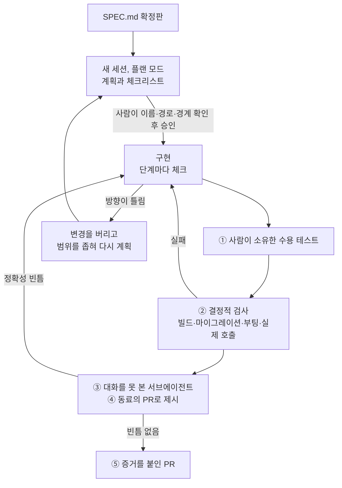

# 7장. 도구 없이 ②: 새 세션에서 만들고, diff를 스펙으로 검증한다

"타입 체크 통과. 빌드 통과. 테스트 통과. 구현 완료."

에이전트의 마지막 보고에 체크 표시가 나란히 붙어 있다. 기분 좋게 앱을 띄운다. 기동 로그가 몇 줄 흐르더니 스택 트레이스가 쏟아진다. 의존성 주입이 해석되지 않는다. 그걸 고치자 이번에는 Logger가 순환 참조를 일으키고, 그다음에는 DB 어댑터 초기화가 실패한다. 방금 "완료"라고 했던 그 코드다.

이 장면은 GPTers의 엔라인이 스펙 주도 개발(Spec-Driven Development, SDD)용 자작 하네스, 이름하여 "SDD 하네스"를 만들며 적은 실패 목록에서 가져왔다. 글에는 날짜가 없고, 한 사람의 보고이며 정량 수치도 없다. 그래도 낯설지 않은 장면이다. 그의 에이전트는 타입 체크, 빌드, 테스트만 통과하면 완료를 선언했다. 거짓말을 한 것은 아니다. 확인하라고 한 것을 확인했을 뿐이다. 문제는 확인할 목록을 정하고, 그 목록을 통과했다고 판정한 쪽이 일한 에이전트 자신이었다는 데 있다.

6장에서 우리는 확정된 `SPEC.md`를 손에 넣었다. 이제 그 파일로 만들 차례다. 그런데 다 만들고 나면 누가, 무엇으로 "스펙대로 됐다"고 판정해야 그 말을 믿을 수 있을까?

> 이 장은 Claude Code 2.1.319(로컬 설치본, 공식 문서 접근 2026-11-10) 기준이다. `plansDirectory`, `showClearContextOnPlanAccept` 같은 설정 키는 하네스 판이 바뀌면 이름이나 동작이 달라질 수 있으니 공식 설정 문서를 함께 확인하자.

## 새 세션에서 계획하기

### SPEC.md만 들고 플랜 모드로

새 세션을 연다. 인터뷰의 대화도, 검사관의 보고도 없는 깨끗한 컨텍스트다. 이 세션에 건넬 것은 `SPEC.md` 하나다. Claude Code 모범 사례가 새 세션을 권하는 이유가 여기 있다. 깨끗한 컨텍스트와 글로 적힌 완료 정의만으로 시작하면, 앞선 대화에서 흘린 말 대신 파일에 적힌 말을 기준으로 일하게 된다.

바로 구현을 시키지 말고 먼저 계획을 받자. `Shift+Tab`으로 모드를 돌려 플랜 모드로 들어가도 되고, `claude --permission-mode plan`으로 시작해도 되고, 프롬프트 앞에 `/plan`을 붙여도 된다. 상태 표시줄에 `⏸ plan mode on`이 보이면 그 세션은 파일을 읽고 탐색용 명령을 돌리고 계획을 쓰지만 소스는 고치지 않는다.

```text
/plan docs/specs/partial-refund/SPEC.md를 읽고 구현 계획을 세워 주세요.
- 수정하거나 추가할 파일 경로를 모두 적고, 파일마다 바꿀 내용을 한두 줄로
- SPEC.md 6절 규칙 R1~R10과 7절 수용 기준 AC1~AC9를 어느 단계, 어느 테스트가
  다루는지 연결해 주세요
- 마이그레이션은 되돌리는 스크립트까지 포함해 주세요
- 단계마다 체크리스트를 두고, 단계를 마칠 때마다 체크해 주세요
- SPEC.md에 없는 결정이 필요하면 계획에 넣지 말고 "질문" 절에 남겨 주세요
```

계획이 나오면 읽는다. 처음부터 끝까지 다 읽기 부담스럽다면 세 가지만이라도 직접 확인하자. 이름과 경로가 맞는가(`delivered_at`, `refunded_quantity`, `/orders/{orderId}/refunds`), 경계 사례가 들어갔는가(168시간 정각과 1초 뒤, PG 실패 뒤 새 키로 재요청), 그리고 바뀌지 않을 동작을 지키는 단계가 있는가(전체 취소 회귀 테스트). 고칠 곳이 있으면 `Ctrl+G`로 계획을 편집기에서 직접 고칠 수 있다.

마지막 줄에 이유가 있다. 계획 단계에서 에이전트가 스펙의 빈칸을 혼자 메우면 6장의 수고가 무너진다. 그래서 빈칸을 발견하면 계획에 슬쩍 넣지 말고 질문으로 꺼내 놓게 했다. 질문이 나오면 답을 정하고, 그 답을 `SPEC.md`의 결정 기록에도 한 줄 남기자. 스펙이 계속 사실을 말하게 하는 가장 싼 방법이다. 구현 도중에 같은 일이 생겨도 순서는 같다. 계획과 스펙이 어긋나는 결정이 나오면 스펙의 결정 기록을 먼저 고치고, 계획은 그다음에 고친다. 순서를 거꾸로 하면 계획 파일은 최신인데 스펙은 낡은 상태가 되고, 8장에서 볼 드리프트가 바로 그 틈에서 시작된다.

계획을 승인할 때는 선택지가 셋이다. Yes, and use auto mode(auto 모드를 쓸 수 없으면 Yes, auto-accept edits), Yes, manually approve edits, No, keep planning. 결제 코드를 처음 만지는 단계라면 편집을 하나씩 승인하는 쪽이 마음 편하다.

### 계획을 저장소에 두고, 체크리스트를 상태로

Claude Code의 계획은 파일로 저장된다. 다만 기본 위치가 `~/.claude/plans`, 곧 저장소 밖이다. 세션이 끝나면 계획이 어디 있는지 팀원은 모르고 다음 세션도 찾기 어렵다. 설정 하나로 저장소 안으로 옮기자.

```json
{
  "plansDirectory": "./docs/plans",
  "showClearContextOnPlanAccept": true
}
```

`.claude/settings.json`에 넣는 두 줄이다. `plansDirectory`는 프로젝트 루트 기준 경로를 받는다. 루트 밖 경로나 macOS·Linux에서 백슬래시가 든 경로는 무시되고 기본 위치로 돌아간다. `showClearContextOnPlanAccept`를 켜면 승인 선택지 맨 앞에 Yes, clear context and …가 생긴다. 계획을 승인하면서 대화 컨텍스트를 비우고 계획만으로 구현을 시작하는 선택지다. 세션을 새로 열지 않고도 "새 세션"을 흉내 낼 수 있는 셈이다.

저장소에 남은 계획은 이런 모양이 된다. 이 책 예제로 채운 발췌다.

```markdown
# 부분 환불 구현 계획

- 스펙: docs/specs/partial-refund/SPEC.md (확정판)
- 바뀌지 않을 동작: 전체 취소 API — AC9 회귀 테스트로 확인

## 1단계 스키마
- [x] migrations/012_add_partial_refund.up.sql, .down.sql
      (refunds, refund_items, order_items.refunded_quantity, 주문 상태 두 개)
- [x] 검증: scripts/db.sh로 적용 → 되돌리기 → 다시 적용

## 2단계 금액 계산 (R4 · AC1, AC2, AC3)
- [x] refund/RefundCalculator.java: 안분, 원 미만 버림, 마지막 수량에서 차액 보정
- [ ] RefundCalculatorTest: 10,800원 / 합계 37,800원 / 1,285·857·858원
- [ ] RefundInvariantTest: 전 수량 환불 합계 = 결제 금액 − 배송비

## 3단계 환불 API (R1~R3, R5~R9 · AC4~AC8)
- [ ] refund/RefundController.java: POST, GET /orders/{orderId}/refunds
- [ ] refund/RefundService.java: 권한(403/404) → 기간(422) → 수량(409)
      → 멱등 키 → PG 호출 → 상태 갱신
- [ ] PartialRefundAcceptanceTest: AC1~AC9

## 4단계 마감
- [ ] scripts/verify-refund.sh 통과 (빌드, 마이그레이션, 부팅, 실제 호출)
- [ ] 서브에이전트 리뷰: diff ↔ SPEC.md, 정확성 빈틈 0건

## 질문 (SPEC.md에 없는 결정)
- 없음
```

체크 표시가 진행 상황을 말해 준다. 2단계 중간까지 왔다. 이 세션이 끊기거나 컨텍스트가 넘쳐도 다음 세션은 이 파일을 읽고 정확히 여기서 이어 간다. Sam McLeod는 이 원리를 한 문장으로 요약했다. "The checklist is the state of the work." 진행 상태가 대화에 있지 않고 파일에 있으니 새 세션이 길을 잃지 않는다. GeekNews의 한 댓글도 계획 파일을 저장소 안에 두고 실행 결과까지 적게 했더니 컨텍스트가 잘 유지됐다고 전했다.

## 구현하는 동안

### 승인 전에는 만들지 않고, 틀리면 버린다

플랜 모드를 쓰면 승인 전에는 소스가 바뀌지 않는다. 구현 금지 가드가 구조로 들어 있는 셈이다. 플랜 모드 없이 계획을 주고받는다면 이 가드를 말로 세워야 한다. Boris Tane은 계획에 주석을 달아 수정을 요청할 때마다 끝에 `don't implement yet`를 붙였다. 그 말이 없으면 에이전트가 계획이 충분하다고 판단하는 순간 코드를 쓰기 시작한다고 그는 적었다. Hartley Brody도 계획 중에 구현을 시작하는 문제를 명시적인 금지로 막았다.

구현이 엉뚱한 방향으로 가면 어떻게 할까? 덧대어 고치고 싶은 마음이 든다. 이미 꽤 만들었고, 조금만 손보면 될 것 같다. Tane의 처방은 반대다. 패치하지 말고 git 변경을 버린 뒤, 범위를 좁혀 다시 시작한다. 틀린 가정 위에 쌓은 코드는 고칠수록 그 가정을 더 단단하게 만든다. 그는 계획 없이 시작한 작업을 되돌리는 데 15분쯤 든다고 적었다. 부분 환불이라면 "1단계부터 3단계까지"를 "2단계 금액 계산만"으로 좁혀 다시 계획을 받는 식이다. 버리는 데 드는 비용은 계획 파일과 `SPEC.md`가 남아 있기에 작다.

세션을 얼마나 길게 끌고 갈지도 정해 두면 좋다. McLeod는 계획이 작고 사용량이 약 40~50K 토큰 아래일 때만 같은 세션을 이어 가고, 200K 모델은 약 160K, 1M 모델은 250~300K 아래로 유지한다고 적었다. Jesse Vincent는 구현자 세션에 태스크를 3~4개씩만 맡기면서 계획에서 벗어나지 말라고 못 박았고, 컨텍스트를 줄일 때 `/compact`보다 `/clear`를 썼다. 둘 다 자기 보고이고 모델마다 사정이 다르다. 그래도 공통점은 분명하다. 긴 세션을 믿기보다 파일을 믿는다.

## 왜 "완료"를 믿지 않는가

### 자기 판정 관문이 놓치는 것

이제 이 장의 질문으로 돌아가자. 다 만든 에이전트가 "완료"라고 말하면 그 말을 어디까지 믿을 수 있을까?

측정이 하나 있다. 관문형 워크플로를 감사한 연구에서, 작업한 모델이 자기 작업의 관문까지 판정하는 오케스트레이터를 돌려 보니 블록 점검 247회 동안 선언하지 않은 변경이 11회 기록됐다. 그중 작업을 멈춘 것은 4회뿐이었다. 저자들이 기능 9개를 직접 운영하며 잰 숫자다. 단서도 함께 읽어야 한다. 저자들은 그 11회가 주로 자기들이 진행 중에 낸 요청과 환경에서 나왔다고 적었고, 결정적 검사와 자기 판정을 직접 맞대어 비교하지는 않았다. 다른 측정도 같은 쪽을 가리킨다. Verus-SpecGym에서는 LLM 판정이 실행 평가기가 잡은 실패의 26%를 놓쳤다.

현장 사례도 있다. Nolan Lawson의 에이전트는 SQL 최적화로 쿼리가 빨라졌다고 측정 없이 주장했는데, 벤치마크와 `EXPLAIN`을 요구하자 오히려 느려진 것으로 드러났다. Netguru의 규제 사례에서는 시스템 일부가 아예 기동하지 못하는데도 테스트가 통과했다. 이 일에서 나온 규칙이 하나 있다. 테스트는 검증하는 동작이 없으면 실패해야 한다.

왜 이런 일이 생길까? 관문마다 판정자가 있고, 판정자마다 잡는 것과 놓치는 것이 다르기 때문이다.

| 관문 | 판정자 | 잘 잡는 것 | 놓치는 것 |
|---|---|---|---|
| 지시문만 있는 관문 | 작업한 같은 모델 | 모델이 스스로 알아챈 문제 | 모델이 넘어가기로 한 문제 |
| 결정적 검사 (파일 목록, 테스트, 린트) | 프로그램 | 선언하지 않은 변경, 깨진 테스트 | 스펙 자체의 오류 |
| 속성 기반 테스트 | 무작위 입력 생성기 | 속성을 어기는 입력 | 속성이 담지 않은 요구 |
| 사람 검토 | 사람 | 의도와 다른 스펙 | 긴 문서 검토의 피로 |

참고 보고서가 정리한 이 표에서 첫 줄이 이 장의 핵심이다. 일한 모델이 판정하는 관문은 그 모델이 넘어가기로 한 문제를 구조적으로 보지 못한다. 결정적 검사가 자기 판정보다 믿을 만하다는 판단 자체는 측정이 아니라 추론이다. 하지만 아래 세 줄은 적어도 판정자가 일한 쪽과 다르다. 그렇다면 남은 일은 분명하다. 판정자를 일한 에이전트 밖으로 꺼내자.

## 검증 루프 기준선

판정자를 밖으로 꺼내는 방법을 다섯 가지로 묶었다. 이 다섯이 이 책의 검증 기준선이다. 8장부터 도구를 하나씩 들일 때마다, 그 도구의 관문이 이 기준선의 어느 칸을 채우는지 비춰 볼 것이다.


그림 1. 구현과 검증 루프. 판정은 일한 세션 밖의 사람, 프로그램, 새 서브에이전트가 내린다

### ① 수용 테스트는 사람이 소유한다

테스트를 누가 써야 할까? 측정이 꽤 분명하게 말한다. 사람이 쓴 테스트를 준 TDFlow는 SWE-Bench Lite에서 88.8%(차순위보다 27.8점 높음), SWE-Bench Verified에서 94.3%를 풀었다. 800회 실행 가운데 테스트를 속여 통과한 경우는 7회였고, 저자들이 꼽은 주된 장애물은 좋은 재현 테스트를 쓰는 일이었다. 반대로 상세 스펙이 있는 앱 165개로 에이전트에게 테스트를 쓰게 한 TestSuiteBench에서는 최전선 에이전트의 변이 점수가 60%를 넘지 못했다. 에이전트가 쓴 테스트는 통과는 잘 하지만 버그를 잘 못 잡는다는 뜻이다.

그러니 `SPEC.md`의 수용 기준을 테스트로 옮기는 일은 사람이 맡자. 직접 쓰거나, 에이전트에게 초안을 받되 한 줄씩 검토한다. 아래는 AC1과 AC7을 옮긴 JUnit 테스트다. 이 책 예제로 쓴 코드이며 import와 테스트 도우미(`OrderFixtures`, `FakePaymentGateway`, `shopAdmin`, `refundBody`)는 생략했다.

```java
// SPEC.md 7절의 AC1, AC7을 옮긴 수용 테스트
@SpringBootTest
@AutoConfigureMockMvc
class PartialRefundAcceptanceTest {

    @Autowired MockMvc mvc;
    @Autowired OrderFixtures fixtures;   // 기준 주문 O-1을 만드는 픽스처
    @Autowired FakePaymentGateway pg;    // 테스트 설정에 등록한 PG 대역

    @Test
    @DisplayName("AC1. 책 B 1권을 환불하면 10,800원, 주문은 PARTIALLY_REFUNDED")
    void refundOneCopyOfBookB() throws Exception {
        Order o1 = fixtures.orderO1(SHOP_X);
        pg.respondSuccess();

        mvc.perform(post("/orders/{orderId}/refunds", o1.id())
                .with(shopAdmin(SHOP_X))
                .header("Idempotency-Key", "ac1")
                .contentType(MediaType.APPLICATION_JSON)
                .content(refundBody(o1.itemId("B"), 1, "책 모서리 파손")))
            .andExpect(status().isCreated())
            .andExpect(jsonPath("$.amount").value(10_800));

        Order after = fixtures.reload(o1);
        assertThat(after.status()).isEqualTo(OrderStatus.PARTIALLY_REFUNDED);
        assertThat(after.item("B").refundedQuantity()).isEqualTo(1);
    }

    @Test
    @DisplayName("AC7. PG가 실패하면 502, 환불은 FAILED, 주문과 수량은 그대로")
    void paymentGatewayFailureLeavesOrderUntouched() throws Exception {
        Order o1 = fixtures.orderO1(SHOP_X);
        pg.respondFailure();

        mvc.perform(post("/orders/{orderId}/refunds", o1.id())
                .with(shopAdmin(SHOP_X))
                .header("Idempotency-Key", "ac7-first")
                .contentType(MediaType.APPLICATION_JSON)
                .content(refundBody(o1.itemId("B"), 1, "책 모서리 파손")))
            .andExpect(status().isBadGateway())
            .andExpect(jsonPath("$.code").value("PAYMENT_GATEWAY_ERROR"));

        Order after = fixtures.reload(o1);
        assertThat(after.status()).isEqualTo(OrderStatus.DELIVERED);
        assertThat(after.item("B").refundedQuantity()).isZero();
        assertThat(fixtures.refundsOf(o1))
            .extracting(Refund::status)
            .containsExactly(RefundStatus.FAILED);

        pg.respondSuccess();             // AND 새 키로 다시 요청하면 정상 처리
        mvc.perform(post("/orders/{orderId}/refunds", o1.id())
                .with(shopAdmin(SHOP_X))
                .header("Idempotency-Key", "ac7-retry")
                .contentType(MediaType.APPLICATION_JSON)
                .content(refundBody(o1.itemId("B"), 1, "책 모서리 파손")))
            .andExpect(status().isCreated());
    }
}
```

테스트 안의 문자열을 보자. 경로 `/orders/{orderId}/refunds`, 헤더 `Idempotency-Key`, 금액 10,800, 오류 코드 `PAYMENT_GATEWAY_ERROR`, 상태 `PARTIALLY_REFUNDED`와 `FAILED`. 모두 `SPEC.md`에 그대로 적힌 이름이다. 6장에서 테스트가 확인할 이름을 스펙에 적어 두자고 한 이유가 여기서 드러난다. 오류 코드를 응답 본문의 `code`에서 꺼낸다는 사실까지 스펙 5절에 한 줄로 적혀 있으니, 테스트가 스펙 밖의 추측에 기대지 않는다.

테스트를 다 썼으면 한 가지를 더 확인하자. 이 테스트는 그 동작이 없으면 실패하는가? 손으로 돌연변이를 하나씩 넣어 보면 된다. `RefundCalculator`에서 쿠폰 안분을 잠시 지우면 AC1이 12,000원으로 실패하는가? PG 실패 처리에서 `FAILED` 기록을 빼면 AC7이 실패하는가? 실패하지 않는다면 그 테스트는 그 동작 말고 다른 무언가를 확인하고 있다. 통과 표시만 보고 안심하고 있었다면 아찔한 일이다.

### ② 결정적 검사: 빌드, 마이그레이션, 부팅, 실제 호출

수용 테스트가 통과해도 앱이 뜨지 않을 수 있다. 이 장의 첫 장면이 그랬다. 그래서 "완료"의 정의에 프로그램이 판정하는 검사를 붙인다. 판정은 에이전트가 쓴 문장이 아니라 스크립트의 종료 코드가 한다.

```bash
#!/usr/bin/env bash
# scripts/verify-refund.sh — "완료"라고 말하기 전에 돌리는 결정적 검사
set -euo pipefail

# 1. 빌드와 전체 테스트 (수용 테스트, 속성 테스트 포함)
./gradlew clean build

# 2. 마이그레이션: 빈 DB에 적용 → 되돌리기 → 다시 적용 → 시드
#    (db.sh는 예제 저장소의 스크립트, 시드의 delivered_at은 현재 시각 하루 전)
./scripts/db.sh drop
./scripts/db.sh up
./scripts/db.sh down
./scripts/db.sh up
./scripts/db.sh seed

# 3. 부팅 스모크: 앱이 실제로 뜨는가 (actuator를 쓰는 경우)
./gradlew bootRun > build/boot.log 2>&1 &
APP_PID=$!
trap 'kill "$APP_PID" 2>/dev/null || true' EXIT
for _ in $(seq 1 30); do
  curl -sf http://localhost:8080/actuator/health > /dev/null && break
  sleep 2
done
curl -sf http://localhost:8080/actuator/health > /dev/null \
  || { echo "부팅 실패: build/boot.log를 확인하세요"; exit 1; }

# 4. 실제 호출: 시드 주문 O-1(주문 번호 1001)에서 책 B 1권 → 10,800원
curl -sf -X POST http://localhost:8080/orders/1001/refunds \
  -H "Authorization: Bearer ${SHOP_X_ADMIN_TOKEN}" \
  -H "Idempotency-Key: smoke-$(date +%s)" \
  -H "Content-Type: application/json" \
  -d '{"items":[{"orderItemId":2,"quantity":1}],"reason":"스모크"}' \
  | grep -q '"amount":10800'

echo "verify-refund: OK"
```

네 단계는 각각 다른 실패를 잡는다. 빌드는 컴파일 오류와 깨진 테스트를, 마이그레이션 왕복은 되돌릴 수 없는 스키마 변경을, 부팅 스모크는 엔라인이 겪은 의존성 주입과 초기화 오류를, 실제 호출은 테스트 대역 뒤에 숨은 설정 오류를 잡는다. 엔라인의 처방도 완료 조건에 앱 부팅 스모크 테스트를 넣는 것이었다.

세부 두 곳에는 이유가 있다. 마이그레이션을 적용하고 끝내지 않고 되돌린 뒤 다시 적용하는 까닭은, 운영에서 배포를 물려야 할 때 `down` 스크립트가 처음 실행되는 일을 막기 위해서다. 그때 처음 돌려 보는 스크립트가 실패하면 정말 난감하다. 시드 주문의 `delivered_at`을 현재 시각 하루 전으로 넣는 까닭은 R2 때문이다. `SPEC.md`의 O-1처럼 날짜를 2026-11-02로 박아 두면, 일주일 뒤에는 스모크 호출이 `422 REFUND_WINDOW_EXPIRED`로 실패한다. 스펙의 예시 데이터는 고정 값이어야 하고, 스모크용 시드는 시간이 흘러도 같은 결과를 내야 한다. 둘은 목적이 다르다.

결정적 검사에도 맹점은 있다. 앞의 표가 말하듯 프로그램은 스펙 자체의 오류를 잡지 못한다. 스펙이 배송비를 돌려준다고 잘못 적혀 있었다면 테스트도 스크립트도 그 잘못을 충실히 통과시켰을 것이다. 그 몫은 6장의 검사관 세션과 사람이 맡았다. 기준선의 각 칸은 서로의 맹점을 덮으려고 함께 있다.

이 스크립트를 에이전트에게 돌리게 해도 괜찮다. 판정자가 바뀌지 않기 때문이다. 에이전트가 무엇이라고 말하든 종료 코드가 0이 아니면 완료가 아니다. 계획 파일의 4단계 체크 항목에도 이 스크립트를 걸어 두었다. Claude Code 문서도 완료 주장에는 증거, 곧 실행한 명령과 그 출력을 요구하라고 권한다.

### ③ 대화를 못 본 리뷰어, ④ 동료의 PR, ⑤ 증거

테스트와 스크립트가 통과하면 마지막으로 diff를 `SPEC.md`와 대조한다. 이 대조를 구현한 세션에게 맡기면 앞의 표 첫 줄로 돌아가게 된다. 그래서 대화를 보지 못한 새 서브에이전트에게 맡긴다. Claude Code 모범 사례의 리뷰 프롬프트를 한국어로 각색하고, 커뮤니티가 찾은 장치 두 개를 더했다.

```text
서브에이전트를 써서 지금 브랜치의 diff를 docs/specs/partial-refund/SPEC.md와
대조해 주세요. 이 diff는 동료가 올린 PR이고, 리뷰만 합니다. 파일은 고치지 마세요.

- 6절 규칙 R1~R10이 각각 구현되었는가? 구현된 파일과 줄을 적고, 없으면 "없음".
- 7절 수용 기준 AC1~AC9마다 테스트가 있는가? 그 테스트가 SPEC.md의 경로,
  오류 코드, 금액을 그대로 확인하는가?
- "안 만들 것"에 있는 동작(배송비 환불 등)을 만든 곳이 있는가?

정확성에 영향을 주는 빈틈만 보고하고, 스타일은 건너뛰어 주세요.
```

마지막 줄을 지우지 말자. 공식 문서의 원래 예문도 "skip style"로 끝나고, 문서는 그 이유를 이렇게 경고한다. 문제를 찾으라는 리뷰어는 늘 무언가를 찾아내고, 그걸 다 고치다 보면 불필요한 추상화와 일어날 수 없는 경우를 위한 테스트가 늘어난다. 리뷰 범위를 스펙 대조로 좁히는 것이 이 위험을 막는다. Claude Code에는 대화를 보지 않는 리뷰를 맡기는 `/code-review`도 있다.

"동료가 올린 PR"이라는 표현은 Nolan Lawson에게서 빌렸다. 그는 리뷰를 새 세션에서 하고, 내 코드라고 말하지 말고 동료의 PR로 내밀라고 권했다. 내 코드라고 하면 에이전트가 아첨한다는 관찰이다. 그는 새 버그가 더 나오지 않을 때까지 같은 리뷰 프롬프트를 되풀이했다. "파일은 고치지 마세요"는 엔라인의 처방에서 왔다. 그는 리뷰어 에이전트가 코드를 직접 고치던 문제를 리뷰어의 쓰기 권한을 도구 수준에서 빼는 방식으로 막았다. 말로 금지하는 것보다 서브에이전트 정의에서 쓰기 도구를 아예 빼 두는 편이 단단하다.

다섯 번째는 증거다. 리뷰어가 "빈틈 없음"이라고 보고하고 스크립트가 `verify-refund: OK`를 찍었다면, 그 두 출력을 PR에 그대로 붙인다. 에이전트의 "완료"라는 한 단어가 그 자리를 대신하지 못하게 하는 마지막 장치다.

## C4의 씨앗: 불변식을 실행 가능한 검사로

수용 기준 AC2는 주문 O-1 하나로 불변식을 확인한다. 전 항목을 환불하면 합계가 결제 금액에서 배송비를 뺀 값과 같다. 그런데 이 약속은 O-1에만 해당하지 않는다. 항목이 다섯 개인 주문, 정액 쿠폰이 붙은 주문, 한 권씩 다섯 번에 나눠 환불한 주문에서도 성립해야 한다. 이런 "언제나 참인 성질"은 예시 하나보다 속성 테스트로 확인하는 편이 낫다.

```java
// SPEC.md AC2의 "환불액 합계 = 결제 금액 − 배송비"를 모든 주문으로 넓힌 스케치
class RefundInvariantTest {

    private final RefundCalculator calculator = new RefundCalculator();

    @RepeatedTest(500)
    void 전_수량을_어떤_순서로_나눠_환불해도_합계는_결제금액_빼기_배송비(RepetitionInfo info) {
        long seed = info.getCurrentRepetition();          // 실패하면 이 시드로 재현
        Random random = new Random(seed);
        OrderSnapshot order = RandomOrders.order(random); // 항목 1~5개, 수량 1~3, 정률·정액 쿠폰
        List<RefundRequest> parts = RandomOrders.splitAll(order, random); // 전 수량을 임의 묶음·순서로

        long total = 0;
        for (RefundRequest part : parts) {
            total += calculator.refundAmount(order, part);
            order = order.afterRefund(part);
        }

        assertThat(total)
            .as("seed=%d", seed)
            .isEqualTo(order.paidAmount() - order.shippingFee());
    }
}
```

JUnit만으로 쓴 스케치다. 이 테스트는 DB도 웹 계층도 거치지 않고 `RefundCalculator` 하나만 겨눈다. 그래서 500번을 돌려도 빌드에 주는 부담이 작고, ②의 스크립트 첫 단계에서 다른 테스트와 함께 돈다. 실패하면 메시지에 찍힌 시드로 같은 주문을 다시 만들어 디버깅하면 된다. 속성 기반 테스트 라이브러리를 쓰면 무작위 입력 생성과 함께, 실패한 입력을 가장 작은 반례로 줄여 주는 기능까지 얻는다. 스펙 문장 하나가 실행 가능한 검사로 바뀌는 첫 장면이다.

이 속성을 누가 찾았는지도 눈여겨보자. 우리가 6장에서 직접 `SPEC.md`에 적었다. API 문서에서 뽑아낼 수 있는 속성 가운데 GPT-4가 올바른 속성 기반 테스트로 만든 비율이 21%였다는 연구가 있다. 문서에서 속성을 알아서 찾게 두면 대부분을 놓친다는 뜻이다. 앞의 판정자 표도 함께 떠올리자. 속성 테스트는 속성이 담지 않은 요구를 잡지 못한다. 동시에 들어온 환불 두 건이 같은 책을 두 번 돌려주는 경쟁 조건은 이 테스트 밖에 있다. 그 경쟁 조건과 이 불변식을 함께 실행 가능한 검사로 올리는 일이 예제 변경 C4이고, 11장 사다리의 R5 단에서 다시 만난다.

## 병합할 때 스펙은 어디로

검증을 마쳤으면 PR을 연다. 이때 `SPEC.md`에서 무엇을 PR로 옮길까? Hartley Brody는 계획 문서를 PR 본문의 `<details>` 블록에 접어 넣었다. 리뷰어는 필요할 때만 펼쳐 보고, 계획은 PR과 함께 기록으로 남는다. 여기에 6장에서 말한 두 가지, 수용 기준과 바뀌지 않을 동작을 본문에 펼쳐 두자.

```markdown
## 부분 환불 (스펙: docs/specs/partial-refund/SPEC.md)

### 수용 기준
- [x] AC1 부분 환불 10,800원 — PartialRefundAcceptanceTest
- [x] AC2 전 항목 환불 합계 37,800원 — PartialRefundAcceptanceTest, RefundInvariantTest
- [x] AC3 차액 보정 1,285 / 857 / 858원 — RefundCalculatorTest
- [x] AC4 환불 기간 168시간 경계 — PartialRefundAcceptanceTest
- [x] AC5 수량 초과 409 — PartialRefundAcceptanceTest
- [x] AC6 중복 요청 — PartialRefundAcceptanceTest
- [x] AC7 PG 실패 502와 재요청 — PartialRefundAcceptanceTest
- [x] AC8 다른 서점 주문 403 — PartialRefundAcceptanceTest
- [x] AC9 전체 취소 회귀 — CancelOrderRegressionTest

### 바뀌지 않을 동작
- 배송 전 전체 취소 `POST /orders/{orderId}/cancel` (배송 전만, 전액)

### 검증 증거
- `scripts/verify-refund.sh` → `verify-refund: OK` (출력 첨부)
- 서브에이전트 리뷰: 정확성 빈틈 0건 (보고 첨부)

<details>
<summary>구현 계획 (docs/plans/)</summary>

(승인한 계획 파일 전문)

</details>
```

PR 리뷰어가 가장 먼저 보는 것은 수용 기준 목록과 증거다. 132줄짜리 스펙 전체를 읽게 할 필요는 없다. 무엇을 약속했고, 무엇을 건드리지 않았고, 무엇으로 확인했는지만 보이면 된다. 검토 부담은 SDD를 향한 2025년의 불만 가운데 2026년 11월까지 살아남은 몇 안 되는 것이다. 참고 보고서가 한국과 일본 실무자들의 글을 모아 정리한 바로는 가장 큰 불만이 생성된 마크다운의 검토 부담이었고, Loglass는 기능마다 계획 문서를 맞추는 데 1~2시간이 들었다고 적었다. 그 부담을 PR 리뷰어에게까지 넘길 이유는 없다. 스펙을 읽고 검사하는 일은 6장에서 이미 마쳤다. PR에서는 그 결과만 확인하면 된다.

남는 질문이 하나 있다. PR이 병합된 뒤 `docs/specs/partial-refund/SPEC.md`는 어떻게 할까? 계속 두고 고쳐 가야 할까, 이 변경과 함께 끝난 문서로 보고 놓아 둘까? 혼자 하는 이번 변경에서는 놓아 둬도 괜찮다. 하지만 석 달 뒤 환불 기간을 바꾸자는 요청이 오면 이 질문이 다시 고개를 든다. OpenSpec은 이 질문에 도구로 답하고, 12장은 팀의 규칙으로 다시 묻는다.

> **다른 하네스에서는.** 계획 파일의 자리가 하네스마다 다르다. Cursor의 Plan Mode는 계획을 홈 디렉터리에 두고 Save to workspace로 작업 공간에 저장할 수 있다. VS Code Copilot의 Plan 에이전트는 Local에서 계획을 세션 메모리(`/memories/session/plan.md`)에 두므로 프로젝트 파일이 아니다. Open in Editor로 편집 가능한 사본을 열어 저장소에 옮기자. Codex CLI의 `/plan`은 계획을 어디에 저장하는지 공식 문서에 적혀 있지 않다. 어느 하네스든 "승인한 계획을 `docs/plans/`에 파일로 남겨 주세요"라는 한 줄을 덧붙이면 같은 효과를 얻는다. 수용 테스트와 검증 스크립트, 리뷰 프롬프트는 하네스를 바꿔도 그대로 쓴다.

### 이 장의 핵심

- 새 세션은 `SPEC.md`만 들고 플랜 모드에서 시작한다. 계획은 `plansDirectory`로 저장소에 두고, 그 안의 체크리스트를 작업 상태로 쓴다.
- 일한 에이전트가 판정하는 관문은 그 에이전트가 넘어가기로 한 문제를 보지 못한다. 판정자를 일한 쪽 밖으로 꺼낸다.
- 검증 기준선은 사람이 소유한 수용 테스트, 종료 코드로 판정하는 결정적 검사, 대화를 못 본 리뷰어, 그리고 PR에 붙이는 증거다.
- 수용 테스트는 "그 동작이 없으면 실패하는가"로 다시 검사하고, 스펙에 적은 불변식은 속성 테스트로 넓힌다.

관문은 일한 에이전트 밖에 둔다. 이 한 문장이 3부에서 가져갈 전부다. 다음 세 도구는 저마다 관문을 품고 있다. 정합성 점검, 수렴 검사, 검증 명령, 리뷰 스킬. 이름이 무엇이든 그 앞에서 던질 질문은 하나면 된다. 이 판정은 누가 내리는가?
