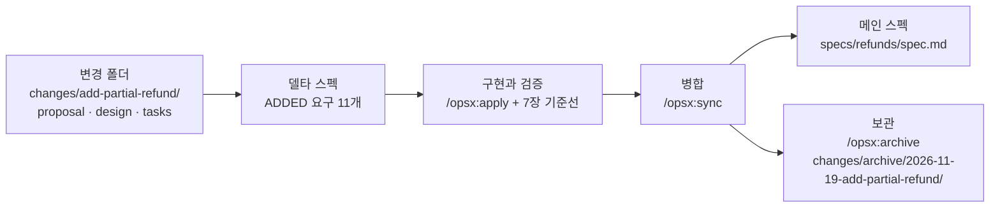
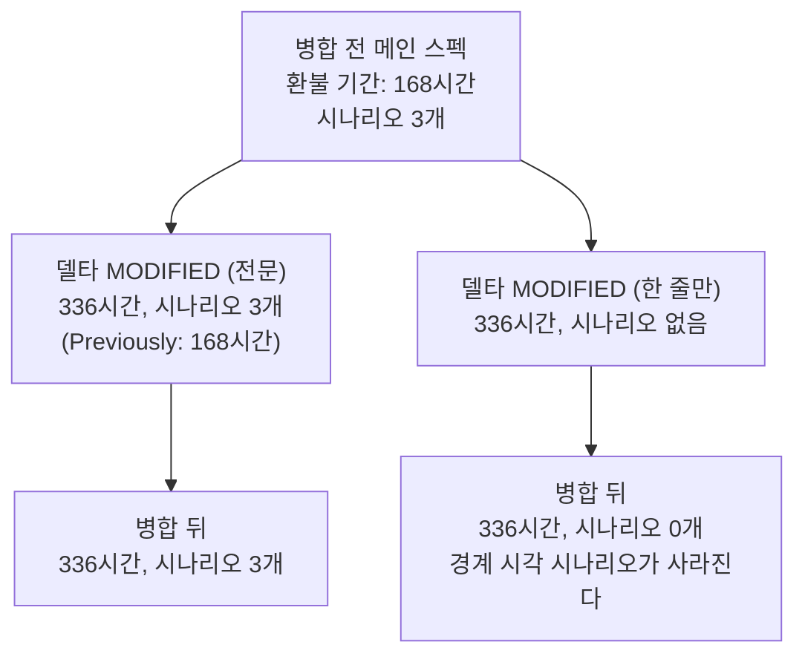

# 8장. OpenSpec으로 개발하기 — 바꿀 부분만 스펙으로

6장에서 공들여 쓴 `SPEC.md`는 PR이 병합되는 순간 어디로 갈까? 7장 끝에서 남겨 둔 질문이다. 석 달 뒤 운영팀이 환불 기간을 7일에서 14일로 늘리고, 자유 입력 사유를 정해진 사유 코드로 바꾸자고 요청한다. 그때 우리는 무엇을 고쳐야 할까?

어느 선택지도 개운하지 않다. PR 본문에 접어 넣은 계획은 병합된 PR 목록 깊숙이 가라앉았다. 저장소에 남긴 `SPEC.md`도 고민거리다. 새 변경용 `SPEC.md`를 하나 더 쓰면 옛 파일의 "168시간"이 낡은 채 남고, 옛 파일을 고치면 두 변경의 인터뷰와 검사 기록이 뒤섞인다. Spec Kit 이슈 #620(2025-09-27)이 바로 이 상황을 물었다. 로그인 기능의 스펙이 몇 달 뒤 2단계 인증 기능 때문에 부분적으로 낡았는데, 원본을 고칠지 이력으로 둘지 묻는 글이었다. 댓글의 한 사용자는 그것이 바로 OpenSpec의 핵심 기능이라고 답했다.

그렇다면 아예 처음부터 시스템 전체의 스펙을 써 두면 어떨까? 주문, 결제, 쿠폰, 배송까지 기존 코드를 역공학해 스펙으로 옮겨 두면 다음 변경은 그 스펙을 고치기만 하면 된다. 그럴듯하지만 찜찜하다. 한 번도 검사받지 않은 수천 줄의 스펙이 생기고, 그 스펙은 코드가 바뀔 때마다 조용히 낡아 간다. OpenSpec 제조사도 이 길을 말린다. 시작할 때 코드베이스 전체를 문서화하지 말고 바꿀 부분만 쓰라고 하고, 기존 PRD를 한꺼번에 변환하면 아무도 믿지 않는 크고 낡은 스펙을 만들기 쉽다고 경고한다.

OpenSpec의 답은 그 사이에 있다. 바꿀 부분만 델타 스펙으로 쓰고, 변경이 끝나면 델타를 리빙 스펙에 병합한다. 스펙은 변경이 한 번 지나갈 때마다 그 변경이 건드린 만큼만 자란다. 같은 부분 환불(C2)을 이번에는 OpenSpec으로 만들고, 석 달 뒤의 두 번째 변경(C3)까지 이어서 해 보자. 이 도구의 진짜 강점은 두 번째 변경에서야 보인다.

> 이 장은 OpenSpec v1.17.0/2026-11-09 기준이다. 이 판은 2.0에서 `/opsx:*` 명령 파일을 없애고 스킬만 남긴다고 예고했으므로, 명령은 처음 나올 때 스킬 표기를 함께 적는다. 하루 사이에도 새 판이 나오는 도구이니 따라 하기 전에 공식 저장소의 릴리스 노트를 확인하자.

## 설치하고, 기존 저장소에 붙이기

### 설치와 초기화

v1.15.0(2026-10-24)부터 기본 설치 방법이 바뀌었다. 이제는 Node.js가 필요 없는 독립 실행 파일이 기본이다. 2026년 10월 이전 글에서 `npm install -g`로 시작하는 안내를 봤다면 그 내용은 낡았다.

```bash
# macOS / Linux (독립 실행 파일, ~/.local/bin에 설치)
curl -fsSL https://raw.githubusercontent.com/Fission-AI/OpenSpec/main/scripts/binary/install.sh | sh

# 버전을 고정하고 싶을 때
curl -fsSL https://raw.githubusercontent.com/Fission-AI/OpenSpec/main/scripts/binary/install.sh | OPENSPEC_VERSION=v1.17.0 sh

# 패키지 관리자 경로 (Node.js 22.12.0 이상, v1.16.0부터)
npm install -g @fission-ai/openspec@latest

cd bookshop-orders && openspec init
```

버전 고정 줄은 문서가 안내하는 `OPENSPEC_VERSION` 변수를 설치 스크립트에 넘기는 형태로 적었다. 정확한 형태는 설치 문서로 한 번 더 확인하자(사실 확인 필요).

`openspec init`을 돌리면 저장소 루트에 `openspec/` 폴더가 생긴다. 안에는 시스템의 현재 동작을 담는 `specs/`, 변경마다 폴더를 하나씩 두는 `changes/`, 선택 사항인 `config.yaml`이 있다. Claude Code에는 스킬이 `.claude/skills/openspec-*/SKILL.md`에, 명령이 `.claude/commands/opsx/<id>.md`에 설치된다. 기본 `core` 프로필의 명령 여섯 개는 4장에서 봤다. `/opsx:verify`나 `/opsx:onboard`는 확장 프로필에 있어서 `openspec config profile`로 프로필을 고른 뒤 `openspec update`를 돌려야 생긴다.

### 빈 specs/에서 시작한다

init 직후 `openspec/specs/`는 비어 있다. 운영 중인 `bookshop-orders`의 주문, 결제, 쿠폰, 배송, 전체 취소 가운데 어느 것도 스펙으로는 존재하지 않는다. 앞에서 말한 그 유혹이 고개를 든다. 채우지 말자.

OpenSpec은 스펙을 나중에 붙일 수 있게 설계됐고, Thoughtworks Technology Radar도 이 점을 들어 브라운필드에 맞는다고 평했다. 스펙은 변경이 지나간 자리에만 생긴다. 부분 환불을 마치면 `specs/refunds/`가 생기고, 다른 영역은 누군가 그 영역을 바꿀 때 생긴다. 첫 순환에서는 확장 프로필의 `/opsx:onboard`가 안내를 맡는데, 이때도 첫 변경으로 이번 주에 하려던 작고 진짜인 작업을 고르라고 권한다.

그렇다면 6장에서 `SPEC.md`에 적었던 "바뀌지 않을 동작"은 어디에 둘까? 전체 취소 API에 대한 메인 스펙이 없으니 델타로 "이 동작은 그대로"라고 적을 자리도 마땅치 않다. 이 장에서는 그 약속을 두 곳에 나눠 둔다. 하나는 제안서의 범위 밖 목록이고, 다른 하나는 태스크 목록의 회귀 테스트다. 말로 하는 약속과 실행하는 약속을 함께 두는 셈이다.

## C2를 변경으로 제안하기

### explore에서 propose까지

변경을 만들기 전에 생각을 정리하고 싶으면 `/opsx:explore`를 쓴다. 선택 단계다. 이 장에서는 6장의 `SPEC.md`가 이미 있으니 explore 대화에서 그 파일을 읽히고 빠진 결정이 없는지만 확인한다. 처음부터 시작한다면 6장의 인터뷰 프롬프트를 이 단계에서 그대로 돌리자. 도구가 바뀌어도 인터뷰가 막아 주는 빈칸은 같다.

생각이 정리되면 변경을 제안한다. `/opsx:propose add-partial-refund`(스킬 표기 `/openspec-propose`)다. 공식 문서가 보여 주는 출력 형태에 이 책 예제의 이름을 넣으면 다음과 같다. 실제로 실행해서 받은 출력이 아니라 형태를 보여 주는 예시다.

```text
You: /opsx:propose add-partial-refund

AI:  Created openspec/changes/add-partial-refund/
     ✓ proposal.md
     ✓ specs/refunds/spec.md
     ✓ design.md
     ✓ tasks.md
     Ready for implementation. Run /opsx:apply.
```

변경 이름은 무엇을 하는지 동사로 시작하는 짧은 이름이 좋다. OpenSpec의 스펙 작성 안내에는 이런 기준이 있다. "A good change has one intent you can say in a sentence." 부분 환불은 한 문장으로 말할 수 있다. 배송을 마친 주문에서 서점 관리자가 일부 항목과 수량을 환불하게 한다.

### proposal.md, 그리고 SPEC.md가 옮겨 가는 자리

`proposal.md`는 OpenSpec 템플릿의 헤딩 구조(`# Proposal:` → `## Intent` → `## Scope` → `## Approach`)를 따른다. 아래는 이 책 예제로 채운 예시다.

```markdown
# Proposal: 부분 환불 추가

## Intent
배송을 마친 주문에서 서점 관리자(`SHOP_ADMIN`)가 일부 항목, 일부 수량을 환불할 수 있게 한다.
지금은 배송 전 전체 취소만 있어서 파손된 책 한 권도 주문 데이터에 환불로 남길 방법이 없다.

## Scope
In scope:
- 항목 단위, 수량 단위 환불 요청 API `POST /orders/{orderId}/refunds`
- 쿠폰 할인 안분과 원 미만 차액 보정
- `Idempotency-Key`로 중복 요청 처리, PG 환불 실패 기록과 재요청
- 환불 내역 조회 API `GET /orders/{orderId}/refunds`
- 주문 상태 `PARTIALLY_REFUNDED`, `REFUNDED`

Out of scope:
- 배송비 환불, 포인트와 적립금, 고객 셀프 환불 화면, 복수 결제 수단, 교환
- 전체 취소 API(`POST /orders/{orderId}/cancel`)의 동작 변경 — 회귀 테스트로 지킨다

## Approach
새 `refunds`, `refund_items` 테이블과 `order_items.refunded_quantity` 열을 추가한다.
금액 계산은 한 곳에 모으고, PG 환불 호출의 성공과 실패를 환불 상태로 기록한다.
전체 취소 흐름은 건드리지 않는다.
```

6장의 `SPEC.md`는 절 아홉 개짜리 한 파일이었다. OpenSpec에서는 그 내용이 네 파일로 흩어진다. 무엇이 어디로 가는지 대응표로 보자.

| 6장 `SPEC.md` | OpenSpec의 자리 | 달라지는 점 |
|---|---|---|
| 1 목적 | `proposal.md` `## Intent` | 한 문장으로 말할 수 있는 의도 하나 |
| 3 만들 것, 4 안 만들 것 | `proposal.md` `## Scope` (In / Out) | 비목표가 범위 밖 목록이 된다 |
| 2 사용자와 권한, 6 규칙 | 델타 스펙 `### Requirement:` | EARS 문장이 `The system SHALL` 한 문장으로 |
| 7 수용 기준 | 델타 스펙 `#### Scenario:` | 수용 기준이 요구마다 흩어져 붙는다 |
| 5 API와 데이터 | `design.md`, 일부는 시나리오 | 경로와 오류 코드는 시나리오에도 남는다 |
| 9 결정 기록 | `design.md` `### Decision:` | 결정마다 제목이 붙는다 |
| 바뀌지 않을 동작 | `proposal.md` Out of scope + `tasks.md` 회귀 테스트 | 메인 스펙이 없어서 두 곳에 나눠 둔다 |
| 8 열린 질문 | 다음 변경 후보 | "사유를 코드로"는 C3가 된다 |
| (없음) | `tasks.md` | 7장의 계획 체크리스트에 해당한다 |

가장 크게 달라지는 곳은 수용 기준이다. `SPEC.md`에서는 AC1~AC9가 한 절에 모여 있었다. OpenSpec에서는 수용 기준이 각자 자기 요구 밑으로 흩어진다. 한눈에 훑기는 조금 불편해지지만, 요구를 고치거나 지울 때 그 요구의 시나리오가 함께 따라온다. 이 차이가 두 번째 변경에서 큰 힘을 발휘한다.

## 델타 스펙: 바꿀 부분만, 요구마다 시나리오

변경 폴더의 심장은 델타 스펙 `openspec/changes/add-partial-refund/specs/refunds/spec.md`다. `refunds`는 이번에 처음 생기는 능력이므로 모든 요구가 `## ADDED Requirements` 아래에 들어간다. 새 능력이니 `## Purpose`도 함께 적는다. 이 Purpose는 아카이브 때 새 메인 스펙의 Purpose가 된다. 아래는 이 책 예제로 채운 전문이고, 헤딩과 키워드는 OpenSpec 문서 형식을 따랐다.

```markdown
# Delta for Refunds

## Purpose
배송을 마친 주문의 부분 환불. 요청 권한, 환불 기간, 수량, 금액 계산,
중복 요청, PG 실패, 환불 뒤 주문 상태, 환불 내역 조회를 다룬다.

## ADDED Requirements

### Requirement: 환불 요청 권한
The system SHALL 서점 관리자(`SHOP_ADMIN`)가 자기 서점에 있는 주문만 환불하게 한다.

#### Scenario: 다른 서점의 주문
- GIVEN 서점 X의 관리자와 서점 Y의 배송 완료 주문
- WHEN 관리자가 환불을 요청한다
- THEN 403을 응답하고 환불을 기록하지 않는다

#### Scenario: 없는 주문
- GIVEN 서점 X의 관리자
- WHEN 존재하지 않는 주문 번호로 환불을 요청한다
- THEN 404를 응답한다

### Requirement: 환불 기간
The system SHALL `delivered_at`부터 168시간 이내의 환불 요청만 받는다.

#### Scenario: 경계 시각
- GIVEN `delivered_at`이 2026-11-02T10:00:00+09:00인 주문
- WHEN 2026-11-09T10:00:00+09:00에 환불을 요청한다
- THEN 환불이 접수된다

#### Scenario: 기간 경과
- GIVEN 같은 주문
- WHEN 2026-11-09T10:00:01+09:00에 환불을 요청한다
- THEN 422 `REFUND_WINDOW_EXPIRED`를 응답한다

#### Scenario: 배송 전 주문
- GIVEN `delivered_at`이 없는 주문
- WHEN 환불을 요청한다
- THEN 422 `REFUND_WINDOW_EXPIRED`를 응답한다

### Requirement: 수량 한도
The system SHALL 항목별 환불 수량의 합이 주문 수량을 넘는 요청을 거절한다.

#### Scenario: 수량 초과
- GIVEN 책 B 2권 가운데 1권이 이미 환불된 주문
- WHEN 책 B 2권을 환불 요청한다
- THEN 409 `REFUND_QUANTITY_EXCEEDED`를 응답하고 아무것도 바꾸지 않는다

### Requirement: 쿠폰 할인 안분
The system SHALL 주문 쿠폰 할인액을 항목 금액 비율로 나누고 원 미만은 버려 환불액에서 뺀다.

#### Scenario: 정률 쿠폰 주문에서 한 권 환불
- GIVEN 책 A 18,000원 × 1, 책 B 12,000원 × 2, 정률 쿠폰 10%, 배송비 3,000원, 결제 40,800원인 주문
- WHEN 책 B 1권을 환불한다
- THEN 안분 쿠폰은 1,200원이고 환불액은 10,800원이며 책 B의 `refunded_quantity`는 1이다

### Requirement: 안분 차액 보정
The system SHALL 원 미만을 버려 남은 쿠폰 차액을 주문의 마지막 남은 수량을 환불할 때 보정한다.

#### Scenario: 정액 쿠폰 차액
- GIVEN 같은 상품에 정액 쿠폰 3,000원인 주문
- WHEN 책 A, 책 B, 책 B 순서로 모두 환불한다
- THEN 안분 쿠폰은 1,285원, 857원, 858원이다

### Requirement: 전 항목 환불 합계
The system SHALL 주문의 모든 수량을 환불한 뒤 환불액 합계가 결제 금액에서 배송비를 뺀 값과 같게 한다.

#### Scenario: 정률 쿠폰 주문 전부 환불
- GIVEN 결제 40,800원, 배송비 3,000원인 주문
- WHEN 모든 항목을 차례로 환불한다
- THEN 환불액 합계는 37,800원이다

### Requirement: 중복 요청
The system SHALL 같은 `Idempotency-Key`로 24시간 안에 다시 온 같은 요청에 첫 결과를 그대로 돌려준다.

#### Scenario: 같은 키, 같은 본문
- GIVEN 키 K로 책 B 1권 환불을 마친 주문
- WHEN 키 K와 같은 본문으로 다시 요청한다
- THEN 첫 응답을 그대로 돌려주고 환불은 한 건만 남는다

#### Scenario: 같은 키, 다른 본문
- GIVEN 같은 주문
- WHEN 키 K와 다른 본문으로 요청한다
- THEN 422 `IDEMPOTENCY_KEY_REUSED`를 응답한다

### Requirement: PG 환불 실패
The system SHALL PG 환불 호출이 실패하면 환불을 `FAILED`로 기록하고 주문 상태와 `refunded_quantity`를 그대로 둔다.

#### Scenario: 실패 뒤 새 키로 재요청
- GIVEN PG가 환불 실패를 응답하는 상태
- WHEN 책 B 1권을 환불 요청한다
- THEN 502 `PAYMENT_GATEWAY_ERROR`를 응답하고 환불은 `FAILED`, 주문은 `DELIVERED`로 남는다
- AND 새 키로 다시 요청하면 환불이 처리된다

### Requirement: 환불 뒤 주문 상태
The system SHALL 환불이 완료되면 남은 수량이 있는 주문은 `PARTIALLY_REFUNDED`로, 남은 수량이 없는 주문은 `REFUNDED`로 바꾼다.

#### Scenario: 일부와 전부
- GIVEN 책 A 1권, 책 B 2권이 든 배송 완료 주문
- WHEN 책 B 1권을 환불한다
- THEN 주문은 `PARTIALLY_REFUNDED`가 된다
- AND 나머지를 모두 환불하면 주문은 `REFUNDED`가 된다

### Requirement: 환불 사유
The system SHALL 환불 요청마다 자유 입력 사유(`reason`)를 받아 기록한다.

#### Scenario: 사유 기록
- WHEN 사유 "책 모서리 파손"으로 환불한다
- THEN 환불 내역에 그 사유가 남는다

### Requirement: 환불 내역 조회
The system SHALL `GET /orders/{orderId}/refunds`로 그 주문의 환불을 생성 순서대로 돌려준다.

#### Scenario: 두 번 환불한 주문
- GIVEN 환불이 두 번 있었던 주문
- WHEN 환불 내역을 조회한다
- THEN 두 환불이 금액, 사유, 상태, 항목과 함께 생성 순서대로 나온다
```

요구 열한 개에 시나리오 열다섯 개다. 6장의 규칙 R1~R9와 수용 기준 AC1~AC8이 거의 그대로 옮겨 왔다. 전체 취소에 관한 R10과 AC9는 앞에서 정한 대로 제안서와 태스크로 갔다. 옮기는 동안 모양이 몇 군데 달라졌다.

먼저 문형이다. 3장과 4장에서 봤듯이 OpenSpec은 EARS 대신 `The system SHALL ...` 한 문장을 쓰고, 조건은 시나리오의 GIVEN과 WHEN으로 내려보낸다. `SPEC.md`의 R2는 "If 요청 시각이 ... 넘으면, then ... 거절한다"였다. 여기서는 "168시간 이내의 요청만 받는다"는 요구 하나와, 경계 시각·기간 경과·배송 전 주문이라는 시나리오 셋으로 나뉘었다. 6장 결정 기록의 D2(배송 전 주문)와 D4(168시간 정각까지 받는다)는 결정 문장으로 남지 않고 시나리오로 굳었다.

다음은 쪼개진 요구다. `SPEC.md`의 R4는 안분과 차액 보정을 한 문장에 담았다. OpenSpec 안내는 이렇게 쓴다. "One statement, one `SHALL`/`MUST`." 그래서 "쿠폰 할인 안분"과 "안분 차액 보정"을 두 요구로 나눴고, 전 항목 환불의 불변식도 따로 떼어 냈다. 요구마다 시나리오를 하나 이상 두고, 경계와 오류 사례를 시나리오로 따로 세우라는 것도 안내의 체크리스트 항목이다.

마지막으로 요구마다 이 질문을 던져 보자. "could a tester who's never seen the code tell whether it passed?" "PG 환불 실패"는 통과한다. 502, `FAILED`, `DELIVERED`가 모두 바깥에서 관찰할 수 있는 값이다. 반면 "금액 계산은 `RefundCalculator`가 맡는다"는 테스터가 볼 수 없는 구현 세부이니 `design.md`로 보낸다.

하나 더 기억해 두자. 열 번째 요구 "환불 사유"는 자유 입력 사유를 받는다고 적었다. 이 요구는 석 달 뒤 두 번째 변경에서 삭제된다. 그때 이 요구의 이름이 정확히 무엇이었는지가 중요해진다.

## design.md, tasks.md, 그리고 validate

### 설계와 태스크

`design.md`에는 테스터가 볼 수 없는 결정이 들어간다. 6장 결정 기록 가운데 구현 방식에 관한 것과 스키마, 데이터 흐름이 이리로 온다. 헤딩은 템플릿대로 `## Technical Approach`, `## Architecture Decisions`, `## Data Flow`, `## File Changes`를 따랐다. 아래는 발췌다.

```markdown
# Design: 부분 환불 추가

## Technical Approach
환불은 새 `refund` 패키지에서 처리하고, 전체 취소 흐름은 건드리지 않는다.

## Architecture Decisions

### Decision: 금액 계산은 RefundCalculator 한 곳에서
안분, 원 미만 버림, 차액 보정을 한 클래스가 맡는다. 속성 테스트가 이 클래스를 겨눈다.

### Decision: PG 실패 뒤 재요청은 새 키로
같은 키는 첫 결과(`FAILED`)를 돌려준다. 재시도는 서점 관리자가 새 키로 요청한다.

## Data Flow
요청 → 권한 → 기간 → 수량 → 멱등 키 → 금액 계산 → `refunds` 저장(`REQUESTED`)
→ PG 환불 → `COMPLETED` 또는 `FAILED` → 주문 상태와 `refunded_quantity` 갱신

## File Changes
- migrations/012_add_partial_refund.up.sql, .down.sql
- refund/RefundController.java, RefundService.java, RefundCalculator.java
- order/OrderStatus.java (상태 두 개 추가)
```

`tasks.md`는 7장의 계획 체크리스트와 같은 일을 한다. OpenSpec 안내가 권하는 태스크 작성법은 네 가지다. 계층 번호(1.1, 1.2)를 쓰고, 한 세션에 끝낼 크기로 자르고, 태스크마다 검증 방법을 적고, 테스트와 문서는 마지막에 몰아서 하지 말고 각 그룹 안에 둔다.

```markdown
# Tasks

## 1. 스키마
- [ ] 1.1 refunds, refund_items 테이블, order_items.refunded_quantity 열, 주문 상태 두 개 추가
      (검증: 빈 DB에 적용 → 되돌리기 → 다시 적용)

## 2. 금액 계산
- [ ] 2.1 RefundCalculator: 쿠폰 안분과 원 미만 버림 (검증: 10,800원 시나리오 테스트)
- [ ] 2.2 마지막 남은 수량에서 차액 보정 (검증: 1,285 / 857 / 858원 시나리오 테스트)
- [ ] 2.3 전 수량 환불 합계 속성 테스트 (검증: 합계 = 결제 금액 − 배송비)

## 3. 환불 API
- [ ] 3.1 POST: 권한 403/404, 기간 422, 수량 409 (검증: 시나리오별 수용 테스트)
- [ ] 3.2 Idempotency-Key 처리 (검증: 같은 키 같은 본문 / 다른 본문 테스트)
- [ ] 3.3 PG 환불 호출과 FAILED 기록 (검증: PG 대역이 실패할 때 502, 상태 그대로)
- [ ] 3.4 주문 상태 전이 (검증: PARTIALLY_REFUNDED → REFUNDED 테스트)
- [ ] 3.5 GET 환불 내역 (검증: 두 번 환불한 주문 테스트)

## 4. 회귀와 마감
- [ ] 4.1 전체 취소 회귀 테스트 (검증: 배송 전 전액 취소가 그대로)
- [ ] 4.2 scripts/verify-refund.sh 통과 (검증: 종료 코드 0)
```

4.1이 "바뀌지 않을 동작"을 실행하는 약속이다. 4.2는 7장에서 만든 결정적 검사 스크립트를 그대로 가져왔다. 도구가 바뀌어도 기준선은 바뀌지 않는다.

### validate가 잡는 것

구현에 들어가기 전에 형식을 검사하자. `openspec validate --strict`다. v1.16.0부터 `validate`는 WHEN이나 GIVEN 단계, 또는 THEN 단계가 없는 `Scenario:`를 경고하고, `--strict`를 주면 실패로 처리한다. v1.16.1부터는 `## DEPRECATED Requirements`처럼 OpenSpec이 모르는 델타 절에 요구를 넣으면 `validate`가 실패하고 `archive`도 거부한다. 전에는 경고만 하고 그 요구를 조용히 버렸다. 생각만 해도 아찔한 동작이다. 누군가 `## CHANGED Requirements`라고 적은 요구가 아카이브 때 소리 없이 사라졌다면, 그 사실을 아는 사람은 아무도 없었을 것이다.

`validate`는 7장 판정자 표의 둘째 줄, 결정적 검사에 속한다. 판정자가 프로그램이고, 같은 입력에 늘 같은 답을 낸다. 대신 형식만 본다. 시나리오가 THEN을 갖췄는지는 알아도, 그 THEN의 금액이 맞는지는 모른다. 10,800원을 11,800원으로 잘못 적어도 `validate`는 통과한다. 내용의 옳고 그름은 여전히 6장의 검사관 질문과 사람의 몫이다.

## 구현하고, 관문을 밖으로 꺼내기

`/opsx:apply`(스킬 표기 `/openspec-apply-change`)로 구현을 시작한다. 에이전트가 `tasks.md`를 읽고 태스크를 하나씩 처리하며 체크한다. 여기서부터는 7장의 기준선을 그대로 겹쳐 쓰면 된다. 다만 대조의 기준이 `SPEC.md`에서 델타 스펙으로 바뀐다.

수용 테스트는 시나리오에서 옮기고, 시나리오 이름을 테스트의 표시 이름으로 쓴다. "AC1" 대신 "쿠폰 할인 안분 / 정률 쿠폰 주문에서 한 권 환불" 같은 식이다. 테스트는 여전히 사람이 쓰거나 검토하고, 결정적 검사는 태스크 4.2의 `scripts/verify-refund.sh`가 맡는다. 서브에이전트 리뷰 프롬프트는 7장의 것에서 대조 대상만 바꾼다. "`openspec/changes/add-partial-refund/specs/refunds/spec.md`의 Requirement마다 구현이 있는가, Scenario마다 테스트가 있는가"로 묻고, "스타일은 건너뛰어 주세요"와 "파일은 고치지 마세요"는 그대로 둔다.

OpenSpec에도 관문 명령이 있다. 확장 프로필의 `/opsx:verify`다. 이 명령이 정확히 무엇을 대조하는지는 이 장이 기준으로 삼은 문서에서 확인하지 못했다(사실 확인 필요). 그래도 7장 끝에서 정한 질문은 던질 수 있다. 이 판정은 누가 내리는가? 하네스 안의 에이전트가 실행하는 명령이니 판정자는 대개 같은 하네스의 에이전트이고(추론), 7장 표의 첫 줄에 가깝다. 써도 좋지만 종료 코드로 판정하는 스크립트와 대화를 못 본 리뷰어를 대신하게 두지는 말자.

`/opsx:archive`도 관문이 아니다. 공식 문서 그대로 "Archive won't block on incomplete tasks, but will warn." 완료는 그 앞의 검증 단계가 판정한다.

구현 중에 버그를 찾으면 어떻게 할까? OpenSpec 이슈 #821(2026-03-10)은 `/opsx:apply` 뒤 버그를 찾을 때마다 코드, `spec.md`, `design.md`, `tasks.md`를 고치라고 따로따로 지시해야 하는 불편을 짚고, 원인이 구현인지 스펙인지 먼저 판정하는 `/opsx:repair`를 제안했다. 지금 core 프로필의 `/opsx:update`(계획 산출물을 고치고 서로 맞춰 두는 명령)가 이 요청을 얼마나 메우는지는 문서로 확인하지 못했다(사실 확인 필요). 어느 쪽이든 순서는 제안자의 것을 따르자. 고치기 전에 먼저 묻는다. 구현이 틀렸나, 스펙이 틀렸나? 스펙이 틀렸다면 델타 스펙부터 고치고 코드는 그다음이다.

## 아카이브: 스펙이 병합 뒤에도 살아남는 순간

구현과 검증이 끝나면 두 명령이 남는다. `/opsx:sync`는 델타 스펙을 메인 스펙에 병합하고, `/opsx:archive`는 변경을 닫는다. 아카이브는 델타가 아직 동기화되지 않았으면 동기화를 제안하고, 변경 폴더를 `openspec/changes/archive/YYYY-MM-DD-<name>/`으로 옮겨 모든 산출물을 감사 기록으로 보존한다.

병합에는 규칙이 있다. `## ADDED Requirements`의 요구는 메인 스펙에 덧붙는다. `## MODIFIED Requirements`의 요구는 메인 스펙의 같은 이름 요구를 통째로 교체한다. `## REMOVED Requirements`의 요구는 메인 스펙에서 지워진다. 새 능력의 `## Purpose`는 새 메인 스펙의 Purpose가 되고, 이미 있는 스펙에서는 무시된다. 마지막 요구까지 지우면 능력 자체를 은퇴시키고 스펙 파일을 지우는데, 변경 폴더의 `.openspec.yaml`에 `retire_capabilities: true`가 있을 때만 그렇다.


그림 1. 변경 폴더에서 아카이브까지. 델타는 메인 스펙에 병합되고, 변경 폴더는 감사 기록으로 보관된다

부분 환불은 모든 요구가 ADDED였으니 병합 결과는 단순하다. `openspec/specs/refunds/spec.md`가 새로 생기고, 델타의 Purpose와 요구 열한 개가 그대로 들어간다. 아래는 그 메인 스펙의 앞부분 발췌다. 형식은 공식 문서의 메인 스펙 예를 따라 적었다. 새 능력의 메인 스펙 제목 줄을 sync가 정확히 어떻게 만드는지는 확인하지 못했다(사실 확인 필요).

```markdown
# Refunds Specification

## Purpose
배송을 마친 주문의 부분 환불. 요청 권한, 환불 기간, 수량, 금액 계산,
중복 요청, PG 실패, 환불 뒤 주문 상태, 환불 내역 조회를 다룬다.

## Requirements

### Requirement: 환불 요청 권한
The system SHALL 서점 관리자(`SHOP_ADMIN`)가 자기 서점에 있는 주문만 환불하게 한다.

#### Scenario: 다른 서점의 주문
- GIVEN 서점 X의 관리자와 서점 Y의 배송 완료 주문
- WHEN 관리자가 환불을 요청한다
- THEN 403을 응답하고 환불을 기록하지 않는다

(… 시나리오 하나 생략 …)

### Requirement: 환불 기간
The system SHALL `delivered_at`부터 168시간 이내의 환불 요청만 받는다.

(… 시나리오 셋과 요구 아홉 개가 이어진다 …)
```

이 순간이 2장에서 본 스펙의 수명 가운데 스펙 고정형(spec-anchored)으로 넘어가는 지점이다. 6장의 `SPEC.md`는 변경이 끝나면 할 일을 다 한 스펙 우선형 문서였다. 이제 부분 환불의 현재 동작은 `specs/refunds/spec.md`에 살아 있고, 그 동작이 생겨난 경위는 지우지 않는 아카이브 폴더가 기억한다.

## 두 번째 변경: 환불 기간을 늘리고 사유를 코드로

### MODIFIED, ADDED, REMOVED

석 달이 지났다. 운영팀이 정리한 요청은 둘이다. 환불 기간을 7일에서 14일로 늘린다. 그리고 자유 입력 사유를 정해진 사유 코드로 바꾸되, 목록에 없는 사유는 "기타"와 메모로 받는다. 이번에는 `SPEC.md`를 새로 쓰지 않는다. `/opsx:propose extend-refund-window`로 변경을 만들고, 델타 스펙에 바뀌는 부분만 적는다.

```markdown
# Delta for Refunds

## MODIFIED Requirements

### Requirement: 환불 기간
The system SHALL `delivered_at`부터 336시간 이내의 환불 요청만 받는다.
(Previously: 168시간)

#### Scenario: 경계 시각
- GIVEN `delivered_at`이 2026-11-02T10:00:00+09:00인 주문
- WHEN 2026-11-16T10:00:00+09:00에 환불을 요청한다
- THEN 환불이 접수된다

#### Scenario: 기간 경과
- GIVEN 같은 주문
- WHEN 2026-11-16T10:00:01+09:00에 환불을 요청한다
- THEN 422 `REFUND_WINDOW_EXPIRED`를 응답한다

#### Scenario: 배송 전 주문
- GIVEN `delivered_at`이 없는 주문
- WHEN 환불을 요청한다
- THEN 422 `REFUND_WINDOW_EXPIRED`를 응답한다

## ADDED Requirements

### Requirement: 환불 사유 코드
The system SHALL 환불 요청마다 사유 코드(`reasonCode`) `CHANGE_OF_MIND`, `DAMAGED`, `WRONG_ITEM`, `OTHER` 가운데 하나를 받아 기록한다.

#### Scenario: 파손 환불
- WHEN 사유 코드 `DAMAGED`로 환불한다
- THEN 환불 내역에 `DAMAGED`가 남는다

#### Scenario: 목록에 없는 코드
- WHEN 사유 코드 `LATE_DELIVERY`로 환불을 요청한다
- THEN 기존 요청 형식 오류와 같은 400을 응답한다

### Requirement: 기타 사유 메모
The system SHALL 사유 코드가 `OTHER`일 때만 메모(`memo`)를 받는다.

#### Scenario: OTHER와 메모
- WHEN 사유 코드 `OTHER`, 메모 "선물이 겹침"으로 환불한다
- THEN 환불 내역에 코드와 메모가 함께 남는다

#### Scenario: OTHER가 아닌 코드에 메모
- WHEN 사유 코드 `DAMAGED`에 메모를 붙여 요청한다
- THEN 400을 응답한다

## REMOVED Requirements

### Requirement: 환불 사유
(사유 코드로 대체한다. 자유 입력은 사유 코드 `OTHER`의 메모로만 남는다.)
```

세 절이 모두 쓰였다. 환불 기간은 바뀐 동작이라 `## MODIFIED Requirements`에 들어갔고, 요구 문장 아래에 `(Previously: 168시간)`을 남겼다. 사유 코드와 기타 메모는 새 동작이라 `## ADDED Requirements`다. 자유 입력 사유는 없어지는 동작이라 `## REMOVED Requirements`에 이름만 적고 대체 사유를 괄호로 달았다. 이 이름은 첫 번째 변경의 요구 이름 "환불 사유"와 글자 하나까지 같아야 한다. 메인 스펙에서 지울 요구를 이름으로 가리키기 때문이다(추론).

RENAMED 절은 쓰지 말자. `/opsx:sync` 설명은 RENAMED도 해석한다고 적지만 델타 형식을 설명하는 concepts 문서의 표에는 없다. 문서끼리 어긋나는 지점이니, 이름을 바꿔야 하면 REMOVED와 ADDED로 나눠 적는 편이 안전하다.

눈치챘겠지만 이 변경에는 의도가 둘이다. "변경 하나 = 의도 하나"라는 기준에 비추면 두 변경으로 나누는 편이 낫다. 같은 정책 개정에서 나와 같은 날 배포하는 데다, 세 절을 한 델타에서 보여 주려는 이 장의 사정도 있어 여기서는 묶었다. 실제 저장소라면 `extend-refund-window`와 `add-refund-reason-codes`로 나누는 쪽을 먼저 고려하자. 이미 쌓인 자유 입력 사유를 사유 코드 `OTHER`와 메모로 옮길지 같은 데이터 이전 결정은 이 변경의 `design.md`가 맡는다.

### MODIFIED는 통째로 갈아 끼운다

MODIFIED 절에서 가장 흔히 밟는 함정이 있다. 바뀐 숫자만 적고 싶어지는 것이다. 바뀐 것은 168이 336이 된 것뿐이니, 요구 문장 한 줄과 `(Previously: 168시간)`만 적으면 될 것 같다. 그런데 병합 규칙을 다시 보자. MODIFIED의 요구는 메인 스펙의 같은 이름 요구를 통째로 교체한다. 공식 문서도 전체 새 버전을 적어야 한다고 못 박는다.


그림 2. MODIFIED 병합 전후. 요구가 통째로 교체되므로 델타에 다시 적지 않은 시나리오는 메인 스펙에서 사라진다

그래서 위 델타의 MODIFIED에는 시나리오 셋을 모두 다시 적었다. 경계 시각은 11월 9일에서 16일로 바뀌었고, 값이 그대로인 배송 전 주문 시나리오도 함께 옮겼다. 시나리오가 하나도 없는 요구를 `validate`가 잡아 주는지는 확인하지 못했다(사실 확인 필요). 그러니 습관을 하나 들이자. sync를 돌린 뒤 `git diff openspec/specs/`로 메인 스펙이 실제로 어떻게 바뀌었는지 읽는 것이다. 이번 변경이라면 diff는 길지 않다. 숫자 몇 개가 바뀌고, 요구 둘이 늘고, 하나가 줄어든다. 그 짧은 diff를 읽는 몇 분이 석 달 뒤의 드리프트를 막는다.

## 근거와 한계

OpenSpec을 고른 근거는 어디까지 믿어도 될까? 같은 티켓으로 도구를 잰 비교는 5장에서 본 Uvik 벤치마크(실행 2026-10-15) 하나다. OpenSpec 조건은 티켓 50개 가운데 42개를 병합해 84%였고, 스펙 없는 대조군 72%보다 12%p 높았다. 네 도구 가운데 잡음 대역 ±10%p를 벗어난 것은 OpenSpec 하나였다. 스펙 드리프트는 2.4%로 가장 낮았고, 스펙 단계 시간 중앙값은 12분, 스펙 길이 중앙값은 93줄로 가장 짧았다. 조건도 함께 옮기자. 서비스 회사가 자기 팀으로 돌렸고, 브라운필드 Python 티켓 50개에 모델은 claude-sonnet-5 하나였으며, OpenSpec 버전 번호는 기록되지 않았다. 공짜도 아니었다. 병합까지 시간 중앙값은 36분으로 대조군 29분보다 길었다.

Thoughtworks Technology Radar Vol 35(2026-11-04)는 OpenSpec을 Trial로 올리며 맨 프롬프트보다 예측 가능하고 의도치 않은 변경이 적다고 평했다. 단서도 달았다. 마크다운을 많이 만들고, 리빙 스펙을 유지하려면 규율이 필요하다.

실패 사례도 있다. .NET Razor Pages 화면 재설계에 OpenSpec을 쓴 한 개발자는 두 시간쯤 뒤 새 화면이 원래와 거의 같았고 평범한 `Instructions.md`가 더 빠르고 쌌다고 적었다(단일 실험). Talk Think Do는 2026년 6월 1일 사용을 중단했다. 저장소 안의 스펙 때문에 이해관계자가 범위와 비용 변화를 볼 수 없었다는 이유였고, 계획을 Claude Team과 Azure DevOps 작업 항목으로 옮기되 계획 규율은 지켰다. Spec Kit의 헌법 파일 같은 사전 거버넌스 장치가 약하다는 점도 기억해 두자(추론).

마지막은 표기다. v1.17.0의 공지는 짧다. "command files (`/opsx:*`) go away in OpenSpec 2.0." 스킬은 남는다. 미리 옮겨 가려면 `openspec config set delivery skills && openspec update`, 계획은 이슈 #2022에 있다. 예전 명령 `/openspec:proposal` 등도 아직 동작하지만 제조사는 OPSX 명령을 권한다. 원고가 나온 뒤 가장 먼저 바뀔 곳이니 공식 문서를 함께 확인하자.

> **다른 하네스에서는.** OpenSpec은 명령 파일을 설치하는 방식에 따라 표기가 달라진다. Claude Code와 Gemini CLI는 `/opsx:propose`, Cursor·Devin Desktop·Copilot(IDE)·Trae는 `/opsx-propose`, Codex CLI는 `$openspec-propose`로 부른다. 스킬만 쓰는 하네스(Zed Agent, 공유 `.agents` 등)는 `/openspec-propose`, `/openspec-apply-change` 같은 스킬 이름을 쓴다. Copilot CLI는 사용자 정의 프롬프트 파일을 지원하지 않아 `/opsx-*`가 IDE에서만 된다. 이 책이 문서에서 확인한 스킬 이름은 이 둘뿐이므로, 나머지 명령의 스킬 이름은 설치된 `.claude/skills/openspec-*/` 폴더 이름으로 확인하자.

## 명령은 바뀌어도 남는 개념

| 명령 (Claude Code 표기) | 남는 개념 | 다른 도구의 대응물 |
|---|---|---|
| `/opsx:explore` | 변경을 정하기 전에 생각을 정리하는 탐색 | 6장 인터뷰, 플랜 모드, Superpowers `brainstorming` |
| `/opsx:propose` (`/openspec-propose`) | 변경 제안: 의도, 범위, 델타 스펙, 설계, 태스크를 한 묶음으로 | 6장 `SPEC.md`, Spec Kit `/speckit-specify`·`/speckit-plan`·`/speckit-tasks` |
| `openspec validate --strict` | 스펙 형식을 프로그램이 판정하는 검사 | 7장 결정적 검사. Spec Kit `/speckit-analyze`는 에이전트가 판정하는 읽기 전용 점검 |
| `/opsx:apply` (`/openspec-apply-change`) | 태스크 목록대로 구현 | 7장 새 세션 구현, Spec Kit `/speckit-implement`, Superpowers `executing-plans` |
| `/opsx:update` | 구현 중 바뀐 결정을 계획 산출물에 되돌려 맞추기 | 6장 결정 기록 갱신 |
| `/opsx:sync` | 변경분을 리빙 스펙에 병합 | 같은 단계가 드물다. Spec Kit은 완료 시점 수렴 검사(`/speckit-converge`)로 드리프트를 다룬다 |
| `/opsx:archive` | 변경을 닫고 감사 기록으로 보존 | 7장 PR 본문에 접어 넣은 계획 |

두 변경을 마친 뒤 `openspec/` 폴더는 이런 모습이다.

```text
openspec/
├── specs/
│   └── refunds/
│       └── spec.md                  # 지금의 동작: 336시간, 사유 코드, 요구 12개
├── changes/
│   └── archive/
│       ├── 2026-11-19-add-partial-refund/
│       │   ├── proposal.md          # 왜 부분 환불이 생겼나
│       │   ├── design.md
│       │   ├── tasks.md             # 모두 체크됨
│       │   └── specs/refunds/spec.md
│       └── 2027-02-18-extend-refund-window/
│           ├── proposal.md          # 왜 14일이 되었나
│           ├── design.md
│           ├── tasks.md
│           └── specs/refunds/spec.md   # MODIFIED · ADDED · REMOVED
└── config.yaml
```

이 트리는 두 가지를 따로 기억한다. 위쪽 `specs/refunds/spec.md`는 지금 이 시스템이 무엇을 하는지를 기억한다. 환불 기간은 336시간이고, 사유는 네 가지 코드 가운데 하나이며, 자유 입력은 기타 메모로만 남는다. 아래쪽 아카이브는 그 동작이 언제, 왜 그렇게 되었는지를 기억한다. 2026년 11월에 부분 환불이 들어왔고, 2027년 2월에 기간이 두 배가 되었으며, 그 이유는 각 폴더의 제안서에 한 문단으로 남아 있다. 6장의 `SPEC.md` 한 장으로는 둘 다 기억하기 어려웠다. 석 달 뒤 누군가 "환불 기간이 왜 14일이죠?"라고 물으면, 이제 대화 기록을 뒤질 필요 없이 이 트리를 열면 된다.
