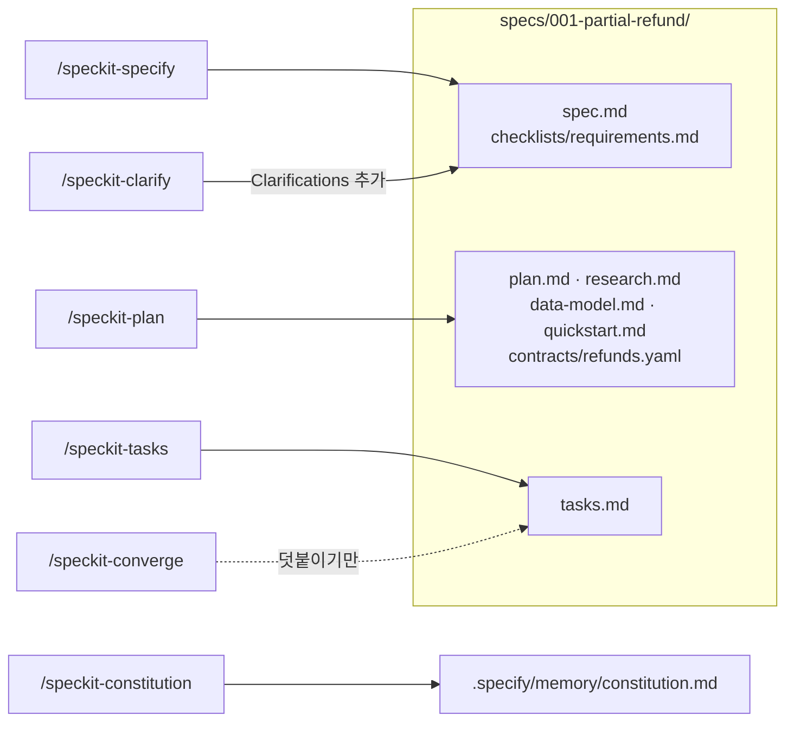
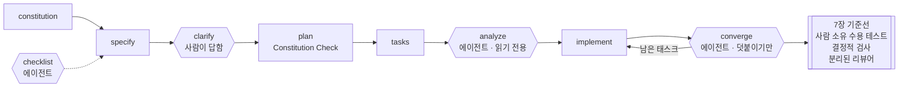

# 9장. Spec Kit으로 개발하기 — 헌법에서 converge까지

코드 689줄에 마크다운 2,577줄이 따라왔다. 2025년 11월, Scott Logic의 한 개발자가 Spec Kit으로 기능 하나의 첫 증분을 만들고 남긴 기록이다. 에이전트가 일한 시간은 33분 30초였다. 그런데 사람이 그 결과를 검토하는 데는 3.5시간이 걸렸고, 그중 plan 단계 문서 2,067줄을 읽는 데만 약 2시간이 들었다. 같은 저자가 Spec Kit 없이 잰 기준선은 에이전트 8분, 코드 1,000줄, 코드 검토 15분, 기능 테스트 9분이었다. 저자는 스펙 없이 하는 쪽이 약 10배 빠르다고 판정했다.

숫자를 받아 들기 전에 조건부터 보자. Spec Kit 1.0(2026-08-21)이 나오기 전 판이었고, Copilot과 Claude Sonnet 4.5 조합이었으며, 한 사람이 증분 두 개를 잰 결과다. 1.0 이후 같은 방식으로 다시 잰 기록은 아직 찾지 못했다. 2차 인용에 자주 보이는 "3.5시간 대 23분"이라는 비교도 쓰지 말자. 23분 30초는 두 번째 증분의 에이전트 시간이라서 첫 증분의 사람 검토 시간과 나란히 놓을 수 없는 값이다.

그래도 이 기록이 던지는 질문은 여전히 유효하다. 스펙 주도 개발(Spec-Driven Development, SDD) 도구 가운데 가장 많은 문서를 만드는 축에 선 Spec Kit은 그 문서 더미로 무엇을 사는가? 답은 직접 돌려 봐야 나온다. 8장에서 OpenSpec으로 다룬 부분 환불을 이번에는 Spec Kit 파이프라인에 처음부터 끝까지 태워 보자. 어느 문서가 일을 하고 어느 문서가 짐이 되는지는 그다음에 따져도 늦지 않다.

> 이 장은 Spec Kit v1.3.3/2026-11-09 기준이다. Spec Kit은 며칠 간격으로 새 판을 내므로 명령과 템플릿은 공식 저장소에서 함께 확인하자.

## 설치하고, 헌법부터

### 기존 저장소에 붙이기

Spec Kit을 쓰려면 Python 3.11 이상과 `uv`가 있어야 한다. CLI는 `specify-cli`라는 이름으로 설치한다. 책과 같은 판으로 따라 하려면 버전을 고정해 두는 편이 낫다.

```bash
# 판 고정 설치 (v1.3.3 릴리스 노트의 형식)
uv tool install specify-cli --from git+https://github.com/github/spec-kit.git@v1.3.3

# 이미 운영 중인 저장소에 Claude Code 통합만 붙인다
cd bookshop-orders
specify integration install claude
```

설치가 끝나면 Claude Code용 스킬이 `.claude/skills/speckit-<command>/SKILL.md`에 생긴다. 공식 문서는 명령을 `/speckit.specify`처럼 점으로 적지만, Claude Code 설치본에서 실제로 부르는 이름은 `/speckit-specify`다. 이 장은 설치본 표기를 쓴다.

설정 하나는 미리 생각해 두자. 기본값에서는 Spec Kit 스킬이 모두 모델 호출 가능 상태라서 스킬 설명이 늘 컨텍스트에 들어간다. 부분 환불 하나를 만드는 동안에도 명령 아홉 개의 설명이 계속 자리를 차지하는 셈이다. 새로 초기화할 때 아래 옵션을 주면 코어 스킬에 `disable-model-invocation: true`가 들어가서, 사람이 직접 부를 때만 실행된다. 기존 저장소에 `integration install`로 붙였다면 생성된 `SKILL.md` 머리말에 이 줄이 있는지 확인해 보자.

```bash
specify init my-project --integration claude --integration-options="--no-model-invocation"
```

기존 저장소에 붙일 때 제조사가 권하는 순서도 기억해 두자. 먼저 작업 중인 변경을 커밋하거나 stash한다. 첫 기능으로 기존 시스템 전체를 문서화하겠다고 나서지 말고, 범위가 정해진 작은 변경을 고른다. 헌법은 저장소가 이미 지키고 있는 규칙에서 출발한다. 부분 환불은 운영 중인 저장소에 엔드포인트 두 개와 테이블 두 개를 더하는 일이니 범위가 분명한 첫 기능으로 알맞다.

Spec Kit README는 진입점을 넷으로 나눈다. SDD, 버그 수정, 아이디어 평가, 직접 만든 프로세스다. 원문은 이 넷을 "independent entry points, not mandatory phases"라고 부른다. 아홉 개 명령을 매번 다 돌려야 하는 사슬로 볼 필요는 없다는 뜻이다. 여기서는 SDD 진입점을 끝까지 돌려 본 뒤, 장 끝에서 어느 단계를 건너뛸지 다시 고르겠다.

> **다른 하네스에서는**
> 단계는 같고 설치 위치와 호출 표기만 다르다. Codex CLI는 통합 키 `codex`로 `.agents/skills/speckit-<command>/SKILL.md`에 설치되고 `$speckit-specify`로 부른다. Cursor는 `cursor-agent` 키로 `.cursor/skills/`에, GitHub Copilot은 `copilot` 키로 `.github/skills/`에 설치되며 둘 다 `/speckit-specify`로 부른다. 여러 에이전트를 한 저장소에서 함께 쓰는 팀은 `--integration none`으로 시작하는 경로도 있다.

### 헌법 파일: 저장소가 이미 지키는 규칙에서

`/speckit-constitution`(문서 표기 `/speckit.constitution`)은 `.specify/memory/constitution.md`를 만들거나 고친다. 기능마다 새로 쓰지 않고, 모든 기능의 계획이 통과해야 할 프로젝트 원칙을 담는다. 1장의 구분으로 치면 스펙보다는 컨텍스트 파일 쪽에 가깝다.

템플릿 구조부터 정확히 짚자. 헌법에는 조항 9개가 들어간다는 설명이 종종 보인다. 실제 템플릿 파일이 만드는 칸은 원칙 다섯 개(`[PRINCIPLE_1_NAME]`부터 `[PRINCIPLE_5_NAME]`까지), 추가 절 두 개, 그리고 `## Governance`다. "아홉 조항"은 방법론 문서 `spec-driven.md`가 설명용으로 쓰는 틀이고, 그 문서조차 IV~VI 조항은 프로젝트가 정의한다고 적는다. 칸 수에 매이지 말고 우리 저장소의 규칙을 채우면 된다.

`bookshop-orders`가 이미 지키는 규칙은 무엇일까? 금액은 원 단위 정수로 다룬다. 공개 API는 하위 호환을 깨지 않는다. 마이그레이션은 되돌릴 수 있어야 한다. 모두 코드 리뷰에서 이미 여러 번 지적해 온 것들이다. 그것을 템플릿 칸에 옮긴 결과가 아래 헌법이다. 이 책 예제로 채운 예시이고, 도구가 생성한 출력이 아니다.

```markdown
<!-- .specify/memory/constitution.md — 이 책 예제로 채운 예시 -->
# bookshop-orders Constitution

## Core Principles

### I. 금액은 원 단위 정수
금액은 원 단위 `long`으로만 계산하고 저장한다. `double`·`float`로 금액을 다루지 않는다.
원 미만 처리 규칙은 기능 스펙이 정한다.

### II. 공개 API 하위 호환
기존 엔드포인트의 경로, 응답 필드, 상태 코드의 의미를 바꾸거나 지우지 않는다.
새 동작은 새 엔드포인트나 새 필드로만 더한다.

### III. Test-First (NON-NEGOTIABLE)
수용 시나리오마다 실패하는 테스트를 먼저 쓰고, 실패를 확인한 뒤 구현한다.
테스트 없이 들어온 프로덕션 코드는 병합하지 않는다.

### IV. 되돌릴 수 있는 마이그레이션
스키마 변경마다 되돌리기 스크립트를 함께 둔다.
같은 릴리스 안에서 운영 데이터를 지우는 마이그레이션은 만들지 않는다.

### V. 관측 가능성
외부 PG 경계를 넘는 호출은 주문 ID와 멱등 키를 구조화 로그로 남긴다.
로그에 카드 정보를 남기지 않는다.

## Security Requirements
`SHOP_ADMIN` API는 요청자의 서점과 대상 주문의 서점이 같은지 서비스 진입점에서 확인한다.
컨트롤러가 받은 주문 ID를 확인 없이 믿지 않는다.

## Development Workflow
스펙 변경과 코드 변경은 같은 PR에 담는다.
PG 연동 코드를 고친 PR은 사람 리뷰 없이 병합하지 않는다.

## Governance
헌법 개정은 PR로 제안하고, 개정 이유를 이 절 아래에 한 줄씩 남긴다.

**Version**: 1.0.0 | **Ratified**: 2026-11-10 | **Last Amended**: 2026-11-10
```

두 가지를 눈여겨보자. 첫째, 원칙 대부분이 "~하지 않는다"로 쓰여 있다. Spec Kit 사용기를 쓴 한 실무자는 헌법에 TDD를 강제하고 허용 규칙보다 금지 규칙을 쓰라고 권한다(velog, 2026-04-26, 개인 보고). 허용 규칙은 에이전트가 넓게 해석할 여지를 남기지만, 금지 규칙은 위반 여부가 diff에서 바로 드러난다.

둘째, 보안 절에 서점 일치 확인을 적었다. 6장 인터뷰가 인가를 따로 물었던 이유를 떠올려 보자. 기존 서비스에 기능 하나를 붙여 세 도구를 비교한 Ran the Builder 글(2026-04)에서는 계획 단계의 어떤 도구도 인가 누락을 짚지 못했다. 실무자 한 명의 관찰이지만, 인가는 기능마다 잊기 쉬운 규칙이라는 점만은 분명하다. 그런 규칙은 기능 스펙보다 헌법에 두는 편이 낫다. 한 번 적어 두면 모든 기능의 Constitution Check가 그 줄을 다시 읽게 되기 때문이다.

## 부분 환불을 기능 폴더로

### `/speckit-specify`: 사용자 스토리로 나눈 spec.md

이제 기능을 정의하자. `/speckit-specify`(문서 표기 `/speckit.specify`)에 몇 줄짜리 설명을 넘긴다. 6장에서 만든 `SPEC.md`가 이미 있다면 그 내용을 입력으로 줘도 된다. 여기서는 Spec Kit의 관문이 무엇을 잡아 주는지 보려고 일부러 설명을 짧게 줬다.

```text
/speckit-specify 서점 관리자가 배송 완료된 주문의 일부 항목을 수량 단위로 환불한다.
주문 쿠폰 할인은 항목 금액 비율로 나눠 환불액에서 뺀다. 같은 요청이 두 번 와도
환불은 한 번만 일어난다. PG 환불이 실패하면 아무것도 바뀌지 않고 다시 요청할 수 있다.
기존 전체 취소 API는 바꾸지 않는다. 배송비, 포인트, 고객 셀프 환불 화면, 교환은 범위 밖이다.
```

이 명령은 `specs/001-partial-refund/spec.md`와 `checklists/requirements.md`를 쓰고, 정해진 기능 폴더 경로를 `.specify/feature.json`의 `"feature_directory"`에 남긴다. 폴더 이름의 `001`은 기본 번호 방식인 세 자리 연번이고, 설정을 바꾸면 `YYYYMMDD-HHMMSS` 시각으로 붙일 수도 있다. git 브랜치는 따로다. v0.10.0부터 브랜치는 `before_specify` 훅이 있을 때만 만든다. 방법론 문서 `spec-driven.md`의 예시에는 아직 "브랜치를 만든다"고 적혀 있는데, 이것은 v0.10.0 이전 동작이니 헷갈리지 말자.

아래는 specify 직후, clarify를 돌리기 전의 `spec.md`다. 헤딩은 `spec-template.md` 원문 구조를 따르고 내용은 이 책 예제로 채웠다.

```markdown
# Feature Specification: 부분 환불

**Feature Branch**: `001-partial-refund`
**Created**: 2026-11-10
**Status**: Draft
**Input**: User description: "서점 관리자가 배송 완료된 주문의 일부 항목을 수량 단위로 환불한다. ..."

## User Scenarios & Testing *(mandatory)*

### User Story 1 - 부분 환불 요청 (Priority: P1)
서점 관리자는 배송이 끝난 주문에서 항목 일부를 수량 단위로 환불한다.

**Why this priority**: 지금은 배송 전 전체 취소만 있어서 배송 뒤 생긴 항목 하나의 문제를 이 서비스 안에서 처리할 수 없다.
**Independent Test**: 결제 40,800원 주문에서 책 B 1권을 환불 요청하고 응답 금액과 주문 상태만 확인하면 단독으로 검증된다.

**Acceptance Scenarios**:
1. **Given** 책 A 18,000원 × 1, 책 B 12,000원 × 2, 정률 쿠폰 10%, 배송비 3,000원으로 40,800원을 결제하고 배송이 끝난 주문, **When** 서점 관리자가 책 B 1권 환불을 요청하면, **Then** 10,800원이 환불되고 주문 상태는 `PARTIALLY_REFUNDED`가 된다.
2. **Given** 책 B 2권을 이미 모두 환불한 주문, **When** 책 B 1권 환불을 다시 요청하면, **Then** `409 REFUND_QUANTITY_EXCEEDED`로 거절되고 아무것도 바뀌지 않는다.
3. **Given** 배송 후 7일이 지난 주문 [NEEDS CLARIFICATION: 7일의 기준 시각 — 배송 완료 시각인가, 날짜 단위인가, 어느 시간대인가?], **When** 환불을 요청하면, **Then** `422 REFUND_WINDOW_EXPIRED`로 거절된다.
4. **Given** 다른 서점의 주문, **When** 서점 관리자가 환불을 요청하면, **Then** `403`으로 거절된다.

### User Story 2 - 쿠폰 할인 안분 (Priority: P2)
환불액에서 주문 쿠폰 할인의 해당 몫을 정확히 뺀다.

**Why this priority**: 금액이 1원이라도 틀리면 고객 분쟁과 정산 오류로 바로 이어진다.
**Independent Test**: 안분 계산만 떼어 금액 표와 대조하면 단독으로 검증된다.

**Acceptance Scenarios**:
1. **Given** User Story 1의 주문, **When** 전 항목을 차례로 환불하면, **Then** 환불액 합계는 37,800원(결제 금액 − 배송비)이다.
2. **Given** 같은 구성에 정액 쿠폰 3,000원이 적용된 주문, **When** 전 항목을 환불하면, **Then** 원 미만을 버려 생긴 1원 차액은 마지막으로 환불되는 항목에서 보정된다.

### User Story 3 - 환불 내역 조회 (Priority: P3)
서점 관리자는 주문의 환불 내역을 본다.

**Why this priority**: 운영 문의에 답하려면 필요하지만 환불 자체가 먼저다.
**Independent Test**: 환불 두 건이 있는 주문을 조회해 두 건의 금액과 상태를 확인한다.

**Acceptance Scenarios**:
1. **Given** 환불 두 건이 있는 주문, **When** `GET /orders/{orderId}/refunds`를 호출하면, **Then** 두 건이 생성 순서대로 금액, 상태와 함께 나온다.

### Edge Cases
- 같은 `Idempotency-Key`, 같은 본문으로 다시 요청하면 첫 결과를 그대로 돌려준다.
- 같은 키에 다른 본문이 오면 `422 IDEMPOTENCY_KEY_REUSED`로 거절한다.
- 키 보관 기간 [NEEDS CLARIFICATION: 키를 얼마나 보관하는가?]
- PG 환불 호출이 실패하면 환불은 `FAILED`, 주문 상태와 `refunded_quantity`는 그대로다.
- 배송 전 주문은 이 기능의 대상이 아니다. 기존 `POST /orders/{orderId}/cancel`을 쓴다.

## Requirements *(mandatory)*

### Functional Requirements
- **FR-001**: System MUST 서점 관리자(`SHOP_ADMIN`)가 자기 서점 주문에 대해서만 `POST /orders/{orderId}/refunds`로 항목·수량 단위 환불을 요청하게 한다.
- **FR-002**: System MUST 배송 후 7일이 지난 요청을 `422 REFUND_WINDOW_EXPIRED`로 거절한다. [NEEDS CLARIFICATION: 기준 시각]
- **FR-003**: System MUST 항목별 누계 환불 수량(`refunded_quantity`)이 주문 수량을 넘게 되는 요청을 `409 REFUND_QUANTITY_EXCEEDED`로 거절한다.
- **FR-004**: System MUST 주문 쿠폰 할인액을 항목 금액 비율로 나눠 환불액에서 빼고, 원 미만은 버리며, 남은 차액은 마지막으로 환불되는 항목에서 보정한다.
- **FR-005**: System MUST 같은 `Idempotency-Key` 재요청에 첫 결과를 그대로 돌려주고, 같은 키에 다른 본문이 오면 `422 IDEMPOTENCY_KEY_REUSED`로 거절한다.
- **FR-006**: System MUST PG 환불 호출이 실패하면 환불 상태를 `FAILED`로 남기고 주문 상태와 `refunded_quantity`를 바꾸지 않으며 `502 PAYMENT_GATEWAY_ERROR`를 돌려준다.
- **FR-007**: System MUST 일부 항목을 환불하면 주문 상태를 `PARTIALLY_REFUNDED`로, 전 항목을 환불하면 `REFUNDED`로 바꾼다.
- **FR-008**: System MUST 기존 전체 취소 API(배송 전, 전액)의 동작을 바꾸지 않는다.
- **FR-009**: System MUST `GET /orders/{orderId}/refunds`로 주문의 환불 내역을 돌려준다. 주문이 없으면 `404`다.

### Key Entities *(include if feature involves data)*
- **Refund**: 환불 한 건. 금액, 사유, 상태(`REQUESTED`, `COMPLETED`, `FAILED`), 고유한 멱등 키.
- **RefundItem**: 환불에 포함된 주문 항목, 수량, 항목별 환불액.
- **OrderItem**(기존): 누계 환불 수량 `refunded_quantity`를 새로 가진다.

## Success Criteria *(mandatory)*

### Measurable Outcomes
- **SC-001**: 전 항목을 환불한 모든 주문에서 환불액 합계가 결제 금액 − 배송비와 1원도 다르지 않다.
- **SC-002**: 같은 요청을 여러 번 보내도 환불은 한 번만 일어난다.
- **SC-003**: 서점 관리자는 운영팀 도움 없이 항목 1개 환불을 요청 한 번으로 끝낸다.

## Assumptions
- 배송비는 환불하지 않는다. 포인트·적립금, 고객 셀프 환불 화면, 복수 결제 수단, 교환은 범위 밖이다.
- 결제는 카드 단일 결제(외부 PG)뿐이다.
- 수용 시나리오마다 자동화 테스트를 요청한다.
```

템플릿이 무엇을 강제했는지 보자. 먼저 사용자 스토리마다 우선순위와 Independent Test를 요구한다. 그래서 US1만 떼어 내도 그 자체로 검증 가능한 최소 기능이 되도록 경계를 긋게 된다. 기능 요구는 EARS가 아니라 RFC 2119식 `MUST` 문장에 `FR-` 번호를 붙이고, 수용 기준은 Given/When/Then으로 쓴다. Success Criteria에는 "기술에 얽매이지 않고 측정 가능해야 한다"는 주석이 붙어 있어서 SC-001처럼 구현과 무관한 문장을 쓰게 된다.

가장 쓸모 있는 장치는 `[NEEDS CLARIFICATION: …]`이다. 템플릿은 모르는 값을 지어내지 말고 이 표시로 남기라고 지시한다. 위 스펙에는 기준 시각과 키 보관 기간 두 곳이 남았다. 6장 검사관 세션이 찾아낸 빈칸이 여기서는 처음부터 표시된 채 나온 셈이다.

반대로 템플릿에 없는 칸도 있다. 비목표 절이 따로 없어서 "안 만들 것"을 Assumptions에 넣었다. 마지막 줄 "수용 시나리오마다 자동화 테스트를 요청한다"가 왜 필요한지는 tasks 단계에서 드러난다.

### `/speckit-clarify`: 다섯 문항으로 빈칸 닫기

`/speckit-clarify`(문서 표기 `/speckit.clarify`, 예전 이름 `/quizme`)는 계획 전에 모호함을 푸는 선택 관문이다. 공식 설명은 현재 스펙의 덜 정해진 곳에 대해 "up to five targeted questions"를 묻는다고 하고, 명령 템플릿은 세션 전체에서 최대 다섯 문항으로 제한한다. 답은 `spec.md` 안에 `## Clarifications` 절과 `### Session YYYY-MM-DD` 소절로 쌓인다. 아래는 이 책 예제로 채운 세션 기록이다.

```markdown
## Clarifications

### Session 2026-11-10
- Q: "배송 후 7일"은 무엇을 기준으로 재나요? → A: 배송 완료 시각 `delivered_at`부터 168시간. 날짜 경계와 시간대는 따지지 않는다.
- Q: `Idempotency-Key`는 얼마나 보관하나요? → A: 24시간.
- Q: PG 실패 뒤 다시 요청할 때 같은 키를 써도 되나요? → A: 새 키로 요청한다. 같은 키는 첫 결과(`FAILED`)를 그대로 돌려준다.
- Q: 환불 내역 조회도 자기 서점 주문만 볼 수 있나요? → A: 그렇다. 다른 서점 주문은 `403`이다.
```

답이 기록되면 해당 요구 줄도 바뀌어야 한다. FR-002는 이렇게 고쳐진다.

```diff
- **FR-002**: System MUST 배송 후 7일이 지난 요청을 `422 REFUND_WINDOW_EXPIRED`로 거절한다. [NEEDS CLARIFICATION: 기준 시각]
+ **FR-002**: System MUST 배송 완료 시각(`delivered_at`)부터 168시간이 지난 요청을 `422 REFUND_WINDOW_EXPIRED`로 거절한다.
```

세 번째 문항을 다시 보자. 규칙 하나(같은 키는 첫 결과를 돌려준다)와 규칙 둘(PG가 실패하면 다시 요청할 수 있다)을 함께 읽으면, 재요청에는 새 키가 필요하다는 결론이 나온다. 두 규칙 모두 스펙에 있었지만 둘을 합친 결과는 어디에도 적혀 있지 않았다. 구현자가 같은 키로 재시도하는 클라이언트를 만들었다면 영원히 `FAILED`만 돌려받는 난감한 상황이 됐을 것이다. 명확화의 값은 이런 문장 사이의 틈에서 나온다.

그렇다면 6장 인터뷰와 무엇이 같고 무엇이 다를까? 질문을 받아 빈칸을 채우고 답을 파일에 남긴다는 점은 같다. 차이는 출발점과 상한이다. 6장 인터뷰는 빈 종이에서 출발해 질문을 수십 개까지 이어 갔고, clarify는 이미 쓴 스펙에서 출발해 다섯 문항 안에서 멈춘다. 그리고 공식 설명이 말하는 대상은 "underspecified areas", 즉 덜 정해진 곳이다.

이 예시를 채우면서 배송비 모순 같은 문장 간 충돌은 일부러 질문 목록에 넣지 않았다. clarify가 찾으라고 설계된 대상이 빈칸이기도 하고, 3장에서 봤듯 모델은 빈칸보다 모순을 훨씬 못 잡기 때문이다. 그러니 clarify가 끝난 `spec.md`에도 6장의 검사 질문 세 개를 사람이 한 번 돌리는 편이 낫다. 특히 "두 문장이 같은 상황에 다른 결과를 요구하는가"는 사람 몫으로 남겨 두자. clarify를 여러 번 반복하면 경계 사례, 정하지 않은 정책, 모호한 도메인 용어가 더 드러난다는 현장 보고도 있다(앞의 velog 글, 개인 보고). 다만 반복할수록 시간도 함께 든다는 점은 잊지 말자.

요구의 품질을 따로 점검하고 싶다면 `/speckit-checklist`도 있다. `checklists/` 아래에 요구 품질 점검표를 만드는 또 하나의 선택 관문이다.

### `/speckit-plan`과 `/speckit-tasks`: 관문이 붙은 계획

스펙이 정리되면 기술 계획으로 넘어간다. `/speckit-plan`에는 스택과 제약을 준다.

```text
/speckit-plan 기존 Spring Boot + PostgreSQL 저장소에 붙인다. 스키마는 마이그레이션 스크립트로 바꾸고,
PG 환불 호출은 기존 결제 클라이언트를 재사용한다. 헌법을 지킨다.
```

이 명령은 기능 폴더에 `plan.md`, `research.md`, `data-model.md`, `quickstart.md`, `contracts/`를 만든다. 핵심은 `plan.md`의 두 절이다.

```markdown
# Implementation Plan: 부분 환불

## Summary
서점 관리자용 부분 환불 API 두 개를 추가한다. 안분 계산과 환불 기간 판정은 순수 계산으로 떼고,
PG 환불 호출은 기존 결제 클라이언트를 재사용한다.

## Technical Context
**Language/Version**: Java 21
**Primary Dependencies**: Spring Boot 3, 기존 PG 결제 클라이언트
**Storage**: PostgreSQL — `refunds`, `refund_items` 신설, `order_items.refunded_quantity` 추가
**Testing**: JUnit 5, 실제 PostgreSQL에 붙는 통합 테스트
**Target Platform**: 기존 `bookshop-orders` 서비스
**Project Type**: 웹 서비스(단일 백엔드)
**Performance Goals**: NEEDS CLARIFICATION
**Constraints**: 금액은 원 단위 `long`. 같은 주문에 동시 요청이 와도 수량 초과가 생기지 않는다
**Scale/Scope**: NEEDS CLARIFICATION

## Constitution Check
*GATE: Must pass before Phase 0 research. Re-check after Phase 1 design.*
- [x] I. 금액은 원 단위 정수 — 안분은 `long`, 버림 규칙은 FR-004
- [x] II. 공개 API 하위 호환 — 새 엔드포인트만 추가, 전체 취소는 FR-008로 고정
- [x] III. Test-First — 수용 시나리오별 테스트 태스크를 구현 태스크 앞에 둔다
- [x] IV. 되돌릴 수 있는 마이그레이션 — 테이블 생성과 열 추가마다 되돌리기 스크립트
- [ ] V. 관측 가능성 — PG 환불 호출의 로그 필드 미정 → research.md에서 정한다
- [x] Security — 서점 일치 확인을 서비스 진입점에 둔다
```

Technical Context의 항목마다 템플릿 기본값에는 "`or NEEDS CLARIFICATION`"이 붙어 있다. 모르는 값을 지어내지 말라는 자리 표시다. 위 계획에서는 성능 목표와 규모가 그 상태로 남았다. 이런 자리를 에이전트가 그럴듯한 숫자로 채우게 두면 아무도 합의한 적 없는 목표가 계획에 들어간다. 사람이 정하거나, 이번 기능에는 "목표 없음"이라고 적자.

Constitution Check는 계획 단계의 관문이다. 헌법 원칙을 한 줄씩 대조하고, 연구 단계 전에 통과해야 하며, 설계 뒤에 다시 확인한다. V번처럼 체크가 비면 그 공백이 `research.md`의 숙제가 된다. `contracts/`에는 환불 API 계약을 둔다. 아래는 요청 본문과 오류 응답만 발췌한 예시다.

```yaml
# specs/001-partial-refund/contracts/refunds.yaml — 이 책 예제로 채운 예시(발췌)
paths:
  /orders/{orderId}/refunds:
    post:
      parameters:
        - { name: orderId, in: path, required: true }
        - { name: Idempotency-Key, in: header, required: true }
      requestBody:
        content:
          application/json:
            schema:
              type: object
              required: [items, reason]
              properties:
                items:
                  type: array
                  items:
                    type: object
                    required: [orderItemId, quantity]
                    properties:
                      orderItemId: { type: integer }
                      quantity: { type: integer }
                reason: { type: string }
      responses:
        # 성공 응답은 발췌에서 뺐다
        '403': { description: 다른 서점의 주문 }
        '404': { description: 주문 없음 }
        '409': { description: REFUND_QUANTITY_EXCEEDED }
        '422': { description: REFUND_WINDOW_EXPIRED 또는 IDEMPOTENCY_KEY_REUSED }
        '502': { description: PAYMENT_GATEWAY_ERROR }
```

`quickstart.md`는 사람이 손으로 기능을 확인하는 절차를 담기에 알맞은 자리다. 7장의 결정적 검사 가운데 `curl`로 실제 호출하는 단계를 여기에 적어 두면 리뷰어도 같은 절차를 돌릴 수 있다.

`/speckit-tasks`는 계획을 `tasks.md`로 쪼갠다. 줄 형식은 `[ID] [P?] [Story] Description`이다. `[P]`는 다른 파일이라 의존 없이 병렬로 할 수 있다는 표시이고, `[US1]`은 사용자 스토리 번호다. 아래는 Phase 3 발췌다.

```markdown
## Phase 3: User Story 1 - 부분 환불 요청 (Priority: P1) 🎯 MVP

### Tests for User Story 1 (OPTIONAL - only if tests requested) ⚠️
- [ ] T010 [P] [US1] 책 B 1권 환불 → 10,800원, PARTIALLY_REFUNDED 수용 테스트 in src/test/java/com/bookshop/orders/refund/PartialRefundAcceptanceTest.java
- [ ] T011 [P] [US1] 누계 수량 초과 → 409 REFUND_QUANTITY_EXCEEDED 테스트 in src/test/java/com/bookshop/orders/refund/RefundQuantityTest.java
- [ ] T012 [P] [US1] delivered_at + 168시간 경과 → 422 REFUND_WINDOW_EXPIRED 테스트 in src/test/java/com/bookshop/orders/refund/RefundWindowPolicyTest.java
- [ ] T013 [P] [US1] 다른 서점 주문 → 403 테스트 in src/test/java/com/bookshop/orders/refund/RefundAuthorizationTest.java

### Implementation for User Story 1
- [ ] T014 [US1] refunds·refund_items 생성, order_items.refunded_quantity 추가 마이그레이션과 되돌리기 스크립트 in src/main/resources/db/migration/
- [ ] T015 [P] [US1] Refund, RefundItem 엔티티 in src/main/java/com/bookshop/orders/refund/
- [ ] T016 [P] [US1] RefundWindowPolicy(delivered_at부터 168시간) in src/main/java/com/bookshop/orders/refund/RefundWindowPolicy.java
- [ ] T017 [US1] RefundService.requestRefund — 서점 일치, 기간, 수량 확인 뒤 PG 환불 호출 in src/main/java/com/bookshop/orders/refund/RefundService.java
- [ ] T018 [US1] POST /orders/{orderId}/refunds 컨트롤러 in src/main/java/com/bookshop/orders/refund/RefundController.java

**Checkpoint**: At this point, User Story 1 should be fully functional and testable independently
```

테스트 소절 제목의 "OPTIONAL"이 보이는가? tasks 템플릿의 정책은 "Tests are OPTIONAL - only include them if explicitly requested in the feature specification"이다. 헌법은 Test-First를 양보할 수 없는 원칙이라고 적었는데, 태스크 템플릿은 스펙이 요청하지 않으면 테스트를 빼도 된다고 말한다. 두 문서가 서로 다른 기본값을 가진 셈이다. 이 긴장을 푸는 가장 단순한 방법이 앞서 `spec.md`의 Assumptions에 넣은 한 줄이다. 스펙이 테스트를 명시적으로 요청하면 템플릿의 조건이 참이 된다. 그리고 implement로 넘어가기 전에, 테스트 태스크가 구현 태스크보다 앞에 있는지 눈으로 한 번 확인하자.



그림 1. 명령별 산출물과 `specs/001-partial-refund/` 기능 폴더

## 관문과 무게

### 관문을 밖으로 꺼내기: analyze, implement, converge

`/speckit-analyze`는 태스크를 만든 뒤, 구현하기 전에 산출물 사이의 정합성을 점검하는 선택 관문이다. 공식 설명은 이 명령이 "read-only"이고 파일을 고치지 않는다고 적는다. 부분 환불이라면 FR마다 대응하는 태스크가 있는지, `spec.md`의 오류 코드와 `contracts/`의 응답이 같은지, Constitution Check의 빈칸이 태스크로 이어졌는지를 살피게 하는 단계다.

다만 analyze의 깨끗한 결과를 너무 믿지는 말자. 이슈 #4164(2026-08-17)가 그 이유를 보여 준다. 에이전트는 spec, plan, tasks에서 비슷한 문구를 grep해 관련 작업을 찾는다. 그래서 요구 문구가 바뀌면 기존 요구를 못 찾고 새 줄을 더해, 같은 동작에 살아 있는 줄이 두 개가 된다. 그런데 analyze는 컨텍스트에 올라온 것만 보기 때문에 결과가 깨끗하게 나온다. 이슈 #4065(2026-08-12)는 다른 함정을 짚는다. `FR-###`, `T###`, `CHK###`가 연번이라 하나를 중간에 끼우면 뒤 번호가 다 밀리고, 다른 문서의 참조가 조용히 엉뚱한 항목을 가리킨다. 두 이슈의 제안은 2026-11 기준으로 채택되지 않았다.

피할 방법은 없을까? 이 책의 제안은 세 가지다. 번호는 중간에 끼우지 말고 끝에 덧붙인다. 요구를 고칠 때는 문구가 아니라 `FR-002` 같은 ID로 찾아 그 줄을 직접 고친다. 다른 문서에서 참조할 때는 ID 옆에 짧은 제목을 함께 적어, 번호가 밀려도 사람이 어긋남을 알아챌 수 있게 한다.

`/speckit-implement`는 `tasks.md`를 읽고 코드를 쓴다. 이슈 #737(2025-10-04)에는 구현 중에 질문을 던지면 답 대신 코드를 고쳐 버린다는 보고가 있다. 구현 도중 묻고 싶은 것이 생기면 질문 전용 모드나 별도 세션을 쓰는 편이 안전하다. Copilot 사용자들은 Ask 모드를 처방으로 들었다.

`/speckit-converge`는 구현을 산출물과 비교해 남은 일을 덧붙인다. 공식 설명은 이 명령이 "append-only"라고 한다. 코드를 고치거나 지우지 않고, 유일하게 쓸 수 있는 것은 `tasks.md`에 태스크를 더하는 일이다. 덧붙는 절은 아래 같은 모양이 된다(이 책 예제로 채운 예시).

```markdown
## Phase 6: Convergence
- [ ] T041 [US2] 정액 쿠폰 1원 차액 보정이 마지막으로 환불되는 항목이 아니라 첫 항목에 붙는다 — FR-004와 대조해 수정 in src/main/java/com/bookshop/orders/refund/RefundAmountCalculator.java
```

README는 converge가 `Converged`를 보고할 때까지 implement와 converge를 반복하라고 한다. 구현이 스펙을 따랐는지 확인하는 루프가 없다는 2025년의 비판은 이 명령으로 부분적으로 해소됐다. "부분적으로"인 이유는 분명하다. `Converged`라는 판정을 내리는 것도 여전히 에이전트이기 때문이다.

7장의 기준선을 여기에 겹쳐 보자. 첫째, 수용 테스트는 사람이 소유한다. T010~T013의 테스트 코드를 implement 전에 사람이 읽고, "그 동작이 없으면 실패하는가"를 확인한다. 둘째, 결정적 검사를 돌린다. 테스트와 빌드에 더해 앱 부팅 스모크, `quickstart.md`의 `curl` 호출, 마이그레이션 적용과 되돌리기를 실행한다. 셋째, 대화를 보지 못한 서브에이전트에게 diff를 `spec.md`와 대조시키되 스타일은 건너뛰게 한다. converge의 `Converged`는 이 셋 가운데 하나를 대신하지 않는다. 그 판정은 판정자 목록에 이름 하나를 더할 뿐이다.



그림 2. 아홉 명령 사이의 품질 관문과 판정자. 만들기 전 관문은 clarify·checklist·analyze, 만든 뒤 관문은 converge다.

### 무게의 손익

이제 파일을 세어 보자. 부분 환불 하나로 기능 폴더에 생긴 파일은 `spec.md`, `checklists/requirements.md`, `plan.md`, `research.md`, `data-model.md`, `quickstart.md`, `contracts/refunds.yaml`, `tasks.md`로 여덟 개다. 여기에 저장소 전체에 하나뿐인 헌법 파일과 `.specify/feature.json`이 더해진다. 6장의 `SPEC.md`는 파일 하나였고, 8장의 OpenSpec 변경은 `proposal.md`, 델타 스펙, `design.md`, `tasks.md`로 네 개였다. Serverworks가 문서 기준으로 센 "Spec Kit 기능당 약 10개, OpenSpec 변경당 약 4개"와 거의 같은 비율이다. 그쪽 수치도 측정이 아니라 문서와 실무를 보고 센 값이라는 점은 함께 적어 두자.

길이도 비슷한 이야기를 한다. 같은 티켓으로 잰 Uvik 벤치마크(서비스 회사가 운영, 브라운필드 Python 티켓 50개, 모델 하나, 잡음 대역 ±10%p)에서 스펙 길이 중앙값은 Spec Kit 132줄, OpenSpec 93줄이었다. 스펙 단계 시간 중앙값은 각각 18분과 12분, 스펙 드리프트는 12.5%와 2.4%였다. 병합률은 Spec Kit 80%로 대조군 72%보다 8%p 높았지만 잡음 대역 안이었다.

현장 사례는 비용이 어디에 몰리는지 보여 준다. OrangeLoops(2026-05, NestJS와 React Native)는 태스크 195개를 만들었다. 백엔드 구현은 약 1시간 6분에 끝났는데, 테스트·버그 수정·시드·시니어 리뷰·안정화에 4일이 들었다. 생성된 클라이언트가 인증 토큰 헤더 동작을 옮기지 않아 권한 오류가 반복됐고, 에이전트가 시간 기록 파일을 덮어쓰는 바람에 "지표 기록은 에이전트가 편집하는 작업 공간 밖에 두라"는 교훈도 남았다. 모두 자기 보고다. 구현이 빨라진 만큼 검증이 뒤로 밀린 모양새가 찜찜할 만큼 7장의 경고와 닮았다.

2025년에 나온 Spec Kit 비판 가운데 무엇이 아직 유효한지도 정리해 두자. 항상 새 브랜치를 만든다는 비판은 v0.10.0에서, 버그에도 무거운 흐름을 강요한다는 비판은 버그 확장으로, 설치가 번거롭다는 비판은 `uv tool install`로 해결됐다. 여전히 유효한 것은 둘이다. 기능마다 파일이 많다는 것, 그리고 긴 마크다운을 사람이 검토해야 한다는 것이다. Thoughtworks Technology Radar Vol 35(2026-11)도 AI 기반 문서 난립을 Caution에 올리며 Spec Kit과 BMAD의 대량 마크다운을 지목했다.

무게를 덜어 내는 진입점도 있다. 버그라면 `specify extension add bug` 뒤 `/speckit-bug-assess` → `/speckit-bug-fix` → `/speckit-bug-test`로 가고, 판정은 `verified`, `partial`, `failed` 셋이다. 만들지 말지부터 고민되는 아이디어라면 평가 확장이 `go`, `needs-clarification`, `kill` 가운데 하나로 판정한다. 아홉 명령을 다 돌리지 않아도 된다는 README의 말은 이런 경로로 구체화돼 있다.

Radar는 Spec Kit을 두고 주로 브라운필드에서 쓰이며, 깔끔한 코딩·아키텍처 습관을 가진 경험 많은 엔지니어가 가장 큰 가치를 얻는다고 평했다. 문서가 많다는 것은 읽고 판단할 사람이 있어야 값을 한다는 뜻이기도 하다. 헌법을 실제 리뷰 기준으로 쓰는 팀, 사용자 스토리 우선순위를 놓고 합의해야 하는 팀이라면 그 문서 더미는 합의의 기록이 된다. 혼자 하는 작은 변경이라면 같은 더미가 검토해야 할 짐으로 돌아온다.

### 명령은 바뀌어도 남는 개념

| 명령 (Claude Code 설치본) | 남는 개념 | 다른 도구의 대응물 |
|---|---|---|
| `/speckit-constitution` | 프로젝트 원칙(상시 규칙) | 컨텍스트 파일(`CLAUDE.md`, `AGENTS.md`), Kiro 스티어링 |
| `/speckit-specify` | 요구 정의 | 6장 `SPEC.md`, OpenSpec 델타 스펙(`/opsx:propose`), Superpowers 설계 문서 |
| `/speckit-clarify` | 명확화(빈칸 닫기) | 6장 인터뷰, Superpowers `brainstorming`, Kiro Analyze Requirements |
| `/speckit-checklist` | 요구 품질 점검 | 6장 검사관 세션 |
| `/speckit-plan` | 기술 계획과 원칙 대조 | 플랜 모드 계획, OpenSpec `design.md`, Superpowers `writing-plans` |
| `/speckit-tasks` | 태스크 분해 | OpenSpec `tasks.md`, 계획 안 체크리스트 |
| `/speckit-analyze` | 구현 전 산출물 정합성 점검 | OpenSpec `openspec validate --strict`(형식 점검) |
| `/speckit-implement` | 구현 | `/opsx:apply`, Superpowers `subagent-driven-development` |
| `/speckit-converge` | 구현 뒤 수렴 점검 | OpenSpec `/opsx:verify`(확장 프로필), 7장 diff 대조 |

명령 이름은 판마다 바뀔 수 있다. 점 표기가 하이픈 표기로 바뀐 것처럼 말이다. 하지만 원칙, 요구, 명확화, 계획, 태스크, 정합성, 수렴이라는 일곱 개념은 다른 도구로 옮겨 가도 그대로 남는다.

그렇다면 이 무게는 언제 값을 할까? 부분 환불을 끝까지 돌려 본 손익을 세 줄로 남기자.

- **여러 사람이 합의해야 할 때.** `spec.md`의 우선순위와 Independent Test, `plan.md`의 Constitution Check는 합의의 흔적을 파일로 남긴다. 혼자라면 그 흔적을 읽을 사람이 나 하나뿐이다.
- **사용자 스토리가 여럿일 때.** P1, P2, P3가 각자 독립적으로 테스트 가능할 만큼 크다면, 스토리 단위로 자른 태스크와 체크포인트가 일을 나눠 준다. 스토리가 하나뿐이라면 6장의 `SPEC.md` 한 장으로 충분하다.
- **헌법이 실제 규칙일 때.** 저장소가 이미 리뷰에서 지키는 규칙을 적었다면 Constitution Check는 기능마다 그 규칙을 다시 대조하는 관문이 된다. 아무도 읽지 않는 선언문이라면 컨텍스트만 차지하는 문서다.

세 줄 가운데 하나도 참이 아니라면 Spec Kit의 문서 더미는 2,577줄 쪽으로 기운다. 둘 이상이 참이라면 그 더미는 합의를 기록하는 장부가 된다.
