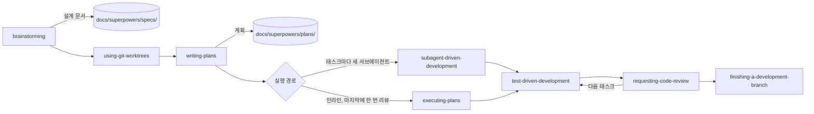
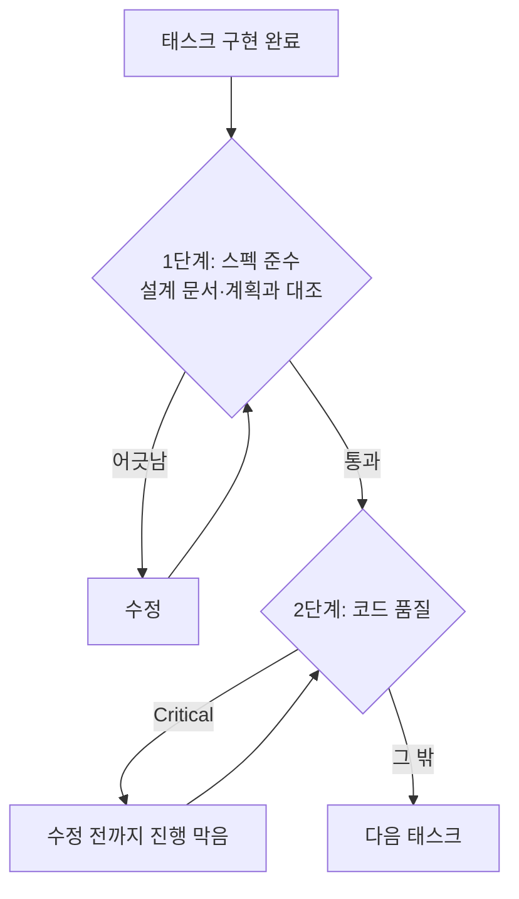

# 10장. Superpowers로 개발하기 — 질문, 계획, TDD, 두 단계 리뷰

2025년 10월 5일, Jesse Vincent는 9월 한 달 동안 코딩 에이전트를 어떻게 써 왔는지 블로그에 적었다. 그는 세션을 셋으로 나눴다. 첫 세션은 브레인스토밍이었다. 설계를 200~300단어짜리 절로 끊고 절마다 확인받았다. 에이전트는 끝났다고 판단하면 긴 글을 한꺼번에 쏟아 내고, 사람은 그런 글을 읽지 않게 된다는 관찰에서 나온 규칙이었다. 두 번째 설계자 세션은 계획을 리뷰하며 어긋난 곳을 표시했다. 세 번째 구현자 세션은 태스크를 서너 개씩 받아 계획에서 벗어나지 않고 구현했고, 컨텍스트가 차면 `/compact` 대신 `/clear`로 비웠다. 나흘 뒤인 10월 9일, 그는 Superpowers를 발표했다. 한 사람의 작업 습관이 스킬 묶음이 된 순간이다.

Vincent가 세션을 나누고 절마다 멈춘 이유를 생각해 보자. 문서를 더 많이 쓰고 싶어서였을까? 그보다는 에이전트가 너무 일찍 코드를 쓰기 시작하고, 사람이 그 속도를 따라 읽지 못하는 문제를 막으려는 쪽에 가깝다. 이 문제는 다른 실무자들도 겪었다. Boris Tane은 계획을 고쳐 달라고 할 때마다 끝에 `don't implement yet`을 붙였다. 그 한 줄이 없으면 에이전트가 계획이 충분하다고 판단하는 순간 코드를 쓰기 시작했기 때문이다. 계획을 읽고 있는데 저쪽에서 이미 파일이 바뀌고 있는 상황, 겪어 본 사람이라면 얼마나 난감한지 안다.

9장의 Spec Kit은 이 문제를 문서로 풀었다. 단계마다 파일을 남기고 사람이 다음 명령을 부를 때까지 기다리게 했다. 그 무게가 어디로 가는지도 함께 봤다. 그렇다면 문서를 늘리지 않고 막을 수는 없을까? 질문하고, 계획하고, 테스트부터 쓰고, 리뷰받는 순서 자체를 에이전트의 습관으로 만드는 길이 있다. Superpowers README는 자기 스킬을 "Mandatory workflows, not suggestions"라고 부른다. 스펙 주도 개발(Spec-Driven Development, SDD)을 문서가 아닌 습관으로 강제하는 도구가 부분 환불을 어떻게 다루는지 따라가 보자.

> 이 장은 Superpowers v7.0.2/2026-11-03 기준이다. v7.0.0(2026-10-10)에서 brainstorming이 다시 쓰였을 만큼 스킬 내용이 빠르게 바뀌므로, 따라 하기 전에 저장소의 SKILL.md를 함께 확인하자.

## 습관을 설치한다

### 설치와 자동 트리거

Claude Code에서는 공식 마켓플레이스나 Superpowers 마켓플레이스로 설치한다.

```bash
# Claude Code — 공식 마켓플레이스
/plugin install superpowers@claude-plugins-official

# 또는 Superpowers 마켓플레이스
/plugin marketplace add obra/superpowers-marketplace
/plugin install superpowers@superpowers-marketplace
```

설치하고 나면 슬래시 명령 목록이 늘어나지 않는다는 점이 먼저 눈에 띈다. Superpowers는 명령이 아니라 조건이 맞으면 스스로 켜지는 스킬 묶음이고, 저장소에는 `commands/` 디렉터리가 없다(2026-11-10 확인). README의 표현대로 에이전트는 작업을 시작하기 전에 관련 스킬이 있는지부터 확인한다. 필요하면 `/brainstorming`처럼 스킬 이름으로 직접 부를 수도 있다(v7.0.1 릴리스 노트).

스킬이 긴 세션에서도 잊히지 않는 구조도 알아 두자. 인프런 강의 "클로드 코드의 정석"의 설명에 따르면, SessionStart 훅이 세션 시작과 `/clear`, compact 뒤에 `using-superpowers` 스킬을 다시 넣는다. 4장과 5장에서 본 대로 플러그인의 훅은 셸 명령으로 실행되고, 권한 규칙과 샌드박스는 플러그인이 스스로 실행하는 코드를 덮지 않는다. 설치 전에 `hooks/hooks.json`을 직접 읽어 보는 것이 5장 점검표의 셋째 항목이었다. 이 플러그인이야말로 그 점검이 필요한 경우다.

두 가지를 더 챙기자. 브레인스토밍의 시각 도구는 버전을 알리는 로고를 불러오는데, 이 텔레메트리는 환경 변수 `SUPERPOWERS_DISABLE_TELEMETRY`로 끌 수 있다. 그리고 9장에서 Spec Kit을 같은 저장소에 설치했다면 이번 실습 동안에는 꺼 두자. SDD 플러그인을 둘 켜 두면 어느 쪽이 도왔는지 알 수 없고 비용만 늘어난다.

> **다른 하네스에서는**
> Cursor는 에이전트 채팅에서 `/add-plugin superpowers`. Codex CLI는 `/plugins`에서 superpowers를 검색해 Install Plugin. Gemini CLI는 `gemini extensions install https://github.com/obra/superpowers`. GitHub Copilot CLI는 `copilot plugin marketplace add obra/superpowers-marketplace` 뒤 `copilot plugin install superpowers@superpowers-marketplace`. 스킬 내용은 같지만 하네스마다 훅과 서브에이전트 지원이 달라서 이 장의 흐름이 똑같이 재현된다는 보장은 없다.

### brainstorming: 결과를 바꾸는 질문만

"부분 환불을 만들자"고 말을 꺼내면 `brainstorming`이 먼저 켜진다. 만들기 전에 발동해서 질문으로 의도와 이유를 끌어내고, 이해한 바를 되읽어 주는 스킬이다. 작은 변경이면 채팅에서 합의하고 끝내고, 프로젝트 규모면 설계 문서를 남긴다. 강의 설명에 따르면 이 스킬은 작업을 Spike, Bounded, Architecture로 나눠 다룬다.

v7.0.2에서 질문하는 방식이 달라졌다. 답이 결과를 바꿀 때만 묻는다. 사용자가 이유를 말하지 않았으면 이유부터 묻는다. 선택지가 있으면 추천과 함께 보여 준다. 제조사의 블라인드 채점 테스트에서 불필요한 질문이 41개(7.0.1)에서 23개로 줄었다고 한다. 제조사가 직접 잰 숫자라는 점은 기억해 두자.

6장의 인터뷰와 나란히 놓으면 성격 차이가 보인다. 6장은 빈 종이에서 시작해 질문을 수십 개까지 이어 가며 빈칸을 남김없이 끌어냈다. brainstorming은 결과를 바꾸는 질문만 남기려고 애쓴다. 그렇다면 부분 환불에서 결과를 바꾸는 질문은 무엇일까? 다른 서점 주문도 환불할 수 있는가. 7일은 어느 시각부터 재는가. 쿠폰 안분의 1원 차액은 어느 항목이 떠안는가. PG가 실패하면 무엇이 바뀌고 무엇이 그대로인가. 재요청에는 같은 멱등 키를 쓰는가. 반대로 클래스 이름이나 로그 문구는 답이 무엇이든 결과가 크게 달라지지 않는다. 이런 것은 빌더에게 남긴다.

질문에 답할 때도 요령이 있다. Vincent는 Superpowers를 내놓기 전부터 질문은 하나씩, 가능하면 객관식으로 받는 방식을 썼다. 선택지에 답하기만 하면 되니 대화가 빨라진다. 다만 추천 선택지를 그대로 고르기 전에 이유를 한 줄 덧붙이자. "배송 완료 시각부터 168시간, 운영팀이 이미 그 기준으로 고객에게 안내하고 있으니까"처럼 이유가 붙은 답은 설계 문서의 Intent and why 절로 그대로 옮겨 간다. 이유 없이 고른 답은 석 달 뒤 누구도 설명하지 못하는 결정이 된다.

질문이 줄어든 만큼 놓치는 것도 생길 수 있다. 특히 3장에서 본 대로 모델은 빈칸보다 모순을 훨씬 못 잡는다. 질문을 아끼는 스킬일수록 문장 사이의 충돌은 사람이 직접 보는 편이 낫다. 설계 문서가 나오면 6장의 검사 질문 세 개를 그대로 한 번 돌려 보자.

### 설계 문서: 의도와 경계를 한 장에

합의가 끝나면 설계 문서가 `docs/superpowers/specs/YYYY-MM-DD-<topic>-design.md`에 커밋된다(사용자가 다른 위치를 선호하면 그쪽이 우선이다). `brainstorming` SKILL.md가 설계 문서에 담으라고 하는 것은 의도와 이유, 목표·비목표·anti-goals, 제약, 접근법, 정한 how, 빌더에게 남긴 것이다. 아래는 이 목록을 절로 삼아 이 책 예제로 채운 예시다. 헤딩 이름은 SKILL.md가 고정한 것이 아니고 목록을 그대로 옮긴 것이다.

```markdown
<!-- docs/superpowers/specs/2026-11-10-partial-refund-design.md — 이 책 예제로 채운 예시 -->
# 부분 환불 설계

## Intent and why
서점 관리자(`SHOP_ADMIN`)가 배송 완료된 주문의 일부 항목을 수량 단위로 환불한다.
지금은 배송 전 전체 취소(`POST /orders/{orderId}/cancel`)만 있어서
배송 뒤 생긴 항목 하나의 문제를 이 서비스 안에서 처리할 방법이 없다.

## Goals
- `POST /orders/{orderId}/refunds`: 항목(`orderItemId`, `quantity`) 목록과 사유(`reason`), 헤더 `Idempotency-Key`
- `GET /orders/{orderId}/refunds`: 주문의 환불 내역
- 쿠폰 할인 안분이 반영된, 1원도 틀리지 않는 환불액
- 같은 요청이 여러 번 와도 환불은 한 번

## Non-goals
- 배송비 환불, 포인트·적립금, 고객 셀프 환불 화면, 복수 결제 수단, 교환

## Anti-goals (결과로 나타나면 실패인 것)
- 기존 전체 취소 API의 동작(배송 전만, 전액)이 바뀐다
- 다른 서점의 주문을 환불하거나 조회할 수 있다
- 금액 계산에 `double`·`float`가 끼어든다

## Constraints
- 기간: `delivered_at`부터 168시간 이내. 지나면 `422 REFUND_WINDOW_EXPIRED`
- 수량: 항목별 `refunded_quantity` ≤ 주문 수량. 넘으면 `409 REFUND_QUANTITY_EXCEEDED`
- 안분: 주문 쿠폰 할인액 × 항목 금액 ÷ 상품 합계, 원 미만 버림, 남은 차액은 마지막으로 환불되는 항목에서 보정
- 불변식: 전 항목을 환불하면 환불액 합계 = 결제 금액 − 배송비
- 멱등: 같은 키 재요청은 첫 결과 그대로, 같은 키·다른 본문은 `422 IDEMPOTENCY_KEY_REUSED`, 키 보관 24시간
- PG 실패: 환불 `FAILED`, 주문 상태·`refunded_quantity` 그대로, `502 PAYMENT_GATEWAY_ERROR`, 새 키로 재요청 가능
- 상태: 일부 환불 `PARTIALLY_REFUNDED`, 전부 환불 `REFUNDED` / 환불 `REQUESTED`, `COMPLETED`, `FAILED`
- 권한: 다른 서점 주문 `403`, 주문 없음 `404`
- 기준 숫자: A 18,000원 × 1, B 12,000원 × 2, 정률 쿠폰 10%, 배송비 3,000원 → 결제 40,800원,
  B 1권 환불 10,800원, 전 항목 합계 37,800원

## Approaches
1. 환불을 별도 테이블로 두고 주문 상태를 확장한다 (추천)
   — 환불 이력이 남고, 전체 취소 흐름을 건드리지 않는다.
2. 전체 취소 API에 "부분" 옵션을 더한다 (기각)
   — anti-goal 1을 깨뜨릴 위험이 가장 크다.
3. 주문 시점에 항목별 환불액을 미리 계산해 저장한다 (기각)
   — 차액 보정이 "마지막으로 환불되는 항목"에 달려 있어 미리 정할 수 없다.

## Decided how
- 새 테이블 `refunds`(id, order_id, amount, reason, status, idempotency_key 고유, created_at),
  `refund_items`(refund_id, order_item_id, quantity, amount), `order_items.refunded_quantity` 열 추가
- 안분 계산은 순수 계산 클래스 `RefundAmountCalculator`로 떼어 금액 표로 테스트한다
- 기간 판정은 `Clock`을 주입받는 `RefundWindowPolicy`가 맡는다

## Left to the builder
- `refund` 패키지 안의 클래스 배치, 저장소 쿼리, 로그 문구
- 같은 주문의 동시 요청을 직렬화하는 방법. 단, 어떤 순서로 와도 수량 초과가 생기면 안 된다
```

6장의 `SPEC.md`와 비교하면 두 가지가 다르다. 하나는 anti-goals다. 비목표가 "이번에 만들지 않을 것"이라면, 이 책은 anti-goals를 "결과로 나타나면 실패인 것"으로 채웠다. 전체 취소 동작이 바뀌는 것은 비목표 목록에 넣으면 어색하지만 anti-goal로는 정확하다. 다른 하나는 Approaches다. 기각한 대안과 그 이유가 남아 있으니, 나중에 누군가 "전체 취소에 옵션 하나 더하면 되지 않나?"라고 물을 때 답이 이미 문서에 있다.

이 문서를 한 번에 읽어 내려가지 말고 절 단위로 끊어 확인하자. Vincent가 설계를 200~300단어 절로 나눈 이유가 바로 여기에 있다. Constraints 절은 특히 한 줄씩 9장의 FR이나 6장의 규칙과 대조해 볼 만하다. 숫자 하나가 다르면 테스트도 다르게 써진다. 긴 설계를 끝까지 읽은 척하고 승인하는 것은 번거로움을 피하는 대가로 나중의 디버깅을 사는 일이다.

프로젝트 규모의 설계라면 v7.0.0부터 Builder check를 거친다. 새 서브에이전트가 빌더 입장에서 설계 문서를 읽는 단계다(이전의 spec-document reviewer를 대체했다). 이 서브에이전트는 설계를 만든 대화를 보지 못했다. 7장에서 세운 "대화를 못 본 리뷰어"와 같은 자리에 선다는 뜻이다. 결제 경계를 넘는 부분 환불이라면 거치는 편이 낫다.

## 계획하고 만든다

### worktree와 writing-plans: 시그니처까지만 정하는 계획

설계가 승인되면 `using-git-worktrees`가 새 브랜치로 격리된 작업 공간을 만들고, 거기서 테스트가 깨끗하게 통과하는 기준선을 확인한다. 이미 깨져 있는 테스트를 이번 변경 탓으로 오해하지 않게 해 주는 단계다.

다음은 `writing-plans`다. 계획은 `docs/superpowers/plans/YYYY-MM-DD-<feature-name>.md`에 쓰이고, 2~5분 단위 태스크로 쪼개진다. 계획 머리말에는 Goal, Architecture, Tech Stack, Spec(구현할 설계 문서 경로), 그리고 Global Constraints와 Review Focus 절이 온다. 태스크마다 Files, Interfaces, 그리고 다섯 단계의 체크박스가 붙는다.

여기서 하나를 바로잡고 가자. README는 아직 계획이 태스크마다 "complete code"를 담는다고 적지만, `writing-plans` SKILL.md(2026-09-25)의 기준은 다르다. 코드 단계에는 "the exact signature (name, parameters, return type), the file it lives in, and the specific values the spec pins"만 적고, 본문은 구현자가 쓴다. 코드 블록은 시그니처와 테스트만으로 정해지지 않는 알고리즘에만 둔다. 저장소 안에서 README와 스킬이 어긋나는 셈인데, 실제로 동작하는 것은 스킬이니 이 장은 SKILL.md를 기준으로 삼는다. 아래 계획도 그 기준대로 채운 예시다.

```markdown
<!-- docs/superpowers/plans/2026-11-10-partial-refund.md — 이 책 예제로 채운 예시(머리말과 Task 1~2) -->
# 부분 환불 Implementation Plan

> **For agentic workers:** REQUIRED SUB-SKILL: Use superpowers:subagent-driven-development (recommended) or superpowers:executing-plans to implement this plan task-by-task. ...

**Goal:** 서점 관리자가 배송 완료 주문의 일부 항목을 수량 단위로 환불하게 한다.
**Architecture:** 새 `refund` 패키지에 순수 계산(안분, 기간)과 서비스·컨트롤러를 둔다.
기존 주문·결제 코드는 상태 갱신과 PG 환불 호출 지점만 건드린다.
**Tech Stack:** Java, Spring Boot, PostgreSQL, JUnit 5
**Spec:** docs/superpowers/specs/2026-11-10-partial-refund-design.md

## Global Constraints
- 금액은 원 단위 `long`. `double`·`float` 금지
- 전체 취소(`POST /orders/{orderId}/cancel`)의 코드와 테스트는 수정하지 않는다
- 모든 태스크는 실패하는 테스트부터

## Review Focus
- 1원 차액 보정이 마지막으로 환불되는 항목에 붙는가
- 서점 일치 확인이 서비스 진입점에 있는가

### Task 1: RefundAmountCalculator

**Files:**
- Create: `src/main/java/com/bookshop/orders/refund/RefundAmountCalculator.java`
- Test: `src/test/java/com/bookshop/orders/refund/RefundAmountCalculatorTest.java`

**Interfaces:**
- Consumes: 주문 항목 금액, 주문 쿠폰 할인액, 이미 환불된 항목·수량
- Produces: `long refundAmount(OrderSnapshot order, List<RefundLine> lines)`

- [ ] **Step 1: Write the failing test** — 정률 10% 주문에서 B 1권 → 10,800원 / 전 항목 → 16,200 + 10,800 + 10,800 = 37,800원 /
      정액 3,000원 주문에서 A 1,285원, B 857원씩 → 합 2,999원, 마지막 환불 항목에서 1원 보정
- [ ] **Step 2: Run test to verify it fails** (Run: `./gradlew test --tests '*RefundAmountCalculatorTest'` / Expected: FAIL)
- [ ] **Step 3: Implement `long refundAmount(OrderSnapshot order, List<RefundLine> lines)` in `RefundAmountCalculator.java`**
- [ ] **Step 4: Run test to verify it passes**
- [ ] **Step 5: Commit**

### Task 2: RefundWindowPolicy

**Files:**
- Create: `src/main/java/com/bookshop/orders/refund/RefundWindowPolicy.java`
- Test: `src/test/java/com/bookshop/orders/refund/RefundWindowPolicyTest.java`

**Interfaces:**
- Consumes: `java.time.Clock`(생성자 주입), 주문의 `delivered_at`
- Produces: `boolean isWithinWindow(Instant deliveredAt)`

- [ ] **Step 1: Write the failing test** — 경과 167시간 59분 → true / 정확히 168시간 → true / 168시간 1초 → false
- [ ] **Step 2: Run test to verify it fails** (Run: `./gradlew test --tests '*RefundWindowPolicyTest'` / Expected: FAIL)
- [ ] **Step 3: Implement `boolean isWithinWindow(Instant deliveredAt)` in `RefundWindowPolicy.java`**
- [ ] **Step 4: Run test to verify it passes**
- [ ] **Step 5: Commit**
```

Task 1의 Step 1을 다시 보자. 테스트가 확인할 금액이 전부 계획에 적혀 있다. 3장에서 "테스트가 확인할 이름·경로·인터페이스를 스펙에 적는다"고 했던 규칙이 계획 단계까지 내려온 모습이다. 구현자는 이 값들을 바꿀 수 없고, 바꿀 수 있는 것은 메서드 본문뿐이다.

Task 2에는 설계 문서에 없던 값이 하나 있다. 정확히 168시간은 안인가, 밖인가? 설계는 "168시간 이내"라고만 했다. 계획을 쓰다 이런 경계가 보이면 계획 안에서 슬쩍 정하지 말고 설계로 돌아가 정한 뒤 고정하는 편이 낫다. 여기서는 "이내"를 문자 그대로 읽어 정각은 허용하기로 하고, 그 결정을 설계 문서의 Constraints에도 한 줄 더한다고 하자. 시그니처와 고정 값만 적는 계획은 이런 빈칸을 드러내는 데 유리하다. 값을 못 박아야 테스트를 쓸 수 있으니, 못 박을 수 없는 곳이 저절로 보인다.

### 실행과 두 단계 리뷰

계획이 서면 실행 경로를 고른다. `subagent-driven-development`는 태스크마다 새 서브에이전트를 띄우고 태스크 사이에 리뷰를 넣는다. 가장 철저한 경로다. `executing-plans`는 현재 세션에서 인라인으로 실행하고 마지막에 브랜치 전체를 한 번 리뷰한다. README는 이쪽을 가장 저렴하다고 소개한다. 부분 환불처럼 금액과 인가가 걸린 기능이라면 태스크마다 리뷰하는 쪽이 어울린다.

두 경로의 차이는 리뷰 횟수만이 아니다. 태스크마다 새 서브에이전트가 뜬다는 것은 구현자의 컨텍스트가 태스크 하나 크기로 유지된다는 뜻이기도 하다. Vincent가 구현자 세션에서 `/compact` 대신 `/clear`를 쓰고 태스크를 서너 개씩만 맡긴 것과 같은 효과를 도구가 자동으로 만든다. 3부에서 본 세션 크기 경험칙을 사람이 따로 지키지 않아도 된다는 점에서, 이 경로의 비용에는 세션 관리의 수고를 덜어 주는 몫도 들어 있다.

각 태스크 안에서는 `test-driven-development`가 RED-GREEN-REFACTOR를 강제한다. 이 스킬은 테스트보다 먼저 쓴 코드를 지운다. 처음 보면 과격하게 느껴지지만, Tane이 매번 붙이던 `don't implement yet`을 스킬이 대신 지켜 주는 셈이다.

태스크 사이에는 `requesting-code-review`가 끼어든다. 리뷰 결과는 심각도별로 보고되고, Critical이 나오면 다음 태스크로 넘어가지 못한다. 그리고 리뷰는 두 단계로 나뉜다. 먼저 스펙 준수를 보고, 그다음에 코드 품질을 본다.

순서가 왜 중요할까? 스펙을 어긴 코드의 품질부터 다듬으면 틀린 동작을 더 깔끔하게 만드는 데 시간을 쓰게 된다. 7장에서 옮긴 Claude Code 모범 사례의 경고도 같은 방향이다. 문제를 찾으라는 리뷰어는 늘 무언가를 찾아내고, 그걸 다 고치면 불필요한 추상화와 일어날 수 없는 경우의 테스트가 생긴다. 두 단계로 나누면 "스펙대로인가"라는 질문이 스타일 지적에 묻히지 않는다. 아래는 리뷰 결과를 읽을 때 이 책이 쓰는 점검 틀이다. 도구가 내는 보고 형식이 아니며, 실제 보고 형식은 `requesting-code-review` 스킬 원문에서 확인하자.

```text
[1단계 — 스펙 준수] 기준: docs/superpowers/specs/2026-11-10-partial-refund-design.md
  - Constraints 줄마다: 구현이 있는가? 그 값을 고정한 테스트가 있는가?
  - Anti-goals 줄마다: 그것을 깨뜨리는 변경이 diff에 있는가?
  - Global Constraints: 전체 취소 코드·테스트가 바뀌지 않았는가?
[2단계 — 코드 품질] 1단계가 통과한 뒤에만 읽는다
  - Critical은 다음 태스크로 넘어가기 전에 처리, 나머지는 기록하고 판단
```

모든 태스크가 끝나면 이름 그대로 완료를 주장하기 전에 확인하게 하는 `verification-before-completion`과, 마감 스킬 `finishing-a-development-branch`가 이어진다. 마감 스킬은 테스트를 확인하고, 병합·PR·보관·폐기 가운데 하나를 고르게 한 뒤 worktree를 정리한다.



그림 1. Superpowers 기본 흐름 일곱 단계와 산출물 위치



그림 2. 두 단계 리뷰의 순서. 스펙 준수가 통과해야 코드 품질을 본다.

## 습관이 보장하지 않는 것

### 관문을 밖으로 꺼내기

7장의 기준선에 Superpowers를 비춰 보자. 반가운 점이 먼저 있다. 리뷰어가 태스크마다 새로 뜨는 서브에이전트이고, Builder check도 설계를 만든 대화를 보지 못한 서브에이전트가 한다. 기준선의 셋째 항목인 "대화를 못 본 리뷰어"를 도구가 기본값으로 갖춘 셈이다. TDD 스킬 덕분에 테스트라는 결정적 검사도 태스크마다 돈다.

그런데 수용 테스트는 누가 쓰는가? Step 1의 실패 테스트를 쓰는 것은 구현을 맡은 서브에이전트다. 계획에 금액이 못 박혀 있어서 엉뚱한 값을 확인할 여지는 줄었지만, 테스트의 모양과 강도는 여전히 에이전트가 정한다. 7장에서 본 TestSuiteBench에서 최전선 에이전트가 쓴 테스트의 변이 점수는 60%에 못 미쳤다. 그러니 Task 1과 Task 2의 Step 1이 끝난 시점, 구현을 시작하기 전에 사람이 테스트를 한 번 읽자. "이 동작이 없으면 이 테스트가 실패하는가"만 확인하면 된다.

이때 기준으로 삼을 규칙이 하나 있다. 규제 환경에서 시스템 일부가 시작조차 못 하는데 테스트는 통과한 사례를 겪은 Netguru는 "테스트는 검증하는 동작이 없으면 실패해야 한다"는 규칙을 세웠다. Task 1의 테스트라면, 차액 보정 코드를 지웠을 때 정액 쿠폰 시나리오가 실제로 실패하는지 한 번 확인해 보면 된다.

단위 테스트 밖의 결정적 검사도 따로 챙겨야 한다. 앱 부팅 스모크, `curl`로 두 엔드포인트를 실제로 호출하기, 마이그레이션 적용과 되돌리기는 태스크 단위 TDD가 저절로 덮어 주지 않는다. 계획의 마지막 태스크로 넣거나 `finishing-a-development-branch` 전에 직접 돌리자. 7장의 사례처럼 타입 체크와 테스트가 모두 통과했는데 앱이 뜨지 않는 일은 이 흐름에서도 얼마든지 생길 수 있다.

병합한 뒤에는 어떻게 될까? 설계 문서와 계획은 `docs/superpowers/` 아래에 커밋된 채 남는다. 하지만 Superpowers에는 그 문서를 다음 변경에 맞춰 갱신하는 장치가 없다. 리빙 스펙이 없으니 2장의 분류로는 스펙 우선형이다. 석 달 뒤 환불 기간을 336시간으로 늘리는 변경이 오면, `2026-11-10-partial-refund-design.md`에는 여전히 168시간이 적혀 있을 것이다. 8장의 OpenSpec이 아카이브로 메인 스펙을 갱신한 것과 대조적이다. 새 설계 문서를 쓸 때 옛 문서 첫 줄에 "이후 변경: …-design.md"라고 한 줄 남겨 두면, 낡은 문서를 진실로 믿는 사고는 막을 수 있다. 이 문서를 아예 PR 기록으로만 볼지는 12장에서 다시 묻겠다.

### 근거와 한계, 어울리는 자리

정직하게 말하면 Superpowers의 효과를 다른 방법과 같은 과제로 잰 독립 측정은 없다. Uvik 벤치마크는 문서 계열 도구 넷과 대조군만 쟀고, 5장의 비교 매트릭스에서도 Superpowers의 효과 근거는 주장 수준이었다. 손에 쥔 숫자는 brainstorming의 불필요한 질문 41개 → 23개라는 제조사 측정 하나다. Superpowers와 GSD가 대체로 토큰을 더 쓴다는 HN 댓글도 있지만 이것 역시 사용자 주장이다. 가벼운 방법이 더 낫다는 결론도, 더 못하다는 결론도 지금 근거로는 낼 수 없다.

대신 구조상의 강점은 분명하다. 문서 1차 출처를 기준으로 검증 강도를 매긴 비교에서 기본값이 높게 나온 두 도구 가운데 하나가 Superpowers였다. TDD와 리뷰를 워크플로 안에 넣었기 때문이다. 한국 강의도 이 점을 짚는다. 인프런 "Claude Code 실전 업무 자동화"의 강사는 플랜 모드가 모호함을 스스로 채우고 바로 구현하는 데 비해 Superpowers는 되묻고 대안을 검토하고 검증 가드레일을 세운다며 초보자에게 권한다. 강사 의견이지만 이 장에서 따라온 흐름과 들어맞는다.

어울리는 자리를 정리해 보자. 혼자 하는 중간 크기 기능, 그리고 TDD 습관을 몸에 붙이고 싶을 때다. 작은 변경은 brainstorming이 채팅 합의로 끝내 주니 생각보다 가볍다. 반대로 여러 사람이 오래 참조할 리빙 스펙이 필요하다면 이 도구만으로는 모자란다. 토큰 한도가 빠듯한 환경이라면 `executing-plans` 쪽을 고르거나 사용량을 먼저 재 보자.

### 명령은 바뀌어도 남는 개념

| 스킬 | 남는 개념 | 다른 도구의 대응물 |
|---|---|---|
| `brainstorming` | 명확화와 의도 합의 | 6장 인터뷰, `/speckit-clarify`, `/opsx:explore` |
| 설계 문서(`docs/superpowers/specs/`) | 스펙 | 6장 `SPEC.md`, Spec Kit `spec.md`, OpenSpec 델타 스펙 |
| `using-git-worktrees` | 격리된 작업 공간과 깨끗한 기준선 | Spec Kit `before_specify` 훅의 브랜치 생성 |
| `writing-plans` | 계획과 태스크 분해 | `/speckit-plan`·`/speckit-tasks`, OpenSpec `tasks.md`, 플랜 모드 계획 |
| `subagent-driven-development` / `executing-plans` | 구현 | `/speckit-implement`, `/opsx:apply` |
| `test-driven-development` | 테스트 우선 | Spec Kit 헌법의 Test-First 원칙 |
| `requesting-code-review` | 분리된 리뷰, 스펙 준수 먼저 | 7장 서브에이전트 diff 대조 |
| `finishing-a-development-branch` | 마감과 정리 | `/opsx:archive`, `/speckit-converge` |

스킬 이름은 판마다 바뀔 수 있다. v7.0.0에서 spec-document reviewer가 Builder check로 바뀐 것처럼 말이다. 그래도 질문, 설계, 계획, 테스트 우선, 분리된 리뷰, 마감이라는 순서는 다른 도구에서도 그대로 찾을 수 있다.

이제 실험을 하나 제안한다. 다음 중간 크기 변경 하나는 Superpowers로, 그다음 변경은 6장의 `SPEC.md` 방식으로 해 보자. 그리고 세 가지만 적어 두자. 에이전트에게 다시 지시한 횟수, 첫 리뷰에서 그대로 받아들였는지, 스펙과 설계에 쓴 시간이다. 두 변경이 끝나면 어느 쪽이 내 저장소에서 값을 했는지 감이 아니라 기록으로 말할 수 있다. 그 기록이 몇 줄 쌓이면, 습관을 강제하는 도구와 문서를 남기는 도구 사이의 선택은 남의 평가가 아닌 내 숫자의 문제가 된다.
