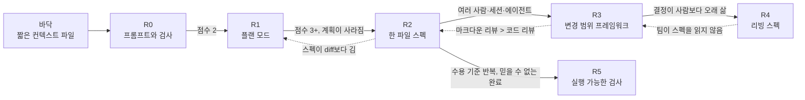
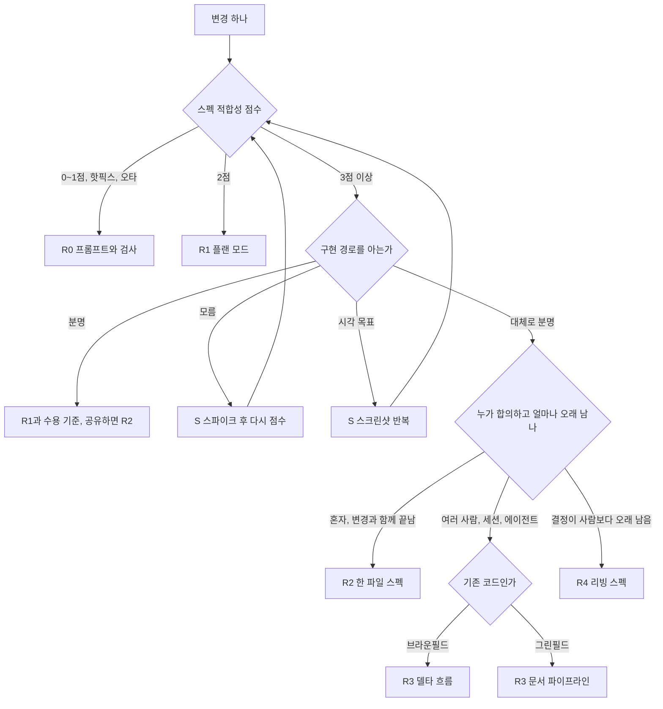

# 11장. 언제 SDD를 쓰지 않는가 — 같은 기능 네 벌, 그리고 변경마다 고르는 사다리

6장부터 10장까지 우리는 부분 환불을 네 번 스펙으로 썼다. 도구 없이 `SPEC.md` 한 장으로, OpenSpec의 변경 폴더로, Spec Kit의 기능 폴더로, Superpowers의 설계 문서와 계획으로. 이제 파일을 세어 보자.

세기 전에 질문 하나를 먼저 던져 두자. 네 벌을 다 써 본 지금, 내 다음 변경에는 무엇을 쓸 것인가? 그리고 무엇을 쓰지 않을 것인가? 스펙 주도 개발(Spec-Driven Development, SDD)을 배우는 책이 마지막 판단 장에서 "쓰지 않는 법"을 다루는 것이 이상하게 들릴 수 있다. 하지만 2장에서 세운 기조를 떠올려 보자. SDD는 모든 작업의 기본값이 아니고 큰 변경마다 고르는 선택지다. 고른다는 말에는 고르지 않을 수도 있다는 뜻이 함께 들어 있다.

## 같은 기능, 네 벌의 스펙

### 네 벌을 나란히

먼저 요구 하나를 골라 네 벌에서 같은 줄을 찾아보자. 환불 기간 규칙이다.

```markdown
<!-- ① 6장 SPEC.md — 6. 규칙 R2, 9. 결정 기록 D4 -->
- R2. If 요청 시각이 `delivered_at`부터 168시간을 넘으면, then the 주문 서비스
  shall `422 REFUND_WINDOW_EXPIRED`로 거절한다.
- D4 (검사 1회차) 환불 기간은 `delivered_at`부터 168시간이다. 날짜가 아니라 시각으로 비교하고, 168시간이 되는 시각까지 받는다.

<!-- ② 8장 OpenSpec — openspec/changes/add-partial-refund/specs/refunds/spec.md (발췌) -->
### Requirement: 환불 기간
The system SHALL `delivered_at`부터 168시간 이내의 환불 요청만 받는다.

#### Scenario: 경계 시각
- GIVEN `delivered_at`이 2026-11-02T10:00:00+09:00인 주문
- WHEN 2026-11-09T10:00:00+09:00에 환불을 요청한다
- THEN 환불이 접수된다

#### Scenario: 기간 경과
- GIVEN 같은 주문
- WHEN 2026-11-09T10:00:01+09:00에 환불을 요청한다
- THEN 422 `REFUND_WINDOW_EXPIRED`를 응답한다

<!-- ③ 9장 Spec Kit — specs/001-partial-refund/spec.md -->
- **FR-002**: System MUST 배송 완료 시각(`delivered_at`)부터 168시간이 지난 요청을 `422 REFUND_WINDOW_EXPIRED`로 거절한다.

<!-- ④ 10장 Superpowers — 설계 문서 Constraints, 계획 Task 2 -->
- 기간: `delivered_at`부터 168시간 이내. 지나면 `422 REFUND_WINDOW_EXPIRED`
- [ ] **Step 1: Write the failing test** — 경과 167시간 59분 → true / 정확히 168시간 → true / 168시간 1초 → false
```

내용은 네 벌 모두 같다. 기준 시각도, 시간 수도, 오류 코드도 같다. 다른 것은 그 결정이 사는 자리다. ①은 EARS 문형으로 실패 조건을 한 문장에 담고, "정확히 168시간은 안인가"라는 경계는 결정 기록 D4에 따로 남겼다. ②는 요구 한 문장에 시나리오를 붙였고, 같은 경계가 "경계 시각" 시나리오의 두 시각으로 굳었다. ③은 번호가 붙은 `MUST` 문장으로 다른 문서가 참조할 수 있게 했지만, 정각이 안인지 밖인지는 "지난"이라는 말에 맡겼다. ④는 그 경계를 계획 Task 2에서 테스트할 값으로 못 박았다. 시그니처와 고정 값을 요구하는 계획 형식이 경계를 드러낸 것이다. ③처럼 경계를 문장에 맡긴 스펙도 수용 테스트로 옮기는 순간 같은 질문을 만난다. 그 질문을 스펙 단계에서 만나느냐 테스트 단계에서 만나느냐의 차이다.

이제 기능 전체를 나란히 놓아 보자. 아래 표는 이 책의 예제 한 건을 네 방식으로 써 본 관찰이다. 같은 과제로 반복해 잰 측정이 아니다.

| 항목 | ① `SPEC.md` (6~7장) | ② OpenSpec (8장) | ③ Spec Kit (9장) | ④ Superpowers (10장) |
|---|---|---|---|---|
| 파일 수 | 1 (계획 파일은 따로) | 변경 폴더에 4 (`proposal.md`, 델타 스펙, `design.md`, `tasks.md`) | 기능 폴더에 8 + 헌법 1 | 2 (설계 문서, 계획) |
| 스펙 분량 (이 책 실물) | `SPEC.md` 132줄 | 델타 스펙 116줄 | `spec.md`만 76줄, 폴더 전체는 그 몇 배 | 설계 문서 50줄 남짓 + 태스크 수에 비례하는 계획 |
| 사람이 읽어야 하는 양 | 한 장 + diff | 네 파일 + diff | 여덟 파일, 그중 plan 단계가 가장 김 | 설계 + 계획 + 태스크마다 리뷰 보고 |
| 강제로 정하게 만든 결정 | 인터뷰가 묻는 만큼, 비목표·결정 기록 절 | 변경 의도 하나, Scope In/Out, 요구마다 시나리오 | 스토리 우선순위와 Independent Test, 측정 가능한 성공 기준, Technical Context, 헌법 대조 | anti-goals, 기각한 접근, 빌더에게 남길 것, 태스크마다 시그니처와 고정 값 |
| 함정을 잡은 곳 | 인가는 인터뷰 질문, 배송비 모순과 기준 시각 빈칸은 검사관 세션 | 6장 결과를 옮겨 와 해소된 채 시작, `validate --strict`는 형식만 점검 | 기준 시각·키 보관은 `[NEEDS CLARIFICATION]`과 clarify, 인가는 헌법 보안 절 | 결과를 바꾸는 질문과 Constraints, 168시간 정각 경계는 계획의 고정 값 |
| 관문 판정자 | 사람(검사 질문), 프로그램(테스트·부팅·`curl`), 분리된 서브에이전트 | 프로그램(`validate`, 형식), 에이전트(`/opsx:verify`, 확장 프로필) | 사람(clarify 답), 에이전트(analyze·converge) | 새 서브에이전트(두 단계 리뷰), 프로그램(TDD) |
| 병합 뒤 스펙 | PR에 첨부하거나 정리 — 스펙 우선형 | 아카이브로 메인 스펙에 병합 — 스펙 고정형 | 기능 폴더가 남지만 다음 기능이 갱신하지 않으면 낡음 — 스펙 우선형 | 설계 문서가 남지만 갱신 장치 없음 — 스펙 우선형 |
| 하네스 이식성 | 어디서나 (평범한 마크다운) | Claude Code·Cursor·Copilot(IDE)·Codex·Gemini·Kiro | 통합 키 43개 | Claude Code·Cursor·Copilot CLI·Codex·Gemini |

표에서 눈에 띄는 줄은 "함정을 잡은 곳"이다. 인가 누락과 문장 사이의 모순을 잡은 것은 네 벌 모두에서 결국 사람이었다. 인터뷰에서 사람이 질문에 답했고, 검사관 세션에서 사람이 충돌을 판정했고, 헌법에 사람이 보안 절을 적었다. 도구가 해 준 일은 그 질문을 던질 자리를 만들어 준 것이다. Ran the Builder의 비교(2026-04, 실무자 1명)에서 계획 단계의 어떤 도구도 인가 누락을 짚지 못했다는 관찰과도 맞아떨어진다.

"사람이 읽어야 하는 양" 줄도 그냥 넘기지 말자. 네 벌 가운데 무엇이 가장 좋으냐는 질문보다, 내가 이번 변경에 읽기 시간을 얼마나 낼 수 있느냐는 질문이 더 정직하다. 9장 첫머리의 Scott Logic 기록에서 에이전트 시간은 33분 30초였고 사람 검토는 3.5시간이었다. 문서가 많을수록 결정은 많이 남지만, 그 결정을 사람이 실제로 읽었을 때만 값이 생긴다. 읽지 않고 승인한 여덟 파일은 읽고 승인한 한 장보다 못하다.

"병합 뒤 스펙" 줄에서는 네 벌 가운데 셋이 스펙 우선형이라는 점이 보인다. 2장에서 대부분의 도구가 실제로는 스펙 우선형이라고 했던 관찰이 우리 예제에서도 그대로 나온 셈이다. 작업이 끝난 뒤에도 스펙을 코드와 함께 고치는 구조를 가진 것은 OpenSpec의 아카이브 하나였다. 그 스펙을 계속 둘지, PR과 함께 보낼지는 다음 장의 질문으로 남겨 두자.

마지막 줄인 하네스 이식성도 가볍게 보지 말자. 네 벌 가운데 어느 하네스에서도 그대로 읽히는 것은 ①뿐이다. 나머지 셋은 공식 지원 범위가 넓지만, 지원한다는 표시가 같은 기능을 보장하지는 않는다. cc-sdd README의 말처럼 스킬을 설치했다고 그 하네스가 전체 흐름을 돌릴 수 있다는 검증이 되지는 않는다. 2026년에만 하네스 종료와 개명 발표가 여러 건 있었다는 점까지 생각하면, 어떤 도구를 쓰든 결정의 원본은 평범한 마크다운으로 저장소에 남기는 편이 안전하다.

이 표를 다른 근거와 겹쳐 읽자. 같은 티켓으로 잰 Uvik 벤치마크(서비스 회사 운영, n=50, 모델 하나, 잡음 대역 ±10%p)에서 잡음 대역 밖으로 나간 도구는 OpenSpec(+12%p) 하나였고, 스펙 드리프트도 OpenSpec 2.4%, Spec Kit 12.5%였다. Superpowers와 플랜 모드 기반의 `SPEC.md` 경로는 그 비교에 아예 없었다. 이 책의 표는 측정이 비어 있는 자리를 관찰로 메울 뿐 순위를 대신하지 않는다. EARS 문형을 파이프라인 안에서 쓰고 싶다면 Kiro 흐름을 Claude Code와 Codex로 옮긴 cc-sdd라는 경로도 있다는 점만 덧붙여 둔다.

## 변경마다 고르는 사다리

### 다섯 번째 선택지: 스펙을 쓰지 않기

네 벌 옆에 다섯 번째 선택지를 놓자. 아무 스펙도 쓰지 않는 것이다. 언제 그래야 할까? 2장과 6장에서 맛본 스펙 적합성 점수가 첫 갈림길이다. 여섯 조건 가운데 참인 것을 센다.

| 번호 | 조건 |
|---|---|
| 1 | 파일 3개 이상을 건드린다 |
| 2 | 수용 기준이 4개 이상이다 |
| 3 | 모듈, 서비스, 저장소 경계를 넘는다 |
| 4 | 스키마나 공개 API를 바꾼다 |
| 5 | 여러 엔지니어나 여러 에이전트가 참여한다 |
| 6 | 규제나 감사 대상이다 |

조건마다 이유가 있다. 파일 수와 경계는 에이전트가 한 번에 머리에 담아야 할 범위를, 수용 기준 수는 빠뜨리기 쉬운 동작의 수를 말한다. 스키마와 공개 API는 되돌리기 비싼 결정이고, 여러 사람과 규제는 결정이 내 머릿속 밖에서도 읽혀야 한다는 뜻이다. 요컨대 점수는 "이 변경에서 추측으로 채워질 빈칸이 몇 개나 될까"를 어림하는 도구다.

Uvik 규칙은 셋 이상이면 스펙을 쓰라고 한다. 0~1점이거나 운영 핫픽스·오타라면 R0, 2점이면 R1, 3점 이상이면 구현 경로가 얼마나 분명한지를 다시 묻는다. 부분 환불은 1~4번이 참이라 4점이었다. 한 가지 주의할 구간이 있다. 2점짜리 변경을 R1로 보내는 규칙은 참고 보고서의 추론이고, 이 구간을 시험한 출처는 없다. 에이전트가 내가 보기 전에 엉뚱한 길로 간 적이 있는 종류의 변경이라면 1점이어도 R1로 올려 보는 식으로, 이 구간은 처음부터 내 기록으로 고쳐 쓰겠다고 생각하는 편이 낫다.

점수가 첫 갈림길이라면, 그다음은 사다리다. 표 맨 아래의 바닥층은 따로 오르는 단이라기보다 모든 단 밑에 깔리는 층이다. 같은 교정을 두 번 입력했다면 R0 변경을 하는 중에도 컨텍스트 파일에 한 줄을 더할 때다. 이 층을 어떻게 짧게 유지할지는 12장에서 다시 본다. 참고 보고서는 변경 크기에 따라 바닥층과 R0~R5의 단을 두고, 단마다 올라갈 신호와 머무는 동안 할 일, 내려올 신호를 적었다.

| 단 | 이름 | 진입 신호 | 머무는 동안 할 일 | 내리는 신호 |
|---|---|---|---|---|
| 바닥 | 짧은 컨텍스트 파일 | 같은 교정을 두 번 입력함 | 에이전트가 추론할 수 없는 비표준 사실만 | 약 150줄을 넘음 |
| R0 | 프롬프트와 검사 | 오타, 한 줄 수정, 핫픽스 | 수용 기준 1~2문장 + 변경을 증명할 명령 하나 | 없음 |
| R1 | 플랜 모드 | 점수 2점 | 계획 전에 질문받기, 이름·경로·경계 사례를 직접 확인 | R0에서 잘 병합되던 변경에 시간만 더함 |
| R2 | 한 파일 스펙 | 3점 이상, 경로가 대체로 분명, 계획이 세션 사이에 사라짐 | 인터뷰 → `SPEC.md` → 새 세션 → diff 대조 | 스펙이 diff보다 길어짐 |
| R3 | 변경 범위 프레임워크 | R2가 관문을 통과했고 여러 사람·세션·에이전트 | 변경 모양에 맞는 프레임워크 하나만 | 마크다운 리뷰가 코드 리뷰보다 길고 수용률 그대로 |
| R4 | 리빙 스펙 | 결정이 세션이나 사람보다 오래 살아야 함 | 시스템 전체가 아니라 모듈 하나, 소유자와 보관 계획 | 스펙 리뷰가 팀을 막음 |
| R5 | 실행 가능한 검사 | 수용 기준 반복, 규제, 믿을 수 없는 "완료" | 그 동작이 없으면 실패하는 검사를 에이전트 밖에 | 동작이 틀렸는데 검사가 통과, 유지 비용이 잡은 결함보다 큼 |

여기서 꼭 짚어 둘 것이 있다. 이 표의 모든 문턱값은 보고서가 정한 시작값이고 추론이다. 근거 쪽에서 가장 강한 신호는 변경 크기다. Uvik에서 수정 파일 1~2개짜리 티켓은 대조군과 최고 스펙 조건이 모두 85%로 같았고, 6개 이상에서는 대조군 50%, 최고 스펙 조건 80%로 벌어졌다. 하지만 그 측정도 한 회사의 브라운필드 Python 티켓 50개와 모델 하나에서 나왔다. 사다리는 내 기록으로 고쳐 쓸 초안으로 받아 두자.

보고서는 사다리를 오르내리는 규칙도 다섯 개로 정리했다. 경력이 아니라 변경마다 고른다. 변경 크기가 첫 갈림길이다. 증거로 올린다. 한 단은 내 변경에서 관문을 통과한 뒤에야 내 천장이 된다. 내려가는 것도 정상 결과다. 오래 남길 부분은 저장소의 평범한 마크다운에 둔다. 셋째 규칙이 특히 중요하다. R2가 내 저장소에서 관문을 통과한 기록이 있어야 비로소 R3를 시험할 자격이 생긴다는 뜻이다. 도구를 설치한 것만으로는 그 단에 서지 못한다.



그림 1. 변경 크기 사다리의 단별 진입 신호(실선)와 하향 신호(점선)

### 예제 변경을 사다리에 올리기

추상적인 표보다 우리 저장소의 변경 다섯 개로 따져 본다. 부분 환불(C2), 8장 후반의 후속 변경(C3), 7장에서 씨앗을 심은 불변식 검사(C4)에 작은 변경 둘(C0, C1)을 더해 하나씩 단에 올린다.

C0은 오류 메시지의 "환뷸"을 "환불"로 고치는 일이다. 4장에서 Kiro 버그픽스 스펙의 세 문형으로 써 본 바로 그 변경이고, 그때 미뤄 둔 질문, 곧 오타 하나에 문서 세 개가 맞느냐에 대한 답이 여기 있다. 점수는 0점, R0이다. 스펙은 쓰지 않는다. 그래도 적을 것은 있다. 수용 기준 한두 문장과 변경을 증명할 명령 하나면 된다.

```text
수용 기준: 환불 관련 오류 메시지에 "환뷸"이 남지 않는다. 메시지 키와 다른 문구는 바뀌지 않는다.
증명 명령: grep -rn "환뷸" src/   # 결과 0줄
          ./gradlew test
```

이 오타 하나에 OpenSpec 변경 폴더를 만들거나 Spec Kit 아홉 명령을 돌린다고 상상해 보자. 끔찍한 낭비다. OpenSpec FAQ도 한 글자 오타 수정에는 절차 부담이 맞지 않는다고 적는다.

C1은 전체 취소 사유에 200자 길이 검증을 더하는 일이다. 건드리는 파일은 요청 객체와 테스트 정도라 점수는 1~2점, R1 플랜 모드가 알맞다. 1점으로 세면 규칙상 R0이지만, 아래에서 볼 "문자 수인가 바이트 수인가"처럼 에이전트가 조용히 골라 버릴 질문이 있어서 앞에서 말한 대로 R1로 올렸다. R1에서 할 일은 계획 전에 질문을 받는 것, 그리고 계획 속 이름·경로·경계 사례를 직접 읽어 확인하는 것이다. Claude Code라면 프롬프트 앞에 `/plan`을 붙이고 "계획을 쓰기 전에 불분명한 점을 먼저 질문해 줘"라고 덧붙인다. 7장에서처럼 `plansDirectory`를 `"./docs/plans"`로 두면 계획이 저장소 안에 남는다.

```markdown
<!-- docs/plans/cancel-reason-length.md — 플랜 모드 계획, 이 책 예제로 채운 예시(발췌) -->
# 전체 취소 사유 200자 길이 검증

## 계획 전에 확인한 것
- 200자는 바이트가 아니라 문자 수로 센다. 앞뒤 공백을 자른 뒤 센다
- 초과하면 기존 취소 API의 입력 검증 오류 응답 형식을 그대로 따른다
- 배송 전·전액이라는 취소 조건은 바꾸지 않는다

## 변경
1. 취소 요청 객체의 사유 필드에 길이 검증 추가
2. 테스트 추가: 200자는 통과, 201자는 거절
3. 기존 취소 테스트가 그대로 통과하는지 확인

## 증명
- ./gradlew test --tests '*CancelOrder*'
```

"문자 수인가 바이트 수인가"는 한글 사유에서 결과를 바꾸는 질문이다. 질문 없이 계획을 받았다면 에이전트가 둘 중 하나를 조용히 골랐을 것이다. R1의 가치는 이 한 줄에 있다.

C2 부분 환불은 4점이다. 구현 경로가 대체로 분명하고 혼자 한다면 R2 한 파일 스펙, 즉 6~7장의 경로가 끝이다. 팀이 함께 쓰고 여러 세션에 걸친다면 R3로 올라가 기존 코드에 붙는 델타 흐름(8장)이나 합의용 파이프라인(9장)을 고른다. C3 환불 기간 확장과 사유 코드 도입은 3점이고, 이미 리빙 스펙이 있는 영역을 고치는 일이라 8장 후반에서 본 R3 델타가 제자리다. 같은 변경을 R2로 한다면 어떨까? 새 `SPEC.md`에 "168시간을 336시간으로"라고 쓰면 되지만, 그 문장은 병합과 함께 사라지고 6장의 `SPEC.md`에는 여전히 168시간이 남는다. 이미 스펙을 남겨 두기로 한 영역이라면, 바뀐 부분만 적어 남은 스펙에 합치는 델타가 가장 싼 길이다. 반대로 C2를 처음 만들 때 스펙을 남기지 않기로 했다면 C3도 R2로 충분하다. 단은 변경 하나만 보고 정하는 것이 아니라 그 영역이 지금까지 어떻게 기록돼 왔는지와 함께 정해진다.

C4는 축이 다르다. 동시 환불 경쟁 조건과 "전 항목 환불 합계 = 결제 금액 − 배송비" 불변식은 문장을 아무리 다듬어도 지켜졌는지 눈으로 확인하기 어렵다. 같은 수용 기준이 리뷰마다 반복되고, 에이전트의 "완료" 보고를 믿을 수 없는 자리다. 그래서 R5로 간다. 7장에서 심어 둔 속성 기반 테스트 하나를 키워, 무작위 주문 구성과 동시 요청에서도 불변식이 깨지지 않는지 검사한다. 이 검사는 검사받는 에이전트 밖에, 그 동작이 없으면 실패하도록 둔다.

### 두 번째 축: 경로 확실성

점수가 3점 이상이면 결정 트리는 하나를 더 묻는다. 구현 경로를 아는가?

Loglass(Zenn, 2025-10-08)는 작업을 경로가 분명한 것, 대체로 분명한 것, 모르는 것으로 나눴고 Spec Kit은 가운데에서만 이득이 있었다고 보고했다. 경로가 분명하면 플랜 모드로 충분하고, 경로를 모르면 생성된 계획을 사람이 검토할 수 없다는 것이다. 약 2개월 동안 여러 도구를 써 본 y-hirakaw(Zenn, 2026-03-15)도 리팩터링과 잘 아는 변경에는 맞지만 새 기술이나 낯선 스택에서는 설계를 판단할 수 없어 맞지 않았다고 했다. 둘 다 실무자 주장이다.

그런데 Kiro 문서는 정반대로 권한다. 낯선 영역일수록 승인 관문이 있는 표준 Feature 스펙을 쓰라는 것이다. 어느 쪽이 맞을까? 참고 보고서의 조정안은 두 주장의 공통 조건을 찾는다. 스펙을 읽는 사람이 계획의 옳고 그름을 판단할 수 있는가. 판단할 수 있다면 승인 관문이 쓸모 있고, 판단할 수 없다면 관문은 도장 찍기가 된다.

부분 환불에 이 질문을 대 보자. 우리는 Spring Boot와 PostgreSQL 저장소를 알고, 환불 규칙도 3장과 6장에서 문장으로 정리했다. 계획을 읽고 "여기서 행 잠금이 빠졌다"고 말할 수 있는 사람이 있다. 그래서 경로가 대체로 분명한 쪽에 놓였다. 같은 기능을 처음 보는 결제 대행사 SDK 위에 올린다면 이야기가 달라진다. 계획이 SDK 호출 순서를 그럴듯하게 적어도, 그것이 맞는지 판단할 사람이 없다.

판단할 수 없을 때는 스파이크 트랙으로 비켜 가자. 시간 상자를 정한 프로토타입으로 경로를 먼저 배우고, 배운 것을 적은 뒤 점수를 다시 매긴다. 보고서는 사다리 옆에 곁가지 트랙을 둘 더 둔다. 감사 요구가 있는 변경은 G 트랙으로 가서 요구를 잠그고 CI 관문과 사람의 결정 지점을 둔다. 몇 시간 넘게 무인으로 돌릴 작업은 H 트랙으로 가서, 통과 표시가 있는 기능 목록과 진행 파일을 두고 루프마다 항목 하나를 새 컨텍스트로 처리한다. 부분 환불에는 둘 다 해당하지 않지만, 결제 규정 감사가 붙는 날이 오면 G 트랙을 떠올리자.

시각적 목표나 주관적 목표도 비슷하다. .NET Razor Pages 화면 재설계에 OpenSpec을 썼더니 약 2시간 뒤 새 화면이 원본과 거의 같았고 평범한 지시 파일이 더 빠르고 쌌다는 보고(단일 실험의 주장)가 있다. 화면은 스펙 문장보다 스크린샷을 보며 작게 반복하는 편이 낫다.

## 내려가기와 기록하기

### 내려가는 것도 정상이다

사다리에서는 내려가는 것도 움직임이다. 방법이 아프기 시작하면 층을 빼는 것 역시 같은 사다리 위에서 일어나는 일이다. 참고 보고서가 정리한 하향 신호 가운데 자주 만날 것만 추려 보자.

| 신호 | 내려갈 단 | 먼저 할 일 |
|---|---|---|
| 0~2점 변경이 스펙을 거치고, 스펙 부담이 에이전트 실행 시간보다 큼 | R0 또는 R1 | 적합성 점수로 다시 보냄 |
| 마크다운 리뷰가 2주 동안 코드 리뷰보다 길고 수용률 변화 없음 | R3 → R2 | 문서 수 줄이기, 요구사항은 꼼꼼히·설계는 훑기, 델타 흐름이나 `SPEC.md` |
| 스펙이 코드나 diff보다 큼 | R2 | 이번에 바꿀 부분만 |
| 같은 실패가 두 번 | 단 유지, 바닥층이나 R5로 | 스펙 문장을 늘리지 않고 테스트·훅·규칙으로 |
| 큰 스펙을 한 번에 넣었더니 항목이 빠짐 | R2 → R1 | 나누고, 플랜 모드·할 일 목록·서브에이전트 |
| 팀이 스펙을 읽지 않음, 실험 중 스펙이 낡음 | R4 → R3 | 빌드 뒤 버리는 스펙 |
| 2주 동안 안 쓴 플러그인 | 플러그인 제거 | 평범한 파일 설정과 비교 |

넷째 줄을 눈여겨보자. 같은 실패가 두 번 나면 스펙에 문장을 한 줄 더 쓰고 싶어진다. 그 충동을 참고 테스트나 훅으로 옮기라는 신호다. 문장은 다음 세션에서 잊힐 수 있지만, 실패하는 테스트는 잊히지 않는다.

내려갈 때 빼지 말아야 할 것도 있다. 방법을 버린 팀들도 의도를 적는 습관은 지키고 그 주변 층만 뺐다. 하향은 대개 무거운 프레임워크에서 가벼운 스펙으로 가는 움직임이고, 스펙을 아예 없애는 경우는 드물다. 사람이 소유한 수용 테스트도 끝까지 남긴다.

내려간 실제 사례도 있다. Talk Think Do(2026-06)는 OpenSpec을 쓰다 중단했다. 저장소 안의 스펙이 계획을 엔지니어링 도구에 묶어 버려서 이해관계자가 범위와 비용 변화를 볼 수 없었기 때문이다. 이 팀은 계획을 작업 항목으로 옮기면서도 계획 규율 자체는 유지했다. 위 표에는 없는 신호지만 "이해관계자가 범위·비용 변화를 못 봄"이라는 하향 신호가 정확히 이 경우다. 단은 그대로 두고, 계획이 사는 곳만 바꾼 것이다.

제조사들도 이미 내려가는 길을 냈다는 점이 흥미롭다. Spec Kit은 버그 수정과 아이디어 평가 진입점을, Kiro는 퀵 스펙과 버그픽스 스펙과 플랜 모드를, BMAD는 "You don't need BMad for an obvious, low-risk edit."라는 문장을 내놓았다. Superpowers는 작은 변경을 채팅 합의로 끝내고, cc-sdd의 discovery는 스펙이 필요 없다고 답할 수 있다. Spec Kit README에는 이런 문장도 있다. "Stopping with a documented reason is also a useful outcome." 이유를 적고 멈추는 것도 결과라는 말이다.

### 내 기록으로 고르기

사다리의 문턱값을 내 것으로 바꾸는 방법은 하나다. 기록하는 것이다. 참고 보고서가 제안한 최소 시험 계획은 이렇다. 먼저 P0 기준선으로 1주 동안 평소대로 일하며 변경 10개 이상을 기록한다. 다음 1주는 P1, 점수 2점 변경에 플랜 모드를 쓴다. 그다음 2주는 3점 이상 변경을 R1과 R2로 나눠 비교한다. 지표는 셋이다. 첫 리뷰에서 그대로 받아들여진 비율, 다시 손본 비율, 그리고 스펙에 든 부담이다.

2장 끝에서 지난주 변경 다섯 개의 수정 파일 수를 세어 두자고 했다. 그 숫자가 이 기록의 `files` 열 첫 줄이 된다. 머리글은 아래처럼 시작하면 된다. 값은 이 책 예제로 채운 예시다.

```csv
date,change,files,fit_score,rung,reprompts,first_review_pass,review_min,spec_min
2026-11-16,C0 환불 메시지 오타,1,0,R0,0,true,2,0
2026-11-17,C1 취소 사유 길이 검증,2,1,R1,1,true,10,4
2026-11-19,C2 부분 환불,9,4,R2,3,false,55,40
```

열마다 뜻을 정해 두자. `reprompts`는 첫 지시 뒤에 방향을 바로잡으려고 다시 지시한 횟수다. `first_review_pass`는 리뷰에서 수정 요청 없이 받아들여졌는지다. `review_min`과 `spec_min`은 사람이 리뷰와 스펙에 쓴 분 단위 시간이다. 6장 끝에서 적어 둔 인터뷰 시간은 `spec_min` 열에 들어가고, 질문 수는 그 변경 줄 옆에 메모로 남겨 두면 된다. 스펙 부담은 `spec_min`이 에이전트 실행 시간이나 `review_min`에 비해 얼마나 큰지로 본다. 하향 신호 표의 첫 줄이 바로 이 비교에서 나온다.

왜 굳이 기록할까? 체감은 믿기 어렵기 때문이다. METR의 무작위 통제 실험(숙련 오픈소스 개발자 16명, 과제 246개)에서 AI를 쓰면 완료 시간이 19% 늘었는데, 개발자들은 20% 줄었다고 믿었다. SDD도 마찬가지다. 스펙을 쓰고 나면 일이 잘된 것 같은 느낌이 든다. 그 느낌이 `first_review_pass` 열에서도 보이는지 확인하자.

4주가 지나면 표를 단별로 묶어 보자. 이 책의 제안은 단순하다. 3점 이상 변경에서 R2의 첫 리뷰 수용률이 R1보다 눈에 띄게 높지 않다면, 그 종류의 변경은 R1에 머문다. 높다면 R2가 내 천장이 되고, 그때 비로소 R3를 시험해 볼 근거가 생긴다. 변경 열 개 남짓한 기록으로 통계적 결론을 낼 수는 없지만, "느낌상 좋았다"보다는 훨씬 단단한 출발점이다.

팀 저장소에서 혼자 시험한다면 `SPEC.md`와 계획 파일을 `.git/info/exclude`에 넣고, PR 본문에는 수용 기준과 바뀌지 않을 동작만 옮기자. 플러그인은 user나 local 범위로 설치해 동료의 환경을 건드리지 않는 편이 낫다.

### 이 장의 핵심

- 같은 기능을 네 방식으로 써 보면 내용은 같고 결정이 사는 자리가 다르다. 인가 누락과 모순을 잡은 것은 네 벌 모두 사람이었다.
- 스펙 적합성 점수가 첫 갈림길이다. 0~1점이면 R0, 2점이면 R1, 3점 이상이면 구현 경로를 다시 묻는다.
- 사다리의 모든 문턱값은 시작값이다. 크기 신호가 가장 강하지만 그 측정도 조건이 좁다.
- 경로를 판단할 수 없으면 승인 관문은 도장 찍기가 된다. 스파이크로 먼저 배우고 점수를 다시 매긴다.
- 내려가는 것도 정상이다. 다만 의도를 적는 습관과 사람이 소유한 수용 테스트는 남긴다.

### 결정 트리 한 장



그림 2. 변경 하나에서 단을 고르는 결정 트리 (참고 보고서의 사다리를 옮김, 문턱값은 시작값)

다음 변경을 이 트리 맨 위에 올려 보자. 어느 끝에 닿든, 내려가는 것도 정상 결과다.
