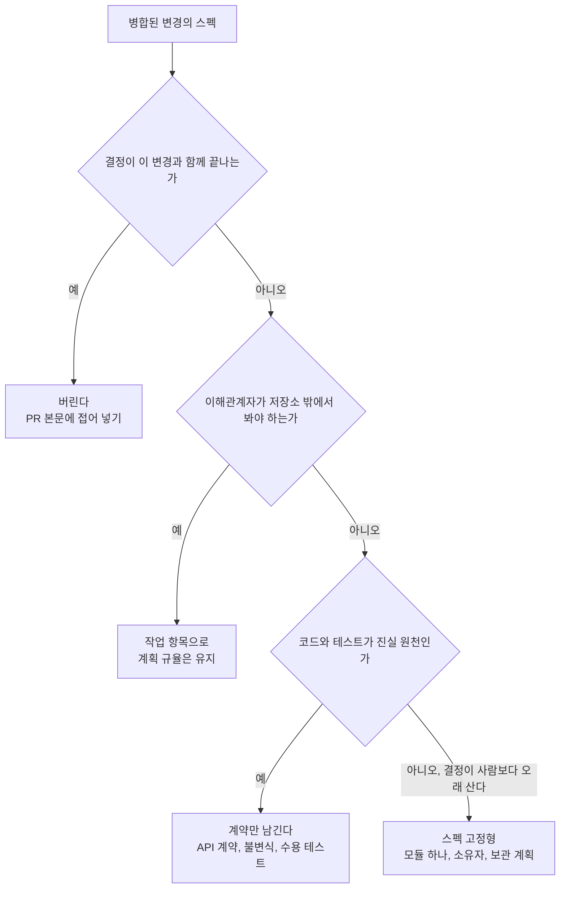
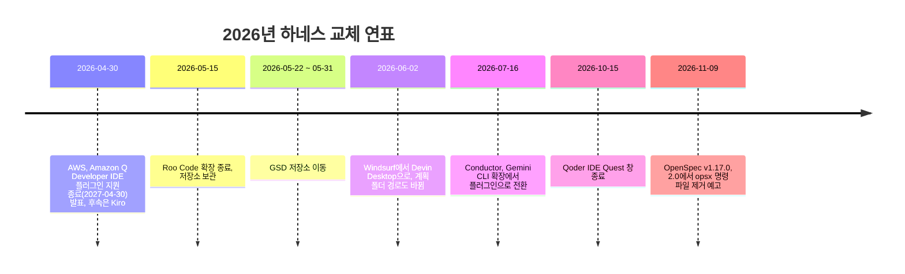

# 12장. 오래 남는 것만 남긴다 — 팀, 드리프트, 그리고 다음 모델

2026년 8월, 반년 가까이 Spec Kit으로 개발해 온 한 개발자가 GPTers에 회고를 올렸다. 닉네임은 황금호랑이. 회고를 쓰면서 그는 자기가 쓰던 검수 스킬을 다시 나눠 봤다. 만들기 전에 쓰는 것(`clarify`, `checklist`)과 만든 뒤에 쓰는 것(`analyze`, `converge`)이다. 그리고 앞의 둘을 거의 쓰지 않았다는 사실을 깨달았다. 반년 동안 쌓아 온 신뢰가 사실은 검수 단계의 절반을 건너뛴 위에 서 있었던 것이다. 그가 내린 결론의 요지는 단순하다. 검수할 수 있는 것은 파일뿐이다. 맥락과 결정과 제약을 채팅에 흘려보내지 말고 스펙·계획·노트 파일로 남겨 Git으로 공유해야, 나중에 누군가 그것을 검수할 수 있다.

이 회고는 이 책이 걸어온 길을 거꾸로 비춘다. 1부에서 우리는 에이전트가 빈칸을 추측으로 채운다는 데서 출발해 스펙 주도 개발(Spec-Driven Development, SDD)을 정의했고, 스펙이 작업 뒤에 어떻게 되느냐로 방법들을 갈랐고, 좋은 스펙 문장을 해부했다. 2부에서는 문서로 통제하는 도구와 습관으로 통제하는 도구를 지도 위에 올렸다. 3부에서는 도구 없이 인터뷰와 `SPEC.md`와 검증 루프를 손으로 돌렸고, 4부에서는 같은 부분 환불을 OpenSpec, Spec Kit, Superpowers로 다시 썼다. 11장에서는 네 벌을 나란히 놓고, 쓰지 않는 선택지까지 포함한 사다리를 세웠다.

여기까지는 대체로 혼자, 그리고 변경 하나의 시간 안에서 일어난 일이었다. 그렇다면 이 방식을 팀으로 가져가고 시간이 흐르면 무엇이 남을까? 황금호랑이의 결론을 이 장의 기준으로 삼자. 남길 것은 파일로 남기고, 파일로 남길 가치가 없는 것은 과감히 버린다.

## 무엇을 얼마나 오래 남길까

### 스펙의 수명을 정한다

변경이 병합된 다음 그 스펙은 어디로 가야 할까? 1장 끝에 남겨 둔 이 질문에 2장은 수명의 세 수준으로 답했다. 이제는 그 답을 팀 규칙으로 바꿀 차례다. 참고 보고서는 선택지를 넷으로 정리한다. 버린다, 스펙 고정형으로 유지한다, 계약만 남긴다, 저장소 밖 작업 항목으로 옮긴다.

| 선택 | 어울리는 때 | 이 책 예제에서 | 근거 |
|---|---|---|---|
| 버린다 (PR에 첨부) | 결정이 변경과 함께 끝난다 | C1 취소 사유 검증의 계획 | Brody는 계획을 PR 본문 `<details>`에 접어 넣음, TOKIUM은 구현 뒤 문서를 지움 |
| 스펙 고정형으로 유지 | 결정이 세션이나 사람보다 오래 살아야 한다 | 환불 모듈의 리빙 스펙(8장 아카이브) | Spec Kit #620 참여자들은 하나로 합친 최신 스펙을 원함 |
| 계약만 남긴다 | 코드가 진실 원천이고 부분 사이 약속만 지키면 된다 | `contracts/refunds.yaml`, 안분 불변식과 수용 테스트 | cc-sdd "Code remains the source of truth." |
| 저장소 밖 작업 항목 | 이해관계자가 범위와 비용 변화를 봐야 한다 | 운영팀과 공유하는 환불 기능 일정 | Talk Think Do가 계획을 작업 항목으로 옮김 |

이 선택을 두고 현장의 의견은 실제로 갈린다. 남기자는 쪽은 스펙을 프로젝트와 함께 진화하는 산출물로 본다. GitHub의 Spec Kit 출시 글이 그렇고, Marc Brooker는 스펙을 버전 관리되는 리빙 산출물로 불렀으며, LayerX는 현실적인 목표가 스펙 고정형이라고 적었다. 버리자는 쪽에서는 유지 비용이 생산성을 갉아먹었다는 GeekNews 댓글과, 요청하지 않은 지식 베이스가 기억을 여러 층에 흩어 놓는다며 스펙을 쓰고 빌드하는 두 단계만 남긴 "Rotten specs" 글이 있다. 어느 쪽이 옳은지보다 중요한 것은 변경을 시작할 때 미리 정해 두는 일이다. 병합한 뒤에 "이 스펙을 어떻게 하지?"라고 묻기 시작하면 대개 아무도 고치지 않는 파일이 남는다.

넷 가운데 하나만 고를 필요는 없다. 부분 환불이라면 계획 파일은 PR에 접어 넣고, 환불 규칙은 OpenSpec 메인 스펙이나 `docs/specs/` 아래 한 파일로 남기고, API 계약과 불변식 테스트는 코드와 함께 둘 수 있다. Brody의 분리법도 쓸모 있다. 기존 시스템을 설명한 연구 문서는 다음 변경에서 다시 쓰고, 변경 하나를 위한 계획 문서는 일회용으로 다룬다.

리빙 스펙을 고른다면 두 가지를 함께 정하자. 하나는 범위다. 리빙 스펙은 모듈 하나로 좁히고, 시스템 전체를 덮으려 하지 말자. 다른 하나는 소유자와 보관 계획이다. 누가 그 스펙을 고치고, 언제 낡았다고 선언하고 정리할지를 정해 두지 않으면, 아무도 믿지 않는 큰 문서가 하나 더 생길 뿐이다.



그림 1. 병합 뒤 스펙의 수명을 정하는 흐름

### 드리프트와 맞선다

스펙을 남기기로 했다면 그다음 적은 드리프트다. 스펙과 코드가 조용히 어긋나는 일이다. 실무자들은 스펙과 코드를 맞춰 보는 일을 주로 작업이 끝나는 시점에만 한다는 조사도 있다. 그 사이에 어긋남이 쌓인다.

맞서는 장치는 이미 책 곳곳에서 만났다. 가장 단순한 것은 같은 PR 규칙이다. 동작을 바꾸는 코드 변경과 그 동작을 적은 스펙 변경을 같은 PR에 담는다. 9장 헌법의 Development Workflow 절에 적어 둔 바로 그 규칙이다. 완료 시점에는 수렴 검사를 돌린다. Spec Kit의 converge가 그 자리에 있다. 변경이 끝날 때 델타를 메인 스펙에 병합하는 OpenSpec의 아카이브도 같은 문제를 다른 방향에서 푼다. 버그가 나면 코드를 고치기 전에 "구현이 틀렸나, 스펙이 틀렸나"부터 묻자. OpenSpec 이슈 #821이 제안한 순서다.

사람이 손으로 관리하는 연결은 최소로 줄이는 편이 낫다. 개인 SDD 프레임워크를 설계한 redism의 노트(2026-04)는 문서 사이 링크 가운데 사람이 관리하는 것은 `parent` 하나만 두고, `children`은 스크립트로 계산해 어긋날 수 없게 했다. 흥미롭게도 그 설계 노트 자체에 결정 045와 어긋나는 낡은 문장이 남아 있다. 자기 승인과 검증 없는 완료 선언을 구조적으로 막겠다고 공들인 문서조차 드리프트를 피하지 못한 것이다. 드리프트는 의지가 아니라 장치로 막아야 한다는 것을 이보다 잘 보여 주는 실물은 드물다.

한 가지 위안도 있다. 스펙을 남기지 않기로 한 변경에는 드리프트도 없다. 버린 스펙은 낡을 일이 없기 때문이다. 앞 절에서 수명을 먼저 정하자고 한 이유가 여기에도 있다. 남길 스펙이 적을수록 지켜야 할 연결도 적다. Radar Vol 35가 AI가 고친 산문을 의미 단위로 검토하는 기법을 Assess에 올린 것도 같은 고민의 연장이다. 남긴 문서가 많아질수록 그 문서를 누가, 어떻게 다시 읽을지가 새 문제로 떠오른다.

팀이 바로 쓸 수 있는 장치로 PR 템플릿에 항목 몇 개를 더해 보자. 아래는 이 책 예제로 채운 예시다.

```markdown
## 스펙 변경
- [ ] 이 PR은 동작을 바꾼다 → 같은 PR에 스펙(또는 델타) 변경이 있다: `docs/specs/...`
- [ ] 이 PR은 동작을 바꾸지 않는다 (리팩터링, 오타, 테스트만)
- 바뀌지 않을 동작: 예) 전체 취소 `POST /orders/{orderId}/cancel`은 배송 전·전액 그대로
- 수용 기준 → 테스트: 예) "책 B 1권 환불 → 10,800원" → `PartialRefundAcceptanceTest`
- 버그 수정이라면: [ ] 구현 오류  [ ] 스펙 오류 (스펙 오류면 스펙부터 고쳤다)

<details><summary>계획 파일</summary>

(plans/ 아래 계획을 여기에 붙인다)

</details>
```

## 사람과 도구가 바뀔 때

### 팀으로 가져갈 때

혼자 잘 되던 방식이 팀에서도 잘 될까? 조심스럽게 보자. 공개 저장소의 스펙 파일을 채굴한 연구에서 스펙 파일의 98.3%는 저자가 한 명이었다. 팀이 스펙을 함께 검토하는 모습은 조직 환경에서만 보였다. 팀의 이득은 저절로 생기지 않고, 공유된 절차가 있어야 생긴다는 뜻이다.

Asana의 3개월 보고(2026-09, 팀 자체 보고)는 그 절차의 이득과 비용을 함께 보여 준다. 엔지니어 약 절반이 시도했고, 주간 사용자는 30~50명이었다. Admin Console 마이그레이션에서는 설정 66개, 마이그레이션 약 150건 가운데 91%가 수정이 필요 없었고, 계획보다 한 달 넘게 빨리 출시했다. 하지만 인프라 팀에서는 스펙 검토가 병목이 됐다. 데이터 마이그레이션에서는 두 작업이 서로 경쟁해 중복 필드를 만들 수 있었는데, 스펙이 그 결함을 그대로 코드와 테스트로 옮겼다. 팀은 구현을 멈추고 한 쪽짜리 설계 문서와 동료 의견으로 돌아갔다. 주당 PR 38% 증가나 구현 코드 추가량 약 2.66배 같은 숫자는 통제 비교가 아니어서 확인된 실패라기보다 위험 신호로 읽어야 한다. 그리고 보고서는 완료된 스펙에 소유자와 보관 계획이 필요하다고 결론지었다.

이 사례에서 두 가지를 가져가자. 하나는 스펙 리뷰도 사람의 시간을 쓰는 일이라 병목이 될 수 있다는 점이다. 11장의 하향 신호 가운데 "스펙 리뷰가 팀을 막음"이 바로 이것이다. 다른 하나는 스펙이 틀리면 그 틀림이 테스트까지 따라간다는 점이다. 스펙에서 나온 테스트가 통과했다고 의도가 맞았다는 보장은 없다.

그렇다면 팀은 스펙 리뷰를 어떻게 나눠야 할까? 11장의 하향 신호 표가 실마리를 준다. 마크다운 리뷰가 코드 리뷰보다 길어질 때 먼저 할 일로 "요구사항은 꼼꼼히, 설계는 훑기"가 적혀 있었다. 팀 규칙으로 옮기면 이렇다. 수용 기준과 바뀌지 않을 동작은 리뷰어 한 명이 줄 단위로 읽고 서명한다. 설계와 계획은 작성자가 책임지고, 리뷰어는 기각한 대안과 위험한 결정만 훑는다. Asana가 병목을 겪은 뒤 돌아간 한 쪽짜리 설계 문서와 동료 의견도 결국 사람이 꼼꼼히 읽을 분량을 줄이는 쪽이었다.

팀에 주니어가 있다면 한 가지를 더 챙기자. diff를 받기 전에 세 질문으로 스스로 점검하게 한다. 이 변경은 무엇을 하는가, 왜 이 방법인가, 어떻게 실패할 수 있는가. 각각 0~3점으로 매겨 본다. 테스트가 실패하면 먼저 손으로 디버깅해 보고, 결과를 확인할 수 있을 때만 위임하고, 수용 테스트는 직접 쓰거나 검토한다. 근거는 Anthropic의 무작위 통제 실험(엔지니어 52명)이다. AI를 쓴 그룹의 이해도 퀴즈 점수는 50%로 직접 코딩한 그룹의 67%보다 낮았고, 격차는 디버깅에서 가장 컸다. 다만 이 연구가 시험한 것은 SDD가 아닌 일반 AI 코딩이라는 점을 함께 적어 두자.

### 바닥층 다시 보기

11장에서 바닥층은 모든 단 밑에 깔린다고 했다. 그 바닥층, 즉 `CLAUDE.md`나 `AGENTS.md` 같은 컨텍스트 파일은 팀으로 갈수록 쉽게 불어난다. 누군가 실수할 때마다 한 줄씩 더해지기 때문이다. Thoughtworks Technology Radar Vol 35(2026-11)가 에이전트 지시문 비대를 Caution에 올리며 내린 처방은 규칙을 훅과 검사로 옮기고 모델이 바뀔 때마다 다시 평가하라는 것이었다.

측정은 엇갈린다. Gloaguen 등의 연구에서는 컨텍스트 파일이 성공률을 대체로 올리지 못했고 추론 비용을 평균 20% 넘게 올렸으며, 저장소 개요는 도움이 되지 않았다. Lulla 등의 연구(저장소 10개, PR 124개)에서는 런타임 중앙값이 28.64%, 출력 토큰이 16.58% 줄었고 완료율은 비슷했다. 설정과 지표가 달라서 어느 쪽이 틀렸다고 말할 수는 없다. 두 결과를 함께 지키는 방법은 이렇다. 에이전트가 스스로 추론할 수 없는 비표준 관행만 적고, 저장소 개요는 빼고, 파일을 바꾸기 전후를 잰다.

현장 기록도 같은 방향을 가리킨다. 한 커뮤니티 사용자는 항상 읽히는 지시 파일을 752줄에서 약 40줄로 줄이고 세부 규칙은 필요할 때만 읽는 파일로 옮겨 세션당 약 35%의 컨텍스트를 아꼈다고 보고했다(자기 보고). 약 150줄을 넘으면 나누라는 실무자 경험칙도 있다. 그리고 공개 저장소의 지시문을 조사한 연구에서는 지시의 74.0%가 이유를 적지 않았다. 이유가 없는 규칙은 지켜야 할 때와 아닐 때를 에이전트가 구분할 수 없다.

Claude Code 모범 사례가 권하는 내용은 검증 명령, 오해하기 쉬운 코드, 저장소에 없는 결정, 두 번 고친 것 정도다. 예외 없이 지켜야 하는 규칙은 훅으로 옮긴다. 이 기준으로 `bookshop-orders`의 `CLAUDE.md`를 써 보면 이 정도면 충분하다. 이 책 예제로 채운 예시다.

```markdown
# bookshop-orders — 에이전트용 메모

## 검증 명령
- 테스트: `./gradlew test`
- 부팅 확인: `./gradlew bootRun`이 오류 없이 뜨는지 본다. 테스트 통과만으로 완료라고 하지 않는다
- 마이그레이션: 새 스크립트는 적용과 되돌리기를 둘 다 돌려 본다

## 오해하기 쉬운 것
- 금액은 원 단위 `long`이다. `double`로 바꾸지 않는다 (1원 오차가 정산 분쟁이 된다)
- `POST /orders/{orderId}/cancel`은 배송 전·전액 전용이다. 부분 환불은 `refund` 패키지다
- 쿠폰 안분의 1원 차액은 마지막으로 환불되는 항목이 떠안는다. 항목마다 반올림하지 않는다

## 저장소에 없는 결정
- 환불 기간은 `delivered_at`부터 168시간으로 잰다. 날짜 경계와 시간대는 쓰지 않는다 (결정 기록: `docs/specs/`)
- 서점 관리자 API는 서비스 진입점에서 서점 일치를 확인한다

## 스펙과 계획
- 스펙: `docs/specs/` — 동작을 바꾸는 PR은 같은 PR에서 스펙도 고친다
- 계획: `plans/` — 병합 때 PR 본문에 접어 넣는다

## 두 번 고친 것
- 테스트에서 현재 시각을 직접 부르지 않는다. `Clock`을 주입한다
```

스무 줄 남짓이다. 저장소 구조 설명이나 "깔끔한 코드를 쓰자" 같은 문장은 없다. 에이전트가 코드에서 읽을 수 있거나, 어차피 지키지 않을 문장이기 때문이다.

### 하네스는 바뀐다

2026년 한 해만 봐도 하네스는 쉬지 않고 바뀌었다. 확장이 종료되고, 저장소가 이사하고, 제품 이름이 바뀌고, 명령 파일이 사라질 예정이다.



그림 2. 2026년 하네스 교체 연표

이 연표가 주는 교훈은 단순하다. 하네스가 사라져도 남는 것은 저장소 안의 평범한 마크다운이다. 이 책이 도구 장마다 "명령은 바뀌어도 남는 개념" 표를 둔 이유도 여기에 있다. `/opsx:propose`가 `/openspec-propose`로 바뀌어도 "변경 제안"이라는 개념과 `proposal.md`라는 파일은 남는다. 오래 남길 결정은 특정 하네스의 기능이 아니라 그 파일에 적어 두자.

스펙을 원본으로 두고 코드를 매번 다시 생성하자는 스펙 소스형의 실험도 같은 교훈을 남겼다. 2장에서 본 Tessl은 2025년 9월 프레임워크와 스펙 레지스트리를 공개했다가 약 넉 달 뒤인 2026년 1월 스킬 패키지 관리 플랫폼으로 방향을 틀었다. 특정 도구의 형식에 결정을 묶어 둘수록 그 도구의 방향 전환에 함께 흔들린다. 평범한 마크다운은 화려하지 않지만, 어느 하네스에서든 열린다.

모델도 바뀐다. Anthropic은 2026년 3월 장기 실행 하네스 글에서, Opus 4.6으로 넘어가며 스프린트 구조를 뺐지만 플래너와 평가자는 남겼다고 썼다. 플래너를 빼 보니 생성자가 스펙을 먼저 쓰지 않고 바로 만들기 시작했고, 기능이 적은 앱이 나왔다. 그 글의 교훈은 하네스의 부품마다 "모델이 혼자서는 못 하는 일"에 대한 가정이 들어 있으니, 새 모델이 나오면 하네스를 다시 점검하라는 것이다.

이 교훈을 우리 방식으로 옮기면 이렇다. 새 모델이 나오면 층을 한 번에 하나씩 빼 보고, 11장에서 기록해 둔 변경 5~10개를 다시 돌린다. 첫 리뷰 수용률이 그대로라면 그 층은 이제 필요 없다. 떨어진다면 그 층에 담긴 가정은 아직 유효하다. 기록이 있어야 이 실험을 할 수 있다는 점에서, 11장의 CSV 몇 줄은 다음 모델을 맞이할 준비이기도 하다.

## 닫는 매듭

### 빈칸을 누가 채우는가

이 장을 연 황금호랑이의 회고를 다시 떠올려 보자. 검수할 수 있는 것은 파일뿐이라는 결론은 이 책이 도구마다 확인한 사실과도 겹친다. `SPEC.md`든, 델타 스펙이든, `spec.md`든, 설계 문서든, 사람이 다시 읽고 판정할 수 있는 형태로 남은 것만이 다음 세션과 다음 동료에게 전해졌다. 채팅에만 있던 결정은 세션과 함께 사라졌다.

긴 여정이었다. 열두 장을 세 문장으로 줄이면 이렇다.

1. 큰 변경에는 코드보다 의도를 먼저 적고, 작은 변경에는 적지 않는다.
2. 검사는 작업한 에이전트 밖에 두고, 수용 테스트는 사람이 소유한다.
3. 프레임워크는 내 기록이 이득을 보일 때만 더하고, 보이지 않으면 뺀다.

첫 문장은 2장의 크기 신호와 11장의 사다리에서 왔다. 둘째 문장은 7장의 검증 기준선에서 왔고, 8~10장에서 도구마다 "이 관문은 누가 판정하나"를 물으며 다시 확인했다. 셋째 문장은 4부의 도구 장들과 11장의 기록 습관이 만나는 자리다. 셋 다 특정 도구의 이름을 담고 있지 않다는 점을 눈여겨보자. 도구 이름은 이 책이 나온 뒤에도 계속 바뀌겠지만, 이 세 문장은 다음 모델과 다음 하네스에서도 그대로 쓸 수 있다.

1장의 장면으로 돌아가 보자. Charles McGuinness는 한 문단짜리 스펙으로 날씨 앱을 바로 만들게 했다. 에이전트는 위치를 40마일 떨어진 곳으로 잡아 52°F여야 할 기온을 40°F로 보여 줬고, 챗봇 창으로 예보를 가렸고, 구형 모델을 골랐다. 위치도, 레이아웃도, 모델도 스펙에 없던 결정이었다. 에이전트는 그 빈칸을 추측으로 채웠다. 같은 사람이 이번에는 열 줄짜리 메모에서 시작해 질문 50개쯤에 답했고, 인터뷰 한 시간과 구현 한 시간 만에 MVP를 만들었다고 적었다(자기 보고).

이 책 내내 우리가 다룬 것은 결국 그 빈칸이었다. 에이전트는 앞으로도 빈칸을 채울 것이다. 모델이 좋아질수록 더 그럴듯하게 채울 것이다. 그러니 물어야 할 것은 빈칸이 있느냐가 아니라 누가 그 빈칸을 채우느냐다. 오타 하나라면 에이전트에게 맡겨도 된다. 부분 환불처럼 인가와 금액과 경계 시각이 걸린 변경이라면, 그 빈칸은 우리가 먼저 채우고 파일로 남기자. 어느 쪽인지 고르는 일, 그것이 이 책이 건네고 싶었던 기술이다.
