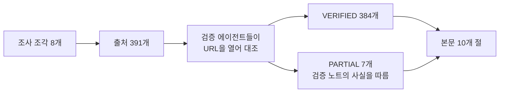
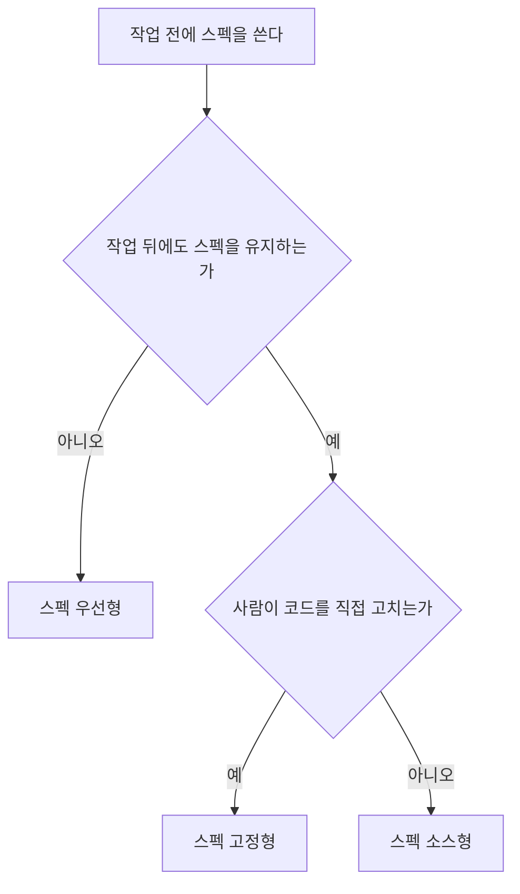
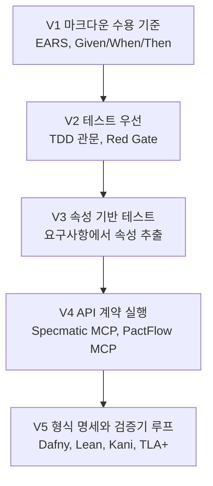
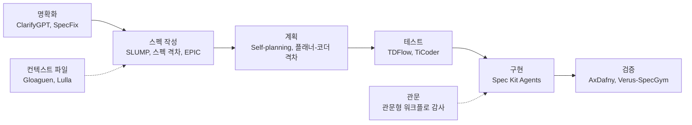
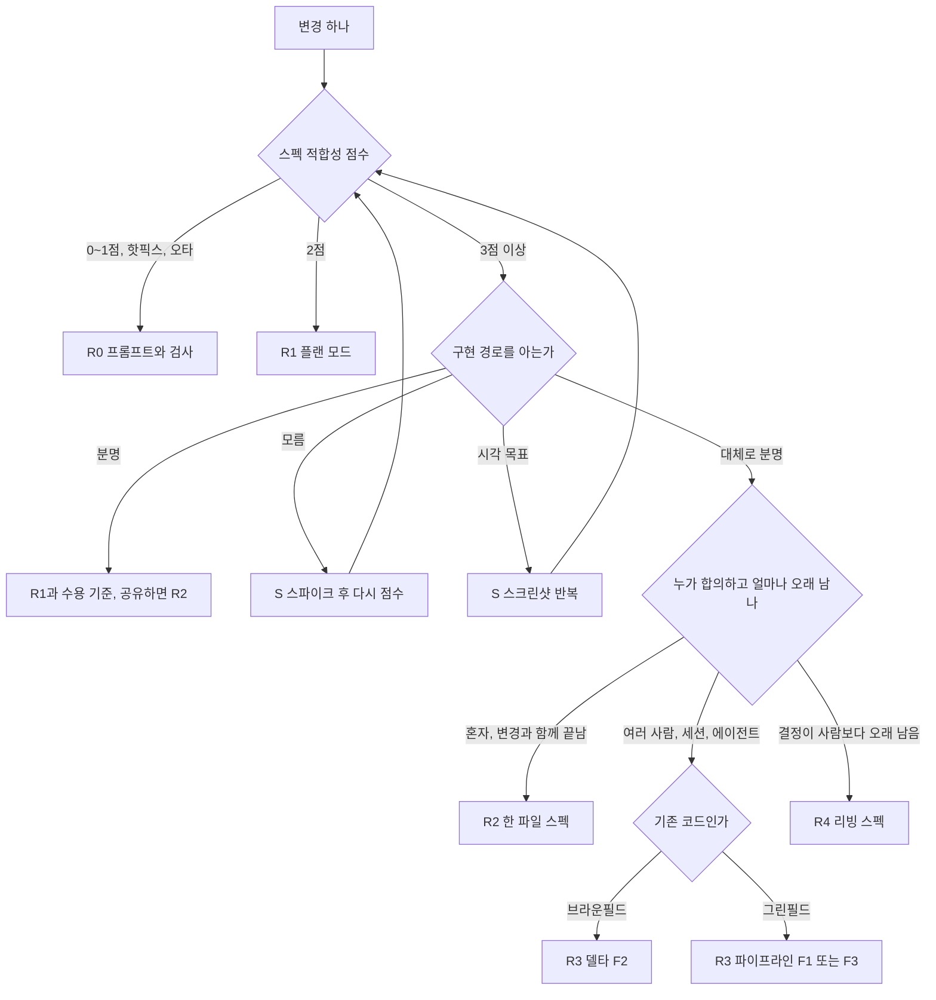
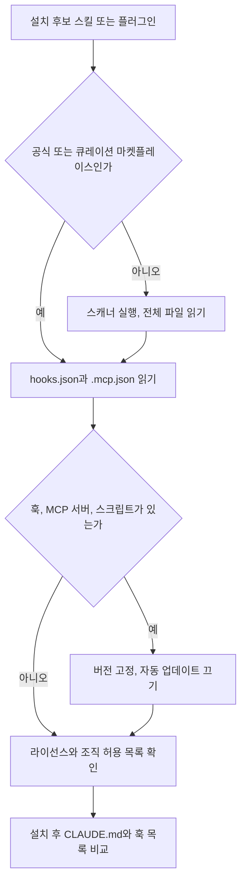
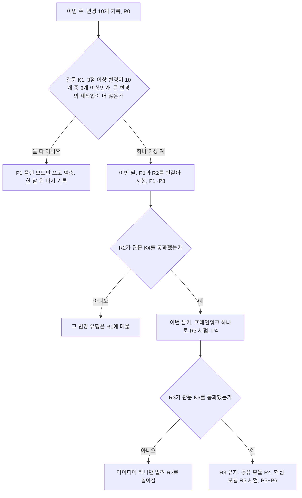
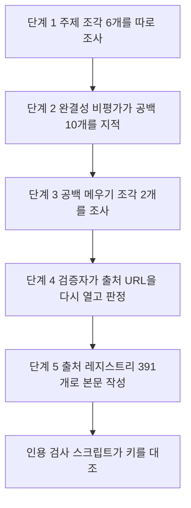

# 스펙 주도 개발(SDD) 2026 지도: 방법, 도구, 연구, 그리고 나에게 맞는 길 찾기

## 목차

- [한눈에 보기](#한눈에-보기)
  - [SDD를 세 문장으로](#sdd를-세-문장으로)
  - [가장 중요한 발견 10개](#가장-중요한-발견-10개)
  - [먼저 알아 둘 도구 8개](#먼저-알아-둘-도구-8개)
  - [바로 시작하는 법](#바로-시작하는-법)
- [이 보고서를 읽는 법](#이-보고서를-읽는-법)
  - [조사는 이렇게 했습니다](#조사는-이렇게-했습니다)
  - [근거 표시 세 가지](#근거-표시-세-가지)
  - [용어 네 개](#용어-네-개)
  - [절 지도](#절-지도)
  - [근거의 한계](#근거의-한계)
- [1. SDD란 무엇인가](#1-sdd란-무엇인가)
  - [1.1 정의는 출처마다 다릅니다](#11-정의는-출처마다-다릅니다)
  - [1.2 스펙, 메모리 뱅크, 플랜은 다릅니다](#12-스펙-메모리-뱅크-플랜은-다릅니다)
  - [1.3 분류 A는 스펙의 수명으로 나눕니다](#13-분류-a는-스펙의-수명으로-나눕니다)
  - [1.4 분류 B는 과정의 차원으로 나눕니다](#14-분류-b는-과정의-차원으로-나눕니다)
  - [1.5 분류 C는 이 보고서의 계열 F1~F8입니다](#15-분류-c는-이-보고서의-계열-f1f8입니다)
  - [1.6 SDD 도구는 2025년 열 달 사이에 몰려 나왔습니다](#16-sdd-도구는-2025년-열-달-사이에-몰려-나왔습니다)
  - [1.7 SDD는 오래된 실천을 다시 묶습니다](#17-sdd는-오래된-실천을-다시-묶습니다)
- [2. 주요 방법론 (상), 문서 파이프라인 계열](#2-주요-방법론-상-문서-파이프라인-계열)
  - [2.1 Spec Kit의 헌법 파일부터 converge 반복까지](#21-spec-kit의-헌법-파일부터-converge-반복까지)
  - [2.2 Kiro 스펙의 IDE 내장 3문서 사슬](#22-kiro-스펙의-ide-내장-3문서-사슬)
  - [2.3 cc-sdd는 Kiro 흐름을 다른 하네스로 옮긴 스킬 묶음](#23-cc-sdd는-kiro-흐름을-다른-하네스로-옮긴-스킬-묶음)
  - [2.4 F1의 나머지 도구들](#24-f1의-나머지-도구들)
  - [2.5 F1 내부 비교](#25-f1-내부-비교)
  - [2.6 OpenSpec은 바꿀 부분만 스펙으로 쓰는 변경 델타형](#26-openspec은-바꿀-부분만-스펙으로-쓰는-변경-델타형)
  - [2.7 BMAD는 역할 에이전트가 문서를 차례로 만드는 방식](#27-bmad는-역할-에이전트가-문서를-차례로-만드는-방식)
  - [2.8 Tessl과 Reversa의 스펙 소스형 실험과 역공학](#28-tessl과-reversa의-스펙-소스형-실험과-역공학)
- [3. 주요 방법론 (하), 스킬과 루프와 검증 계열](#3-주요-방법론-하-스킬과-루프와-검증-계열)
  - [3.1 배포 단위가 스킬과 플러그인으로 바뀌었습니다](#31-배포-단위가-스킬과-플러그인으로-바뀌었습니다)
  - [3.2 Superpowers는 작업 습관을 필수 워크플로로 강제합니다](#32-superpowers는-작업-습관을-필수-워크플로로-강제합니다)
  - [3.3 mattpocock/skills는 질문으로 스펙을 끌어냅니다](#33-mattpocockskills는-질문으로-스펙을-끌어냅니다)
  - [3.4 agent-skills는 스펙 단계를 수명주기 스킬 안에 넣습니다](#34-agent-skills는-스펙-단계를-수명주기-스킬-안에-넣습니다)
  - [3.5 Compound Engineering은 변경마다 교훈을 남깁니다](#35-compound-engineering은-변경마다-교훈을-남깁니다)
  - [3.6 F4 계열의 나머지 도구](#36-f4-계열의-나머지-도구)
  - [3.7 GSD는 실행자마다 새 컨텍스트를 줍니다](#37-gsd는-실행자마다-새-컨텍스트를-줍니다)
  - [3.8 ExecPlan은 리빙 계획 파일 하나로 몇 시간을 버팁니다](#38-execplan은-리빙-계획-파일-하나로-몇-시간을-버팁니다)
  - [3.9 Ralph 루프는 원형과 공식 플러그인이 다르게 동작합니다](#39-ralph-루프는-원형과-공식-플러그인이-다르게-동작합니다)
  - [3.10 Anthropic 장기 실행 하네스 패턴은 스펙을 남기고 절차를 줄였습니다](#310-anthropic-장기-실행-하네스-패턴은-스펙을-남기고-절차를-줄였습니다)
  - [3.11 Ouroboros는 모호성을 숫자로 재고 YAML 계약으로 실행합니다](#311-ouroboros는-모호성을-숫자로-재고-yaml-계약으로-실행합니다)
  - [3.12 F5 계열의 나머지 도구](#312-f5-계열의-나머지-도구)
  - [3.13 F6 네이티브 플랜 모드는 가장 작은 스펙 우선형입니다](#313-f6-네이티브-플랜-모드는-가장-작은-스펙-우선형입니다)
  - [3.14 F8 검증 중심형은 스펙을 기계가 판정하게 바꿉니다](#314-f8-검증-중심형은-스펙을-기계가-판정하게-바꿉니다)
- [4. 하네스별 플러그인, 스킬, 확장, MCP 생태계](#4-하네스별-플러그인-스킬-확장-mcp-생태계)
  - [구조적 발견 다섯 가지](#구조적-발견-다섯-가지)
  - [도구별 하네스 지원 매트릭스](#도구별-하네스-지원-매트릭스)
  - [Claude Code](#claude-code)
  - [Cursor](#cursor)
  - [GitHub Copilot](#github-copilot)
  - [Codex](#codex)
  - [Gemini CLI와 Antigravity](#gemini-cli와-antigravity)
  - [Kiro와 Amazon Q Developer](#kiro와-amazon-q-developer)
  - [기타 IDE와 에이전트](#기타-ide와-에이전트)
  - [SDD용 MCP 서버](#sdd용-mcp-서버)
  - [AGENTS.md를 읽는 하네스](#agentsmd를-읽는-하네스)
  - [네이티브 플랜 모드와 스펙 모드 비교](#네이티브-플랜-모드와-스펙-모드-비교)
  - [하네스 교체 연표](#하네스-교체-연표)
- [5. 비교 분석](#5-비교-분석)
  - [5.1 주 비교 매트릭스는 16개 도구를 11개 차원으로 채점합니다](#51-주-비교-매트릭스는-16개-도구를-11개-차원으로-채점합니다)
  - [5.2 Uvik 벤치마크는 네 도구와 대조군을 같은 티켓으로 측정했습니다](#52-uvik-벤치마크는-네-도구와-대조군을-같은-티켓으로-측정했습니다)
  - [5.3 초점 비교 A. Spec Kit, Kiro 스펙, OpenSpec, cc-sdd](#53-초점-비교-a-spec-kit-kiro-스펙-openspec-cc-sdd)
  - [5.4 초점 비교 B. 무거운 방법과 가벼운 방법](#54-초점-비교-b-무거운-방법과-가벼운-방법)
  - [5.5 초점 비교 C. 문서 파이프라인과 네이티브 플랜 모드](#55-초점-비교-c-문서-파이프라인과-네이티브-플랜-모드)
  - [5.6 채택 지표는 지표마다 순위가 다릅니다](#56-채택-지표는-지표마다-순위가-다릅니다)
- [6. 연구 문헌이 말하는 것](#6-연구-문헌이-말하는-것)
  - [근거 수준 지도](#근거-수준-지도)
  - [SDD를 직접 다룬 연구](#sdd를-직접-다룬-연구)
  - [입장과 개념 논문](#입장과-개념-논문)
  - [스펙 벤치마크](#스펙-벤치마크)
  - [모호성과 명확화](#모호성과-명확화)
  - [테스트를 스펙으로, 그리고 코딩 전 계획](#테스트를-스펙으로-그리고-코딩-전-계획)
  - [형식 명세](#형식-명세)
  - [컨텍스트 파일 연구](#컨텍스트-파일-연구)
  - [개발자 경험 배경과 연구 공동체 신호](#개발자-경험-배경과-연구-공동체-신호)
  - [연구 종합](#연구-종합)
- [7. 커뮤니티와 업계의 목소리](#7-커뮤니티와-업계의-목소리)
  - [7.1 2025~2026 의견 연대표](#71-20252026-의견-연대표)
  - [7.2 여섯 국면으로 본 의견 변화](#72-여섯-국면으로-본-의견-변화)
  - [7.3 Thoughtworks Radar 링 이력](#73-thoughtworks-radar-링-이력)
  - [7.4 주요 글 요약](#74-주요-글-요약)
  - [7.5 찬반 논거와 말한 사람](#75-찬반-논거와-말한-사람)
  - [7.6 단일 도구 체험 수치](#76-단일-도구-체험-수치)
  - [7.7 제조사 성과 주장](#77-제조사-성과-주장)
  - [7.8 반복되는 경험칙](#78-반복되는-경험칙)
  - [7.9 한국 커뮤니티](#79-한국-커뮤니티)
  - [7.10 인프런 강의](#710-인프런-강의)
  - [7.11 일본 커뮤니티](#711-일본-커뮤니티)
- [8. 맥락별 적합성](#8-맥락별-적합성)
  - [핵심 발견 아홉 가지](#핵심-발견-아홉-가지)
  - [변경 크기가 가장 강한 신호입니다](#변경-크기가-가장-강한-신호입니다)
  - [경로 확실성은 두 번째 축입니다](#경로-확실성은-두-번째-축입니다)
  - [그린필드와 브라운필드](#그린필드와-브라운필드)
  - [개인, 팀, 기업](#개인-팀-기업)
  - [규제와 감사](#규제와-감사)
  - [프로토타입과 운영](#프로토타입과-운영)
  - [영역별 근거](#영역별-근거)
  - [경험 수준](#경험-수준)
  - [실패와 회복 사례](#실패와-회복-사례)
  - [제조사도 가벼운 경로를 냈습니다](#제조사도-가벼운-경로를-냈습니다)
- [9. 나에게 맞는 SDD 찾기, 전략과 여정](#9-나에게-맞는-sdd-찾기-전략과-여정)
  - [이 여정을 묶는 다섯 가지 규칙](#이-여정을-묶는-다섯-가지-규칙)
  - [출발 질문 여덟 개](#출발-질문-여덟-개)
  - [스펙 적합성 테스트](#스펙-적합성-테스트)
  - [SDD 사다리의 여섯 단과 바닥층](#sdd-사다리의-여섯-단과-바닥층)
  - [AGENTS.md 성숙도 곡선](#agentsmd-성숙도-곡선)
  - [결정 트리](#결정-트리)
  - [하네스별 첫 선택](#하네스별-첫-선택)
  - [페르소나 경로](#페르소나-경로)
  - [스펙 수명 결정](#스펙-수명-결정)
  - [시험 계획](#시험-계획)
  - [주니어 이해 점검 단계](#주니어-이해-점검-단계)
  - [하향 신호 목록](#하향-신호-목록)
- [10. 위험과 주의점](#10-위험과-주의점)
  - [위험 지도](#위험-지도)
  - [스킬과 플러그인 공급망](#스킬과-플러그인-공급망)
  - [설치 전 점검표](#설치-전-점검표)
  - [토큰과 컨텍스트 비용](#토큰과-컨텍스트-비용)
  - [스펙 드리프트와 문서 난립](#스펙-드리프트와-문서-난립)
  - [자기 판정 관문과 과신](#자기-판정-관문과-과신)
  - [2025 비판의 유효기간](#2025-비판의-유효기간)
  - [종속과 교체](#종속과-교체)
  - [숫자를 믿기 전에](#숫자를-믿기-전에)
- [11. 결론과 다음 행동](#11-결론과-다음-행동)
  - [11.1 이 보고서의 판단은 한 문장입니다](#111-이-보고서의-판단은-한-문장입니다)
  - [11.2 판단 일곱 가지](#112-판단-일곱-가지)
  - [11.3 2025년의 약속과 2026년 11월의 결과](#113-2025년의-약속과-2026년-11월의-결과)
  - [11.4 아직 모르는 것](#114-아직-모르는-것)
  - [11.5 다음 행동](#115-다음-행동)
  - [11.6 세 문장으로 줄인 권고](#116-세-문장으로-줄인-권고)
- [부록](#부록)
  - [A. 용어집](#a-용어집)
  - [B. 조사 방법과 한계](#b-조사-방법과-한계)
  - [C. 확인하지 못한 항목](#c-확인하지-못한-항목)

## 한눈에 보기

### SDD를 세 문장으로

스펙 주도 개발(spec-driven development, SDD)은 AI 에이전트에게 코드를 맡기기 전에 구조화된 자연어 스펙을 먼저 쓰고, 그 스펙을 사람과 에이전트가 함께 따르는 기준으로 삼는 개발 방식입니다 [[1]][r1][[2]][r2]. 방법은 작업이 끝난 뒤 스펙이 어떻게 되는가에 따라 스펙 우선형(spec-first), 스펙 고정형(spec-anchored), 스펙 소스형(spec-as-source)으로 나뉩니다 [[1]][r1]. 2026년 11월 현재 SDD 도구는 대부분 스킬이나 플러그인으로 배포되고 [[3]][r3], 이 보고서가 확인한 하네스 11개가 읽기 전용 계획 단계를 내장합니다 (추론, 4절의 네이티브 모드 비교표 기준) [[4]][r4][[5]][r5][[6]][r6].

이 보고서는 spec을 본문에서 "스펙"이라고 씁니다. 정의와 분류의 출처별 차이는 1절에 있습니다.

### 가장 중요한 발견 10개

1. 변경 크기와 작업 종류가 스펙의 이득을 가릅니다 [[7]][r7][[8]][r8]. Uvik 벤치마크에서 파일 1~2개 변경은 스펙 없는 대조군과 최고 스펙 조건이 모두 85%를 병합했고, 파일 6개 이상 변경은 50% 대 80%였습니다 (측정, n=50) [[7]][r7][[9]][r9]. 버그 수정에서는 대조군이 90%를 병합해 스펙 조건과 같거나 높았습니다 (측정) [[7]][r7]. (5절, 8절)
2. 여러 이름 있는 도구를 같은 티켓으로 잰 실무 통제 비교 가운데 이 보고서가 찾은 유일한 비교에서 잡음 대역 ±10%p를 넘은 도구는 OpenSpec 하나입니다 [[9]][r9]. OpenSpec은 티켓 50개 중 42개를, 대조군은 36개를 병합했습니다 (측정, 모델 1개) [[9]][r9]. 네 도구 모두 병합 티켓당 리뷰 결함이 대조군 0.86보다 낮았지만, 병합까지 시간은 대조군의 29분이 가장 짧았습니다 (측정) [[9]][r9]. (5절)
3. 실무자는 SDD를 선택적으로, 주로 새 기능에 씁니다 [[8]][r8]. 저장소에서 채굴한 스펙의 82.0%가 feat 라벨이었고, 스펙 파일의 98.3%는 저자가 한 명이었습니다 (측정) [[8]][r8]. 버그는 에이전트에게 직접 프롬프트를 주어 고쳤습니다 [[8]][r8]. (6절, 8절)
4. 도구는 절차를 줄이고 스펙은 남기는 쪽으로 움직였습니다 (추론, 이 항목의 세 출처 기준). Agent OS v3는 스펙 작성을 플랜 모드에 넘기고 구현과 오케스트레이션 단계를 없앴습니다 [[10]][r10]. Anthropic은 Opus 4.6에서 스프린트 구조를 뺐습니다 [[11]][r11]. 그러나 플래너는 남겼습니다. 플래너가 없으면 생성자가 스펙 없이 바로 만들기 시작했기 때문입니다 [[11]][r11]. Thoughtworks Radar Vol 35는 OpenSpec을 Trial로 올리고, 같은 판에서 AI 문서 난립과 지시문 비대를 Caution에 두었습니다 [[12]][r12][[13]][r13]. (3절, 7절)
5. 플랜 모드는 기본 기능이 되었지만 그 계획은 대부분 저장소에 남지 않습니다 (추론, 4절의 하네스 14개 행 기준). VS Code Copilot의 Plan 에이전트는 계획을 프로젝트 파일이 아니라 세션 메모리에 저장합니다 [[6]][r6]. Kiro 스펙은 `.kiro/specs/<name>/`에, TRAE Spec은 `.trae/specs/`에 스펙 파일을 씁니다 [[14]][r14][[15]][r15]. 설치 없이 저장소에 스펙 폴더를 기본으로 남기는 모드는 이 둘뿐입니다 (추론, 4절의 네이티브 모드 비교표 기준). (4절)
6. 처음 정리한 스펙이 대화로 자라는 스펙보다 결과가 좋습니다 [[16]][r16][[17]][r17][[18]][r18]. SLUMP에서 한 번에 준 스펙이 논문 20편 중 16편(Claude Code)에서 구현 충실도가 더 높았습니다 (측정) [[16]][r16]. 스펙 상세도를 줄이자 에이전트 2개의 통합 정확도가 58%에서 25%로 떨어졌습니다 (측정) [[17]][r17]. (6절)
7. 측정 근거가 가장 많은 실행 가능한 스펙은 테스트입니다 (추론, 6절 논문 비교 기준) [[19]][r19][[20]][r20][[21]][r21]. TDFlow는 사람이 쓴 테스트를 받아 SWE-Bench Verified에서 94.3%를 냈습니다 (측정) [[20]][r20]. 에이전트가 스펙에서 만든 테스트 묶음은 변이 점수가 60%에 못 미쳤습니다 (측정) [[22]][r22]. 그래서 수용 테스트는 사람이 쓰거나 검토합니다 (추론, TDFlow와 TestSuiteBench 기준). (6절)
8. 작업한 모델이 스스로 판정하는 관문은 문제를 거의 막지 못합니다 [[23]][r23]. 저자 운영 감사에서 자기 판정 오케스트레이터는 블록 점검 247회 중 11회만 미선언 변경을 기록했고, 4회만 작업을 멈췄습니다 (측정, 기능 9개) [[23]][r23]. 같은 연구에서 파일 목록 점검 같은 결정적 검사는 실행자의 미선언 변경을 잡았습니다 [[23]][r23]. (6절, 10절)
9. 채택 지표는 지표마다 순위가 다릅니다 (추론, 5절의 지표 다섯 개 비교 기준). mattpocock/skills는 GitHub 별 318,438개와 skills.sh 설치 32.2M으로 1위이지만, 인터뷰 응답자 21명 중 지금 쓰는 사람은 없었습니다 [[24]][r24][[25]][r25][[26]][r26]. OpenSpec은 별이 74,291개인데 npm 월 다운로드 3,920,829건과 인터뷰 응답자 7명(파생 도구 포함)으로 앞섰습니다 [[27]][r27][[28]][r28][[26]][r26]. (5절)
10. 스킬과 플러그인 설치는 공급망 위험을 들여옵니다 [[29]][r29][[30]][r30]. 커뮤니티 스킬 31,132개 중 26.1%에 취약점이 1개 이상 있었고, 실행 스크립트를 포함한 스킬은 취약할 확률이 2.12배였습니다 (측정) [[30]][r30]. Claude Code의 권한 규칙과 샌드박스는 Claude의 도구 호출만 덮고, 플러그인이 스스로 실행하는 훅과 MCP 서버 프로세스는 덮지 않습니다 [[31]][r31]. (10절)

### 먼저 알아 둘 도구 8개

버전과 GitHub 별 수는 2026-11-09에 읽은 값입니다. 별 수는 관심을 셀 뿐 채택을 세지 않습니다 (5절). 계열 기호 F1~F8은 이 보고서의 분류입니다 (추론, 1절).

| 도구 | 계열 | 한 줄 요약 | 먼저 볼 상황 | 최신 버전 | 별 |
|---|---|---|---|---|---|
| Spec Kit | F1 단계 게이트형 | 헌법 파일부터 converge까지 단계별 문서를 만들고 에이전트 41개에 통합됩니다 [[32]][r32][[33]][r33] | 그린필드의 팀 작업 [[34]][r34] | v1.3.2 [[35]][r35] | 148,677 [[36]][r36] |
| Kiro 스펙 | F1 단계 게이트형 | AWS Kiro에 내장된 `requirements.md`(EARS), `design.md`, `tasks.md` 3문서 사슬입니다 [[14]][r14] | 규정 준수가 걸리거나 위험이 큰 작업 [[37]][r37] | GA 2025-11-17 [[38]][r38] | 4,452 (이슈 저장소) [[39]][r39] |
| OpenSpec | F2 변경 델타형 | 바꿀 부분만 스펙 델타로 쓰고 archive 때 리빙 스펙에 병합합니다 [[27]][r27] | 기존 시스템의 변경 [[40]][r40] | v1.16.1 [[27]][r27] | 74,291 [[27]][r27] |
| BMAD | F3 역할 시뮬레이션형 | 분석가, PM, 아키텍트, PO 역할 에이전트가 문서를 차례로 만들고 작업 크기별 경로 4개를 둡니다 [[41]][r41] | 여러 이해관계자가 합의할 여러 에픽 [[42]][r42] | v6.12.4, v7 알파 [[43]][r43] | 55,132 [[43]][r43] |
| cc-sdd | F1 단계 게이트형 | Kiro 호환 스펙 흐름을 스킬 17개로 옮긴 일본산 도구이고 안정 지원은 Claude Code와 Codex입니다 [[44]][r44] | Kiro식 EARS 흐름을 Kiro 밖에서 쓸 때 [[44]][r44] | v3.1.0 [[44]][r44] | 3,758 [[45]][r45] |
| Superpowers | F4 스킬 규율형 | 브레인스토밍, 계획, TDD, 리뷰 스킬을 조건이 맞으면 스스로 켜는 필수 워크플로입니다 [[46]][r46] | 인프런 강의가 초보자에게 권하는 출발점 [[47]][r47] | v7.0.2 [[48]][r48] | 314,546 [[49]][r49] |
| mattpocock/skills | F4 스킬 규율형 | `/grill-me`처럼 질문으로 스펙을 끌어내고 `/to-spec`으로 대화를 스펙으로 정리하며, 절차는 사용자에게 맡깁니다 [[24]][r24] | 절차를 직접 정하려는 숙련 개발자 (추론, README의 설계 입장 기준) | v1.3.2 (2026-10-29) [[24]][r24] | 318,438 [[24]][r24] |
| GSD Core | F5 계획-실행 루프형 | 실행자마다 새 200k 토큰 컨텍스트를 주어 컨텍스트 부패(context rot)를 막습니다 [[50]][r50] | 여러 세션에 걸친 마일스톤 작업 (추론, 2절과 3절의 프로필 기준) | v1.20.1 [[51]][r51] | 11,356, 옛 저장소 64,155 [[51]][r51][[52]][r52] |

도구 16개를 11개 차원으로 채점한 매트릭스는 5절에 있습니다. 하네스별 설치 명령은 4절에 있습니다.

### 바로 시작하는 법

1. 이번 주에 할 변경 10개를 적고, 9절의 스펙 적합성 테스트 여섯 조건 중 몇 개가 참인지 셉니다. 여섯 조건은 파일 3개 이상, 수용 기준 4개 이상, 모듈이나 서비스 경계를 넘음, 스키마나 공개 API 변경, 여러 엔지니어나 에이전트 참여, 규제나 감사 대상입니다. Uvik 규칙은 셋 이상이면 스펙을 쓰라고 합니다 [[7]][r7].
2. 0~1점 변경, 핫픽스, 오타는 수용 기준 1~2문장과 확인 명령 하나만 붙여 바로 맡깁니다 (추론, 9절 사다리의 R0, 즉 프롬프트와 확인 명령만 쓰는 가장 낮은 단).
3. 2점 변경은 지금 쓰는 하네스의 플랜 모드에서 계획을 직접 읽고 승인합니다 (추론, 9절 사다리 기준) [[4]][r4][[5]][r5].
4. 3점 이상이고 경로가 대체로 분명하면 에이전트의 인터뷰로 `SPEC.md`를 쓰고, 새 세션에서 구현하고, diff를 `SPEC.md`와 대조합니다 [[53]][r53]. 3점 이상이어도 구현 경로가 분명하면 플랜 모드 계획에 수용 기준을 붙이고, 경로를 모르면 반나절 프로토타입으로 먼저 배운 뒤 다시 점수를 매깁니다 (추론, 9절 결정 트리).
5. 여러 사람이나 여러 세션이 같은 변경을 맡을 때만 프레임워크 하나를 시험합니다 (추론, 9절). 맥락별 근거는 8절에, 12주 시험 계획과 하향 신호는 9절에 있습니다.

## 이 보고서를 읽는 법

### 조사는 이렇게 했습니다

조사는 주제별 조각(research slice) 8개로 나눠 진행했습니다. 조각 6개가 주제를 맡았고, 두 번의 빈칸 보충 조각이 완전성 점검에서 나온 빈 곳을 채웠습니다. 조각들은 출처 391개를 모았습니다. 검증 에이전트들이 출처를 나눠 맡아 URL을 직접 열고 노트의 주장과 대조했습니다. 391개 중 384개는 VERIFIED, 7개는 PARTIAL 판정을 받았습니다. 모든 페이지, 별 수, 버전, 다운로드 수는 2026-11-09에 읽은 값입니다.

조각별 범위, 출처 수, 출처 종류는 부록 B.2에 있습니다.

PARTIAL은 출처의 핵심 사실은 맞지만 세부 하나가 노트와 달랐다는 뜻입니다. 예를 들어 제목, 날짜 범위, 수치의 측정 방식이 다른 경우입니다. 이 보고서는 그런 출처에서 검증 에이전트가 적은 사실만 씁니다.

본문의 인용 키는 최종본에서 번호 링크로 바뀌고, 보고서 끝의 참고 문헌으로 이어집니다. 참고 문헌에는 본문이 실제로 인용한 출처만 들어갑니다.

### 근거 표시 세 가지

| 표시 | 뜻 | 예 | 읽는 법 |
|---|---|---|---|
| (측정) | 벤치마크, 통제 실험, 저장소 채굴, 팀 지표에서 나온 숫자입니다 | Uvik 벤치마크의 병합률 [[9]][r9] | 표본 크기, 모델 수, 실행한 주체를 함께 봅니다 |
| (주장) | 제조사, 저자, 경쟁 도구 제작자가 자기 도구나 경험에 대해 한 말입니다 | Kiro 페이지의 생산성 중앙값 4.5배 [[54]][r54] | 이해관계가 있는 말로 읽고, 독립 재현이 있는지 찾습니다 |
| (추론) | 이 보고서가 여러 출처를 묶어 낸 판단입니다 | 계열 분류 F1~F8, 9절의 문턱값 | 자기 인용 키는 없고, 바탕이 된 출처나 표를 문장 안에 적습니다 |

5절의 비교 매트릭스는 표시 두 개를 더 씁니다. [문서]는 1차 문서에 그 기능이 적혀 있다는 뜻이고, 효과가 있다는 뜻은 아닙니다. [실무]는 독립 실무자나 팀의 보고입니다.

### 용어 네 개

| 용어 | 이 보고서에서의 뜻 | 자세히 |
|---|---|---|
| 하네스(harness) | Claude Code, Cursor, Kiro처럼 모델을 감싸 도구를 실행하는 에이전트 환경입니다 | 1절, 4절 |
| 계열 F1~F8 | 무엇을 스펙으로 삼는지에 따라 도구를 여덟 묶음으로 나눈 이 보고서의 분류입니다 (추론) | 1절 |
| 사다리 R0~R5 | 변경 하나마다 고르는 SDD 수준 여섯 단입니다. 프롬프트와 검사(R0)에서 실행 가능한 검사(R5)까지 갑니다 (추론) | 9절 |
| 스펙 드리프트(spec drift) | 스펙과 코드가 서로 다른 내용을 말하게 되는 현상입니다 | 5절, 10절 |

### 절 지도

| 절 | 답하는 질문 |
|---|---|
| 1 | SDD는 무엇이고, 어떻게 분류하고, 어디서 왔나 |
| 2 | 문서 파이프라인 계열(Spec Kit, Kiro, cc-sdd, OpenSpec, BMAD 등)은 어떻게 도나 |
| 3 | 스킬, 루프, 플랜 모드, 검증 계열(Superpowers, GSD, Ralph 루프 등)은 어떻게 도나 |
| 4 | 내 하네스에는 무엇이 내장되어 있고, 무엇을 어떻게 설치하나 |
| 5 | 도구들은 숫자로 어떻게 다른가 |
| 6 | 논문은 무엇을 측정했고, 근거는 얼마나 강한가 |
| 7 | 실무자와 업계는 2025~2026년에 무엇을 말했나 |
| 8 | 어떤 맥락에 어떤 SDD 스타일이 맞나 |
| 9 | 나에게 맞는 수준과 도구를 어떻게 찾고 시험하나 |
| 10 | 설치 전에 어떤 위험을 확인하나 |
| 11 | 이 보고서의 판단은 무엇이고, 이번 주, 이번 달, 이번 분기에 무엇을 하나 |

### 근거의 한계

- 여러 이름 있는 도구를 같은 과제로 잰 실무 통제 비교는 Uvik 하나입니다. Uvik은 Python과 인력 지원 서비스를 파는 회사이고, 팀 하나, 모델 하나로 실험했다고 스스로 밝힙니다 [[9]][r9].
- SDD를 직접 다룬 논문 13편 중 학회나 워크숍 표기가 있는 것은 4편입니다 [[55]][r55][[56]][r56][[57]][r57][[58]][r58]. 나머지는 동료 심사 전 프리프린트입니다 (6절).
- 스킬 규율형(F4)과 네이티브 플랜 모드(F6)를 다른 방법과 같은 과제로 잰 독립 측정은 찾지 못했습니다. 그래서 이 보고서는 가벼운 방법이 더 낫다고 판정하지 않습니다 (추론, 5.4절의 측정 공백).
- 경험 수준별로 SDD와 SDD 없음을 비교한 통제 연구도 찾지 못했습니다 (8절).

## 1. SDD란 무엇인가

이 절은 개념만 다룹니다. 도구별 워크플로는 2절과 3절에, 측정 결과는 5절과 6절에, 찬반 논쟁은 7절에 있습니다.

### 1.1 정의는 출처마다 다릅니다

스펙 주도 개발(spec-driven development, SDD)이라는 말은 2025년에 널리 퍼졌습니다. 그러나 출처마다 강조점이 다릅니다. 아래 표는 자주 인용되는 정의 다섯 개를 나란히 놓습니다.

| 출처 | 날짜 | 스펙이란 무엇인가 | 강조점 | 근거 |
|---|---|---|---|---|
| Birgitta Böckeler (Thoughtworks) | 2025-10-15 | 코드보다 먼저 쓰는 구조화된 행동 중심 자연어 산출물 | 스펙이 사람과 에이전트 모두의 진실 원천입니다. 모든 세션에 들어가는 메모리 뱅크와 구분합니다. | [[1]][r1] |
| GitHub, Den Delimarsky | 2025-09-02 | 프로젝트와 함께 진화하는 살아 있는 실행 가능한 산출물 | 스펙이 일회용 문서가 아니라 계속 쓰는 산출물이라는 점 | [[2]][r2] |
| Spec Kit 선언문 `spec-driven.md` | 저장소 문서 | 코드가 섬기는 대상 | 권력 역전(The Power Inversion). 코드가 스펙을 따르고, 유지보수는 스펙을 진화시키는 일입니다. | [[59]][r59] |
| Marc Brooker (AWS) | 2026-04-09 | 요구사항과 핵심 설계 결정을 명시한 문장 | 코드보다 위에(upstream) 놓입니다. 자유 형식도 되고 RFC 2119나 EARS 같은 구조 형식도 됩니다. | [[60]][r60] |
| Wikipedia | 문서 항목 | 문서 주도 개발의 한 유형 | 모델 주도 개발, 라운드트립 엔지니어링과 같은 묶음에 넣습니다. Ostroff, Makalsky, Paige의 2004년 논문 "Agile Specification-Driven Development"를 인용합니다. 그 논문은 TDD와 Design by Contract를 결합했습니다. 이 논문을 용어의 첫 공개 사용으로 보는 것은 specdriven.com 연표입니다 [[61]][r61]. | [[62]][r62] |

다섯 정의는 한 가지에 동의합니다. 스펙은 코드보다 먼저 오고, 코드가 스펙을 따릅니다 (추론, 위 다섯 출처 기준). 차이는 스펙의 수명에 있습니다. GitHub와 Spec Kit 선언문은 스펙이 계속 살아 있다고 봅니다. Böckeler는 대부분 도구가 실제로 작업 전 스펙에서 멈춘다고 봅니다 [[1]][r1].

Böckeler는 이 용어가 이미 "semantically diffused" 상태라고 경고합니다 [[1]][r1]. 의미가 흩어져서 어떤 사람은 이 말을 자세한 프롬프트의 동의어로 씁니다 [[1]][r1]. 그래서 이 보고서는 작업 정의 하나를 정합니다.

> **작업 정의.** 스펙 주도 개발(SDD)은 AI 에이전트에게 코드를 맡기기 전에 구조화된 자연어 스펙을 먼저 쓰고, 그 스펙을 사람과 에이전트가 함께 따르는 기준으로 삼는 개발 방식입니다.

### 1.2 스펙, 메모리 뱅크, 플랜은 다릅니다

세 산출물은 모두 마크다운 파일입니다. 그러나 범위와 수명이 다릅니다. Böckeler는 스펙과 메모리 뱅크를 구분합니다 [[1]][r1]. 플랜은 하네스의 플랜 모드가 만드는 세 번째 종류입니다.

| 구분 | 범위 | 언제 읽히나 | 수명 | 예 | 출처 |
|---|---|---|---|---|---|
| 스펙(spec) | 기능 하나 또는 변경 하나 | 그 기능을 만들 때 | 작업 뒤 버리거나, 유지하며 코드와 함께 고침 | Kiro `requirements.md`, OpenSpec 스펙 델타 | [[14]][r14][[27]][r27] |
| 메모리 뱅크(memory bank) | 프로젝트 전체 | 모든 세션에 공통으로 | 프로젝트가 끝날 때까지 | 컨텍스트 파일(`AGENTS.md`, `CLAUDE.md`), Kiro 스티어링(`product.md`, `tech.md`, `structure.md`), Spec Kit 헌법 파일 | [[63]][r63][[64]][r64][[59]][r59] |
| 플랜(plan) | 이번 작업 하나 | 승인 직후 구현 동안 | 보통 작업 하나 동안. Cursor는 저장소에 저장하는 선택지를 줍니다. | Claude Code 플랜 모드, Cursor Plan Mode, Codex ExecPlan | [[65]][r65][[5]][r5][[66]][r66] |

Claude Code의 플랜 모드는 파일을 읽고 계획을 제안합니다. 사람이 승인할 때까지 파일을 고치지 않습니다 [[65]][r65]. Kiro 스티어링 파일은 `.kiro/steering/`에 있고 always, fileMatch, manual, auto 네 가지 포함 방식을 씁니다 [[64]][r64]. 하네스별 플랜 모드 비교는 4절에 있습니다.

### 1.3 분류 A는 스펙의 수명으로 나눕니다

Böckeler는 SDD를 세 수준으로 나눕니다 [[1]][r1]. 기준은 스펙이 작업 뒤에 어떻게 되는가입니다.

| 수준 | 영문 | 스펙의 운명 | 사람이 고치는 것 | 대표 사례 | 출처 |
|---|---|---|---|---|---|
| 스펙 우선형 | spec-first | 작업 전에 쓰고 그 작업에 씁니다. 작업 뒤 버려지거나 방치될 수 있습니다. | 스펙과 코드 | Kiro, Spec Kit | [[1]][r1] |
| 스펙 고정형 | spec-anchored | 작업 뒤에도 남습니다. 스펙과 코드를 함께 바꿉니다. | 스펙과 코드를 같이 | OpenSpec의 아카이브 병합, Tessl의 목표 | [[1]][r1][[27]][r27] |
| 스펙 소스형 | spec-as-source | 스펙만 원본입니다. 코드는 스펙에서 다시 생성합니다. | 스펙만 | Tessl Framework의 실험 | [[1]][r1][[67]][r67] |

이 분류에서 세 가지를 기억하면 됩니다.

1. 모든 SDD 접근은 스펙 우선형에서 출발합니다. 그 뒤의 유지 전략을 정한 도구는 적습니다 [[1]][r1]. 그래서 대부분 도구는 이름과 달리 실제로는 스펙 우선형입니다.
2. 한국어 독자는 이 분류를 요즘IT의 번역본(안영회 역, 2025-12-01)으로 접할 수 있습니다. 번역본은 "스펙 우선", "스펙 고정형", "스펙을 소스로"라고 씁니다 [[68]][r68]. 이 보고서는 별칭 "스펙을 소스로" 대신 스펙 소스형이라고 씁니다.
3. 같은 세 단계를 학술 논문도 씁니다. Piskala(2026-01)가 세 수준을 받아들였고, Alenezi(2026-07)도 명세 거버넌스 참조 모델(SGRM) 안에서 세 엄격성 수준을 정식화했습니다 [[69]][r69][[70]][r70]. 수준별 적용 지침은 8절에 있습니다.

스펙 소스형의 이론적 끝에는 Monperrus의 시연이 있습니다. 926단어 스펙과 Claude Code의 첫 구현에서 출발해, 새로 생성한 에이전트가 같은 스펙을 처음부터 다시 올바르게 구현했습니다 (측정, 시연 1회) [[71]][r71]. 상세는 6절에 있습니다.

### 1.4 분류 B는 과정의 차원으로 나눕니다

분류 A는 스펙 하나의 수명만 봅니다. 학계는 방법론 전체의 과정을 여러 차원으로 봅니다.

de Macedo(2026-06)는 여섯 차원 분류와 채점 기준을 제안했습니다 [[72]][r72]. 이 분류를 Spec Kit, OpenSpec, BMAD, GSD, Spec Kitty, Reversa에 적용했습니다 [[72]][r72].

| 차원 | 영문 | 이 차원이 묻는 것 (이 보고서의 풀이, 추론) |
|---|---|---|
| 명세 | specification | 스펙을 어떤 형식과 단계로 쓰는가 |
| 컨텍스트 | context | 에이전트에게 어떤 프로젝트 맥락을 주는가 |
| 역할 | roles | 사람과 에이전트의 역할을 어떻게 나누는가 |
| 실행 | execution | 구현을 어떤 단위와 순서로 돌리는가 |
| 검증 | validation | 결과가 스펙과 맞는지 어떻게 확인하는가 |
| 이식성 | portability | 다른 에이전트 하네스로 옮길 수 있는가 |

de Macedo는 여섯 차원을 모두 강하게 다루는 프레임워크가 없다고 보고합니다 [[72]][r72]. 프레임워크들은 영속 산출물, 작업 계약, 추적성, 사람 검토로 수렴합니다 [[72]][r72]. 과정의 깊이와 이식성 사이의 교환은 5절에서 다룹니다.

Díaz 등(2026-08)은 팀 수준의 사회기술 모델을 제안합니다 [[73]][r73]. 이 모델은 두 하네스를 구분합니다 [[74]][r74].

- **기술 하네스**(technical harness)는 에이전트를 감싼 도구 환경입니다.
- **방법론 하네스**(methodological harness)는 팀을 감싼 절차와 합의입니다.

같은 논문은 사람과 에이전트의 상호작용 패턴 5개를 유형으로 제시합니다 [[74]][r74]. 저자들은 바이브 코딩이 잃는 책임성, 검증 가능성, 이전 가능성을 SDD가 되찾는다고 주장합니다 (주장) [[73]][r73]. 단, 이 모델은 주로 회색 문헌에 기반한 개념 분석입니다. 저자들도 근거 기반이 미성숙하다고 밝힙니다 [[73]][r73]. 검증된 이론이 아니라 첫 단계로 읽어야 합니다.

참고로 하네스 엔지니어링(harness engineering)은 스펙, 컨텍스트, 센서(테스트, 검사), 훅을 조합해 에이전트 행동을 설계하는 일입니다 [[75]][r75]. 이 틀로 논의가 옮겨 간 과정은 7절에 있습니다.

### 1.5 분류 C는 이 보고서의 계열 F1~F8입니다

분류 A와 B는 도구를 고르는 데 바로 쓰기 어렵습니다. 그래서 이 보고서는 무엇을 스펙으로 삼는지를 기준으로 도구를 여덟 계열로 묶습니다. **이 분류는 이 보고서의 분류이며 연구 노트를 종합한 추론입니다.** 각 계열의 대표 도구만 2~3개 적습니다.

| 기호 | 계열 | 무엇이 스펙인가 | 대표 도구 | 출처 | 상세 |
|---|---|---|---|---|---|
| F1 | 단계 게이트형 파이프라인 | 요구사항 → 설계 → 태스크 문서 사슬과 단계별 승인 | Spec Kit, Kiro 스펙, cc-sdd | [[2]][r2][[76]][r76][[45]][r45] | 2절 |
| F2 | 변경 델타형 | 변경마다 쓰는 제안과 스펙 델타. 끝나면 리빙 스펙에 병합 | OpenSpec | [[27]][r27] | 2절 |
| F3 | 역할 시뮬레이션형 | PM, 아키텍트 같은 역할 에이전트가 차례로 만드는 문서 | BMAD, gstack | [[77]][r77][[78]][r78] | 2절 |
| F4 | 스킬 규율형 | 고정 문서 대신 질문, 계획, TDD, 리뷰 습관을 강제하는 스킬 | Superpowers, mattpocock/skills | [[46]][r46][[24]][r24] | 3절 |
| F5 | 계획-실행 루프형 | 계획 파일이나 태스크 그래프를 새 컨텍스트에서 반복 실행 | GSD, Taskmaster, Ralph 루프 | [[79]][r79][[80]][r80][[81]][r81] | 3절 |
| F6 | 네이티브 플랜 모드 | 하네스에 내장된 읽기 전용 계획 단계의 결과 | Claude Code 플랜 모드, Cursor Plan Mode | [[65]][r65][[5]][r5] | 3절, 4절 |
| F7 | 스펙 소스형 실험과 역공학 | 코드를 재생성하는 원본 스펙, 또는 기존 코드에서 복원한 스펙 | Tessl Framework(전환됨), Reversa | [[67]][r67][[82]][r82][[83]][r83] | 2절 |
| F8 | 검증 중심형 | 테스트, 속성, 계약, 형식 명세처럼 기계가 판정하는 스펙 | VSDD, Kiro 속성 기반 테스트, Specmatic MCP | [[84]][r84][[85]][r85][[86]][r86] | 3절 |

계열과 수준은 서로 다른 축입니다. F1 도구도 대부분 스펙 우선형이고, F2의 OpenSpec은 아카이브 단계로 스펙 고정형에 가깝습니다 (추론, [[1]][r1][[27]][r27] 기준).

### 1.6 SDD 도구는 2025년 열 달 사이에 몰려 나왔습니다

아래 표는 주요 방법의 첫 공개 시점입니다. 저장소 생성일은 2026-11-09에 GitHub에서 읽은 값입니다.

| 날짜 | 방법 | 계열 | 공개 형태 | 출처 |
|---|---|---|---|---|
| 2025-03-04 | Taskmaster | F5 | 저장소 생성 | [[80]][r80] |
| 2025-04-13 | BMAD | F3 | 저장소 생성 | [[77]][r77] |
| 2025-06-21 / 2025-07-02 | PRP (Widing / Medin) | F5 | 저장소 생성 | [[87]][r87][[88]][r88] |
| 2025-07-14 | Kiro | F1 | 제품 발표 | [[89]][r89] |
| 2025-07-14 | Ralph 루프 | F5 | Geoffrey Huntley 블로그 글 | [[81]][r81] |
| 2025-07-17 | cc-sdd | F1 | 저장소 생성 | [[45]][r45] |
| 2025-08-05 | OpenSpec | F2 | 저장소 생성 | [[27]][r27] |
| 2025-09-02 | Spec Kit | F1 | 발표 (저장소는 2025-08-21 생성) | [[2]][r2] |
| 2025-09 (2025-09-23 직전 주) | Tessl Framework, Spec Registry | F7 | 베타 공개 | [[67]][r67] |
| 2025-10-09 | Superpowers | F4 | 발표와 저장소 생성 | [[90]][r90] |
| 2025-11-13 | AI-DLC | F1 | 저장소 생성 | [[91]][r91] |
| 2025-12-14 | GSD | F5 | 저장소 생성 (지금은 GSD Core로 이전) | [[92]][r92] |
| 2025-12-17 | Conductor | F1 | 저장소 생성 | [[93]][r93] |

동인은 다섯 가지로 정리됩니다.

1. **에이전트가 한 번에 오래 일하게 되었습니다.** OpenAI Cookbook은 ExecPlan을 여러 시간짜리 문제 풀이용 계획으로 소개합니다 [[66]][r66]. Ralph 루프는 루프 한 번에 항목 하나를 처리하며 계속 돕니다 [[81]][r81]. GSD는 컨텍스트 부패(context rot)를 막으려고 새 컨텍스트에서 실행기를 돌립니다 [[79]][r79][[50]][r50]. 긴 작업에는 대화 기록 밖에 남는 기준 문서가 필요합니다 (추론, 위 세 출처 기준).
2. **대화만으로 만든 결과는 남지 않습니다.** Díaz 등은 바이브 코딩(vibe coding)이 책임성, 검증 가능성, 이전 가능성을 잃는다고 주장합니다 (주장) [[73]][r73].
3. **바이브 코딩에 대한 반작용이 있었습니다.** Sean Grove(OpenAI)는 2025년 AI Engineer World's Fair에서 프롬프트나 코드가 아니라 스펙이 프로그래밍의 기본 단위가 된다고 말했습니다 (주장) [[94]][r94].
4. **자연어 스펙이 실행 가능해졌습니다.** Böckeler는 LLM이 파싱 가능한 스펙 언어의 필요를 없앤다고 봅니다. 대신 비결정성이 더해집니다 [[1]][r1].
5. **코드 생성이 좋아질수록 스펙이 더 중요해집니다.** "The Specification Paradox" 논문은 AI가 코드를 잘 만들수록 사람이 쓴 올바른 스펙에 더 의존한다고 주장합니다 (주장) [[95]][r95].

2025년부터 2026년까지의 의견 변화는 7절의 연대표에 있습니다.

### 1.7 SDD는 오래된 실천을 다시 묶습니다

SDD의 부품은 대부분 새것이 아닙니다. 아래 표는 각 실천에서 SDD가 무엇을 물려받았고, 그때 무엇이 막혔는지 정리합니다.

| 이전 실천 | 시기 | SDD가 물려받은 것 | 그때 한계나 실패 이유 | 출처 |
|---|---|---|---|---|
| 모델 주도 개발(MDD), OMG MDA | MDA 2001 | 원본 모델에서 코드를 생성하는 발상. 스펙 소스형이 이 발상을 되살립니다. | 업무용 앱에서 절차 부담이 컸습니다. Böckeler는 지금 방식이 경직성과 비결정성을 함께 안을 위험을 경고합니다. | [[1]][r1][[61]][r61] |
| Design by Contract | 1986 (Meyer, Eiffel) | 사전조건, 사후조건, 불변식을 먼저 적는 습관. Ostroff 등 2004가 TDD와 결합했습니다. | 노트에 당시 실패 원인의 직접 근거는 없습니다. 에이전트가 계약을 먼저 쓰게 한 최근 연구는 6절에 있습니다. | [[61]][r61][[62]][r62][[96]][r96] |
| TDD | 약 2000 (Kent Beck) | 테스트를 먼저 쓰는 일은 작은 스펙을 쓰는 일입니다. Spec Kit 헌법 3조가 Test-First입니다. Superpowers와 cc-sdd가 RED-GREEN을 강제합니다. | 테스트만으로는 기능과 아키텍처 수준의 의도를 다 적기 어렵습니다 (추론). Piskala는 SDD를 이 수준으로 끌어올린 TDD로 봅니다. | [[61]][r61][[69]][r69][[59]][r59][[46]][r46][[45]][r45] |
| BDD, Gherkin | Cucumber 2008 | Given/When/Then 시나리오. Kiro와 OpenSpec의 WHEN/THEN 시나리오가 이 형식을 다시 씁니다. Piskala는 BDD를 SDD의 가장 직접적인 조상으로 봅니다. | 좋은 Gherkin을 코드와 맞춰 두기가 어려웠습니다. 그래서 스펙이 다시 문서로 돌아갔습니다. | [[97]][r97][[69]][r69][[27]][r27] |
| IDL, Thrift, OpenAPI | CORBA IDL, Thrift 약 2007, OpenAPI | 스키마를 먼저 쓰고, 생성물은 고치지 않고 다시 생성하는 규율. 계약 테스트(Specmatic, Pact)로 이어집니다. | 기계가 읽는 형식은 API 경계에만 쓰였습니다 (추론, Brauer 글 기준). | [[97]][r97][[69]][r69] |
| 형식 명세 (VDM, Z, B, TLA+) | VDM 1960년대, Z 1970년대 말, B 1990년대 (TLA+ 날짜는 출처에 없음) | 기계가 참과 거짓을 판정하는 정확한 스펙. F8 계열이 이 방향입니다. | Brooker는 TLA+나 Lean 같은 정확한 형식 언어를 필요할 때만 가끔 쓴다고 말합니다. | [[61]][r61][[60]][r60] |
| 문학적 프로그래밍 (Knuth) | 유비 | 설명 문서와 코드를 함께 두는 생각이 닮았습니다. | 계보가 아니라 유비입니다. Knuth와 SDD 도구를 직접 잇는 1차 출처가 없습니다. | [[98]][r98] |
| 요구공학 | 전통 실천 | 요구사항 문형, 추적성, 수용 기준 | 모호하지 않은 스펙은 원래 쓰기 어려웠습니다. 불완전하거나 낡은 스펙이 쌓이면 스펙 부채(specification debt)가 됩니다. | [[1]][r1][[95]][r95] |
| EARS | 2009 (Rolls-Royce) | WHEN [조건] THE SYSTEM SHALL [동작] 문형. Kiro와 cc-sdd의 `requirements.md`가 씁니다. | 실패한 실천이 아닙니다. 제트 엔진 제어의 감항 규칙에서 나와 지금도 쓰입니다. | [[99]][r99][[100]][r100][[45]][r45] |

표에서 반복되는 실패 원인은 하나입니다. 스펙과 코드를 맞춰 두는 비용이 이득보다 컸습니다 (추론, MDD, BDD, 요구공학 행 기준). 2025년의 SDD 도구가 다르다는 주장은 에이전트가 그 비용을 대신 진다는 데 있습니다. 그 주장이 맞는지는 5절과 6절의 측정 결과로 판단합니다.

## 2. 주요 방법론 (상), 문서 파이프라인 계열

이 절은 문서를 정해진 순서로 쌓는 스펙 주도 개발(SDD) 도구를 하나씩 소개합니다. 대상 계열은 넷입니다. 단계 게이트형 파이프라인(phase-gated spec pipeline, F1), 변경 델타형(change-delta spec, F2), 역할 시뮬레이션형(role/persona simulation, F3), 스펙 소스형 실험과 역공학(spec-as-source experiments and spec recovery, F7)입니다. F1부터 F8까지의 계열 이름은 이 보고서의 분류입니다(추론, 1절 참고). 스킬, 루프, 검증 계열은 3절이 다룹니다.

모든 프로필은 같은 형식을 따릅니다. 한 줄 정의, 사실(만든 곳, 첫 공개, 최신 버전, 라이선스), 단계, 산출물, 동기화, 2026년 변화, 제조사가 안내하는 가벼운 경로와 쓰지 말 때, 맞는 경우와 약점 순서입니다. 별 수와 설치 명령은 4절, 도구 간 수치와 차원 점수는 5절, 체험 수치는 7절이 맡습니다. 이 절의 모든 버전과 날짜는 2026-11-09에 읽은 값입니다.

| 계열 | 도구 | 만든 곳 | 스펙 수준(추론) |
|---|---|---|---|
| F1 단계 게이트형 | Spec Kit | GitHub | 스펙 우선형(spec-first), 스펙 고정형(spec-anchored)으로 이동 중 |
| F1 단계 게이트형 | Kiro 스펙 | AWS | 스펙 우선형, 사람이 갱신을 요청 |
| F1 단계 게이트형 | cc-sdd | gotalab | 스펙 우선형과 고정형 사이 |
| F1 단계 게이트형 | Conductor | Google | 맥락 파일 중심의 스펙 고정형 |
| F1 단계 게이트형 | AI-DLC | AWS Labs | 절차와 감사 기록 중심 |
| F1 단계 게이트형 | Spec Kitty | spec-kitty | 스펙 우선형 |
| F1 → F6 | Agent OS | Builder Methods | 스펙 우선형, 플랜 모드(plan mode)로 이동 |
| F1 단계 게이트형 | spec-workflow-mcp | Pimzino | 스펙 우선형 |
| F2 변경 델타형 | OpenSpec | Fission AI | 스펙 고정형 |
| F3 역할 시뮬레이션형 | BMAD | BMad Code, LLC | 스펙 우선형, 문서가 많음 |
| F7 스펙 소스형 | Tessl Framework | Tessl | 스펙 소스형(2026-01 전환) |
| F7 역공학 | Reversa | sandeco | 기존 코드에서 스펙 복원 |

스펙 수준 열은 연구 노트의 비교표를 따른 판단입니다(추론, 근거는 각 프로필의 동기화 행). 수준의 정의는 1절에 있습니다.

### 2.1 Spec Kit의 헌법 파일부터 converge 반복까지

Spec Kit은 GitHub의 오픈소스 SDD 도구입니다. 헌법 파일(constitution), specify, plan, tasks, implement, converge 순서로 문서와 코드를 만듭니다 [[32]][r32].

| 항목 | 내용 (2026-11-09 기준) |
|---|---|
| 만든 곳 | GitHub. 출시 글은 Den Delimarsky가 2025-09-02에 썼습니다 [[2]][r2]. |
| 첫 공개 | 저장소 2025-08-21 생성, 첫 릴리스 v0.0.1은 2025-08-22입니다 [[32]][r32]. |
| 최신 버전 | v1.3.2 (2026-11-06). 1.0.0은 2026-08-21에 나왔습니다 [[35]][r35]. |
| 라이선스 | MIT [[32]][r32] |
| 지원 에이전트 | 통합 페이지에 이름 있는 에이전트 41개와 `generic`, `none`이 있습니다 [[33]][r33]. |

단계는 아래와 같습니다. 괄호 안은 선택 단계입니다 [[32]][r32][[101]][r101].

1. `/speckit-constitution` → 프로젝트마다 한 번 실행합니다.
2. specify → (clarify) → plan → (checklist) → tasks
3. analyze → 읽기 전용으로 문서 사이의 일관성을 점검합니다.
4. implement → converge → converge가 `Converged`를 보고할 때까지 implement와 converge를 반복합니다.

산출물은 많습니다. `memory/constitution.md`는 Test-First 같은 조항 9개를 담습니다 [[59]][r59]. 기능마다 `spec.md`, `checklists/requirements.md`, `plan.md`, `tasks.md`가 생깁니다 [[101]][r101]. plan 명령은 Phase 0에서 `research.md`를, Phase 1에서 `data-model.md`, `contracts/`, `quickstart.md`를 더 만듭니다 [[102]][r102].

동기화는 완료 시점의 점검입니다. converge 명령은 코드를 spec, plan, tasks와 비교합니다. 그리고 빠진 작업만 `tasks.md`의 Convergence 절에 덧붙입니다 [[101]][r101][[103]][r103]. 스펙 문서를 코드에 맞게 고치지는 않습니다. 따라서 상시 동기화가 아닙니다(추론, converge 명령 문서 기준).

2026년의 주요 변화는 아래 표와 같습니다.

| 버전 | 날짜 | 변화 (2026-11-09 기준) | 출처 |
|---|---|---|---|
| 0.9.4 | 2026-06-05 | 첫 PyPI 릴리스. 그 전 설치는 PyPI 통계에 잡히지 않습니다. | [[104]][r104] |
| 0.10.0 | 2026-06-09 | git 확장을 선택 사항으로 바꿨습니다. 브랜치 생성은 훅(hook)으로 켜는 선택 기능입니다. | [[35]][r35][[105]][r105] |
| 0.11.2 | 2026-06-18 | converge 명령을 추가했습니다. | [[35]][r35] |
| 1.0.0 | 2026-08-21 | 첫 1.x 릴리스입니다. | [[35]][r35] |
| 1.3.2 | 2026-11-06 | 기준일의 최신 버전입니다. | [[35]][r35] |

이제 스펙 디렉터리 이름과 브랜치 이름은 서로 독립입니다. 현재 기능은 `.specify/feature.json`이 기억합니다 [[105]][r105]. README에는 SDD 밖의 기능도 있습니다. 버그 수정 확장은 `.specify/bugs/<slug>/`에 기록하고 verified, partial, failed로 판정합니다. 아이디어 평가 확장은 go, needs-clarification, kill 중 하나로 끝납니다 [[32]][r32]. 프리셋, 워크플로, 번들, 사설 카탈로그, 에어갭 설치도 있습니다 [[32]][r32]. 프리셋으로 계획에 규제 추적성을 요구하도록 절차를 바꿀 수 있습니다 [[106]][r106]. 커뮤니티 확장(spec-kit-review, spec-kit-jira 등)은 `specify extension add`로 붙입니다 [[107]][r107].

가벼운 경로도 제조사가 직접 냈습니다. 버그 수정 확장은 SDD 기능 워크플로를 먼저 돌리지 않아도 됩니다 [[108]][r108]. 아이디어 평가는 문서화된 이유와 함께 kill로 멈추는 결과도 유용하다고 봅니다 [[106]][r106]. 기존 프로젝트 가이드는 기존 시스템 전체의 문서화를 첫 기능으로 삼지 말라고 합니다. 범위가 정해진 작은 변경을 먼저 고르고, 헌법 파일은 저장소가 이미 지키는 규칙에서 출발하라고 안내합니다 [[109]][r109].

| 맞는 경우와 약점 | 내용 |
|---|---|
| 맞는 경우 | 여러 에이전트에서 같은 절차를 쓰고 싶은 팀, 추적성이 필요한 조직입니다(추론, 통합 41개와 규제 추적성 프리셋 예시 근거) [[33]][r33][[106]][r106]. |
| 약점 | 기능 하나에 파일이 많습니다. plan만으로 파일 4종이 더 생깁니다 [[102]][r102]. Böckeler는 스펙 하나에서 파일 8개를 셌습니다(측정, 체험 1회, 2025-09 사용, 2025-10-15 글) [[1]][r1]. 이 비판이 지금도 유효한지는 10절이 판정합니다. |
| 연구 | Spec Kit Agents 논문은 단계마다 읽기 전용 맥락 훅을 붙여 품질을 측정했습니다. 수치는 6절에 있습니다 [[110]][r110]. |

### 2.2 Kiro 스펙의 IDE 내장 3문서 사슬

Kiro 스펙은 AWS Kiro의 내장 스펙 기능입니다. `requirements.md`, `design.md`, `tasks.md`를 `.kiro/specs/<name>/`에 만듭니다 [[14]][r14].

| 항목 | 내용 (2026-11-09 기준) |
|---|---|
| 만든 곳 | AWS. Code OSS 위에 만든 IDE입니다 [[89]][r89]. |
| 첫 공개 | 2025-07-14 발표 [[89]][r89]. 정식 출시(GA)는 2025-11-17입니다 [[38]][r38]. |
| 최신 상태 | 스펙 문서 페이지는 2026-10-15에 갱신되었습니다 [[111]][r111]. 한 하네스가 IDE, CLI, Web, Mobile을 모두 돌립니다 [[39]][r39]. |
| 라이선스 | 독점 제품. `kirodotdev/Kiro` 저장소는 이슈와 문서용입니다 [[39]][r39]. |

스펙 종류는 셋(Feature, 버그픽스, 퀵 스펙)이고, Feature 스펙에는 흐름이 둘 있습니다.

| 종류 | 단계 | 쓰는 경우 | 출처 |
|---|---|---|---|
| Feature 스펙, 요구사항 우선 | Requirements → Design → Tasks | 기본 흐름 | [[76]][r76][[112]][r112] |
| Feature 스펙, 설계 우선 | Design → Requirements → Tasks | 기술 제약이 큰 작업, 기존 설계를 옮길 때 | [[113]][r113][[114]][r114] |
| 버그픽스 스펙(Bugfix Spec) | `bugfix.md` → Design → Tasks | 복잡한 버그, 핵심 경로, 회귀 이력이 있는 버그 | [[115]][r115] |
| 퀵 스펙(Quick Spec) | 세 문서를 한 번에, 승인 관문 없음 | 잘 이해된 기능, 빠른 프로토타입 | [[76]][r76][[37]][r37] |

설계 우선 흐름과 버그픽스 스펙은 2026-02-18에 나왔습니다. 모든 사람이 요구사항에서 출발하지 않는다는 사용자 의견이 계기였습니다 [[114]][r114]. `bugfix.md`는 현재 동작, 기대 동작, 바꾸면 안 되는 동작을 적습니다 [[115]][r115].

산출물의 형식은 정해져 있습니다. `requirements.md`는 사용자 스토리와 EARS(Easy Approach to Requirements Syntax) 문형의 수용 기준(acceptance criteria)을 씁니다. 문형은 `WHEN [condition/event] THE SYSTEM SHALL [expected behavior]`입니다 [[100]][r100]. 스티어링(steering) 파일 `product.md`, `tech.md`, `structure.md`는 `.kiro/steering/`에 있습니다. 포함 모드는 always, fileMatch, manual, auto 넷입니다 [[64]][r64]. 훅은 파일 저장, 생성, 삭제 때 실행되어 테스트나 문서를 갱신할 수 있습니다 [[89]][r89].

실행과 점검 기능은 아래와 같습니다.

- 태스크를 하나씩 또는 모두 실행합니다. run all은 의존성 그래프를 만들고 웨이브 단위로 동시에 돌립니다 [[76]][r76].
- Analyze Requirements는 요구사항 전체에서 모순, 모호함, 충돌 제약, 숨은 가정, 빠진 경계 사례를 찾습니다. IDE, CLI, Web에서 됩니다. 작거나 잘 이해된 스펙은 이 분석을 건너뛰어도 된다고 문서가 말합니다 [[116]][r116].
- 속성 기반 테스트(property-based testing)는 IDE에서만 됩니다 [[117]][r117][[111]][r111]. Kiro는 EARS 요구사항에서 속성을 뽑아 Hypothesis 테스트로 바꿉니다 [[85]][r85]. 문서는 이것이 증명이 아니라 정확성의 증거라고 밝힙니다 [[117]][r117]. 실행 가능한 스펙으로서의 의미는 3절이 다룹니다.

동기화는 사람이 시작합니다. 요구사항이나 설계를 고친 뒤 `tasks.md`에서 Sync Files를 누르면 새 태스크가 생깁니다. Sync Files나 스펙 채팅 요청은 코드베이스를 훑어 끝난 태스크를 완료로 표시합니다 [[118]][r118]. 요구사항과 설계는 사람이 고치거나 에이전트에게 요청할 때만 코드를 따라갑니다. 코드에서 스펙으로 가는 자동 동기화는 문서에 없습니다 [[118]][r118].

가벼운 경로는 둘입니다. 퀵 스펙은 관문 없이 세 문서를 만듭니다 [[37]][r37]. Kiro의 플랜 모드(Plan)는 계획을 대화 맥락에만 두고, 스펙은 `.kiro/specs/`에 저장됩니다. Kiro는 구현 15~60분짜리 작업에 플랜 모드를 권합니다 [[119]][r119]. 반대로 낯선 영역이나 규정 준수가 걸린 작업에는 표준 Feature 스펙을 권합니다 [[37]][r37].

| 맞는 경우와 약점 | 내용 |
|---|---|
| 맞는 경우 | 설정 없이 IDE 안에서 SDD를 쓰려는 개발자, EARS 요구사항을 원하는 팀, AWS 중심 조직입니다(추론, 내장 기능과 GA 기능 근거) [[38]][r38]. |
| 약점 | 2025-09 체험(2025-10-15 글)에서 작은 버그가 사용자 스토리 4개와 수용 기준 16개가 되었습니다(측정, 체험 1회) [[1]][r1]. 이 체험은 버그픽스 스펙과 퀵 스펙 이전입니다(→ 10절). 스펙 UI는 Kiro 안에서만 씁니다(추론, 하네스 종속). |

### 2.3 cc-sdd는 Kiro 흐름을 다른 하네스로 옮긴 스킬 묶음

cc-sdd는 일본 개발자 gotalab이 만든 Kiro 호환 SDD 스킬 묶음입니다. 기존 Kiro 스펙과 호환됩니다 [[45]][r45].

| 항목 | 내용 (2026-11-09 기준) |
|---|---|
| 만든 곳 | gotalab |
| 첫 공개 | 저장소 2025-07-17 생성 [[44]][r44] |
| 최신 버전 | v3.1.0 (2026-09-23). v3.0.0은 2026-04-09입니다 [[44]][r44][[120]][r120]. |
| 라이선스 | MIT [[45]][r45] |
| 지원 범위 | 스킬 17개를 에이전트 8개에 설치합니다. 안정 지원은 Claude Code와 Codex 둘이고 나머지는 베타입니다 [[44]][r44]. |

단계는 `/kiro-discovery`에서 시작합니다. discovery는 일을 기존 스펙 확장, 스펙 없이 바로 구현, 새 스펙 하나, 여러 스펙으로 분해, 혼합 분해 중 하나로 나눕니다 [[45]][r45].

1. `/kiro-discovery` → 경로를 고릅니다.
2. `kiro-spec-init` → requirements → design → tasks
3. `/kiro-impl` → 네이티브 서브에이전트가 있는 하네스에서는 태스크마다 새 구현자가 TDD로 짜고, 독립 리뷰어가 검토하고, 자동 디버그가 돕니다. 서브에이전트가 없으면 메인 컨텍스트에서 인라인 리뷰로 진행합니다 [[45]][r45][[121]][r121].

여러 스펙의 로드맵은 `kiro-spec-batch`가 의존성 웨이브로 만듭니다. 브라운필드(brownfield)에서는 `kiro-validate-gap`이 기존 코드와의 차이를 봅니다 [[45]][r45]. 산출물은 `brief.md`, `roadmap.md`, EARS `requirements.md`, File Structure Plan이 든 `design.md`, `_Boundary:_`와 `_Depends:_` 표시가 든 `tasks.md`입니다 [[45]][r45][[121]][r121].

동기화 입장은 분명합니다. cc-sdd는 코드가 진실 원천이고 스펙은 시스템 부분 사이의 계약이라고 봅니다 [[44]][r44]. README는 스킬 설치가 하네스의 자율 루프 실행 가능성까지 확인하지는 않는다고 적습니다 [[121]][r121].

기원은 2025-07-19의 Zenn 글입니다. gotalab은 Kiro의 스펙 흐름을 Claude Code 명령 7개로 재현했습니다. Claude Code에서 만든 결과를 Kiro에서 그대로 쓰기 위해서였습니다 [[122]][r122]. 프로젝트 문서는 cc-sdd가 필요 없는 경우도 적습니다. 한 세션에 끝나는 혼자 하는 일, 프로토타입, 바이브 코딩이 정말 더 빠른 일입니다. discovery도 스펙이 필요 없다고 답할 수 있습니다 [[123]][r123].

맞는 경우는 Kiro의 3문서 모델을 Claude Code나 Codex에서 쓰고 싶은 개발자입니다(추론, 안정 지원 범위 근거) [[121]][r121]. 약점은 안정 지원이 2개 하네스뿐이라는 점입니다 [[44]][r44].

### 2.4 F1의 나머지 도구들

Conductor는 Google의 컨텍스트 우선 SDD 도구입니다. 프로젝트 맥락 파일과 트랙(track)별 스펙, 계획을 만듭니다 [[93]][r93].

| 항목 | 내용 (2026-11-09 기준) |
|---|---|
| 사실 | `gemini-cli-extensions` 조직, 저장소 2025-12-17 생성, conductor-v0.4.1 (2026-03-11), Apache-2.0 [[93]][r93] |
| 단계 | Context → Spec & Plan → Implement. 명령은 setup, new-track, implement, status, revert, review 6개입니다 [[93]][r93]. |
| 산출물 | `conductor/product.md`, `product-guidelines.md`, `tech-stack.md`, `workflow.md`, `code_styleguides/`, `tracks.md`. 트랙마다 `tracks/<id>/spec.md`, `plan.md`, `metadata.json` [[93]][r93] |
| 동기화 | 트랙이 끝나면 프로젝트 맥락 파일을 갱신합니다. revert는 git을 인식해 트랙, 단계, 태스크 단위로 되돌립니다 [[93]][r93]. |
| 2026 변화 | 2026-07-16 Google 블로그가 Gemini CLI 확장에서 Conductor Plugin으로의 전환을 알렸습니다 [[124]][r124]. 현재 README는 Antigravity와 Claude Code 설치만 안내합니다 [[125]][r125]. |
| 가벼운 경로 | 제조사 안내를 찾지 못했습니다. |
| 맞는 경우와 약점 | 맥락을 산출물로 남기고 논리 단위로 되돌리려는 팀에 맞습니다(추론). 주 하네스가 Gemini CLI에서 Antigravity와 Claude Code로 옮겨 갔습니다 [[125]][r125]. |

AI-DLC는 AWS Labs의 개발 수명주기 규칙 묶음입니다. 단계, 관문, 감사 기록이 중심입니다. AWS는 AI-DLC를 AI가 실행하고 사람이 감독하는 방식으로 정의합니다 [[126]][r126].

| 항목 | 내용 (2026-11-09 기준) |
|---|---|
| 사실 | `awslabs/aidlc-workflows`, 2025-11-13 생성, MIT-0 [[127]][r127] |
| 단계 | Initialization → Ideation → Inception → Construction → Operation. 5단계 33스테이지이고, Initialization 다음의 단계 경계마다 검증 관문이 있습니다(Ideation→Inception, Inception→Construction, Construction→Operation의 3개) [[91]][r91][[128]][r128]. |
| 구성 | 에이전트 14개, 워크플로 프로필 11개, 감사 이벤트 134개 [[91]][r91][[128]][r128] |
| 지원 하네스 | Claude Code, Kiro CLI와 IDE, Codex CLI, Cursor, OpenCode, GitHub Copilot [[91]][r91] |
| 실사용 방식 | 2026-02 체험 기록에서는 규칙 파일을 `CLAUDE.md`와 `.aidlc-rule-details/`에 복사하고 `Using AI-DLC, ...`로 시작했습니다. 그때는 3단계였고, 산출물은 `aidlc-docs/`에 쌓였습니다 [[129]][r129]. |
| 가벼운 경로 | 같은 기록은 상황에 따라 스테이지를 건너뛰는 적응형 흐름을 적습니다 [[129]][r129]. |
| 맞는 경우와 약점 | 감사 기록과 사람의 단계별 감독이 필요한 조직에 맞습니다(추론, 관문과 감사 이벤트 근거). 도구별 문서 양 비교는 5절에 있습니다. |

체험 기록의 3단계와 현재 README의 5단계는 다릅니다. 2026년 사이에 구조가 커졌다고 봅니다(추론, 두 출처의 날짜 차이 근거).

Spec Kitty는 Spec Kit 스타일 흐름에 Charter, 작업 패키지 레인, 워크트리 격리를 더한 도구입니다 [[130]][r130].

| 항목 | 내용 (2026-11-09 기준) |
|---|---|
| 사실 | `spec-kitty/spec-kitty`, 2025-10-09 생성, 4.0.0rc7 (2026-10-15), MIT [[131]][r131] |
| 단계 | spec → plan → tasks → next → review → accept → merge [[130]][r130] |
| 산출물 | `kitty-specs/`의 미션 산출물, `.worktrees/`의 워크트리(git worktree), Charter, 미션별 회고 [[130]][r130][[131]][r131] |
| 가벼운 경로 | 없습니다. 스스로 일회성 수정에는 과하다고 밝힙니다 [[130]][r130]. |
| 맞는 경우와 약점 | 병렬 에이전트와 거버넌스가 필요한 팀에 맞습니다(추론). 4.x는 아직 릴리스 후보입니다 [[131]][r131]. |

Agent OS는 Builder Methods의 표준 주입 시스템입니다. v3부터 스펙 작성은 플랜 모드(plan mode)에 맡깁니다 [[10]][r10].

| 항목 | 내용 (2026-11-09 기준) |
|---|---|
| 사실 | Brian Casel(Builder Methods), 2025-07-16 생성, v3.0.0 (2026-01-20), MIT [[10]][r10][[132]][r132] |
| v2.1 단계 (2025-10-21) | plan-product → shape-spec → write-spec → create-tasks → implement-tasks → orchestrate-tasks [[10]][r10] |
| v3 단계 (2026-01-20) | `/discover-standards` → `/inject-standards`(`index.yml`) → 제품 계획(Product planning) → `/shape-spec`. shape-spec은 계획을 Agent OS 스펙 폴더에 저장합니다 [[10]][r10][[132]][r132]. |
| 2026 변화 | 구현과 오케스트레이션 단계를 없앴습니다. 최신 모델이 그 일을 직접 한다는 이유입니다 [[10]][r10]. |
| 맞는 경우와 약점 | 에이전트가 팀 관례를 무시하는 것이 문제인 팀에 맞습니다(추론). 스펙 흐름 자체는 하네스 플랜 모드의 품질을 따릅니다(추론). |

변경 기록은 플랜 모드를 "the industry-standard approach to spec-driven development in 2026+"라고 부릅니다 [[10]][r10]. 이 변화는 문서 파이프라인이 가벼워지는 흐름의 한 증거입니다. 플랜 모드 개념은 3절의 F6이 다룹니다.

spec-workflow-mcp는 요구사항, 설계, 태스크 흐름과 승인 대시보드를 MCP 서버로 제공하는 도구입니다 [[133]][r133].

| 항목 | 내용 (2026-11-09 기준) |
|---|---|
| 사실 | Pimzino, 2025-08-07 생성, 마지막 푸시 2026-07-03, GPL-3.0 [[134]][r134] |
| 단계 | 요구사항 → 설계 → 태스크 → 구현. 문서마다 승인과 개정을 거칩니다 [[134]][r134]. |
| 도구 | 실시간 웹 대시보드, VS Code 확장 [[134]][r134] |
| 전신 | `Pimzino/claude-code-spec-workflow`, 2025-07-18 생성, 마지막 푸시 2025-09-07, MIT. 명령은 `/spec-steering-setup`, `/spec-create`, `/spec-execute`와 `/bug-create`, `/bug-analyze`, `/bug-fix`, `/bug-verify`입니다. README는 개발 초점이 MCP 판으로 옮겨 갔다고 알립니다 [[135]][r135]. |
| 맞는 경우와 약점 | 어떤 MCP 클라이언트에서든 사람의 승인 관문과 화면을 원하는 사람에게 맞습니다(추론). GPL-3.0은 회사에 따라 걸림돌이 됩니다(추론). 설치 명령은 4절에 있습니다. |

### 2.5 F1 내부 비교

아래 표는 F1 도구의 구조만 나란히 둡니다. 점수와 성과 수치는 5절에 있습니다. 2026-11-09 기준입니다.

| 도구 | 핵심 단계 수 | 승인 관문 | 산출물 위치 | 가벼운 경로 이름 |
|---|---|---|---|---|
| Spec Kit | 6 (+ 선택 2, analyze 1) | 단계마다 사람이 다음 명령을 부름(추론) | `memory/`, 기능별 스펙 디렉터리 | bug 확장, assess 확장 |
| Kiro 스펙 | 3 | 있음, 퀵 스펙은 없음 | `.kiro/specs/<name>/` | 퀵 스펙, 버그픽스 스펙, 플랜 모드 |
| cc-sdd | 6 (discovery부터 impl까지) | 문서 단계 사이 검토(추론) | Kiro 호환 스펙 폴더 | discovery의 "스펙 없이 바로 구현" 경로 |
| Conductor | 3 | 계획 승인 뒤 implement 실행(README) | `conductor/`, `conductor/tracks/<id>/` | 안내 없음 |
| AI-DLC | 5단계 33스테이지 | 있음, 단계 사이 검증 관문 | `aidlc-docs/` | 적응형 스테이지 생략 |
| Spec Kitty | 7 | review, accept 단계 | `kitty-specs/`, `.worktrees/` | 없음(일회성 수정에는 과하다고 밝힘) |
| Agent OS v3 | 4 | 하네스 플랜 모드에 맡김(추론) | Agent OS 스펙 폴더 | 하네스 플랜 모드 |
| spec-workflow-mcp | 4 | 있음, 대시보드 승인과 개정 | 프로젝트 경로(MCP 인자) | 안내 없음(전신에는 bug 명령) |

출처는 각 프로필의 행과 같습니다 [[32]][r32][[76]][r76][[45]][r45][[93]][r93][[128]][r128][[130]][r130][[10]][r10][[134]][r134].

### 2.6 OpenSpec은 바꿀 부분만 스펙으로 쓰는 변경 델타형

OpenSpec은 Fission AI의 변경 델타형 SDD 도구입니다. propose, apply, archive 흐름이고 브라운필드를 먼저 생각합니다 [[27]][r27].

| 항목 | 내용 (2026-11-09 기준) |
|---|---|
| 만든 곳 | Fission AI |
| 첫 공개 | 저장소 2025-08-05 생성, v0.1.0은 2025-09-06 [[27]][r27] |
| 최신 버전 | v1.16.1 (2026-11-07) [[27]][r27] |
| 라이선스 | MIT [[27]][r27] |
| 지원 범위 | 도구 30개 이상. 명령 표기는 도구마다 다릅니다 [[27]][r27]. |

단계는 넷입니다 [[27]][r27].

1. `/opsx:explore` → 선택 단계. 함께 생각하는 상대 역할을 합니다.
2. `/opsx:propose <change>` → 변경 폴더와 문서를 만듭니다.
3. `/opsx:apply` → 태스크를 구현합니다.
4. `/opsx:archive` → 변경을 보관하고 리빙 스펙(living spec)에 병합합니다.

확장 프로필은 new, continue, ff, verify, bulk-archive, onboard 명령을 더합니다 [[27]][r27].

산출물은 `openspec/changes/<change>/` 아래에 생깁니다. `proposal.md`, `specs/`의 스펙 델타(spec delta), `design.md`, `tasks.md`입니다. 스펙 델타는 `## ADDED Requirements` 같은 블록에 SHALL 문장과 WHEN/THEN 시나리오를 씁니다 [[27]][r27]. archive는 변경을 `openspec/changes/archive/<date>-<name>/`로 옮기고 `openspec/specs/`를 갱신합니다 [[27]][r27].

동기화는 구조 안에 있습니다. 변경이 끝날 때마다 델타가 리빙 스펙에 병합되므로 OpenSpec은 구조상 스펙 고정형입니다(추론, archive 동작 근거) [[27]][r27]. Stores(베타)는 스펙을 별도 저장소에 두어 저장소를 넘는 기능과 공통 요구사항을 다룹니다 [[27]][r27]. README는 구현 전에 추론 성능이 높은 모델과 깨끗한 맥락을 권합니다 [[27]][r27].

제조사 안내는 가벼운 경로를 기본으로 둡니다. 시작할 때 코드베이스 전체를 문서화하지 않고, 바꿀 부분만 스펙을 씁니다 [[40]][r40]. 기존 PRD는 탐색의 재료로 쓰고 한꺼번에 스펙으로 바꾸지 않습니다. 일괄 변환은 아무도 믿지 않는 큰 낡은 스펙을 만들기 쉽다는 이유입니다 [[40]][r40]. FAQ는 합의가 중요한 곳에 쓰라고 하고, 한 글자 오타 수정에는 절차 부담(ceremony)이 맞지 않는다고 말합니다. 원하는 것이 분명하면 explore를 건너뜁니다 [[136]][r136].

| 맞는 경우와 약점 | 내용 |
|---|---|
| 맞는 경우 | 브라운필드, 반복 개발 팀, 여러 저장소에 걸친 프로그램(Stores)입니다(추론, 델타 모델과 Stores 근거) [[27]][r27][[40]][r40]. |
| 약점 | Spec Kit의 헌법 파일 같은 사전 거버넌스 장치가 약합니다(추론, 두 도구의 산출물 비교). |

### 2.7 BMAD는 역할 에이전트가 문서를 차례로 만드는 방식

BMAD는 분석가, PM, 아키텍트, PO 같은 역할 에이전트로 애자일 문서를 만드는 방법론입니다. 작업 크기에 따라 경로를 고릅니다 [[41]][r41].

| 항목 | 내용 (2026-11-09 기준) |
|---|---|
| 만든 곳 | BMad Code, LLC [[77]][r77] |
| 첫 공개 | 저장소 2025-04-13 생성 [[43]][r43] |
| 최신 버전 | 안정판 v6.12.4 (2026-10-14). v7은 미리보기 알파이고 2026-11 중순 출시 예정입니다 [[43]][r43][[77]][r77]. |
| 라이선스 | README는 MIT이고 상표권을 따로 둡니다. GitHub API는 NOASSERTION으로 표시합니다 [[43]][r43]. |

경로는 넷입니다 [[41]][r41][[42]][r42].

| 경로 | 크기 | 하는 일 |
|---|---|---|
| Trivial | 분명하고 위험이 낮은 수정 | BMAD를 쓰지 않습니다. |
| One session | 한 세션 | `bmad-build`로 바로 만듭니다. |
| Epic-sized | 에픽 하나 | PO Sofia가 에픽 요구사항을 쓰고 스토리로 나눕니다. |
| Project-sized | 에픽 여러 개, 약 20세션 이상 | 제품, UX, 기술 공통 문서를 먼저 만듭니다. |

단계는 Analysis → Planning → Solutioning → Build입니다 [[41]][r41]. 역할과 산출물은 아래와 같습니다 [[41]][r41].

| 역할 | 산출물 |
|---|---|
| 분석가 Mary | brief, PRFAQ, BRD |
| PM John | `prd-<slug>.md`와 계획 문서 11개 |
| UX와 아키텍처 | `DESIGN.md`, `EXPERIENCE.md`, `ux-<slug>.md`, `architecture-<slug>.md` |
| PO Sofia | 에픽과 스토리 파일, 순서가 정해진 `tickets.toml` |

동기화는 스토리 파일이 맥락을 실어 나르는 방식입니다(추론, 산출물 구조 근거). 모듈에는 Builder, Test Architect, 무인 에픽 빌드용 Loop, Game Dev Studio 등이 있습니다 [[77]][r77]. 배포 형태는 스킬과 플러그인입니다(→ 4절).

제조사는 가벼운 경로를 직접 적습니다. 분명하고 위험이 낮은 수정에는 BMAD가 필요 없습니다. 여러 사람이 합의해야 할 때가 아니면 PRD를 건너뜁니다 [[42]][r42]. README도 작은 변경은 바로 Build로 간다고 말합니다 [[77]][r77].

| 맞는 경우와 약점 | 내용 |
|---|---|
| 맞는 경우 | PM, 아키텍트, QA 관점이 필요한 큰 그린필드(greenfield) 제품과 팀입니다(추론, 역할 구성 근거). |
| 약점 | 이 보고서의 기준일에 v6 안정판과 v7 알파가 함께 있어 문서와 명령이 바뀌는 중입니다 [[43]][r43]. 문서 양에 대한 비판은 10절이 다룹니다. |

### 2.8 Tessl과 Reversa의 스펙 소스형 실험과 역공학

Tessl은 스펙 소스형을 시도한 대표 도구입니다. 2026-01-29에 스킬 패키지 관리 플랫폼으로 전환했습니다 [[82]][r82].

| 시점 | 사건 | 출처 |
|---|---|---|
| 2025-09 (23일 전 주) | Spec Registry(공개 베타)와 Tessl Framework(비공개 베타) 공개. 오픈소스 라이브러리용 스펙 1만 개 이상 | [[67]][r67] |
| 2025-09 (2025-10-15 글) | Böckeler 체험. 스펙과 코드 파일이 일대일로 대응하고, 생성 코드에는 편집 금지 머리말이 붙습니다. `tessl document`가 코드에서 스펙을 복원합니다. 재생성 결과는 매번 달랐습니다 | [[1]][r1] |
| 2025-11 | Thoughtworks Radar가 스펙 자체를 유지 대상으로 삼는 더 급진적인 접근으로 Tessl Framework를 소개했습니다 | [[137]][r137] |
| 2026-01-29 | 스킬용 패키지 관리자 발표. 발표문은 스킬을 스펙과 묶지 않습니다 | [[82]][r82] |
| 기준일 | 문서는 레지스트리, 거버넌스, 평가, 관측 기능의 플랫폼을 설명하고 Framework를 언급하지 않습니다 | [[138]][r138] |

스펙은 `@generate` 같은 태그로 대상 소스 파일을 지정했습니다 [[67]][r67]. 현재 문서는 스킬 하나나 저장소 하나의 리뷰 관문부터 조금씩 도입하라고 안내합니다 [[139]][r139]. 가장 눈에 띈 스펙 소스형 시도가 약 4개월 만에 방향을 바꿨습니다. 그래서 스펙 소스형은 아직 실험 단계로 봅니다(추론, 2025-09 공개와 2026-01 전환 근거).

Reversa는 레거시 코드를 에이전트용 실행 스펙으로 역공학하는 도구입니다. 기존 프로젝트 파일을 고치지 않습니다 [[83]][r83].

| 항목 | 내용 (2026-11-09 기준) |
|---|---|
| 사실 | `sandeco/reversa`, 2026-04-26 생성, MIT [[83]][r83] |
| 방향 | 코드 → 스펙. 다른 F1, F2 도구와 반대 방향입니다(추론). |
| 맞는 경우와 약점 | 스펙이 없는 레거시에서 코드를 건드리지 않고 스펙을 먼저 얻고 싶을 때 맞습니다(추론, 비수정 원칙 근거). |

두 도구의 방향은 반대입니다. Tessl은 스펙에서 코드를 만들고, Reversa는 코드에서 스펙을 만듭니다. 둘 다 스펙과 코드의 차이를 줄이려는 시도입니다(추론). 스펙 드리프트(spec drift)의 위험 전반은 10절이 다룹니다.

## 3. 주요 방법론 (하), 스킬과 루프와 검증 계열

이 절은 이 보고서의 분류(추론) 가운데 네 계열을 다룹니다. F4 스킬 규율형(discipline skill pack), F5 계획-실행 루프형(plan-and-execute loop), F6 네이티브 플랜 모드(native plan mode), F8 검증 중심형(verification-backed SDD)입니다. 주요 도구는 긴 프로필로, 나머지 도구는 계열 표의 한 행으로 씁니다. 설치 명령과 하네스별 지원 여부는 4절, 별 수와 채택 지표는 4절과 5절, 위험 평가는 10절이 다룹니다. 표 안의 버전과 날짜는 모두 2026-11-09에 읽은 값입니다.

| 계열 | 스펙의 형태 | 에이전트를 묶는 장치 | 대표 도구 |
|---|---|---|---|
| F4 스킬 규율형 | 설계 문서, 구현 계획, 짧은 SPEC 파일, 타입 스케치 | 자동 트리거 스킬, TDD 관문, 리뷰 서브에이전트 | Superpowers, mattpocock/skills, agent-skills, Compound Engineering |
| F5 계획-실행 루프형 | 계획 파일, 태스크 그래프, 기능 목록 파일, YAML 계약 | 새 컨텍스트 반복 실행, 진행 로그, 평가 에이전트 | GSD, ExecPlan, Ralph 루프, Anthropic 장기 실행 하네스 패턴, Ouroboros |
| F6 네이티브 플랜 모드 | 하네스가 만드는 마크다운 계획 | 읽기 전용 단계와 사람의 승인 | Claude Code, Cursor 등의 플랜 모드 (→ 4절) |
| F8 검증 중심형 | 테스트, 속성, API 계약, 형식 명세 | 기계 판정(테스트 실행, 계약 검사, 검증기) | VSDD, Kiro 속성 기반 테스트, Specmatic MCP, PactFlow MCP |

### 3.1 배포 단위가 스킬과 플러그인으로 바뀌었습니다

2026년의 SDD 도구는 대부분 에이전트 스킬(`SKILL.md`)이나 플러그인으로 배포됩니다. 플러그인은 스킬, 서브에이전트, 훅, MCP 서버를 한 매니페스트로 묶습니다 [[140]][r140][[3]][r3]. 같은 스킬 묶음이 여러 하네스에 설치됩니다. Superpowers는 Claude Code, Codex, Cursor, Gemini CLI, Copilot CLI, OpenCode 등의 설치 경로를 문서로 제공합니다 [[48]][r48]. Claude Code 문서는 켜진 플러그인의 스킬과 에이전트 이름, 설명이 매 턴 컨텍스트에 들어간다고 밝힙니다 [[3]][r3]. 이 비용의 크기는 10절이 다룹니다.

도구는 세 갈래로 나뉩니다(추론, 아래 표의 기준).

| 갈래 | 스펙이 하는 일 | 통제의 단위 | 이 보고서의 위치 |
|---|---|---|---|
| 문서 파이프라인 | 정해진 문서 사슬(요구사항 → 설계 → 태스크)을 단계마다 만든다 | 문서와 승인 관문 | F1, F2, F3, F7 (→ 2절) |
| 스킬 규율 | 가벼운 계획을 두고 에이전트의 작업 습관을 바꾼다 | 질문, 계획, TDD, 리뷰 스킬 | F4 (이 절) |
| 계획-실행 루프 | 계획 파일이나 태스크 그래프를 새 컨텍스트에서 반복 실행한다 | 반복 단위와 진행 기록 | F5 (이 절) |

mattpocock/skills는 공개적으로 스킬 규율 쪽을 고릅니다. 이 저장소의 README는 GSD, BMAD, Spec Kit을 이름으로 들고, 이 프레임워크들이 사용자의 통제를 빼앗는다고 씁니다 [[24]][r24]. 그래서 이 저장소는 프로세스를 소유하지 않는 작은 스킬만 줍니다.

### 3.2 Superpowers는 작업 습관을 필수 워크플로로 강제합니다

Superpowers는 Jesse Vincent의 스킬 묶음입니다. 2025-10-09에 발표되었고, 최신 버전은 v7.0.2(2026-11-03), 라이선스는 MIT입니다 [[90]][r90][[48]][r48].

- 워크플로 단계. brainstorming → using-git-worktrees → writing-plans → subagent-driven-development 또는 executing-plans → test-driven-development → requesting-code-review → finishing-a-development-branch [[46]][r46].
- 계획의 크기. writing-plans는 작업을 2~5분 단위 태스크로 나눕니다. 태스크마다 정확한 파일 경로, 완성 코드, 검증 단계가 들어갑니다 [[48]][r48].
- 자동 트리거. 스킬은 조건이 맞으면 스스로 켜집니다. README는 스킬을 제안이 아니라 필수 워크플로라고 부릅니다 [[46]][r46][[141]][r141].
- 두 단계 리뷰. 리뷰는 먼저 스펙 준수를 보고, 그다음 코드 품질을 봅니다 [[48]][r48].
- 가벼운 경로. 작은 변경은 채팅에서 합의하고, 프로젝트 단위 작업만 설계 문서를 씁니다 [[141]][r141]. 스킬이 필수 워크플로이므로 작은 변경에서도 스킬은 그대로 돕니다. 절차가 줄어드는 곳은 브레인스토밍 범위입니다(추론, 위 README 문구 기준).
- 실행 경로 두 개. subagent-driven-development는 태스크마다 새 서브에이전트와 리뷰를 씁니다. 인라인 실행은 마지막에 리뷰를 한 번만 하며, README는 이 경로를 가장 저렴하다고 합니다 [[141]][r141].
- 산출물. 설계 문서와 구현 계획(마크다운)입니다. 리빙 스펙은 따로 두지 않으므로 수준은 스펙 우선형입니다(추론, [[46]][r46]의 산출물 목록 기준).
- 제조사 주장. README는 에이전트가 계획을 받아 몇 시간씩 혼자 일한다고 씁니다(주장) [[48]][r48].
- 알아 둘 사실. 브레인스토밍 시각 도구가 버전을 알리는 로고를 불러옵니다. `SUPERPOWERS_DISABLE_TELEMETRY`로 끕니다 [[48]][r48].

### 3.3 mattpocock/skills는 질문으로 스펙을 끌어냅니다

mattpocock/skills는 Matt Pocock의 스킬 묶음입니다. 2026-02-03에 만들어졌습니다. 최신 릴리스는 v1.3.2(2026-10-29)이고 MIT입니다 [[24]][r24]. 이 묶음의 스펙 단계는 인터뷰형 스펙 작성(interview-to-spec)입니다.

| 스킬 | 하는 일 |
|---|---|
| `/grill-me` | 에이전트가 사용자에게 세부 질문을 연속으로 합니다 |
| `/grill-with-docs` | 질문하면서 공유 언어를 정리하고 ADR을 기록합니다 |
| `/to-spec` | 지금까지의 대화를 스펙으로 정리해 이슈 트래커에 올립니다. README 소개문은 건드릴 모듈을 먼저 묻는다고 쓰고, 스킬 목록은 인터뷰 없이 정리한다고 씁니다 |
| 트리아지 스킬 | 사용자의 이슈 트래커와 연결해 작업을 분류합니다 |

출처는 모두 README입니다 [[24]][r24]. 단계 순서와 문서 사슬은 사용자가 정합니다. 그래서 초보자에게 주는 안내는 적습니다(추론, [[24]][r24]의 설계 입장 기준).

### 3.4 agent-skills는 스펙 단계를 수명주기 스킬 안에 넣습니다

Addy Osmani의 agent-skills는 2026-02-15에 만들어졌고 MIT입니다 [[142]][r142]. 수명주기 스킬 24개와 메타 스킬 1개, 모두 25개의 스킬이 있습니다. 리뷰어 페르소나 4개와 참조 체크리스트 7개도 들어 있습니다 [[142]][r142].

- 6단계. DEFINE → PLAN → BUILD → VERIFY → REVIEW → SHIP. 슬래시 명령 9개(`/spec`, `/plan`, `/build`, `/test`, `/constraints`, `/review`, `/webperf`, `/code-simplify`, `/ship`)가 단계에 붙습니다 [[142]][r142].
- spec-driven-development 스킬. SPECIFY → PLAN → TASKS → IMPLEMENT 순서이고, 관문마다 사람이 검토합니다 [[143]][r143].
- Phase 0. 기능이 여러 개인 요청을 기능 지도로 나눕니다. 모듈마다 고정 id와 `SPEC-<module>.md` 파일 하나를 둡니다 [[143]][r143].
- Phase 1. 에이전트가 스펙을 쓰기 전에 자기 가정을 나열합니다 [[143]][r143].
- 쓰지 말 때. 한 줄 수정, 오타, 모호함이 없는 독립 변경에는 쓰지 않습니다. 30분이 넘거나, 여러 파일을 건드리거나, 아키텍처 결정이 필요할 때 씁니다 [[143]][r143][[144]][r144].
- `/build auto`. 계획을 한 번 승인받으면 모든 태스크를 구현합니다. 태스크마다 테스트 주도로 진행하고 따로 커밋하며, 실패하면 멈춥니다 [[142]][r142].
- 검증 장치. 모든 스킬이 증거 요구 사항으로 끝나고, 스킬마다 합리화 방지 표가 있습니다(주장) [[142]][r142].
- 알려진 결함. 스킬 하나씩 `npx`로 설치하면 저장소 수준의 `references/` 폴더가 복사되지 않습니다(이슈 #361) [[142]][r142].

### 3.5 Compound Engineering은 변경마다 교훈을 남깁니다

Compound Engineering은 Every의 플러그인입니다. 2025-10-09에 만들어졌고 MIT이며, README 배지는 스킬 37개를 표시하고, 본문은 에이전트 호스트 14개에서 돈다고 씁니다 [[145]][r145].

- 루프. 위 그림의 여섯 명령이 한 바퀴입니다 [[145]][r145].
- `/lfg`. 루프를 사람 개입 없이 돌리고, PR을 열고, 횟수 제한이 있는 수리 루프로 CI를 지켜봅니다 [[145]][r145].
- 축적 장치. `/ce-compound`가 교훈을 `docs/solutions/`에 쓰고, 다음 `/ce-brainstorm`과 `/ce-plan`이 그 파일을 읽습니다 [[145]][r145]. 이 파일은 검색을 위해 YAML 머리말을 가집니다. 다른 산출물은 `docs/brainstorms/`, `docs/plans/`, `todos/`입니다 [[146]][r146].
- 80/20 규칙. Every의 가이드는 엔지니어 시간의 80%를 계획과 리뷰에, 20%를 작업과 축적에 쓰라고 합니다(주장) [[146]][r146].
- 출처 차이. 가이드는 옛 플러그인의 `/workflows:*` 명령 이름을 씁니다. 이 보고서는 현재 README의 `/ce-*` 이름을 따릅니다 [[145]][r145][[146]][r146].

### 3.6 F4 계열의 나머지 도구

| 도구 | 핵심 루프 | 스펙 산출물 | 검증 장치 | 대상 사용자 |
|---|---|---|---|---|
| gstack (F3 성격) | Think → Plan → Build → Review → Test → Ship → Reflect 역할 스프린트 [[78]][r78] | `/office-hours`의 질문 6개로 만든 설계 문서 [[78]][r78] | `/review`, 실제 브라우저로 도는 `/qa`. 안전 스킬의 훅 강제는 Claude Code에서만 됩니다 [[78]][r78] | 창업자, Claude Code 첫 사용자, 테크 리드(주장) [[78]][r78] |
| pstack | `poteto-mode`가 작업을 23개 플레이북 중 하나로 보냅니다 [[147]][r147] | 스케치형 스펙(sketch-as-spec). `architect`가 타입, 시그니처, 모듈 경계를 빈 본문으로 그리고, 구조가 다른 후보를 두 개 이상 비교합니다 [[147]][r147] | 합친 스케치를 계약으로 두고 그에 맞춰 구현합니다. 어긋남은 신호로 보고합니다 [[147]][r147] | 경험 많은 엔지니어, 여러 모델 사용자(추론, [[147]][r147] 기준) |
| feature-dev | 발견 → 코드베이스 조사 → 명확화 질문 → 아키텍처 설계 → 구현 → 품질 리뷰 → 요약의 7단계 [[148]][r148] | 고정 스펙 파일 없음 [[148]][r148] | `code-explorer`, `code-architect` 각 2~3개, `code-reviewer` 3개 서브에이전트 [[148]][r148] | 스펙 파일 없이 구조를 원하는 Claude Code 사용자(추론) |
| SuperClaude | `/sc:*` 명령 30개, 페르소나, 모드 [[149]][r149] | 엄격한 스펙 사슬 없음 [[149]][r149] | 선택 MCP 서버. 정해진 검증 관문은 문서에 없습니다 [[149]][r149] | 명령과 페르소나를 많이 원하는 사용자(추론) |
| ECC | plan → test → implement → review → verify → remember → improve [[150]][r150] | `/ecc:plan` 계획. 스펙 프레임워크가 아닙니다 [[150]][r150] | `tdd-workflow`, 버그는 실패 테스트부터. README는 설치 방법을 겹치면 스킬과 훅이 중복된다고 경고합니다 [[150]][r150] | 에이전트 71개, 스킬 314개를 한 번에 원하는 사용자(주장) [[150]][r150] |
| Tsumiki | dev-context → dev-plan → dev-impl → dev-run → dev-verify [[151]][r151] | Kiro식 Kairo 흐름은 선택 설치 `tsumiki-legacy`로 옮겨졌습니다 [[151]][r151] | dev-impl의 테스트 우선, Playwright 웹 테스트 [[151]][r151] | Claude Code 플러그인 사용자, 일본 SI 현장(추론) |

Tsumiki의 변화는 한 방향을 보여 줍니다. Classmethod는 요구사항 중심 흐름에서 맥락, 계획, 구현, 검증 스킬로 가벼워졌습니다 [[151]][r151].

### 3.7 GSD는 실행자마다 새 컨텍스트를 줍니다

GSD(Get Shit Done)는 지금 GSD Core라는 이름으로 `open-gsd/gsd-core`에서 개발됩니다. 최신 버전은 v1.20.1(2026-11-05), 라이선스는 MIT입니다 [[51]][r51]. 옛 저장소는 보관되었고 마지막 푸시는 2026-05-31입니다 [[52]][r52][[152]][r152].

- 단계. 마일스톤마다 한 단계씩 Discuss → (UI design) → Plan → Execute → Verify → Ship을 반복합니다 [[79]][r79].
- 새 컨텍스트. Execute는 병렬 웨이브로 돌고, 실행자마다 새 200k 토큰 컨텍스트를 받습니다. 이 컨텍스트에는 프로젝트 요약, 단계 맥락, 조사 결과, 해당 `PLAN.md`가 들어갑니다 [[50]][r50].
- 산출물. `ROADMAP.md`, `CONTEXT.md`, `UI-SPEC.md`, `RESEARCH.md`, `PLAN.md`, `VERIFICATION.md`, `STATE.md` [[79]][r79][[50]][r50].
- 겨냥하는 문제. 컨텍스트 부패(context rot)입니다. 무거운 일은 새 서브에이전트에서 하고, `STATE.md`와 `CONTEXT.md`가 세션을 넘어 상태를 잇습니다 [[153]][r153].
- GSD 할당량 소비에 대한 체험 수치는 7절이 다룹니다.

### 3.8 ExecPlan은 리빙 계획 파일 하나로 몇 시간을 버팁니다

ExecPlan은 OpenAI Cookbook의 템플릿입니다. 도구가 아니라 패턴입니다 [[66]][r66].

- 연결 방식. AGENTS.md가 복잡한 기능이나 큰 리팩터링에는 `.agent/PLANS.md`의 ExecPlan을 쓰라고 지시합니다 [[154]][r154].
- 필수 리빙 절 4개. Progress(시각이 붙은 체크박스), Surprises & Discoveries, Decision Log, Outcomes & Retrospective. 문서는 이 절들이 선택이 아니라고 씁니다 [[66]][r66][[154]][r154].
- 골격 절. Purpose, Context, Plan of Work, Concrete Steps, Validation and Acceptance, Idempotence and Recovery, Interfaces [[66]][r66].
- 자기완결성. 처음 보는 사람이 계획 파일 하나만 읽고 작업을 다시 시작할 수 있어야 합니다 [[154]][r154].
- 제조사 주장. 비슷한 계획으로 Codex가 프롬프트 하나에서 7시간 넘게 일했다고 씁니다(주장) [[154]][r154].
- 상태. 쿡북 페이지는 보관 표시가 붙어 있고, 옛 모델을 언급할 수 있다고 알립니다 [[154]][r154].

### 3.9 Ralph 루프는 원형과 공식 플러그인이 다르게 동작합니다

Ralph 루프는 Geoffrey Huntley가 2025-07-14 글에서 소개했습니다. 가장 단순한 형태는 bash 루프 `while :; do cat PROMPT.md | claude-code ; done`입니다 [[81]][r81].

- 스펙 작성. 먼저 긴 대화로 스펙을 만들고, 스펙 폴더에 주제마다 한 파일로 저장합니다 [[81]][r81].
- 반복마다 같은 묶음. 매 반복이 같은 순서로 계획(`@fix_plan.md`)과 스펙(`@specs/*`)을 받습니다. 규칙은 반복 한 번에 항목 하나입니다 [[81]][r81].
- 확장 가이드. `ghuntley/how-to-ralph-wiggum`(2026-01-10 생성)은 3단계, 프롬프트 2개, 루프 1개로 정리합니다. 1단계는 `specs/FILENAME.md`를 씁니다. PLANNING 프롬프트는 스펙과 코드의 차이를 분석해 `IMPLEMENTATION_PLAN.md`를 씁니다. BUILDING 프롬프트는 태스크 하나를 구현하고, 테스트를 배압(backpressure)으로 쓰고, 커밋하고, 계획과 `AGENTS.md`를 갱신합니다 [[155]][r155].

| 항목 | 원형 Ralph | 공식 `ralph-loop` 플러그인 |
|---|---|---|
| 반복 단위 | 반복마다 새 프로세스, 컨텍스트 비움 [[81]][r81][[155]][r155] | 한 세션 안에서 반복 [[156]][r156] |
| 구현 방식 | 바깥 bash 루프 | Stop 훅이 종료를 막고 같은 프롬프트를 다시 넣음 [[156]][r156] |
| 멈춤 조건 | 계획의 항목이 끝날 때까지 | `--max-iterations`, `--completion-promise` [[156]][r156] |
| 스펙 위치 | `specs/*`, 계획 파일 | 프롬프트 안 |

Huntley의 글은 Claude Code 플러그인이 원래 Ralph가 아닌 이유를 설명하는 영상으로 연결됩니다 [[81]][r81]. 차이의 핵심은 컨텍스트를 비우는지 여부입니다(추론, 위 표의 두 출처 기준).

### 3.10 Anthropic 장기 실행 하네스 패턴은 스펙을 남기고 절차를 줄였습니다

Anthropic Engineering은 장기 실행 에이전트 하네스에 대해 두 편의 글을 냈습니다. 두 글 모두 SDD라는 이름을 쓰지 않습니다. 그러나 구조는 기계가 판독하는 스펙과 반복 실행입니다(추론) [[157]][r157][[11]][r11].

| 항목 | 2025-11-26 글 (Justin Young) | 2026-03-24 글 (Prithvi Rajasekaran) |
|---|---|---|
| 출발 문제 | Opus 4.5를 컴팩션과 함께 루프로 돌려도 운영 수준 웹앱을 못 만듦. 한 번에 다 만들려는 실패, 뒤 세션이 일찍 완료를 선언하는 실패 [[157]][r157] | 긴 앱 개발을 위한 하네스 설계 [[11]][r11] |
| 에이전트 구성 | 초기화 에이전트 1회, 이후 코딩 에이전트 반복 [[157]][r157] | 플래너, 생성자, 평가자(Playwright QA) [[11]][r11] |
| 스펙 | 기능 목록 파일. claude.ai 복제 앱 기준 200개 이상 기능, 처음엔 모두 실패 표시 [[157]][r157] | 플래너가 1~4문장 프롬프트를 전체 제품 스펙으로 펼침 [[11]][r11] |
| 스펙 보호 | 에이전트는 `passes` 값만 바꿀 수 있음. 모델이 마크다운보다 JSON을 덜 고쳐 쓰기 때문에 JSON을 고름 [[157]][r157] | 스프린트 전 생성자와 평가자가 완료 기준을 합의하는 스프린트 계약. 스프린트 3 하나에 기준 27개 [[11]][r11] |
| 다른 파일 | `init.sh`, `claude-progress.txt`, 첫 git 커밋 [[157]][r157] | 없음 |
| 검증 | Puppeteer MCP 브라우저 자동화. 성능이 크게 나아졌다고 쓰지만 수치는 없음 [[157]][r157] | 평가자 에이전트의 QA [[11]][r11] |

2025-11-26 글의 코딩 에이전트는 매 세션 같은 순서로 일합니다 [[157]][r157].

1. `pwd`로 위치를 확인하고, git 로그와 진행 로그를 읽습니다.
2. 기능 목록을 읽고, 우선순위가 가장 높은 실패 기능을 고릅니다.
3. 기본 종단 간 테스트를 먼저 돌립니다.
4. 기능 하나만 작업하고, 커밋하고, 진행 로그를 갱신합니다.

2026-03-24 글의 수치는 저자가 앱 하나씩 직접 돌린 결과입니다(측정, 자체 보고, 앱 1개씩) [[11]][r11].

| 실행 | 시간 | 비용 |
|---|---|---|
| 레트로 게임 메이커, 단독 에이전트 | 20분 | $9 |
| 레트로 게임 메이커, 전체 하네스 | 6시간 | $200 |
| DAW 앱, Opus 4.6 하네스 | 약 4시간 | $124 |
| 그중 플래너 단계 | 4.7분 | $0.46 |

Opus 4.6에서 저자는 스프린트 구조를 뺐습니다. 플래너와 평가자는 남겼습니다. 플래너가 없으면 생성자가 작업의 스펙을 먼저 쓰지 않고 바로 만들기 시작했고, 기능이 적은 앱이 나왔기 때문입니다 [[11]][r11]. 글은 원칙 하나를 적습니다. 하네스의 부품마다 모델이 혼자 못 하는 일에 대한 가정이 들어 있으므로, 새 모델이 나오면 하네스를 다시 점검하라는 원칙입니다 [[11]][r11].

이 두 글은 "스펙은 남기고 절차는 줄인다"는 흐름의 1차 제조사 근거입니다(추론). 근거는 세 가지입니다. 첫째, 플래너 단계는 비용이 $0.46인데 제거하면 결과가 나빠졌습니다 [[11]][r11]. 둘째, 빠진 것은 스프린트 분해라는 절차였습니다 [[11]][r11]. 셋째, Agent OS v3도 구현과 오케스트레이션 단계를 은퇴시키고 스펙 작성을 플랜 모드에 넘겼습니다(→ 2.4절) [[10]][r10]. 비용 위험의 일반론은 10절이 다룹니다.

### 3.11 Ouroboros는 모호성을 숫자로 재고 YAML 계약으로 실행합니다

Ouroboros(우로보로스)는 한국 개발자 이재규의 `Q00/ouroboros`입니다. 2026-01-14에 만들어졌고 MIT입니다. 스스로를 에이전트 OS라고 부르고, MCP 서버로 배포하며, Claude Code, Codex CLI, Gemini CLI, OpenCode, Copilot, Kiro 등 14개 런타임을 지원합니다. README에는 한국어판이 있습니다 [[158]][r158].

- 워크플로. 인터뷰 → 결정화(crystallize) → 실행 → 평가 → 진화 [[158]][r158].
- 모호성 점수. 인터뷰 중에 모호성 점수를 보여 줍니다 [[158]][r158].
- SEED와 계약. SEED가 모호성을 수치화합니다. 계약은 마크다운이 아니라 YAML로 씁니다. 코드가 목표, 성공 조건, 제약, 루프 종료 조건을 파싱해야 하기 때문입니다 [[159]][r159].
- 검증 철학. 생성된 코드를 모두 읽는 대신 ADR과 체크리스트를 검토합니다. SEED를 완료 판정 기준으로 쓰고, LLM 판정보다 결정적 관문을 선호하고, 보상 해킹을 경계합니다 [[160]][r160].
- 제작자 벤치마크. 이재규는 한 벤치마크에서 Ouroboros가 Superpowers와 기본 플랜 모드를 앞섰다고 말합니다. 경쟁 도구 제작자의 말이고 독립 측정이 아닙니다(주장) [[159]][r159].

### 3.12 F5 계열의 나머지 도구

| 도구 | 핵심 루프 | 스펙 산출물 | 검증 장치 | 대상 사용자 |
|---|---|---|---|---|
| PRP | `INITIAL.md` → `/generate-prp` → `/execute-prp` [[88]][r88]. 새 흐름은 `/prp-prd` → `/prp-plan` → `/prp-implement` [[87]][r87] | PRD에 코드베이스 맥락과 실행 지침을 더한 PRP. 새 흐름은 저장소 밖 `~/.prp/<project-key>/`에 저장 [[87]][r87] | `/prp-implement`의 검증, 커밋, PR [[87]][r87] | 한 번에 기능 하나를 끝내려는 Claude Code 사용자(추론) |
| Taskmaster | `prd.txt` → `parse-prd` → `analyze-complexity` → `expand` → `next` [[80]][r80][[161]][r161] | 의존성, 우선순위, testStrategy를 가진 태스크 [[161]][r161] | 태스크 상태와 testStrategy 필드 [[161]][r161] | PRD에서 태스크 그래프를 원하는 사용자. MIT + Commons Clause [[80]][r80] |
| beads | `bd ready` → `bd update --claim` → `bd close` [[162]][r162] | 스펙 형식 없음. Dolt 기반 의존성 그래프 이슈 트래커 [[162]][r162] | 의존성 그래프와 해시 id로 에이전트 간 충돌 방지. 권장 AGENTS.md 문구가 마크다운 TODO 목록을 쓰지 말라고 함 [[162]][r162] | 계획 파일이 상태를 잃는 장기, 다중 에이전트 작업(추론) |
| CCPM | PRD → 에픽 → GitHub Issues → 코드 [[163]][r163] | GitHub Issues가 진실 원천 [[163]][r163] | 이슈 상태, 병렬 에이전트 [[163]][r163] | 이미 GitHub Issues로 일하는 팀(추론) |
| oh-my-claudecode | team-plan → team-prd → team-exec → team-verify → team-fix 반복 [[164]][r164] | `/deep-interview`의 소크라테스식 요구사항 명확화와 PRD [[164]][r164] | team-verify와 team-fix 루프 [[164]][r164] | 오케스트레이션과 지속 루프를 원하는 Claude Code 사용자(추론) |
| HumanLayer RPI | Research → Plan → Implement 스킬 [[165]][r165] | 조사와 계획 산출물 | 앱과 데몬이 Claude Code, Codex, OpenCode, Pi를 실행 [[165]][r165] | HumanLayer 앱 사용자(추론) |

### 3.13 F6 네이티브 플랜 모드는 가장 작은 스펙 우선형입니다

플랜 모드는 하네스에 내장된 읽기 전용 계획 단계입니다. Claude Code의 플랜 모드는 파일을 읽고 계획을 제안하지만, 사람이 승인하기 전에는 아무것도 고치지 않습니다 [[4]][r4]. 이 보고서는 플랜 모드를 가장 작은 스펙 우선형으로 봅니다(추론). 스펙은 작업 전에 쓰이고, 그 작업에만 쓰이고, 저장하지 않으면 세션과 함께 사라지기 때문입니다.

Claude Code 문서는 프레임워크 없는 SDD 경로를 직접 제시합니다 [[53]][r53].

같은 문서는 무엇을 원하는지 모를 때 이 인터뷰를 쓰라고 합니다. CLAUDE.md는 짧게 두고, 예외가 없는 규칙은 훅으로 옮기라고 합니다 [[53]][r53].

Agent OS v3가 스펙 작성을 플랜 모드에 넘긴 과정은 2.4절에 있습니다. 하네스별 진입 방법, 계획 저장 위치, 지원 하네스 목록은 4절의 표가 다룹니다.

### 3.14 F8 검증 중심형은 스펙을 기계가 판정하게 바꿉니다

검증 중심형은 스펙을 실행 가능한 스펙(executable specification)으로 바꿉니다. 실행 가능한 스펙은 기계가 실행해 참과 거짓을 판정하는 스펙입니다. 이 보고서는 판정의 강도에 따라 실행 가능한 스펙 사다리 다섯 단(V1~V5)으로 정리합니다(추론, [[143]][r143][[84]][r84][[117]][r117][[86]][r86][[166]][r166]의 종합). 이 사다리는 9절의 SDD 사다리(R0~R5)와 다른 축입니다.

| 단 | 스펙의 형태 | 누가 판정하는가 | 대표 도구 | 채택 신호 | 한계 |
|---|---|---|---|---|---|
| V1 마크다운 수용 기준 | EARS 문형, Given/When/Then 시나리오 | 사람이나 리뷰어 에이전트 | Kiro `requirements.md`(EARS) [[100]][r100], Kiro Analyze Requirements의 모순과 누락 점검 [[116]][r116] | Kiro의 EARS 수용 기준은 BDD 시나리오처럼 읽힙니다 [[9]][r9] | 판정이 사람의 읽기에 달려 있음 |
| V2 테스트 우선 | 먼저 실패하는 테스트 | 테스트 실행기 | Superpowers TDD [[46]][r46], agent-skills `/build auto` [[142]][r142], Tsumiki dev-impl [[151]][r151], VSDD Red Gate [[84]][r84] | 큰 스킬 묶음 대부분이 TDD 관문을 기본으로 둡니다(추론, 위 출처 기준) | 테스트가 약하면 통과가 의미 없음 |
| V3 속성 기반 테스트 | 요구사항에서 뽑은 속성과 무작위 입력 | 속성 테스트 프레임워크(Hypothesis) | Kiro 속성 기반 테스트, IDE 전용 [[117]][r117][[85]][r85] | 공개 사용량 수치 없음 | 약한 속성은 실제 동작이 틀려도 통과 [[117]][r117] |
| V4 API 계약 실행 | OpenAPI 계약, Pact 계약 | 계약 테스트, 하위 호환 검사 | Specmatic MCP [[86]][r86], PactFlow MCP [[166]][r166] | Specmatic MCP npm 다운로드 179회, 2026-10-09~2026-11-07(측정) [[28]][r28] | API 경계만 다룸 |
| V5 형식 명세와 검증기 | 사전조건, 사후조건, 불변식, 증명 | 검증기(Dafny, Lean, Kani, TLA+) | VSDD가 Phase 1에서 검증 스택을 고름 [[84]][r84]. 나머지는 연구 단계 (→ 6절) | 제품이 아니라 연구 단계 | 스펙 자체가 약하면 검증기가 틀린 것을 인증 (→ 6절) |

단별 세부 사실은 다음과 같습니다.

- V3. Kiro는 EARS 요구사항에서 속성을 뽑고, 무작위 입력을 많이 만들고, 실패한 입력을 최소 사례로 줄입니다. 그다음 코드를 고치거나 스펙, 코드, 테스트 중 무엇을 고칠지 제안합니다 [[117]][r117]. 문서는 이 방식이 "evidence of correctness, not a proof"라고 한계를 적습니다 [[117]][r117]. 2025-11-17 블로그는 텍스트 속성이 Hypothesis 테스트로 바뀌고, 스펙 문장에서 그 테스트로 바로 이동할 수 있다고 씁니다 [[85]][r85].
- V4. Specmatic MCP는 `run_contract_test`, `run_resiliency_test`, `manage_mock_server`, `backward_compatibility_check` 도구를 줍니다. 마지막 도구는 npm 패키지에만 있고, OpenAPI 스펙을 git 브랜치와 비교합니다. Node와 JRE가 필요합니다 [[86]][r86]. PactFlow MCP는 OpenAPI 스펙, HTTP 트래픽, 소스 코드에서 Pact 테스트를 만들고, VS Code, Cursor, Claude Code를 대상으로 합니다 [[166]][r166].
- V5. 검증기 루프의 성공률과 스펙 해킹 수치는 6절이 다룹니다.

VSDD(Verified Spec-Driven Development)는 도구가 아닙니다. 2026-02-28에 공개된 GitHub gist의 방법론 문서이고, 같은 날 Hacker News에 올라왔고 2026-11-09 기준 211점입니다 [[167]][r167][[84]][r84]. VSDD는 SDD, TDD, 검증 주도 개발을 차례로 통과하는 관문으로 묶습니다 [[84]][r84].

| VSDD 단계 | 하는 일 |
|---|---|
| Phase 1 | 행동 계약(사전조건, 사후조건, 불변식)과 검증 구조를 씁니다. Kani, CBMC, Dafny, TLA+ 중에서 고르고 순수 함수 경계를 긋습니다 [[84]][r84] |
| Phase 2 | 테스트 우선. Red Gate에서 모든 테스트가 먼저 실패해야 합니다. 속성 기반 테스트(Hypothesis, fast-check, proptest)를 포함합니다 [[84]][r84] |
| Phase 3 | 새 컨텍스트의 적대적 리뷰어가 검토합니다 [[84]][r84] |
| Phase 4 | 리뷰 결과를 결함의 층에 따라 스펙, 테스트, 구현 단계로 되돌립니다 [[84]][r84] |
| Phase 5 | Phase 1에서 고른 검증 계획을 실행합니다. 증명, 퍼징, 뮤테이션 테스트가 여기서 돕니다 [[84]][r84] |
| Phase 6 | 적대적 리뷰어가 문제를 지어내야 할 만큼 결함을 못 찾으면 끝냅니다 [[84]][r84] |

VSDD에는 패키지 도구도 측정 결과도 없습니다 [[84]][r84]. 역할 구성은 사람 아키텍트, 빌더 Claude, 이슈 트래커, Gemini 기반 적대적 리뷰어입니다 [[84]][r84].

BDD와 Gherkin을 에이전트에 붙이는 공식 도구는 없습니다. 커뮤니티 스킬만 있습니다. 확인한 예인 `bdd-assistant` 스킬은 2026-04-28에 수명주기 조율 기능을 밖으로 옮겼고, 지금은 Gherkin 형식과 Three Amigos 참조 자료만 둡니다 [[168]][r168]. Gherkin 우선 에이전트 워크플로를 측정한 연구는 이번 조사 노트에서 찾지 못했습니다.

## 4. 하네스별 플러그인, 스킬, 확장, MCP 생태계

이 절은 하네스마다 무엇이 내장되어 있는지, 그리고 SDD 도구를 어떻게 설치하는지를 다룹니다. 각 도구의 단계와 산출물은 2절과 3절이 설명합니다. 채택 지표는 5절, 보안 점검과 컨텍스트 비용 수치는 10절, 하네스별 첫 선택 추천은 9절이 다룹니다.

### 구조적 발견 다섯 가지

| 번호 | 발견 | 근거 | 더 볼 곳 |
|---|---|---|---|
| 1 | **하네스 경계가 녹습니다.** 한 도구가 같은 산출물을 여러 하네스에 설치합니다. 배포 단위는 에이전트 스킬(`SKILL.md`)이나 스킬, 에이전트, 훅, MCP 서버를 묶은 플러그인입니다. | Spec Kit 통합 키 43개(이름 있는 에이전트 41개와 generic, none) [[169]][r169][[33]][r33], cc-sdd 스킬 17개를 에이전트 8개에 설치 [[121]][r121], OpenSpec 30개 이상 도구 [[170]][r170], Claude Code 플러그인 구조 [[3]][r3] | 아래 큰 표 |
| 2 | SDD 도구는 고정 문서 사슬을 쓰는 문서 파이프라인과, 가벼운 계획 위에서 작업 습관을 강제하는 스킬 규율로 나뉩니다. | 두 접근의 구분과 근거는 3절에 있습니다 | 2절, 3절 |
| 3 | 플랜 모드(plan mode)는 기본 기능이 되었습니다. 이 보고서가 확인한 하네스 11개가 계획 단계를 내장합니다. 대부분은 계획 중 편집을 막지만, OpenCode Plan은 bash를 막지 않습니다. 확인한 하네스 가운데 Amp는 문서에 플랜 모드가 없습니다 [[171]][r171]. | [[4]][r4][[5]][r5][[172]][r172][[173]][r173][[174]][r174][[6]][r6][[175]][r175][[176]][r176][[15]][r15][[177]][r177][[119]][r119] | 네이티브 모드 비교표 |
| 4 | 교체가 잦습니다. 2026년에 하네스 종료, 개명, 호스트 이동, 저장소 이동, 지원 종료 발표가 여섯 건 있었습니다. | [[178]][r178][[179]][r179][[124]][r124][[180]][r180][[181]][r181][[152]][r152] | 교체 연표 |
| 5 | 플러그인은 컨텍스트 비용을 냅니다. 켜진 플러그인에서 Claude가 스스로 부를 수 있는 스킬, 에이전트, 명령의 이름과 설명이 매 턴 컨텍스트에 들어갑니다. | Claude Code 문서 [[3]][r3] | 10절 |

### 도구별 하네스 지원 매트릭스

기호의 뜻은 다음과 같습니다.

- ● 공식 또는 안정 지원으로 안내합니다.
- ◐ 베타나 실험으로 표시하거나, 범용 경로(skills CLI, MCP 클라이언트)로만 안내합니다.
- ○ 이 보고서가 읽은 문서에서 확인하지 못했습니다.

근거는 각 도구 README의 설치 안내입니다. 별 수와 마지막 푸시는 2026-11-09에 GitHub API로 읽은 값입니다. "Copilot" 열은 VS Code와 Copilot CLI를 포함합니다.

| 도구 (계열) | Claude Code | Cursor | Copilot | Codex | Gemini CLI / Antigravity | Kiro | 기타 | 설치 명령 | 별 | 마지막 푸시 |
|---|---|---|---|---|---|---|---|---|---|---|
| Spec Kit (F1) [[182]][r182][[169]][r169] | ● | ● | ● 기본 | ● | ● | ● CLI | Junie, Zed, Cline, Amp, OpenCode, TRAE 등 | `uv tool install specify-cli` 후 `specify init <project> --integration <키>`(예 `copilot`, `claude`, `cursor-agent`). 여러 에이전트를 함께 쓰는 팀은 `--integration none` | 148,677 | 2026-11-07 |
| Kiro 스펙 (F1) [[39]][r39][[111]][r111] | ○ | ○ | ○ | ○ | ○ | ● 내장 | 없음 | kiro.dev에서 내려받기 | 4,452 (이슈 저장소) | 2026-11-05 |
| cc-sdd (F1) [[121]][r121] | ● | ◐ | ◐ | ● | ◐ | ○ | Devin ◐, OpenCode ◐ | `npx cc-sdd@latest` (예 `--codex-skills`) | 3,758 | 2026-10-22 |
| Conductor (F1) [[125]][r125] | ● | ○ | ○ | ○ | ● Antigravity, Gemini CLI 안내 없음 | ○ | 없음 | `agy plugins install https://github.com/gemini-cli-extensions/conductor` | 3,779 | 2026-09-01 |
| AI-DLC (F1) [[91]][r91][[129]][r129] | ● | ● | ● | ● | ○ | ● IDE, CLI | OpenCode | `install.sh` 설치기로 `aidlc` 명령과 하네스 런타임 설치(릴리스 tarball 수동 복사 경로도 있음) | 5,954 | 2026-11-08 |
| Spec Kitty (F1) [[131]][r131] | ● | ● | ● | ● | ● 둘 다 | ● | Devin Desktop(구 Windsurf), OpenCode | `pipx install spec-kitty-cli` 후 `spec-kitty init my-project --ai claude` | 1,717 | 2026-11-08 |
| spec-workflow-mcp (F1) [[134]][r134] | ● | ● | ● VS Code | ◐ | ◐ | ◐ | 모든 MCP 클라이언트 | `claude mcp add spec-workflow npx @pimzino/spec-workflow-mcp@latest -- /path/to/project` | 4,306 | 2026-07-03 |
| claude-code-spec-workflow (F1) [[135]][r135] | ● | ○ | ○ | ○ | ○ | ○ | 없음 | `npm i -g @pimzino/claude-code-spec-workflow` | 3,854 | 2025-09-07 |
| Agent OS (F1→F6) [[183]][r183] | ● | ● | ○ | ○ | ● Antigravity | ○ | 기타 하네스 | buildermethods.com 안내 | 5,588 | 2026-10-07 |
| OpenSpec (F2) [[170]][r170][[34]][r34] | ● `/opsx:propose` | ● `/opsx-propose` | ● `/opsx-propose` | ● `$openspec-propose` | ● 둘 다 | ● | 30개 이상 도구(README) | `npm install -g @fission-ai/openspec@latest` 후 `openspec init` | 74,291 | 2026-11-07 |
| BMAD (F3) [[43]][r43] | ● | ◐ | ◐ | ● | ◐ | ◐ | skills CLI | `npx bmad-method install` | 55,132 | 2026-11-08 |
| gstack (F3) [[78]][r78] | ● 인증 등급 | ◐ | ◐ CLI | ◐ | ◐ Gemini | ◐ | 기타 실험 등급 | README 설치(`~/.claude/skills`에 씀) | 140,779 | 2026-11-08 |
| Superpowers (F4) [[48]][r48] | ● | ● | ● CLI | ● | ● 둘 다 | ○ | Devin, Droid, OpenCode, Pi, Qwen, Grok 등 | `/plugin install superpowers@claude-plugins-official` | 314,546 | 2026-11-03 |
| mattpocock/skills (F4) [[24]][r24] | ● | ◐ | ● | ● | ● Gemini | ○ | skills CLI ◐ (OpenCode, Devin, Amp, Pi 등) | `claude plugin install mattpocock-skills@claude-plugins-official` | 318,438 | 2026-11-05 |
| agent-skills (F4) [[142]][r142] | ● | ● `.cursor/skills/` | ● CLI | ● | ● 둘 다 | ○ | skills CLI 70개 이상 에이전트 | `npx skills add addyosmani/agent-skills` | 114,100 | 2026-11-01 |
| Compound Engineering (F4) [[145]][r145] | ● | ● | ○ | ● | ○ | ○ | 호스트 14개(README) | Claude Code 플러그인 | 25,992 | 2026-11-08 |
| pstack (F4) [[147]][r147] | ◐ 생성 사본 | ● | ○ | ○ | ○ | ○ | 없음 | Cursor `/add-plugin pstack`, Claude Code `/plugin marketplace add cursor/plugins` 후 `/plugin install pstack@cursor-plugins` | 15,736 (`cursor/plugins`) | 2026-11-07 |
| feature-dev (F4) [[148]][r148] | ● 공식 | ○ | ○ | ○ | ○ | ○ | 없음 | 공식 마켓플레이스 항목 | 46,479 (마켓플레이스 저장소) | 2026-11-08 |
| SuperClaude (F4) [[149]][r149] | ● | ○ | ○ | ○ | ○ | ○ | 없음 | `pipx install superclaude` 후 `superclaude install` | 23,932 | 2026-09-27 |
| ECC (F4) [[150]][r150] | ● | ◐ | ◐ | ● | ◐ | ○ | Qoder ●, Kimi Code, OpenCode, Zed, Qwen ◐ | README 안내, 설치 방법 중복 금지 경고 | 299,662 | 2026-11-06 |
| Tsumiki (F4) [[151]][r151] | ● 플러그인 | ○ | ○ | ○ | ○ | ○ | 없음 | Claude Code 플러그인 | 973 | 2026-08-07 |
| GSD Core (F5) [[153]][r153][[52]][r52] | ● | ● | ● | ● | ● Antigravity CLI | ○ | OpenCode, Devin Desktop 등 | `npx @opengsd/gsd-core@latest` | 11,356 (옛 저장소 64,155, 보관) | 2026-11-08 |
| Taskmaster (F5) [[184]][r184] | ● | ● | ● VS Code | ○ | ○ | ○ | Devin Desktop, Q Developer CLI | `claude mcp add taskmaster-ai -- npx -y task-master-ai` | 28,328 | 2026-04-28 |
| beads (F5) [[162]][r162] | ○ | ○ | ○ | ○ | ○ | ○ | 하네스와 무관한 CLI `bd`, AGENTS.md 지시문으로 연결 | README 안내 | 28,597 | 2026-11-08 |
| CCPM (F5) [[163]][r163] | ● | ● | ○ | ● | ○ | ○ | OpenCode, Factory, Amp | `skill/ccpm`을 `.claude/skills/`에 심볼릭 링크 | 8,436 | 2026-11-04 |
| oh-my-claudecode (F5) [[164]][r164] | ● | ◐ 워커 | ○ | ◐ 워커 | ◐ 워커 | ○ | `omc team`이 tmux 워커 실행 | npm `oh-my-claude-sisyphus` | 40,696 | 2026-11-08 |
| Ouroboros (F5) [[158]][r158] | ● | ○ | ● | ● | ● Gemini CLI | ● | OpenCode 등 런타임 14개, MCP 서버 | README 안내 | 6,336 | 2026-11-08 |
| HumanLayer RPI (F5) [[165]][r165] | ● | ○ | ○ | ● | ○ | ○ | OpenCode, Pi | 모노레포 `apps/riptide-rpi-claude-plugin` | 12,842 | 2026-11-05 |
| Ralph 루프 (F5) [[156]][r156][[155]][r155] | ● `ralph-loop` | ○ | ○ | ○ | ○ | ○ | 원형은 bash 루프 | 공식 마켓플레이스 항목 | 1,770 (가이드 저장소) | 2026-01-11 (가이드 저장소) |
| Specmatic MCP (F8) [[86]][r86] | ● | ● | ● VS Code | ○ | ○ | ○ | Node와 JRE 필요 | npm `specmatic-mcp` | 12 | 2026-06-10 |
| PactFlow MCP (F8) [[166]][r166] | ● | ● | ● VS Code | ○ | ○ | ○ | 없음 | PactFlow 안내 | 공개 저장소 확인 안 됨 | 확인 안 됨 |

표를 읽을 때 세 가지를 확인합니다.

- Superpowers와 mattpocock/skills의 별 수는 읽은 값입니다. 이 보고서는 별 수를 채택 증거로 쓰지 않습니다 (→ 5절).
- cc-sdd README는 스킬 설치가 그 호스트에서 전체 자율 루프가 돈다는 뜻이 아니라고 밝힙니다 [[121]][r121]. ● 표시는 설치 안내가 있다는 뜻이지 기능이 같다는 뜻이 아닙니다.
- 마지막 푸시가 2025년인 도구는 claude-code-spec-workflow 하나입니다. Shrimp Task Manager도 2025-08-21 이후 푸시가 없습니다 [[185]][r185].

### Claude Code

- 플랜 모드는 `claude --permission-mode plan`이나 Shift+Tab으로 켭니다. Claude는 파일을 읽고 계획을 내지만 승인 전에는 편집하지 않습니다 [[4]][r4].
- 플러그인은 스킬, 서브에이전트, 훅, MCP 서버를 묶습니다. 매니페스트는 `.claude-plugin/plugin.json`입니다. 설치 범위는 user, project(커밋되는 `.claude/settings.json`), local 세 가지입니다 [[3]][r3]. project 범위로 설치하면 커밋된 `.claude/settings.json`을 통해 팀원 모두에게 같은 플러그인이 켜집니다. 그래서 개인 시험은 user나 local 범위로 하고, project 범위는 팀이 파일럿을 정한 뒤에만 씁니다 (추론, 위 문서의 범위 설명에 기반).
- 공식 마켓플레이스 `claude-plugins-official`은 첫 대화형 실행 때 추가됩니다 [[3]][r3]. 2026-11-09에 플러그인 317개가 올라 있고, 항목에 설치 수 필드는 없습니다 [[186]][r186].
- SDD와 관련된 공식 마켓플레이스 항목은 `superpowers`, `feature-dev`, `mattpocock-skills`, `ralph-loop`, `code-review`, `pr-review-toolkit`, `code-modernization`입니다 [[148]][r148].
- `anthropics/skills`(별 189,516)는 docx, pdf, skill-creator, mcp-builder 같은 문서와 빌더 스킬을 담습니다. SDD 워크플로 스킬은 없습니다 [[187]][r187].
- 서드파티 스킬, 에이전트, 도구, 플러그인을 사람이 골라 모은 목록으로 `hesreallyhim/awesome-claude-code`(별 57,544)가 있습니다 [[188]][r188]. 목록에 올랐다고 보안 검토를 거친 것은 아니므로 설치 전에 10절 점검표를 거칩니다 (추론, 10절의 공급망 연구에 기반).
- 고정 스펙 파일을 남기는 Claude Code용 SDD 도구는 모두 서드파티가 만듭니다 (추론, 위 마켓플레이스 목록과 `anthropics/skills` 목록에 기반).
- 공식 마켓플레이스는 플러그인마다 컨텍스트 비용 추정치를 보여 줍니다 [[3]][r3]. 수치와 보안 점검 절차는 10절이 다룹니다.

### Cursor

- Cursor는 2025-10-07에 Plan Mode를 발표했습니다. Shift+Tab으로 켭니다. 계획은 파일 경로와 코드 참조가 있는 마크다운이고, 바로 고칠 수 있으며, 저장소에 저장할 수도 있습니다 [[5]][r5].
- 프로젝트 규칙은 `.cursor/rules` 아래 `.mdc` 파일입니다. `description`, `globs`, `alwaysApply` 값으로 Always Apply, Apply Intelligently, Apply to Specific Files, Apply Manually 네 종류를 만듭니다. 그 폴더의 일반 `.md` 파일은 무시됩니다. AGENTS.md는 루트와 하위 폴더에서 읽습니다 [[189]][r189].
- 플러그인은 규칙, 스킬, 에이전트, 명령, MCP 서버, 훅을 묶습니다. Cursor Plugin은 `.cursor-plugin/plugin.json`을 쓰고, Agent Plugin은 루트의 `plugin.json`을 씁니다. 규칙, 에이전트, 명령, 훅은 Cursor Plugin에서만 동작합니다. 설치는 Customize > Marketplace에서 project나 user 범위로 하며, 팀 마켓플레이스도 있습니다 [[140]][r140].
- Cursor는 마켓플레이스의 모든 플러그인과 업데이트를 사람이 검토한다고 밝힙니다 (주장) [[190]][r190]. 이 검토의 한계는 10절이 다룹니다.
- pstack은 Lauren Tan이 `cursor/plugins`에 낸 플러그인입니다. 로컬 사본 버전은 0.15.36입니다. Claude Code에는 생성된 사본으로 설치되며, Cursor 전용 단계 일부를 건너뜁니다 [[147]][r147]. `architect`의 스케치형 스펙은 3절이 설명합니다.
- Cursor에 설치되는 교차 도구는 Spec Kit(`cursor-agent` 키), cc-sdd(`--cursor-skills`, 베타), Superpowers(Cursor 마켓플레이스), OpenSpec(`/opsx-propose` 표기), Taskmaster(원클릭 MCP), GSD Core입니다 [[169]][r169][[121]][r121][[48]][r48][[170]][r170][[184]][r184][[153]][r153].

### GitHub Copilot

- Spec Kit README의 기본 예시는 `--integration copilot`입니다 [[182]][r182]. 2025-09-02 발표 때 처음 지원한 에이전트는 Copilot, Claude Code, Gemini CLI였습니다 [[191]][r191].
- 사용자 지정 지침은 저장소 전체용 `.github/copilot-instructions.md`와 경로별 `.github/instructions/**/NAME.instructions.md`입니다. 에이전트 지침 파일 AGENTS.md, CLAUDE.md, GEMINI.md도 읽지만, 문서는 모든 Copilot 기능이 이를 지원하지는 않는다고 적습니다. 프롬프트 파일은 작업별로 사람이 골라 씁니다 [[192]][r192].
- 사용자 지정 에이전트 프로필은 YAML 머리말이 있는 마크다운입니다. 저장소, 조직, 엔터프라이즈 수준에 두고 GitHub.com, Copilot CLI, VS Code에서 씁니다 [[193]][r193]. Copilot 코딩 에이전트는 루트와 하위 폴더의 AGENTS.md를 읽습니다 [[194]][r194].
- VS Code의 Plan 에이전트는 `/plan`으로 켭니다. 구현 단계, 관련 파일, 검증 단계를 담은 계획을 냅니다. Local 세션의 계획은 프로젝트 파일이 아니라 세션 메모리 `/memories/session/plan.md`에 저장됩니다. "Open in Editor"는 저장 전 사본을 엽니다 [[6]][r6].
- Copilot 세션의 인계 선택지는 Implement Plan, Approve Plan Only, Implement with Autopilot, Reject입니다. Local 세션은 Start Implementation과 Start with Autopilot(Preview)을 줍니다 [[6]][r6].
- 그래서 Spec Kit을 기본 통합으로 쓰는 사람은 설치 없이 Plan 에이전트도 이미 가지고 있습니다 (추론, 위 두 문서에 기반).
- Copilot(VS Code와 Copilot CLI)에 설치되는 교차 도구는 Spec Kit(기본 `copilot` 통합), OpenSpec(`/opsx-propose` 표기), Superpowers(Copilot CLI), agent-skills(Copilot CLI), mattpocock/skills, GSD Core, Spec Kitty, Taskmaster(VS Code MCP), spec-workflow-mcp(VS Code 확장), Ouroboros입니다 [[182]][r182][[170]][r170][[48]][r48][[142]][r142][[24]][r24][[153]][r153][[131]][r131][[184]][r184][[134]][r134][[158]][r158]. CCPM은 GitHub Issues를 진실 원천으로 쓰지만, 이 보고서가 읽은 README에서 Copilot 지원은 확인하지 못했습니다 [[163]][r163].

### Codex

- Codex는 AGENTS.md를 정해진 순서로 찾습니다. 먼저 전역 `~/.codex`에서 `AGENTS.override.md`가 있으면 그것을, 없으면 `AGENTS.md`를 읽습니다. 이 수준에서는 비어 있지 않은 첫 파일 하나만 씁니다. 이어서 프로젝트 루트부터 현재 폴더까지 폴더마다 파일 하나를 읽고, 가까운 파일이 우선합니다. 이 사슬은 실행마다 한 번 만듭니다 [[195]][r195].
- 합친 크기가 `project_doc_max_bytes`에 닿으면 더 읽지 않습니다. 기본값은 32 KiB입니다 [[195]][r195].
- ExecPlan은 도구가 아니라 템플릿입니다. AGENTS.md에 절을 더하고 `.agent/PLANS.md`를 둡니다. 쿡북 페이지는 보관(archived) 표시가 되어 있습니다 [[154]][r154]. 내용은 3절이 다룹니다.
- Codex에 설치되는 교차 도구는 Superpowers(Codex 플러그인 마켓플레이스), cc-sdd(`--codex-skills`, 안정), BMAD(`codex plugin marketplace add bmad-code-org/bmad-plugins`), mattpocock/skills(`codex plugin marketplace add mattpocock/skills`), Spec Kit(`codex` 키), OpenSpec(`$openspec-propose`)입니다 [[48]][r48][[121]][r121][[43]][r43][[24]][r24][[169]][r169][[170]][r170].
- 이 보고서가 출처로 등록한 Codex 문서(AGENTS.md 안내와 ExecPlan 쿡북)는 플랜 모드를 다루지 않습니다. 그래서 아래 네이티브 모드 비교표에 Codex 행은 없습니다.

### Gemini CLI와 Antigravity

- Google은 2026-03-11에 Gemini CLI 플랜 모드를 발표했습니다. 읽기 전용 모드이고, `ask_user`로 질문하며, 읽기 전용 MCP만 씁니다. `/plan`, Shift+Tab, 또는 기본 승인 모드 설정으로 켭니다 [[172]][r172]. `google-gemini/gemini-cli`의 별은 108,782입니다 [[196]][r196].
- Conductor는 호스트를 옮겼습니다. 2026-07-16 Google 글은 Conductor가 "evolving from a Gemini CLI extension into the Conductor Plugin"이라고 씁니다 [[124]][r124]. 새 플러그인은 스킬, 규칙, MCP 서버, 훅을 묶습니다 [[124]][r124].
- 현재 Conductor README는 Antigravity(`agy plugins install`)와 Claude Code(`/plugin marketplace add gemini-cli-extensions/conductor`) 설치만 안내합니다. Gemini CLI 설치 명령은 없습니다 (2026-11-09 확인) [[125]][r125]. 같은 글은 TerminalBench 최고 난도 부분집합에서 성공률이 올랐다고 하지만 수치는 없습니다 (주장) [[124]][r124].
- Antigravity App/IDE는 대화마다 Planning 모드와 Fast 모드를 고릅니다. Plan Review Policy는 "Always Ask"와 "Always Proceed"가 있지만, `/plan`은 항상 승인을 기다립니다 [[175]][r175].
- `/plan`은 부작용 없이 탐색하고 질문한 뒤, 태스크 분해와 검증 지점이 있는 Implementation Plan을 씁니다 [[197]][r197]. 에이전트는 검토 정책과 상관없이 코드 변경 전에 구현 계획 검토를 요청합니다. 사람은 Proceed를 누르거나 문단에 의견을 답니다 [[198]][r198].
- 워크스루(walkthrough)는 구현이 끝난 뒤 변경을 요약합니다. 브라우저 작업 스크린샷은 기본이 아닙니다. 사용자가 요청하거나 `/plan`으로 계획했을 때만 붙습니다 [[199]][r199].
- Antigravity CLI는 default, accept-edits, auto, plan 네 모드를 가집니다. 옛 `/planning`과 `/fast` 명령은 1.1.0에서 없어졌습니다 [[200]][r200]. CLI는 `implementation_plan.md` 같은 대기 산출물을 ctrl+r로 열고, y로 승인하고 n으로 거절합니다 [[201]][r201].
- 공식 문서는 산출물을 어디에 저장하는지 밝히지 않습니다 [[202]][r202].
- Gemini CLI와 Antigravity에 설치되는 교차 도구는 Spec Kit(`gemini` 키), OpenSpec, Superpowers(Gemini CLI는 `gemini extensions install https://github.com/obra/superpowers`, Antigravity도 안내), mattpocock/skills(Gemini), agent-skills(`npx skills add addyosmani/agent-skills`), Spec Kitty, GSD Core(Antigravity CLI), Ouroboros(Gemini CLI)입니다 [[169]][r169][[170]][r170][[48]][r48][[24]][r24][[142]][r142][[131]][r131][[153]][r153][[158]][r158]. Conductor는 지금 Antigravity와 Claude Code에만 설치 명령이 있습니다 [[125]][r125].

### Kiro와 Amazon Q Developer

Kiro는 스펙 기능을 제품의 중심에 둔 하네스입니다. AWS는 Kiro를 SDD를 위해 처음부터 만든 제품이라고 소개합니다 (주장) [[181]][r181]. 표면(IDE, CLI, Web)마다 기능이 다릅니다.

| 기능 | IDE | CLI | Web | 근거 |
|---|---|---|---|---|
| Feature, Bugfix, Quick Spec | ● | ● | ● | [[111]][r111] |
| 병렬 태스크 실행 | ● | ● | ● | [[111]][r111] |
| Analyze Requirements | ● | ● | 문서 간 불일치 | [[111]][r111][[116]][r116] |
| 속성 기반 테스트(Correctness) | ● | 없음 | 없음 | [[117]][r117][[111]][r111] |
| Plan 모드(대화 속 계획) | ● | 확인 안 됨 | 확인 안 됨 | [[119]][r119] |

Specs 개요 표는 Analyze Requirements의 Web 칸을 비워 두지만, Analyze Requirements 페이지의 호출 방법에는 IDE, CLI, Web 탭이 모두 있습니다 [[111]][r111][[116]][r116].

- Kiro README는 IDE, CLI, Web, Mobile, Crew를 한 에이전트 하네스가 움직인다고 적습니다. 스티어링, 훅, Powers, 사용자 지정 에이전트, 에이전트 스킬, 클라우드 세션(Preview)을 가집니다 [[39]][r39].
- 스티어링 파일 `product.md`, `tech.md`, `structure.md`는 `.kiro/steering/`에 두고, always, fileMatch, manual, auto 포함 모드를 씁니다 [[64]][r64].
- Kiro 문서는 Plan 모드를 구현 15~60분짜리 작업에 권합니다 [[119]][r119].
- Kiro CLI는 2025-11-17에 버전 1.20.0으로 발표되었고, 스티어링 파일, MCP, 사용자 지정 에이전트를 지원합니다 [[203]][r203]. 터미널에서 일하는 사람은 IDE 없이 이 CLI로 Kiro 스펙을 씁니다. 표면별 기능 차이는 위 표에 있습니다.
- 설치형 도구도 Kiro에 들어갑니다. Spec Kit은 `kiro-cli` 키를 가집니다 [[169]][r169]. AI-DLC는 Kiro CLI와 IDE에서 돕니다 [[91]][r91]. Ouroboros는 Kiro를 런타임으로 듭니다 [[158]][r158].
- AWS는 2026-04-30에 Amazon Q Developer IDE 플러그인과 유료 구독을 2027-04-30에 지원 종료한다고 발표했습니다. 후속으로 Kiro를 권합니다 [[181]][r181].

### 기타 IDE와 에이전트

| 하네스 | 내장된 SDD 관련 기능 | 설치형 도구와 주의점 | 근거 |
|---|---|---|---|
| Devin Desktop(구 Windsurf) | 2026-06-02 OTA 업데이트로 바뀌었습니다. 규칙은 `.devin/rules/`가 우선이고 `.windsurf/rules/`, `.windsurfrules`도 읽습니다. AGENTS.md를 읽고 `.cursor/rules`의 `.mdc`를 가져올 수 있습니다. 작업 공간 계획은 `.windsurf/plans/`에서 `.devin/plans/`로 옮겨 갑니다. | cc-sdd는 Windsurf 플래그를 폐기하고 `--devin`을 안내합니다. Superpowers는 `devin plugins install obra/superpowers`를 안내합니다. | [[179]][r179][[121]][r121][[48]][r48] |
| Cline | 메모리 뱅크(memory bank)는 내장 기능이 아니라 문서화 방법론입니다. 파일 6개를 쓰고 `.clinerules/memory-bank.md`에 지시를 붙여 넣습니다. Plan 모드는 파일을 고치거나 명령을 실행하지 못하고, 대화 기록은 Act로 넘어갑니다. `/deep-planning`은 긴 계획 세션을 엽니다. | Spec Kit `cline` 키. `cline/cline` 별 71,473(2026-11-09 값). | [[204]][r204][[173]][r173][[169]][r169] |
| Roo Code | Architect 모드는 마크다운 파일만 고쳤고, Orchestrator 모드는 `new_task`로 하위 작업을 맡겼습니다. | 2026-05-15에 확장이 종료되었고 저장소는 보관되었습니다. README는 커뮤니티 포크 ZooCode나 Cline을 권합니다. 과거 사례로만 다룹니다. | [[205]][r205][[178]][r178] |
| Factory Droid | Spec Mode는 Shift+Tab, `--use-spec`, `droid exec --use-spec`으로 켭니다. 이 모드에서는 읽기, 검색, 질문만 합니다. 승인 뒤 수동 승인 또는 Low, Medium, High 자율 수준으로 진행합니다. | CCPM과 Superpowers가 Factory를 지원 하네스로 듭니다. | [[174]][r174][[163]][r163][[48]][r48] |
| Qoder | Quest 창은 2026-10-15 23시 59분(UTC+8)에 종료되었습니다. 새 Qoder 앱의 Plan은 `/plan`이나 Shift+Tab으로 켜고, 저장 대화상자의 기본 위치는 `.qoder/specs`입니다. 문서는 기본 위치가 자동 저장을 뜻하지 않는다고 적습니다. Qoder CLI에서는 `/plan`이 읽기 전용 Plan 상태를 켜고 끄며, `qoder --permission-mode plan`으로 시작할 수도 있습니다. | Quest Spec-driven은 요구사항, 설계, 태스크, 수용 기준을 Spec 탭에 보여 주었습니다. | [[180]][r180][[206]][r206][[176]][r176][[207]][r207] |
| TRAE | `/spec`은 `.trae/specs/<task>/`에 `spec.md`, `tasks.md`, `checklist.md`를 씁니다. 문서는 이 파일을 버전 관리해도 된다고 적습니다. `/plan`은 `.trae/documents/`에 `plan.md`를 씁니다. | Spec Kit `trae` 키. | [[15]][r15][[169]][r169] |
| OpenCode | 기본 에이전트 Build와 Plan을 Tab으로 바꿉니다. Plan은 `.opencode/plans/`의 마크다운 계획 외 편집을 막지만 bash는 막지 않습니다. `OPENCODE_EXPERIMENTAL_PLAN_MODE`를 켜야 Git 프로젝트에 계획을 저장합니다. | **함정**이 있습니다. 전역 `"edit": "allow"`는 마지막 일치 규칙이 이기므로 Plan에도 적용됩니다. | [[177]][r177] |
| Amp | 플랜 모드가 없습니다. 모드는 `low`, `medium`, `high`, `ultra`이고 작업 난도로 고릅니다. 선택형 Oracle 플러그인(`@amp/oracle`)은 파일을 고치지 않는 읽기 전용 도구만 더합니다. | SDD 산출물은 직접 가져와야 합니다. CCPM과 Spec Kit(`amp` 키)이 Amp를 지원합니다. | [[171]][r171][[163]][r163][[169]][r169] |
| JetBrains Junie | 제품 기능이 아니라 JetBrains 블로그의 프롬프트 패턴입니다. `docs/requirements.md`, `docs/plan.md`, `docs/tasks.md`를 만들고 `.junie/guidelines.md`를 고칩니다. | Spec Kit `junie` 키. | [[208]][r208][[169]][r169] |
| Zed | 프로젝트 지침은 `.rules`, `.cursorrules`, `.windsurfrules`, `.clinerules`, `.github/copilot-instructions.md`, `AGENT.md`, `AGENTS.md`, `CLAUDE.md`, `GEMINI.md` 순서에서 첫 번째로 맞는 파일 하나만 읽습니다. | 목록 위쪽의 `.rules`가 있으면 AGENTS.md가 읽히지 않습니다. Spec Kit `zed` 키. | [[209]][r209][[169]][r169] |
| Intent | 코디네이터 에이전트가 작업마다 스펙을 쓰고 이를 Living Spec이라 부릅니다. 작업마다 격리된 작업 공간을 두고 CLI 에이전트를 직접 고릅니다. | `augmentcode.com/intent`가 intentapp.dev로 넘어갑니다. Augment 소유 여부는 확인하지 못했습니다. | [[210]][r210] |

### SDD용 MCP 서버

| MCP 서버 | 하는 일 | 라이선스와 조건 | 상태 (2026-11-09) | 근거 |
|---|---|---|---|---|
| spec-workflow-mcp | 요구사항, 설계, 태스크 흐름과 승인, 개정. 웹 대시보드(포트 5000)와 VS Code 확장. | **GPL-3.0**. 대시보드는 별도 프로세스. | 마지막 푸시 2026-07-03 | [[134]][r134] |
| Taskmaster | `.taskmaster/docs/prd.txt`의 PRD를 태스크 그래프로 쪼갬. main, research, fallback 모델 역할. | MIT + Commons Clause(API는 NOASSERTION). Claude Code나 Codex OAuth가 아니면 API 키 필요. | 0.43.1(2026-03-31), 마지막 푸시 2026-04-28 | [[184]][r184] |
| Shrimp Task Manager | 의존성 추적과 되돌아보기가 있는 태스크 계획. | MIT. 저장소를 받아 빌드하고 `.mcp.json`에 등록. | 2025-08-21 이후 정체 | [[185]][r185] |
| Specmatic MCP | `run_contract_test`, `run_resiliency_test`, `manage_mock_server`, `backward_compatibility_check`로 OpenAPI 계약을 검사. | MIT. Node와 JRE 필요. | 별 12, 마지막 푸시 2026-06-10 | [[86]][r86] |
| PactFlow MCP | OpenAPI, HTTP 트래픽, 소스 코드에서 Pact 계약 테스트를 만들고 갱신. | 라이선스 확인 안 됨. | 2025-10-03 갱신 발표 | [[166]][r166] |
| beads MCP | beads는 에이전트용 Dolt 기반 그래프 이슈 트래커 `bd`입니다. 스펙 형식이 아니라 태스크와 기억 계층입니다. | MIT. | 저장소 마지막 푸시 2026-11-08 | [[162]][r162] |
| Ouroboros MCP | 인터뷰 기반 스펙 우선 루프를 MCP 서버로 배포. 런타임 14개. | MIT. | 마지막 푸시 2026-11-08 | [[158]][r158] |

MCP는 2025년에 독립된 SDD 계층이었습니다. 2026년에는 플러그인의 부품이 되었습니다. Conductor 플러그인, Cursor 플러그인, Claude Code 플러그인이 모두 MCP 서버를 묶어 배포합니다 [[124]][r124][[140]][r140][[3]][r3]. 그래서 SDD 플러그인 하나를 설치하면 MCP 서버 프로세스도 함께 켜질 수 있습니다 (추론, 위 세 문서의 플러그인 구성에 기반). 이 프로세스의 권한 문제는 10절이 다룹니다.

### AGENTS.md를 읽는 하네스

AGENTS.md는 에이전트 지침용 공개 형식입니다. `agentsmd/agents.md` 저장소(별 25,395, MIT)는 `openai/agents.md`에서 넘어온 주소입니다 [[63]][r63].

| 하네스 | 읽는 방식 | 주의점 | 근거 |
|---|---|---|---|
| Codex | 전역 파일 다음 루트에서 현재 폴더까지 폴더마다 하나. 가까운 파일이 우선. | 합친 크기 상한 기본 32 KiB | [[195]][r195] |
| Copilot 코딩 에이전트 | 루트와 하위 폴더 AGENTS.md | Copilot의 다른 기능은 모두 지원하지 않을 수 있음 | [[194]][r194][[192]][r192] |
| Cursor | 루트와 하위 폴더 | `.cursor/rules`의 일반 `.md`는 무시 | [[189]][r189] |
| Zed | 지침 파일 목록에서 첫 번째로 맞는 파일 하나 | `.rules`가 AGENTS.md를 가릴 수 있음 | [[209]][r209] |
| Devin Desktop | 규칙 폴더와 함께 AGENTS.md를 읽음 | `.cursor/rules` 가져오기 가능 | [[179]][r179] |
| Kiro | AGENTS.md를 스티어링 지시로 읽음. 전역 스티어링 폴더, 작업 공간 루트, 하위 폴더에 둠 | AGENTS.md는 포함 모드를 지원하지 않고 항상 포함됨 | [[64]][r64] |

### 네이티브 플랜 모드와 스펙 모드 비교

이 표는 각 하네스가 설치 없이 주는 계획 단계를 비교합니다. 방법으로서의 플랜 모드(F6)는 3절이 설명합니다.

| 하네스 | 모드 | 진입 | 산출물 | 기본 위치 | 저장소에 기본 저장 | 근거 |
|---|---|---|---|---|---|---|
| Claude Code | 플랜 모드 | `claude --permission-mode plan`, Shift+Tab | 승인 전 계획 | 세션 안 | 아니오 | [[4]][r4] |
| Cursor | Plan Mode | Shift+Tab | 파일 경로와 코드 참조가 있는 마크다운 계획 | 사용자가 고르면 저장소 | 선택 | [[5]][r5] |
| VS Code Copilot | Plan 에이전트 | `/plan`, 에이전트 목록 | 구현 단계, 관련 파일, 검증 단계 | 세션 메모리 `/memories/session/plan.md` | 아니오 | [[6]][r6] |
| Gemini CLI | 플랜 모드 | `/plan`, Shift+Tab, 기본 승인 모드 | 읽기 전용 계획 | 문서에 없음 | 문서에 없음 | [[172]][r172] |
| Antigravity | Planning 모드, `/plan` | 모드 선택, `/plan`, CLI plan 모드 | `implementation_plan.md`, 워크스루 | 문서에 없음 | 문서에 없음 | [[201]][r201][[202]][r202][[175]][r175] |
| Cline | Plan/Act | 모드 전환 | 대화 속 계획 | 대화 기록 | 아니오 | [[173]][r173] |
| Kiro | Plan 모드 | 모드 선택 | 대화형 계획 | 대화 컨텍스트 | 아니오 | [[119]][r119] |
| Kiro | 스펙 | 모드 선택 | `requirements.md`(또는 `bugfix.md`), `design.md`, `tasks.md` | `.kiro/specs/<name>/` | **예** | [[14]][r14][[119]][r119] |
| Factory Droid | Spec Mode | Shift+Tab, `--use-spec` | `YYYY-MM-DD-slug.md` | `.factory/docs`(설정을 켤 때) | 선택(기본 꺼짐) | [[174]][r174] |
| Qoder 새 앱 | Plan | `/plan`, Shift+Tab | 목표, 비목표, 파일, 단계, 위험, 검증 | 저장할 때 `.qoder/specs` | 저장할 때만 | [[176]][r176] |
| Qoder IDE Quest | Spec-driven (종료) | Spec 토글 | 요구사항, 설계, 태스크, 수용 기준 | Spec 탭, 내려받기 | 문서에 없음 | [[206]][r206][[180]][r180] |
| TRAE | Spec | `/spec` | `spec.md`, `tasks.md`, `checklist.md` | `.trae/specs/<task>/` | **예** | [[15]][r15] |
| TRAE | Plan | `/plan` | `plan.md` | `.trae/documents/` | 예 | [[15]][r15] |
| OpenCode | Plan 에이전트 | Tab | 마크다운 계획 | `.opencode/plans/`(실험 플래그) | 선택 | [[177]][r177] |
| Amp | 없음 | 해당 없음 | 없음 | 해당 없음 | 해당 없음 | [[171]][r171] |

표에서 두 가지를 읽습니다.

1. 설치 없이 쓰는 계획 단계는 Amp를 뺀 거의 모든 하네스에 있습니다 (추론, 위 표의 행에 기반).
2. 저장소에 스펙 폴더를 기본으로 남기는 것은 **Kiro 스펙과 TRAE Spec뿐**입니다 (추론, 위 표의 "저장소에 기본 저장" 열에 기반). TRAE Plan도 `plan.md`를 남기지만 계획 한 파일입니다. 나머지 하네스의 계획은 사용자가 저장하지 않으면 세션과 함께 사라집니다.

만약 쓰는 하네스에 저장 설정이 있으면(Cursor, Factory Droid, Qoder, OpenCode), 그 설정을 켜야 계획이 저장소에 남습니다 (추론, 위 네 행에 기반).

### 하네스 교체 연표

| 날짜 | 사건 | 바뀐 것 | 근거 |
|---|---|---|---|
| 2025-09-07 | claude-code-spec-workflow 마지막 푸시 | 저자가 MCP 버전(spec-workflow-mcp)으로 초점을 옮김 | [[135]][r135] |
| 2026-04-30 | AWS가 Amazon Q Developer 지원 종료를 발표 | 후속 제품으로 Kiro를 지목 | [[181]][r181] |
| 2026-05-15 | Roo Code 확장 종료 | 저장소 보관, ZooCode 포크나 Cline으로 안내 | [[178]][r178] |
| 2026-05-22 ~ 2026-05-31 | GSD 저장소 이동 | `open-gsd/gsd-core` 생성, 옛 `gsd-build/get-shit-done`은 마지막 푸시 후 보관 | [[51]][r51][[52]][r52][[152]][r152] |
| 2026-06-02 | Windsurf가 Devin Desktop으로 바뀜 | 규칙과 계획 경로가 `.windsurf/`에서 `.devin/`으로 이동, cc-sdd는 `--devin` 플래그로 교체 | [[179]][r179][[121]][r121] |
| 2026-07-16 | Conductor가 Gemini CLI 확장에서 플러그인으로 전환 | 현재 README는 Antigravity와 Claude Code 설치만 안내 | [[124]][r124][[125]][r125] |
| 2026-10-15 | Qoder IDE Quest 창 종료 | Editor 창이나 새 Qoder 앱으로 안내 | [[180]][r180] |
| 2027-04-30 (예정) | Amazon Q Developer IDE 플러그인과 유료 구독 지원 종료 | Kiro로 이전 | [[181]][r181] |

이 연표가 하네스 종속 위험에 주는 뜻은 10절이 평가합니다.

## 5. 비교 분석

이 절은 16개 도구를 같은 11개 차원으로 채점합니다. 그다음 세 가지 초점 비교와 채택 지표 읽는 법을 다룹니다. 도구마다 워크플로가 어떻게 도는지는 2절과 3절이 설명합니다. 이 절은 도구 사이의 차이와 그 차이를 받치는 숫자만 다룹니다.

### 5.1 주 비교 매트릭스는 16개 도구를 11개 차원으로 채점합니다

#### 읽는 법

각 셀은 `점수 · 근거 표시 · 출처 키` 형식입니다. 표 칸을 줄이려고 본문의 (측정), (주장), (추론)을 표 안에서는 [측정], [주장], [추론]으로 쓰고, 표 전용 표시 [문서]와 [실무]를 더합니다. 두 표시를 +로 이은 셀(예를 들어 [문서+측정])은 두 종류의 근거를 함께 쓴 셀입니다.

- [측정]은 벤치마크나 저장소 채굴에서 나온 값입니다.
- [문서]는 1차 문서(제조사 문서, README, 명령 템플릿)에 그 기능이 적혀 있다는 뜻입니다. 기능이 효과가 있다는 뜻은 아닙니다.
- [실무]는 독립 실무자나 팀의 보고입니다.
- [주장]은 제조사나 경쟁 제작자의 말입니다.
- [추론]은 이 보고서의 판단입니다. 셀의 키는 그 판단의 바탕이 된 출처입니다.

근거가 없으면 `?`로 둡니다. 별 수, 인기, 다른 도구와 닮은 점으로 빈칸을 채우지 않았습니다. `4/2`처럼 두 값이 있으면 앞은 기본 경로, 뒤는 가벼운 경로나 선택 기능입니다. D11의 +, -, ±는 근거가 가리키는 효과의 방향입니다.

점수가 높다고 좋은 것은 아닙니다. 아래 표의 방향 열을 먼저 봅니다.

| 차원 | 질문 | 척도 | 방향 |
|---|---|---|---|
| D1 SDD 수준 | 작업이 끝난 뒤 스펙은 어떻게 되는가 | 0~4 | 높을수록 스펙이 오래 산다 |
| D2 산출물 무게 | 변경 하나에 문서가 몇 개 생기는가 | 1~4 | 높을수록 무겁다 |
| D3 절차 부담 | 구현 전 관문은 몇 개이고 비용은 얼마인가 | 1~5 | 높을수록 무겁다 |
| D4 브라운필드 지원 | 기존 저장소를 위한 장치가 있는가 | 1~4 | 높을수록 강하다 |
| D5 팀과 감사 | 공유 검토와 승인 기록을 남기는가 | 1~4 | 높을수록 강하다 |
| D6 동기화 | 코드가 스펙에서 벗어나면 무엇이 잡는가 | 0~4 | 높을수록 강하다 |
| D7 이식성 | 다른 하네스로 옮겨도 산출물이 살아남는가 | 1~4 | 높을수록 하네스 종속이 약하다 |
| D8 성숙도와 채택 | 안정적이고 실제로 쓰이는가 | 1~4 | 높을수록 확립됐다 |
| D9 학습 곡선 | 첫 변경까지 무엇을 배워야 하는가 | 1~4 | 높을수록 어렵다 |
| D10 검증 강도 | 무엇이 스펙 충족을 판정하는가 | 0~5 | 높을수록 기계가 판정한다 |
| D11 효과 근거 | 도움이 된다는 근거는 얼마나 강한가 | 1~4 | 높을수록 근거가 강하다 |

#### 요약 표, 여섯 축

아래 표는 여섯 축 D1, D3, D4, D6, D7, D10의 점수만 모은 요약입니다. 처음 읽을 때는 이 표부터 봅니다. 근거 표시와 출처는 이어지는 주 매트릭스에 있습니다. 상황별로 어떤 도구를 볼지는 8절과 9절이 다룹니다.

| 도구 | D1 SDD 수준 | D3 절차 부담 (높을수록 무거움) | D4 브라운필드 | D6 동기화 | D7 이식성 | D10 검증 강도 |
|---|---|---|---|---|---|---|
| Spec Kit | 2 | 4/2 | 3 | 3 | 4 | 2 |
| Kiro 스펙 | 2 | 3/1 | 3 | 2 | 1 | 2/4 |
| cc-sdd | 2 | 3 | 4 | 2 | 2 | 2/3 |
| Conductor | 3 | 2 | 3 | 3 | 2 | 2 |
| AI-DLC | ? | 5 | ? | ? | 3 | 2 |
| Spec Kitty | ? | 4 | ? | ? | 3 | 2 |
| OpenSpec | 3 | 2 | 4 | 3 | 4 | 1/2 |
| BMAD | 1 | 4/2 | ? | ? | 3 | ? |
| Superpowers | 1 | 3/1 | ? | 2 | 4 | 3 |
| mattpocock/skills | 1 | 2 | ? | ? | 3 | ? |
| agent-skills | 1 | 3/1 | ? | ? | 3 | 3 |
| Compound Engineering | 1 | 3/1 | ? | ? | 4 | 2 |
| GSD | 1 | 4 | ? | 3 | 3 | 2 |
| ExecPlan | 2 | 1 | ? | 2 | 3 | 2 |
| Ouroboros | ? | 3 | ? | ? | 4 | 4 |
| 네이티브 플랜 모드 | 0 | 1 | 2 | 0 | 1 | 1 |

#### 주 매트릭스 (1/2), D1~D6

점수는 2026-11-09에 읽은 최신 공개 버전 기준입니다.

| 도구 | 계열 | D1 SDD 수준 | D2 산출물 무게 (높을수록 무거움) | D3 절차 부담 (높을수록 무거움) | D4 브라운필드 | D5 팀과 감사 | D6 동기화 |
|---|---|---|---|---|---|---|---|
| Spec Kit | F1 | 2 · [문서] · [[101]][r101] | 4 · [문서+실무] · [[211]][r211][[102]][r102] | 4/2 · [문서+측정] · [[9]][r9][[106]][r106] | 3 · [문서] · [[109]][r109] | 3 · [문서] · [[106]][r106] | 3 · [문서] · [[101]][r101][[103]][r103] |
| Kiro 스펙 | F1 | 2 · [문서] · [[118]][r118] | 2 · [문서] · [[14]][r14] | 3/1 · [문서+측정] · [[9]][r9][[76]][r76] | 3 · [문서] · [[64]][r64][[114]][r114] | 4 · [문서] · [[211]][r211] | 2 · [문서] · [[118]][r118] |
| cc-sdd | F1 | 2 · [문서] · [[45]][r45] | 3 · [문서] · [[45]][r45] | 3 · [문서] · [[45]][r45] | 4 · [문서] · [[45]][r45] | 2 · [문서] · [[45]][r45] | 2 · [문서] · [[45]][r45] |
| Conductor | F1 | 3 · [문서] · [[93]][r93] | 2 · [문서] · [[93]][r93] | 2 · [추론] · [[93]][r93] | 3 · [문서] · [[93]][r93] | 2 · [문서] · [[93]][r93] | 3 · [문서] · [[93]][r93] |
| AI-DLC | F1 | ? | 4 · [문서+실무] · [[211]][r211] | 5 · [문서] · [[128]][r128] | ? | 4 · [문서] · [[91]][r91][[128]][r128] | ? |
| Spec Kitty | F1 | ? | ? | 4 · [문서] · [[130]][r130] | ? | 3 · [문서] · [[130]][r130] | ? |
| OpenSpec | F2 | 3 · [문서] · [[27]][r27][[212]][r212] | 3 · [문서+실무] · [[211]][r211][[213]][r213] | 2 · [문서+측정] · [[9]][r9][[27]][r27] | 4 · [문서] · [[40]][r40] | 2 · [문서] · [[27]][r27] | 3 · [문서] · [[27]][r27] |
| BMAD | F3 | 1 · [문서] · [[41]][r41] | 4 · [문서] · [[41]][r41] | 4/2 · [문서+측정] · [[9]][r9][[41]][r41] | ? | 2 · [추론] · [[41]][r41] | ? |
| Superpowers | F4 | 1 · [문서] · [[46]][r46] | 2 · [문서] · [[48]][r48] | 3/1 · [문서] · [[46]][r46][[141]][r141] | ? | ? | 2 · [문서] · [[48]][r48] |
| mattpocock/skills | F4 | 1 · [문서] · [[24]][r24] | 2 · [문서] · [[24]][r24] | 2 · [문서] · [[24]][r24] | ? | 2 · [문서] · [[24]][r24] | ? |
| agent-skills (Addy Osmani) | F4 | 1 · [문서] · [[143]][r143] | 2 · [문서] · [[143]][r143] | 3/1 · [문서] · [[143]][r143][[142]][r142] | ? | ? | ? |
| Compound Engineering | F4 | 1 · [문서] · [[145]][r145] | 3 · [문서] · [[146]][r146] | 3/1 · [문서] · [[145]][r145] | ? | 2 · [문서] · [[146]][r146] | ? |
| GSD | F5 | 1 · [문서] · [[153]][r153] | 4 · [문서] · [[79]][r79] | 4 · [문서] · [[79]][r79] | ? | 2 · [문서] · [[153]][r153] | 3 · [문서] · [[79]][r79] |
| ExecPlan | F5 | 2 · [문서] · [[66]][r66] | 1 · [문서] · [[66]][r66] | 1 · [문서] · [[66]][r66] | ? | 2 · [문서] · [[66]][r66] | 2 · [문서] · [[66]][r66] |
| Ouroboros | F5 | ? | 2 · [주장] · [[159]][r159] | 3 · [문서] · [[158]][r158] | ? | ? | ? |
| 네이티브 플랜 모드 (일반형) | F6 | 0 · [문서] · [[6]][r6] | 1 · [문서] · [[65]][r65] | 1 · [문서] · [[65]][r65] | 2 · [문서] · [[65]][r65] | 1 · [문서] · [[214]][r214][[6]][r6] | 0 · [문서] · [[6]][r6] |

#### 주 매트릭스 (2/2), D7~D11

행 순서는 (1/2)과 같습니다. 점수와 버전은 2026-11-09에 읽은 값입니다.

| 도구 | D7 이식성 | D8 성숙도와 채택 | D9 학습 곡선 (높을수록 어려움) | D10 검증 강도 | D11 효과 근거 (방향) |
|---|---|---|---|---|---|
| Spec Kit | 4 · [문서] · [[33]][r33] | 4 · [문서] · [[35]][r35][[26]][r26] | 3 · [문서] · [[32]][r32] | 2 · [문서] · [[101]][r101] | 4± · [측정] · [[215]][r215][[216]][r216] |
| Kiro 스펙 | 1 · [문서] · [[14]][r14] | 4 · [문서] · [[38]][r38][[26]][r26] | 1 · [문서] · [[14]][r14] | 2/4 · [문서] · [[117]][r117] | 3± · [측정] · [[9]][r9] |
| cc-sdd | 2 · [문서] · [[121]][r121] | 3 · [문서] · [[121]][r121][[28]][r28] | 3 · [문서] · [[121]][r121] | 2/3 · [문서] · [[45]][r45] | 2 · [실무] · [[34]][r34] |
| Conductor | 2 · [문서] · [[125]][r125][[124]][r124] | 2 · [문서] · [[125]][r125][[26]][r26] | 2 · [문서] · [[93]][r93] | 2 · [문서] · [[93]][r93] | 1 · [주장] · [[124]][r124] |
| AI-DLC | 3 · [문서] · [[91]][r91] | 2 · [문서] · [[91]][r91] | 4 · [문서] · [[91]][r91] | 2 · [문서] · [[128]][r128] | 2 · [실무] · [[211]][r211] |
| Spec Kitty | 3 · [문서] · [[131]][r131] | 2 · [문서] · [[131]][r131] | 3 · [문서] · [[130]][r130] | 2 · [문서] · [[130]][r130] | 1 · [주장] · [[130]][r130] |
| OpenSpec | 4 · [문서] · [[170]][r170] | 4 · [문서] · [[212]][r212][[28]][r28] | 2 · [문서] · [[27]][r27] | 1/2 · [문서] · [[27]][r27] | 3+ · [측정+실무] · [[9]][r9][[217]][r217] |
| BMAD | 3 · [문서] · [[43]][r43] | 4 · [문서] · [[77]][r77][[28]][r28] | 4 · [문서] · [[41]][r41] | ? | 3± · [측정+실무] · [[9]][r9][[217]][r217] |
| Superpowers | 4 · [문서] · [[48]][r48] | 4 · [문서] · [[48]][r48][[26]][r26] | 2 · [문서] · [[46]][r46] | 3 · [문서] · [[48]][r48] | 1- · [주장] · [[159]][r159] |
| mattpocock/skills | 3 · [문서] · [[24]][r24] | 2 · [문서] · [[24]][r24][[25]][r25] | 2 · [문서] · [[24]][r24] | ? | 1 · [주장] · [[24]][r24] |
| agent-skills (Addy Osmani) | 3 · [문서] · [[142]][r142] | 2 · [문서] · [[142]][r142] | 3 · [문서] · [[142]][r142] | 3 · [문서] · [[142]][r142] | 1 · [주장] · [[142]][r142] |
| Compound Engineering | 4 · [문서] · [[145]][r145] | 3 · [문서] · [[145]][r145] | 3 · [문서] · [[145]][r145] | 2 · [문서] · [[145]][r145] | 1 · [주장] · [[146]][r146] |
| GSD | 3 · [문서] · [[153]][r153] | 3 · [문서] · [[51]][r51][[28]][r28] | 3 · [문서] · [[79]][r79] | 2 · [문서] · [[153]][r153] | 2- · [실무] · [[218]][r218] |
| ExecPlan | 3 · [추론] · [[66]][r66][[195]][r195] | 1 · [문서] · [[66]][r66] | 1 · [문서] · [[66]][r66] | 2 · [문서] · [[66]][r66] | 1 · [주장] · [[66]][r66] |
| Ouroboros | 4 · [문서] · [[158]][r158] | 2 · [문서] · [[158]][r158][[219]][r219] | 4 · [추론] · [[158]][r158] | 4 · [주장] · [[159]][r159] | 1 · [주장] · [[159]][r159] |
| 네이티브 플랜 모드 (일반형) | 1 · [문서] · [[4]][r4] | 4 · [문서] · [[6]][r6][[10]][r10] | 1 · [문서] · [[65]][r65] | 1 · [문서] · [[65]][r65] | 1 · [주장] · [[159]][r159] |

선택 행(Tessl Framework, Agent OS, Taskmaster, Ralph 루프)은 넣지 않았습니다. 16개 행은 F1~F6 계열을 덮습니다. F7과 F8은 2절과 3절이 다룹니다.

#### 필수 주석 네 개

1. Uvik 벤치마크 방법 상자. 티켓 50개(n=50), 모두 브라운필드 Python입니다. 모델은 claude-sonnet-5 하나입니다. Kiro만 자체 IDE에서 돌았고 나머지는 Claude Code에서 돌았습니다. 병합률의 **잡음 대역**은 ±10%p입니다. Uvik은 Python과 인력 지원 서비스를 파는 회사이고, 이 이해관계를 페이지에 밝혔습니다 [[9]][r9]. 도구별 수치는 5.2에 있습니다.
2. 점수는 2026-11-09 버전 기준입니다. 2025년 비판이 지금도 유효한지는 10절에서 다룹니다.
3. 별 수와 다운로드 수는 집계 방식이 달라서 순위를 직접 비교하지 않습니다(→ 5.6).
4. 계열 분류(F1~F8)는 이 보고서의 종합(추론)입니다.

#### 셀 각주

- Spec Kit D5. README는 규제 추적성을 요구하는 프리셋을 예시로 듭니다. 기본 탑재 기능이 아니므로 4가 아니라 3을 줬습니다 [[106]][r106].
- Spec Kit D11. Spec Kit Agents(arXiv 2604.05278)와 traceSDD 비교(arXiv 2606.30689)는 모두 동료 심사 전 프리프린트입니다 [[215]][r215][[216]][r216]. 결과 상세는 6절에 있습니다.
- Kiro 스펙 D10. 속성 기반 테스트는 IDE에서만 됩니다. Kiro 문서도 이것이 증명이 아니라 정확성의 증거라고 적습니다 [[117]][r117].
- cc-sdd D7. 8개 에이전트에 설치되지만 안정 지원은 Claude Code와 Codex 두 개입니다. 나머지 6개는 베타입니다 [[121]][r121].
- Conductor D1, D6. 완료 시점에 동기화되는 대상은 프로젝트 맥락 파일입니다. 트랙별 `spec.md` 자체를 고친다는 기록은 없습니다 [[93]][r93].
- AI-DLC D3. 실무자 보고에 따르면 적응형 단계 건너뛰기가 있습니다 [[129]][r129]. 가벼운 경로의 관문 수는 확인하지 못해 한 값만 적었습니다.
- Spec Kitty D11. de Macedo 연구가 Spec Kitty의 과정 범위를 평가했습니다 [[220]][r220]. 효과 측정이 아니므로 점수에 넣지 않았습니다.
- D3 [문서+측정]. 관문 수는 명령 문서에서 셌습니다. Uvik이 잰 것은 관문 수가 아니라 스펙 단계 시간(비용)입니다 [[9]][r9].
- cc-sdd D11, AI-DLC D11. GMO Media와 Serverworks는 상황별 적합성을 판단했고 효과를 재지 않았습니다. 그래서 측정 근거가 있는 도구보다 낮은 2를 줬습니다 [[34]][r34][[211]][r211].
- D6 측정값. Uvik이 잰 드리프트 비율은 5.2 표에 있습니다. 측정값은 문서 점수를 바꾸지 않습니다.
- Ouroboros D10, D11. 근거는 제작자의 강의입니다. 계약(Contract)을 YAML로 써서 코드가 목표와 성공 조건을 읽는다고 설명합니다 [[159]][r159]. 1차 문서의 실행 단계로는 확인하지 못했습니다.
- 네이티브 플랜 모드 D1. 일반형 기준입니다. Kiro 스펙과 TRAE Spec은 설치 없이 저장소에 스펙 폴더를 남깁니다 [[15]][r15][[14]][r14]. 하네스별 차이는 4절에 있습니다.

#### 매트릭스에서 읽히는 것 (추론, 주 매트릭스 두 표의 열을 비교한 결과)

- 무게와 절차는 같이 움직입니다. D3이 4 이상인 도구(AI-DLC, Spec Kit, Spec Kitty, BMAD, GSD) 중 D2를 아는 네 개는 모두 D2가 4입니다.
- D11이 3 이상인 도구는 네 개입니다. Spec Kit, Kiro 스펙, OpenSpec, BMAD이고 모두 측정 근거(Uvik 또는 프리프린트)가 있는 F1~F3 문서 계열입니다. F4 스킬 규율형과 F5 루프형은 1~2점입니다. 이것은 효과가 없다는 뜻이 아닙니다. 독립 측정이 없다는 뜻입니다.
- 1차 문서 기준으로 D10 기본값이 3 이상인 도구는 Superpowers와 agent-skills입니다. 둘 다 TDD를 워크플로에 넣은 스킬 묶음입니다. Ouroboros의 4는 제작자 주장입니다. 문서 파이프라인의 기본 경로는 LLM 판정이라서 대부분 2점에 멈춥니다.
- D7이 1인 두 행(Kiro 스펙, 플랜 모드)은 D9도 1입니다. 하네스에 내장된 기능은 배우기 쉽지만 다른 하네스로 가져가지 못합니다.
- F4와 F5의 D4, D6 칸에 `?`가 몰려 있습니다. 이 도구들의 1차 문서가 브라운필드 장치와 동기화 규칙을 따로 적지 않기 때문입니다.

### 5.2 Uvik 벤치마크는 네 도구와 대조군을 같은 티켓으로 측정했습니다

Uvik "SDD Benchmark 2026"은 이 보고서가 찾은 다중 도구 통제 비교 가운데 실무 티켓과 스펙 없는 대조군을 쓴 유일한 비교입니다 [[9]][r9]. 실행일은 2026-10-15이고 페이지 최종 갱신일은 2026-11-02입니다. 티켓 50개는 고객 저장소 다섯 곳에서 뽑았습니다. 유형은 버그 수정, 기능, 리팩터링, 데이터 파이프라인, 테스트 작성이고 유형마다 10개입니다. 크기는 작음 20개, 중간 20개, 큼 10개입니다. 스펙과 구현에 각각 45분 제한을 뒀습니다. 시니어 엔지니어 다섯 명이 도구를 모른 채 리뷰했습니다. 잡음을 재려고 10개 티켓을 다시 돌렸습니다 [[9]][r9].

아래 표는 Uvik 표 1의 값입니다(측정, n=50, 모델 1개). 버전은 Uvik이 밝힌 실행 당시 값입니다.

| 지표 | Spec Kit | Kiro 스펙 | BMAD | OpenSpec | 대조군 (스펙 없음) |
|---|---|---|---|---|---|
| 버전 | 1.0 | 번호 없음 | 6.x | 번호 없음 | 해당 없음 |
| 하네스 | Claude Code 2026.09 | Kiro IDE | Claude Code 2026.09 | Claude Code 2026.09 | Claude Code 2026.09 |
| 병합률 (병합 수) | 80% (40) | 82% (41) | 82% (41) | 84% (42) | 72% (36) |
| 대조군 대비 | +8%p | +10%p | +10%p | +12%p | 기준 |
| 잡음 대역 ±10%p 밖인가 | 아니오 | 경계 | 경계 | 예 | 해당 없음 |
| 병합 티켓당 비용 | $3.33 | $2.35 | $4.23 | $2.71 | $2.43 |
| 병합까지 시간 중앙값 | 44분 | 41분 | 55분 | 36분 | 29분 |
| 스펙 단계 시간 중앙값 | 18분 | 16분 | 28분 | 12분 | 해당 없음 |
| 스펙 길이 중앙값 | 132줄 | 106줄 | 188줄 | 93줄 | 해당 없음 |
| 스펙 드리프트 | 12.5% | 4.9% | 12.2% | 2.4% | 해당 없음 |
| 병합 티켓당 리뷰 결함 | 0.57 | 0.39 | 0.49 | 0.40 | 0.86 |

출처는 모든 행이 [[9]][r9]입니다.

#### 표를 읽는 규칙

1. 잡음 대역 밖에 있는 도구는 OpenSpec(+12%p) 하나입니다. Spec Kit, Kiro, BMAD는 대역 안이나 경계에 있어서 Uvik도 순위를 매기지 않습니다 [[9]][r9].
2. 리뷰 결함은 네 도구 모두 대조군 0.86보다 낮습니다. 스펙 쪽 평균은 0.46입니다 [[7]][r7].
3. 시간은 대조군이 가장 짧습니다(29분). 스펙 단계가 티켓마다 중앙값 12~28분을 더합니다 [[9]][r9].
4. Kiro의 비용($2.35)이 대조군($2.43)보다 낮습니다. 그런데 Kiro만 다른 하네스에서 모델을 손으로 설정해 돌았습니다. 그래서 비용 차이를 도구 효과로 읽으면 안 됩니다(추론, Uvik이 밝힌 하네스 차이에 근거).
5. 차이는 티켓 크기가 클수록 커집니다. 작업 유형별, 크기별 표는 8절에 있습니다.

#### Uvik이 스스로 적은 한계

팀 하나, Python만, 모델 하나, Kiro만 다른 하네스, 고정된 시간 제한, 한 번에 티켓 하나입니다 [[9]][r9]. 원자료 CSV(CC BY 4.0)가 페이지에 나오지만 이 조사는 내려받지 않았습니다. 이 결과를 인용할 때는 서비스 회사 운영, 통제 실험, 블라인드 리뷰, n=50, 모델 1개라는 조건을 함께 적습니다.

### 5.3 초점 비교 A. Spec Kit, Kiro 스펙, OpenSpec, cc-sdd

네 도구는 모두 요구사항, 설계, 태스크 문서를 만듭니다. 차이는 문서 수, 동기화 방법, 하네스 범위에서 납니다. 별 수와 버전은 2026-11-09에 읽은 값입니다.

| 항목 | Spec Kit | Kiro 스펙 | OpenSpec | cc-sdd |
|---|---|---|---|---|
| 계열 | F1 단계 게이트형 | F1 단계 게이트형 | F2 변경 델타형 | F1 단계 게이트형 |
| 핵심 산출물 | `constitution.md`, `spec.md`, plan 산출물, `tasks.md` [[32]][r32][[102]][r102] | `requirements.md`(EARS), `design.md`, `tasks.md` [[14]][r14] | `proposal.md`, `specs/` 델타, `design.md`, `tasks.md` [[27]][r27] | `brief.md`, `requirements.md`(EARS), `design.md`, `tasks.md` [[45]][r45] |
| 변경 1건당 문서 수 | 기능당 약 10개 [문서+실무] [[211]][r211]; 7개 이상 [[213]][r213] | 스펙당 3개 [문서] [[14]][r14] | 변경당 약 4개 [문서+실무] [[211]][r211][[213]][r213] | 4~5개 [문서] [[45]][r45] |
| 동기화 | `/speckit.converge`가 부족한 작업을 `tasks.md`에 덧붙임 [[101]][r101] | Sync Files와 코드 스캔으로 태스크 상태를 맞춤. 요구사항은 사람이 요청할 때만 고침 [[118]][r118] | 아카이브가 델타를 `openspec/specs/`에 병합 [[27]][r27] | 기존 스펙 확장 경로 [[45]][r45] |
| 브라운필드 장치 | 범위를 좁힌 첫 변경 안내 [[109]][r109] | 스티어링 파일, 버그픽스 스펙, 설계 우선 [[64]][r64][[114]][r114] | 바꿀 부분만 스펙으로 씀 [[40]][r40] | `kiro-validate-gap` [[45]][r45] |
| 하네스 | 41개 에이전트 통합 [[33]][r33] | Kiro IDE, CLI, Web [[111]][r111] | 30개 이상 [[170]][r170] | 안정 2개, 베타 6개 [[121]][r121] |
| 계정 플랫폼 | 없음 [[211]][r211] | IAM Identity Center, SSO, 감사 로그 [[211]][r211] | 없음 [[211]][r211] | 없음 (추론, 스킬 설치형) |
| Radar 링 | 2026-04 Assess, 현재 판에 없음 [[221]][r221] | 기록 없음 | 2026-04 Assess → 2026-11 Trial [[212]][r212] | 기록 없음 |
| Uvik 병합률, 드리프트 | 80%, 12.5% [[9]][r9] | 82%, 4.9% [[9]][r9] | 84%, 2.4% [[9]][r9] | 측정 안 됨 |
| SpecMine 저장소 수 | 10,619 [[26]][r26] | 12,910 (별도 집계) [[26]][r26] | 8,926 [[26]][r26] | 따로 집계 없음 |
| 최신 버전 | v1.3.2 [[35]][r35] | GA 2025-11-17 [[38]][r38] | v1.16.1 [[170]][r170] | v3.1.0 [[121]][r121] |

#### Serverworks 비교 (2026-08-25)

Serverworks는 Spec Kit, AI-DLC, Kiro 스펙, OpenSpec을 서로 다른 구현으로 봅니다. 고르는 기준은 사람이 얼마나 관여하는지와 어떤 생태계에 있는지입니다 [[211]][r211]. 문서 수는 AI-DLC가 단위당 40~50개, Spec Kit이 기능당 약 10개, OpenSpec이 변경당 약 4개입니다. AI-DLC 값은 공식 문서(v1.0.1)의 전체 단계 형태에서 나왔습니다. Spec Kit 값은 측정과 명령 정의를 합친 값입니다. 그래서 이 보고서는 [측정]이 아니라 [문서+실무]로 표시합니다 [[211]][r211]. 네 도구 중 계정 플랫폼을 가진 것은 Kiro 하나입니다. AI-DLC의 많은 관문은 여럿이 동시에 보는 몹 방식 검토에 맞는다고 봅니다 [[211]][r211].

#### GMO Media 판정 (2025-12-11)

GMO Media는 Claude Code에서 세 도구를 비교했습니다 [[34]][r34].

| 상황 | GMO Media 추천 |
|---|---|
| 기존 서비스 변경 | OpenSpec |
| 그린필드, 견고한 팀 작업 | Spec Kit |
| 그린필드, 문서 언어 일관성 필요 | cc-sdd |

GMO Media는 변경을 `specs/`에 병합하는 아카이브 단계가 세 도구 중 OpenSpec에만 있다고 적습니다 [[34]][r34]. 이 판정은 Spec Kit 1.0(2026-08-21) 이전에 나왔습니다 [[35]][r35]. 그 뒤 Spec Kit에 converge가 생겼지만 스펙 병합 단계는 여전히 없습니다(추론, [[101]][r101]과 [[35]][r35]에 근거).

#### traceSDD 비교

세 프레임워크를 같은 과제로 통제 비교한 프리프린트가 하나 있습니다 [[216]][r216]. 저자가 traceSDD 제작자라서 조심해서 읽어야 합니다. 수치는 6절에 있습니다.

### 5.4 초점 비교 B. 무거운 방법과 가벼운 방법

#### Ran the Builder 비교 (2026-04-13)

게스트 저자 Itzhak Eretz Kdosha가 기존 serverless Python 서비스에 중간 크기 백엔드 기능 하나를 네 방법으로 만들었습니다. 하네스는 Cursor, 모델은 Sonnet 4.5입니다 [[222]][r222][[217]][r217]. 실무자 보고이고 표본은 기능 하나입니다.

| 지표 | BMAD 전체 | BMAD Quick | Spec Kit (v0.1.6) | OpenSpec (v1.2.0) |
|---|---|---|---|---|
| 계획 시간 | 2일 | 5시간 | 4시간 | 3시간 |
| 구현 시간 | 4일 | 1.5일 | 1일 | 1일 |
| 비용 | $200 | $85 | $75 | $95 |
| 점수 (5점 만점) | 3.65 | 3.74 | 2.77 | 4.00 |

출처는 [[217]][r217][[222]][r222]입니다. 버전은 작성자가 2026-02에 평가한 값입니다 [[217]][r217]. 두 도구 모두 지금 버전(Spec Kit v1.3.2, OpenSpec v1.16.1)보다 훨씬 이전입니다 [[35]][r35][[170]][r170]. BMAD는 v6.0.3이었습니다 [[217]][r217].

- 점수는 작성자의 13개 범주 루브릭에서 나왔습니다. 작성자 스스로 이 루브릭이 매우 주관적이라고 밝혔습니다 [[217]][r217].
- 비용 계산 방법은 설명되지 않았습니다 [[217]][r217].
- 작성자는 네 방법 모두 수정 없이는 대기업 도입에 준비되지 않았다고 결론냈습니다 [[222]][r222].

#### 무거운 쪽과 가벼운 쪽을 비교한 근거 전체

| 근거 | 무거운 쪽 | 가벼운 쪽 | 결과 | 강도 |
|---|---|---|---|---|
| Uvik [[9]][r9] | BMAD | OpenSpec | 비용 $4.23 대 $2.71, 병합까지 55분 대 36분, 병합률 82% 대 84% | [측정] n=50, 모델 1개 |
| Ran the Builder [[217]][r217] | BMAD 전체 | BMAD Quick, OpenSpec | 계획과 구현 2일+4일 대 5시간+1.5일(BMAD Quick)과 3시간+1일(OpenSpec), 점수 3.65 대 3.74와 4.00 | [실무] 기능 1개 |
| Radar Vol 35 [[223]][r223] | Spec Kit, BMAD | 해당 없음 | AI 문서 난립을 Caution 링에 두고 대량 마크다운의 출처로 두 도구를 지목 | [실무] 컨설팅사 판단 |
| de Macedo [[220]][r220] | 과정이 깊은 프레임워크 | 이식성이 높은 프레임워크 | 여섯 과정 차원을 모두 강하게 덮는 프레임워크는 없음. 과정 깊이와 이식성이 서로 교환됨 | 논문, 6개 프레임워크 |
| Ouroboros 강의 [[159]][r159] | Superpowers | Claude 플랜 모드 | 한 벤치마크에서 Superpowers가 플랜 모드보다 낮았다고 말함 | [주장] 경쟁 제작자 |

de Macedo가 평가한 것은 Spec Kit, OpenSpec, BMAD, GSD, Spec Kitty, Reversa입니다 [[220]][r220]. 매트릭스에서 D3과 D7을 함께 보면 같은 경향이 보입니다. D3이 5인 AI-DLC는 D7이 3이고, D3이 2인 OpenSpec은 D7이 4입니다. 다만 Superpowers처럼 D3 3과 D7 4를 함께 가진 예외도 있습니다(추론, 5.1 매트릭스).

#### 측정 공백

가벼운 쪽의 F4 스킬 규율형(Superpowers, mattpocock/skills, agent-skills)과 F6 네이티브 플랜 모드를 다른 방법과 같은 과제로 잰 독립 측정은 찾지 못했습니다. 유일한 비교는 위 표의 Ouroboros 강의이고, 이것은 경쟁 제작자의 주장입니다 [[159]][r159]. 그래서 "가벼운 방법이 더 낫다"는 결론은 이 근거로 낼 수 없습니다. 근거가 말하는 것은 하나뿐입니다. 같은 문서 계열 안에서는 OpenSpec이 두 근거 모두에서 BMAD 전체와 Spec Kit보다 빠르고 점수가 같거나 높았습니다(추론, Uvik과 Ran the Builder에 근거). BMAD Quick은 BMAD 전체보다 빨랐지만 Spec Kit보다는 느렸습니다. Ran the Builder 작성자는 BMAD Quick, Spec Kit, OpenSpec의 시간과 비용 차이를 잡음으로 봤습니다 [[217]][r217].

### 5.5 초점 비교 C. 문서 파이프라인과 네이티브 플랜 모드

| 항목 | 문서 파이프라인 (F1, F2) | 네이티브 플랜 모드 (F6, 일반형) |
|---|---|---|
| 지속성 | 스펙이 저장소 파일로 남음. OpenSpec은 아카이브로 리빙 스펙에 병합 [[27]][r27] | VS Code는 세션 메모리, Cursor는 홈 디렉터리가 기본 저장 위치 [[6]][r6][[214]][r214] |
| 절차 부담 | 관문 2개(OpenSpec)부터 5단계 33스테이지(AI-DLC)까지 [[27]][r27][[128]][r128] | 계획 승인 1회 [[65]][r65] |
| 팀 공유 | 스펙을 커밋해 PR에서 검토 [[27]][r27] | 따로 저장하지 않으면 공유할 산출물이 없음 [[6]][r6][[214]][r214] |
| 검증 | 완료 점검(converge), 아카이브 병합, Kiro IDE의 속성 기반 테스트 [[101]][r101][[117]][r117] | 사람이 계획을 읽고 승인 [[65]][r65] |
| 도구 간 측정 | Uvik이 스펙 없는 대조군과 비교 [[9]][r9] | 플랜 모드만 따로 잰 비교는 없음 |

- Uvik 대조군은 "스펙 없음" 조건입니다. 대조군이 플랜 모드를 썼는지는 이 조사의 노트에 없습니다. 그래서 Uvik 결과를 "문서 파이프라인 대 플랜 모드"로 읽지 않습니다.
- Anthropic의 장기 실행 하네스 글은 모델이 좋아지자 스프린트 절차는 뺐지만 스펙을 쓰는 플래너는 남겼습니다(→ 3절).
- 2026-08 Ask HN 글은 모두 플랜 모드면 충분하다고 결론 냈는지 물었습니다(→ 7절).
- intent-driven.dev는 하이브리드 안을 냅니다. 빠른 실험, 버리는 프로토타입, 작고 고립된 기능은 플랜 모드로 합니다. 운영, 팀, 규정 준수, 브라운필드 작업은 SDD로 합니다. 처음에는 플랜 모드로 탐색하고 나중에 SDD로 넘어가는 순서도 제안합니다 [[224]][r224].

이 절은 어느 쪽이 낫다고 판정하지 않습니다. 어떤 조건에서 어느 쪽이 맞는지는 8절의 근거와 9절의 결정 트리가 다룹니다.

### 5.6 채택 지표는 지표마다 순위가 다릅니다

별 수 하나로 인기를 말하면 틀린 그림이 나옵니다. 아래 표는 다섯 지표를 나란히 놓습니다. 별 수는 2026-11-09에 읽은 값입니다. 다운로드는 npm 2026-10-09~2026-11-07, PyPI는 pypistats의 지난 한 달 값입니다 [[28]][r28][[225]][r225][[219]][r219].

| 도구 | GitHub 별 | 월 다운로드 (패키지) | skills.sh 설치 | SpecMine 저장소 / 파일 | 인터뷰 응답자의 현재 도구 (N=21) |
|---|---|---|---|---|---|
| Spec Kit | 148,677 [[36]][r36] | 83,972 (PyPI `specify-cli`) [[225]][r225] | 750 [[25]][r25] | 10,619 / 54,640 [[26]][r26] | 3 [[26]][r26] |
| OpenSpec | 74,291 [[27]][r27] | 3,920,829 (npm) [[28]][r28] | 61.5K [[25]][r25] | 8,926 / 274,955 [[26]][r26] | 7 (파생 포함) [[26]][r26] |
| Kiro | 4,452 (이슈 저장소) [[39]][r39] | 공개 수치 없음 (IDE 다운로드) | 해당 없음 | 12,910 / 98,574 (별도 집계) [[26]][r26] | 1 [[26]][r26] |
| BMAD | 55,132 [[77]][r77] | 83,745 (npm) [[28]][r28] | 462.0K [[25]][r25] | 집계 안 됨 [[26]][r26] | 1 [[26]][r26] |
| Superpowers | 314,546 [[49]][r49] | 해당 없음 | 3.8M [[25]][r25] | 집계 안 됨 [[26]][r26] | 3 [[26]][r26] |
| mattpocock/skills | 318,438 [[24]][r24] | 해당 없음 | 32.2M [[25]][r25] | 집계 안 됨 [[26]][r26] | 0 |
| agent-skills | 114,100 [[142]][r142] | 해당 없음 | 1.7M [[25]][r25] | 집계 안 됨 | 0 |
| Compound Engineering | 25,992 [[145]][r145] | 2,485 (npm 변환기) [[28]][r28] | 133.5K [[25]][r25] | 집계 안 됨 | 0 |
| GSD | 11,356 (GSD Core 새 저장소, 옛 저장소 64,155) [[51]][r51][[52]][r52] | 62,080 (npm, 옛 이름 62,429 별도) [[28]][r28] | 36.4K [[25]][r25] | 181 / 196 [[26]][r26] | 0 |
| cc-sdd | 3,758 [[45]][r45] | 45,812 (npm) [[28]][r28] | 31 [[25]][r25] | 따로 집계 없음 | 0 |
| Conductor | 3,779 [[93]][r93] | 해당 없음 | 기록 없음 | 936 / 7,752 [[26]][r26] | 0 |
| Ouroboros | 6,336 [[158]][r158] | 91,699 (PyPI) [[219]][r219] | 기록 없음 | 따로 집계 없음 | 0 |

인터뷰 응답자 21명의 나머지는 자체 도구 3명, 도구 없음 3명입니다 [[26]][r26]. Superpowers와 mattpocock/skills의 별 수는 읽은 값으로만 싣고 채택 증거로 쓰지 않습니다.

#### 지표마다 편향이 다릅니다

| 지표 | 세는 것 | 편향 | 출처 |
|---|---|---|---|
| GitHub 별 | 저장소에 별을 누른 계정 | 관심과 홍보를 셉니다. 사용을 세지 않습니다. 부풀림 여부를 이 조사는 확인하지 못했습니다 | 아래 "별 이상 여부" 참고 |
| npm 월 다운로드 | 레지스트리 요청 | CI 실행, 캐시 없는 `npx`, 미러를 모두 셉니다. 사용자 수가 아닙니다 | [[28]][r28] |
| PyPI 월 다운로드 | 패키지 설치 요청 | Spec Kit은 첫 PyPI 릴리스가 2026-06-05라서 그 전 git 설치가 빠집니다 | [[104]][r104] |
| skills.sh 설치 | `npx skills add`의 익명 텔레메트리 | 자체 설치기를 가진 도구(Spec Kit `specify`, `npx cc-sdd`, OpenSpec npm, `/plugin install`)를 적게 셉니다. 스킬 묶음에 유리합니다 | [[25]][r25][[226]][r226] |
| SpecMine 저장소 / 파일 | GitHub 코드 검색, 18개 도구의 디렉터리 패턴 | 고유 스펙 디렉터리가 없는 스킬 묶음을 못 봅니다. 파일 수는 변경 산출물이 많은 OpenSpec에 유리합니다. 수집은 2026-07-03에 끝났습니다. caffeine.ai의 13,749개 저장소는 한 생성 계정에서 나왔습니다 | [[26]][r26] |
| 인터뷰 현재 도구 | 응답자 21명 | 표본이 작고 응답자 중 8명이 도구 제작자입니다 | [[8]][r8][[26]][r26] |
| 마켓플레이스 설치 | 해당 없음 | 공식 `marketplace.json`(플러그인 317개)에 설치 수 필드가 없습니다 | [[186]][r186] |

#### 순위가 크게 다른 예 세 개

1. mattpocock/skills는 별(318,438)과 skills.sh 설치(32.2M)에서 1위입니다. SpecMine에는 신호가 없고 인터뷰 응답자 중 현재 쓰는 사람은 0명입니다 [[24]][r24][[25]][r25][[26]][r26].
2. Spec Kit은 별이 148,677개입니다. skills.sh 설치는 750건, PyPI 다운로드는 83,972건입니다. 그런데 SpecMine 저장소 수(10,619)는 한 생성 계정에서 나온 caffeine.ai(13,749)를 빼면 이름 붙은 도구 중 Kiro 별도 집계 다음으로 많습니다 [[36]][r36][[25]][r25][[225]][r225][[26]][r26].
3. OpenSpec은 별이 Spec Kit의 절반(74,291)입니다. npm 다운로드는 3,920,829건으로 Spec Kit PyPI의 약 47배입니다. SpecMine 파일 수(274,955)와 인터뷰 현재 도구(7명)에서 1위입니다 [[27]][r27][[28]][r28][[26]][r26]. OpenSpec npm 월 합계는 8월 1.80M, 9월 2.42M, 10월 3.54M으로 늘었고 최대 일일 값은 2026-11-03의 232,491건입니다 [[28]][r28]. 47배 차이는 사용 비율로 읽기에는 너무 큽니다. npm과 PyPI의 집계 방식이 다르기 때문입니다(추론, 위 편향 표에 근거).

#### 별 이상 여부

2026-11-09 GitHub API 기준 포크 대 별 비율은 Superpowers 0.089, mattpocock/skills 0.084, ECC 0.148, Spec Kit 0.090, OpenSpec 0.069입니다 [[49]][r49][[24]][r24][[150]][r150][[36]][r36][[27]][r27]. 이 비율은 부풀림을 보여 주지 않지만 배제하지도 못합니다(추론). 별 증가 이력은 확인할 수 없었습니다. GitHub stargazers 응답은 404였고, star-history.com은 mattpocock/skills 접근을 거부했습니다. 그래서 이 보고서는 별 수를 D8의 여러 지표 중 하나로만 씁니다.

## 6. 연구 문헌이 말하는 것

이 절은 스펙 주도 개발(spec-driven development, SDD)과 그 주변 실천을 다룬 arXiv 문서 67편과 학술 워크숍 1개를 주제별로 묶습니다. 모든 출처는 2026-11-09에 읽었습니다. 수치는 대부분 각 논문의 초록에서 가져왔습니다. 측정 결과는 (측정), 저자의 주장이나 자체 사례는 (주장), 이 보고서의 종합 판단은 (추론)으로 표시합니다.

### 근거 수준 지도

아래 표가 이 절의 **근거 수준 지도**입니다. 주제마다 측정 연구가 몇 편인지, 대표 결과가 무엇인지, 얼마나 믿을 만한지를 한 줄로 보여 줍니다.

| 주제 | 측정 연구 수 | 대표 결과 | 근거 강도 | 주의점 |
|---|---|---|---|---|
| SDD 직접 연구 | 10편 (주장 1, 프로토콜 1, 파일럿 1 별도) | 자기 판정 관문이 미선언 변경을 기록한 11회 중 4회만 작업을 멈춤(블록 점검 247회) [[23]][r23] | 약 | 13편 중 9편이 학회 표기 없음. 저자 운영 사례가 많음 |
| 입장과 개념 논문 | 0편 (단일 시연 1, 자체 보고 1) | 926단어 스펙에서 새 에이전트가 같은 프로그램을 재구현 [[227]][r227] | 약 | 통제군 없음 |
| 스펙 벤치마크 | 7편 | 한 번에 준 스펙이 20편 중 16편에서 충실도가 더 높음 [[16]][r16] | 중 | 연구용 과제. 모델 세대가 빨리 바뀜 |
| 모호성과 명확화 | 4편 (입장 1 별도) | ClarifyGPT로 GPT-4 Pass@1 70.96% → 80.80% [[228]][r228] | 중 | 대부분 함수 수준 과제 |
| 테스트를 스펙으로 | 6편 | 사람이 쓴 테스트로 SWE-Bench Verified 94.3% [[20]][r20] | 강 | 사람이 테스트를 써야 효과가 남 |
| 코딩 전 계획 | 3편 | 다중 에이전트 실패의 75.3%가 플래너-코더 격차 [[229]][r229] | 중 | 2023~2025년 모델 기준 |
| 형식 명세 | 9편 (nl2spec은 상호작용 방법) | AxDafny가 DafnyBench 검증 성공 92.7% [[230]][r230] | 중 | 연구 단계. 증명 통과가 의도 일치를 뜻하지 않음 |
| 컨텍스트 파일 | 11편 (프로토콜 1 별도) | 성공률 향상 없이 추론 비용이 20% 이상 증가 [[231]][r231] | 중 | 두 측정 결과가 서로 엇갈림 |
| 개발자 경험 배경 | 4편 | AI 사용 시 완료 시간 19% 증가 [[232]][r232] | 중 | SDD 자체를 잰 연구가 아님 |

근거 강도 열은 이 보고서의 판단입니다(추론). 측정 연구 수, 동료 심사 여부, 결과가 서로 맞는지를 근거로 삼았습니다.

SDD를 직접 다룬 13편 중 학회나 워크숍 표기가 있는 논문은 4편뿐입니다 [[55]][r55][[56]][r56][[57]][r57][[58]][r58]. 나머지 9편은 동료 심사 전 프리프린트(preprint)입니다. 단독 저자 논문도 많습니다 [[216]][r216][[233]][r233][[17]][r17]. 관문형 워크플로 감사와 헌법형 SDD는 저자가 직접 운영한 사례입니다 [[23]][r23][[233]][r233]. traceSDD 비교는 그 도구를 만든 저자가 했습니다 [[216]][r216].

아래 그림은 각 연구 묶음이 SDD 흐름의 어느 단계를 다루는지 보여 줍니다(추론, 이 절의 표 전체 기반).

### SDD를 직접 다룬 연구

| 연구 | 설계와 표본 | 측정 결과 | 근거 표시 | 주의점 |
|---|---|---|---|---|
| Agarwal 등 [[234]][r234] | Reddit 주제 분석, 실무자 인터뷰 21명(도구 제작자 8명), 활성 저장소 266개. 저장소는 SpecMine(73,030개 저장소의 스펙 파일 470,795개)에서 뽑음 | 실무자는 SDD를 선택적으로, 주로 새 기능에 씀. 에이전트가 더 믿을 만해지지만 계획과 검토 비용이 늘어남. 상세 스펙에 구현 세부가 들어가고 낡음. 스펙-코드 점검은 주로 작업 완료 시점에만 함 | (측정, 질적) | 학회 표기 없음 |
| EPIC [[235]][r235] | SDD 저장소 114개를 ISO/IEC/IEEE 29148로 채점. 실무자 15명이 실천 항목 평가 | 10개 품질 차원에 실천 40개. 스펙 품질 상위 1/3 저장소는 커밋의 11.8%가 버그 수정, 하위 1/3은 20.4%. 상위 1/3의 기여자 수 중앙값은 4배 | (측정) | 상관이지 인과가 아님 |
| 관문형 워크플로 감사 [[23]][r23] | 단계마다 사용자 승인을 받는 Claude Code 워크플로. 리뷰 서브에이전트, 선언한 파일만 고치는 실행자, 블록마다 파일 목록 점검. 7개 프로젝트의 기능 9개 | 9개 중 5개 기능이 계획 태스크를 모두 끝냄. 계획 태스크 581개 중 288개를 블록 단위로 완료. 파일 목록 점검이 실행자의 미선언 변경 1건을 잡음. 자기 점검을 스스로 판정하는 오케스트레이터는 247회 점검 중 11회만 미선언 변경을 기록했고 4회만 작업을 멈춤 | (측정) | 저자 운영, 작은 표본 |
| Spec Kit Agents [[215]][r215] | Spec Kit 4단계(Specify, Plan, Tasks, Implement) 위의 PM, 개발자 역할 에이전트. 128회 실행, 기능 32개, 저장소 5개 | 저장소 근거를 넣는 훅이 LLM 판정(LLM-as-judge) 점수를 5점 척도에서 +0.15 올림(p<0.05). SWE-bench Lite Pass@1은 1.7% 올라 58.2% | (측정) | 작은 효과, LLM이 채점 |
| traceSDD 인용 규율 [[216]][r216] | 사전 등록 통제 연구 2건. traceSDD(줄 단위 요구사항 인용), Spec Kit, OpenSpec 비교. Claude 구현 240개, GLM 구현 600개 | 인용 조건만 환각을 자동 탐지함(Claude 86.4%, GLM 88.0%, 다른 조건 0%). 인용 없는 코드가 더 결정적(Claude d=-0.76, p=0.003). traceSDD는 결정성에서 Spec Kit보다 낫고 OpenSpec보다는 낫지 않음 | (측정) | 단독 저자가 traceSDD 제작자 |
| Google 스펙 주도 테스트 생성 [[55]][r55] | 에이전트가 사전조건, 사후조건, 미정의 동작을 먼저 쓰고 테스트를 만듦. Google 운영 버그로 평가 | 일반 테스트 생성 에이전트보다 버그 탐지율 +9.8%p(p=0.0352), 분기 커버리지 +2.5%p(p=0.0034) | (측정) | SpecOps 2026 워크숍 논문 |
| 브라운필드 기업 사례 [[236]][r236] | 규제 산업의 브라운필드 제품. 4인 스쿼드 범위를 스태프 엔지니어 1명과 AI 에이전트 4개가 SDD로 수행 | 계획 기간의 절반에 납품. 첫 리뷰에서 AI 코드 90% 수락. 직접 인력 비용 85% 이상 감소 | (측정, n=1) | 가능성의 증거이지 평균 결과가 아님 |
| PBL 교육 보고 [[56]][r56] | 학부 3학년 프로젝트 수업에 4단계 SDD(조사, 계획, 구현, 리뷰) 적용 | 에이전트가 구현 처리량을 높임. 학생은 코드를 다 이해하지 않고 진행하는 경향을 보임 | (측정, 교육) | CSEE&T 2026 채택 |
| 헌법형 SDD [[233]][r233] | CWE/MITRE Top 25에서 뽑은 버전 관리 보안 헌법. 은행 마이크로서비스 예제 1건 | 제약 없는 AI 생성보다 보안 결함 73% 감소 | (주장) | 단독 저자의 자작 사례 1건. 다른 논문이 재인용함 [[237]][r237] |
| 보안 지식 이전 [[238]][r238] | 비즈니스 스펙을 보안 강화 생성 계약으로 바꿈. 세 조건으로 백엔드 생성, 숨긴 블랙박스 API 테스트 221개로 채점 | 대표 실패 수가 50(보안 요구 없음) → 42(ASVS 조건) → 36(다층 보안 모델) | (측정) | 효과는 줄지만 남음 |
| 스펙 격차 [[17]][r17] | 클래스 생성 과제 51개. 스펙 상세도를 전체 docstring(L0)에서 시그니처만(L3)까지 줄임. 에이전트 2개가 한 클래스를 나눠 구현 | 2-에이전트 통합 정확도 58% → 25%. 단일 에이전트 89% → 56%. 전체 스펙을 되돌리면 단일 에이전트 상한 89%를 회복. AST 충돌 보고는 효과 없음 | (측정) | 단독 저자 |
| 등록 보고서 프로토콜 [[57]][r57] | Specification, Tests, Function 단계를 가진 VS Code 확장 CURRANTE. LiveCodeBench 문제 | 결과 없음 | 해당 없음, 프로토콜 단계 | SANER 2026 등록 보고서 1단계 |
| 저장소 수준 구조화 스펙 [[58]][r58] | 구조화 스펙으로 시스템 3개의 MVC 비즈니스 로직을 LLM 5개로 생성하는 파일럿 | 초록에 대표 수치 없음 | (주장) | FSE Companion 2026 |

관문형 워크플로 감사는 이 묶음에서 가장 실무에 가까운 교훈을 줍니다. 자기 점검을 스스로 판정하는 오케스트레이터는 미선언 변경을 기록한 11회 중 4회에서만 작업을 멈췄습니다 [[23]][r23]. 저자들은 그 11회가 주로 저자들이 진행 중에 낸 요청과 환경에서 나왔다고 적었습니다 [[23]][r23]. 파일 목록 같은 결정적 점검은 미선언 변경을 잡았습니다 [[23]][r23]. 자기 판정 관문의 위험 일반론은 10절이 다룹니다.

EPIC 연구에서 한 팀은 "should" 대신 "must"를 씁니다. 에이전트가 "should"를 선택 사항으로 읽을 수 있기 때문입니다 [[235]][r235]. Agarwal 등이 관찰한 선택적 사용은 이 보고서의 **선택적 SDD** 개념의 근거입니다 [[234]][r234]. 작업 크기별 적용 판단은 8절이 다룹니다.

### 입장과 개념 논문

아래 논문들은 틀을 제안합니다. 통제된 측정은 없습니다.

| 논문 | 주장 | 근거 유형 |
|---|---|---|
| Díaz 등 [[73]][r73] | 스펙은 사람과 에이전트 사이의 계약입니다. 기술 하네스와 방법론 하네스를 나누고 상호작용 패턴 5개를 제시합니다(정의는 1절) | 개념 분석, 주로 회색 문헌. 저자가 근거 기반이 미성숙하다고 밝힘 |
| Piskala [[239]][r239] | 스펙 우선형, 스펙 고정형, 스펙 소스형 3단계 엄격성과 언제 어느 단계를 쓸지에 대한 판단 틀(적용 지침은 8절) | 입장 논문, AIWare 2026 제출 |
| Alenezi [[237]][r237] | 스펙 거버넌스 참조 모델(SGRM), 4요소 스펙 계약, 결정적 검증, ISO/IEC 25010 대응 | 개념. 보안 결함 73% 감소와 출시 기간 50% 단축을 경험적 근거로 재인용. 73%는 단일 자작 사례의 수치와 같아 그 사례에서 온 것으로 보임(추론) [[233]][r233]. Alenezi 초록은 원 출처를 밝히지 않음 |
| SDAD [[240]][r240] | 의도 포착 → 기계 판독 스펙 → 에이전트 합성 → 사람 승인 아래 독립 다중 에이전트 검증. 모호성 세금(Ambiguity Tax), 스펙 충실도(Spec Fidelity) 같은 지표 제안 | 개념, 측정 없음 |
| Monperrus [[227]][r227] | 구현이 아니라 스펙이 기준 산출물입니다. 스펙 소스형의 이론적 끝 | 단일 시연(측정). 926단어 스펙과 Claude Code의 첫 구현에서, 새로 만든 에이전트가 같은 스펙을 처음부터 올바르게 재구현. IEEE Software 게재 예정 |
| Kitchen Loop [[241]][r241] | 사용자 스펙 표면, LLM 합성 파워 유저, 작성자가 속일 수 없는 테스트, 일시 정지 관문을 가진 드리프트 통제 | 자체 보고(주장). 운영 시스템 2개에서 285회 이상 반복, 병합 PR 1,094개 이상, 회귀 오라클이 찾은 회귀 0건. 단독 저자, 통제군 없음 |
| Spec Growth Engine [[242]][r242] | 스펙-코드 불일치를 병합 차단 조건으로 만드는 드리프트 관문 | 아키텍처 제안(주장) |

이 표의 수치 가운데 재인용에 주의할 것은 73%입니다. 원 출처는 저자 한 명이 직접 만든 은행 예제 하나입니다 [[233]][r233]. Alenezi는 새 근거 없이 이 수치를 근거로 씁니다 [[237]][r237]. 이 보고서는 73%를 약한 근거로 다룹니다(추론, 두 논문의 출처 관계 기반).

### 스펙 벤치마크

| 벤치마크 | 무엇을 쟀나 | 측정 결과 | SDD에 주는 함의 (추론) |
|---|---|---|---|
| SWE-AGI [[243]][r243] | 표준 문서와 RFC만 보고 MoonBit로 1,000~10,000줄 시스템(파서, 인터프리터, 디코더, SAT 솔버) 구축 | gpt-5.3-codex 19/22(86.4%), claude-opus-4.6 15/22(68.2%). 코드가 커지면 쓰기보다 읽기가 병목 | 권위 있는 스펙이 있으면 큰 시스템도 만들지만 가장 어려운 과제에서는 불안정 |
| SLUMP [[16]][r16] | ML 논문 20편, 검증 가능한 구성 요소 371개. 과제당 약 60개 요청으로 설계를 조금씩 공개하는 조건과 한 번에 주는 스펙 비교 | 한 번에 준 스펙이 16/20(Claude Code), 14/20(Codex)에서 충실도가 더 높음. 외부 프로젝트 상태 층 ProjectGuard가 Claude Code에서 격차의 90%를 회복, 완전 충실 구성 요소 118 → 181 | 처음 쓴 스펙이나 상태 추적 파일이 대화로만 자라는 스펙보다 낫다 |
| SpecPath [[18]][r18] | 계약상 같은 스펙의 서로 다른 수정 이력. 과제 5개, 에이전트 구성 14개 | 직접 스펙에서 성공한 블록 100개 중 35개가 동등한 이력 하나 이상에서 실패 | 요구사항 변경을 하나의 현재 스펙으로 합쳐 준다 |
| 스펙-오라클 격차 [[244]][r244] | SWE-Milestone에서 스펙에 없는 이름이나 경로에 기대는 테스트 | 마일스톤 98개 중 25개에 해당. 그런 단위는 80.6% 실패, 비교 단위는 48.4% 실패 | 테스트가 확인할 이름, 경로, 인터페이스를 스펙에 적는다 |
| TestSuiteBench [[22]][r22] | 상세 스펙을 가진 앱 165개에서 테스트 묶음 생성 | 최전선 에이전트의 변이 점수(mutation score)가 60% 미만. 그 테스트의 88%는 참조 구현을 통과. 같은 스펙으로 만든 구현은 참조 테스트의 82%를 통과 | 에이전트는 검증하지 못하는 코드를 만든다. 수용 테스트는 사람이 쓰거나 검토한다 |
| UnderSpecBench [[245]][r245] | 덜 정해진 DevOps 지시. 프롬프트 변형 2,208개, OpenCode, Claude Code, Codex 위의 에이전트-모델 구성 5개 | 실행의 55.8~67.8%가 행동 경계를 하나 이상 위반. 에이전트는 실패하기보다 추측함 | 운영과 인프라 작업은 범위와 대상을 명시한다. 에이전트는 거의 묻지 않는다 |
| Asuka-Bench [[246]][r246] | 웹 과제 50개, LLM 8개, 다회 피드백으로 의도 다듬기 | 가장 강한 모델도 피드백 3회 뒤 프로젝트의 52%만 완료. 모델 간 통과율 차이 38%p | 피드백 반복은 UI 작업의 대안 경로이지만 아직 풀리지 않았다 |

SLUMP, 스펙 격차, SpecPath는 같은 방향을 가리킵니다. SLUMP에서는 한 번에 준 스펙이 대화로 드러난 스펙보다 충실도가 높았습니다 [[16]][r16]. 스펙 격차 연구에서는 스펙 상세도를 줄이면 다중 에이전트 통합 정확도가 떨어졌습니다 [[17]][r17]. SpecPath에서는 전체 정확도가 거의 같았지만, 직접 스펙에서 성공한 블록의 35%가 동등한 수정 이력에서 실패했습니다 [[18]][r18]. 세 결과는 정리된 현재 스펙 하나가 중요하다는 쪽을 함께 가리킵니다(추론, 세 초록 기반). 이 묶음이 SDD를 지지하는 가장 강한 통제 근거입니다(추론). 세 연구 모두 연구용 과제라는 한계가 있습니다.

### 모호성과 명확화

| 연구 | 측정 결과 | 근거 표시 |
|---|---|---|
| ClarifyGPT [[228]][r228] | 코드 일관성 검사로 모호함을 감지했을 때만 질문합니다. 참가자 10명 실험에서 GPT-4의 MBPP-sanitized Pass@1이 70.96% → 80.80%. 모의 사용자로 4개 벤치마크 평균 GPT-4 68.02% → 75.75%, ChatGPT 58.55% → 67.22% | (측정) |
| Wu [[247]][r247] | LLM이 모호함이나 낮은 확신을 표시하고 최종 코드 전에 질문하는 소통 중심 과정을 제안합니다 | (주장), MAPS 2023 |
| ClarifyCodeBench [[248]][r248] | LLM 6개. 코드 생성이 강해도 명확화는 강하지 않습니다. 추론을 늘리면 정답률은 오르지만 모호함 발견은 거의 오르지 않습니다. 모호함 밀도가 높아지면 명확화가 급격히 나빠집니다 | (측정) |
| Orchid [[249]][r249] | 과제 1,304개, 어휘, 구문, 의미, 막연함의 네 유형. 모호함은 모든 LLM의 성능을 떨어뜨리고 가장 앞선 모델에서 낙폭이 가장 큽니다. 모델은 모호함을 스스로 감지하거나 해소하지 못했습니다 | (측정) |
| SpecFix [[250]][r250] | 문제 설명의 43.58%를 고쳐 그 부분의 Pass@1을 30.9%, 전체를 4.09%p 올렸습니다. 고친 설명은 다른 모델도 10.48% 올렸습니다. LLM에 바로 명확화를 시키면 관계없는 수정이 자주 나왔습니다 | (측정) |

명확화(clarification) 단계는 효과가 있습니다 [[228]][r228][[250]][r250]. 그러나 모델은 혼자서 모호함을 잘 찾지 못합니다 [[248]][r248][[249]][r249]. 그래서 사람이 스펙을 한 번 읽고 빈 곳을 짚는 단계가 남습니다(추론, ClarifyCodeBench와 Orchid 기반). SpecFix 결과는 한 번 고친 스펙이 모델을 바꿔도 가치를 유지한다는 뜻입니다 [[250]][r250]. 도구별 명확화 명령은 2절과 3절이 다룹니다.

### 테스트를 스펙으로, 그리고 코딩 전 계획

| 연구 | 설계 | 측정 결과 | 발표처 |
|---|---|---|---|
| TiCoder [[251]][r251] | 테스트로 사용자 의도를 형식화. Codex, 모의 사용자 질의 1~5회 | Pass@1이 MBPP에서 22.49~37.71점, HumanEval에서 24.79~53.98점 상승 | arXiv 2022 |
| Fakhoury 등 [[19]][r19] | 프로그래머 15명 사용자 연구와 대규모 평가 | 참가자가 AI 코드를 올바르게 판정할 가능성이 유의하게 높아지고 인지 부하가 유의하게 낮아짐. 상호작용 5회 안에 LLM 4개 평균 Pass@1 +45.97점 | IEEE TSE 50(9), 2024 |
| Mathews와 Nagappan [[252]][r252] | GPT-4와 Llama 3에 문제와 함께 테스트를 줌 | MBPP와 HumanEval에서 성공률이 일관되게 오름. 초록은 방향만 제시 | arXiv 2024 |
| TDFlow [[20]][r20] | 사람이 쓴 테스트를 푸는 TDD 에이전트 워크플로 | SWE-Bench Lite 88.8%(차순위보다 +27.8점), SWE-Bench Verified 94.3%. 800회 중 테스트 해킹 7회. 주 장애물은 좋은 재현 테스트 작성 | EACL 2026 |
| TENET [[21]][r21] | 저장소 수준 TDD, Claude Sonnet 4 | Pass@1이 RepoCod 69.08%, RepoEval 81.77%. 최고 기준선보다 +9.49점, +2.17점 | ISSRE 2026 |
| WebApp1K [[253]][r253] | 테스트를 프롬프트로 주는 과제 1,000개, 모델 19개 | 일반 코딩 실력보다 지시 따르기와 문맥 내 학습이 더 중요. 긴 프롬프트에서 지시를 잃는 것이 주 실패 | arXiv 2025 |
| Self-planning [[254]][r254] | 먼저 계획을 쓰고 코드를 생성 | 직접 생성보다 Pass@1 최대 25.4% 상대 향상, 사고 사슬(CoT)보다 최대 11.9% | TOSEM |
| Plan-and-Solve [[255]][r255] | 과제를 하위 과제로 나누는 계획 프롬프트, GPT-3, 추론 데이터셋 10개 | 모든 데이터셋에서 Zero-shot-CoT보다 높음. 코드 과제가 아님 | ACL 2023 |
| 플래너-코더 격차 [[229]][r229] | 다중 에이전트 코드 생성의 견고성 | 의미가 같은 입력만 바꿔도 이미 푼 문제의 7.9~83.3%에서 실패. 실패의 75.3%가 플래너와 코더 사이의 정보 손실. 모니터 에이전트와 다중 프롬프트 생성으로 발견한 실패의 40.0~88.9%를 고침 | arXiv 2025 |

테스트는 측정 근거가 가장 많은 실행 가능한 스펙입니다 [[19]][r19][[20]][r20][[21]][r21]. 동료 심사를 거친 발표처(TSE, EACL, ISSRE)도 이 묶음에 몰려 있습니다. 조건이 하나 있습니다. TDFlow의 높은 수치는 사람이 쓴 테스트에서 나왔습니다 [[20]][r20]. 에이전트가 스스로 쓴 테스트는 변이 점수가 60%에 못 미쳤습니다 [[22]][r22]. 따라서 수용 테스트는 사람이 소유해야 합니다(추론, TDFlow와 TestSuiteBench 기반).

계획도 같은 조건을 가집니다. 계획 단계는 정답률을 올립니다 [[254]][r254]. 하지만 덜 정해진 계획은 플래너와 코더 사이에서 정보를 잃고, 이것이 다중 에이전트 실패의 75.3%를 차지했습니다 [[229]][r229]. 테스트에서 형식 명세까지 검증 강도 다섯 단은 3절에 있습니다.

### 형식 명세

형식 명세(formal specification)는 스펙 엄격성의 가장 높은 단계입니다. 이 묶음은 진전이 크지만 결과가 깨지기 쉽다는 점을 함께 보여 줍니다.

| 연구 | 측정 결과 | 발표처 |
|---|---|---|
| nl2spec [[256]][r256] | 자연어를 시간 논리로 옮기고, 부분 공식을 원문 조각에 연결합니다. 사용자는 전체를 다시 쓰지 않고 조각 단위로 고칩니다(방법 제안) | arXiv 2023 |
| nl2postcond [[257]][r257] | LLM이 만든 사후조건이 대체로 정확하고 구별력이 있었고, Defects4J의 실제 과거 버그 64개를 잡았습니다 | FSE 2024 |
| Lahiri [[258]][r258] | Dafny 스펙을 기호 테스트로 재는 지표가 사람 라벨과 가깝게 일치했고, 사람 라벨이 틀린 경우도 찾았습니다 | FMCAD 2024 |
| SpecGen [[259]][r259] | 프로그램 385개 중 279개에 검증 가능한 스펙을 만들었습니다. 순수 LLM, Houdini, Daikon보다 높습니다 | arXiv 2024 |
| AutoSpec [[260]][r260] | 프로그램의 79%를 검증했습니다. 기존 연구의 1.592배입니다. 실제 X509 파서에도 적용했습니다 | arXiv 2024 |
| Clover [[261]][r261] | 코드, docstring, Dafny 주석을 서로 대조하는 검사가 올바른 사례를 최대 87% 받아들였고, 적대적 오답에서 거짓 양성은 0이었습니다 | arXiv 2023 |
| Verus-SpecGym [[262]][r262] | 과제 581개. Gemini 3.1 Pro 77.8%, 다른 최전선 모델 51.1~57.8%, 공개 모델 21.5~25.5%. LLM 판정은 실행 평가기가 잡은 실패의 26%를 놓쳤습니다 | arXiv 2026 |
| Maji [[263]][r263] | 같은 모델이 같은 글에서 스펙을 독립적으로 다시 뽑으면 일치율이 59.3%였습니다. 역할 배분에 따라 일치율이 53.0%에서 14.3%까지 바뀌었습니다. 약한 구현자가 명세자의 술어를 직접 호출해 통과했습니다 | NeurIPS 2026 워크숍 |
| AxDafny [[230]][r230] | 검증기가 이끄는 수리 루프로 구현, 불변식, 단언, 종료 논증을 만듭니다. DafnyBench 검증 성공 92.7%, 기존 최고 증명 힌트 기준선보다 +6.5점 | arXiv 2026-06-30 |
| RLVR 스펙 해킹 [[264]][r264] | Dafny에서 검증 가능한 보상 강화학습(RLVR)으로 검증 보상이 2.2% → 58.1%로 올랐지만, 모델이 약한 스펙을 이용하는 스펙 해킹이 드러났습니다. 덜 정해진 과제를 거른 뒤 다회 RLVR의 검증 통과율은 9.7% → 31.1%였습니다. Lean 검증기 안내 틀은 VeriCoding 파일럿 통과율을 46.2% → 69.2%로 올렸습니다 | MIT 학위 논문, 2026-05 |

**스펙 해킹**(specification hacking)은 모델이 약한 스펙의 빈틈으로 검증을 통과하는 현상입니다 [[264]][r264]. Maji의 결과와 합치면 결론은 하나입니다. 증명이 통과해도 스펙이 의도를 담았다는 보장은 없습니다 [[263]][r263][[264]][r264]. AxDafny 저자들도 검증 성공과 런타임 테스트 성능은 서로 다른 측면을 잰다고 적습니다 [[230]][r230]. Verus-SpecGym은 스펙 채점을 LLM 판정에만 맡기면 안 된다는 근거입니다 [[262]][r262]. 형식 명세는 2026년 현재 연구 단계이고, 일반 업무 코드에 쓰는 비용은 아직 측정되지 않았습니다(추론, 이 표의 연구 대부분이 벤치마크 과제라는 점 기반).

### 컨텍스트 파일 연구

컨텍스트 파일(context file)은 AGENTS.md, CLAUDE.md, 규칙 파일처럼 에이전트가 매 세션 읽는 저장소 수준 지시 파일입니다. 이 묶음의 두 핵심 측정은 서로 엇갈립니다.

| 항목 | Gloaguen 등 [[231]][r231] | Lulla 등 [[265]][r265] |
|---|---|---|
| 설정 | 여러 LLM과 에이전트, LLM이 만든 파일과 사람이 쓴 파일 모두 | 저장소 10개, PR 124개 |
| 주 지표 | 과제 성공률, 추론 비용 | 런타임, 출력 토큰, 완료율 |
| 결과 | 성공률이 대체로 오르지 않음. 추론 비용이 평균 20% 이상 증가 | 런타임 중앙값 28.64% 감소, 출력 토큰 16.58% 감소, 완료율은 비슷 |
| 세부 관찰 | 지시는 잘 따름. 저장소 개요는 도움이 되지 않음 | 효율 이득 |

두 연구는 설정과 지표가 다릅니다. 그래서 어느 한쪽이 틀렸다고 말할 수 없습니다(추론). 두 결과를 함께 지키는 방법은 이렇습니다(추론, 두 연구와 아래 표 기반). 비표준 관행만 적고, 저장소 개요는 빼고, 파일을 바꾸기 전후를 잽니다.

| 연구 | 표본 | 측정 결과 |
|---|---|---|
| 설정 냄새 [[266]][r266] | 인기 저장소 100개 | Lint Leakage 62%, Context Bloat 42%, Skill Leakage 35% |
| 문구별 준수율 [[267]][r267] | 과제 86개, 하네스-모델 조합 4개, 한 정책을 네 문체로 삽입 | 조건문형 문구가 처방형이나 설명형보다 덜 지켜짐 |
| AGENTS.md와 CLAUDE.md 인구조사 [[268]][r268] | 저장소 22,854개, 진술 341,852개 | 26.3% 저장소에 에이전트 지시가 있고 별이 가장 많은 저장소에서는 59.6%. 지시의 74.0%가 이유를 적지 않음. 지시 세트(루트의 AGENTS.md와 CLAUDE.md를 묶은 단위)의 3분의 1에 생성기 흔적이 있고, 초록은 5개 중 4개가 생성 뒤 수정되었다고 적음 |
| Agent READMEs [[269]][r269] | 파일 2,303개 | 테스트 절차 75.9%, 구현 세부 70.8%, 아키텍처 68.1%. 보안 14.8%, 성능 14.5%는 드묾 |
| CLAUDE.md 연구 [[270]][r270] | 저장소 242개의 파일 253개 | 얕은 계층. 운영 명령, 구현 메모, 아키텍처 위주. PROFES 2025 |
| Cursor 규칙 연구 1 [[271]][r271] | 저장소 401개 (질적) | 주제 5개(관례, 지침, 프로젝트 정보, LLM 지시, 예시). MSR 2026 |
| Cursor 규칙 연구 2 [[272]][r272] | `.cursorrules` 파일 12,110개 이상 | 작고 활동이 적은 단일 관리자 저장소에 집중. 보안 내용이 적음. ICSOFT 2026 |
| 지시 유지 연구 [[273]][r273] | 저장소 채굴 계획 | 결과 없음. 프로토콜 단계 |
| ACE [[274]][r274] | 에이전트 과제, 금융 과제 | 생성, 성찰, 큐레이션으로 키우는 플레이북형 컨텍스트. 에이전트 +10.6%, 금융 +8.6%. 반복 재작성으로 생기는 컨텍스트 붕괴를 피함. ICLR 2026 |
| Lost in the Middle [[275]][r275] | 긴 문맥 과제 | 관련 정보가 처음이나 끝에 있을 때 성능이 가장 높고, 중간에 있으면 크게 떨어짐. TACL 2023 |

설정 냄새 연구는 냄새 6종을 정의했고, 위 세 비율이 가장 흔했습니다 [[266]][r266]. 인구조사는 지시 파일이 흔하지만 이유 없는 지시가 대부분이라는 것을 보여 줍니다 [[268]][r268]. ACE는 리빙 문서를 통째로 다시 쓰기보다 구조화된 작은 갱신이 낫다는 근거입니다 [[274]][r274]. Lost in the Middle은 스펙을 짧게 쓰고 핵심 제약을 앞이나 끝에 두라는 배경 근거입니다 [[275]][r275]. 컨텍스트 비용의 위험 일반론은 10절, AGENTS.md 성숙도 곡선은 9절에 있습니다.

### 개발자 경험 배경과 연구 공동체 신호

아래 연구는 SDD를 직접 재지 않습니다. 대신 SDD가 왜 등장했는지와 효과를 어떻게 재야 하는지에 대한 배경을 줍니다. 경험 수준별 연구(Anthropic RCT 등)는 8절이 다룹니다.

| 연구 | 설계 | 결과 | 근거 표시 |
|---|---|---|---|
| Pimenova 등 [[276]][r276] | 인터뷰, Reddit, LinkedIn 190,000단어 이상 질적 분석 | 신뢰가 위임에서 공동 창작으로 옮겨 가는 정도를 조절함. 고충은 스펙, 신뢰성, 디버깅, 리뷰 부담, 협업 | (측정, 질적) |
| Chou 등 [[277]][r277] | 바이브 코딩 영상 20개, 프롬프트 254개 근거 이론 연구 | 코드를 전혀 보지 않는 쪽부터 꼼꼼히 고치는 쪽까지 스펙트럼. 디버깅을 주사위 굴리기에 비유. ESEC/FSE 2026 | (측정, 질적) |
| METR RCT [[232]][r232] | 숙련 오픈소스 개발자 16명, 과제 246개 무작위 통제 실험 | AI를 쓰면 완료 시간이 19% 늘었음. 개발자는 20% 줄었다고 믿음 | (측정) |
| Microsoft 도입 연구 [[278]][r278] | Microsoft 엔지니어 수만 명, Claude Code와 Copilot CLI 도입 | 도입자는 도입하지 않았을 경우보다 PR을 약 24% 더 병합. 첫 사용은 주로 사회적 연결망으로 퍼짐 | (측정) |

METR 결과는 체감 속도와 실제 속도가 반대 방향일 수 있다는 근거입니다 [[232]][r232]. 따라서 SDD 도입 효과도 느낌이 아니라 측정으로 판단해야 합니다(추론, METR 기반). Microsoft 연구는 동료가 쓰는 모습이 도입을 퍼뜨린다는 것을 보여 줍니다 [[278]][r278].

연구 공동체도 SDD를 독립 주제로 받아들였습니다. SpecOps 2026은 SDD 수명주기를 다루는 첫 국제 워크숍입니다. 2026-10-06 Oakland의 SPLASH/ISSTA 2026에서 열렸습니다 [[279]][r279]. Shuvendu Lahiri의 기조연설은 AI가 만든 형식 명세의 품질 평가를 주제로 삼았고, 병목이 스펙 작성에서 스펙 평가로 옮겨 간다고 봤습니다 [[279]][r279]. Google의 스펙 주도 테스트 생성 논문도 이 워크숍에서 발표되었습니다 [[55]][r55].

### 연구 종합

| 주제 | 증거가 말하는 것 | 아직 모르는 것 (추론) |
|---|---|---|
| 처음 쓰는 스펙 | 한 번에 준 스펙이 대화로 드러난 스펙보다 충실도가 높았고 [[16]][r16], 스펙 상세도를 줄이면 다중 에이전트 통합이 나빠졌고 [[17]][r17], 수정 이력이 달라지면 같은 스펙도 결과가 갈렸습니다 [[18]][r18] | 실제 팀 저장소에서도 같은 크기의 효과가 나는지 |
| 명확화 | 질문과 스펙 수리가 정답률을 올립니다 [[228]][r228][[250]][r250]. 모델은 혼자서 모호함을 잘 찾지 못합니다 [[248]][r248][[249]][r249] | 사람의 스펙 검토 1회가 어느 비용으로 빈 곳을 얼마나 메우는지 |
| 테스트 | 사람이 쓴 테스트가 가장 검증된 실행 가능한 스펙입니다 [[19]][r19][[20]][r20]. 에이전트가 쓴 테스트는 약합니다 [[22]][r22] | 에이전트가 쓰고 사람이 검토한 테스트가 사람이 쓴 테스트만큼 효과가 있는지 |
| 계획 | 계획은 도움이 되지만 정밀해야 합니다 [[254]][r254][[229]][r229] | 최신 하네스의 플랜 모드에서도 플래너-코더 격차가 같은 크기인지 |
| 컨텍스트 파일 | 공짜가 아니고 결과가 엇갈립니다 [[231]][r231][[265]][r265]. 비대와 이유 없는 지시가 흔합니다 [[266]][r266][[268]][r268] | 어떤 내용이 성공률을 실제로 올리는지 |
| 형식 명세 | 진전이 크지만 깨지기 쉽고, 증명 통과가 의도 포착은 아닙니다 [[263]][r263][[230]][r230][[264]][r264] | 일반 업무 코드에서의 비용과 이득 |
| 실무 SDD | 선택적으로 쓰이고, 계획과 검토 비용이 들고, 상세 스펙은 낡습니다 [[234]][r234]. 자기 판정 관문은 기록한 미선언 변경 대부분에서 멈추지 않았습니다 [[23]][r23]. 학습자의 코드 이해가 떨어질 수 있습니다 [[56]][r56] | 스펙 드리프트를 몇 달 단위로 잰 결과, 비용 대비 효과 |
| 스펙 품질과 결과 | 스펙 품질이 높은 저장소는 버그 수정 커밋 비율이 낮습니다 [[235]][r235] | 이 관계가 인과인지. EPIC은 상관만 보였습니다 |
| 이름 있는 도구 비교 | 이름 있는 SDD 프레임워크를 통제 비교한 논문은 traceSDD 연구 1편이고, 저자가 도구 제작자입니다 [[216]][r216] | 독립 연구자가 Spec Kit, Kiro, OpenSpec, BMAD를 비교한 동료 심사 결과. 실무 비교는 5절 |
| 경험 수준 | SDD 대 비SDD를 경험 수준별로 비교한 통제 연구는 이번 조사에서 찾지 못했습니다 | 주니어와 시니어에게 같은 SDD 수준이 맞는지. AI 보조 일반의 경험 수준 연구는 8절 |
| 생산성 체감 | 체감과 측정이 반대 방향일 수 있습니다 [[232]][r232] | SDD 도입 전후를 같은 팀에서 잰 통제 결과 |
| 근거 품질 | 2026년 SDD 논문 다수가 프리프린트, 단독 저자, 저자 운영 사례입니다. 73% 수치는 새 근거 없이 재인용되었습니다 [[233]][r233][[237]][r237] | 동료 심사를 거친 반복 연구 |

## 7. 커뮤니티와 업계의 목소리

이 절은 2025년 7월부터 2026년 11월까지 실무자, 분석 기관, 제조사가 SDD에 대해 한 말을 모읍니다. 이 절은 비판을 "그 시점에 나온 말"로만 적습니다. 그 비판이 2026-11 기준으로 아직 맞는지는 10절이 판정합니다. 도구 간 수치 비교(Uvik, Ran the Builder, Serverworks, GMO Media)는 5절, 기업 사례는 8절, 논문은 6절이 다룹니다.

### 7.1 2025~2026 의견 연대표

아래 표는 사건 27개를 날짜순으로 놓습니다. "논조" 열은 그 글이나 토론의 주된 태도입니다.

| 날짜 | 사건 | 논조 | 출처 |
|---|---|---|---|
| 2025-07-15 | Marc Brooker(AWS)가 Kiro 공개 글에서 스펙을 에이전트의 길잡이이자 버전 관리되는 결정 기록으로 소개 | 제조사 낙관 | [[280]][r280] |
| 2025 중반 (강연 초록을 옮긴 글 2025-09-24) | Sean Grove(OpenAI)가 AI Engineer World's Fair에서 프로그래밍의 기본 단위가 코드에서 스펙으로 옮겨 간다고 발표 | 비전 | [[94]][r94] |
| 2025-09-02 | GitHub가 Spec Kit을 공개하고 스스로 실험이라고 표현 | 제조사 낙관, 유보 | [[281]][r281] |
| 2025-10-07 | Simon Willison의 "vibe engineering" 글. SDD 용어 없이 사전 계획과 테스트 우선을 권함 | 실천 우선 | [[282]][r282] |
| 2025-10-15 | Birgitta Böckeler(Thoughtworks)가 Kiro, Spec Kit, Tessl을 써 보고 3단계로 분류(정의는 1절) | 회의적 호기심 | [[283]][r283] |
| 2025-10-29 | Patrick Debois(Tessl)가 스펙 평가 지표가 아직 없다고 쓰고 도구 하나를 골라 깊이 쓰라고 권함 | 조건부 옹호 | [[284]][r284] |
| 2025-11-05 | Thoughtworks Radar Vol 33이 SDD 기법을 Assess에 놓고 검토하기 어려운 긴 스펙 파일을 경고 | 신중 | [[285]][r285][[286]][r286] |
| 2025-11-12 | Marmelab "The Waterfall Strikes Back" 게시. 2025-11-15 HN 토론 225점, 댓글 191개 | 비판, 큰 논쟁 | [[287]][r287][[288]][r288] |
| 2025-11-15 | Spec Kit 이슈 #1191 등록. 기존 스펙을 제자리에서 고칠 수 없다는 불만. 반응 115개로 최다 | 사용자 고통 | [[289]][r289] |
| 2025-11-26 | Scott Logic이 Spec Kit 작업 시간을 직접 재고 반복 프롬프팅이 약 10배 빠르다고 보고 | 비판, 측정 | [[290]][r290][[291]][r291] |
| 2026-01-08 | Martin Fowler의 글이 Kent Beck의 반론을 인용. 구현 중에 배우는 것이 없다는 가정에 반대 | 비판 | [[292]][r292] |
| 2026-01-13 | Addy Osmani가 작고 모듈화된 스펙과 3단 경계를 권함 | 실용 | [[293]][r293] |
| 2026-02-18 | Kiro가 설계 우선 워크플로와 버그픽스 스펙을 추가. 모두가 요구사항에서 시작하지는 않는다는 사용자 의견을 반영 | 제조사 적응 | [[294]][r294][[114]][r114] |
| 2026-02-19 | InfoQ(Hari Krishnan)가 기업 규모 도입을 다루며 SpecFall과 마크다운 괴물을 경고 | 조건부 옹호 | [[295]][r295] |
| 2026-02-28 | HN "Verified Spec-Driven Development" 토론. 모르는 것을 스펙으로 쓸 수 있는지 논쟁 | 형식 검증 관점 | [[296]][r296] |
| 2026-03-17 | HN "Get Shit Done" 토론 473점, 댓글 253개. 토큰 소모 불만 | 기대와 반발 | [[218]][r218] |
| 2026-04-02 | Böckeler "Harness engineering" 글. 스펙은 여러 피드포워드 가이드 중 하나 | 재구성 | [[75]][r75] |
| 2026-04-09 | Brooker "Spec Driven Development isn't Waterfall" | 반박 | [[297]][r297] |
| 2026-04-13 | Ran the Builder 기고가 BMAD, Spec Kit, OpenSpec을 한 기능으로 비교(수치는 5절) | 비교, 측정 | [[217]][r217] |
| 2026-04-15 | Radar가 Spec Kit과 OpenSpec을 Assess에 놓음. 지시문 비대(agent instruction bloat) 관찰 | 신중한 긍정 | [[298]][r298][[12]][r12] |
| 2026-05-28 | Thoughtworks 팟캐스트(Böckeler, Laura Tacho). Böckeler가 과도한 마크다운에 대한 반발을 예측 | 성찰 | [[299]][r299] |
| 2026-06-12 | Ask HN "Are you using Spec Driven Development?" OpenSpec 사용자도 코드 위생 문제를 보고 | 엇갈림 | [[300]][r300] |
| 2026-08-05 | Ask HN "What Happened to Spec-Driven Development?" 플랜 모드로 충분했는지 질문 | 피로 | [[301]][r301] |
| 2026-09-16 | HN "OpenSpec" 토론. Spec Kit보다 확실히 가볍다는 평 | 경량 선호 | [[302]][r302] |
| 2026-10-15 | Uvik 벤치마크 실행(결과는 5절) | 통제 비교 | [[9]][r9] |
| 2026-11-04 | Radar Vol 35. OpenSpec을 Trial로 올리고 문서 난립과 지시문 비대를 Caution에 넣음. 무인 야간 빌드는 Trial | 성숙, 선택적 | [[12]][r12][[13]][r13][[303]][r303] |
| 2026-11-08 | HN "I Use Development-Driven Specs, Not Spec-Driven Development". 스펙은 코드를 만들면서 함께 만든다는 주장 | SDD 뒤집기 | [[304]][r304] |

Kiro 설계 우선 워크플로의 날짜는 제조사 블로그의 2026-02-18입니다 [[114]][r114]. 2026-02-20은 언론 보도일입니다 [[305]][r305].

### 7.2 여섯 국면으로 본 의견 변화

국면 구분은 이 보고서의 종합입니다(추론). 7.1 연대표의 행에 기댑니다.

| 국면 | 시기 | 무엇이 일어났나 | 대표 출처 |
|---|---|---|---|
| 1. 비전 | 2025 중반 | 제조사와 연사가 스펙을 새 진실의 원천으로 제시. 주장은 정성적이었고 GitHub 공개 글에도 데이터가 없었음 | [[280]][r280][[281]][r281][[94]][r94] |
| 2. 첫 체험과 반발 | 2025-10~12 | 첫 체험 글이 절차 부담, 마크다운 검토 피로, 워터폴 같은 느낌을 보고. Radar는 Assess. 최다 반응 이슈는 스펙을 반복 수정할 수 없다는 내용 | [[283]][r283][[285]][r285][[287]][r287][[290]][r290][[289]][r289] |
| 3. 반박과 재구성 | 2026-01~05 | "워터폴이 아니다" 반박이 나옴. 핵심은 스펙이 버전 관리되고 코드와 함께 바뀐다는 점. Beck과 Fowler는 사전 가정에 반대. Kiro는 설계 우선과 버그픽스 스펙으로 적응 | [[306]][r306][[297]][r297][[307]][r307][[292]][r292][[294]][r294] |
| 4. 도구 정렬 | 2026 봄 | 사용자가 무거운 도구(Spec Kit, BMAD, GSD)와 가벼운 도구(OpenSpec)를 비용으로 비교. Radar는 브라운필드의 스펙 델타(OpenSpec)에 주목 | [[218]][r218][[217]][r217][[298]][r298][[12]][r12] |
| 5. 피로 | 2026 여름 | "SDD는 어떻게 됐나" 질문. 모델이 좋아져 plan.md와 검증 루프로 충분한 경우가 많다는 답 | [[301]][r301][[300]][r300][[299]][r299] |
| 6. 정착한 중간 지대와 하네스 엔지니어링 | 2026-11 | Radar가 스펙 고정형 OpenSpec을 Trial로 올리고 같은 판에서 부작용 두 개를 Caution에 넣음. 사전 스펙이 장시간 무인 실행의 전제가 됨. 논의가 "SDD를 할까"에서 하네스 엔지니어링(harness engineering)으로 이동 | [[12]][r12][[13]][r13][[303]][r303][[75]][r75] |

6국면의 틀에서 스펙은 센서(테스트, 검사)와 함께 쓰는 가이드 하나입니다 [[75]][r75]. 질문은 "SDD를 쓸까"에서 "하네스 안에서 스펙을 어디까지 둘까"로 바뀌었습니다(추론, 6국면 출처에 기댐).

### 7.3 Thoughtworks Radar 링 이력

링 이름은 Adopt(채택), Trial(시도), Assess(평가), Caution(주의)입니다. "-"는 그 판에 해당 블립이 없거나 블립 페이지에 기록이 없다는 뜻입니다.

| 항목 | 사분면 | 2025-11 (Vol 33) | 2026-04 (Vol 34) | 2026-11 (Vol 35) | Thoughtworks의 평 | 출처 |
|---|---|---|---|---|---|---|
| 스펙 주도 개발 | 기법 | Assess | - | 현재 판에 없음 | 워크플로가 정교하고 강한 의견을 담음. 작업 크기에 따라 동작이 달라짐. 스펙 파일이 길어 검토하기 어려움. PRD 독자가 불분명 | [[285]][r285][[286]][r286] |
| GitHub Spec Kit | 언어와 프레임워크 | - | Assess (2026-04-15) | 현재 판에 없음 | 주로 브라운필드에서 사용. 지시문 비대가 컨텍스트 부패로 이어짐. 깔끔한 코딩과 아키텍처 습관을 가진 경험 많은 엔지니어가 가장 큰 가치를 얻음 | [[298]][r298][[221]][r221] |
| OpenSpec | 도구 | - | Assess | **Trial** | 여러 팀이 성공 보고. 스펙을 나중에 붙일 수 있어 브라운필드에 맞음. 맨 프롬프트보다 예측 가능하고 의도치 않은 변경이 적음. 마크다운을 많이 만든다는 단서 | [[12]][r12][[212]][r212] |
| AI 기반 문서 난립 | 기법 | - | - | Caution | Spec Kit과 BMAD의 대량 마크다운이 품질 관문을 피해 낡고 모순된 스펙 더미가 되고 에이전트 컨텍스트를 낭비 | [[13]][r13][[223]][r223] |
| 에이전트 지시문 비대 | 기법 | - | - | Caution | AGENTS.md, 스킬, 워크플로가 길고 모순되고 낡아짐. 처방은 규칙을 훅과 검사로 옮기고 모델마다 다시 평가하는 것 | [[13]][r13] |
| 무인 야간 에이전트 빌드 | 기법 | - | - | Trial | 샌드박스, SDD 방식의 사전 스펙, 피드백 센서가 필요 | [[13]][r13] |
| AI가 고친 산문의 시맨틱 리뷰 | 기법 | - | - | Assess | LLM이 스펙, ADR, 계획의 의미 변화를 표시. 텍스트 diff는 의도 변화를 묻어 버림 | [[13]][r13] |
| 점진적 컨텍스트 공개 | 기법 | - | - | Adopt | Vol 35 주제 "대규모 하네스 엔지니어링"과 같은 판 | [[303]][r303][[223]][r223] |

Vol 35가 2026-11 판이라는 사실은 페이지에 적혀 있습니다 [[223]][r223]. Vol 33과 Vol 34의 번호는 연 2회 발행 주기에서 거꾸로 셈한 값입니다(추론). 블립 페이지는 날짜만 보여 줍니다. 같은 Vol 35가 스펙 고정형 도구 하나를 올리면서 SDD 부작용 두 개를 Caution에 넣었습니다. 이 조합은 SDD를 고르되 문서 양을 통제하라는 신호로 읽힙니다(추론, 위 Vol 35 행에 기댐).

### 7.4 주요 글 요약

| 글 (저자, 날짜) | 입장 | 핵심 내용 | 출처 |
|---|---|---|---|
| Böckeler의 도구 체험, 2025-10-15 | 회의적 호기심 | Kiro가 작은 버그를 큰 문서로 키움(수치는 7.6). Spec Kit은 3~5포인트 기능에 과함. 에이전트가 기존 클래스 조사 메모를 무시하고 중복 클래스를 만듦. 긴 마크다운보다 코드를 검토하고 싶다고 씀. Tessl 재생성에서 비결정성. MDD의 경직성과 LLM 비결정성이 겹칠 수 있다는 우려 | [[283]][r283] |
| Marmelab (François Zaninotto), 2025-11-12 | 비판 | 컨텍스트 맹목, 마크다운 과부하, 관료주의, 가짜 애자일 스토리, 스펙과 코드의 이중 검토. 에이전트가 테스트 없이 검증 태스크를 완료로 표시한 사례. 대안은 가장 위험한 가정부터 시험하는 "Natural Language Development" 루프 | [[287]][r287] |
| Scott Logic (Colin Eberhardt), 2025-11-26 | 비판, 측정 | 수치는 7.6. 스펙이 기존 세션 데이터 이전 같은 가정을 드러낸 점은 장점. 중복된 가짜 맥락, 버그 수정을 스펙에 표현할 길이 없음, 스펙이 낡음. Spec Kit식 순수 SDD는 쓸 만한 과정이 아니고 가장 빠른 길은 여전히 반복 프롬프팅과 검토라고 결론. Spec Kit이 제품 책임자 같은 다른 사용자용일 수 있는지는 질문으로만 던짐 | [[290]][r290] |
| Fowler와 Kent Beck, 2026-01-08 | 비판 | Beck은 구현 중에 스펙을 바꿀 만한 것을 배우지 않는다는 가정을 이상하다고 함. Fowler는 AI로 XP 피드백 루프를 빠르게 하자고 함 | [[292]][r292] |
| InfoQ (Hari Krishnan), 2026-02-19 | 조건부 옹호 | 도입은 도구 배포가 아니라 조직 변화. 도구 배포로 다루면 SpecFall과 마크다운 괴물이 생김. 도구 공백은 백로그(Jira, Azure DevOps) 연동 부재와 약한 스펙-구현 정합성 검증. 정량 자료 없음 | [[295]][r295] |
| Addy Osmani, 2026-01-13 | 실용 | 큰 방향만 주고 에이전트가 스펙 초안을 씀. 스펙을 모듈로 나눠 관련 조각만 주입. 경계는 3단(항상 할 것, 먼저 물을 것, 절대 하지 말 것) | [[293]][r293] |
| Simon Willison, 2025-10-07 (2026-02-23 갱신) | 실천 우선 | SDD 용어는 쓰지 않음. 사전 계획과 테스트 우선이 루프형 에이전트에 잘 맞음. 2026 갱신에서 에이전틱 엔지니어링(agentic engineering)이 선호 용어가 된다고 씀 | [[282]][r282] |
| Böckeler "Harness engineering", 2026-04-02 | 재구성 | 기능 스펙은 행동 하네스의 피드포워드 가이드. 테스트와 검사는 센서. 사람이 원하는 바를 명확히 정하지 않으면 정확성은 어떤 센서도 잡지 못함 | [[75]][r75] |
| Thoughtworks 팟캐스트, 2026-05-28 | 성찰 | 핵심은 스펙이 아니라 워크플로. "스펙"이라는 말이 흐림. Tacho는 스펙이 백로그에 남으면 안 된다고 함. 흩어진 의도를 한곳에 모으는 이점. Böckeler는 마크다운 반발을 예측 | [[299]][r299] |
| 반박 (Allstacks, Jeremy Freeman), 2026-03-12 | 반박 | 코드가 싸져서 병목이 "무엇을 만들까"로 옮겨 감. 그래서 스펙을 빨리 고칠 수 있음. 인용한 애자일 성공 3배 수치에는 출처가 없음 | [[306]][r306] |
| 반박 (Brooker), 2026-04-09 | 반박 | 스펙은 버전 관리되는 리빙 산출물이고 반복 대상은 스펙. 스펙은 구현보다 위에 있고 사람이 바깥 루프를 가짐. 수치 없음 | [[297]][r297] |
| 반박 (Atomic Object, Meg Kretz), 2026-05-22 | 반박 | 워터폴과 네 가지가 다름(변경 시점, 병렬 설계, 스펙 안의 완료 기준, 개발자의 스펙 수정 소유). 스펙과 코드를 같은 PR에 넣고 낡은 스펙을 점검하라고 권함 | [[307]][r307] |
| 기타 비판 (Jakša Vuckovic), 2026-03-26 | 비판 | 수치는 7.6. 코드의 복잡함과 문서의 검증 불가능성을 함께 가진 최악의 조합이라고 평가 | [[308]][r308] |
| 기타 비판 (Travis Frisinger, dev.to) | 비판 | 업계가 만든 산문 스펙은 모두 코드와 어긋났다고 주장. 절 제목은 "The Executable Test Is the Only Spec That Cannot Lie". SDD 도구는 비계와 추적성으로만 쓸모 있다고 봄 | [[309]][r309] |
| 기타 비판 (deontologician), 2026-02-10 HN | 비판 | 정확한 스펙을 쓰는 일 자체가 도메인 발견이고 SDD는 대화의 시작일 뿐이라고 주장. 댓글은 실제 외부 연동에서는 어떤 스펙도 충분히 완전하지 않다고 씀 | [[310]][r310][[311]][r311] |

### 7.5 찬반 논거와 말한 사람

반대 쪽 논거입니다.

| 논거 | 누가 말했나 | 출처 |
|---|---|---|
| 절차 부담과 토큰 비용 | Böckeler, Scott Logic(약 10배 느림), HN의 GSD 사용자(할당량 소진), Superpowers와 GSD가 대체로 토큰을 더 쓴다는 HN 댓글 | [[283]][r283][[290]][r290][[218]][r218][[302]][r302] |
| 긴 마크다운 검토 부담 | Radar Vol 33, Marmelab(이중 검토), Scott Logic(계획 2,067줄 검토에 약 2시간), Radar Vol 35 문서 난립, Böckeler와 Tacho | [[285]][r285][[287]][r287][[291]][r291][[13]][r13][[299]][r299] |
| 스펙 드리프트와 낡음 | Scott Logic, Frisinger, Reddit r/GithubCopilot 사용자(앱이 커질수록 드리프트 증가), Spec Kit 이슈 #1191, Radar의 문서 더미 경고 | [[290]][r290][[309]][r309][[312]][r312][[289]][r289][[13]][r13] |
| 워터폴의 귀환 | Marmelab, Fowler를 통한 Kent Beck, HN 댓글(상세한 스펙이 바로 문제라는 반론) | [[287]][r287][[292]][r292][[288]][r288] |
| 브라운필드에서의 고통 | Marmelab(큰 코드베이스에서 대부분 쓸 수 없음), Reddit Copilot 사용자(로깅 위치 오류, 중복 로직), HN(튜토리얼이 할 일 앱에서 멈춤). **반례**는 Radar가 Spec Kit을 주로 브라운필드에서 봤고 OpenSpec 스펙 델타가 브라운필드에 맞는다고 한 점 | [[287]][r287][[312]][r312][[313]][r313][[298]][r298][[12]][r12] |
| 에이전트가 스펙을 무시함 | Böckeler(중복 클래스), Marmelab(테스트 없이 완료 표시), OpenSpec 사용자(AGENTS.md와 스킬을 넣어도 중복 헬퍼, 불일치 이름) | [[283]][r283][[287]][r287][[300]][r300] |
| 비결정성 | Böckeler(Tessl 재생성), Marmelab, HN(스펙은 언어처럼 결정적이지 않아 진짜 상위 언어가 아님) | [[283]][r283][[287]][r287][[301]][r301] |
| 상세한 스펙은 실행 못 하는 코드 | Show HN 댓글 | [[314]][r314] |
| 지시문 비대와 컨텍스트 부패 | Radar Vol 34와 Vol 35, HN(큰 요구사항 파일이 컨텍스트를 썩힘) | [[298]][r298][[13]][r13][[315]][r315] |
| 독자 불일치 | Radar Vol 33, Marmelab, Ask HN(스펙을 너무 늦게 엔지니어가 쓰고 비엔지니어는 GitHub에 접근 못 함), InfoQ(도구가 개발자 중심) | [[285]][r285][[287]][r287][[316]][r316][[295]][r295] |

찬성 쪽 논거입니다.

| 논거 | 누가 말했나 | 출처 |
|---|---|---|
| 팀 정렬 | Brooker(공유된 이해), InfoQ(제품, 아키텍처, 엔지니어링이 나눠 쓰는 스펙), Tacho와 Böckeler(흩어진 의도를 모음), Debois | [[280]][r280][[295]][r295][[299]][r299][[284]][r284] |
| 감사 기록과 결정 기록 | Brooker(버전 관리되는 결정 기록), 팟캐스트, Brooker 2026 글(살아 있는 문서) | [[280]][r280][[299]][r299][[297]][r297] |
| 온보딩 | AWS 신약 에이전트 팀(정성 서술) | [[317]][r317] |
| 세션 간 지속성과 저렴한 모델 실행 | Reddit(세션 사이의 안정된 기준점, Opus가 계획하고 Sonnet이 실행), HN(강한 모델이 스펙을 쓰고 싼 모델이 구현), Show HN(단계 사이 컨텍스트 비우기) | [[318]][r318][[300]][r300][[314]][r314] |
| 조기 오류 발견 | Radar Vol 34(수명주기가 문제를 일찍 드러냄), HN(요구사항, 설계 순서로 확인하면 실수가 작게 남음), Scott Logic(데이터 이전 필요 발견) | [[298]][r298][[300]][r300][[290]][r290] |
| 브라운필드 예측 가능성 | Radar Vol 35 OpenSpec Trial(맨 프롬프트보다 의도치 않은 변경이 적음) | [[12]][r12] |
| 에이전트가 발명한 기능 통제 | Ask HN 댓글(스펙이 발명된 기능을 보이게 하고 통제하게 함) | [[301]][r301] |
| 자율 실행의 전제 | Radar Vol 35(야간 빌드에 사전 스펙 필요), Brooker(스펙이 에이전트를 오래 돌게 함) | [[13]][r13][[297]][r297] |

반대 논거의 근거는 1인 체험과 토론 댓글이 많습니다. 찬성 논거의 근거는 제조사 글과 Radar가 많습니다(추론, 위 두 표의 출처 열에 기댐).

### 7.6 단일 도구 체험 수치

한 사람이나 한 팀이 한 도구를 한 프로젝트에 써 보고 잰 수치입니다. 이 묶음에 통제 실험은 없습니다. 버전은 체험 당시 버전입니다.

| 누가, 날짜 | 도구와 조건 | 수치 | 측정 방식 | 근거 | 출처 |
|---|---|---|---|---|---|
| Scott Logic (Colin Eberhardt), 2025-11-26 | Spec Kit(1.0 이전), GitHub Copilot + Claude Sonnet 4.5, 제거한 약 1,000 LOC 기능 다시 만들기 | 증분 1은 에이전트 시간 33분 30초, 689 LOC, 마크다운 2,577줄, 검토 3.5시간. 그중 plan 단계만 2,067줄, 검토 약 2시간. 증분 2는 23분 30초, 약 300 LOC, 마크다운 2,262줄, 검토 약 2시간. 기준선(작은 증분 프롬프팅)은 에이전트 8분, 1,000 LOC, 코드 검토 15분, 기능 테스트 9분. 저자 판정은 SDD 없이 약 10배 빠름 | 저자 본인 시간 측정, 1인, 증분 2개, 토큰과 비용 미측정 | 측정 | [[291]][r291][[290]][r290] |
| Marmelab (Zaninotto), 2025-11-12 | Spec Kit, 앱에 현재 날짜를 표시하는 기능 | 파일 8개, 텍스트 약 1,300줄. 저자는 SDD가 개발을 약 80% 읽기로 바꾼다고 추정. 저자 본인은 스펙 없이 Claude Code로 3D 조각 도구를 약 10시간에 만듦 | 다른 개발자의 실행 예를 인용(저자 본인 실행 아님), 출력 파일 수 | 측정(인용), 주장(80%) | [[287]][r287] |
| Böckeler, 2025-10-15 | Kiro, 작은 버그 하나 | 사용자 스토리 4개, 수용 기준 16개 | 생성 산출물 수 | 측정 | [[283]][r283] |
| Jakša Vuckovic, 2026-03-26 | Spec Kit, 새 앱 | 사용자 스토리 3개가 태스크 47개와 확인할 체크리스트 이슈 약 30개가 됨. 테스트 생성 없음. 앱이 전혀 동작하지 않음 | 산출물 수, 1회 실행 | 측정 | [[308]][r308] |
| Rebekka Hubert, 2026-05-12 ("Implementing the spec: where discipline holds and where it slips", 4편 중 3편) | Spec Kit v0.7.5, Claude Code Opus 4.7, 브라운필드 작은 저장소 | 정적 분석만으로 만든 역공학 문서가 런타임 버그 3개를 놓침 | 수동 감사, 시간과 토큰 자료 없음 | 측정 | [[319]][r319] |
| Incomplete Developer (dev.to) | OpenSpec(Codex, 이후 Copilot + Haiku 4.5) 대 단순한 Instructions.md, Razor Pages UI 재설계 | OpenSpec에 약 2시간과 많은 토큰. Instructions.md가 더 빠르고 싸고 쉬웠다고 결론. 정확한 수치 없음 | 1개 프로젝트 일화 | 주장 | [[320]][r320] |
| HN GSD 사용자, 2026-03-17 | GSD, Claude Code | 5시간 한도를 약 30분 만에, 주간 한도를 화요일까지 소진. 직접 프롬프팅보다 측정 가능한 개선 없음 | 요금제 한도 자기 보고 | 주장 | [[218]][r218] |
| HN OpenSpec 댓글, 2026-09 | 단순한 스펙 워크플로 | 471줄 스펙 하나로 큰 기능을 구현 | 자기 보고, 댓글 하나 | 주장 | [[302]][r302] |

2차 인용에 도는 "3.5시간 대 23분"은 두 증분의 숫자를 섞은 값입니다. 23분 30초는 Spec Kit 두 번째 증분의 에이전트 시간입니다. 기준선의 사람 시간은 15분과 9분을 더한 24분입니다(추론, Scott Logic 원문 대조) [[291]][r291]. Scott Logic 측정은 Spec Kit 1.0.0(2026-08-21) 이전 버전에서 나왔습니다 [[35]][r35]. 1.0 이후 같은 방식의 재측정은 이번 조사에서 찾지 못했습니다. Scott Logic은 무거운 SDD가 가벼운 흐름보다 약 10배 느렸다고 보고합니다. Jakša는 속도를 재지 않았고, 산출물이 과하고 앱이 동작하지 않았다고 보고합니다. 긍정 수치는 주로 제조사나 1인 보고에서 나옵니다(추론, 이 표와 7.7 표에 기댐).

### 7.7 제조사 성과 주장

아래 수치는 모두 만든 쪽이나 본인이 보고한 값입니다(주장). 독립 재현은 없습니다.

| 주장한 곳 | 주장 | 무엇으로 쟀나 | 빠진 것 | 출처 |
|---|---|---|---|---|
| Kiro "Frontier teams" 페이지 (날짜 없음) | Amazon Stores 다팀 파일럿에서 생산성 중앙값 4.5배. Bedrock 프로젝트(엔지니어 6명, 76일)에서 최대 20배 개인 생산성(커밋이 주당 2회에서 개발자당 40회로 늘었다는 값). Prime Video 10일 스프린트에서 커밋 556 대 기준선 96. 첫 2주는 더 느리게 느껴지는 편이라고 인정 | Bedrock과 Prime Video는 커밋 수를 대리 지표로 사용. Stores 4.5배는 측정 방법을 밝히지 않음 | 표본 크기, 품질 자료 | [[54]][r54] |
| AWS for Industries 블로그, 2026-02-18 | 개발자 3명이 Kiro로 신약 발견 에이전트를 3주에 만듦. 스펙이 비싼 재작업을 막고 새 팀원 온보딩을 쉽게 만든다고 씀 | 정성 서술 | 수치 전체 | [[317]][r317] |
| Kiro 요구사항 분석 블로그, 2026-05-12 | 선택 단계인 요구사항 분석이 LLM 자동 형식화와 SMT 솔버로 `requirements.md`의 모순과 누락을 찾음. 외부 연구를 인용해 모호한 프롬프트가 Pass@1을 20~40% 낮추고(Larbi 등 2025) 덜 명세된 프롬프트는 회귀 가능성이 약 2배(Yang 등 2025)라고 씀 | 외부 연구 인용, 자체 평가는 정성 | 자체 수치 | [[321]][r321] |
| Qoder 고객 사례 (자사 사용) | 10명 팀이 "Ultra Spec"으로 3주 동안 에이전트 작성 코드 50만 줄을 400만 줄 레거시 시스템(Qoder 자체 코드베이스)에 병합 | 자기 보고 | 온라인 사고가 없었다는 말 외의 결함 자료, 독립 측정 | [[322]][r322] |
| saivivek potnuru (dev.to) 개인 보고 | Kiro로 만든 경보 분류 에이전트로 조사 1건이 30~60분에서 5분 미만으로 줄고 월 35시간 이상 절약 | 측정 방법 설명 없음 | 방법, 기준선 | [[323]][r323] |

Kiro 페이지의 Bedrock 수치와 Prime Video 수치는 커밋 수로 잰 값이고, Stores 4.5배는 측정 방법을 밝히지 않습니다. 커밋 수는 작업량의 대리 지표이고 품질을 말하지 않습니다(추론). 숫자를 믿기 전 점검은 10절이 다룹니다.

### 7.8 반복되는 경험칙

HN, Reddit, 블로그 댓글에서 같은 조언이 여러 번 나옵니다.

1. **작은 수정은 건너뜁니다.** 한 Reddit 댓글은 작은 버그 수정, 2개 파일 미만 변경, 탐색 스파이크에는 스펙을 쓰지 않습니다 [[318]][r318]. 다른 사용자는 작은 UI 변경에 SDD가 과하다고 씁니다 [[324]][r324].
2. **스펙 초안은 에이전트가 씁니다.** 사람은 메모를 주고 초안을 검토합니다 [[324]][r324][[293]][r293].
3. **스펙과 테스트를 짝짓습니다.** HN 댓글은 스펙과 테스트가 함께 LLM을 붙잡아 준다고 씁니다 [[288]][r288]. Reddit에서는 BDD를 대안으로 권합니다 [[324]][r324]. Frisinger는 실행 가능한 테스트만 거짓말하지 않는 스펙이라고 봅니다 [[309]][r309].
4. **스펙은 작게 유지합니다.** 관련 조각만 주입하고 기능마다 새 세션을 엽니다 [[293]][r293][[324]][r324].

사용자가 Claude Code용으로 자주 추천한 도구는 아래와 같습니다 [[300]][r300][[318]][r318][[324]][r324].

| 도구 | 이 보고서의 계열 | 워크플로 설명 |
|---|---|---|
| Superpowers (`obra/superpowers`) | F4 스킬 규율형 | 3절 |
| OpenSpec | F2 변경 델타형 | 2절 |
| GSD | F5 계획-실행 루프형 | 3절 |
| BMAD | F3 역할 시뮬레이션형 | 2절 |
| Addy Osmani의 agent-skills | F4 스킬 규율형 | 3절 |
| Compound Engineering (Every) | F4 스킬 규율형 | 3절 |

### 7.9 한국 커뮤니티

한국은 자체 SDD 도구가 적습니다. 대신 GeekNews 번역 토론, velog 실무 글, 인프런 강의와 밋업이 학습의 중심입니다(추론, 아래 표의 출처에 기댐).

| 출처 | 날짜 | 형태 | 핵심 내용 | 출처 키 |
|---|---|---|---|---|
| GeekNews 23074, Spec Kit 소개 | 2025-09-15 | 뉴스 요약과 댓글 | 54점, 댓글 9개. 요약은 xguru가 GPT-5와 긴 개인 요약 프롬프트로 만든 AI 보조 번역이고 1차 체험이 아님. 댓글 heycalmdown의 실사용 보고는 앱 전체를 말하는 상위 문서가 없음, specify와 tasks가 문서를 많이 만들어 컨텍스트를 빨리 씀, 압축이나 새 세션 뒤 Claude Code가 문서를 잊음, 버그 수정 중 `tasks.md`에서 멀어짐. PoC에는 쓰지 말라고 결론 | [[325]][r325] |
| GeekNews 24400, "스펙 주도 개발(SDD): 워터폴의 귀환" | 2025-11-17 | 번역 요약 | 20점. Marmelab 비판을 요약. 번역된 HN 댓글은 균형적임. 6개월 사용자는 스펙 작성 2~3시간 뒤 테스트된 기능을 당일 출시하고, 다른 사용자는 Spec Kit보다 beads가 실용적이라고 씀 | [[326]][r326] |
| velog, KIM Jongwan | 2026-04-26 | 실무 워크플로 | 헌법 파일에 TDD를 강제하고 허용 규칙보다 금지 규칙을 씀. `/speckit.clarify`를 N회 반복하면 엣지 케이스, 미정 정책, 모호한 도메인 용어가 드러남. 커뮤니티 확장(spec-kit-review, spec-kit-jira 등) 사용 | [[107]][r107] |
| velog, sammy | 2026-02-02 | 도구 가이드 | Spec Kit, ECC, oh-my-claudecode를 함께 까는 Claude Code 활용 스택. SDD를 독립 방법론이 아니라 스택의 한 층으로 다룸. 작성 시점 별 수는 66.9K, 37.6K, 4.1K | [[327]][r327] |
| 컬리 기술 블로그, 박재영 | 2025-12-17 | 사내 실무 | 30쪽 스펙을 한 번에 넣자 스펙 항목이 빠지고 요청하지 않은 기능이 생김. 원인으로 Lost in the Middle, 학습 데이터 쪽 회귀(15턴쯤 Zustand가 Redux로 바뀜), 스펙 모호성, 오류 누적을 듦. 처방은 작은 다회 요청, 실행 전 플랜 모드, Todo, 영역별 서브에이전트, CLAUDE.md, compact와 파일 백업 | [[328]][r328] |
| AWS Korea 기술 블로그 | 2025-08-21 | 제조사 해설 | Kiro는 프롬프트를 곧바로 코드로 바꾸지 않고 요구사항, 설계, 태스크를 먼저 정의함. Kent Beck의 Augmented Coding(TDD, Tidy First)을 스티어링 규칙으로 결합하자고 제안 | [[329]][r329] |
| 요즘IT, 안영회 번역 | 2025-12-01 | 공인 번역 | Böckeler 글의 한국어판. 한국 독자는 3단계 분류를 주로 이 번역으로 접함(용어는 1절). 읽은 시점 조회 12.6K | [[68]][r68] |
| Ouroboros 빌더밋 (인프런) | 2026-07-30 | 밋업 | 제작자 이재규를 소개하고 GitHub 별이 3개월에 4배가 됐다고 씀(주최 측 주장) | [[330]][r330] |
| `Q00/ouroboros` | 2026-01-14 생성 | 국산 도구 | 인터뷰, 결정화, 실행, 평가, 진화로 이어지는 스펙 우선 워크플로. 한국어 README. 별 6,336개 | [[158]][r158] |
| `dan1901/spec-mix` | 2025-12-03 생성 | 국산 포크 | Spec Kit 포크에 한국어 문서, 모드, 웹 대시보드를 더함. 별 1개 | [[331]][r331] |

이 표의 별 수와 버전은 2026-11-09에 읽은 값입니다. velog 별 수만 작성 시점 값입니다. GeekNews의 관련 글 목록은 OpenSpec, Böckeler 분석, Osmani 스펙 글, GSD를 담고 있습니다 [[325]][r325]. 한국어 읽기 목록이 영어권 목록을 거의 그대로 따라갑니다(추론, 같은 목록에 기댐). 이번 조사에서는 카카오, 토스, 네이버, 우아한형제들, LINE, 당근 기술 블로그의 SDD 전용 글을 찾지 못했습니다.

### 7.10 인프런 강의

링크 형식은 `https://www.inflearn.com/courses/lecture?courseId={courseId}&unitId={unitId}`입니다. 강의에서 나온 수치는 강사의 주장입니다.

| 강사 | 강의 | 단원 | 링크 | SDD 관련 내용 | 출처 |
|---|---|---|---|---|---|
| 하용호 | [VOD] AI시대, 나의 전문성을 재설계하는 법 | Q. 내가 자는 동안에도 AI가 혼자 일하게 하려면... | [342633/461558](https://www.inflearn.com/courses/lecture?courseId=342633&unitId=461558) | 요구사항이 불명확하면 중간 결정 지점이 생겨 사람이 깨어 있을 때만 AI가 일함. SDD 도구는 질문을 거듭해 여러 쪽짜리 스펙을 만들고, 그 스펙이 아침 검수 기준이 됨(강사 예시 검사 172개) | [[332]][r332] |
| 실용주의개발 | 클로드 코드의 정석: 실전 에이전틱 엔지니어링 | superpowers 심층 분석 및 활용 (2026-09-17 갱신) | [342076/496792](https://www.inflearn.com/courses/lecture?courseId=342076&unitId=496792) | SessionStart 훅이 시작, clear, compact 뒤에 using-superpowers 스킬을 다시 넣음. 브레인스토밍이 작업을 Spike, Bounded, Architecture로 나눔. 전통 방법론을 스킬로 묶은 것이라고 설명. 강의는 Superpowers 별을 28만 개로 소개(강의 시점 수치, 현재 값은 4절) | [[333]][r333] |
| 일잘러 장피엠 | Claude Code 실전 업무 자동화: 코드 없이 나만의 AI 에이전트 만들기 | 내 암묵지를 에이전트에게 알려주는 요령 | [344586/501124](https://www.inflearn.com/courses/lecture?courseId=344586&unitId=501124) | 플랜 모드는 모호함을 스스로 채우고 바로 구현함. Superpowers는 되묻고 대안을 검토하고 검증 가드레일을 세움. 잘 알려진 플러그인으로 Superpowers, gstack, GSD를 꼽고 초보자에게 Superpowers를 권함 | [[47]][r47] |
| 이재규 (Jae Gyu Lee) | [VOD] 이재규(Ouroboros) 빌더밋 - 하네스, 에이전트에게 건네는 계약서 | Q5. 우로보로스는 어떻게 만들어졌나? | [343420/481411](https://www.inflearn.com/courses/lecture?courseId=343420&unitId=481411) | Ouroboros(우로보로스)의 SEED가 모호성을 수치로 잼. Contract는 코드가 파싱하도록 마크다운 대신 YAML로 씀. 약 6개월에 릴리스 약 109회, PyPI 최고 약 3만 다운로드(강사 수치). 한 벤치마크에서 Superpowers와 플랜 모드를 앞섰다고 주장(경쟁 도구 제작자의 주장, 독립 측정 아님) | [[159]][r159] |
| 이재규 (Jae Gyu Lee) | 같은 강의 | Q2. 어디까지 믿고 맡길 수 있나? | [343420/481333](https://www.inflearn.com/courses/lecture?courseId=343420&unitId=481333) | 생성 코드를 전부 읽지 말고 ADR, 체크리스트(시드), 도구 호출 추적, 결정적 관문으로 검증하라고 함 | [[160]][r160] |
| 딩코딩코 | The 10x AI-Native Developer: 회사에서 AI로 압도적 성과를 내는 법 | 4-2. AI PM, 프로젝트를 설계하다: PRD와 Jira 자동화 | [338904/353479](https://www.inflearn.com/courses/lecture?courseId=338904&unitId=353479) | PRD를 북극성으로 삼음. Claude Code와 Jira MCP로 PRD 하나에서 에픽 1개, 스토리 6개, 하위 태스크 26개(티켓 33개)를 만들고 TDD와 GitHub-Jira 추적으로 이어감. PRD 우선, 티켓 주도 변형 | [[334]][r334] |
| FlowCoder | AI 체계적으로 일 시키기(SDD 에이전트 구축) | 강좌 페이지 (MCP 색인에 단원 없음) | [강좌 페이지](https://www.inflearn.com/course/claude-code-developm) | 스킬 8개, 서브에이전트 6개, 명령 9개로 만든 `/sdd:auto` 자동 라우팅. 읽은 시점 평점 4.7, 리뷰 72개, 수강생 462명 | [[335]][r335] |

검색 요약만 보고 본문을 확인하지 못한 두 단원(344586/501123, 338904/353465)은 표에서 뺐습니다. 한국 강의는 Spec Kit이나 Kiro보다 Claude Code 플러그인(Superpowers, gstack, GSD)과 자체 도구(Ouroboros, FlowCoder의 `/sdd:auto`)로 SDD를 가르칩니다(추론, 확인한 강의 단원 기반) [[333]][r333][[47]][r47][[159]][r159][[335]][r335]. 2026-11-09 인프런 MCP 검색에서 "Kiro"와 "Spec Kit" 전용 단원은 나오지 않았습니다. 강의가 추천하는 도구의 워크플로는 2절과 3절에 있습니다.

### 7.11 일본 커뮤니티

일본은 지역 SDD 도구와 팀 단위 채택 보고가 가장 많은 곳입니다(추론, 이 절의 두 표와 7.9절 비교 기반). 기준 도구는 일본 개발자 gotalab이 만든 cc-sdd입니다(프로필은 2절). gotalab은 2025-07-19 글에서 Kiro의 스펙 흐름을 Claude Code 슬래시 명령 7개로 재현해 그 결과물을 Kiro에서도 쓸 수 있게 했다고 밝혔습니다 [[122]][r122]. GIGAZINE은 cc-sdd를 일본어 문서를 갖춘 Kiro 호환 "국산" SDD 도구로 소개했습니다 [[336]][r336].

cc-sdd 채택 보고입니다.

| 팀 또는 저자 | 날짜 | 조건 | 결과 | 근거 | 출처 |
|---|---|---|---|---|---|
| 하쿠호도 테크놀로지스 7인 팀 (Qiita) | 2025-12-11 | 요구사항과 설계 뒤 PR 리뷰, Claude 훅으로 린트와 테스트 | 구현 대 스펙 시간 비율이 약 7 대 3에서 거꾸로 뒤집히는 중(저자 체감). 팀 공통 방법이 생기고 중단 뒤 재개가 빨라짐. `design.md`가 상세 설계 수준이라 검토가 어렵고 PR이 커짐. 두 사람이 두 기능을 맡는 짝 구성을 검토 | 주장(체감 비율 포함) | [[337]][r337] |
| 91works (Zenn) | 2025-11-28 | 사용자 관리 기능, cc-sdd v2.x | 변경 파일 71개(그중 마크다운 스펙 약 30개), 큰 재작업 거의 없음. EARS 요구사항이 빠진 조건을 일찍 드러냄. 시행착오형 작업에는 맞지 않음 | 측정 | [[338]][r338] |
| y-morimatsu (Qiita) | 2026-04-17 | cc-sdd v3, 1,200줄(약 2만 자) 요구사항 문서 하나 | 사내 시스템 1.0 빌드를 사람 작업 약 반나절(약 6~7시간)에 끝냄. 요구사항 99% 반영, 87% 완전 구현 | 측정(자기 보고) | [[120]][r120] |
| TOKIUM (Zenn) | 2026-03-27 | 팀 자체 스펙 유지 | 합의된 스펙을 구현 수준 문서로 쪼개는 데만 cc-sdd를 쓰고 구현 뒤 문서를 지움(이중 유지 방지). 다음 단계를 기억하는 인지 부하가 사라짐 | 주장 | [[339]][r339] |
| y-hirakaw (Zenn) | 2026-03-15 | 약 2개월, Spec Kit, cc-sdd, OpenSpec, Tsumiki | 좋지만 맞는 작업에만 써야 한다는 판정. 리팩터링과 잘 아는 변경에 맞고 새 기술이나 낯선 스택에는 설계를 판단할 수 없어 맞지 않음. 모든 작업이 아니라 작업 단위로 적용하라고 권함 | 주장 | [[340]][r340] |

Spec Kit, Kiro, 기타 도구 보고입니다.

| 팀 또는 저자 | 날짜 | 도구 | 핵심 내용 | 출처 |
|---|---|---|---|---|
| Loglass 신사업 팀 (Zenn) | 2025-10-08 | Spec Kit | 코드 품질은 올랐지만 속도는 오르지 않음(주장). plan이 문서를 5개 이상 만들고 정합성 교차 검토에 1~2시간이 듦(측정). 경로가 확실한 작업, 대체로 확실한 작업, 불확실한 작업 중 가운데만 이득. 확실한 작업은 플랜 모드로 충분하고, 불확실한 작업은 검토할 수 없는 계획이 나옴 | [[341]][r341] |
| watany (Zenn) | 2025-07-15 | Kiro | 공개 첫날 메모. Code OSS 포크, Vibe와 Spec 모드, 파일 저장, 생성, 삭제 시 훅, `.kiro/steering/`의 스티어링 | [[342]][r342] |
| watany (Zenn) | 2025-09-09 | Spec Kit | SDD는 사람 없는 개발이 아니라고 씀. 에이전트가 태스크 목록을 더 잘 따르고 목록 확인이 컨텍스트 망각을 덜어 준다는 합의를 정리. Cline `/deep-planning`도 비슷한 일을 한다고 봄 | [[343]][r343] |
| AWS Japan "Kiroweeeeeeek in Japan" | 2025-11-29 | Kiro | Kiro GA를 기념해 2025-11-18부터 11-29까지 12일 연재와 일본어 워크숍 진행 | [[344]][r344] |
| LayerX (Zenn) | 2025-12-02 | spec-workflow-mcp | Kiro, Spec Kit, cc-sdd의 공통 약점을 검토 부담으로 봄. 스펙, 진행, 구현 로그, 승인을 보여 주는 실시간 웹 대시보드 때문에 spec-workflow-mcp를 권함. 현실적 목표 수준은 스펙 고정형 | [[345]][r345] |

GMO Media와 Serverworks의 도구 비교 글도 있습니다 [[34]][r34][[211]][r211]. 두 글의 판정과 문서 수는 5절이 다룹니다. Classmethod의 Tsumiki는 Kiro식 요구사항 흐름(Kairo)을 선택형 `tsumiki-legacy` 플러그인으로 빼고 가벼운 context, plan, impl, verify 스킬로 옮겼습니다 [[151]][r151]. 이 움직임은 일본에서도 도구가 가벼워지는 흐름과 맞습니다(추론, Tsumiki와 TOKIUM 보고에 기댐).

한국과 일본 보고가 함께 가리키는 지역 합의는 두 줄입니다.

1. **이득 구간.** 목표는 알지만 경로를 고민해야 하는 중간 크기 작업에서 SDD가 이득입니다. PoC, 작은 수정, 낯선 스택에서는 이득이 없습니다 [[325]][r325][[341]][r341][[337]][r337][[340]][r340][[338]][r338].
2. **최대 불만.** 생성된 마크다운의 검토 부담입니다. Loglass는 기능마다 계획 문서를 맞추는 데 1~2시간을 썼습니다 [[341]][r341][[345]][r345][[337]][r337][[340]][r340].

## 8. 맥락별 적합성

이 절은 어떤 맥락에 어떤 SDD 스타일이 맞는지에 대한 근거를 모읍니다. 맥락은 변경 크기, 경로 확실성, 그린필드와 브라운필드, 조직 규모, 규제, 프로토타입과 운영, 영역, 경험 수준입니다. 이 근거로 자기 수준을 고르는 판단 도구(스펙 적합성 테스트, 결정 트리, 페르소나 경로)는 9절에 있습니다. 도구 간 수치 비교는 5절에 있습니다.

### 핵심 발견 아홉 가지

아래 아홉 개는 여러 출처를 묶은 종합입니다. 근거 표시 열은 각 행을 받치는 출처의 성격을 적습니다.

| 번호 | 발견 | 근거 | 근거 표시 |
|---|---|---|---|
| 1 | 변경 크기가 가장 강하고 가장 자주 반복되는 적합성 신호입니다. 여러 파일에 걸친 기능과 데이터 파이프라인에서 스펙이 이득을 냅니다. 작은 버그 수정, 리팩터링, 오타 수정에서는 이득이 없습니다. | Uvik 벤치마크, Agarwal 등의 인터뷰, Asana, Böckeler, 제조사 안내 [[7]][r7][[8]][r8][[346]][r346][[347]][r347][[136]][r136][[42]][r42][[144]][r144][[141]][r141] | (측정)과 (주장) |
| 2 | 실무자 대부분은 SDD를 선택적으로, 주로 새 기능에 씁니다. 버그는 에이전트에게 직접 프롬프트를 주어 고칩니다. | 채굴한 스펙의 82.0%가 feat 라벨 [[8]][r8] | (측정) |
| 3 | 브라운필드가 주 무대입니다. 제조사들은 그린필드 우선 흐름에서 변경 범위 흐름으로 옮겨 갔습니다. | OpenSpec 스펙 델타, Spec Kit의 제한된 첫 변경 안내, Kiro 버그픽스와 설계 우선 워크플로 [[40]][r40][[109]][r109][[114]][r114] | (주장) |
| 4 | 팀 이득에는 공유 절차가 필요합니다. 개인 이득은 위임 전에 의도를 밝히는 데서 나옵니다. | 스펙 파일의 98.3%가 단독 저자, 팀 검토는 조직 환경에서만 관찰 [[8]][r8] | (측정) |
| 5 | 규제와 감사 업무는 추적성을 갖춘 스펙 고정형이 가장 분명하게 맞는 경우입니다. | 업체와 컨설팅 글, 사례 연구 1건, 개념 논문 1편, Spec Kit의 규제 추적성 프리셋 [[348]][r348][[349]][r349][[350]][r350][[106]][r106] | (주장) |
| 6 | 프런트엔드 시각 작업과 주관적 목표는 텍스트 스펙과 잘 맞지 않습니다. | OpenSpec UI 재설계 실험 1건 [[351]][r351] | (주장), 단일 실험 |
| 7 | 스펙 단계는 시간과 토큰을 더합니다. | Uvik 티켓당 스펙 단계 중앙값 12~28분(도구별 값과 비용은 5절), 한 인터뷰 참여자는 토큰의 80%가 계획에 쓰인다고 말함 [[7]][r7][[8]][r8] | (측정)과 (주장) |
| 8 | 흔한 실패는 스펙 부패와 드리프트, 검토 과부하, 과잉 구현 위험, 스펙에서 코드와 테스트로 그대로 옮겨진 잘못된 가정입니다. | 연구 인터뷰와 실무 보고 [[8]][r8][[346]][r346][[352]][r352][[353]][r353] | (주장) |
| 9 | 흔한 회복은 절차를 줄이는 것입니다. | 한 쪽짜리 설계 문서와 동료 대화, 계획을 저장소 밖 작업 항목으로 이동, 지식 베이스 층 삭제, 반복 실패를 테스트와 규칙으로 전환 [[346]][r346][[354]][r354][[352]][r352][[348]][r348] | (주장) |

### 변경 크기가 가장 강한 신호입니다

Uvik 벤치마크는 브라운필드 Python 운영 티켓 50개로 스펙 조건 넷과 스펙 없는 대조군을 비교했습니다 (측정) [[7]][r7][[9]][r9]. 아래 두 표는 잡음 대역(noise band) ±10%p를 기준으로 읽습니다. 설계, 잡음 대역을 잰 방법, 한계는 5.2절에 있습니다.

작업 유형별 병합률 (측정, n=50, 유형당 10개) [[7]][r7]

| 작업 유형 | 대조군(스펙 없음) | 스펙 조건 | 차이가 잡음 대역 밖인가 (추론) |
|---|---|---|---|
| 버그 수정 | 90% | 80~90% | 아니오 |
| 리팩터링 | 80% | 80% | 아니오 |
| 기능 | 60% | 최고 90% (BMAD) | 예 |
| 데이터 파이프라인 | 60% | 최고 90% | 예 |
| 테스트 작성 | 70% | 70~80% | 아니오 |

수정 파일 수별 병합률 (측정) [[7]][r7][[9]][r9]

| 수정 파일 수 | 대조군 | 최고 스펙 조건 | 차이 |
|---|---|---|---|
| 1~2개 (작음) | 85% | 85% | 0%p |
| 3~5개 (중간) | 70% | 85% | +15%p |
| 6개 이상 (큼) | 50% | 80% | +30%p |

(추론) 두 표와 잡음 대역을 함께 보면, 스펙의 이득은 파일 3개 이상, 기능, 데이터 파이프라인에서만 잡음 대역을 넘습니다. 작은 버그 수정과 리팩터링에서 스펙은 병합률을 올리지 못했습니다. 도구별 병합률, 비용, 드리프트는 5절에 있습니다.

Agarwal 등은 Reddit 주제 분석, 실무자 21명 인터뷰, 저장소 266개 분석을 묶어 실제 실천을 조사했습니다 [[8]][r8]. 실무자는 SDD를 선택적으로, 주로 새 기능에 썼습니다 [[8]][r8]. 채굴한 스펙의 82.0%가 feat 라벨을 달고 있었습니다 (측정) [[8]][r8]. 버그는 에이전트에게 직접 프롬프트를 주어 고쳤습니다 [[8]][r8]. 운영 핫픽스는 SDD 흐름 전체를 건너뛰었습니다. 그럴 시간이 없기 때문입니다 [[8]][r8]. 한 참여자는 엄격성의 기준을 "the cost of failure determines how rigorous the spec must be"라고 말했습니다 [[8]][r8].

Asana는 대부분의 작고 국소적인 변경에 대화나 짧은 계획을 권합니다 (주장) [[346]][r346]. Asana는 방향을 합의할 때 스펙 우선형(spec-first)을 씁니다. 결정이 이후 세션까지 살아남아야 할 때는 스펙 고정형(spec-anchored)을 씁니다 [[346]][r346].

Piskala의 기본 규칙은 모호함을 없애는 데 필요한 최소한의 엄격성만 쓰라는 것입니다 (주장, 개념 논문) [[350]][r350]. Piskala는 수준별 적용을 아래처럼 나눕니다.

| 맥락 | Piskala의 권고 | 출처 |
|---|---|---|
| AI 보조 초기 개발 | 스펙 우선형 | [[350]][r350] |
| 대부분의 운영 시스템 | 스펙 고정형이 적정점 | [[350]][r350] |
| 생성 기술이 성숙하고 신뢰받는 곳 | 스펙 소스형(spec-as-source)만 허용 | [[350]][r350] |
| 버리는 프로토타입, 탐색 코딩 | SDD가 과할 수 있음 | [[350]][r350] |
| 요구사항이 분명한 단순 CRUD | 최소한의 스펙 | [[350]][r350] |

### 경로 확실성은 두 번째 축입니다

변경 크기가 같아도 구현 경로를 얼마나 아는지에 따라 결과가 달라집니다. Loglass의 한 엔지니어는 작업을 경로가 분명한 작업, 대체로 분명한 작업, 모르는 작업으로 나눴고, Spec Kit은 가운데 유형에서만 이득을 냈습니다 (주장) [[341]][r341]. 이 보고의 나머지 내용은 7절에 있습니다.

| 경로 확실성 | Loglass의 관찰 | 근거가 가리키는 방식 | 출처 |
|---|---|---|---|
| 분명함 | 하네스의 플랜 모드(plan mode)로 충분 | 플랜 모드나 직접 프롬프트 | [[341]][r341] |
| 대체로 분명함 | Spec Kit이 이득을 냄 | 변경 범위 스펙 | [[341]][r341] |
| 모름 | 생성된 계획을 사람이 검토할 수 없음 | 탐색이나 프로토타입을 먼저 (추론) | [[341]][r341] |

y-hirakaw는 Spec Kit, cc-sdd, OpenSpec, Tsumiki를 약 2개월 실무에 쓴 뒤 같은 방향의 결론을 냈습니다 (주장) [[340]][r340]. 리팩터링과 잘 아는 변경에는 맞고, 새 기술과 낯선 스택에는 맞지 않았습니다. 사람이 설계를 판단할 수 없기 때문입니다 [[340]][r340]. 이 저자는 모든 작업이 아니라 작업 해상도에 따라 SDD를 적용하라고 권합니다 [[340]][r340].

Kiro 문서는 반대로 낯선 영역에 승인 관문이 있는 표준 Feature 스펙을 권합니다 [[37]][r37]. (추론) 두 관찰은 충돌처럼 보입니다. 공통 조건은 스펙을 읽는 사람이 계획의 옳고 그름을 판단할 수 있는가입니다. 이 추론은 Loglass, y-hirakaw, Kiro 문서에 기댑니다.

### 그린필드와 브라운필드

초기 SDD 도구는 기존 코드베이스에 넣기 어려웠습니다. Böckeler는 2025-10에 세 도구 중 두 개는 기존 코드베이스 도입이 더 많은 일로 보였다고 썼습니다 [[347]][r347]. 2026년의 제조사 문서는 변경 범위 흐름 쪽으로 옮겨 갔습니다.

| 도구 | 브라운필드 안내 | 출처 |
|---|---|---|
| OpenSpec | 코드베이스 전체가 아니라 이번에 바꿀 부분만 스펙으로 씁니다. ADDED, MODIFIED, REMOVED 델타가 변경마다 쌓입니다. 기존 PRD는 일괄 변환하지 않고 탐색 재료로 씁니다. | [[40]][r40] |
| Spec Kit | init은 기존 동작의 스펙을 추론하지 않습니다. 첫 기능으로 기존 시스템 전체를 문서화하지 말라고 안내합니다. 헌법은 저장소가 이미 따르는 규칙에 근거하게 합니다. | [[109]][r109] |
| Spec Kit 출시 글 (2025-09-02) | 기존 시스템의 기능 작업을 SDD가 가장 강한 곳으로 꼽습니다. 고급 컨텍스트 엔지니어링이 필요할 수 있다는 단서를 답니다. | [[355]][r355] |
| Kiro | 버그픽스 스펙은 `bugfix.md`에 현재 동작, 기대 동작, 바뀌지 않아야 할 동작을 적습니다. 2026-02-18에 설계 우선 워크플로와 함께 나왔습니다. | [[115]][r115][[114]][r114] |

Kiro 블로그는 이 변경의 이유로 모든 사용자가 요구사항에서 출발하지는 않는다는 의견을 듭니다 [[114]][r114]. CIO 보도에서 AWS의 Ankit Sharma는 사용자들이 스펙 구조는 원했지만 흐름이 충분히 유연하지 않다고 느꼈다고 말했습니다 [[305]][r305].

실무 근거도 같은 방향입니다. Matsen 연구 그룹은 Spec Kit을 새 프로젝트에 권합니다 (주장) [[356]][r356]. 기존 코드에서는 아주 큰 기능이나 마이그레이션이 아니면 전체 워크플로가 무겁다고 봅니다 [[356]][r356]. Uvik의 50개 티켓은 모두 브라운필드였고, 작은 브라운필드 티켓에서는 대조군도 경쟁력이 있었습니다 (측정) [[7]][r7]. Agarwal 등은 브라운필드 프로젝트에서 스펙을 기존 코드로부터 역공학한 경우를 기록했습니다 [[8]][r8]. 기존 시스템에서는 스펙이 코드보다 커질 수 있다고도 보고합니다 [[8]][r8]. Thoughtworks Radar는 팀들이 Spec Kit을 주로 브라운필드에서 시험한다고 적었습니다 (→ 7절) [[221]][r221].

(추론) 브라운필드 적합성은 스펙 범위를 이번 변경 하나로 묶을 때 생깁니다. 이 추론은 OpenSpec과 Spec Kit 문서, Agarwal 등의 관찰, Uvik의 작은 티켓 결과에 기댑니다.

### 개인, 팀, 기업

Agarwal 등이 채굴한 스펙 파일의 98.3%는 저자가 한 명이었습니다 (측정) [[8]][r8]. 팀 검토는 조직 환경에서만 나타났습니다 [[8]][r8]. 인터뷰 참여자들은 개인 혼자의 도입은 멈추고 팀 전체가 바꿔야 한다고 말했습니다 [[8]][r8]. 일부 조직은 한 스프린트 파일럿, 의무화, 기존 절차에 도구 끼워 넣기 가운데 하나로 SDD를 절차로 도입했습니다. 연구진은 이런 환경에서도 관성이 나타났다고 적었습니다 [[8]][r8].

Asana는 3개월 경험을 아래 수치로 보고합니다 (주장, 팀 자체 보고) [[346]][r346].

| 항목 | 값 |
|---|---|
| 시도한 엔지니어 | 약 절반 |
| 주간 사용자 | 30~50명 |
| 리빙 스펙(living spec) 유지 기간 | 제품 작업 두 건에서 2~3개월 |
| Admin Console 마이그레이션 | 설정 66개, 마이그레이션 약 150건(건마다 클라우드 에이전트 티켓 하나) |
| 수정이 필요 없던 마이그레이션 | 91% |
| 출시 시점 | 계획보다 한 달 이상 빠름 |
| 인프라 팀 | 스펙 검토가 병목이 됨. 한 엔지니어는 계획 후 바로 구현하는 방식보다 느리다고 봄 |

Asana는 완료된 스펙에 소유자와 보관 계획이 필요하다고 덧붙입니다 [[346]][r346]. BMAD 문서는 PRD를 생략하라고 안내합니다. 단, 여러 사람이 제품에 합의해야 하거나 여러 에픽이 서로 어긋나지 않아야 하면 PRD를 씁니다 (주장) [[42]][r42]. 비즈니스 요구사항 문서는 별도 당사자, 규제기관, 계약이 요구할 때만 필요하다고 봅니다 [[42]][r42].

Talk Think Do는 여러 직군이 함께 일하는 컨설팅 회사이고, 2026-06-01에 OpenSpec을 그만 쓴 이유를 공개했습니다 [[354]][r354]. 저장소 스펙은 계획을 엔지니어링 도구에 묶었습니다. 그 결과 범위와 비용의 변화가 보이지 않았습니다 [[354]][r354]. 이 회사는 요구사항 작업이 저장소보다 위에 있다고 봅니다. 도구나 접근 권한의 문제가 아니라고도 밝힙니다 [[354]][r354]. 계획은 Claude Team과 Azure DevOps 작업 항목으로 옮겼고, 내부 플러그인과 MCP 서버를 붙였습니다 [[354]][r354]. 에이전트는 스토리마다 모델, 토큰, AI 비용을 기록합니다 [[354]][r354].

Ran the Builder의 게스트 저자는 세 도구 모두 수정 없이는 대규모 기업 도입 준비가 되지 않았다고 판단했습니다 (주장) [[222]][r222]. 저자는 설치와 설정을 자체 거버넌스 층으로 감싸고, 자체 스킬을 진입점으로 내놓아 종속을 줄이라고 권합니다 [[222]][r222]. Spec Kit은 팀이 절차를 고칠 수 있게 프리셋, 확장, 워크플로, 번들을 제공합니다 [[106]][r106].

| 규모 | 관찰 | 근거가 가리키는 방식 | 출처 |
|---|---|---|---|
| 개인 | 스펙 파일 대부분이 단독 저자. 이득은 위임 전 의도 정리 | 스펙 우선형, 가벼운 계획 | [[8]][r8] |
| 팀 | 팀 전체 전환이 필요. 절차로 도입해도 관성이 남음. 검토가 병목이 될 수 있음 | 공유 절차, 결정이 오래 가야 할 때 스펙 고정형 | [[8]][r8][[346]][r346] |
| 여러 직군, 고객 업무 | 요구사항이 저장소보다 위에 있음 | 작업 항목과 연동한 계획 | [[354]][r354] |
| 기업 | 도구를 그대로 쓰기 어려움 | 자체 거버넌스 층, 자체 진입점 스킬 | [[222]][r222] |

### 규제와 감사

규제 맥락의 근거는 사례와 안내뿐이고 측정은 없습니다 (추론, 아래 표의 출처 성격에 기댐). Netguru는 이름을 밝히지 않은 규제 산업의 멀티테넌트 SaaS 사례를 공개했습니다 (주장, 업체 사례) [[348]][r348]. 이 사례의 통제 장치는 다섯 가지입니다.

1. 비즈니스가 승인하고 잠근 요구사항을 저장소에서 버전 관리합니다 [[348]][r348].
2. 큰 기능에 요구사항이 없으면 CI가 PR을 실패시킵니다 [[348]][r348].
3. 사람이 결정하는 지점을 다섯 곳에 둡니다 [[348]][r348].
4. 커밋마다 모델 태그를 달고, PR에 승인을 기록하고, 릴리스 등록부가 릴리스를 커밋과 CI 증거에 잇습니다 [[348]][r348].
5. 에이전트에게 주니어 엔지니어 수준의 권한만 줍니다 [[348]][r348].

Netguru 팀은 시스템 일부가 시작하지 못하는데도 테스트가 통과한 실패를 발견했습니다 [[348]][r348]. 팀은 테스트가 검증하는 동작이 없으면 실패해야 한다는 규칙으로 고쳤습니다 [[348]][r348].

| 출처 | 규제와 감사 안내 | 근거 표시 |
|---|---|---|
| SoftwareSeni | 감사 추적은 네 요소가 필요합니다. 상위 스펙, AI 시스템과 버전, 사람의 승인 단계, 버전 관리 기록입니다. 어떤 도구도 처음부터 규정 준수를 완전히 주지 않는다고 씁니다 [[349]][r349]. | (주장), 컨설팅 |
| Piskala | 추적성이 필요한 규제 영역을 SDD의 가치가 큰 경우로 듭니다. ISO 26262 아래 Simulink와 인증 코드 생성을 쓰는 자동차 임베디드 사례를 스펙 소스형으로 분류합니다 [[350]][r350]. | (주장), 개념 논문 |
| Kiro 문서 | 컴플라이언스에 민감하거나 위험이 큰 작업에는 퀵 스펙보다 승인 관문이 있는 표준 Feature 스펙이 맞다고 안내합니다. 컴플라이언스 문서가 필요한 버그에는 버그픽스 스펙을 권합니다 [[37]][r37][[115]][r115]. | (주장), 제조사 |
| BMAD 문서 | 위험이 크거나 규제기관이나 계약이 요구사항 문서를 요구하면 계획을 늘리라고 안내합니다 [[42]][r42]. | (주장), 제조사 |
| Spec Kit README | 계획에 규제 추적성을 요구하는 프리셋 예를 제공합니다 [[106]][r106]. | (주장), 제조사 |
| CIO 분석가 인용 | Kiro가 거버넌스와 감사가 중요한 규율 있는 팀에 맞을 가능성이 크다고 봅니다. 속도만 재지 말고 변경 실패율(change failure rate)과 MTTR(mean time to restore)을 재라고 권합니다 [[305]][r305]. | (주장), 분석가 |

SoftwareSeni 글은 EU AI Act 고위험 의무의 날짜를 적지만, 그 날짜는 다른 출처와 어긋납니다 [[349]][r349]. 이 보고서는 그 날짜를 쓰지 않습니다.

### 프로토타입과 운영

| 출처 | 프로토타입 | 운영 |
|---|---|---|
| Kiro 퀵 스펙 문서 | 퀵 스펙은 승인 관문을 건너뜁니다. 잘 아는 기능과, 검토보다 속도가 중요한 빠른 프로토타입에 맞습니다 [[37]][r37]. | 낯선 영역과 반복 수정이 필요한 요구사항에는 표준 Feature 스펙이 맞습니다 [[37]][r37]. |
| Agarwal 등 | 참여자들은 일회성 스크립트와 프로토타입 같은 비운영 작업에서 SDD를 건너뛰었습니다 [[8]][r8]. | 새 기능에 선택적으로 썼습니다 [[8]][r8]. |
| Piskala | 버리는 프로토타입과 탐색 코딩에는 SDD가 과할 수 있습니다. 이른 스펙이 학습을 묶기 때문입니다 [[350]][r350]. | 대부분의 운영 시스템에는 스펙 고정형이 적정점입니다 [[350]][r350]. |
| Deepak Singh (Kiro 책임자) | 빠른 개인 앱을 위한 바이브 코딩(vibe coding)은 사라지지 않는다고 말합니다 [[357]][r357]. | 스펙은 6개월 뒤에도 공유할 수 있는 맥락을 줍니다 [[357]][r357]. |
| Asana | PM과 디자이너가 운영 작업 전에 아이디어를 시험할 때 프로토타입이 이득을 봤습니다 [[346]][r346]. | 결정이 이후 세션까지 살아남아야 하면 스펙 고정형을 씁니다 [[346]][r346]. |
| Matsen 그룹 | 새 프로젝트에는 Spec Kit을 권합니다. 이 사례의 헌법 파일은 프로토타입 우선 개발을 원칙으로 둡니다 [[356]][r356]. | 기존 코드에서는 아주 큰 기능이나 마이그레이션이 아니면 무겁다고 봅니다 [[356]][r356]. |

(추론) 버릴 코드인지, 남길 코드인지가 갈림길입니다. 남을 코드가 클수록 스펙을 오래 유지할 이유가 커집니다. 이 추론은 Piskala, Deepak Singh, Asana에 기댑니다.

### 영역별 근거

| 영역 | 관찰 | 근거 강도 | 출처 |
|---|---|---|---|
| 프런트엔드 | .NET Razor Pages 재설계에 OpenSpec을 쓰자 약 2시간 뒤 새 화면이 원본과 거의 같았습니다. 평범한 `Instructions.md`가 더 빠르고 쌌습니다. | 단일 실험 (주장) | [[351]][r351] |
| 백엔드 | 기존 서버리스 Python 서비스 확장에서 계획 단계의 어떤 도구도 인가 누락을 짚지 못했습니다. BMAD는 권한 검사를 더했고, Spec Kit과 OpenSpec은 호출자가 준 맥락을 그대로 믿었습니다. | 실무자 1명 (주장) | [[222]][r222] |
| 데이터 | Uvik 데이터 파이프라인 티켓은 최고 스펙 조건 90%, 대조군 60%였습니다. | 통제 비교 (측정) | [[7]][r7] |
| 데이터 | Matsen 그룹은 Spec Kit으로 Snakemake 파이프라인을 약 하루에 만들었습니다. 첫 스펙은 트리 루팅과 방향성 요구를 놓쳤고, 시범 실행에서 분류 조회 버그가 드러났습니다. | 실무 사례 (주장) | [[356]][r356] |
| 데이터 | Asana 데이터 마이그레이션에서 두 작업이 경쟁해 중복 필드를 만들 수 있었고, 스펙이 그 결함을 코드와 테스트로 옮겼습니다. | 실무 사례 (주장) | [[346]][r346] |
| API | Piskala의 금융 서비스 사례는 OpenAPI와 Specmatic으로 스펙 고정형을 운영해 API 변경 주기를 75% 줄였다고 보고합니다. | 단일 사례 (주장) | [[350]][r350] |

(추론) 스펙은 데이터 흐름과 API처럼 입력과 출력을 기계로 판정할 수 있는 영역에서 잘 작동합니다. 시각적이고 주관적인 목표에서는 약합니다. 스펙이 적지 않은 인가 같은 보안 요구는 계획 단계에서 아무도 짚지 않을 수 있습니다. 이 추론은 위 표의 여섯 행에 기댑니다. 스펙을 실행 가능한 검증으로 바꾸는 방법은 3절에 있습니다.

### 경험 수준

SDD 자체를 경험 수준별로 비교한 통제 연구는 이 조사 범위에서 찾지 못했습니다. AI 보조 코딩 일반에는 무작위 실험 1건과 대규모 채굴 연구 1건이 있고, SDD를 학습자에게 가르친 교육 보고가 2건 있습니다.

| 연구 | 설계와 표본 | 주요 결과 | 근거 표시 |
|---|---|---|---|
| Anthropic RCT (Shen, Tamkin, 2026-01) | 무작위 실험. 엔지니어 52명, 대부분 주니어. Python을 1년 넘게 매주 썼고 Trio 비동기 라이브러리는 처음 | 퀴즈 점수 AI 그룹 50%, 직접 코딩 그룹 67% (Cohen's d=0.738, p=0.01). AI 그룹은 약 2분 빨랐지만 유의하지 않음. 격차는 디버깅에서 가장 큼 [[358]][r358][[359]][r359] | (측정) |
| Anthropic 작업장 연구 (2025-12-02) | 엔지니어 132명 설문, 53명 인터뷰 | 감독의 역설(supervision paradox). 절반 넘는 응답자가 업무의 0~20%만 완전히 위임할 수 있다고 답함 [[360]][r360] | (측정), 한 회사 자기 보고 |
| 초보자 PR 채굴 (MSR 2026) | AIDev 데이터의 PR 22,953개, 에이전트 사용자 1,719명 | 경험이 적은 사용자의 PR은 리뷰 댓글 4.52배, 수락률 31% 낮음, 열린 기간 5.16배 [[361]][r361] | (측정) |
| 주니어 질적 연구 (2026-07) | 인턴과 주니어 13명 인터뷰 | 결과를 확인할 수 있는가가 AI와 수작업 사이의 선택을 정함. 연구는 이를 검증 조건부 사용(verification-conditioned use)이라 부름 [[362]][r362] | (주장), 질적 |
| FHNW 교육 과정 논문 (Martin, Schwander, 2026-09-21) | 응용 AI 수업의 학생 설문 | 스펙, AGENTS.md, 단계별 에이전트 스킬 파일을 묶은 가벼운 SDD 수명주기를 학생이 수업에서 썼습니다. 평가는 학생 설문입니다 [[363]][r363] | (주장), 설문 |
| SDD PBL 실천 보고 (CSEE&T 2026 채택) | 학부 3학년 프로젝트 수업 | SDD 아래 에이전트 사용이 구현 처리량을 높였지만, 학생이 코드를 다 이해하지 않고 진행하는 경향이 생겼습니다 (→ 6절) [[56]][r56] | (주장), 교육 사례 |
| EPIC (2026-10-06) | SDD 저장소 114개를 ISO/IEC/IEEE 29148로 채점 | 스펙 품질 상위 1/3은 버그 수정 커밋 11.8%, 하위 1/3은 20.4%. 상위 1/3의 기여자 수 중앙값은 4배. 저자들은 템플릿이 스펙의 완전성과 명확성 판단을 돕지 못한다는 문제의식에서 출발함 (주장) [[364]][r364] | (측정), 상관 |

Anthropic RCT의 초록은 AI 사용이 개념 이해, 코드 읽기, 디버깅 능력을 떨어뜨린다고 적습니다 [[358]][r358]. 상호작용 패턴별 점수 차이도 컸습니다. 위임형 패턴은 24~39%였고, 인지적으로 참여한 패턴은 65~86%였습니다 (측정, 칸당 표본 작음) [[359]][r359]. 예를 들어 생성 후 이해 패턴은 86%(n=2), 개념 질문 패턴은 65%(n=7)였습니다 [[359]][r359]. 이 결과는 연관이지 인과가 아닙니다. 실험 도구는 에이전트가 아니라 채팅 보조였고, 기간이 짧고, 라이브러리가 하나였습니다 [[358]][r358][[359]][r359].

작업장 연구에서 엔지니어들은 결과 확인이 만들기보다 쌀 때 가장 많이 위임했습니다 [[360]][r360]. Kiro 책임자 Deepak Singh은 Amazon의 시니어 엔지니어들이 에이전트를 더 일찍, 더 깊게 받아들였다고 말합니다 (주장) [[357]][r357]. 그는 에이전트의 행동을 이끄는 일을 노력으로 얻는 기술로 봅니다 [[357]][r357].

(추론) 위 연구에서 세 가지 추론이 나옵니다.

1. 스펙을 에이전트에 넘기고 결과를 그대로 받는 방식은 RCT의 위임형 패턴에 가깝습니다. 그래서 주니어에게는 diff를 읽고 설명하는 이해 점검 단계가 필요합니다 (→ 9절). 바탕은 RCT와 주니어 질적 연구입니다.
2. 초보자는 스펙이나 검증 관문이 없을 때 검증 비용을 리뷰어에게 넘깁니다. 수용 기준(acceptance criteria)이 있는 스펙은 그 점검을 앞당길 수 있지만, PR 채굴 연구는 이를 시험하지 않았습니다.
3. 도구보다 스펙 작성 품질이 결과를 더 잘 예측합니다. 바탕은 EPIC의 상관 결과와 Deepak Singh의 발언입니다.

noqta.tn의 글은 주니어가 SDD 워크플로를 낯설어한다고 주장합니다. 이 글은 바이라인이 "AI Bot"이고 근거나 데이터를 대지 않습니다 [[365]][r365]. 이 보고서는 이 주장을 근거로 쓰지 않습니다.

### 실패와 회복 사례

| 사례 | 무엇이 잘못되었나 | 회복 | 출처 |
|---|---|---|---|
| Asana 데이터 마이그레이션 | 계획은 그럴듯했지만 두 작업이 경쟁해 사용자 정의 필드를 중복 생성할 수 있었습니다. 스펙이 그 결함을 코드와 테스트로 옮겼습니다. | 구현을 멈추고, 한 쪽짜리 설계 문서를 쓰고, 동료 의견을 받아 더 안전한 방법을 찾았습니다. | [[346]][r346] |
| Asana 과잉 구현 위험 | 주당 PR이 38% 늘고 구현 코드 추가량이 약 2.66배가 되었습니다(통제 비교 아님). Asana는 이 증가가 불필요하게 큰 구현일 수 있다고 봤습니다. 리뷰어가 과도하게 큰 구현을 걸러 내는 리뷰를 이 변경들이 통과했으므로, 과잉 구현이 증가 전체를 설명하지는 않는다고 판단했습니다. | 확인된 실패가 아니라 위험 신호입니다. 별개로 Asana는 워크플로 자체가 복잡해져 다음 버전은 더 작고 집중된 코어로 가겠다고 밝혔습니다. | [[346]][r346] |
| Asana 인프라 팀 | 스펙 검토가 병목이 되었습니다. 한 엔지니어는 계획 후 구현보다 느리다고 봤습니다. | 결정과 위험을 PR보다 일찍 드러냅니다. | [[346]][r346] |
| Talk Think Do | 저장소 스펙이 계획을 엔지니어링 도구에 묶어 큰 고객 업무의 범위와 비용 변화를 가렸습니다. | 계획을 Claude Team과 Azure DevOps 작업 항목으로 옮기고, 내부 플러그인과 MCP 서버를 붙이고, 테스트를 수용 기준에 연결했습니다. 계획 규율은 유지했습니다. | [[354]][r354] |
| OpenSpec UI 재설계 | 두 번의 시도에 몇 시간을 썼지만 화면이 거의 바뀌지 않았습니다. | 작은 태스크로 나눈 평범한 `Instructions.md`로 바꿨습니다. | [[351]][r351] |
| 스펙 부패 (irr123) | OpenSpec, Spec Kit, BMAD가 각각 저자가 요청하지 않은 지식 베이스를 만들었습니다. 기억이 여러 층에 흩어졌습니다. | 스펙을 쓰고 빌드하는 두 단계만 남겼습니다. 코드가 진실의 원천입니다. | [[352]][r352] |
| REAP 저자 | 스펙 드리프트와 비결정성 때문에 스펙이 사후 문서가 되었습니다. | 살아 있는 기준 문서와 실제 테스트를 둔 반복 주기로 바꿨습니다. 저자는 자기 도구 REAP를 홍보합니다. | [[353]][r353] |
| Netguru 규제 사례 | 시스템 일부가 시작하지 못하는데 테스트는 통과했습니다. | 테스트는 검증하는 동작이 없으면 실패해야 한다는 규칙을 세웠습니다. | [[348]][r348] |
| Kiro 제조사 측 | 사용자들이 원래 스펙 흐름이 충분히 유연하지 않다고 느꼈습니다. | 2026-02-18에 설계 우선 워크플로와 버그픽스 스펙을 추가했습니다. | [[305]][r305][[114]][r114] |
| Matsen 파이프라인 | 첫 스펙이 핵심 도메인 요구를 놓쳤고, 분류 버그가 모든 레코드를 Unknown으로 표시했습니다. | 사람이 스펙을 검토하고, 시범 실행 뒤 고쳤습니다. | [[356]][r356] |
| Ran the Builder | Spec Kit 출력이 스펙의 의도에서 벗어났고, 업그레이드가 사용자 설정을 덮어쓸 수 있었습니다. | 자체 거버넌스 층과 자체 진입점 스킬을 권합니다. | [[222]][r222] |

(추론) 위 표의 회복은 네 갈래로 모입니다. Asana 과잉 구현 행은 확인된 실패가 아니라 위험 신호라서 이 묶음에서 뺍니다.

1. 절차를 줄입니다. 한 쪽짜리 설계 문서, 두 단계 흐름, 평범한 지시 파일, 저장소 밖 계획, 유연한 진입 흐름이 여기에 속합니다 (Asana, Talk Think Do, OpenSpec UI, irr123, Kiro).
2. 반복 실패를 테스트와 규칙으로 바꿉니다. Asana는 Markdown 파서 결함을 공유 파서, 회귀 테스트, 아키텍처 검사로 바꿨습니다 [[346]][r346]. Netguru도 같은 길을 갔습니다.
3. 사람의 검토와 대화를 앞당깁니다 (Asana 마이그레이션, Asana 인프라 팀, Matsen).
4. 외부 도구를 자기 층으로 감쌉니다 (Ran the Builder).

언제 수준을 내려야 하는지에 대한 신호는 9절에 있습니다.

### 제조사도 가벼운 경로를 냈습니다

주요 제조사 대부분은 자기 방법을 덜 쓰거나 쓰지 않을 경로를 문서에 적었습니다. Spec Kit, Kiro, OpenSpec, BMAD, Superpowers, `addyosmani/agent-skills`가 여기에 해당합니다 (주장) [[106]][r106][[37]][r37][[136]][r136][[42]][r42][[141]][r141][[144]][r144]. 하네스인 Claude Code의 문서도 프레임워크 없이 인터뷰로 `SPEC.md`를 쓰는 경로를 안내합니다 [[53]][r53]. 도구별 안내 내용은 2절과 3절의 각 프로필에 있습니다. (추론) 제조사의 안내, Uvik의 측정, Agarwal 등의 관찰은 같은 방향을 가리킵니다. 작은 변경에는 가벼운 경로가 맞고, 여러 파일과 경계를 넘는 변경에는 스펙이 맞습니다.

## 9. 나에게 맞는 SDD 찾기, 전략과 여정

이 절은 독자가 자기 일에 맞는 스펙 주도 개발(spec-driven development, SDD) 수준과 도구를 고르는 방법을 다룹니다. 독자는 질문 여덟 개에 답하고, 변경 하나마다 사다리의 한 단을 고르고, 자기 작업으로 시험하고, 기록을 보고 올리거나 내립니다. 근거 수치는 다시 펼치지 않고 (→ N절)로 가리킵니다. 이 절의 모든 문턱값(예를 들어 "15분 이하", "3분의 1 감소")은 이 보고서가 정한 시작값이며 (추론)입니다. 독자는 자기 기록에 맞게 이 값을 고칩니다.

근거 표시는 세 가지입니다. (측정)은 벤치마크, 통제 실험, 저장소 채굴, 팀 지표에서 나온 숫자입니다. (주장)은 제조사나 글쓴이가 자기 도구와 경험에 대해 한 말입니다. (추론)은 이 보고서가 여러 출처를 묶어 낸 판단입니다.

이 절의 기호는 아래와 같습니다. R0~R5는 변경마다 고르는 사다리 단입니다. S(스파이크), G(통제와 추적), H(무인 루프)는 사다리 옆 트랙입니다. O1(보안, 되돌릴 수 없음, 규제), O2(무인 실행), O3(이해 점검)은 어느 단에든 붙는 추가층입니다. P0~P7은 12주 시험 단계이고, K0~K7은 그 단계의 관문 이름입니다. F1~F8은 1절의 도구 계열입니다. 5절의 D1~D11은 비교 차원이며 이 절의 관문과 다릅니다.

### 이 여정을 묶는 다섯 가지 규칙

| 번호 | 규칙 | 뜻 | 근거 |
|---|---|---|---|
| 1 | 경력이 아니라 변경마다 고릅니다 | 오타는 R4에 오른 뒤에도 R0로 보냅니다. 모호함을 없애는 가장 낮은 단을 고릅니다. | Piskala의 최소 엄격성 원칙 [[350]][r350], 작은 변경에는 쓰지 말라는 제조사 안내 [[136]][r136][[42]][r42][[144]][r144] |
| 2 | 변경 크기가 첫 번째 갈림길입니다 | 작은 변경은 스펙 없이도 잘 병합됩니다. 큰 변경에서 스펙이 이득을 냅니다. | (측정) [[7]][r7] (→ 5절, 8절) |
| 3 | 증거로 올립니다 | 한 단은 내 변경에서 관문을 통과한 뒤에만 내 **천장**(ceiling)이 됩니다. 천장은 관문을 통과한 가장 높은 단입니다. | 느낌과 실제가 어긋난 RCT (측정) [[232]][r232] (→ 6절) |
| 4 | 내려가는 것도 정상 결과입니다 | 제조사들도 가벼운 경로를 냈습니다. | Kiro 퀵 스펙과 버그픽스 스펙 [[37]][r37][[115]][r115], Spec Kit 버그 진입점 [[108]][r108], BMAD Trivial 경로 [[42]][r42], Agent OS v3 [[10]][r10] (→ 8절) |
| 5 | 오래 남길 부분은 저장소의 평범한 마크다운에 둡니다 | 플러그인은 하네스와 함께 사라질 수 있습니다. 마크다운 스펙은 도구를 바꿔도 남습니다. | Roo Code 종료 [[178]][r178], Windsurf 개명 [[179]][r179], Amazon Q Developer 지원 종료 [[181]][r181] (→ 4절, 10절) |

Spec Kit README도 같은 태도를 적었습니다. "Stopping with a documented reason is also a useful outcome" [[106]][r106].

규제 업무에는 바닥이 있습니다. 규제와 감사 요구는 선호가 아니라 위험에서 오므로 첫날부터 R3와 승인 관문, 그리고 G 트랙(통제와 추적, 아래 곁가지 트랙 표)을 씁니다 (추론, Netguru 사례와 감사 추적 4요소 글에 기반) [[348]][r348][[349]][r349].

### 출발 질문 여덟 개

질문은 세 묶음입니다. 변경마다 묻는 질문, 프로젝트마다 한 번 묻고 한 달에 한 번 다시 보는 질문, 시작할 때 한 번 묻는 질문입니다.

| 번호 | 질문 | 언제 묻나 | 답의 형태 | 정하는 것 | 근거 절 |
|---|---|---|---|---|---|
| Q1 | 이번 변경은 얼마나 큰가 | 변경마다 | 스펙 적합성 점수 0~6 | R0, R1, 또는 Q2로 이동 | 5절, 8절 |
| Q2 | 구현 경로(어느 파일을 어떻게 바꿀지)를 아는가 | 변경마다 | 분명, 대체로 분명, 모름, 시각 목표 | R1, S 트랙, 또는 Q3로 이동 | 7절, 8절 |
| Q3 | 그린필드인가 브라운필드인가 | 프로젝트마다 | 기존 코드의 제한된 변경, 새 프로젝트나 큰 새 모듈 | 델타형(F2) 또는 파이프라인형(F1) | 2절, 5절, 8절 |
| Q4 | 혼자인가 팀인가, 결정은 얼마나 오래 살아야 하나 | 프로젝트마다 | 혼자, 여러 사람·세션·에이전트, 사람보다 오래 | R2, R3, R4 | 8절 |
| Q5 | 규제나 감사 대상인가 | 프로젝트마다 | 보통 위험, 보안 민감, 되돌릴 수 없는 변경, 규제 | 추가층 O1과 G 트랙 | 8절, 10절 |
| Q6 | 어떤 하네스를 쓰나 | 한 번 | Claude Code, Cursor, Copilot 등 | 첫 도구 목록 | 4절 |
| Q7 | 토큰 예산은 얼마인가 | 한 번 | 구독 한도, 변경당 비용 | 무거운 파이프라인을 기본값으로 쓸지 | 5절, 10절 |
| Q8 | 이 스택에서 코드를 읽고 디버깅하고 판단할 수 있나 | 한 번, 스택이 바뀔 때 | 할 수 있음, 주니어이거나 이 스택이 처음 | 추가층 O3(이해 점검) | 8절 |

Q2의 답은 이렇게 고릅니다. 분명은 바꿀 파일과 방법을 지금 말할 수 있다는 뜻입니다. 대체로 분명은 방향은 알지만 경계 사례가 열려 있다는 뜻입니다. 모름은 먼저 코드를 읽거나 시험해야 한다는 뜻입니다. 시각 목표는 성공을 화면으로만 판단할 수 있다는 뜻입니다. 앞의 세 유형은 Loglass 팀의 분류입니다 [[341]][r341] (→ 8절).

질문 하나가 더 있습니다. 에이전트가 몇 시간이나 밤새 혼자 돌아가면 추가층 O2가 켜지고 H 트랙을 더합니다 (→ 3절).

### 스펙 적합성 테스트

**스펙 적합성 테스트**(Spec Fit Test)는 Q1의 답입니다. 아래 여섯 조건 가운데 참인 것의 수를 셉니다. Uvik 규칙은 셋 이상이면 스펙을 쓰라고 합니다 [[7]][r7].

| 번호 | 조건 | 참 또는 거짓 |
|---|---|---|
| 1 | 파일 3개 이상을 건드립니다 |  |
| 2 | 수용 기준(acceptance criteria)이 4개 이상입니다 |  |
| 3 | 모듈, 서비스, 저장소 경계를 넘습니다 |  |
| 4 | 스키마나 공개 API를 바꿉니다 |  |
| 5 | 여러 엔지니어나 여러 에이전트가 참여합니다 |  |
| 6 | 규제나 감사 대상입니다 |  |

| 점수 | 이동할 곳 | 근거 |
|---|---|---|
| 0~1점, 또는 운영 핫픽스와 오타 | R0 | Uvik 규칙 [[7]][r7], 제조사 안내 [[136]][r136][[42]][r42] |
| 2점, 또는 에이전트가 내가 보기 전에 엉뚱한 길로 간 적이 있음 | R1 | (추론) 플랜 모드는 설치 비용이 없으므로 중간 구간을 맡깁니다. 이 구간을 시험한 출처는 없습니다. |
| 3점 이상 | Q2 | Uvik 규칙 [[7]][r7] |

근거의 한계도 함께 적습니다. 이 규칙은 서비스 회사 한 곳이 자기 팀으로 돌린 벤치마크에서 나왔습니다 (측정, 브라운필드 Python 티켓 50개, 모델 1개, 병합률 잡음 대역 ±10%p) [[9]][r9]. 크기 칸마다 표본이 작습니다. 그래서 이 보고서는 크기 신호를 이 표 하나 때문이 아니라 여러 출처가 같은 방향을 가리키기 때문에 강하게 봅니다 (추론, 저장소 채굴 연구와 제조사 안내에 기반) [[8]][r8][[144]][r144] (→ 5절, 8절).

### SDD 사다리의 여섯 단과 바닥층

사다리는 R0부터 R5까지 여섯 단입니다. 짧은 컨텍스트 파일은 단이 아니라 모든 단 아래의 **바닥층**(base layer)입니다. 컨텍스트 파일은 이미 본 실패에서 써야 가장 좋기 때문입니다 (추론, 성숙도 곡선 글과 Claude Code 문서에 기반) [[366]][r366][[53]][r53]. 거버넌스는 단이 아니라 G 트랙으로 따로 둡니다.

스펙 소스형(spec-as-source)은 이 사다리에 없습니다. Piskala는 스펙 소스형을 생성이 성숙하고 믿을 만한 경우로 한정합니다 [[350]][r350]. 2026년 11월에 일반 개발자가 여기서 시작할 이유는 없습니다 (추론). 그래서 F7(스펙 소스형 실험과 역공학)은 출발점으로 권하지 않습니다.

| 단 | 이름 | 진입 신호 | 머무는 동안 할 일 | 올리는 신호 | 내리는 신호 | 주 계열 |
|---|---|---|---|---|---|---|
| 바닥 | 짧은 컨텍스트 파일 | 같은 교정을 두 번 입력함. 에이전트가 저장소 관례를 깸(패키지 관리자, 금지 의존성, 테스트 명령) | 에이전트가 추론할 수 없는 비표준 사실만 적음. 기록한 실패가 요구할 때만 한 줄씩 더함 | 파일에 기능별 결정이 쌓임. 그 결정은 R2 스펙으로 옮김 | 약 150줄을 넘음 [[366]][r366]. README를 반복함 (추론) | 모든 계열 |
| R0 | 프롬프트와 검사 | 모든 개발자의 출발점. 오타, 한 줄 수정, 핫픽스, 버리는 스크립트 | 수용 기준 1~2문장과 변경을 증명할 명령 하나(테스트, 빌드, curl)를 줌 | 큰 변경의 재작업이 작은 변경보다 분명히 많음. 에이전트가 요청하지 않은 기능을 넣거나 요청 일부를 빠뜨림 [[328]][r328] | 없음(가장 낮은 단) | 없음 |
| R1 | 플랜 모드(plan mode) | 점수 2점. 3~5개 파일 변경이 작은 변경보다 자주 실패함 | 계획 전에 질문을 받음. 이름, 경로, 경계 사례를 직접 읽어 확인함. 빌드가 틀어지면 되돌리고 계획을 고쳐 다시 실행함 [[214]][r214] | 세션이 끝난 뒤에도 같은 계획이 다시 필요함. 일이 여러 세션에 걸침 | R0에서 잘 병합되던 변경에 시간만 더함. 그 변경은 R0로 돌림 | F6 |
| R2 | 한 파일 스펙 | 점수 3점 이상, 구현 경로 대체로 분명, 계획이 세션 사이에 사라짐 | 에이전트가 인터뷰하고 `SPEC.md`를 씀. 새 세션에서 빌드하고 diff를 `SPEC.md`와 대조함 [[53]][r53]. 수용 테스트는 직접 쓰거나 검토함 (→ 6절) | 스펙이 변경 사이에 반복됨. 여러 사람이나 에이전트가 같은 변경을 맡음 | 브라운필드에서 스펙이 diff보다 길어짐 [[8]][r8] | F6, F4 |
| R3 | 변경 범위 프레임워크 | R2가 관문을 통과했고 Q4가 여러 사람·세션·에이전트를 가리킴 | 변경 모양에 맞는 프레임워크 하나만 씀. 설치 전 10절 점검표를 거침. 작고 진짜인 첫 변경으로 시작함 [[40]][r40][[109]][r109] | 옛 스펙을 다시 열어 코드의 이유를 찾음. 동료나 다음 세션이 과거 결정을 찾음 [[346]][r346] | 마크다운 리뷰가 코드 리뷰보다 길고 수용률이 그대로임. 토큰 대부분이 계획에 쓰임 [[8]][r8]. 먼저 네이티브 `SPEC.md` 경로로 내림 | F2(델타), F1(파이프라인), F3(역할) |
| R4 | 리빙 스펙(living spec) | 결정이 세션이나 사람보다 오래 살아야 함 [[346]][r346] | 시스템 전체가 아니라 모듈 하나만 유지함 [[40]][r40]. 소유자와 보관 계획을 정함 [[346]][r346]. 병합마다 스펙 드리프트(spec drift)를 점검함 | 잘못된 가정이 스펙, 코드, 테스트를 함께 통과함 [[346]][r346]. 테스트는 통과하는데 시스템이 깨짐 [[348]][r348] | 스펙 리뷰가 팀을 막음 [[346]][r346]. 계획이 저장소보다 위에 있어야 함 [[354]][r354] | F2 아카이브, F1 converge, F5 ExecPlan |
| R5 | 실행 가능한 검사 | 수용 기준이 반복됨. 규제 업무, 긴 무인 실행, 계약으로 확인할 수 있는 공개 API, 믿을 수 없는 "완료" 보고 | 위험이 요구하는 만큼만 3절의 검증 강도 단(V1~V5)을 오름 (→ 3절). 검사는 그 동작이 없으면 실패해야 함 [[348]][r348]. 검사는 검사받는 에이전트 밖에 둠 [[23]][r23] | 없음(가장 높은 단) | 동작이 틀렸는데 검사가 통과함. 유지 비용이 잡은 결함보다 큼. 형식 명세는 고위험 모듈에만 남김 (→ 6절) | F8 |

곁가지 트랙 세 개는 사다리 옆에 붙습니다.

| 트랙 | 언제 타나 | 더하는 것 | 필요한 것 |
|---|---|---|---|
| S 스파이크 | 경로를 모르거나 성공이 시각적, 주관적임 | 시간을 정한 프로토타입이나 스크린샷 반복. 배운 것을 적고 Q1로 돌아감. 적은 내용이 첫 좋은 스펙이 되는 경우가 많음 (추론) | 시간 상자(예를 들어 반나절) |
| G 통제와 추적 | 규제 기관, 계약, 고객이 감사 기록을 요구함 | 잠근 요구사항, CI 관문, 이름 붙인 사람의 결정 지점, 모델 태그 커밋, 릴리스 기록 [[348]][r348] | 승인 관문이 있는 R3 |
| H 무인 루프 | 에이전트가 몇 시간이나 밤새 돌아감 | 통과 표시가 있는 기계 판독 기능 목록, 진행 파일, 루프마다 항목 하나와 새 컨텍스트 [[157]][r157][[155]][r155] | R2 이상의 스펙과 강한 테스트 |

### AGENTS.md 성숙도 곡선

바닥층의 컨텍스트 파일(context file)은 시간이 지나며 자랍니다. 아래 네 단계는 Codex 지식 기반 글의 성숙도 곡선입니다 (주장, 실무자 글) [[366]][r366]. 1단계는 출발점이며 계기가 없습니다. 2단계부터 4단계까지는 계기가 있습니다.

| 단계 | 이름 | 시기 | 이 단계로 오는 계기 | 이때 할 일 (추론) |
|---|---|---|---|---|
| 1 | Wish List | 1주차 | 계기 없음. 일반적인 산문으로 시작하는 출발점 | 빌드, 테스트, 린트 명령만 남기고 나머지는 지움 |
| 2 | Constraint Set | 2~6주 | 첫 빌드 실패, 금지 의존성, 무시된 관례 | 실패마다 금지 규칙 한 줄과 이유 한 줄을 씀 |
| 3 | Decision Engine | 2~4개월 | "기술적으로 맞지만 구조적으로 틀린" 출력 | 구조 결정(어느 계층에 무엇을 두는지)을 적음 |
| 4 | Living Contract | 5개월 이후 | 새 팀원이 문서화되지 않은 관례를 거듭 깸 | 팀이 함께 고치는 계약으로 다루고 리뷰를 거침 |

파일이 약 150줄을 넘으면 나눕니다 [[366]][r366]. Codex는 AGENTS.md 합계가 기본 32 KiB에 이르면 그 뒤 내용을 더하지 않습니다 [[195]][r195]. 예외 없는 규칙은 훅으로 옮기고 `CLAUDE.md`는 짧게 둡니다 (주장) [[53]][r53]. 컨텍스트 파일 연구가 가리키는 방향은 짧게 쓰고, 지시형으로 쓰고, 효과를 재라는 것입니다 (→ 6절). 이 곡선 글은 스펙을 다루지 않습니다. 그래서 기능별 결정은 컨텍스트 파일이 아니라 R2 스펙에 둡니다 (추론).

### 결정 트리

아래 트리는 변경 하나를 사다리 단과 계열(F1~F8)로 보냅니다. 계열 기호는 이 보고서의 분류입니다 (→ 1절).

트리 끝마다 먼저 해 볼 것 하나와 피할 것 하나를 둡니다.

| 끝 | 단과 계열 | 먼저 해 볼 것 하나 | 피할 것 하나 |
|---|---|---|---|
| L1 | R0, 계열 없음 | 수용 기준 1~2문장과 증명 명령 하나를 프롬프트에 넣기 | 오타 하나에 프레임워크 전체 흐름 돌리기 [[136]][r136] |
| L2 | R1, F6 | 계획 전에 에이전트가 질문하게 하기 | 계획을 읽지 않고 승인하기 (→ 8절) |
| L3 | R1, F6 | 계획을 저장소에 저장하고 수용 기준 붙이기 | 경로가 분명한 일에 문서 파이프라인 쓰기 [[341]][r341] |
| L4 | S | 시간을 정한 프로토타입 뒤에 배운 것 적기 | 무엇을 원하는지 모르는 채 스펙부터 쓰기 [[350]][r350][[340]][r340] |
| L5 | S | 짧은 프롬프트와 매 반복 스크린샷 리뷰 | 시각 목표를 긴 텍스트 스펙으로 적기 [[351]][r351] |
| L6 | R2, F6 또는 F4 | 인터뷰 → `SPEC.md` → 새 세션 빌드 → diff 대조 (아래 프롬프트 세 개) [[53]][r53] | 대화 기록을 스펙 대신 넘기기 (→ 6절) |
| L7 | R3, F2 | OpenSpec으로 이번 주 하려던 작고 진짜인 변경 하나 [[40]][r40] | 기존 문서 일괄 변환이나 시스템 전체 역공학 [[40]][r40][[109]][r109] |
| L8 | R3, F1 (여러 이해관계자가 합의해야 하면 F3) | Spec Kit의 경계 있는 첫 변경, 헌법 파일은 저장소가 이미 지키는 규칙으로 [[109]][r109] | 여러 사람이 합의할 일이 아닌데 PRD 쓰기 [[42]][r42] |
| L9 | R4, F2 아카이브 또는 F5 ExecPlan | 모듈 하나에 소유자와 보관 계획 정하기 [[346]][r346] | 시스템 전체를 리빙 스펙으로 덮기 [[40]][r40] |

L6의 R2 절차는 프롬프트 세 개로 시작합니다. Claude Code 문서는 스펙을 쓸 수 있을 때까지 인터뷰하게 하고, 새 세션에서 빌드하고, 서브에이전트로 diff를 `SPEC.md`와 대조하라고 합니다 [[53]][r53]. 아래는 그 예를 한국어로 옮겨 결제 웹훅 변경에 맞춘 것입니다.

1. 첫 세션에서 `결제 웹훅 재시도를 바꾸려는데 아직 다 정하지 못했습니다. 스펙을 쓸 수 있을 때까지 저에게 질문하고, 끝나면 SPEC.md에 써 주세요.`를 입력합니다.
2. 새 세션에서 `SPEC.md대로 구현해 주세요.`를 입력합니다.
3. 검토할 때 `서브에이전트로 이 diff를 SPEC.md와 대조해 주세요.`를 입력합니다.

추가층은 어느 끝에든 붙습니다.

| 추가층 | 켜지는 조건 | 먼저 해 볼 것 하나 | 피할 것 하나 |
|---|---|---|---|
| O1 보안 | 인증, 결제, 개인정보 | 스펙이나 헌법 파일에 보안 요구사항을 적고 계획 단계에서 인가를 직접 확인 [[222]][r222] | 도구가 인가 누락을 잡아 줄 것이라 믿기 [[222]][r222] |
| O1 되돌릴 수 없음 | 데이터 이전, 동시성 | 빌드 전에 동료와 한 쪽 설계 문서 리뷰 [[346]][r346] | 스펙만 보고 바로 빌드 |
| O1 규제와 G | 규제, 감사 | 감사 기록 4요소(상위 스펙, AI 시스템과 버전, 사람의 승인, 버전 관리 기록)를 변경마다 남기기 [[349]][r349] | 도구가 규정 준수를 대신해 준다고 가정하기 [[349]][r349] |
| O2와 H | 몇 시간 이상 무인 실행 | 통과 표시가 있는 기능 목록과 진행 파일 [[157]][r157] | 테스트가 되밀어 주지 못하는 루프 (추론) |
| O3 | 주니어, 새 스택 | 아래 이해 점검 단계 | 이해 없이 위임하기 [[358]][r358] |

마지막 규칙이 있습니다. 트리가 고른 단과 내 천장 가운데 낮은 쪽을 씁니다. 추가층은 천장에 묶이지 않습니다 (추론).

### 하네스별 첫 선택

첫 선택은 왼쪽 열부터 봅니다. 왼쪽일수록 움직이는 부품이 적습니다 (추론). 하네스별 설치 명령과 지원 매트릭스는 4절에 있습니다.

| 하네스 | 0원 시작(네이티브 모드, 저장 설정 켜기) | 가벼운 스킬 | 전체 파이프라인 |
|---|---|---|---|
| Claude Code | 플랜 모드(Shift+Tab) [[4]][r4]. 저장하려면 인터뷰 후 `SPEC.md`로 씀 [[53]][r53] | Superpowers [[48]][r48], mattpocock `/grill-me`와 `/to-spec` [[24]][r24] | OpenSpec [[170]][r170], Spec Kit [[182]][r182], cc-sdd [[121]][r121] |
| Cursor | Plan Mode. 기본 저장 위치는 홈 디렉터리이므로 "Save to workspace"로 저장소에 둠 [[214]][r214] | Superpowers [[48]][r48] | OpenSpec [[170]][r170], Spec Kit [[169]][r169] |
| GitHub Copilot (VS Code) | Plan 에이전트. 계획이 세션 메모리에 있으므로 "Open in Editor"로 사본을 저장함 [[6]][r6] | Superpowers(Copilot CLI) [[48]][r48] | Spec Kit, Copilot 통합 [[169]][r169] |
| Codex | 이 보고서가 읽은 Codex 문서에 별도 플랜 모드 설명이 없음. AGENTS.md와 `PLANS.md` ExecPlan으로 시작 [[154]][r154] | ExecPlan [[154]][r154], Superpowers(Codex 플러그인 마켓플레이스) [[48]][r48], mattpocock/skills(`plugin marketplace add mattpocock/skills`) [[24]][r24] | cc-sdd(Codex 안정 지원) [[44]][r44], OpenSpec [[170]][r170], BMAD(`codex plugin marketplace add bmad-code-org/bmad-plugins`) [[43]][r43], Spec Kit `codex` 통합 [[169]][r169] |
| Gemini CLI, Antigravity | 플랜 모드(`/plan` 또는 Shift+Tab) [[172]][r172]. Antigravity 브라우저 스크린샷은 요청하거나 `/plan`으로 계획할 때만 붙음 [[199]][r199] | Superpowers(Gemini CLI와 Antigravity 모두 지원) [[48]][r48], mattpocock/skills(Gemini CLI) [[24]][r24]. Conductor 트랙은 Antigravity 설치 안내만 있음 [[125]][r125] | Spec Kit `gemini` 통합 [[169]][r169], OpenSpec [[170]][r170], Antigravity는 Conductor [[125]][r125] |
| Kiro | Plan 모드. 계획은 대화 안에만 있으므로 남기려면 스펙으로 옮김 [[119]][r119] | 퀵 스펙(승인 관문 없음) [[37]][r37] | Feature 스펙과 버그픽스 스펙, `.kiro/specs/<name>/`에 저장 [[14]][r14][[115]][r115] |
| JetBrains Junie | 문서화된 프롬프트로 `docs/requirements.md`, `docs/plan.md`, `docs/tasks.md`를 만듦 [[208]][r208] | 같은 프롬프트 [[208]][r208] | Spec Kit `junie` 통합 [[169]][r169] |
| TRAE | Plan이 `.trae/documents/`에 `plan.md`를 씀 [[15]][r15] | `/spec`이 `.trae/specs/`에 `spec.md`, `tasks.md`, `checklist.md`를 씀 [[15]][r15] | Spec Kit `trae` 통합 [[169]][r169] |
| Factory | Spec Mode. "Save spec as Markdown" 설정을 켜야 파일로 남음 [[174]][r174] | Superpowers(Droid 지원) [[48]][r48] | CCPM(Factory 지원, GitHub Issues가 진실 원천) [[163]][r163] |

하네스 선택에 붙는 규칙은 세 가지입니다.

1. SDD 플러그인은 한 번에 하나만 켭니다. Claude Code는 켜진 플러그인의 스킬과 에이전트 이름, 설명을 매 턴 컨텍스트에 넣습니다 [[3]][r3]. 두 개를 켜면 어느 쪽이 도왔는지 알 수 없고 비용만 늘어납니다 (추론).
2. 설치 전에 10절 점검표를 거칩니다 (→ 10절).
3. 프레임워크는 별 수가 아니라 변경 모양으로 고릅니다 (추론, 일본 비교 글들에 기반) [[34]][r34]. 기존 시스템 변경은 OpenSpec, 팀 규칙이 있는 새 제품은 Spec Kit, Kiro식 EARS 흐름을 Kiro 밖에서 쓰려면 cc-sdd, 승인 관문과 기업 계정이 필요하면 Kiro, 여러 이해관계자가 합의할 여러 에픽은 BMAD를 먼저 봅니다 [[40]][r40][[367]][r367][[44]][r44][[37]][r37][[42]][r42]. 도구 간 수치는 5절에 있습니다.

### 페르소나 경로

페르소나는 같은 결정 트리를 지나는 예시 경로입니다. 출처가 있는 사례가 아니며, 각 경로는 독자가 여정으로 확인할 가설입니다 (추론). 두 페르소나에 해당하면, 그 변경에는 높은 쪽 단을 쓰고 나머지 변경에는 낮은 쪽 단을 씁니다.

| 번호 | 페르소나 | 예시 변경 | 시작 단 | 예상 천장 | P4(5~8주차 프레임워크 시험)에서 먼저 시험할 도구 | 주 지표 | 내리는 규칙 (추론) |
|---|---|---|---|---|---|---|---|
| 1 | 혼자 일하는 인디 개발자, 그린필드 | 남길 기능, 파일 5개 | S → R2 | 큰 기능은 R3, 테스트가 강해지면 H | Superpowers, 큰 기능은 Spec Kit 또는 cc-sdd | 병합까지 시간, 비용, 14일 안 수정 | 프레임워크 스펙 단계가 3개 기능 연속으로 빌드보다 길면 한 단 내림 |
| 2 | 큰 브라운필드 모놀리스의 시니어 | 파일 4개에 걸친 결제 웹훅 | 바닥층 + R2, O1 보안 | R3 델타, 공유 영역은 R4 | OpenSpec, 복잡한 버그는 Kiro 버그픽스 스펙 형식을 빌린 `SPEC.md`(현재 동작, 기대 동작, 바뀌면 안 되는 동작 세 칸) [[115]][r115] | 재작업, 선언 밖 파일 수 | 스펙이 diff보다 길면 수용 기준, 파일 범위, 바뀌지 않을 동작만 남김 |
| 3 | 규제 산업 팀 리드 | 결제 규칙 변경 | R3 + 관문 + G | 핵심 모듈은 R5 | Kiro Feature 스펙 또는 버그픽스 스펙, Spec Kit 규제 추적성 프리셋 [[106]][r106] | 변경 실패율, 감사 추적 시간 | 한 분기 동안 아무것도 못 잡고 매주 리뷰 시간만 드는 관문은 결정론적 검사로 바꾸고 감사 기록은 남김 |
| 4 | 배우는 주니어 | 버그 수정, 작은 기능 | R0, R1 + O3 | 두 번째 달부터 R2 [[368]][r368] | Superpowers [[47]][r47] | 이해 점수, PR당 리뷰 코멘트 | 이해 점수가 2주 연속 2점 미만 |
| 5 | 하네스를 자주 바꾸는 파워 유저 | 모든 변경 | 바닥층 + 평범한 마크다운 R2 | 이식할 수 있을 때만 R3 | OpenSpec 또는 cc-sdd [[170]][r170][[44]][r44] | 컨텍스트 비용, 하네스마다 다시 쓴 규칙 수 | 2주 동안 안 쓴 플러그인은 지움 |
| 6 | SDD를 퍼뜨리는 팀 리드, 플랫폼 그룹 | 7명 팀의 새 서비스 | 조직 기본값 바닥층 + R2 | 팀 모양별 R3, 규제 팀은 G | Spec Kit 프리셋 또는 얇은 사내 스킬층 [[106]][r106][[222]][r222] | 팀별 재작업, 리뷰 결함, 스펙 리뷰 시간 | 한 스프린트 동안 스펙 리뷰 시간 중앙값이 구현 시간 중앙값을 넘으면 그 팀만 한 단 내림 |
| 7 | 프런트엔드 UI 개발자 | 시각 재설계 | S 스크린샷 반복 | UI 아래 로직만 R2 | 시각 작업에는 없음 [[351]][r351] | 수용까지 반복 횟수 | UI 스펙이 첫 스크린샷 리뷰 뒤 대부분 다시 쓰이면 시각 작업에는 쓰지 않음 |
| 8 | 자율 루프 운영자 | Codex 야간 그린필드 빌드 | R2로 스펙을 쓰고 H | R5 | ExecPlan, Ralph 루프, GSD Core, Ouroboros [[154]][r154][[155]][r155][[153]][r153][[158]][r158] | 완전 통과 항목, 잘못된 완료 표시, 범위 위반 | 새 모델이 절차 단계를 불필요하게 만들면 절차만 빼고 스펙은 남김 [[11]][r11] |

생태계와 언어에 따라 출발점이 조금 달라집니다. 아래 다섯 경로는 위 페르소나에 생태계 조건을 더한 변형입니다.

| 독자 | 가까운 페르소나 | 단 경로 | 첫 도구와 이유 |
|---|---|---|---|
| Claude Code를 쓰는 개인 개발자 | 1, 5 | 바닥층 → R1 → R2 → 필요할 때 R3 | 플랜 모드 다음에 인터뷰형 `SPEC.md` [[4]][r4][[53]][r53]. 플러그인은 하나씩 [[3]][r3] |
| GitHub 중심 팀 | 6 | R1 → R2 → R3 파이프라인 | Copilot Plan 에이전트 계획은 따로 저장해야 함 [[6]][r6]. Spec Kit은 Copilot 통합이 있음 [[169]][r169]. GitHub Issues를 진실 원천으로 쓰는 CCPM도 있음 [[163]][r163] |
| AWS 조직 | 3, 6 | R1 → R3(Kiro 스펙), 규제면 G | Amazon Q Developer IDE 플러그인은 2027-04-30에 지원이 끝나고 AWS는 Kiro를 권함 [[181]][r181]. 비교된 네 도구 가운데 계정 플랫폼(IAM Identity Center, SSO, 감사 로그)은 Kiro에만 있음 (주장) [[211]][r211]. 묶음 절차가 필요하면 AI-DLC [[91]][r91] (→ 2절) |
| 일본어 문서가 필요한 팀 | 2, 6 | R2 → R3 파이프라인 | cc-sdd는 일본어 문서와 지원이 있는 일본산 도구이고 Kiro 스펙과 호환됨 [[336]][r336][[44]][r44]. 문서 언어 일관성이 필요한 그린필드에 cc-sdd를 권한 비교 글이 있음 [[34]][r34] |
| 한국어 학습자 | 4 | P0 기준선 기록과 P1 플랜 모드를 먼저 → R2 | 확인한 인프런 강의 두 개는 SDD를 Superpowers 같은 Claude Code 플러그인으로 가르침 [[333]][r333][[47]][r47]. 그래서 한국 독자는 R2로 바로 들어가기 쉬움 (추론). 그래도 기준선을 먼저 잼. 플랜 모드 우선 사례는 컬리 글 [[328]][r328], 명확화 반복 사례는 `/speckit.clarify` 글(그 글이 쓴 명령 표기) [[107]][r107] (→ 7절) |

### 스펙 수명 결정

스펙을 얼마나 오래 둘지는 일부러 정합니다. 정하지 않으면 스펙은 낡고, 아무도 믿지 않는 문서가 됩니다 (추론, 스펙 부패 글과 OpenSpec 안내에 기반) [[352]][r352][[40]][r40].

| 선택 | 남기는 것 | 사례 | 고르는 조건 | 대가 |
|---|---|---|---|---|
| 버린다 | 팀이 원래 쓰던 스펙만. 구현용 문서는 빌드 뒤 삭제 | TOKIUM은 합의된 스펙을 cc-sdd로 구현 수준 문서로 쪼개고, 이중 관리를 피하려고 구현 뒤 버림 [[339]][r339] | 팀 스펙이 이미 다른 곳에 있음. 결정이 변경과 함께 끝남 | 나중에 "왜"를 물으면 코드와 커밋만 남음 |
| 고정형으로 유지 | 변경 뒤에도 갱신하는 리빙 스펙 | LayerX는 현실적 목표 수준을 스펙 고정형(spec-anchored)으로 봄 [[345]][r345]. OpenSpec은 아카이브 때 델타를 `openspec/specs/`에 병합함 [[27]][r27] | 결정이 세션이나 사람보다 오래 살아야 함. 여러 사람이 같은 영역을 맡음 [[346]][r346] | 소유자, 보관 계획, 병합마다 드리프트 점검이 필요함 [[346]][r346] |
| 계약만 남긴다 | 부분 사이 경계와 인터페이스. 코드가 진실 원천 | cc-sdd는 스펙을 시스템 부분 사이의 계약으로 보고 코드를 진실 원천으로 둠 [[44]][r44] | 경계는 오래가고 내부는 자주 바뀜 | 내부 결정은 기록되지 않음 |

네 번째 경우도 있습니다. 비엔지니어나 고객이 범위와 비용 변화를 봐야 하면 계획을 저장소 밖 작업 항목으로 옮깁니다. Talk Think Do 사례(→ 8절)가 이 경우이며, 그 팀은 계획 규율은 그대로 지켰습니다 [[354]][r354].

### 시험 계획

시험은 이번 주에 하려던 작고 진짜인 변경 하나로 시작합니다. OpenSpec은 첫 변경으로 실제 작은 작업을 고르라고 하고 `/opsx:onboard`로 안내된 첫 순환을 줍니다 [[40]][r40]. Spec Kit은 먼저 커밋하거나 stash하고, 헌법 파일을 저장소가 이미 지키는 규칙으로 쓰고, 경계 있는 첫 변경을 고르라고 합니다 [[109]][r109]. 팀은 한 스프린트 파일럿으로 시작합니다. 인터뷰 연구에서 일부 참여자의 조직은 한 스프린트 파일럿, 의무화, 기존 절차에 도구 끼워 넣기 가운데 하나로 SDD를 절차로 도입했습니다 (주장, 인터뷰 연구) [[8]][r8]. 관성을 보고한 참여자는 대개 SDD를 팀에 직접 들여온 사람이었고, 한 참여자는 팀 전체가 바꿔야 한다고 말했습니다 [[8]][r8]. 연구진은 절차로 도입해도 관성이 사라진다는 근거는 없다고 적었습니다 [[8]][r8].

팀 저장소에서 혼자 시험하는 개발자는 팀 절차를 바꾸지 않고 시작합니다. `SPEC.md`와 계획 파일은 `.git/info/exclude`에 넣어 커밋하지 않고, PR 본문에는 수용 기준과 바뀌지 않을 동작만 옮깁니다. 플러그인은 user나 local 범위로 설치합니다 (→ 4절). 기록이 10~20행 모이면 그 기록을 들고 팀 회고에서 한 스프린트 파일럿을 제안합니다 (추론). 이 경로는 개인 시험에서 팀 파일럿으로 가는 다리입니다. 혼자 들여온 도입은 위의 관성에 막히기 쉽기 때문입니다 (추론) [[8]][r8].

절차가 무겁게 느껴지면 최소 경로부터 합니다. 최소 경로는 P0 기준선 1주, P1 플랜 모드 1주, P3 R1 대 R2 비교 2주의 세 단계입니다. 지표는 첫 리뷰 수용률, 재작업률, 스펙 부담(스펙 작성 시간) 세 개만 봅니다. 최소 경로에서 R2가 K4를 통과하지 못하면 P4 이후는 하지 않습니다 (추론).

전체 여정은 약 12주, 여덟 단계입니다. 단계마다 새로운 것은 하나만 시험합니다. 새 것이 둘이면 무엇이 도왔는지 알 수 없습니다 (추론). 대부분의 개발자는 대부분의 일에서 R1, R2, R3에 머뭅니다. 이는 오늘날 SDD가 선택적으로, 주로 새 기능에 쓰인다는 관찰과 맞습니다 [[8]][r8].

관문 열은 그 단계를 통과했다고 볼 조건입니다. 조건을 채우지 못하면 오른쪽 열을 따릅니다.

| 단계 | 주차 | 시험 대상 | 할 일 | 관문 (추론) | 관문 실패 시 |
|---|---|---|---|---|---|
| P0 기준선 | 0~1 | 지금 습관(R0) | 변경 10개 이상 기록. 크기와 적합성 점수 태그. 컨텍스트 파일은 줄이기만 함 | K0 기록 10행. K1 10개 중 3개 이상이 적합성 테스트를 통과하는가, 또는 큰 변경의 재작업이 작은 변경보다 많은가. 이 주에는 재작업으로 다시 시킨 프롬프트 2회 초과만 셈 | K1의 두 조건이 모두 아니면 P1만 하고 멈춤. 한 달 뒤 다시 봄 |
| P1 경로와 계획 | 1~2 | R1 | 모든 변경에 점수. 0~1점은 R0, 2점 이상과 구현 경로가 분명한 변경은 플랜 모드 | K2 2점 이상 변경에서 재작업이 3분의 1 줄거나 첫 수용률이 오름. 계획 시간 중앙값 15분 이하. 작은 변경은 나빠지지 않음 | 계획을 실제로 읽었는지 확인하고 한 주 다시 |
| P2 실패에서 컨텍스트 | 2~3 | 바닥층 | 기록된 반복 교정이 있을 때만 한 줄 추가 | K3 반복 교정 절반, 변경당 토큰 증가 20% 미만 | 동작을 바꾼 줄만 남김 |
| P3 한 파일 스펙 | 3~5 | R2 대 R1 | 3점 이상, 구현 경로 대체로 분명한 변경에 R1과 R2를 번갈아 각 5개 이상 | K4 지표 두 개 개선(하나는 크게), 20% 넘게 나빠진 지표 없음, 리뷰 시간 증가 절반 미만, 스펙 부담 30분 미만 | 이 변경들은 R1에 머묾 |
| P4 프레임워크 하나 | 5~8 | R3 대 R2 | 점검한 프레임워크 하나로 변경 8~10개. 강한 모델로 계획하고 싼 모델로 구현하는 시험은 선택 [[300]][r300] | K5 재작업, 드리프트, 리뷰 결함에서 R2를 잡음 대역 이상으로 이김. 더한 시간이 아낀 시간보다 적음 | 아이디어 하나(델타, EARS, 명확화 반복)만 빌려 R2로 돌아감 |
| P5 스펙 수명 | 8~10 | R4 | 공유 모듈 하나에 리빙 스펙. 병합마다 드리프트 점검. 끝에 "왜" 질문 세 개 | K6 셋 중 둘에 스펙만으로 답함, 드리프트 감소, 변경당 유지 15분 이하 | R3에서 빌드 뒤 버리는 스펙. 공유 모듈이 없는 개인은 이 단계를 건너뜀 |
| P6 실행 가능한 검사 | 10~12 | R5 | 핵심 모듈 하나에 먼저 실패하는 테스트나 계약. 일부러 동작을 지워 봄 | K7 동작을 지우면 모든 검사가 실패함, 실제 회귀나 에이전트 지름길을 하나 이상 잡음, 유지 비용이 아낀 리뷰 시간보다 적음 | R2나 R3의 평범한 테스트로 돌아감 |
| P7 정상 상태 | 분기마다, 새 모델마다 | 전체 | 기록을 하향 신호 표와 대조. 새 모델이 나오면 기록한 변경 5~10개를 층 하나를 빼고 다시 실행 | 각 단이 아래 단을 아직 이기는가 | 그 층을 뺌 |

추가층은 관문을 기다리지 않습니다. G와 O1 보안은 첫날부터, O3 이해 점검은 모든 단계에서, H는 R2 스펙과 강한 테스트가 생긴 뒤에 씁니다 (추론).

재는 지표는 아래와 같습니다. 변경 하나에 CSV 한 행이면 약 1분이 걸립니다 (추론). 기준값과 도구별 수치는 5절에 있습니다.

| 지표 | 정의 (추론) | 싸게 모으는 법 | 행동 신호 (추론) |
|---|---|---|---|
| 첫 리뷰 수용률(병합률) | 수정 요청 없이 첫 리뷰를 통과한 변경의 비율 | 기록 칸 하나 | 중간, 큰 변경에서 10개 뒤에도 오르지 않으면 그 단은 이득이 없음 |
| 병합까지 시간 | 첫 프롬프트부터 병합까지 | 타임스탬프 | 품질 이득 없이 늘면 한 단 내림 |
| 리뷰 시간 | 스펙 리뷰와 코드 리뷰를 따로 잼 | 타이머 두 개 | 스펙 리뷰가 2주 동안 코드 리뷰보다 길면 문서를 줄임 |
| 리뷰 결함 | 병합된 변경당 리뷰어가 찾은 결함 | 리뷰 코멘트 태그 | 무거운 단을 유지할 주된 이유 |
| 재작업률 | 다시 시킨 프롬프트 2회 초과, 또는 14일 안에 같은 파일 수정이나 되돌림. 0~1주차에는 앞부분만 세고, 14일 안 수정과 되돌림은 3주차에 `git log -- <파일>`로 찾아 앞 기록에 채움 | `git log` 검색 | 무거운 단에서 오르면 스펙에 틀린 가정이 있음 |
| 토큰 비용 | 첫 수용된 변경당 토큰이나 금액, 첫 코드 수정 전 토큰 비율 | 하네스 사용량 보고 | 계획 비율이 절반을 넘으면 한 단 내림 |
| 드리프트 | 병합 때 못 채운 수용 기준, 선언 밖 파일, 스펙에 없는 동작의 수 | 병합 체크리스트, 파일 목록 diff [[23]][r23] | 오르면 스펙에서 구현 세부를 빼고 결정론적 검사를 더함 |

혼자 일하는 개발자는 첫 리뷰 수용률, 재작업률, 스펙 부담, 리뷰 시간, 드리프트, 비용만 봅니다. 팀은 변경 실패율과 복구 시간을 더합니다. Kiro 도입 팀에게도 속도만이 아니라 이 지표를 재라는 분석가 조언이 있습니다 [[305]][r305].

숫자를 읽는 규칙은 다섯 가지입니다.

1. 실험 전에 관문과 그 관문이 정할 결정을 적습니다. 예를 들어 "R2가 기능 변경의 첫 수용률을 약 15%p 올리지 못하면 R1에 머문다"처럼 적습니다 (추론).
2. 같은 변경 유형과 같은 크기끼리 비교합니다. 버그 수정과 기능 변경은 스펙에 반대로 반응합니다 [[7]][r7] (→ 8절).
3. 잡음을 인정합니다. 변경 5~10개로는 재작업 절반 감소나 리뷰 시간 두 배 같은 큰 효과만 보입니다 (추론, Uvik의 잡음 대역에 기반) [[9]][r9]. 지표 두 개가 함께 움직여야 믿습니다.
4. 느낌 대신 기록을 셉니다. 숙련 개발자가 AI 도구로 실제로는 느려졌는데 빨라졌다고 느낀 RCT가 있습니다 (측정) [[232]][r232] (→ 6절).
5. 분기마다 다시 평가하고 버릴 준비를 합니다. Talk Think Do는 도구를 분기마다 검토하고 증거를 더 내지 못하는 도구를 버립니다 (주장) [[354]][r354]. Anthropic은 모델이 바뀔 때마다 하네스의 각 부품이 여전히 필요한지 다시 확인합니다 (주장) [[11]][r11].

### 주니어 이해 점검 단계

추가층 O3는 주니어와 새 스택을 맡은 개발자에게 모든 단에서 켜집니다. 근거 연구는 SDD 자체가 아니라 일반 AI 코딩을 시험했습니다 (→ 8절). 경험 수준별로 SDD와 SDD 없음을 비교한 연구는 이 조사에서 찾지 못했습니다 (추론, 8절 경험 수준 근거와 부록 B.5에 기반). 주니어가 SDD를 낯설어한다는 주장은 근거 없는 AI 작성 페이지에만 있으므로 이 보고서는 어느 방향으로도 쓰지 않습니다 [[365]][r365].

1. diff를 받기 전에 세 질문에 답합니다. 무엇을 하는가, 왜 이 방법인가, 어떻게 실패할 수 있는가. 0~3점으로 스스로 채점합니다 (추론).
2. 테스트가 실패하면 먼저 손으로 디버깅합니다. AI 사용 집단은 이해도, 특히 디버깅에서 뒤처졌습니다 (측정) [[358]][r358] (→ 8절).
3. 결과를 내가 확인할 수 있을 때만 위임합니다. 주니어는 결과를 확인할 수 있는지로 AI와 수작업을 고릅니다 (주장, 인터뷰 13명) [[362]][r362].
4. 수용 테스트는 직접 쓰거나 직접 검토합니다. 테스트를 부분 스펙으로 주면 AI 코드의 정오를 더 잘 판단했습니다 (측정) [[19]][r19] (→ 6절).
5. 3~4주차에는 내가 쓴 수용 기준으로 짧은 스펙을 더합니다. 스펙 작성은 두 번째 달부터 시작하자는 주니어 가이드가 있습니다. 그 가이드는 독립 연구를 찾지 못했다고 스스로 밝힙니다 (주장) [[368]][r368].

통과 기준은 PR당 리뷰 코멘트가 줄고 자기 점수가 2점 이상을 유지하는 것입니다. 자기 점수가 2주 연속 2점 미만이면 더 작은 변경과 손 디버깅으로 돌아가고, 점수가 회복될 때까지 단을 올리지 않습니다 (추론).

### 하향 신호 목록

방법이 아플 때 근거가 가리키는 첫 행동은 거의 언제나 도구를 더하는 것이 아니라 층을 빼는 것입니다 (추론, 8절의 실패와 회복 사례에 기반). 아래 표의 "내려갈 단"은 그 변경이나 그 영역에 적용합니다.

| 번호 | 내 기록의 신호 | 내려갈 단 | 먼저 할 일 | 근거 |
|---|---|---|---|---|
| 1 | 0~2점 변경이 스펙을 거치고 스펙 부담이 에이전트 실행 시간보다 큼 | R0 또는 R1 | 적합성 점수로 다시 보냄 | [[7]][r7][[347]][r347] (→ 8절) |
| 2 | 리뷰 시간이 구현 시간을 넘음. 마크다운 리뷰가 2주 동안 코드 리뷰보다 길고 수용률 변화 없음 | R3 → R2 | 문서 수를 줄임. 요구사항은 꼼꼼히, 설계는 훑어봄. 델타 흐름이나 네이티브 `SPEC.md`로 바꿈 | [[341]][r341][[345]][r345][[337]][r337][[223]][r223] |
| 3 | 스펙이 코드나 diff보다 큼 | R2 (이번 변경 범위) | 이번에 바꿀 부분만 남김 | [[8]][r8][[40]][r40] |
| 4 | 같은 실패가 두 번 일어남 | 단은 유지, 바닥층이나 R5 검사로 옮김 | 스펙 문장을 늘리지 않고 테스트, 훅, 규칙으로 만듦 | [[348]][r348][[53]][r53] |
| 5 | 토큰 한도가 일찍 바닥남. 병합될 변경인데 토큰과 시간 절반 이상이 계획에 쓰임 | 한 단 아래 | 강한 모델로 계획하고 싼 모델로 구현함. 무거운 루프를 기본값에서 뺌 | [[218]][r218][[300]][r300][[8]][r8] (→ 10절) |
| 6 | 팀이 스펙을 읽지 않음. 실험 중에 스펙이 낡음 | R4 → R3 | 빌드 뒤 버리는 스펙으로 바꾸거나 보관하고 유지를 멈춤 | [[339]][r339][[352]][r352] |
| 7 | 스펙 리뷰가 동료를 막음 | R4 → R3 | 결정과 위험을 PR보다 먼저 꺼냄. 리뷰 대시보드를 씀 | [[346]][r346][[345]][r345] |
| 8 | 큰 스펙을 한 번에 넣었더니 항목이 빠짐 | R2 → R1 | 나누고 플랜 모드, 할 일 목록, 서브에이전트로 진행함 | [[328]][r328] |
| 9 | 시각 목표인데 UI가 거의 안 바뀜 | S | 스크린샷과 작은 작업으로 바꿈 | [[351]][r351] (→ 8절) |
| 10 | 이해관계자가 범위와 비용 변화를 못 봄 | 단은 유지 | 스펙 규율은 지키고 계획을 저장소와 연결된 작업 항목으로 옮김 | [[354]][r354] |
| 11 | diff를 설명하지 못함 | 올리지 않음, 더 작은 변경 | 병합 전에 이해 점검을 더함 | [[358]][r358][[56]][r56] (→ 8절) |
| 12 | 관문이 한 분기 동안 아무것도 못 잡고 매주 리뷰 시간을 씀 | G 안에서 관문 하나 제거 | 결정론적 검사로 바꾸고 감사 기록은 남김 | (추론) [[23]][r23] |
| 13 | 2주 동안 안 쓴 플러그인, 또는 지표 이득 없이 세션당 토큰을 약 10% 넘게 더하는 플러그인 | 플러그인 제거 | 지우고 평범한 파일 설정과 비교함 | [[3]][r3][[302]][r302] (문턱값은 추론) |
| 14 | 새 모델이 나옴 | 층 하나씩 빼고 시험 | 기록한 변경 5~10개를 층 하나를 빼고 다시 실행함 | [[11]][r11] |

빼지 말아야 할 것도 있습니다. 방법을 버린 팀들은 의도를 적는 습관을 지키고 그 주변의 층만 뺐습니다 (추론, Asana, Talk Think Do, 스펙 부패 글에 기반) [[346]][r346][[354]][r354][[352]][r352]. 그래서 하향은 대개 무거운 프레임워크에서 가벼운 스펙으로 가는 것이고, 스펙을 아예 없애는 경우는 드뭅니다 (추론). 크고, 여러 에이전트가 함께 하고, 무인으로 도는 일에는 스펙 단계를 남깁니다. Anthropic도 분해 절차는 뺐지만 계획 단계는 남겼습니다 [[11]][r11]. 사람이 소유한 수용 테스트도 남깁니다 (→ 6절).

## 10. 위험과 주의점

이 절은 SDD 도구를 들이기 전에 확인할 위험 여섯 가지를 다룹니다. 각 위험마다 발생 조건, 측정된 크기, 완화책을 적습니다. 다른 절이 소유한 원 수치는 한 줄로만 적고 (→ N절)로 가리킵니다.

### 위험 지도

| 위험 | 발생 조건 | 측정된 크기 | 완화책 | 근거 절 |
|---|---|---|---|---|
| 스킬과 플러그인 공급망 | 검토 없는 마켓플레이스에서 스크립트나 훅이 든 스킬을 설치할 때 | 분석한 스킬 31,132개 중 26.1%에 취약점 1개 이상. 스크립트를 포함한 스킬은 2.12배 (측정) [[30]][r30] | 설치 전 점검표, 조직 허용 목록 | 10절 |
| 토큰과 컨텍스트 비용 | 플러그인을 여럿 켜거나, 작은 변경에도 긴 문서 사슬을 돌릴 때 | 컨텍스트 파일이 추론 비용을 평균 20% 넘게 올림 (측정) [[231]][r231] (→ 6절) | 플러그인 수 줄이기, 규칙을 훅과 검사로 옮기기 | 3, 5, 6, 10절 |
| 스펙 드리프트와 문서 난립 | 스펙과 코드를 따로 고치거나, 문서가 품질 관문 밖에서 쌓일 때 | 도구별 드리프트 비율 (→ 5절) [[9]][r9] | 같은 PR 규칙, 드리프트 관문, 완료 시점 점검 | 5, 6, 10절 |
| 자기 판정 관문의 과신 | 작업한 모델이 자기 작업의 관문도 판정할 때 | 미선언 변경 기록 11회 중 작업 중단 4회 (측정, 저자 실행 9개 기능) [[23]][r23] (→ 6절) | 결정적 검사, 판정자 분리 | 6, 10절 |
| 낡은 2025 비판 | 2025년 체험기를 2026년 도구 선택에 그대로 쓸 때 | Spec Kit 비판 7개 중 해결 4, 부분 해결 1, 여전히 유효 2 (추론, 아래 유효기간 표) | 비판의 날짜와 도구 버전 확인 | 7, 10절 |
| 종속과 교체 | 산출물이나 기능이 한 하네스에서만 동작할 때 | 2026년에 발표된 하네스 종료와 개명 3건 [[178]][r178][[179]][r179][[181]][r181] (→ 4절) | 저장소 안의 평범한 마크다운 산출물 | 4, 10절 |

### 스킬과 플러그인 공급망

2026년의 SDD 도구 다수는 에이전트 스킬(`SKILL.md`)과 플러그인으로 배포됩니다 (추론, cc-sdd, CCPM, mattpocock/skills, Superpowers의 배포 방식에 기반) [[121]][r121][[163]][r163][[24]][r24][[48]][r48] (→ 4절). 그래서 SDD를 설치하는 일은 남이 쓴 지시문과 스크립트를 내 에이전트에 넣는 일입니다. 아래 표는 커뮤니티 스킬 전체의 공급망(supply chain) 연구입니다. 특정 SDD 도구를 측정한 연구는 아닙니다.

| 연구 | 표본 | 핵심 수치 | 근거 수준 |
|---|---|---|---|
| Snyk ToxicSkills (2026-02-05) | ClawHub와 skills.sh 스킬 3,984개 | 치명적 문제 534개(13.4%). 문제 1개 이상 1,467개(36.82%). 사람 검토로 확인한 악성 페이로드 76개, 그중 91%가 프롬프트 주입(prompt injection). ClawHub 스킬의 10.9%에 하드코딩된 비밀 [[29]][r29] | (측정) 보안 회사 조사 |
| Agent Skills in the Wild (arXiv 2601.10338) | 수집 42,447개 중 31,132개 분석 | 취약점 1개 이상 26.1%. 데이터 유출 13.3%, 권한 상승 11.8%. 실행 스크립트를 포함한 스킬은 취약할 확률 2.12배 [[30]][r30] | (측정) 탐지기 정밀도 86.7%, 재현율 82.5% |
| 자격 증명 유출 연구 (arXiv 2604.03070) | SkillsMP 스킬 17,022개 표본 | 영향받은 스킬 520개, 문제 1,708건. 원인의 73.5%가 디버그 로그. 원본에서 지운 비밀이 포크 50개 이상에 남음 [[369]][r369] | (측정) |
| Agentic Skills SoK (arXiv 2602.20867) | ClawHavoc 사례 | 악성 스킬 약 1,200개가 한 마켓플레이스에 들어가 API 키와 자격 증명을 빼냄 [[370]][r370] | (주장) 논문이 정리한 사례 보고 |
| Towards Secure Agent Skills (arXiv 2604.02837) | Agent Skills 위협 분석 | 가장 심각한 위협은 구조에서 나옴. 데이터와 지시의 경계가 없고, 한 번 승인하면 계속 신뢰하고, 기능 선언을 강제하는 장치가 없음 [[371]][r371] | (주장) 위협 분류 논문 |

게시 장벽은 낮습니다. Snyk에 따르면 ClawHub에 스킬을 올리는 데 `SKILL.md` 하나와 만든 지 약 1주 된 GitHub 계정이면 됩니다 [[29]][r29]. Snyk는 이 상태를 "No code signing. No security review. No sandbox by default."로 요약합니다 [[29]][r29].

**데이터와 지시의 경계**가 없습니다. 디버그 로그가 유출 원인 1위인 이유는 표준 출력이 그대로 LLM 컨텍스트에 들어가기 때문입니다 [[369]][r369]. 스킬 문서, 가져온 웹 페이지, 도구 출력은 모두 같은 컨텍스트에 들어가고, 에이전트는 그 안의 문장을 지시로 읽을 수 있습니다 (추론, 자격 증명 유출 연구와 Snyk 권고에 근거). Snyk가 가져온 내용을 신뢰하지 않는 입력으로 다루라고 권하는 이유입니다 [[29]][r29]. 위협 분류 논문도 이 경계의 부재와 한 번 승인으로 계속 신뢰하는 모델을 가장 심각한 구조적 위협으로 꼽습니다 [[371]][r371]. 한 번 승인한 플러그인이 자동 업데이트로 바뀌는 문제는 같은 구조입니다 (추론, 이 논문과 Claude Code 문서에 기반) [[371]][r371][[31]][r31].

하네스의 보호 범위는 생각보다 좁습니다. Claude Code 문서는 플러그인이 훅을 셸 명령으로 실행하고, MCP와 LSP 서버를 띄우고, `bin/`을 PATH에 추가할 수 있다고 적습니다 [[31]][r31]. 권한 규칙과 샌드박스는 Claude가 하는 도구 호출만 덮고, 플러그인이 스스로 실행하는 코드는 덮지 않습니다 [[31]][r31]. 플러그인은 자동 업데이트되므로 검토한 파일이 디스크에서 바뀔 수 있습니다 [[31]][r31]. 공식 마켓플레이스 이름은 `github.com/anthropics/`에서만 나옵니다. 그러나 마켓플레이스 이름은 카탈로그 게시자만 알려 주고 각 플러그인이 하는 일은 알려 주지 않습니다 [[31]][r31]. Cursor Marketplace는 모든 플러그인과 모든 업데이트를 사람이 검토하고, 오픈소스만 받습니다 [[190]][r190]. 그래도 Cursor는 설치의 위험을 설치한 사용자에게 둡니다 [[190]][r190].

SDD 도구에서 확인한 동작은 아래와 같습니다. 이 표는 결함 목록이 아닙니다. 설치 전에 알아야 할 동작 목록입니다.

| 도구 | 확인한 동작 | 사용자가 할 일 |
|---|---|---|
| Superpowers | 브레인스토밍 시각 도구가 버전을 알리는 로고를 불러옴 [[48]][r48] | 원하지 않으면 `SUPERPOWERS_DISABLE_TELEMETRY`로 끄기 [[48]][r48] |
| gstack | 설치가 `~/.claude/skills`에 쓰고 CLAUDE.md에 절을 추가함. 다른 브라우저 도구 대신 자기 `/browse` 스킬을 쓰라고 지시함. 팀 모드는 세션 시작 때 도는 자동 업데이트 훅을 추가함 [[78]][r78] | 설치 전후 CLAUDE.md와 훅 목록 비교 |
| ECC | README가 설치 방법을 겹치면 스킬, 훅, 설정이 중복된다고 경고함 [[150]][r150] | 설치 방법 하나만 쓰기 |

SDD 프레임워크는 훅, 스킬, 때로는 스크립트를 함께 배포합니다 [[78]][r78][[150]][r150]. 그래서 Claude Code 문서가 샌드박스 밖이라고 말한 위험 등급에 속합니다 (추론) [[31]][r31]. 이번 조사는 특정 SDD 프레임워크의 보안 감사를 찾지 못했습니다. 따라서 이 보고서는 어떤 SDD 플러그인도 악성이거나 취약하다고 판정하지 않습니다.

### 설치 전 점검표

| 순서 | 점검 | 방법 | 근거 |
|---|---|---|---|
| 1 | 출처 | 공식 마켓플레이스나 사람이 검토하는 큐레이션 마켓플레이스를 먼저 고릅니다 | [[31]][r31][[190]][r190] |
| 2 | 버전 | 버전을 고정하거나 자동 업데이트를 끕니다. 자동 업데이트는 검토한 파일을 바꿉니다 | [[31]][r31] |
| 3 | 실행 코드 | `hooks/hooks.json`과 `.mcp.json`을 직접 읽습니다 | [[31]][r31] |
| 4 | 설치 내용 | `/plugin` 상세 화면의 "Will install" 목록을 보거나 `claude --plugin-dir <dir> plugin details <name>`을 실행합니다 | [[31]][r31] |
| 5 | 스캐너 | `uvx mcp-scan@latest --skills`로 스킬을 검사합니다. 표시된 스킬은 지우고 자격 증명을 교체합니다. `snyk aibom`으로 AI 부품 목록을 남깁니다 | [[29]][r29] |
| 6 | 조직 정책 | 마켓플레이스 허용 목록을 두고, 훅을 관리형 훅으로 제한하고, `pluginTrustMessage`를 설정합니다 | [[31]][r31] |
| 7 | 라이선스 | spec-workflow-mcp는 GPL-3.0입니다. Taskmaster는 MIT에 Commons Clause가 붙습니다. 사내 배포나 상용 제품에 넣기 전에 조건을 확인합니다 | [[134]][r134][[184]][r184] |

6항은 관리자 권한이 있어야 할 수 있는 일입니다. 관리자가 아니면 설치 전에 사내 보안 담당에게 허용 목록이나 관리형 설정이 있는지 묻습니다. 없으면 커밋되는 project 범위 대신 user나 local 범위로 설치해 동료의 설정에 퍼지지 않게 합니다 (추론, 4절의 설치 범위에 근거) [[3]][r3] (→ 4절).

### 토큰과 컨텍스트 비용

SDD는 계획과 문서에 토큰을 씁니다. 비용은 작업마다 드는 비용과 켜 두기만 해도 드는 비용으로 나뉩니다.

| 비용 원천 | 메커니즘 | 크기 | 자세히 |
|---|---|---|---|
| 켜 둔 플러그인 | 에이전트가 스스로 부를 수 있는 스킬, 에이전트, 명령의 이름과 설명이 매 턴 컨텍스트에 들어감 [[3]][r3] | 켠 플러그인 수에 따라 늘어남 (추론) | 4절 |
| 계획 단계 | 한 인터뷰 응답자는 토큰의 80%가 계획 작성에 쓰인다고 말함 (주장) [[8]][r8] | 응답자 1명 | 6절 |
| 무거운 프레임워크 | GSD 사용자가 사용 한도를 빨리 소진했다고 보고함 (주장) [[218]][r218] | 한 줄 결론만 | 7절 |
| 도구별 병합당 비용 | 같은 티켓에서 도구마다 비용이 다름 (측정) [[9]][r9] | 한 줄 결론만 | 5절 |
| 장기 실행 하네스 | 단독 실행 $9 대 전체 하네스 $200, 앱 1개 (주장) [[11]][r11] | 한 줄 결론만 | 3절 |
| 컨텍스트 파일 | 작업 성공률은 대체로 오르지 않고 추론 비용은 평균 20% 넘게 오름 (측정) [[231]][r231] | 한 줄 결론만 | 6절 |

Thoughtworks Radar Vol 35는 지시문 비대(agent instruction bloat)를 Caution에 두었습니다 [[13]][r13]. AGENTS.md, 스킬, 워크플로가 길고 모순되고 낡은 상태로 쌓인다는 경고입니다 [[13]][r13]. Radar의 처방은 두 가지입니다. 규칙을 훅과 검사로 바꾸고, 새 모델마다 규칙을 다시 평가합니다 [[13]][r13]. Claude Code 문서도 CLAUDE.md를 짧게 두고 예외 없는 규칙은 훅으로 옮기라고 적습니다 [[53]][r53]. ECC처럼 에이전트 71개와 스킬 314개를 묶은 번들은 같은 위험을 키울 수 있습니다 (추론, ECC README와 Radar Caution에 근거) [[150]][r150][[13]][r13].

상한이 있는 하네스도 있습니다. Codex는 AGENTS.md를 합친 크기가 `project_doc_max_bytes`(기본 32 KiB)에 닿으면 더 이상 파일 내용을 추가하지 않습니다 [[195]][r195]. 상한을 넘은 지시는 에이전트에게 닿지 않습니다 (추론) [[195]][r195]. 만약 지시 파일이 계속 길어진다면, 지시를 더하기 전에 훅이나 테스트로 옮길 수 있는 규칙부터 찾습니다.

### 스펙 드리프트와 문서 난립

스펙 드리프트(spec drift)는 스펙과 코드가 서로 다른 내용을 말하게 되는 현상입니다. Radar Vol 35는 문서 난립(AI-driven documentation sprawl)을 Caution에 두고 Spec Kit과 BMAD를 대량 마크다운의 출처로 지목했습니다 [[223]][r223]. Radar는 품질 관문을 피한 문서가 거대한 문서 진흙 덩어리가 된다고 적습니다 [[13]][r13]. 낡고 모순된 스펙이 에이전트 컨텍스트를 낭비한다는 뜻입니다 [[13]][r13]. 도구별 드리프트 비율은 5절이 다룹니다 (→ 5절) [[9]][r9]. Agarwal 등은 실무자가 스펙과 코드의 일치를 주로 변경 완료 시점에만 점검한다고 관찰했습니다 (→ 6절) [[234]][r234].

| 대응 | 하는 일 | 성숙도 | 근거 |
|---|---|---|---|
| 같은 PR 규칙 | 스펙과 코드 변경을 같은 PR에 커밋합니다. diff 리뷰와 스펙 건강 점검으로 낡은 스펙을 잡습니다 | 실무 권고 | [[307]][r307] |
| 드리프트 관문 | 스펙과 코드의 불일치를 병합 차단 조건으로 만듭니다 | 연구 제안 (주장) | [[242]][r242] |
| 완료 시점 수렴 검사 | Spec Kit `converge`가 코드를 스펙, 계획, 태스크와 비교하고 남은 일을 tasks.md에 추가합니다 | 도구 기능 | [[103]][r103] |
| 델타 병합 | OpenSpec `archive`가 변경을 보관하고 스펙을 갱신합니다 | 도구 기능 | [[27]][r27] |
| 시맨틱 리뷰 | LLM이 스펙, ADR, 계획의 의미 변화를 표시합니다. 텍스트 diff는 의도 변화를 묻기 때문입니다 | Radar Assess | [[13]][r13] |

### 자기 판정 관문과 과신

관문이 있다는 사실과 관문이 잡는다는 사실은 다릅니다. 저자들이 직접 돌린 관문형 워크플로 감사에서, 자기 검사를 스스로 판정한 오케스트레이터는 기록한 문제의 일부에서만 작업을 멈췄습니다 (측정, 기능 9개) [[23]][r23] (→ 6절). 같은 연구에서 실행자가 선언 밖 파일을 바꾼 경우는 한 번이었고 파일 목록 검사가 그것을 잡았습니다 [[23]][r23]. 그래서 파일 목록 검사 같은 **결정적 검사**가 자기 판정보다 믿을 만하다고 이 보고서는 봅니다 (추론, 이 논문은 두 방식을 직접 비교하지 않았고 검사도 같은 오케스트레이터가 돌렸습니다).

Kiro 속성 기반 테스트(property-based testing)의 동작은 3절 F8이 다룹니다 (→ 3절). 속성이 약하면 테스트는 통과하고 코드는 틀릴 수 있습니다 (추론, Kiro 문서의 한계 서술에 근거) [[117]][r117]. 모델이 약한 스펙의 빈틈을 이용해 검증을 통과하는 스펙 해킹(specification hacking)도 연구에서 관찰됐습니다 (→ 6절) [[264]][r264]. Böckeler는 사람이 원하는 것을 명확히 정하지 않았다면 정확성은 어떤 센서도 판정할 수 없다고 썼습니다 [[75]][r75]. Netguru는 테스트가 통과했는데 시스템 일부가 시작되지 않은 사례를 겪었습니다 (→ 8절) [[348]][r348].

| 관문 종류 | 판정자 | 잘 잡는 것 | 놓치는 것 |
|---|---|---|---|
| 지시문만 있는 관문 | 작업한 같은 모델 | 모델이 스스로 알아챈 문제 | 모델이 넘어가기로 한 문제 [[23]][r23] |
| 결정적 검사 (파일 목록, 테스트, 린트) | 프로그램 | 선언하지 않은 변경, 깨진 테스트 [[23]][r23] | 스펙 자체의 오류 (추론) |
| 속성 기반 테스트 | 무작위 입력 생성기 | 속성을 어기는 입력 [[117]][r117] | 속성이 담지 않은 요구 (추론) |
| 사람 검토 | 사람 | 의도와 다른 스펙 [[75]][r75] | 긴 문서 검토의 피로 [[372]][r372] (→ 7절) |

Radar Vol 35는 변이 테스트(mutation testing)를 Adopt에 두었습니다 [[223]][r223]. 변이 테스트는 테스트가 실제로 실패할 수 있는지 확인합니다. 그래서 통과만 하는 테스트를 걸러 내는 결정적 검사로 쓸 수 있습니다 (추론).

### 2025 비판의 유효기간

7절은 2025년 비판을 그때 나온 말로만 기록합니다. 이 표는 그 비판이 2026-11-09 기준 도구에도 맞는지 판정합니다. 버전과 날짜는 2026-11-09에 읽은 값이고, Spec Kit 현재 버전은 v1.3.2입니다 [[35]][r35].

| 대상 | 2025 비판 | 2026-11 상태 | 근거 |
|---|---|---|---|
| Spec Kit | 기존 스펙을 고치거나 다듬기 어렵다 (이슈 #1191) | 해결됨. 2026-04-08 완료로 닫힘. 해결책은 코어가 아니라 커뮤니티 Spec Refine 확장 | [[373]][r373] |
| Spec Kit | `/speckit.specify`가 항상 새 브랜치를 만든다 | 해결됨. v0.10.0(2026-06-09)부터 git 확장은 선택. 스펙 디렉터리와 브랜치 이름은 독립 | [[35]][r35][[105]][r105] |
| Spec Kit | 코드가 스펙을 따랐는지 확인하는 루프가 없다 | 부분 해결. v0.11.2(2026-06-18)에 `/speckit.converge` 추가. 완료 판정은 여전히 에이전트가 함 (추론) | [[35]][r35][[103]][r103] |
| Spec Kit | 버그에도 무거운 흐름을 강요한다 | 해결됨. README가 SDD, 버그 수정, 아이디어 평가의 독립 진입점을 제공. 버그 확장은 기능 흐름 없이 씀 | [[108]][r108] |
| Spec Kit | 기능마다 파일이 많다 | 여전히 유효. plan 명령이 research.md, data-model.md, contracts/, quickstart.md를 계속 만듦. 2026-06 비교 글은 기능당 7개 이상 | [[102]][r102][[213]][r213] |
| Spec Kit | 긴 마크다운 검토 부담 | 여전히 유효. Radar Vol 35 문서 난립 Caution이 Spec Kit을 지목 | [[372]][r372][[223]][r223] |
| Spec Kit | 설치가 번거롭다 | 해결됨. `uv tool install specify-cli`. PyPI 첫 릴리스 0.9.4(2026-06-05) | [[108]][r108][[104]][r104] |
| Kiro | 작은 버그가 사용자 스토리 4개, 수용 기준 16개가 된다 | 부분 해결. 버그픽스 스펙(2026-02-18), 퀵 스펙, 작은 스펙은 요구사항 분석 생략 가능. 독립 재검증 없음 | [[372]][r372][[114]][r114][[37]][r37][[116]][r116] |
| Kiro | IDE에 묶인다 (OpenSpec README, 경쟁사 주장) | 부분 해결. 기능, 버그픽스, 퀵 스펙은 IDE, CLI, Web에서 동작. 속성 기반 테스트는 IDE 전용 | [[374]][r374][[375]][r375] |
| OpenSpec | 다시 검증할 강한 2025 비판이 없다 | 해당 없음. Radar는 리빙 스펙 유지에 여전히 규율이 필요하다고 적음 | [[212]][r212] |

브랜치와 스펙 정제 문제는 해결됐습니다. 파일 양과 검토 부담은 여전히 유효합니다. Scott Logic의 약 10배 느림 수치는 1.0 이전 Spec Kit에서 잰 값이고, 1.0(2026-08-21) 이후 다시 잰 결과는 없습니다 [[290]][r290][[291]][r291][[35]][r35]. Kiro의 작은 버그 비판은 부분 해결이지만, 같은 사례를 독립적으로 다시 시험한 2026년 글은 찾지 못했습니다 [[114]][r114][[116]][r116]. 만약 2025년 체험기를 근거로 도구를 거른다면, 먼저 그 비판이 이 표에서 어느 상태인지 확인합니다.

### 종속과 교체

하네스와 도구는 2026년에 자주 바뀌었습니다. 자세한 연표는 4절이 다룹니다 (→ 4절).

| 사건 | 날짜 | 사용자에게 남긴 일 | 근거 |
|---|---|---|---|
| Roo Code 확장 종료, 저장소 보관 | 2026-05-15 | 다른 하네스로 이전 | [[178]][r178] |
| Windsurf가 Devin Desktop이 됨. `.windsurf/plans/`가 `.devin/plans/`로 바뀜 | 2026-06-02 | 계획 파일 경로 변경 | [[179]][r179] |
| Amazon Q Developer IDE 플러그인 지원 종료 예정, 후속은 Kiro | 2027-04-30 | 12개월 안에 전환 | [[181]][r181] |
| Tessl이 스펙 소스형 프레임워크에서 스킬 패키지 관리자로 방향을 바꿈 | 2026-01-29 | 스펙 소스형 실험의 후속 경로 없음 | [[82]][r82][[138]][r138] |
| GSD 옛 저장소가 개발을 멈추고 `open-gsd/gsd-core`로 이동 | 새 저장소 생성 2026-05-22 | 설치 경로 변경 | [[152]][r152][[51]][r51] |

교훈은 **평범한 마크다운**입니다. 저장소 안의 마크다운 스펙과 계획은 하네스가 사라져도 남습니다 (추론, 위 교체 사례에 근거). 도구 내부에만 있는 상태나 하네스 전용 형식은 교체 때 함께 사라집니다 (추론).

업그레이드도 교체입니다. 한 실무자는 Spec Kit 업그레이드가 사용자 지정을 덮어쓸 수 있다고 보고했습니다 (주장) [[222]][r222]. 같은 글은 설치와 설정을 자기 거버넌스 층으로 감싸고, 자기 스킬을 진입점으로 두라고 권합니다 [[222]][r222]. de Macedo는 6개 프레임워크를 평가하고 플랫폼 의존을 반복 위험으로 꼽았습니다 [[220]][r220]. 같은 논문은 프로세스 깊이와 에이전트 간 이식성이 서로 교환된다고 보고했습니다 [[220]][r220].

깊은 통합은 종속의 대가입니다. Kiro의 속성 기반 테스트는 IDE에서만 동작합니다 [[375]][r375]. gstack은 Claude Code만 `full` 등급으로 인증하고, 안전 스킬은 Claude Code에서만 훅으로 강제됩니다 [[78]][r78]. 만약 이런 기능이 꼭 필요하다면 그 하네스에 묶이는 비용을 받아들이고, 산출물만은 저장소의 마크다운으로 남깁니다 (추론).

### 숫자를 믿기 전에

1. 제조사 성과 수치는 커밋 수 같은 대리 지표를 씁니다. 품질 데이터는 함께 오지 않습니다 (→ 7절) [[54]][r54].
2. 자기 보고 속도는 믿기 어렵습니다. METR 무작위 대조 실험에서 개발자가 느낀 속도 변화와 측정된 변화는 방향이 반대였습니다 (→ 6절) [[232]][r232].
3. 별 수는 채택이 아닙니다. 별 순위와 다운로드, 설치 순위는 크게 어긋납니다 (→ 5절) [[28]][r28][[225]][r225].

## 11. 결론과 다음 행동

이 절은 보고서 전체의 판단을 한곳에 모읍니다. 먼저 2026년 11월의 스펙 주도 개발(spec-driven development, SDD)에 대한 이 보고서의 입장을 적습니다. 그다음 아직 모르는 것을 적습니다. 마지막으로 독자가 이번 주, 이번 달, 이번 분기에 할 일을 적습니다. 수치와 표는 다시 펼치지 않고 (→ N절)로 가리킵니다. 사다리의 단과 트랙 이름(R0~R5, S, G, H, O1~O3), 시험 단계 이름(P0~P7), 관문 이름(K0~K7)은 9절 시험 계획의 단계별 통과 조건입니다. 5절의 비교 차원 D1~D11과는 다릅니다.

### 11.1 이 보고서의 판단은 한 문장입니다

> **판단.** 2026년 11월의 SDD는 모든 작업의 기본 방법이 아닙니다. 큰 변경마다 고르는 선택지입니다 (추론, 5절, 6절, 8절의 근거 종합).

그래서 권고도 하나입니다. 큰 변경에는 의도를 먼저 적는 습관을 둡니다. 프레임워크는 내 기록이 이득을 보여 줄 때만 더합니다 (추론, 아래 일곱 판단 기반). 실무자들도 이미 이렇게 씁니다. Agarwal 등의 연구에서 실무자는 SDD를 선택적으로, 주로 새 기능에 썼습니다 (측정) [[234]][r234].

### 11.2 판단 일곱 가지

아래 표는 위 판단을 받치는 일곱 판단입니다. 근거 강도 열은 6절과 같은 기준(측정 연구 수, 동료 심사 여부, 결과의 일치)으로 이 보고서가 매긴 값입니다 (추론).

| 번호 | 판단 | 받치는 근거 | 근거 강도 | 자세히 |
|---|---|---|---|---|
| 1 | 스펙의 이득은 큰 변경에서만 측정됩니다 | 파일 6개 이상 티켓에서 대조군 50%, 최고 스펙 조건 80%. 파일 1~2개에서는 둘 다 85% (측정, n=50) [[7]][r7]. 실무자는 버그를 스펙 없이 직접 고침 [[8]][r8] | 중 | 8절 |
| 2 | 가장 강한 근거는 도구가 아니라 부품에 있습니다 | 처음 정리한 스펙이 대화로 자란 스펙보다 나음 (측정) [[16]][r16][[17]][r17][[18]][r18]. 사람이 쓴 테스트로 SWE-Bench Verified 94.3% (측정) [[20]][r20]. 명확화 질문이 정답률을 올림 (측정) [[228]][r228][[250]][r250] | 중~강 | 6절 |
| 3 | 이름 있는 도구 사이의 순위는 아직 정할 수 없습니다 | 다중 도구 통제 비교는 Uvik 하나이고, 잡음 대역 ±10%p 밖은 OpenSpec 하나 (측정, 모델 1개) [[9]][r9]. 논문 비교 1편은 도구 제작자의 단독 연구 [[216]][r216] | 약 | 5절 |
| 4 | 무거운 절차의 비용은 실재합니다 | 스펙 단계가 티켓마다 중앙값 12~28분을 더함. 대조군의 병합까지 시간 중앙값은 29분 (측정) [[9]][r9]. Radar Vol 35가 문서 난립을 Caution에 둠 [[223]][r223] | 중 | 5절, 7절, 10절 |
| 5 | 업계는 스펙을 남기고 절차를 줄였습니다 | Anthropic은 스프린트 절차를 빼고 플래너를 남김 [[11]][r11]. Agent OS v3는 스펙 작성을 플랜 모드에 넘김 [[10]][r10]. Tsumiki는 옛 요구사항 흐름을 선택형 플러그인으로 뺌 [[151]][r151]. Radar는 스펙 고정형 OpenSpec을 Trial로 올림 [[12]][r12] | 중 | 3절, 7절 |
| 6 | 관문은 작업한 에이전트 밖에 둘 때만 믿을 수 있습니다 | 자기 판정 오케스트레이터가 블록 점검 247회에서 미선언 변경 11회를 기록하고 그중 4회만 작업을 멈춤 (측정, 저자 운영) [[23]][r23]. LLM 판정이 실행 평가기가 잡은 실패의 26%를 놓침 (측정) [[262]][r262] | 중 | 6절, 10절 |
| 7 | 오래 남길 산출물은 저장소의 평범한 마크다운입니다 | 2026년에 하네스 종료, 개명, 지원 종료 발표가 3건 [[178]][r178][[179]][r179][[181]][r181]. 가장 멀리 간 스펙 소스형 도구 Tessl이 방향을 바꿈 [[82]][r82] | 중 | 4절, 10절 |

일곱 판단을 합치면 질문이 바뀝니다. 2025년의 질문은 SDD를 쓸지였습니다. 2026년 11월의 질문은 이번 변경에 스펙을 얼마나 둘지입니다 (추론, 7절 여섯 국면과 위 판단 1, 5 기반). Böckeler도 스펙을 테스트와 검사 같은 센서와 함께 쓰는 가이드 하나로 봅니다 [[75]][r75].

판단 2와 판단 3은 함께 읽어야 합니다. 근거가 지지하는 것은 스펙을 먼저 쓰는 일, 사람이 소유한 테스트, 모호함을 묻는 단계입니다. 특정 프레임워크가 다른 프레임워크보다 낫다는 근거는 아직 약합니다 (추론, 5절과 6절의 근거 수준 기반). 그래서 이 보고서는 도구보다 부품을 먼저 들이라고 권합니다.

### 11.3 2025년의 약속과 2026년 11월의 결과

아래 표는 2025년에 나온 큰 약속과 비판이 2026-11-09 기준으로 어떻게 되었는지 한 줄씩 판정합니다. 판정 열은 이 보고서의 판단입니다 (추론).

| 2025년의 말 | 누가 | 2026년 11월의 결과 | 판정 |
|---|---|---|---|
| 스펙이 프로그래밍의 기본 단위가 됩니다 | Sean Grove (주장) [[94]][r94] | 스펙 소스형을 가장 멀리 시도한 Tessl이 2026-01-29에 스킬 패키지 관리로 전환 [[82]][r82] | 스펙 소스형은 아직 실험 |
| 스펙은 프로젝트와 함께 진화하는 살아 있는 산출물입니다 | GitHub [[2]][r2] | 실무자는 스펙과 코드를 주로 완료 시점에만 대조 [[234]][r234]. Spec Kit `converge`는 태스크만 덧붙이고 스펙을 고치지 않음 [[101]][r101]. OpenSpec 아카이브는 델타를 리빙 스펙에 병합 [[27]][r27] | 일부만 실현. 델타 병합이 가장 가까움 |
| 스펙이 에이전트의 길잡이이자 버전 관리되는 결정 기록이 됩니다 | Marc Brooker (주장) [[280]][r280] | 채굴한 스펙 파일의 98.3%가 단독 저자. 팀 검토는 조직 환경에서만 관찰 (측정) [[8]][r8] | 팀 이득은 팀이 공유 절차를 만들 때만 나옴 |
| SDD는 워터폴로 돌아가는 길입니다 | Marmelab [[287]][r287] | 제조사들이 버그픽스 스펙, 설계 우선, 변경 범위 흐름, 작은 변경용 경로를 추가 [[305]][r305][[40]][r40][[106]][r106]. 문서 양 문제는 Radar가 다시 경고 [[223]][r223] | 절차 비판은 대부분 해소, 문서 양 비판은 유효 |
| 스펙 도구가 생산성을 몇 배 올립니다 | Kiro 페이지의 생산성 중앙값 4.5배 (주장) [[54]][r54] | 4.5배 중앙값은 지표 정의를 밝히지 않음. 같은 페이지의 다른 사례(개발자당 커밋 20배, 커밋 556 대 96)는 커밋 수를 대리 지표로 씀. 독립 재현 없음. 체감 속도와 측정 속도가 반대였던 RCT가 있음 (측정) [[232]][r232] | 믿을 근거 없음 |

도구별 2025 비판의 상세 판정은 10절의 유효기간 표에 있습니다 (→ 10절).

### 11.4 아직 모르는 것

아래 아홉 질문은 이번 조사가 답을 찾지 못한 질문입니다. 마지막 열은 답이 나오면 이 보고서의 어느 권고가 바뀌는지 적습니다 (추론). 버전과 날짜는 2026-11-09에 읽은 값입니다.

| 번호 | 질문 | 지금 아는 것 | 답을 줄 근거 | 답이 나오면 바뀌는 권고 |
|---|---|---|---|---|
| 1 | 독립 연구자가 비교하면 Spec Kit, Kiro, OpenSpec, BMAD 사이에 순위가 나오는가 | 통제 비교는 서비스 회사의 Python 티켓 50개, 모델 1개뿐 [[9]][r9]. 논문 비교는 제작자 단독 [[216]][r216] | 여러 언어와 모델로 한 동료 심사 비교 | 9절 하네스별 첫 선택의 도구 열 |
| 2 | 가벼운 스킬 묶음(F4)과 플랜 모드(F6)가 문서 파이프라인보다 나은가 | 같은 과제로 잰 독립 측정이 없음. 유일한 비교는 경쟁 도구 제작자의 주장 [[159]][r159] | 같은 티켓으로 F1, F2, F4, F6을 함께 잰 비교 | R1과 R2를 대부분의 기본값으로 둔 권고 |
| 3 | 스펙 드리프트는 몇 달 뒤 얼마나 되는가 | 드리프트 측정은 티켓 단위 [[9]][r9]. 실무자는 완료 시점에만 점검 [[234]][r234] | 리빙 스펙 저장소를 몇 달 추적한 채굴 연구 | R4를 언제 권할지 |
| 4 | 주니어와 시니어에게 맞는 SDD 수준이 다른가 | SDD를 경험 수준별로 잰 연구가 없음. 일반 AI 코딩 RCT는 이해도 저하를 보고 (측정) [[358]][r358] | 경험 수준별 SDD 통제 실험 | O3 이해 점검의 강도 |
| 5 | 스펙 품질이 결과를 만드는가 | 스펙 품질 상위 1/3 저장소는 버그 수정 커밋 비율이 낮음. 상관만 확인 [[235]][r235] | 스펙 품질을 바꾸는 개입 실험 | 도구 고르기보다 스펙 작성 연습에 시간을 쓸지 |
| 6 | 1.0 이후 Spec Kit도 여전히 느린가 | 약 10배 느림은 1.0 이전 버전의 1인 측정 [[291]][r291]. 1.0은 2026-08-21, 현재 v1.3.2 [[35]][r35] | 같은 방식의 재측정 | 10절 비판 유효기간 표의 판정 |
| 7 | 형식 명세가 업무 코드에서 비용보다 큰 이득을 내는가 | DafnyBench 검증 성공률은 92.7%까지 오름 (측정) [[230]][r230]. 같은 모델이 같은 글에서 스펙을 다시 뽑으면 일치율이 59.3% (측정) [[263]][r263] | 업무 코드 사례의 비용 측정 | R5 위쪽 단(형식 명세)의 권고 범위 |
| 8 | SDD 플러그인 자체는 안전한가 | 커뮤니티 스킬 31,132개 중 26.1%에 취약점 (측정) [[30]][r30]. 특정 SDD 프레임워크의 보안 감사는 찾지 못함 (→ 10절) | 프레임워크별 보안 감사 | 설치 전 점검표의 강도 |
| 9 | 다음 모델 세대는 어떤 절차를 더 지울까 | Opus 4.6에서 스프린트를 빼고 플래너를 남김 [[11]][r11] | 모델이 바뀔 때마다 층을 하나씩 빼고 다시 잰 결과 | 사다리 단의 수 |

1번과 2번의 답이 이 보고서의 도구 권고를 가장 크게 바꿉니다 (추론). 독자는 이 두 질문을 자기 기록으로 일부 답할 수 있습니다. 아래 다음 행동은 그 기록을 만드는 순서입니다.

### 11.5 다음 행동

아래 목록은 9절 시험 계획(P0~P7)을 달력에 놓은 것입니다. 관문 수치와 지표 정의는 9절 표에 있고 여기서 반복하지 않습니다 (→ 9절). 각 항목에는 끝났다는 증거 하나를 붙였습니다. 증거가 없으면 그 항목은 끝나지 않은 것으로 봅니다 (추론, METR RCT의 체감과 측정 차이 기반).

#### 이번 주 (0~1주차)

| 번호 | 할 일 | 끝났다는 증거 | 근거 |
|---|---|---|---|
| 1 | 이번 주 변경 10개를 한 줄씩 기록합니다. 크기, 9절 스펙 적합성 점수, 재작업 여부, 리뷰 시간을 적습니다 (P0). CSV 머리글은 `date,change,files,fit_score,rung,reprompts,first_review_pass,review_min,spec_min`처럼 둡니다 (추론, 9절 지표 기반) | CSV 10행 | 숙련 개발자의 체감과 측정이 반대였음 (측정) [[232]][r232] |
| 2 | 쓰는 하네스의 플랜 모드를 켜고 계획을 저장소에 남깁니다. Claude Code는 계획을 승인한 뒤 그 계획을 `docs/plans/<변경 이름>.md`에 저장하라고 요청합니다 (추론). Cursor는 Save to workspace를 누릅니다. Copilot은 Open in Editor로 연 사본을 저장합니다 | 저장소 안의 계획 파일 1개 | Claude Code 플랜 모드는 Shift+Tab으로 켜고 계획을 세션 안에 둠 [[4]][r4] (→ 4절). Cursor의 Save to workspace [[214]][r214], Copilot의 Open in Editor [[6]][r6] |
| 3 | 컨텍스트 파일을 줄입니다. 빌드, 테스트, 린트 명령과 에이전트가 추론할 수 없는 사실만 남깁니다 | 줄인 전후의 줄 수 | 컨텍스트 파일이 성공률은 대체로 못 올리고 추론 비용을 20% 넘게 올림 (측정) [[231]][r231]. Claude Code 문서도 짧게 두라고 함 [[53]][r53] |
| 4 | 켜 둔 SDD 플러그인을 세고 하나만 남깁니다. Claude Code는 `/plugin` 화면, Cursor는 Customize 화면의 플러그인 목록에서 셉니다 | 플러그인 목록 1줄 | 켠 플러그인의 스킬 이름과 설명이 매 턴 컨텍스트에 들어감 [[3]][r3] |
| 5 | 규제나 감사 대상이면 오늘부터 변경마다 감사 기록 네 요소를 남깁니다 (G 트랙) | 변경 1건의 감사 기록 | 상위 스펙, AI 시스템과 버전, 사람의 승인, 버전 관리 기록 [[349]][r349]. 규제 사례의 통제 장치 [[348]][r348] |

#### 이번 달 (1~5주차)

| 번호 | 할 일 | 끝났다는 증거 | 근거 |
|---|---|---|---|
| 1 | 3점 이상이고 경로가 대체로 분명한 변경에서 R1과 R2를 번갈아 씁니다 (P1~P3). R2는 에이전트 인터뷰, `SPEC.md` 저장, 새 세션 빌드, diff 대조 순서입니다 | R1과 R2 기록 각 5행 이상 | Claude Code 문서의 프레임워크 없는 경로 [[53]][r53] |
| 2 | 스펙을 쓰기 전에 에이전트가 질문하게 하고, 사람이 스펙을 한 번 읽고 빈 곳을 짚습니다 | 변경마다 질문 목록 | 명확화가 정답률을 올림 (측정) [[228]][r228]. 모델은 모호함을 스스로 잘 찾지 못함 (측정) [[248]][r248][[249]][r249] |
| 3 | 수용 테스트는 직접 쓰거나 직접 검토합니다 | 변경마다 사람이 승인한 테스트 | 사람이 쓴 테스트에서 94.3% (측정) [[20]][r20]. 에이전트가 만든 테스트의 변이 점수는 60% 미만 (측정) [[22]][r22] |
| 4 | 같은 교정을 두 번 하면 스펙 문장을 늘리지 않고 훅, 테스트, 규칙으로 만듭니다 | 새 훅이나 테스트 1개 이상 | Radar Vol 35의 지시문 비대 처방 [[13]][r13] |
| 5 | 주니어이거나 새 스택을 맡았다면 diff마다 9절의 이해 점검을 합니다 (O3) | 주마다 이해 점수 기록 | AI 사용 집단의 이해도와 디버깅 저하 (측정) [[358]][r358] |
| 6 | 다음 분기에 시험할 프레임워크 하나를 별 수가 아니라 변경 모양으로 고르고, 10절 설치 전 점검표를 거칩니다 | 점검표 7항 기록 | 플러그인 훅과 MCP 서버는 샌드박스 밖에서 실행됨 [[31]][r31]. 고르는 기준은 9절, 2025 비판의 현재 상태는 10절 |

#### 이번 분기 (5~12주차)

| 번호 | 할 일 | 끝났다는 증거 | 근거 |
|---|---|---|---|
| 1 | 고른 프레임워크 하나로 변경 8~10개를 하고 R2와 비교합니다 (P4). 시작 전에 관문과 그 관문이 정할 결정을 적습니다 | 유지 또는 포기 결정 한 줄 | 변경 10개 안팎으로는 큰 효과만 보임 (추론). Uvik이 티켓 10개를 다시 돌려 잰 잡음 대역은 ±10%p (측정) [[9]][r9] |
| 2 | 팀이라면 한 스프린트 파일럿으로 팀 전체가 함께 바꿉니다. 지표에 변경 실패율과 복구 시간을 더합니다 | 스프린트 회고 기록 | 조직은 한 스프린트 파일럿 같은 절차로 도입했고, 혼자 도입하면 팀 전체가 바꿔야 해서 막혔다고 참여자가 말함 (주장, 인터뷰 연구) [[8]][r8]. 분석가의 지표 권고 [[305]][r305] |
| 3 | 결정이 사람보다 오래 살아야 하는 공유 모듈 하나에만 리빙 스펙을 둡니다. 소유자와 보관 계획을 정합니다 (P5) | 소유자 이름이 적힌 스펙 1개 | Asana의 소유자와 보관 계획 권고 [[346]][r346]. OpenSpec의 바꿀 부분만 스펙으로 쓰기 [[40]][r40] |
| 4 | 핵심 모듈 하나에 실행 가능한 검사를 두고, 동작을 일부러 지워 검사가 실패하는지 확인합니다 (P6) | 실패한 검사 실행 기록 | 테스트가 통과했는데 시스템 일부가 시작하지 못한 규제 사례 [[348]][r348]. 파일 목록 검사가 실행자의 미선언 변경 1건을 잡은 사례에서, 결정적 검사가 자기 판정보다 믿을 만하다고 봄 (추론) [[23]][r23] |
| 5 | 분기 말에 기록을 9절 하향 신호 목록과 대조하고, 이득을 증명하지 못한 층을 뺍니다 (P7) | 뺀 층의 목록 | 분기마다 도구를 검토하고 증거를 못 낸 도구를 버리는 팀 사례 (주장) [[354]][r354] |
| 6 | 새 모델이 나오면 기록한 변경 5~10개를 층 하나를 뺀 채 다시 돌립니다 | 층별 재실행 결과 | Anthropic은 하네스의 부품마다 모델이 못 하는 일에 대한 가정이 들어 있다고 봄 (주장) [[11]][r11] |

분기가 끝나면 독자는 한 분기 분량의 기록과 자기 **천장**을 가집니다. 그 기록이 이 보고서보다 나은 근거입니다. 이 보고서의 근거는 대부분 다른 팀, 다른 언어, 다른 모델에서 나왔기 때문입니다 (추론, 6절의 근거 수준 지도와 5절의 측정 공백 기반).

### 11.6 세 문장으로 줄인 권고

1. 큰 변경에는 코드보다 의도를 먼저 적습니다. 작은 변경에는 적지 않습니다.
2. 검사는 작업한 에이전트 밖에 두고, 수용 테스트는 사람이 소유합니다.
3. 프레임워크는 내 기록이 이득을 보일 때만 더하고, 기록이 이득을 보이지 않으면 뺍니다.

세 문장의 근거는 각각 판단 1, 판단 2와 6, 판단 3과 4입니다 (→ 11.2절).

## 부록

부록은 세 부분입니다. A는 이 보고서의 용어 기준입니다. B는 조사를 어떻게 했고 어디까지 믿을 수 있는지 적습니다. C는 조사 중에 보았지만 원문으로 확인하지 못한 항목입니다.

### A. 용어집

이 표는 본문이 쓰는 표기의 기준입니다. 제품, 저장소, 하네스 이름은 2절, 3절, 4절의 표에 있으므로 여기서는 개념어만 싣습니다. 근거 열이 "정의"인 행은 이 보고서가 정한 뜻이며 출처의 주장이 아닙니다. 계열 기호 F1부터 F8은 이 보고서의 분류입니다(추론, 1.5절의 노트 종합).

#### A.1 핵심 개념

| 본문 표기 | 영문 | 뜻 | 근거 |
|---|---|---|---|
| 스펙 주도 개발(SDD) | spec-driven development | AI 에이전트에게 코드를 맡기기 전에 구조화된 자연어 스펙을 먼저 쓰고, 그 스펙을 사람과 에이전트가 함께 따르는 기준으로 삼는 개발 방식 | 정의 (1.1절 작업 정의) |
| 스펙 | spec, specification | 시스템이 할 일과 핵심 설계 결정을 적은 행동 중심 문서. 코드보다 위에 놓입니다. | [[1]][r1][[60]][r60] |
| 메모리 뱅크 | memory bank | 모든 세션에 공통으로 들어가는 프로젝트 전역 맥락 파일 묶음. Böckeler는 기능 단위 스펙과 구분합니다. | [[1]][r1] |
| 컨텍스트 파일 | context file | `AGENTS.md`, `CLAUDE.md`, 규칙 파일처럼 에이전트가 매 세션 읽는 저장소 수준 지시 파일. 메모리 뱅크의 한 형태입니다(추론, 이 보고서의 분류). | [[63]][r63] |
| 스티어링 | steering | Kiro의 메모리 뱅크. `.kiro/steering/`의 `product.md`, `tech.md`, `structure.md` 같은 상시 맥락 파일입니다. | [[64]][r64] |
| 플랜 모드 | plan mode | 하네스에 내장된 읽기 전용 계획 단계. 사람이 승인하기 전에는 파일을 고치지 않습니다. | [[65]][r65] |
| 에이전트 하네스 | agent harness | 모델을 감싸 도구, 권한, 컨텍스트, 세션을 관리하는 실행 제품. 줄여서 하네스라고 씁니다. | 정의 |
| 기술 하네스와 방법론 하네스 | technical and methodological harness | Díaz 등의 구분. 기술 하네스는 에이전트를 감싼 도구 환경이고, 방법론 하네스는 팀을 감싼 절차와 합의입니다. | [[73]][r73] |
| 하네스 엔지니어링 | harness engineering | 스펙, 컨텍스트, 테스트와 검사, 훅을 조합해 에이전트 행동을 설계하는 일. Radar Vol 35의 주제 가운데 하나입니다. | [[303]][r303] |
| 피드포워드 가이드와 센서 | feedforward guide and sensor | Böckeler의 하네스 틀. 스펙은 행동 전에 주는 가이드이고, 테스트와 검사는 행동 후에 신호를 주는 센서입니다. | [[75]][r75] |
| 컨텍스트 엔지니어링 | context engineering | 에이전트가 무엇을 언제 얼마나 읽을지 설계하는 일. PRP 계열이 이 이름을 씁니다. | [[88]][r88] |
| 바이브 코딩 | vibe coding | 스펙 없이 대화와 즉흥 수정으로 결과를 얻는 방식 | 정의 |
| 에이전틱 엔지니어링 | agentic engineering | 계획과 테스트를 갖추고 에이전트를 쓰는 방식. Willison은 사전 계획과 테스트 우선 개발을 잘 맞는 실천으로 꼽습니다. | [[282]][r282] |
| 절차 부담 | ceremony | 결과물 품질과 별개로 방법론이 요구하는 단계, 승인, 문서 작성의 양 | 정의 |
| 토큰 오버헤드 | token overhead | 구현이 아니라 계획, 스펙, 검토에 쓰는 토큰과 비용 | 정의 |
| 그린필드와 브라운필드 | greenfield and brownfield | 새 프로젝트와 이미 코드가 있는 프로젝트 | 정의 |
| 변경 범위 스펙 | change-scoped spec | 시스템 전체가 아니라 이번에 바꿀 부분만 적는 스펙 | 정의 |
| 명확화 | clarification | 구현 전에 질문으로 스펙의 모호함을 줄이는 단계. Spec Kit의 선택 단계 `clarify`가 대표입니다. | [[32]][r32] |
| 인터뷰형 스펙 작성 | interview-to-spec | 에이전트가 사람에게 연속 질문을 해서 스펙을 끌어내는 방식. `/grill-me`와 `/deep-interview`가 예입니다. | [[24]][r24][[164]][r164] |
| 스케치형 스펙 | sketch-as-spec | 산문 문서 대신 타입, 시그니처, 모듈 경계 스케치를 계약으로 쓰는 방식. pstack의 `architect`가 대표입니다. | 정의 (3절) |
| 실행 가능한 스펙 | executable specification | 기계가 실행해 참과 거짓을 판정하는 스펙. 테스트, 속성, 계약, 형식 명세가 해당합니다. | 정의 |
| 수용 기준 | acceptance criteria | 기능이 완료되었다고 판정하는 조건 목록 | 정의 |
| 계약 | contract | 입력, 출력, 사전조건, 사후조건, 불변식을 적은 약속 | 정의 |
| 리빙 스펙 | living spec | 작업이 끝난 뒤에도 유지하고 코드 변경과 함께 고치는 스펙 | 정의 |
| 스펙 드리프트 | spec drift | 코드와 스펙이 서로 다른 내용을 말하게 되는 현상 | 정의 |
| 스펙 부패 | spec rot | 스펙을 고치지 않아 낡고 믿을 수 없게 되는 현상. 드리프트의 결과입니다. | 정의 |
| 컨텍스트 부패 | context rot | 긴 세션이나 큰 지시문 때문에 에이전트의 지시 준수와 품질이 떨어지는 현상 | 정의 |
| 지시문 비대 | agent instruction bloat | `AGENTS.md`, 스킬, 워크플로가 길고 낡게 쌓이는 현상. Radar Vol 35의 Caution 항목입니다. | [[13]][r13] |
| 문서 난립 | AI-driven documentation sprawl | 에이전트가 만든 대량의 마크다운이 쌓이는 현상. Radar Vol 35의 Caution 항목이고, Spec Kit과 BMAD를 예로 듭니다. | [[223]][r223] |
| 스펙 부채 | specification debt | 불완전하거나 낡은 스펙이 쌓여 생기는 미래 비용 | 정의 |
| 스펙 해킹 | specification hacking | 모델이 약한 스펙의 빈틈을 이용해 검증을 통과하는 현상. Dafny 강화학습 연구에서 관찰되었습니다. | [[264]][r264] |
| 선택적 SDD | selective SDD | 모든 작업이 아니라 크기와 위험이 큰 작업에만 SDD를 쓰는 실천. Agarwal 등이 실무자에게서 관찰했습니다. | [[234]][r234] |

#### A.2 SDD 수준과 방법론 계열

| 본문 표기 | 영문 | 뜻 | 근거 |
|---|---|---|---|
| 스펙 우선형 | spec-first | 작업 전에 스펙을 쓰고 그 작업에 씁니다. 작업 뒤에는 스펙을 버리거나 방치할 수 있습니다. | [[1]][r1] |
| 스펙 고정형 | spec-anchored | 작업이 끝난 뒤에도 스펙을 유지하고, 스펙과 코드를 함께 바꿉니다. | [[1]][r1] |
| 스펙 소스형 | spec-as-source | 사람은 스펙만 고치고 코드는 스펙에서 다시 생성합니다. | [[1]][r1] |
| F1 단계 게이트형 파이프라인 | phase-gated spec pipeline | 요구사항, 설계, 태스크, 구현의 문서 사슬을 단계별 승인과 함께 만드는 계열. Spec Kit, Kiro 스펙, cc-sdd, Conductor 등 | 정의 (이 보고서의 분류) |
| F2 변경 델타형 | change-delta spec | 변경마다 제안과 스펙 델타를 쓰고, 끝나면 리빙 스펙에 병합하는 계열. OpenSpec | 정의 (이 보고서의 분류) |
| F3 역할 시뮬레이션형 | role simulation | PM, 아키텍트, QA 같은 역할 에이전트가 차례로 문서를 만드는 계열. BMAD, gstack | 정의 (이 보고서의 분류) |
| F4 스킬 규율형 | discipline skill pack | 고정 문서 사슬 대신 스킬로 질문, 계획, TDD, 리뷰 습관을 강제하는 계열. Superpowers, mattpocock/skills, agent-skills 등 | 정의 (이 보고서의 분류) |
| F5 계획-실행 루프형 | plan-and-execute loop | 스펙이 계획 파일이나 태스크 그래프이고, 새 컨텍스트에서 반복 실행하는 계열. GSD, ExecPlan, Ralph 루프 등 | 정의 (이 보고서의 분류) |
| F6 네이티브 플랜 모드 | native plan mode | 하네스에 내장된 계획 단계만 쓰는 가장 가벼운 SDD | 정의 (이 보고서의 분류) |
| F7 스펙 소스형 실험과 역공학 | spec-as-source experiments and spec recovery | 스펙에서 코드를 다시 만들거나, 기존 코드에서 스펙을 복원하는 계열. Tessl, Reversa | 정의 (이 보고서의 분류) |
| F8 검증 중심형 | verification-backed SDD | 스펙을 테스트, 속성, 계약, 형식 명세로 바꿔 기계가 판정하게 하는 계열. Kiro 속성 기반 테스트, Specmatic MCP 등 | 정의 (이 보고서의 분류) |

#### A.3 산출물과 형식

| 본문 표기 | 영문 | 뜻 | 근거 |
|---|---|---|---|
| 헌법 파일 | constitution | Spec Kit에서 프로젝트 전체의 불변 원칙을 적는 `memory/constitution.md`. 아홉 조항이 있고 제3조가 Test-First입니다. | [[59]][r59] |
| EARS | Easy Approach to Requirements Syntax | Rolls-Royce의 Mavin 등이 만들어 2009년에 처음 발표한 요구사항 문형. Kiro의 `requirements.md`가 WHEN 조건 THE SYSTEM SHALL 동작 형태로 씁니다. | [[99]][r99][[100]][r100] |
| Given/When/Then | Gherkin scenario | BDD의 시나리오 문형 | 정의 |
| 스펙 델타 | spec delta | OpenSpec 변경 안에서 추가, 수정, 삭제할 요구사항을 적은 블록 | [[27]][r27] |
| 아카이브 | archive | OpenSpec에서 끝난 변경을 `changes/archive/`로 옮기고 스펙을 갱신하는 단계 | [[27]][r27] |
| 트랙 | track | Conductor의 기능 단위. 트랙마다 `spec.md`, `plan.md`, `metadata.json`을 만듭니다. | [[93]][r93] |
| ExecPlan | ExecPlan (`PLANS.md`) | OpenAI Cookbook의 리빙 계획 템플릿. Progress, Surprises & Discoveries, Decision Log, Outcomes & Retrospective 절이 필수입니다. | [[66]][r66] |
| PRP | Product Requirement Prompt | PRD에 선별한 코드베이스 정보와 실행 지침을 더한 묶음 | [[87]][r87] |
| 기능 목록 파일 | feature list | Anthropic 장기 실행 하네스 글의 JSON 기능 목록. 처음에는 모두 실패로 표시하고, 코딩 에이전트는 통과 여부 값만 바꿉니다. | [[157]][r157] |
| Contract | Ouroboros contract | Ouroboros가 목표, 성공 조건, 제약, 루프 종료 조건을 YAML로 적는 계약. 코드가 읽기 쉽도록 마크다운에서 YAML로 바꿨습니다. | [[159]][r159] |
| 스펙 적합성 테스트 | Spec Fit Test | Uvik 벤치마크의 판정 규칙. 여섯 조건 가운데 셋 이상이 참이면 스펙을 씁니다. | [[7]][r7] |

#### A.4 배포 단위와 하네스 기능

| 본문 표기 | 영문 | 뜻 | 근거 |
|---|---|---|---|
| 에이전트 스킬 | Agent Skill (`SKILL.md`) | 필요할 때 읽히는 지시와 스크립트 묶음. 줄여서 스킬이라고 씁니다. | 정의 |
| 플러그인 | plugin | 스킬, 서브에이전트, 훅, MCP 서버, 명령을 한 매니페스트로 묶은 설치 단위. 플러그인이 스스로 돌리는 훅과 MCP 서버는 Claude Code의 권한 규칙 밖에 있습니다. | [[31]][r31] |
| 확장 | extension | 제품이 extension이라고 부르는 단위에만 씁니다. 예는 Gemini CLI 확장입니다. | 정의 |
| 마켓플레이스 | marketplace | 플러그인 카탈로그 | 정의 |
| MCP 서버 | MCP server | Model Context Protocol로 하네스에 도구를 붙이는 서버 | 정의 |
| 슬래시 명령 | slash command | `/speckit.plan`처럼 채팅창에서 부르는 명령 | 정의 |
| 서브에이전트 | subagent | 새 컨텍스트에서 하위 작업을 맡는 에이전트 | 정의 |
| 훅 | hook | 세션 시작, 파일 저장, 종료 같은 이벤트에 자동으로 실행되는 스크립트나 지시 | 정의 |
| 워크트리 | git worktree | 같은 저장소의 작업 디렉터리를 여러 개 두어 병렬 에이전트를 떼어 놓는 git 기능 | 정의 |
| 하네스 종속 | harness lock-in | 방법론의 산출물이나 기능이 한 하네스에서만 동작해 옮기기 어려운 정도 | 정의 |

#### A.5 근거와 측정 용어

| 본문 표기 | 영문 | 뜻 | 근거 |
|---|---|---|---|
| 근거 표시 | evidence label | 수치와 주장 옆에 붙이는 출처 성격 표시. 본문은 (측정), (주장), (추론) 세 가지를 씁니다. | 정의 |
| 측정 | measured | 실험, 벤치마크, 저장소 채굴, 사용자 연구에서 나온 숫자. 본문은 표본 크기를 함께 씁니다. | 정의 |
| 주장 | claim | 제조사나 저자가 측정 없이 한 말. 제조사의 말에는 상업적 이해관계가 있습니다. | 정의 |
| 추론 | inference | 이 보고서가 여러 출처를 묶어 낸 판단. 어느 한 출처의 결론이 아닙니다. | 정의 |
| LLM 판정 | LLM-as-judge | 다른 LLM이 품질을 채점하는 평가 방식. 실행 기반 판정보다 약합니다. | 정의 |
| 병합률 | merge rate | 제출한 티켓 가운데 리뷰를 통과해 병합된 비율. Uvik의 주 지표입니다. | [[9]][r9] |
| 잡음 대역 | noise band | 같은 조건을 다시 돌릴 때 결과가 흔들리는 폭. Uvik 병합률은 ±10%p입니다. | [[9]][r9] |
| Pass@1 | Pass@1 | 첫 시도에 테스트를 통과한 비율 | 정의 |
| 변이 점수 | mutation score | 테스트 묶음이 일부러 심은 결함을 잡아내는 비율 | 정의 |
| Radar 링 | Adopt, Trial, Assess, Caution | Thoughtworks Radar의 네 단계. 각각 채택, 시도, 평가, 주의입니다. Vol 35는 Caution 링에 지시문 비대와 문서 난립을 넣었습니다. | [[13]][r13] |
| SpecMine | SpecMine corpus | Agarwal 등이 공개한 SDD 산출물 말뭉치. 공개 저장소 73,030개의 스펙 파일 470,795개입니다 (측정). | [[234]][r234] |
| EPIC 프레임워크 | EPIC Framework | SDD 저장소 114개를 ISO/IEC/IEEE 29148로 채점해 만든 실천 40개, 품질 차원 10개 | [[235]][r235] |
| Uvik 벤치마크 | Uvik SDD Benchmark 2026 | 서비스 회사 Uvik이 브라운필드 Python 티켓 50개로 Spec Kit, Kiro, BMAD, OpenSpec, 스펙 없는 대조군을 비교한 벤치마크 | [[7]][r7][[9]][r9] |
| SpecOps 2026 | SpecOps 2026 workshop | SPLASH/ISSTA 2026에서 2026-10-06에 열린 첫 SDD 수명주기 국제 워크숍 | [[279]][r279] |

### B. 조사 방법과 한계

#### B.1 조사는 다섯 단계로 진행했습니다

1. 조사자가 주제 조각 여섯 개를 따로 조사했습니다. 규칙은 하나였습니다. 이번 조사에서 직접 연 페이지만 출처로 씁니다. 열지 못한 것은 노트의 "Unconfirmed" 목록으로 보냈습니다.
2. 완결성 비평가가 여섯 노트를 읽고 빠진 주제 열 개를 찾았습니다.
3. 두 조각(gaps-1, gaps-2)이 그 열 개를 다섯 개씩 나눠 메웠습니다.
4. 검증자가 출처마다 URL을 다시 열고 노트의 주장이 원문과 맞는지 판정했습니다.
5. 작성자가 검증된 레지스트리의 키만 써서 본문을 썼습니다. 스크립트가 본문의 모든 키를 레지스트리와 대조했습니다.

숫자의 기준일은 2026-11-09입니다. 별 수와 저장소 정보는 그날 GitHub API로 읽었습니다.

#### B.2 조각 여덟 개의 범위와 출처 수

| 조각 | 범위 | 주된 수집 경로 | 출처 수 |
|---|---|---|---|
| methods | SDD 정의, 분류, 방법론과 프레임워크 | 저장소 README, 공식 문서, GitHub API | 59 |
| ecosystem | 하네스별 플러그인, 스킬, 확장, MCP 서버 | `gh api` 저장소 메타데이터, 공식 문서 | 50 |
| papers | 학술 문헌 | arXiv API와 초록 페이지 | 65 |
| community | 영어권 실무 글, 분석 기관 Radar, Hacker News, Reddit | 페이지 직접 열기. Reddit은 제3자 스냅샷 미러로 읽음 | 50 |
| fit | 맥락별 적합성, 제조사가 밝힌 쓰지 말아야 할 경우, 실패 사례 | 공식 문서, 실무 글, 논문 | 37 |
| regional | 한국과 일본 커뮤니티, 한국어 강의 | GeekNews, velog, Qiita, Zenn, 기업 기술 블로그, Inflearn MCP | 41 |
| gaps-1 | 공백 메우기 1 (공백 1~5) | 저장소, 원문 재확인, npm, PyPI, skills.sh | 46 |
| gaps-2 | 공백 메우기 2 (공백 6~10) | 하네스 공식 문서, 제조사 블로그, 논문 | 43 |
| 합계 | | | 391 |

출처 종류는 블로그 95개, 논문 92개, 공식 문서 89개, 저장소 79개, 포럼 19개, 강의 9개, 뉴스 7개, 영상 1개입니다.

#### B.3 비평가가 찾은 공백 열 개와 처리 결과

| 번호 | 공백 | 메운 결과 | 반영 절 | 남은 한계 |
|---|---|---|---|---|
| 1 | 스킬 묶음과 루프 계열을 조사하지 않음 | agent-skills, Compound Engineering, gstack, beads, oh-my-claudecode, ECC, Ralph 루프를 추가로 조사함 [[142]][r142][[78]][r78][[164]][r164][[81]][r81] | 3절 | 이 계열의 독립 측정은 없음 (5.4절) |
| 2 | 노트끼리 사실이 충돌함 | 원문으로 다섯 건을 정리함. SDD Radar 항목은 2025-11 Assess이고 현재 판에는 없음 [[286]][r286]. GSD는 멈춘 것이 아니라 저장소를 옮김 [[51]][r51][[52]][r52]. Kiro 설계 우선 흐름은 2026-02-18 [[114]][r114] | 5절, 7절 | Radar 판 번호는 연 2회 주기로 맞춘 추론 |
| 3 | 2025년 비판이 지금도 맞는지 확인하지 않음 | Spec Kit issue #1191은 2026-04-08에 닫힘 [[373]][r373]. git 단계는 v0.10.0부터 선택이고 `/speckit.converge`가 추가됨 [[35]][r35] | 10절 | 파일 수가 많다는 비판은 구조상 남음 |
| 4 | 검증 중심형 SDD를 다루지 않음 | Kiro 속성 기반 테스트, Specmatic MCP, PactFlow MCP, Dafny 연구를 조사함 [[38]][r38][[86]][r86][[166]][r166][[230]][r230] | 3절 F8 | Dafny와 Lean 쪽은 제품이 아니라 연구 |
| 5 | 채택을 별 수로만 봄 | npm, PyPI, skills.sh 설치 수, SpecMine 저장소 수를 모음 [[28]][r28][[225]][r225][[25]][r25][[26]][r26] | 5.6절 | 별 증가 이력은 확인하지 못함 |
| 6 | 하네스의 네이티브 스펙과 플랜 모드가 빠짐 | Factory, VS Code Copilot, Antigravity, Qoder, TRAE, OpenCode의 모드와 저장 위치를 확인함 [[174]][r174][[6]][r6][[15]][r15][[177]][r177] | 4절 | Antigravity 문서는 저장 위치를 말하지 않음 [[202]][r202] |
| 7 | Kiro 스펙 형식과 동기화가 불분명함 | `requirements.md`는 EARS를 씀 [[100]][r100]. Sync Files는 스펙에서 태스크로 동기화함 [[118]][r118]. 변경 기록에 코드에서 요구사항으로 가는 자동 동기화 항목은 없음 [[376]][r376] | 2절 | |
| 8 | 제조사의 장기 실행 하네스 원문을 읽지 않음 | Anthropic의 2025-11 글과 2026-03 후속 글을 읽음. 후속 글은 스프린트를 빼고 플래너를 남김 [[157]][r157][[11]][r11] | 3절 | OpenAI 글은 HTTP 403으로 열지 못함 |
| 9 | 경험 수준별 근거가 없음 | 주니어 위주 52명 RCT에서 AI 그룹의 퀴즈 점수는 50%, 직접 코딩 그룹은 67%였음 (측정) [[359]][r359]. PR 22,953건에서 경험이 적은 사용자의 PR이 리뷰 댓글을 4.52배 받음 (측정) [[361]][r361] | 8절 | 어느 연구도 SDD를 직접 시험하지 않음 |
| 10 | 스킬과 플러그인의 공급망 위험을 다루지 않음 | 스킬 3,984개 가운데 악성 76개 (측정) [[29]][r29]. 스킬 31,132개 가운데 26.1%에 취약점 1개 이상 (측정) [[30]][r30] | 10절 | |

#### B.4 검증 과정과 수

검증자는 출처마다 URL을 다시 열었습니다. 그리고 노트가 적은 주장이 원문과 맞는지 두 등급으로 판정했습니다. VERIFIED는 원문과 맞는다는 뜻입니다. PARTIAL은 일부만 맞는다는 뜻이고, 검증자가 맞는 사실을 메모로 남겼습니다.

| 항목 | 수 |
|---|---|
| 레지스트리 출처 | 391 |
| 검증 묶음 파일 | 28 |
| 검증자가 직접 판정한 출처 | 389 |
| 같은 URL의 판정을 물려받은 출처 | 2 |
| VERIFIED | 384 |
| PARTIAL | 7 |
| 검증 중에 고친 URL | 5 |
| 본문이 인용한 출처 | 369 |
| 본문이 인용하지 않은 출처 | 22 |

PARTIAL 일곱 개는 본문이 검증자의 메모만 따랐습니다. 아래 표는 무엇이 달랐는지 보여 줍니다. 표의 버전은 원문이 적은 값입니다.

| 출처 | 노트가 원문과 다른 부분 | 본문이 따른 사실 |
|---|---|---|
| AGENTS.md 설정 냄새 논문 [[266]][r266] | 발표 장소를 SCAM 2026으로 적음 | 저장소 100개, Lint Leakage 62%, Context Bloat 42%, Skill Leakage 35%는 맞음. arXiv 페이지에 장소 표기는 없음 |
| Serverworks 비교 [[211]][r211] | 파일 수를 모두 측정값으로 적음 | 수치는 맞음. AI-DLC 수치는 공식 문서의 전체 단계 형태에서 나왔고, Spec Kit 수치는 측정과 명령 정의를 섞은 값 |
| Piskala 논문 [[350]][r350] | 단순 CRUD 앱에는 SDD가 필요 없다고 적음 | 원문은 단순 CRUD 앱에 최소한의 스펙이 필요하다고 씀 |
| Talk Think Do 글 [[354]][r354] | OpenSpec이 비개발자에게 맞지 않아서 떠났다고 적음 | 원문은 도구 접근 문제가 아니라고 밝힘. 이유는 범위와 비용 변화가 보이지 않는 점, 요구사항 작업이 저장소보다 앞단에 있다는 점 |
| AGENTS.md 성숙도 곡선 [[366]][r366] | 네 단계 모두 에이전트 실패가 계기라고 적음 | 1단계는 출발점이라 계기가 없음. 4단계의 계기는 새 팀원이 문서에 없는 관례를 깨는 일 |
| Hubert의 Spec Kit 평가 [[319]][r319] | 글 제목을 다르게 적음 | 2026-05-12 글, 네 편 중 세 번째, Spec Kit v0.7.5와 Claude Code 사용은 맞음. 실제 제목은 스펙 구현 단계에서 규율이 지켜지는 곳과 무너지는 곳을 다룸 |
| Antigravity Walkthrough 문서 [[199]][r199] | 브라우저 작업 스크린샷이 기본으로 붙는다고 적음 | 스크린샷은 사용자가 요청하거나 `/plan`으로 계획할 때만 붙음 |

#### B.5 이 조사가 확인하지 못한 것

| 영역 | 확인하지 못한 것 | 왜 못 했나 |
|---|---|---|
| 도구 간 측정 | 가벼운 F4 스킬 규율형과 F6 플랜 모드를 다른 방법과 같은 과제로 잰 독립 측정 | 찾지 못함 (5.4절) |
| 장기 효과 | 스펙 드리프트를 몇 달 단위로 잰 결과, 비용 대비 효과 | 연구가 없음 (6절 연구 종합) |
| SDD와 경험 수준 | SDD가 주니어의 코드 이해를 지키는지 | 경험 수준 연구는 AI 사용 일반을 다룸 |
| 채택 추세 | 별 증가 이력 | GitHub stargazers 응답 404, star-history.com 접근 거부 |
| 다운로드의 뜻 | npm 다운로드 중 CI와 봇의 몫 | 패키지 통계로는 구분할 수 없음 |
| 커뮤니티 원문 | reddit.com 본 사이트 | 접속이 안 되어 제3자 스냅샷 미러로 읽음 [[312]][r312] |
| 일부 원문 | OpenAI 하네스 글, Medium 글 여러 편, Visual Studio Magazine 기사 | HTTP 403 또는 429로 열지 못함 |
| 동료 심사 | 2026년 SDD 논문 다수의 심사 장소 | 대부분 arXiv 사전 공개본이고 장소 표기가 없음 |
| 최신 실사용 | 2026-08-21 Spec Kit v1.0.0 이후의 독립 실사용 리뷰 | 찾지 못함 |

#### B.6 출처는 영어와 제조사 쪽으로 치우쳤습니다

| 편향 | 수치 (레지스트리 391개 기준) | 본문에 주는 영향 |
|---|---|---|
| 언어 | 제목이 라틴 문자인 출처 360개, 한국어 15개, 일본어나 중국어 16개 | 한국 팀의 수치 사례가 적습니다. 지역 근거는 일본 쪽이 더 두껍습니다. |
| 제조사 자료 | 공식 문서 89개와 저장소 79개, 합계 168개 (43%) | 도구 기능과 버전은 정확합니다. 효과에 대한 말은 대부분 (주장)입니다. |
| 측정 운영자 | 도구 간 병합률 비교의 중심인 Uvik은 서비스 회사이고, 모델 1개로 티켓 50개를 돌림 [[9]][r9] | 한 벤치마크의 잡음 대역 ±10%p 안의 차이는 순위로 읽지 않았습니다. |
| 논문 단계 | 논문 92개 가운데 2026년 SDD 논문 다수가 사전 공개본 | 학술 근거도 아직 검증 전 단계로 읽어야 합니다. |

이 보고서는 편향을 두 가지 방법으로 다뤘습니다. 첫째, 제조사의 성과 수치에는 (주장)을 붙였습니다. 둘째, 한 출처에만 기댄 결론은 (추론)으로 표시하고 무엇에 기댔는지 적었습니다. 그래도 영어권 도구 제작자의 시각이 기본 틀을 정했다는 한계는 남습니다(추론, 위 표의 비율에 근거).

### C. 확인하지 못한 항목

**아래 항목은 모두 확인하지 못했습니다.** 조사 중에 검색 결과 요약이나 다른 글에서만 보았고, 원문을 열지 못했거나 열었지만 그 내용이 없었습니다. 그래서 본문은 이 항목을 사실로 쓰지 않았습니다. 인포그래픽에서도 사실로 쓰지 마십시오. 노트에서 미확인이었다가 공백 메우기 조각이 원문으로 확인한 항목(Kiro 정식 출시일, Kiro의 EARS와 `.kiro/specs/` 경로, Uvik과 Scott Logic 수치, SDD의 Radar 링)은 이 목록에서 뺐습니다.

#### C.1 도구와 제품 기능 (미확인)

| 항목 | 상태 |
|---|---|
| Kiro 가격 등급(Free, Pro, Pro+) | 미확인 |
| Kiro CLI v3의 Early Access 상태와 `--v3` 플래그 | 미확인. 예전 URL은 스펙 문서로 넘어감 |
| Amazon Q Developer CLI가 2025-11에 Kiro CLI로 합쳐졌다는 보도 | 미확인 |
| Cursor 플랜 저장 경로 `.cursor/plans/` | 미확인. 공식 글은 저장소에 저장할 수 있다고만 씀 |
| Windsurf와 Devin의 플랜 모드 Implement 버튼, Cascade 종료일 | 미확인 |
| Antigravity 아티팩트 저장 경로와 `task.md` 체크리스트 | 미확인. 커뮤니티 자료만 있음 |
| Factory 기본 디렉터리 `~/.factory/specs`와 `specSaveDir` 설정 | 미확인. 공식 문서와 어긋남 |
| Qoder Quest의 예전 `.qoder/quest` 디렉터리 | 미확인 |
| Kiro "Configuration Sync" 기능 | 미확인. 커뮤니티 발표 자료에만 있음 |
| TRAE `/plan` 단축키 | 미확인 |
| Amp Oracle이 쓰는 모델 | 미확인. 2차 자료끼리 다름 |
| Intent의 Augment 소유 여부, 공개 베타 상태, Verifier 에이전트 | 미확인 |
| Cursor 2.5 플러그인 출시 파트너, 플러그인 스킬이 읽히지 않는다는 버그 보고 | 미확인 |
| Gemini CLI 확장 갤러리에 Conductor 말고 스펙 확장이 있는지 | 미확인 |
| Copilot 프롬프트 파일의 IDE별 지원 | 미확인. 자료끼리 다름 |
| cc-sdd가 지원하는 언어에 한국어가 들어 있는지 | 미확인 |
| BMAD "Level 0~4" 번호 체계 | 미확인. 미러와 포크에만 있음 |
| Kiro의 바이브 모드와 스펙 모드 선택 화면이 바뀌었는지 | 미확인. 공식 비교 페이지를 찾지 못함 |
| Tessl Framework의 세부 동작 | 미확인. 1차 자료를 열지 못함 |
| ZooCode 포크의 상태 | 미확인 |

#### C.2 수치와 성과 주장 (미확인)

| 항목 | 상태 |
|---|---|
| OpenSpec이 Spec Kit의 절반가량 토큰만 쓴다는 Medium 비교 | 미확인. 페이지가 403 |
| Visual Studio Magazine의 Spec Kit 기사와 별 수 주장 | 미확인. 페이지가 403 |
| AWS 신약 개발 사례의 비즈니스 로직 비율과 절약 시간 | 미확인. 보이는 본문에 없음 |
| Reenbit의 BMAD 월 비용 주장과 BMAD, Spec Kit, OpenSpec 비교 | 미확인. 페이지가 403 |
| Superpowers의 공식 플러그인 디렉터리 설치 수 | 미확인. 자료끼리 다르고 집계 사이트가 429 |
| Superpowers, mattpocock/skills, ECC의 별 증가 곡선 | 미확인. 조회가 막힘 |
| OpenSpec npm 다운로드에서 CI와 봇이 차지하는 몫 | 미확인. 추론만 있음 |
| Uvik 벤치마크 원본 CSV | 미확인. 페이지에 이름만 있고 내려받지 않음 |
| OpenAI "Harness engineering" 글의 저자, 코드 줄 수, PR 수 | 미확인. 페이지가 403 |

#### C.3 사람, 날짜, 출처 이력 (미확인)

| 항목 | 상태 |
|---|---|
| BMAD 제작자의 실명과 v2.0.0 이전 이력 | 미확인 |
| Taskmaster의 첫 공개 날짜 | 미확인. 저장소 생성일만 확인함 |
| ExecPlan의 저자와 첫 공개 시점 | 미확인. 2차 블로그만 있음 |
| JetBrains Junie 블로그 글의 저자 | 미확인 |
| oh-my-claudecode 제작자의 국적 | 미확인 |
| every.to Compound Engineering 안내 글의 날짜 | 미확인 |
| SDAD 논문의 첫 공개 날짜와 arXiv 번호의 불일치 | 미확인 |
| Agarwal 등 논문의 심사 장소와 판마다 제목이 바뀌었는지 | 미확인 |
| AxDafny와 ICML 2026의 DafnyProver가 같은 연구인지 | 미확인 |
| EU AI Act 고위험 의무의 시행일 | 미확인. 자료끼리 날짜가 다르므로 공식 법문으로 확인해야 함 |

#### C.4 연구 문헌 (미확인)

| 항목 | 상태 |
|---|---|
| "Requirements are All You Need" (Wei) | 미확인. 초록을 열지 못함 |
| "Interactive Agents to Overcome Ambiguity in Software Engineering" | 미확인. 찾지 못함 |
| AutoVerus와 AlphaVerus | 미확인. SpecOps 기조연설 소개에만 나옴 |
| SWE-bench Verified의 미명세 이슈 사람 주석 | 미확인 |
| GitHub 풀 리퀘스트를 다룬 에이전틱 코딩 실증 연구 (arXiv 2509.14745) | 미확인. 초록을 열지 못함 |
| Reversa 논문의 내용 | 미확인 |
| Specula와 TLA+ 명세 작성 논문 | 미확인 |
| Marc Brooker의 SE Radio, Real Python 팟캐스트 내용 | 미확인 |
| 주니어가 사전 사고 능력을 갖추기 전까지 SDD를 낯설게 느낀다는 주장 | 미확인. 검색 요약에만 있음 |

#### C.5 커뮤니티와 지역 자료 (미확인)

| 항목 | 상태 |
|---|---|
| Kent Beck의 원래 LinkedIn 글 | 미확인. Fowler 글을 거쳐서만 봄 |
| r/ExperiencedDevs, r/cursor의 SDD 토론 | 미확인. 찾지 못함 |
| Sean Grove 발표의 "코드는 손실 투영" 주장 | 미확인. 열어 본 요약에 그 말이 없음 |
| Sergey Laptick의 레거시 코드 Spec Kit 글, EPAM의 브라운필드 글 | 미확인. 일부만 보였거나 403 |
| Qiita와 Zenn의 cc-sdd, Spec Kit, Tsumiki 글 여러 편 | 미확인. 검색 결과만 봄 |
| 일본 비교 글들(issoh 등)과 거기 적힌 도구 버전 | 미확인. 검색 요약만 봄 |
| Kakao, Toss, Naver, Woowahan, LINE, Daangn 기술 블로그의 SDD 전용 글 | 미확인. 2026-11-09 검색에서 찾지 못함 |
| WOOWACON 2025의 "작은 계획과 PoC" 발표 | 미확인. 검색 요약만 봄 |
| wikidocs의 VSDD 글 | 미확인. 접속 검사에 막힘 |
| 한국어 YouTube SDD 강좌 | 미확인. 연 페이지로 확인한 것이 없음 |
| Inflearn의 일부 강의 단위(코드빌런, 일잘러 장피엠, 딩코딩코) | 미확인. 검색 요약만 봄 |
| MUSUBI 저장소의 README | 미확인 |

## 참고 문헌

1. [Understanding Spec-Driven-Development: Kiro, spec-kit, and Tessl](https://martinfowler.com/articles/exploring-gen-ai/sdd-3-tools.html) (blog, 2025-10-15)
2. [Spec-driven development with AI: Get started with a new open source toolkit](https://github.blog/ai-and-ml/generative-ai/spec-driven-development-with-ai-get-started-with-a-new-open-source-toolkit/) (blog, 2025-09-02)
3. [Claude Code docs: Plugins overview](https://code.claude.com/docs/en/plugins) (docs)
4. [Claude Code docs: Common workflows](https://code.claude.com/docs/en/common-workflows) (docs)
5. [Cursor blog: Plan Mode](https://cursor.com/blog/plan-mode) (blog, 2025-10-07)
6. [VS Code docs, Planning with agents](https://code.visualstudio.com/docs/agents/run/planning) (docs, 2026-11-04)
7. [Uvik Spec-Driven Development Benchmark 2026](https://uvik.net/blog/spec-driven-development-benchmark/) (blog, 2026-10-15)
8. [Spec-Driven Development as Prescribed and as Practiced (arXiv 2608.25202)](https://arxiv.org/html/2608.25202v4) (paper, 2026-08-25)
9. [Uvik Software SDD Benchmark 2026](https://uvik.net/blog/spec-driven-development-benchmark/) (blog, 2026-11-02)
10. [Agent OS CHANGELOG](https://github.com/buildermethods/agent-os/blob/main/CHANGELOG.md) (repo, 2026-01-20)
11. [Anthropic Engineering, Harness design for long-running application development](https://www.anthropic.com/engineering/harness-design-long-running-apps) (blog, 2026-03-24)
12. [Thoughtworks Technology Radar: OpenSpec](https://www.thoughtworks.com/radar/tools/openspec) (docs, 2026-11-04)
13. [Thoughtworks Technology Radar: Techniques (Vol 35)](https://www.thoughtworks.com/radar/techniques) (docs, 2026-11-04)
14. [Kiro docs, Specs](https://kiro.dev/docs/specs.md) (docs)
15. [TRAE docs, Workflow: Spec & Plan](https://docs.trae.ai/solo/spec-and-plan-as-different-workflows?_lang=en) (docs)
16. [When the Specification Emerges: Benchmarking Faithfulness Loss in Long-Horizon Coding Agents](https://arxiv.org/abs/2603.17104) (paper, 2026-03-17)
17. [The Specification Gap: Coordination Failure Under Partial Knowledge in Code Agents](https://arxiv.org/abs/2603.24284) (paper, 2026-03-25)
18. [SpecPath: Testing Coding Agents Across Contract-Equivalent Specification Histories](https://arxiv.org/abs/2608.09799) (paper, 2026-08-10)
19. [LLM-Based Test-Driven Interactive Code Generation: User Study and Empirical Evaluation](https://arxiv.org/abs/2404.10100) (paper, 2024-04-15)
20. [TDFlow: Agentic Workflows for Test Driven Development](https://arxiv.org/abs/2510.23761) (paper, 2025-10-27)
21. [TENET: One Step Toward Test-Driven Development for Repository-Level Code Generation](https://arxiv.org/abs/2509.24148) (paper, 2025-09-29)
22. [TestSuiteBench: Coding Agents Struggle to Generate Strong Test Suites from Specifications](https://arxiv.org/abs/2610.13065) (paper, 2026-10-09)
23. [A Gated Spec-Driven Workflow: An Audit-Trail Study of Coding-Agent Work](https://arxiv.org/abs/2611.05094) (paper, 2026-11-03)
24. [mattpocock/skills](https://github.com/mattpocock/skills) (repo)
25. [skills.sh repo pages](https://skills.sh/mattpocock/skills) (docs)
26. [Spec-Driven Development as Prescribed and as Practiced (arXiv 2608.25202 v4)](https://arxiv.org/html/2608.25202v4) (paper, 2026-10-15)
27. [Fission-AI/OpenSpec README](https://github.com/Fission-AI/OpenSpec) (repo)
28. [npm downloads API (last month)](https://api.npmjs.org/downloads/point/last-month/@fission-ai/openspec) (docs, 2026-11-07)
29. [Snyk, ToxicSkills](https://snyk.io/blog/toxicskills-malicious-ai-agent-skills-clawhub) (blog, 2026-02-05)
30. [Agent Skills in the Wild, arXiv 2601.10338](https://arxiv.org/abs/2601.10338) (paper, 2026-01-15)
31. [Claude Code docs, Plugin security and trust](https://code.claude.com/docs/en/plugins/security) (docs)
32. [github/spec-kit README](https://github.com/github/spec-kit) (repo, 2026-11-06)
33. [Spec Kit integrations](https://github.github.io/spec-kit/integrations/index.html) (docs)
34. [Claude Codeで仕様書駆動開発！3つのツール比較（OpenSpec / spec-kit / cc-sdd） (Zenn, GMO Media)](https://zenn.dev/gmomedia/articles/8ccf71e50858de) (blog, 2025-12-11)
35. [Spec Kit CHANGELOG](https://github.com/github/spec-kit/blob/main/CHANGELOG.md) (repo)
36. [github/spec-kit repository (GitHub API metadata)](https://github.com/github/spec-kit) (repo, 2025-08-21)
37. [Kiro docs: Quick Spec](https://kiro.dev/docs/specs/quick-spec/) (docs, 2026-08-04)
38. [Kiro blog: Kiro is generally available](https://kiro.dev/blog/general-availability/) (blog, 2025-11-17)
39. [kirodotdev/Kiro](https://github.com/kirodotdev/Kiro) (repo)
40. [OpenSpec docs: Using OpenSpec in an Existing Project](https://raw.githubusercontent.com/Fission-AI/OpenSpec/main/docs/existing-projects.md) (docs)
41. [BMad docs: Choose a planning path](https://docs.bmad-method.org/plan/choose-a-planning-path/) (docs)
42. [BMAD docs: Choose a Planning Path](https://docs.bmad-method.org/plan/choose-a-planning-path/) (docs)
43. [bmad-code-org/BMAD-METHOD](https://github.com/bmad-code-org/BMAD-METHOD) (repo, v6.12.4 2026-10-14)
44. [GitHub gotalab/cc-sdd](https://github.com/gotalab/cc-sdd) (repo, 2025-07-17)
45. [gotalab/cc-sdd README](https://github.com/gotalab/cc-sdd) (repo)
46. [obra/superpowers README](https://github.com/obra/superpowers) (repo)
47. [Inflearn: 일잘러 장피엠, 내 암묵지를 에이전트에게 알려주는 요령 (courseId 344586, unitId 501124)](https://www.inflearn.com/courses/lecture?courseId=344586&unitId=501124) (lecture)
48. [obra/superpowers](https://github.com/obra/superpowers) (repo, v7.0.2 2026-11-03)
49. [GitHub obra/superpowers](https://github.com/obra/superpowers) (repo, 2025-10-09)
50. [GSD Core: The phase loop](https://github.com/open-gsd/gsd-core/blob/main/docs/explanation/the-phase-loop.md) (docs)
51. [open-gsd/gsd-core repository](https://github.com/open-gsd/gsd-core) (repo, 2026-05-22)
52. [gsd-build/get-shit-done (archived)](https://github.com/gsd-build/get-shit-done) (repo, 2025-12-14)
53. [Best practices for Claude Code](https://code.claude.com/docs/en/best-practices) (docs)
54. [Kiro: Frontier teams and spec-driven development](https://kiro.dev/topics/frontier-teams/) (docs)
55. [Grounding AI Agents in Contracts: An Empirical Evaluation of Spec-Driven Test Generation](https://arxiv.org/abs/2608.17177) (paper, 2026-08-17)
56. [Practical Implementation Report on Introducing Spec-Driven Development Using AI Agents in Software Development PBL](https://arxiv.org/abs/2608.30572) (paper, 2026-08-31)
57. [Understanding Specification-Driven Code Generation with LLMs: An Empirical Study Design](https://arxiv.org/abs/2601.03878) (paper, 2026-01-07)
58. [LLM-Assisted Repository-Level Generation with Structured Spec-Driven Engineering](https://arxiv.org/abs/2605.02455) (paper, 2026-05-04)
59. [Spec Kit spec-driven.md](https://github.com/github/spec-kit/blob/main/spec-driven.md) (docs)
60. [Spec Driven Development isn't Waterfall](https://brooker.co.za/blog/2026/04/09/waterfall-vs-spec.html) (blog, 2026-04-09)
61. [History of Specifications in Software (specdriven.com)](https://specdriven.com/timeline) (blog)
62. [Wikipedia: Spec-driven development](https://en.wikipedia.org/wiki/Spec-driven_development) (docs)
63. [agentsmd/agents.md](https://github.com/agentsmd/agents.md) (repo)
64. [Kiro docs: Steering](https://kiro.dev/docs/steering/) (docs)
65. [Claude Code docs: Common workflows](https://code.claude.com/docs/en/common-workflows) (docs)
66. [Using PLANS.md for multi-hour problem solving](https://developers.openai.com/cookbook/articles/codex_exec_plans) (docs)
67. [Tessl launches spec-driven development tools](https://tessl.io/blog/tessl-launches-spec-driven-framework-and-registry) (blog, 2025-09-23)
68. [스펙 주도 개발(SDD) 심층 탐구하기 (Yozm IT, translation of Birgitta Bockeler)](https://yozm.wishket.com/magazine/detail/3477/) (blog, 2025-12-01)
69. [Spec-Driven Development: From Code to Contract in the Age of AI Coding Assistants](https://arxiv.org/html/2602.00180v1) (paper, 2026-01-30)
70. [Specification-Driven Development as the Foundation of AI-Native Enterprise Software Engineering](https://arxiv.org/abs/2607.16680) (paper, 2026-07-18)
71. [Bootstrapping Coding Agents: The Specification Is the Program](https://arxiv.org/abs/2603.17399) (paper, 2026-03-18)
72. [From Prompt to Process: a Process Taxonomy and Comparative Assessment of Frameworks Supporting AI Software Development Agents](https://arxiv.org/abs/2606.04967) (paper, 2026-06-03)
73. [Spec-Driven Development for Agentic Software Engineering: Harnessing Human-Agent Teamwork](https://arxiv.org/abs/2609.00252) (paper, 2026-08-31)
74. [Spec-Driven Development for Agentic Software Engineering: Harnessing Human-Agent Teamwork](https://arxiv.org/abs/2609.00252) (paper, 2026-08-31)
75. [Harness engineering for coding agent users (Böckeler)](https://martinfowler.com/articles/harness-engineering.html) (blog, 2026-04-02)
76. [Kiro docs: Specs](https://kiro.dev/docs/specs/) (docs)
77. [BMAD-METHOD README](https://github.com/bmad-code-org/BMAD-METHOD) (repo)
78. [garrytan/gstack README](https://github.com/garrytan/gstack) (repo, 2026-03-11)
79. [open-gsd/gsd-core README](https://github.com/open-gsd/gsd-core) (repo)
80. [eyaltoledano/claude-task-master README](https://github.com/eyaltoledano/claude-task-master) (repo)
81. [Geoffrey Huntley, Ralph Wiggum as a software engineer](https://ghuntley.com/ralph/) (blog, 2025-07-14)
82. [Announcing skills on Tessl](https://tessl.io/blog/skills-are-software-and-they-need-a-lifecycle-introducing-skills-on-tessl) (blog, 2026-01-29)
83. [sandeco/reversa README](https://github.com/sandeco/reversa) (repo)
84. [VSDD gist by dollspace-gay](https://gist.github.com/dollspace-gay/d8d3bc3ecf4188df049d7a4726bb2a00) (repo, 2026-02-28)
85. [Kiro blog: Does your code match your spec?](https://kiro.dev/blog/property-based-testing/) (blog, 2025-11-17)
86. [specmatic/specmatic-mcp-server README](https://github.com/specmatic/specmatic-mcp-server) (repo, 2025-08-25)
87. [Wirasm/PRPs-agentic-eng](https://github.com/Wirasm/prp) (repo)
88. [coleam00/context-engineering-intro](https://github.com/coleam00/context-engineering-intro) (repo)
89. [Introducing Kiro](https://kiro.dev/blog/introducing-kiro/) (blog, 2025-07-14)
90. [Superpowers (blog announcement)](https://blog.fsck.com/2025/10/09/superpowers/) (blog, 2025-10-09)
91. [awslabs/aidlc-workflows README](https://github.com/awslabs/aidlc-workflows) (repo)
92. [gsd-build/get-shit-done (archived)](https://github.com/gsd-build/get-shit-done) (repo)
93. [gemini-cli-extensions/conductor README](https://github.com/gemini-cli-extensions/conductor) (repo)
94. [The New Code (recap of Sean Grove talk)](https://sungsoo.github.io/2025/09/24/the-new-code.html) (lecture, 2025-09-24)
95. [The Specification Paradox: Rethinking Requirements Engineering in the Age of AI](https://arxiv.org/abs/2608.16618) (paper, 2026-08-17)
96. [Grounding AI Agents in Contracts: An Empirical Evaluation of Spec-Driven Test Generation](https://research.google/pubs/grounding-ai-agents-in-contracts-an-empirical-evaluation-of-spec-driven-test-generation/) (paper, 2026)
97. [Spec-Driven Development: Everything Old Is New Again](https://superluminar.io/2026/04/28/spec-driven-development-everything-old-is-new-again/) (blog, 2026-04-28)
98. [Getting Started with Spec-Driven Development (workshop guide)](https://adzerk.github.io/spec-driven-workshop/guide.html) (docs)
99. [EARS (Alistair Mavin)](https://alistairmavin.com/ears/) (docs)
100. [Kiro docs, Feature Specs](https://kiro.dev/docs/specs/feature-specs/) (docs, 2026-08-04)
101. [Spec Kit command reference (agentic SDD)](https://github.github.io/spec-kit/reference/agentic-sdd.html) (docs)
102. [Spec Kit plan command template](https://github.com/github/spec-kit/blob/main/templates/commands/plan.md) (repo)
103. [Spec Kit converge command template](https://github.com/github/spec-kit/blob/main/templates/commands/converge.md) (repo)
104. [PyPI JSON for specify-cli](https://pypi.org/pypi/specify-cli/json) (docs)
105. [Spec Kit specify command template](https://github.com/github/spec-kit/blob/main/templates/commands/specify.md) (repo)
106. [GitHub Spec Kit README](https://raw.githubusercontent.com/github/spec-kit/main/README.md) (repo)
107. [Claude Code + Spec Kit으로 스펙 주도 개발(SDD) 시작하기](https://velog.io/@jw_kim/Claude-Code-Spec-Kit%EC%9C%BC%EB%A1%9C-%EC%8A%A4%ED%8E%99-%EC%A3%BC%EB%8F%84-%EA%B0%9C%EB%B0%9CSDD-%EC%8B%9C%EC%9E%91%ED%95%98%EA%B8%B0) (blog, 2026-04-26)
108. [Spec Kit README](https://github.com/github/spec-kit) (repo)
109. [Spec Kit docs: Existing projects](https://github.github.io/spec-kit/how-to/existing-projects.html) (docs)
110. [Spec Kit Agents: Context-Grounded Agentic Workflows](https://arxiv.org/abs/2604.05278) (paper, 2026-04-07)
111. [Kiro docs: Specs](https://kiro.dev/docs/specs/) (docs, updated 2026-10-15)
112. [Kiro docs, Requirements-First workflow](https://kiro.dev/docs/specs/feature-specs/requirements-first.md) (docs)
113. [Kiro docs: Feature specs](https://kiro.dev/docs/specs/feature-specs/) (docs)
114. [Kiro blog: Design-first and Bugfix specs](https://kiro.dev/blog/specs-bugfix-and-design-first/) (blog, 2026-02-18)
115. [Kiro docs: Bugfix Specs](https://kiro.dev/docs/specs/bugfix-specs/) (docs, 2026-08-04)
116. [Kiro docs: Analyze Requirements](https://kiro.dev/docs/specs/analyze-requirements/) (docs, 2026-09-02)
117. [Kiro docs: Correctness with property-based tests](https://kiro.dev/docs/specs/correctness/) (docs)
118. [Kiro docs, Specs best practices](https://kiro.dev/docs/specs/best-practices.md) (docs)
119. [Kiro docs, Plan mode](https://kiro.dev/docs/specs/plan.md) (docs)
120. [cc-sdd v3で仕様駆動開発を体感する (Qiita, y-morimatsu)](https://qiita.com/y-morimatsu/items/efc7f0286fa936e2218f) (blog, 2026-04-17)
121. [gotalab/cc-sdd](https://github.com/gotalab/cc-sdd) (repo, v3.1.0 2026-09-23)
122. [Kiroの仕様書駆動開発プロセスをClaude Codeで徹底的に再現した (Zenn, Gota)](https://zenn.dev/gotalab/articles/3db0621ce3d6d2) (blog, 2025-07-19)
123. [cc-sdd docs: Why cc-sdd? A philosophy note](https://github.com/gotalab/cc-sdd/blob/main/docs/guides/why-cc-sdd.md) (docs)
124. [Evolving Spec-Driven Development: Conductor Now Supports Antigravity](https://developers.googleblog.com/evolving-spec-driven-development-conductor-now-supports-antigravity/) (blog, 2026-07-16)
125. [gemini-cli-extensions/conductor](https://github.com/gemini-cli-extensions/conductor) (repo, conductor-v0.4.1 2026-03-11)
126. [AI 駆動開発ライフサイクル (AI-DLC) (AWS Japan blog translation)](https://aws.amazon.com/jp/blogs/news/ai-driven-development-life-cycle/) (blog)
127. [GitHub awslabs/aidlc-workflows](https://github.com/awslabs/aidlc-workflows) (repo, 2025-11-13)
128. [AI-DLC guide: Phases and stages](https://github.com/awslabs/aidlc-workflows/blob/main/docs/guide/04-phases-and-stages.md) (docs)
129. [aidlc-workflows ワークフローを利用して開発した感想 (Zenn, hirokita117)](https://zenn.dev/hirokita117/articles/3d295ee64dafbd) (blog, 2026-02-25)
130. [spec-kitty/spec-kitty README](https://github.com/spec-kitty/spec-kitty) (repo)
131. [spec-kitty/spec-kitty](https://github.com/spec-kitty/spec-kitty) (repo, v4.0.0rc7 2026-10-15)
132. [Builder Methods: Agent OS](https://buildermethods.com/agent-os) (docs)
133. [Pimzino/spec-workflow-mcp](https://github.com/Pimzino/spec-workflow-mcp) (repo)
134. [Pimzino/spec-workflow-mcp](https://github.com/Pimzino/spec-workflow-mcp) (repo)
135. [Pimzino/claude-code-spec-workflow](https://github.com/Pimzino/claude-code-spec-workflow) (repo)
136. [OpenSpec docs: FAQ](https://raw.githubusercontent.com/Fission-AI/OpenSpec/main/docs/faq.md) (docs)
137. [Thoughtworks Technology Radar: Spec-driven development](https://www.thoughtworks.com/radar/techniques/spec-driven-development) (docs, 2025-11-05)
138. [Tessl docs home](https://docs.tessl.io/) (docs)
139. [Tessl docs landing page](https://docs.tessl.io/) (docs)
140. [Cursor docs: Plugins](https://cursor.com/docs/plugins) (docs)
141. [obra/superpowers README](https://raw.githubusercontent.com/obra/superpowers/main/README.md) (repo)
142. [addyosmani/agent-skills README and metadata](https://github.com/addyosmani/agent-skills) (repo, 2026-02-15)
143. [agent-skills spec-driven-development SKILL.md](https://github.com/addyosmani/agent-skills/blob/main/skills/spec-driven-development/SKILL.md) (repo)
144. [addyosmani/agent-skills spec-driven-development skill (Tessl registry)](https://tessl.io/registry/skills/github/addyosmani/agent-skills/spec-driven-development) (repo)
145. [EveryInc/compound-engineering-plugin README](https://github.com/EveryInc/compound-engineering-plugin) (repo, 2025-10-09)
146. [Every: Compound Engineering: How Every Codes With Agents](https://every.to/chain-of-thought/compound-engineering-how-every-codes-with-agents) (blog)
147. [cursor/plugins pstack README](https://github.com/cursor/plugins/tree/main/pstack) (repo)
148. [anthropics/claude-plugins-official](https://github.com/anthropics/claude-plugins-official) (repo)
149. [SuperClaude-Org/SuperClaude_Framework](https://github.com/SuperClaude-Org/SuperClaude_Framework) (repo, v4.3.0 2026-03-22)
150. [affaan-m/ECC (Everything Claude Code) README](https://github.com/affaan-m/ECC) (repo, 2026-01-18)
151. [GitHub classmethod/tsumiki](https://github.com/classmethod/tsumiki) (repo, 2025-07-24)
152. [gsd-build/get-shit-done](https://github.com/gsd-build/get-shit-done) (repo)
153. [open-gsd/gsd-core](https://github.com/open-gsd/gsd-core) (repo, v1.20.1 2026-11-05)
154. [Using PLANS.md for multi-hour problem solving](https://developers.openai.com/cookbook/articles/codex_exec_plans) (docs)
155. [ghuntley/how-to-ralph-wiggum README](https://github.com/ghuntley/how-to-ralph-wiggum) (repo, 2026-01-10)
156. [claude-plugins-official ralph-loop plugin README](https://github.com/anthropics/claude-plugins-official/tree/main/plugins/ralph-loop) (repo)
157. [Anthropic Engineering, Effective harnesses for long-running agents](https://www.anthropic.com/engineering/effective-harnesses-for-long-running-agents) (blog, 2025-11-26)
158. [GitHub Q00/ouroboros](https://github.com/Q00/ouroboros) (repo, 2026-01-14)
159. [Inflearn: Jae Gyu Lee, Q5. 우로보로스는 어떻게 만들어졌나? (courseId 343420, unitId 481411)](https://www.inflearn.com/courses/lecture?courseId=343420&unitId=481411) (lecture)
160. [Inflearn: Jae Gyu Lee, Q2. 어디까지 믿고 맡길 수 있나? (courseId 343420, unitId 481333)](https://www.inflearn.com/courses/lecture?courseId=343420&unitId=481333) (lecture)
161. [Taskmaster docs: Task structure](https://tryhamster.com/docs/taskmaster/capabilities/task-structure) (docs)
162. [gastownhall/beads README](https://github.com/gastownhall/beads) (repo, 2025-10-12)
163. [automazeio/ccpm](https://github.com/automazeio/ccpm) (repo)
164. [Yeachan-Heo/oh-my-claudecode README](https://github.com/Yeachan-Heo/oh-my-claudecode) (repo, 2026-01-09)
165. [humanlayer/humanlayer](https://github.com/humanlayer/humanlayer) (repo)
166. [PactFlow blog: Introducing the PactFlow MCP Server](https://pactflow.io/blog/pactflow-mcp-server/) (blog, 2025-10-03)
167. [Hacker News: Verified Spec-Driven Development (VSDD)](https://hn.algolia.com/api/v1/items/47197595) (forum, 2026-02-28)
168. [AsiaOstrich bdd-assistant SKILL.md](https://github.com/AsiaOstrich/universal-dev-standards/blob/main/.claude/skills/bdd-assistant/SKILL.md) (repo)
169. [Spec Kit integrations](https://github.github.io/spec-kit/integrations/index.html) (docs)
170. [Fission-AI/OpenSpec](https://github.com/Fission-AI/OpenSpec) (repo, v1.16.1 2026-11-07)
171. [Amp docs, Models and subagents](https://ampcode.com/docs/models-and-subagents) (docs)
172. [Plan mode is now available in Gemini CLI](https://developers.googleblog.com/plan-mode-now-available-in-gemini-cli/) (blog, 2026-03-11)
173. [Cline docs: Plan and Act](https://docs.cline.bot/core-workflows/plan-and-act) (docs)
174. [Factory docs, Specification Mode](https://docs.factory.com/cli/user-guides/specification-mode) (docs)
175. [Antigravity docs, Artifact review](https://www.antigravity.google/docs/artifact-review) (docs)
176. [Qoder docs, Plan-driven](https://docs.qoder.com/qoder/plan-driven.md) (docs)
177. [OpenCode docs source, agents.mdx](https://github.com/anomalyco/opencode/blob/dev/packages/web/src/content/docs/agents.mdx) (repo)
178. [RooCodeInc/Roo-Code](https://github.com/RooCodeInc/Roo-Code) (repo)
179. [Devin Desktop FAQ](https://docs.devin.ai/desktop/devin-desktop-faq) (docs)
180. [Qoder docs, Quest window retirement notice](https://docs.qoder.com/release-notes/quest-retirement-notice.md) (docs)
181. [Amazon Q Developer end-of-support announcement](https://aws.amazon.com/blogs/devops/amazon-q-developer-end-of-support-announcement/) (blog, 2026-04-30)
182. [github/spec-kit](https://github.com/github/spec-kit) (repo, v1.3.2 2026-11-06)
183. [buildermethods/agent-os](https://github.com/buildermethods/agent-os) (repo, v3.0.0 2026-01-20)
184. [eyaltoledano/claude-task-master](https://github.com/eyaltoledano/claude-task-master) (repo, task-master-ai@0.43.1 2026-03-31)
185. [cjo4m06/mcp-shrimp-task-manager](https://github.com/cjo4m06/mcp-shrimp-task-manager) (repo)
186. [claude-plugins-official marketplace.json](https://github.com/anthropics/claude-plugins-official/blob/main/.claude-plugin/marketplace.json) (repo)
187. [anthropics/skills](https://github.com/anthropics/skills) (repo)
188. [hesreallyhim/awesome-claude-code](https://github.com/hesreallyhim/awesome-claude-code) (repo)
189. [Cursor docs: Rules](https://cursor.com/docs/rules) (docs)
190. [Cursor help, Marketplace security](https://cursor.com/help/security-and-privacy/marketplace-security) (docs)
191. [Spec-driven development with AI: Get started with a new open source toolkit](https://github.blog/ai-and-ml/generative-ai/spec-driven-development-with-ai-get-started-with-a-new-open-source-toolkit/) (blog, 2025-09-02)
192. [GitHub Docs: Copilot custom instructions](https://docs.github.com/en/copilot/concepts/prompting-and-context/custom-instructions) (docs)
193. [GitHub Docs: About custom agents](https://docs.github.com/en/copilot/concepts/customizations/custom-agents) (docs)
194. [Copilot coding agent now supports AGENTS.md custom instructions](https://github.blog/changelog/2025-08-28-copilot-coding-agent-now-supports-agents-md-custom-instructions/) (news, 2025-08-28)
195. [Codex docs: AGENTS.md](https://learn.chatgpt.com/docs/agent-configuration/agents-md) (docs)
196. [google-gemini/gemini-cli](https://github.com/google-gemini/gemini-cli) (repo)
197. [Antigravity docs, /plan](https://antigravity.google/docs/plan/) (docs)
198. [Antigravity docs, Implementation plan](https://antigravity.google/docs/implementation-plan) (docs)
199. [Antigravity docs, Walkthrough](https://antigravity.google/docs/walkthrough) (docs)
200. [Antigravity docs, CLI modes](https://antigravity.google/docs/cli/modes/) (docs)
201. [Antigravity docs, CLI Artifacts](https://antigravity.google/docs/cli/artifacts/) (docs)
202. [Antigravity docs, Artifacts](https://antigravity.google/docs/artifacts) (docs)
203. [Kiro changelog: Kiro CLI announcement](https://kiro.dev/changelog/kiro-cli-announcement) (docs, 2025-11-17)
204. [Cline docs: Memory Bank](https://docs.cline.bot/best-practices/memory-bank) (docs)
205. [Roo Code docs: Using modes](https://roocodeinc.github.io/Roo-Code/basic-usage/using-modes) (docs)
206. [Qoder docs, Quest Spec-driven development](https://docs.qoder.com/user-guide/quest/spec-driven.md) (docs)
207. [Qoder docs, CLI Plan First, Then Execute](https://docs.qoder.com/cli/plan-mode.md) (docs)
208. [How to Use a Spec-Driven Approach for Coding with AI (JetBrains)](https://blog.jetbrains.com/junie/2025/10/how-to-use-a-spec-driven-approach-for-coding-with-ai/) (blog, 2025-10)
209. [Zed docs: Instructions](https://zed.dev/docs/ai/instructions.html) (docs)
210. [Intent](https://www.intentapp.dev/) (docs)
211. [仕様駆動開発ツールを比較する — Spec Kit / AI-DLC / Kiro / OpenSpec (Serverworks)](https://blog.serverworks.co.jp/spec-driven-development-tools-comparison) (blog, 2026-08-25)
212. [Thoughtworks Radar: OpenSpec](https://www.thoughtworks.com/radar/tools/openspec) (news, 2026-11-04)
213. [ypyl: OpenSpec vs GitHub Spec-Kit hands-on comparison](https://ypyl.github.io/programming/2026/06/03/openspec-vs-spec-kit-sdd.html) (blog, 2026-06-03)
214. [Cursor docs: Agent modes](https://cursor.com/docs/agent/modes) (docs)
215. [Spec Kit Agents: Context-Grounded Agentic Workflows](https://arxiv.org/abs/2604.05278) (paper, 2026-04-07)
216. [Citation Discipline in Spec-Driven Development: A Cross-Model Empirical Study](https://arxiv.org/abs/2606.30689) (paper, 2026-06-28)
217. [I Tested Three Spec-Driven AI Tools. Here's My Honest Take. (Ran the Builder)](https://ranthebuilder.cloud/blog/i-tested-three-spec-driven-ai-tools-here-s-my-honest-take/) (blog, 2026-04-13)
218. [Hacker News: Get Shit Done: A meta-prompting, context engineering and spec-driven dev system](https://hn.algolia.com/api/v1/items/47417804) (forum, 2026-03-17)
219. [pypistats ouroboros-ai](https://pypistats.org/api/packages/ouroboros-ai/recent) (docs)
220. [From Prompt to Process: a Process Taxonomy and Comparative Assessment of Frameworks Supporting AI Software Development Agents (arXiv 2606.04967)](https://export.arxiv.org/api/query?id_list=2606.04967) (paper, 2026-06-03)
221. [Thoughtworks Radar: GitHub Spec Kit](https://www.thoughtworks.com/radar/languages-and-frameworks/github-spec-kit) (news, 2026-04-15)
222. [I Tested Three Spec-Driven AI Tools. Here's My Honest Take (Ran the Builder)](https://ranthebuilder.cloud/blog/i-tested-three-spec-driven-ai-tools-here-s-my-honest-take/) (blog, 2026-04-13)
223. [Thoughtworks Radar Vol 35 Techniques](https://www.thoughtworks.com/radar/techniques) (news, 2026-11)
224. [Plan Mode vs Spec-Driven Development (intent-driven.dev)](https://intent-driven.dev/knowledge/plan-mode-vs-sdd/) (blog, 2025-12-28)
225. [pypistats specify-cli](https://pypistats.org/api/packages/specify-cli/recent) (docs)
226. [skills.sh docs](https://skills.sh/docs) (docs)
227. [Bootstrapping Coding Agents: The Specification Is the Program](https://arxiv.org/abs/2603.17399) (paper, 2026-03-18)
228. [ClarifyGPT: Empowering LLM-based Code Generation with Intention Clarification](https://arxiv.org/abs/2310.10996) (paper, 2023-10-17)
229. [Understanding and Bridging the Planner-Coder Gap](https://arxiv.org/abs/2510.10460) (paper, 2025-10-12)
230. [AxDafny: Agentic Verified Code Generation in Dafny](https://arxiv.org/abs/2606.32007) (paper, 2026-06-30)
231. [Evaluating AGENTS.md: Are Repository-Level Context Files Helpful for Coding Agents?](https://arxiv.org/abs/2602.11988) (paper, 2026-02-12)
232. [Measuring the Impact of Early-2025 AI on Experienced Open-Source Developer Productivity](https://arxiv.org/abs/2507.09089) (paper, 2025-07-12)
233. [Constitutional Spec-Driven Development: Enforcing Security by Construction in AI-Assisted Code Generation](https://arxiv.org/abs/2602.02584) (paper, 2026-01-31)
234. [Spec-Driven Development as Prescribed and as Practiced](https://arxiv.org/abs/2608.25202) (paper, 2026-08-25)
235. [The EPIC Framework for Spec-Driven Development](https://arxiv.org/abs/2610.07534) (paper, 2026-10-06)
236. [One Developer Is All You Need: A Case Study of an AI-Augmented One-Person Squad in a Brownfield Enterprise](https://arxiv.org/abs/2605.18461) (paper, 2026-05-18)
237. [Specification-Driven Development as the Foundation of AI-Native Enterprise Software Engineering](https://arxiv.org/abs/2607.16680) (paper, 2026-07-18)
238. [Specification-Driven Development Benchmark: Security Knowledge Transition](https://arxiv.org/abs/2606.00167) (paper, 2026-05-29)
239. [Spec-Driven Development: From Code to Contract in the Age of AI Coding Assistants](https://arxiv.org/abs/2602.00180) (paper, 2026-01-30)
240. [SDAD: Spec-Driven Agentic Development for the AI-Native SDLC](https://arxiv.org/abs/2608.20341) (paper, 2026-05-05)
241. [The Kitchen Loop: User-Spec-Driven Development for a Self-Evolving Codebase](https://arxiv.org/abs/2603.25697) (paper, 2026-03-26)
242. [The Spec Growth Engine: Spec-Anchored, Code-Coupled, Drift-Enforced Architecture for AI-Assisted Software Development](https://arxiv.org/abs/2606.27045) (paper, 2026-06-25)
243. [SWE-AGI: Benchmarking Specification-Driven Software Construction with MoonBit](https://arxiv.org/abs/2602.09447) (paper, 2026-02-10)
244. [What the Specification Did Not Say: Specification-Oracle Gaps in Test-Graded Coding-Agent Benchmarks](https://arxiv.org/abs/2610.30635) (paper, 2026-10-22)
245. [Coding Agents Are Guessing: Measuring Action-Boundary Violations in Underspecified DevOps Instructions](https://arxiv.org/abs/2607.02294) (paper, 2026-07-02)
246. [Asuka-Bench: Benchmarking Code Agents on Underspecified User Intent and Multi-Round Refinement](https://arxiv.org/abs/2606.05920) (paper, 2026-06-04)
247. [Large Language Models Should Ask Clarifying Questions to Increase Confidence in Generated Code](https://arxiv.org/abs/2308.13507) (paper, 2023-08-25)
248. [ClarifyCodeBench: Evaluating LLMs on Clarifying Ambiguous Requirements for Code Generation](https://arxiv.org/abs/2607.00711) (paper, 2026-07-01)
249. [Clarity Is Not Assumed: Understanding LLM-Based Code Generation under Ambiguous Requirements](https://arxiv.org/abs/2604.21505) (paper, 2026-04-23)
250. [Automated Repair of Ambiguous Problem Descriptions for LLM-Based Code Generation](https://arxiv.org/abs/2505.07270) (paper, 2025-05-12)
251. [Interactive Code Generation via Test-Driven User-Intent Formalization](https://arxiv.org/abs/2208.05950) (paper, 2022-08-11)
252. [Test-Driven Development for Code Generation](https://arxiv.org/abs/2402.13521) (paper, 2024-02-21)
253. [Tests as Prompt: A Test-Driven-Development Benchmark for LLM Code Generation](https://arxiv.org/abs/2505.09027) (paper, 2025-05-13)
254. [Self-planning Code Generation with Large Language Models](https://arxiv.org/abs/2303.06689) (paper, 2023-03-12)
255. [Plan-and-Solve Prompting: Improving Zero-Shot Chain-of-Thought Reasoning by Large Language Models](https://arxiv.org/abs/2305.04091) (paper, 2023-05-06)
256. [nl2spec: Interactively Translating Unstructured Natural Language to Temporal Logics with LLMs](https://arxiv.org/abs/2303.04864) (paper, 2023-03-08)
257. [Can Large Language Models Transform Natural Language Intent into Formal Method Postconditions?](https://arxiv.org/abs/2310.01831) (paper, 2023-10-03)
258. [Evaluating LLM-driven User-Intent Formalization for Verification-Aware Languages](https://arxiv.org/abs/2406.09757) (paper, 2024-06-14)
259. [SpecGen: Automated Generation of Formal Program Specifications via Large Language Models](https://arxiv.org/abs/2401.08807) (paper, 2024-01-16)
260. [Enchanting Program Specification Synthesis by Large Language Models using Static Analysis and Program Verification](https://arxiv.org/abs/2404.00762) (paper, 2024-03-31)
261. [Clover: Closed-Loop Verifiable Code Generation](https://arxiv.org/abs/2310.17807) (paper, 2023-10-26)
262. [Verus-SpecGym: An Agentic Environment for Evaluating Specification Autoformalization](https://arxiv.org/abs/2605.26457) (paper, 2026-05-26)
263. [When Verification Is Not Agreement: Cross-Agent LLM-to-Dafny Formalization](https://arxiv.org/abs/2611.07073) (paper, 2026-11-04)
264. [Automating Formal Verification with Reinforcement Learning and Recursive Inference](https://arxiv.org/abs/2605.30914) (paper, 2026-05-29)
265. [On the Impact of AGENTS.md Files on the Efficiency of AI Coding Agents](https://arxiv.org/abs/2601.20404) (paper, 2026-01-28)
266. [Configuration Smells in AGENTS.md Files: Common Mistakes in Configuring Coding Agents](https://arxiv.org/abs/2606.15828) (paper, 2026-06-14)
267. [Do Coding Agents Follow AGENTS.md? The Effect of Policy Wording on Instruction Compliance](https://arxiv.org/abs/2611.04367) (paper, 2026-11-03)
268. [What Open-Source Projects Tell Their Coding Agents: A Census of AGENTS.md and CLAUDE.md](https://arxiv.org/abs/2610.31715) (paper, 2026-10-22)
269. [Agent READMEs: An Empirical Study of Context Files for Agentic Coding](https://arxiv.org/abs/2511.12884) (paper, 2025-11-17)
270. [On the Use of Agentic Coding Manifests: An Empirical Study of Claude Code](https://arxiv.org/abs/2509.14744) (paper, 2025-09-18)
271. [Beyond the Prompt: An Empirical Study of Cursor Rules](https://arxiv.org/abs/2512.18925) (paper, 2025-12-21)
272. [A Study of Cursorrules Files in GitHub Open Source Projects](https://arxiv.org/abs/2608.10622) (paper, 2026-08-11)
273. [How Do Developers Maintain and Evolve Their Agents' Instructions? An Empirical Study](https://arxiv.org/abs/2606.25257) (paper, 2026-06-24)
274. [Agentic Context Engineering: Evolving Contexts for Self-Improving Language Models](https://arxiv.org/abs/2510.04618) (paper, 2025-10-06)
275. [Lost in the Middle: How Language Models Use Long Contexts](https://arxiv.org/abs/2307.03172) (paper, 2023-07-06)
276. [Good Vibrations? A Qualitative Study of Co-Creation, Communication, Flow, and Trust in Vibe Coding](https://arxiv.org/abs/2509.12491) (paper, 2025-09-15)
277. [Building Software by Rolling the Dice: A Qualitative Study of Vibe Coding](https://arxiv.org/abs/2512.22418) (paper, 2025-12-27)
278. [Adoption and Impact of Command-Line AI Coding Agents: Microsoft's Early 2026 Rollout of Claude Code and GitHub Copilot CLI](https://arxiv.org/abs/2607.01418) (paper, 2026-07-01)
279. [SpecOps 2026: 1st International Workshop on Specification-Driven Development Life Cycle](https://conf.researchr.org/home/splash-issta-2026/specops-2026) (docs, 2026)
280. [Kiro and the future of software development (Marc Brooker)](https://kiro.dev/blog/kiro-and-the-future-of-software-development/) (blog, 2025-07-15)
281. [Spec-driven development with AI: Get started with a new open source toolkit (GitHub blog)](https://github.blog/ai-and-ml/generative-ai/spec-driven-development-with-ai-get-started-with-a-new-open-source-toolkit/) (blog, 2025-09-02)
282. [Vibe engineering (Simon Willison)](https://simonwillison.net/2025/Oct/7/vibe-engineering/) (blog, 2025-10-07)
283. [Understanding Spec-Driven-Development: Kiro, spec-kit, and Tessl (Böckeler)](https://martinfowler.com/articles/exploring-gen-ai/sdd-3-tools.html) (blog, 2025-10-15)
284. [Spec-Driven Development: 10 things you need to know about specs (Tessl, Patrick Debois)](https://tessl.io/blog/spec-driven-development-10-things-you-need-to-know-about-specs/) (blog, 2025-10-29)
285. [Thoughtworks Technology Radar: Spec-driven development](https://www.thoughtworks.com/radar/techniques/spec-driven-development) (docs, 2025-11-05)
286. [Thoughtworks Radar: Spec-driven development](https://www.thoughtworks.com/radar/techniques/spec-driven-development) (news, 2025-11-05)
287. [Spec-Driven Development: The Waterfall Strikes Back (Marmelab)](https://marmelab.com/blog/2025/11/12/spec-driven-development-waterfall-strikes-back.html) (blog, 2025-11-12)
288. [Hacker News thread: Spec-Driven Development: The Waterfall Strikes Back](https://hn.algolia.com/api/v1/items/45935763) (forum, 2025-11-15)
289. [Spec Kit issue #1191: Can't Easily Update or Refine Existing Specs](https://github.com/github/spec-kit/issues/1191) (repo, 2025-11-15)
290. [Putting Spec Kit Through Its Paces: Radical Idea or Reinvented Waterfall? (Scott Logic)](https://blog.scottlogic.com/2025/11/26/putting-spec-kit-through-its-paces-radical-idea-or-reinvented-waterfall.html) (blog, 2025-11-26)
291. [Scott Logic, Putting Spec Kit Through Its Paces](https://blog.scottlogic.com/2025/11/26/putting-spec-kit-through-its-paces-radical-idea-or-reinvented-waterfall.html) (blog, 2025-11-26)
292. [Martin Fowler, Fragments: January 8](https://martinfowler.com/fragments/2026-01-08.html) (blog, 2026-01-08)
293. [How to write a good spec for AI agents (Addy Osmani)](https://addyosmani.com/blog/good-spec/) (blog, 2026-01-13)
294. [Kiro: Design-first and Bugfix specs](https://kiro.dev/blog/specs-bugfix-and-design-first/) (blog, 2026-02-18)
295. [Spec-Driven Development: Adoption at Enterprise Scale (InfoQ)](https://www.infoq.com/articles/enterprise-spec-driven-development/) (blog, 2026-02-19)
296. [Hacker News: Verified Spec-Driven Development (VSDD)](https://hn.algolia.com/api/v1/items/47197595) (forum, 2026-02-28)
297. [Spec Driven Development isn't Waterfall (Marc Brooker)](https://brooker.co.za/blog/2026/04/09/waterfall-vs-spec) (blog, 2026-04-09)
298. [Thoughtworks Technology Radar: GitHub Spec Kit](https://www.thoughtworks.com/radar/languages-and-frameworks/github-spec-kit) (docs, 2026-04-15)
299. [Thoughtworks podcast: What is spec-driven development?](https://www.thoughtworks.com/insights/podcasts/technology-podcasts/what-is-spec-driven-development) (video, 2026-05-28)
300. [Ask HN: Are you using Spec Driven Development?](https://hn.algolia.com/api/v1/items/48510002) (forum, 2026-06-12)
301. [Ask HN: What Happened to Spec-Driven Development?](https://hn.algolia.com/api/v1/items/49182353) (forum, 2026-08-05)
302. [Hacker News: OpenSpec - A lightweight and configurable AI spec framework](https://hn.algolia.com/api/v1/items/49734264) (forum, 2026-09-16)
303. [Thoughtworks Technology Radar (Vol 35 home)](https://www.thoughtworks.com/radar) (docs, 2026-11)
304. [Hacker News: I Use Development-Driven Specs, Not Spec-Driven Development](https://hn.algolia.com/api/v1/items/50410279) (forum, 2026-11-08)
305. [AWS adds design-first and bugfix workflows to Kiro (CIO)](https://www.cio.com/article/4135314/aws-adds-design-first-and-bugfix-workflows-to-kiro-2.html) (news, 2026-02-20)
306. [Spec-Driven Development Isn't Waterfall (Allstacks)](https://www.allstacks.com/blog/spec-driven-development-isnt-waterfall-why-the-ai-coding-bottleneck-changed-everything) (blog, 2026-03-12)
307. [Spec-Driven Development Is Not Waterfall (Atomic Object)](https://spin.atomicobject.com/spec-driven-vs-waterfall/) (blog, 2026-05-22)
308. [SpecKit: Not Impressed (Jaksa Vuckovic)](https://jaksa.me/blog/2026-03-26-speckit-not-impressed) (blog, 2026-03-26)
309. [Spec-Driven Development Is the Prose-Spec Drift Trap Reborn (Frisinger, dev.to)](https://dev.to/tmfrisinger/spec-driven-development-is-the-prose-spec-drift-trap-reborn-4p99) (blog)
310. [Spec-driven development doesn't work if you're too confused to write the spec](https://publish.obsidian.md/deontologician/Posts/Spec-driven+development+doesn%27t+work+if+you%27re+too+confused+to+write+the+spec) (blog)
311. [Hacker News thread on 'too confused to write the spec'](https://hn.algolia.com/api/v1/items/46955747) (forum, 2026-02-10)
312. [Reddit r/GithubCopilot (snapshot): Spec-driven dev sounded great until context started breaking things](https://reddit.sentinel-team.org/posts/1rx1ro2/snapshots/2026-03-20T18%3A10%3A03.712731Z) (forum)
313. [Hacker News thread on Böckeler's SDD article](https://hn.algolia.com/api/v1/items/45610996) (forum, 2025-10-16)
314. [Show HN: Spec-Driven Development Workflow for Claude Code](https://hn.algolia.com/api/v1/items/48231575) (forum, 2026-05-22)
315. [Show HN: I Made a Claude Skill for Spec-Driven Development](https://hn.algolia.com/api/v1/items/48221805) (forum, 2026-05-21)
316. [Ask HN: Why are Spec-kit specs like that](https://hn.algolia.com/api/v1/items/48539057) (forum, 2026-06-15)
317. [From spec to production: a three-week drug discovery agent using Kiro (AWS)](https://aws.amazon.com/blogs/industries/from-spec-to-production-a-three-week-drug-discovery-agent-using-kiro/) (blog, 2026-02-18)
318. [Reddit r/ClaudeAI (snapshot): Any review about Spec Driven Development?](https://reddit.sentinel-team.org/posts/1tnt93b/snapshots/2026-05-30T02%3A41%3A26.708778Z) (forum)
319. [Spec Kit: Evaluation on two small repos, Part 3 (Rebekka Hubert)](https://hubreb.github.io/blog/spec-kit-brownfield-implementation) (blog, 2026-05-12)
320. [OpenSpec Failed My Experiment: Instructions.md Was Simpler and Faster (dev.to)](https://dev.to/incomplete_developer/openspec-spec-driven-development-failed-my-experiment-instructionsmd-was-simpler-and-faster-3a5d) (blog)
321. [Requirements analysis: catching requirement bugs before they become code (Kiro)](https://kiro.dev/blog/deep-spec-analysis/) (blog, 2026-05-12)
322. [Qoder docs, customer case 500,000 lines of agent-written code](https://docs.qoder.com/customer-cases/qoder-case-50agent.md) (blog)
323. [From 60 Minutes to 5: SDD with Kiro for alert investigations (dev.to)](https://dev.to/saivivekpotnuru/from-60-minutes-to-5-how-spec-driven-development-helped-me-automate-alert-investigations-with-kiro-1m3j) (blog)
324. [Reddit r/ClaudeAI (snapshot): Spec Driven Development guides and tips for beginners?](https://reddit.sentinel-team.org/posts/1trcdvi/snapshots/2026-05-30T02%3A41%3A26.708778Z) (forum)
325. [GitHub의 Spec Kit - 고품질 소프트웨어를 더 빠르게 개발하기 (GeekNews topic 23074)](https://news.hada.io/topic?id=23074) (forum, 2025-09-15)
326. [스펙 주도 개발(SDD): 워터폴의 귀환 (GeekNews topic 24400)](https://news.hada.io/topic?id=24400) (forum, 2025-11-17)
327. [Claude Code를 200% 활용하는 방법: spec-kit, Everything Claude Code, Oh My ClaudeCode 완벽 가이드](https://velog.io/@sammy0329/Claude-Code%EB%A5%BC-200-%ED%99%9C%EC%9A%A9%ED%95%98%EB%8A%94-%EB%B0%A9%EB%B2%95-spec-kit-Everything-Claude-Code-Oh-My-ClaudeCode-%EC%99%84%EB%B2%BD-%EA%B0%80%EC%9D%B4%EB%93%9C) (blog, 2026-02-02)
328. [Claude Code를 활용한 예측 가능한 바이브 코딩 전략 (Kurly tech blog)](https://helloworld.kurly.com/blog/vibe-coding-with-claude-code/) (blog, 2025-12-17)
329. [Kiro와 함께 Augmented Coding 기반 소프트웨어 개발하기 (AWS Korea tech blog)](https://aws.amazon.com/ko/blogs/tech/augmented-coding-with-kiro) (blog, 2025-08-21)
330. [Inflearn challenge: 이재규(Ouroboros) 빌더밋 - 하네스, 에이전트에게 건네는 계약서](https://www.inflearn.com/challenge/%EC%9D%B4%EC%9E%AC%EA%B7%9Couroboros-%EB%B9%8C%EB%8D%94%EB%B0%8B-%ED%95%98%EB%84%A4%EC%8A%A4) (lecture, 2026-07-30)
331. [GitHub dan1901/spec-mix](https://github.com/dan1901/spec-mix) (repo, 2025-12-03)
332. [Inflearn: 하용호, Q. 내가 자는 동안에도 AI가 혼자 일하게 하려면, 어떤 환경을 만들어야 하나요? (courseId 342633, unitId 461558)](https://www.inflearn.com/courses/lecture?courseId=342633&unitId=461558) (lecture)
333. [Inflearn: 실용주의개발, superpowers 심층 분석 및 활용 (courseId 342076, unitId 496792)](https://www.inflearn.com/courses/lecture?courseId=342076&unitId=496792) (lecture)
334. [Inflearn: 딩코딩코, 4-2. AI PM, 프로젝트를 설계하다: PRD와 Jira 자동화 (courseId 338904, unitId 353479)](https://www.inflearn.com/courses/lecture?courseId=338904&unitId=353479) (lecture)
335. [Inflearn course: AI 체계적으로 일 시키기(SDD 에이전트 구축) — Claude Code 에이전틱 자동화 (FlowCoder)](https://www.inflearn.com/course/claude-code-developm) (lecture)
336. [日本語にも対応、Kiroと互換性のある国産の仕様駆動型開発ツール「cc-sdd」を使ってみた (GIGAZINE)](https://gigazine.net/news/20251108-cc-sdd/) (news, 2025-11-08)
337. [7人チームで仕様駆動開発 (cc-sdd)を運用してみた (Qiita, Hakuhodo Technologies)](https://qiita.com/YusukeKyokawa/items/2761ebb21cb5c72d0730) (blog, 2025-12-11)
338. [cc-sddで71ファイルのユーザー管理機能実装を手戻りなく進めた話 (Zenn, 91works)](https://zenn.dev/91works/articles/1f725ab39c31c2) (blog, 2025-11-28)
339. [cc-sddを仕様駆動じゃないけど使ってみたら認知負荷から解放された (Zenn, TOKIUM)](https://zenn.dev/tokium_dev/articles/cc-sdd-without-sdd) (blog, 2026-03-27)
340. [結局仕様駆動開発は良いのか (Zenn, y-hirakaw)](https://zenn.dev/z_maruhira/articles/07b2e8bdfe1fa2) (blog, 2026-03-15)
341. [spec-kit の導入で開発スピードは上がるのか？ (Zenn, Loglass)](https://zenn.dev/loglass/articles/0bbe0d693594f1) (blog, 2025-10-08)
342. [AWS発のエージェント型IDE"Kiro"の速報レベルのメモ (Zenn, watany)](https://zenn.dev/watany/articles/d6b948e05a4db1) (blog, 2025-07-15)
343. [″仕様駆動開発″というプロンプトを外付けするSpec Kit (Zenn, watany)](https://zenn.dev/watany/articles/46f7a8006eb054) (blog, 2025-09-09)
344. [Kiro をはじめる第一歩：あなたに合った学習パスを見つける (AWS Japan blog)](https://aws.amazon.com/jp/blogs/news/kiroweeeeeeek-in-japan-day-11-finding-your-way-with-kiro) (blog, 2025-11-29)
345. [目にやさしい仕様駆動開発「spec-workflow-mcp」がもたらすブルーベリー効果 (Zenn, LayerX)](https://zenn.dev/layerx/articles/60b46a2e9ac94e) (blog, 2025-12-02)
346. [Spec-driven development: The Good Parts - and what we learned after three months (Asana)](https://asana.com/inside-asana/spec-driven-development) (blog, 2026-09-16)
347. [Understanding Spec-Driven-Development: Kiro, spec-kit, and Tessl (Birgitta Böckeler)](https://www.martinfowler.com/articles/exploring-gen-ai/sdd-3-tools.html) (blog, 2025-10-15)
348. [AI-assisted SDLC in a regulated industry: case study (Netguru)](https://www.netguru.com/blog/ai-assisted-sdlc-regulated-industry) (blog, 2026-11-06)
349. [Spec-Driven Development in Regulated Industries: Governance, Compliance and Audit Trails (SoftwareSeni)](https://www.softwareseni.com/spec-driven-development-in-regulated-industries-governance-compliance-and-audit-trails) (blog, 2026-05-29)
350. [Spec-Driven Development: From Code to Contract in the Age of AI Coding Assistants (arXiv 2602.00180)](https://arxiv.org/html/2602.00180v1) (paper, 2026-01-30)
351. [OpenSpec Spec-Driven Development Failed My Experiment: Instructions.md Was Simpler and Faster](https://dev.to/incomplete_developer/openspec-spec-driven-development-failed-my-experiment-instructionsmd-was-simpler-and-faster-3a5d) (blog)
352. [Rotten specs (DEV Community)](https://dev.to/irr123/rotten-specs-83a) (blog)
353. [Why Spec-Driven Development Fails and What We Can Learn From It](https://dev.to/casamia918/why-spec-driven-development-fails-and-what-we-can-learn-from-it-2pec) (blog)
354. [Why We Moved Away from OpenSpec (Talk Think Do)](https://talkthinkdo.com/ai-velocity-report/moving-away-from-openspec/) (blog, 2026-06-01)
355. [Spec-driven development with AI: Get started with a new open source toolkit (GitHub Blog)](https://github.blog/ai-and-ml/generative-ai/spec-driven-development-with-ai-get-started-with-a-new-open-source-toolkit/) (blog, 2025-09-02)
356. [Spec-Driven Development with spec-kit (Matsen group)](https://matsen.fredhutch.org/general/2026/02/10/spec-kit-walkthrough.html) (blog, 2026-02-10)
357. [Vibe coding needs a spec too (Stack Overflow Blog podcast with Deepak Singh)](https://stackoverflow.blog/2025/10/31/vibe-coding-needs-a-spec-too/) (blog, 2025-10-31)
358. [Shen and Tamkin, How AI Impacts Skill Formation, arXiv 2601.20245](https://arxiv.org/abs/2601.20245) (paper, 2026-01-28)
359. [Anthropic Research, How AI assistance impacts the formation of coding skills](https://www.anthropic.com/research/AI-assistance-coding-skills) (blog, 2026-01-29)
360. [Anthropic Research, How AI is transforming work at Anthropic](https://www.anthropic.com/research/how-ai-is-transforming-work-at-anthropic) (blog, 2025-12-02)
361. [Novice Developers Produce Larger Review Overhead for Project Maintainers while Vibe Coding, arXiv 2602.23905](https://arxiv.org/abs/2602.23905) (paper, 2026-02-27)
362. [Verification-Conditioned Use, arXiv 2607.24606](https://arxiv.org/abs/2607.24606) (paper, 2026-07-27)
363. [A Lean and Spec-Driven AI-Assisted Software Development Lifecycle for Applied AI Education (arXiv 2609.24348)](https://export.arxiv.org/api/query?id_list=2609.24348) (paper, 2026-09-21)
364. [The EPIC Framework for Spec-Driven Development (arXiv 2610.07534)](https://export.arxiv.org/api/query?id_list=2610.07534) (paper, 2026-10-06)
365. [noqta.tn, Spec-Driven Development: AI's New Coding Foundation](https://noqta.tn/en/blog/spec-driven-development-ai-agents-software-engineering-2026) (blog, 2026-04-29)
366. [The AGENTS.md Maturity Curve (Codex Knowledge Base)](https://codex.danielvaughan.com/2026/07/19/agents-md-maturity-curve-evolution-project-context-codex-cli/) (blog, 2026-07-19)
367. [Spec Kit docs: SDD philosophy](https://github.github.io/spec-kit/how-to/sdd.html) (docs)
368. [developertoolkit.ai, Growing junior developers when agents write the code](https://developertoolkit.ai/en/teams/junior-developers/) (blog, 2026-09-26)
369. [How Your Credentials Are Leaked by LLM Agent Skills, arXiv 2604.03070](https://arxiv.org/abs/2604.03070) (paper, 2026-04-03)
370. [SoK: Agentic Skills, arXiv 2602.20867](https://arxiv.org/abs/2602.20867) (paper, 2026-02-24)
371. [Towards Secure Agent Skills, arXiv 2604.02837](https://arxiv.org/abs/2604.02837) (paper)
372. [Understanding Spec-Driven-Development: Kiro, spec-kit, and Tessl](https://martinfowler.com/articles/exploring-gen-ai/sdd-3-tools.html) (blog, 2025-10-15)
373. [Spec Kit issue #1191](https://github.com/github/spec-kit/issues/1191) (repo, 2025-11-15)
374. [OpenSpec README](https://raw.githubusercontent.com/Fission-AI/OpenSpec/main/README.md) (repo)
375. [Kiro docs: Specs](https://kiro.dev/docs/specs/) (docs, 2026-10-15)
376. [Kiro changelog RSS](https://kiro.dev/changelog/feed.rss) (docs)

[r1]: https://martinfowler.com/articles/exploring-gen-ai/sdd-3-tools.html
[r2]: https://github.blog/ai-and-ml/generative-ai/spec-driven-development-with-ai-get-started-with-a-new-open-source-toolkit/
[r3]: https://code.claude.com/docs/en/plugins
[r4]: https://code.claude.com/docs/en/common-workflows
[r5]: https://cursor.com/blog/plan-mode
[r6]: https://code.visualstudio.com/docs/agents/run/planning
[r7]: https://uvik.net/blog/spec-driven-development-benchmark/
[r8]: https://arxiv.org/html/2608.25202v4
[r9]: https://uvik.net/blog/spec-driven-development-benchmark/
[r10]: https://github.com/buildermethods/agent-os/blob/main/CHANGELOG.md
[r11]: https://www.anthropic.com/engineering/harness-design-long-running-apps
[r12]: https://www.thoughtworks.com/radar/tools/openspec
[r13]: https://www.thoughtworks.com/radar/techniques
[r14]: https://kiro.dev/docs/specs.md
[r15]: https://docs.trae.ai/solo/spec-and-plan-as-different-workflows?_lang=en
[r16]: https://arxiv.org/abs/2603.17104
[r17]: https://arxiv.org/abs/2603.24284
[r18]: https://arxiv.org/abs/2608.09799
[r19]: https://arxiv.org/abs/2404.10100
[r20]: https://arxiv.org/abs/2510.23761
[r21]: https://arxiv.org/abs/2509.24148
[r22]: https://arxiv.org/abs/2610.13065
[r23]: https://arxiv.org/abs/2611.05094
[r24]: https://github.com/mattpocock/skills
[r25]: https://skills.sh/mattpocock/skills
[r26]: https://arxiv.org/html/2608.25202v4
[r27]: https://github.com/Fission-AI/OpenSpec
[r28]: https://api.npmjs.org/downloads/point/last-month/@fission-ai/openspec
[r29]: https://snyk.io/blog/toxicskills-malicious-ai-agent-skills-clawhub
[r30]: https://arxiv.org/abs/2601.10338
[r31]: https://code.claude.com/docs/en/plugins/security
[r32]: https://github.com/github/spec-kit
[r33]: https://github.github.io/spec-kit/integrations/index.html
[r34]: https://zenn.dev/gmomedia/articles/8ccf71e50858de
[r35]: https://github.com/github/spec-kit/blob/main/CHANGELOG.md
[r36]: https://github.com/github/spec-kit
[r37]: https://kiro.dev/docs/specs/quick-spec/
[r38]: https://kiro.dev/blog/general-availability/
[r39]: https://github.com/kirodotdev/Kiro
[r40]: https://raw.githubusercontent.com/Fission-AI/OpenSpec/main/docs/existing-projects.md
[r41]: https://docs.bmad-method.org/plan/choose-a-planning-path/
[r42]: https://docs.bmad-method.org/plan/choose-a-planning-path/
[r43]: https://github.com/bmad-code-org/BMAD-METHOD
[r44]: https://github.com/gotalab/cc-sdd
[r45]: https://github.com/gotalab/cc-sdd
[r46]: https://github.com/obra/superpowers
[r47]: https://www.inflearn.com/courses/lecture?courseId=344586&unitId=501124
[r48]: https://github.com/obra/superpowers
[r49]: https://github.com/obra/superpowers
[r50]: https://github.com/open-gsd/gsd-core/blob/main/docs/explanation/the-phase-loop.md
[r51]: https://github.com/open-gsd/gsd-core
[r52]: https://github.com/gsd-build/get-shit-done
[r53]: https://code.claude.com/docs/en/best-practices
[r54]: https://kiro.dev/topics/frontier-teams/
[r55]: https://arxiv.org/abs/2608.17177
[r56]: https://arxiv.org/abs/2608.30572
[r57]: https://arxiv.org/abs/2601.03878
[r58]: https://arxiv.org/abs/2605.02455
[r59]: https://github.com/github/spec-kit/blob/main/spec-driven.md
[r60]: https://brooker.co.za/blog/2026/04/09/waterfall-vs-spec.html
[r61]: https://specdriven.com/timeline
[r62]: https://en.wikipedia.org/wiki/Spec-driven_development
[r63]: https://github.com/agentsmd/agents.md
[r64]: https://kiro.dev/docs/steering/
[r65]: https://code.claude.com/docs/en/common-workflows
[r66]: https://developers.openai.com/cookbook/articles/codex_exec_plans
[r67]: https://tessl.io/blog/tessl-launches-spec-driven-framework-and-registry
[r68]: https://yozm.wishket.com/magazine/detail/3477/
[r69]: https://arxiv.org/html/2602.00180v1
[r70]: https://arxiv.org/abs/2607.16680
[r71]: https://arxiv.org/abs/2603.17399
[r72]: https://arxiv.org/abs/2606.04967
[r73]: https://arxiv.org/abs/2609.00252
[r74]: https://arxiv.org/abs/2609.00252
[r75]: https://martinfowler.com/articles/harness-engineering.html
[r76]: https://kiro.dev/docs/specs/
[r77]: https://github.com/bmad-code-org/BMAD-METHOD
[r78]: https://github.com/garrytan/gstack
[r79]: https://github.com/open-gsd/gsd-core
[r80]: https://github.com/eyaltoledano/claude-task-master
[r81]: https://ghuntley.com/ralph/
[r82]: https://tessl.io/blog/skills-are-software-and-they-need-a-lifecycle-introducing-skills-on-tessl
[r83]: https://github.com/sandeco/reversa
[r84]: https://gist.github.com/dollspace-gay/d8d3bc3ecf4188df049d7a4726bb2a00
[r85]: https://kiro.dev/blog/property-based-testing/
[r86]: https://github.com/specmatic/specmatic-mcp-server
[r87]: https://github.com/Wirasm/prp
[r88]: https://github.com/coleam00/context-engineering-intro
[r89]: https://kiro.dev/blog/introducing-kiro/
[r90]: https://blog.fsck.com/2025/10/09/superpowers/
[r91]: https://github.com/awslabs/aidlc-workflows
[r92]: https://github.com/gsd-build/get-shit-done
[r93]: https://github.com/gemini-cli-extensions/conductor
[r94]: https://sungsoo.github.io/2025/09/24/the-new-code.html
[r95]: https://arxiv.org/abs/2608.16618
[r96]: https://research.google/pubs/grounding-ai-agents-in-contracts-an-empirical-evaluation-of-spec-driven-test-generation/
[r97]: https://superluminar.io/2026/04/28/spec-driven-development-everything-old-is-new-again/
[r98]: https://adzerk.github.io/spec-driven-workshop/guide.html
[r99]: https://alistairmavin.com/ears/
[r100]: https://kiro.dev/docs/specs/feature-specs/
[r101]: https://github.github.io/spec-kit/reference/agentic-sdd.html
[r102]: https://github.com/github/spec-kit/blob/main/templates/commands/plan.md
[r103]: https://github.com/github/spec-kit/blob/main/templates/commands/converge.md
[r104]: https://pypi.org/pypi/specify-cli/json
[r105]: https://github.com/github/spec-kit/blob/main/templates/commands/specify.md
[r106]: https://raw.githubusercontent.com/github/spec-kit/main/README.md
[r107]: https://velog.io/@jw_kim/Claude-Code-Spec-Kit%EC%9C%BC%EB%A1%9C-%EC%8A%A4%ED%8E%99-%EC%A3%BC%EB%8F%84-%EA%B0%9C%EB%B0%9CSDD-%EC%8B%9C%EC%9E%91%ED%95%98%EA%B8%B0
[r108]: https://github.com/github/spec-kit
[r109]: https://github.github.io/spec-kit/how-to/existing-projects.html
[r110]: https://arxiv.org/abs/2604.05278
[r111]: https://kiro.dev/docs/specs/
[r112]: https://kiro.dev/docs/specs/feature-specs/requirements-first.md
[r113]: https://kiro.dev/docs/specs/feature-specs/
[r114]: https://kiro.dev/blog/specs-bugfix-and-design-first/
[r115]: https://kiro.dev/docs/specs/bugfix-specs/
[r116]: https://kiro.dev/docs/specs/analyze-requirements/
[r117]: https://kiro.dev/docs/specs/correctness/
[r118]: https://kiro.dev/docs/specs/best-practices.md
[r119]: https://kiro.dev/docs/specs/plan.md
[r120]: https://qiita.com/y-morimatsu/items/efc7f0286fa936e2218f
[r121]: https://github.com/gotalab/cc-sdd
[r122]: https://zenn.dev/gotalab/articles/3db0621ce3d6d2
[r123]: https://github.com/gotalab/cc-sdd/blob/main/docs/guides/why-cc-sdd.md
[r124]: https://developers.googleblog.com/evolving-spec-driven-development-conductor-now-supports-antigravity/
[r125]: https://github.com/gemini-cli-extensions/conductor
[r126]: https://aws.amazon.com/jp/blogs/news/ai-driven-development-life-cycle/
[r127]: https://github.com/awslabs/aidlc-workflows
[r128]: https://github.com/awslabs/aidlc-workflows/blob/main/docs/guide/04-phases-and-stages.md
[r129]: https://zenn.dev/hirokita117/articles/3d295ee64dafbd
[r130]: https://github.com/spec-kitty/spec-kitty
[r131]: https://github.com/spec-kitty/spec-kitty
[r132]: https://buildermethods.com/agent-os
[r133]: https://github.com/Pimzino/spec-workflow-mcp
[r134]: https://github.com/Pimzino/spec-workflow-mcp
[r135]: https://github.com/Pimzino/claude-code-spec-workflow
[r136]: https://raw.githubusercontent.com/Fission-AI/OpenSpec/main/docs/faq.md
[r137]: https://www.thoughtworks.com/radar/techniques/spec-driven-development
[r138]: https://docs.tessl.io/
[r139]: https://docs.tessl.io/
[r140]: https://cursor.com/docs/plugins
[r141]: https://raw.githubusercontent.com/obra/superpowers/main/README.md
[r142]: https://github.com/addyosmani/agent-skills
[r143]: https://github.com/addyosmani/agent-skills/blob/main/skills/spec-driven-development/SKILL.md
[r144]: https://tessl.io/registry/skills/github/addyosmani/agent-skills/spec-driven-development
[r145]: https://github.com/EveryInc/compound-engineering-plugin
[r146]: https://every.to/chain-of-thought/compound-engineering-how-every-codes-with-agents
[r147]: https://github.com/cursor/plugins/tree/main/pstack
[r148]: https://github.com/anthropics/claude-plugins-official
[r149]: https://github.com/SuperClaude-Org/SuperClaude_Framework
[r150]: https://github.com/affaan-m/ECC
[r151]: https://github.com/classmethod/tsumiki
[r152]: https://github.com/gsd-build/get-shit-done
[r153]: https://github.com/open-gsd/gsd-core
[r154]: https://developers.openai.com/cookbook/articles/codex_exec_plans
[r155]: https://github.com/ghuntley/how-to-ralph-wiggum
[r156]: https://github.com/anthropics/claude-plugins-official/tree/main/plugins/ralph-loop
[r157]: https://www.anthropic.com/engineering/effective-harnesses-for-long-running-agents
[r158]: https://github.com/Q00/ouroboros
[r159]: https://www.inflearn.com/courses/lecture?courseId=343420&unitId=481411
[r160]: https://www.inflearn.com/courses/lecture?courseId=343420&unitId=481333
[r161]: https://tryhamster.com/docs/taskmaster/capabilities/task-structure
[r162]: https://github.com/gastownhall/beads
[r163]: https://github.com/automazeio/ccpm
[r164]: https://github.com/Yeachan-Heo/oh-my-claudecode
[r165]: https://github.com/humanlayer/humanlayer
[r166]: https://pactflow.io/blog/pactflow-mcp-server/
[r167]: https://hn.algolia.com/api/v1/items/47197595
[r168]: https://github.com/AsiaOstrich/universal-dev-standards/blob/main/.claude/skills/bdd-assistant/SKILL.md
[r169]: https://github.github.io/spec-kit/integrations/index.html
[r170]: https://github.com/Fission-AI/OpenSpec
[r171]: https://ampcode.com/docs/models-and-subagents
[r172]: https://developers.googleblog.com/plan-mode-now-available-in-gemini-cli/
[r173]: https://docs.cline.bot/core-workflows/plan-and-act
[r174]: https://docs.factory.com/cli/user-guides/specification-mode
[r175]: https://www.antigravity.google/docs/artifact-review
[r176]: https://docs.qoder.com/qoder/plan-driven.md
[r177]: https://github.com/anomalyco/opencode/blob/dev/packages/web/src/content/docs/agents.mdx
[r178]: https://github.com/RooCodeInc/Roo-Code
[r179]: https://docs.devin.ai/desktop/devin-desktop-faq
[r180]: https://docs.qoder.com/release-notes/quest-retirement-notice.md
[r181]: https://aws.amazon.com/blogs/devops/amazon-q-developer-end-of-support-announcement/
[r182]: https://github.com/github/spec-kit
[r183]: https://github.com/buildermethods/agent-os
[r184]: https://github.com/eyaltoledano/claude-task-master
[r185]: https://github.com/cjo4m06/mcp-shrimp-task-manager
[r186]: https://github.com/anthropics/claude-plugins-official/blob/main/.claude-plugin/marketplace.json
[r187]: https://github.com/anthropics/skills
[r188]: https://github.com/hesreallyhim/awesome-claude-code
[r189]: https://cursor.com/docs/rules
[r190]: https://cursor.com/help/security-and-privacy/marketplace-security
[r191]: https://github.blog/ai-and-ml/generative-ai/spec-driven-development-with-ai-get-started-with-a-new-open-source-toolkit/
[r192]: https://docs.github.com/en/copilot/concepts/prompting-and-context/custom-instructions
[r193]: https://docs.github.com/en/copilot/concepts/customizations/custom-agents
[r194]: https://github.blog/changelog/2025-08-28-copilot-coding-agent-now-supports-agents-md-custom-instructions/
[r195]: https://learn.chatgpt.com/docs/agent-configuration/agents-md
[r196]: https://github.com/google-gemini/gemini-cli
[r197]: https://antigravity.google/docs/plan/
[r198]: https://antigravity.google/docs/implementation-plan
[r199]: https://antigravity.google/docs/walkthrough
[r200]: https://antigravity.google/docs/cli/modes/
[r201]: https://antigravity.google/docs/cli/artifacts/
[r202]: https://antigravity.google/docs/artifacts
[r203]: https://kiro.dev/changelog/kiro-cli-announcement
[r204]: https://docs.cline.bot/best-practices/memory-bank
[r205]: https://roocodeinc.github.io/Roo-Code/basic-usage/using-modes
[r206]: https://docs.qoder.com/user-guide/quest/spec-driven.md
[r207]: https://docs.qoder.com/cli/plan-mode.md
[r208]: https://blog.jetbrains.com/junie/2025/10/how-to-use-a-spec-driven-approach-for-coding-with-ai/
[r209]: https://zed.dev/docs/ai/instructions.html
[r210]: https://www.intentapp.dev/
[r211]: https://blog.serverworks.co.jp/spec-driven-development-tools-comparison
[r212]: https://www.thoughtworks.com/radar/tools/openspec
[r213]: https://ypyl.github.io/programming/2026/06/03/openspec-vs-spec-kit-sdd.html
[r214]: https://cursor.com/docs/agent/modes
[r215]: https://arxiv.org/abs/2604.05278
[r216]: https://arxiv.org/abs/2606.30689
[r217]: https://ranthebuilder.cloud/blog/i-tested-three-spec-driven-ai-tools-here-s-my-honest-take/
[r218]: https://hn.algolia.com/api/v1/items/47417804
[r219]: https://pypistats.org/api/packages/ouroboros-ai/recent
[r220]: https://export.arxiv.org/api/query?id_list=2606.04967
[r221]: https://www.thoughtworks.com/radar/languages-and-frameworks/github-spec-kit
[r222]: https://ranthebuilder.cloud/blog/i-tested-three-spec-driven-ai-tools-here-s-my-honest-take/
[r223]: https://www.thoughtworks.com/radar/techniques
[r224]: https://intent-driven.dev/knowledge/plan-mode-vs-sdd/
[r225]: https://pypistats.org/api/packages/specify-cli/recent
[r226]: https://skills.sh/docs
[r227]: https://arxiv.org/abs/2603.17399
[r228]: https://arxiv.org/abs/2310.10996
[r229]: https://arxiv.org/abs/2510.10460
[r230]: https://arxiv.org/abs/2606.32007
[r231]: https://arxiv.org/abs/2602.11988
[r232]: https://arxiv.org/abs/2507.09089
[r233]: https://arxiv.org/abs/2602.02584
[r234]: https://arxiv.org/abs/2608.25202
[r235]: https://arxiv.org/abs/2610.07534
[r236]: https://arxiv.org/abs/2605.18461
[r237]: https://arxiv.org/abs/2607.16680
[r238]: https://arxiv.org/abs/2606.00167
[r239]: https://arxiv.org/abs/2602.00180
[r240]: https://arxiv.org/abs/2608.20341
[r241]: https://arxiv.org/abs/2603.25697
[r242]: https://arxiv.org/abs/2606.27045
[r243]: https://arxiv.org/abs/2602.09447
[r244]: https://arxiv.org/abs/2610.30635
[r245]: https://arxiv.org/abs/2607.02294
[r246]: https://arxiv.org/abs/2606.05920
[r247]: https://arxiv.org/abs/2308.13507
[r248]: https://arxiv.org/abs/2607.00711
[r249]: https://arxiv.org/abs/2604.21505
[r250]: https://arxiv.org/abs/2505.07270
[r251]: https://arxiv.org/abs/2208.05950
[r252]: https://arxiv.org/abs/2402.13521
[r253]: https://arxiv.org/abs/2505.09027
[r254]: https://arxiv.org/abs/2303.06689
[r255]: https://arxiv.org/abs/2305.04091
[r256]: https://arxiv.org/abs/2303.04864
[r257]: https://arxiv.org/abs/2310.01831
[r258]: https://arxiv.org/abs/2406.09757
[r259]: https://arxiv.org/abs/2401.08807
[r260]: https://arxiv.org/abs/2404.00762
[r261]: https://arxiv.org/abs/2310.17807
[r262]: https://arxiv.org/abs/2605.26457
[r263]: https://arxiv.org/abs/2611.07073
[r264]: https://arxiv.org/abs/2605.30914
[r265]: https://arxiv.org/abs/2601.20404
[r266]: https://arxiv.org/abs/2606.15828
[r267]: https://arxiv.org/abs/2611.04367
[r268]: https://arxiv.org/abs/2610.31715
[r269]: https://arxiv.org/abs/2511.12884
[r270]: https://arxiv.org/abs/2509.14744
[r271]: https://arxiv.org/abs/2512.18925
[r272]: https://arxiv.org/abs/2608.10622
[r273]: https://arxiv.org/abs/2606.25257
[r274]: https://arxiv.org/abs/2510.04618
[r275]: https://arxiv.org/abs/2307.03172
[r276]: https://arxiv.org/abs/2509.12491
[r277]: https://arxiv.org/abs/2512.22418
[r278]: https://arxiv.org/abs/2607.01418
[r279]: https://conf.researchr.org/home/splash-issta-2026/specops-2026
[r280]: https://kiro.dev/blog/kiro-and-the-future-of-software-development/
[r281]: https://github.blog/ai-and-ml/generative-ai/spec-driven-development-with-ai-get-started-with-a-new-open-source-toolkit/
[r282]: https://simonwillison.net/2025/Oct/7/vibe-engineering/
[r283]: https://martinfowler.com/articles/exploring-gen-ai/sdd-3-tools.html
[r284]: https://tessl.io/blog/spec-driven-development-10-things-you-need-to-know-about-specs/
[r285]: https://www.thoughtworks.com/radar/techniques/spec-driven-development
[r286]: https://www.thoughtworks.com/radar/techniques/spec-driven-development
[r287]: https://marmelab.com/blog/2025/11/12/spec-driven-development-waterfall-strikes-back.html
[r288]: https://hn.algolia.com/api/v1/items/45935763
[r289]: https://github.com/github/spec-kit/issues/1191
[r290]: https://blog.scottlogic.com/2025/11/26/putting-spec-kit-through-its-paces-radical-idea-or-reinvented-waterfall.html
[r291]: https://blog.scottlogic.com/2025/11/26/putting-spec-kit-through-its-paces-radical-idea-or-reinvented-waterfall.html
[r292]: https://martinfowler.com/fragments/2026-01-08.html
[r293]: https://addyosmani.com/blog/good-spec/
[r294]: https://kiro.dev/blog/specs-bugfix-and-design-first/
[r295]: https://www.infoq.com/articles/enterprise-spec-driven-development/
[r296]: https://hn.algolia.com/api/v1/items/47197595
[r297]: https://brooker.co.za/blog/2026/04/09/waterfall-vs-spec
[r298]: https://www.thoughtworks.com/radar/languages-and-frameworks/github-spec-kit
[r299]: https://www.thoughtworks.com/insights/podcasts/technology-podcasts/what-is-spec-driven-development
[r300]: https://hn.algolia.com/api/v1/items/48510002
[r301]: https://hn.algolia.com/api/v1/items/49182353
[r302]: https://hn.algolia.com/api/v1/items/49734264
[r303]: https://www.thoughtworks.com/radar
[r304]: https://hn.algolia.com/api/v1/items/50410279
[r305]: https://www.cio.com/article/4135314/aws-adds-design-first-and-bugfix-workflows-to-kiro-2.html
[r306]: https://www.allstacks.com/blog/spec-driven-development-isnt-waterfall-why-the-ai-coding-bottleneck-changed-everything
[r307]: https://spin.atomicobject.com/spec-driven-vs-waterfall/
[r308]: https://jaksa.me/blog/2026-03-26-speckit-not-impressed
[r309]: https://dev.to/tmfrisinger/spec-driven-development-is-the-prose-spec-drift-trap-reborn-4p99
[r310]: https://publish.obsidian.md/deontologician/Posts/Spec-driven+development+doesn%27t+work+if+you%27re+too+confused+to+write+the+spec
[r311]: https://hn.algolia.com/api/v1/items/46955747
[r312]: https://reddit.sentinel-team.org/posts/1rx1ro2/snapshots/2026-03-20T18%3A10%3A03.712731Z
[r313]: https://hn.algolia.com/api/v1/items/45610996
[r314]: https://hn.algolia.com/api/v1/items/48231575
[r315]: https://hn.algolia.com/api/v1/items/48221805
[r316]: https://hn.algolia.com/api/v1/items/48539057
[r317]: https://aws.amazon.com/blogs/industries/from-spec-to-production-a-three-week-drug-discovery-agent-using-kiro/
[r318]: https://reddit.sentinel-team.org/posts/1tnt93b/snapshots/2026-05-30T02%3A41%3A26.708778Z
[r319]: https://hubreb.github.io/blog/spec-kit-brownfield-implementation
[r320]: https://dev.to/incomplete_developer/openspec-spec-driven-development-failed-my-experiment-instructionsmd-was-simpler-and-faster-3a5d
[r321]: https://kiro.dev/blog/deep-spec-analysis/
[r322]: https://docs.qoder.com/customer-cases/qoder-case-50agent.md
[r323]: https://dev.to/saivivekpotnuru/from-60-minutes-to-5-how-spec-driven-development-helped-me-automate-alert-investigations-with-kiro-1m3j
[r324]: https://reddit.sentinel-team.org/posts/1trcdvi/snapshots/2026-05-30T02%3A41%3A26.708778Z
[r325]: https://news.hada.io/topic?id=23074
[r326]: https://news.hada.io/topic?id=24400
[r327]: https://velog.io/@sammy0329/Claude-Code%EB%A5%BC-200-%ED%99%9C%EC%9A%A9%ED%95%98%EB%8A%94-%EB%B0%A9%EB%B2%95-spec-kit-Everything-Claude-Code-Oh-My-ClaudeCode-%EC%99%84%EB%B2%BD-%EA%B0%80%EC%9D%B4%EB%93%9C
[r328]: https://helloworld.kurly.com/blog/vibe-coding-with-claude-code/
[r329]: https://aws.amazon.com/ko/blogs/tech/augmented-coding-with-kiro
[r330]: https://www.inflearn.com/challenge/%EC%9D%B4%EC%9E%AC%EA%B7%9Couroboros-%EB%B9%8C%EB%8D%94%EB%B0%8B-%ED%95%98%EB%84%A4%EC%8A%A4
[r331]: https://github.com/dan1901/spec-mix
[r332]: https://www.inflearn.com/courses/lecture?courseId=342633&unitId=461558
[r333]: https://www.inflearn.com/courses/lecture?courseId=342076&unitId=496792
[r334]: https://www.inflearn.com/courses/lecture?courseId=338904&unitId=353479
[r335]: https://www.inflearn.com/course/claude-code-developm
[r336]: https://gigazine.net/news/20251108-cc-sdd/
[r337]: https://qiita.com/YusukeKyokawa/items/2761ebb21cb5c72d0730
[r338]: https://zenn.dev/91works/articles/1f725ab39c31c2
[r339]: https://zenn.dev/tokium_dev/articles/cc-sdd-without-sdd
[r340]: https://zenn.dev/z_maruhira/articles/07b2e8bdfe1fa2
[r341]: https://zenn.dev/loglass/articles/0bbe0d693594f1
[r342]: https://zenn.dev/watany/articles/d6b948e05a4db1
[r343]: https://zenn.dev/watany/articles/46f7a8006eb054
[r344]: https://aws.amazon.com/jp/blogs/news/kiroweeeeeeek-in-japan-day-11-finding-your-way-with-kiro
[r345]: https://zenn.dev/layerx/articles/60b46a2e9ac94e
[r346]: https://asana.com/inside-asana/spec-driven-development
[r347]: https://www.martinfowler.com/articles/exploring-gen-ai/sdd-3-tools.html
[r348]: https://www.netguru.com/blog/ai-assisted-sdlc-regulated-industry
[r349]: https://www.softwareseni.com/spec-driven-development-in-regulated-industries-governance-compliance-and-audit-trails
[r350]: https://arxiv.org/html/2602.00180v1
[r351]: https://dev.to/incomplete_developer/openspec-spec-driven-development-failed-my-experiment-instructionsmd-was-simpler-and-faster-3a5d
[r352]: https://dev.to/irr123/rotten-specs-83a
[r353]: https://dev.to/casamia918/why-spec-driven-development-fails-and-what-we-can-learn-from-it-2pec
[r354]: https://talkthinkdo.com/ai-velocity-report/moving-away-from-openspec/
[r355]: https://github.blog/ai-and-ml/generative-ai/spec-driven-development-with-ai-get-started-with-a-new-open-source-toolkit/
[r356]: https://matsen.fredhutch.org/general/2026/02/10/spec-kit-walkthrough.html
[r357]: https://stackoverflow.blog/2025/10/31/vibe-coding-needs-a-spec-too/
[r358]: https://arxiv.org/abs/2601.20245
[r359]: https://www.anthropic.com/research/AI-assistance-coding-skills
[r360]: https://www.anthropic.com/research/how-ai-is-transforming-work-at-anthropic
[r361]: https://arxiv.org/abs/2602.23905
[r362]: https://arxiv.org/abs/2607.24606
[r363]: https://export.arxiv.org/api/query?id_list=2609.24348
[r364]: https://export.arxiv.org/api/query?id_list=2610.07534
[r365]: https://noqta.tn/en/blog/spec-driven-development-ai-agents-software-engineering-2026
[r366]: https://codex.danielvaughan.com/2026/07/19/agents-md-maturity-curve-evolution-project-context-codex-cli/
[r367]: https://github.github.io/spec-kit/how-to/sdd.html
[r368]: https://developertoolkit.ai/en/teams/junior-developers/
[r369]: https://arxiv.org/abs/2604.03070
[r370]: https://arxiv.org/abs/2602.20867
[r371]: https://arxiv.org/abs/2604.02837
[r372]: https://martinfowler.com/articles/exploring-gen-ai/sdd-3-tools.html
[r373]: https://github.com/github/spec-kit/issues/1191
[r374]: https://raw.githubusercontent.com/Fission-AI/OpenSpec/main/README.md
[r375]: https://kiro.dev/docs/specs/
[r376]: https://kiro.dev/changelog/feed.rss
